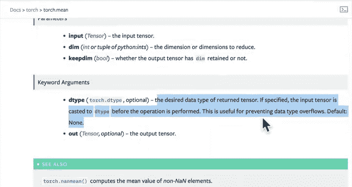
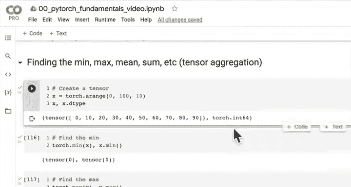
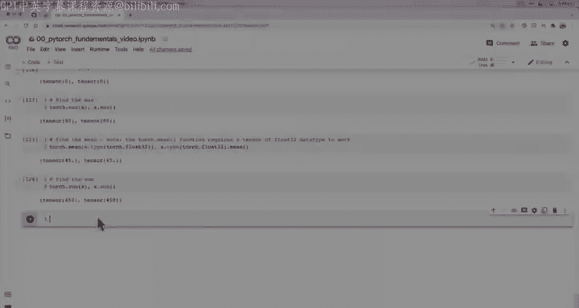
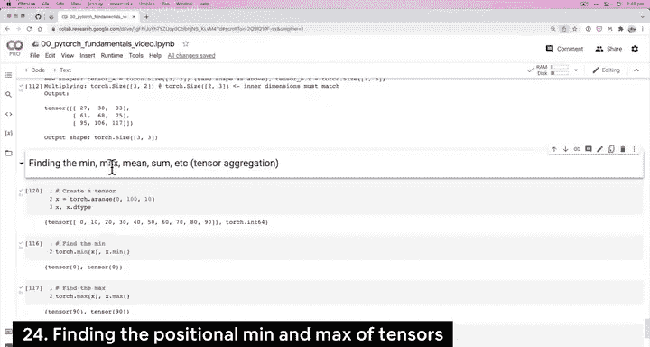
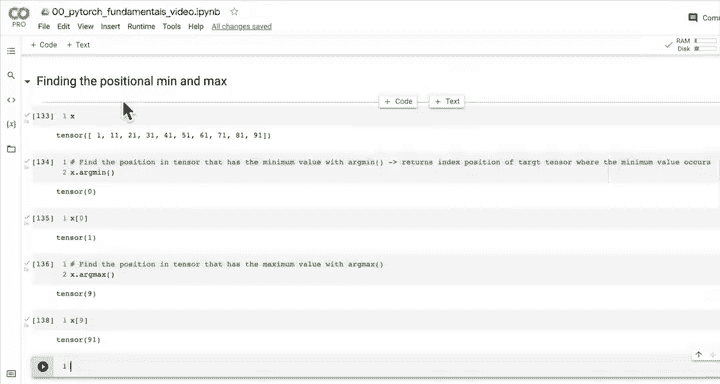

# mrdbourke《一天学会pytorch深度学习｜Learn PyTorch for deep learning in a day Literally》中英 - P21：23. Finding the min, max, mean and sum.zh_en - GPT中英字幕课程资源 - BV1kx4y1r79d

Back in the last few videos， we've covered one of the most fundamental operations in neural networks。

 and that is matrix multiplication， but now it's time to move on。

 And let's cover tensor aggregation and what I mean by that is finding the min max mean sum etca。

 tensor aggregation of certain tensor values。 So for whatever reason。

 you may want to find the minimum value of a tensor， the maximum value， the mean， the sum。

 what's going on there。 So let's have a look at some few pytorch methods that are inbuil to do all of these。

 And again， if you're finding one of these values， it's called tensor aggregation because you're going from what's typically a large amount of numbers to a small amount of numbers。

 So the min of this tensor would be 27， So you're turning it from9 elements to one element hence aggregation。

😊，So let's create a tensor。😊，Create a tensor。X eags Torch dot。

 let's use a range will create maybe a zero to 100 with a step of 10。😊。

Sounds good to me and we can find the in。By going， can we do torchdo men， maybe we can？

Or we could also go。X dotmin。And then we can do the same， find a max。Tch shot Max。And X stopt max。

Now how do you think we might get the average？So let's try it out。I'll find the main。To on the main。

Torch dot mean X Os， so we don't have an X。Is this going to work？What's happened？

Mean input data type should be either floating point or complex D types Got long instead。 Ha ha。

 Finally， I knew that  error would show its face eventually。

 Remember how I said it right up here that。We've covered a fair bit already。 But right up here。

 some of the most common errors that you're gonna run into is tensor is not the right data type。

 not the right shape。 We've seen that with matrix multiplication， not the right device。

 We haven't seen that yet， but not the right data type。 This is one of those times。

 So it turns out that the tensor that we created。 X is of the data type， X dot D type。😊，Inth 64。

 which is long。 So if we go to， let's look up torch tensor。This is where they're getting long from。

 we've seen long before is N 64。Where's that or long， Yeah， So long tensor， That's what it's saying。

 And it turns out that the torch mean function can't work on tensors with data type long。

 So what could we do here。Well， we can change the data type of X。

 So let's go torch mean X type and change it to float 32， or before we do that。

If we go to torch do mean， is this going to tell us。That it needs。A D type， Art D time。

Optionalional the desired data type。Yeah。Does it have Fat 32？Doesn't tell us。

 So this is another one of those little hidden things that you're going to come across。

 and you only really come across this by writing code is that sometimes the documentation doesn't really tell you explicitly what D type the input should be the input tensor。

 However， we find out that with this error message that it should either be a floating point or a complex D type。

 not a long。 so we can convert it to torch float 32。

 So all we've done is gone X type as type floatat 32。 Let's see what happens here。45 beautiful。

 And then the same thing if we went， can we do X dot mean， Is that going to work as well。😊。

same thing。 So if we go X dot type torch dot Fat 32， get the mean of that。There we go。

 So that is I knew it would come up eventually， a beautiful example of finding the right data type。

 Let me just put a note here。😊，Note， the torch dot mean。Function requires。A tensor of float。32。

So so far we've seen two of the major errors in Pytorrch。Is data type and shape issues。

 What's another one that we said， a， some。 So find the sum。When in this sum。

 we want x dot sum or maybe we just do torch dot sum first。

 keep it in line with what's going on above and x dot sum。

Which one of these should you use like torch do something X or X dot sum personally， I prefer torch。

 max， but you'll also probably see me at points write this。 It really depends on what's going on。

 I would say a pick whichever style you prefer and because behind the scenes they're calling the same methodology。

 pick whichever style you prefer and stick with throughout your code。For now。Let's leave it at that。

 Tensor aggregation。 There's some finding min Max mean some。

 in the next video we're going to look at finding the positional min and max。

 which is also known as Arg max and Arg min or vice versa。 So actually。

 that's a little bit of a challenge for the next video is see how you can find out what the positional。

Min and maxes of this。 And what I mean by that is which index does the max value occur at and which index of this tensor does the min occur at。

 You'll probably want to look into the methods Arg min Torch dot arg min for that one and torch dot arg max for that。

 But we'll cover that in the next video。

我 see的。

Welcome back。 In the last video， we learned all about tensor aggregation， and we found the min。

 the max， the mean and the sum。 And we also ran into one of the most common issues in pi torch and deep learning and neural networks in general。

 And that was wrong data types。 And so we solved that issue by converting because some functions。

 such as torch dot mean， require a specific type of data type as input。

 And we created our tensor here， which was of by default， Torch in 64。 However。

 torch dot mean requires torch dot float 32。 We saw that in an error。

 We fixed that by changing the type of the inputs。 I also issued you the challenge of finding。😊。

Finding they're positional。Main and max。And you might have found that you can use the。Ag min。

For the minimum， let's remind ourselves of what x is x。So this means at Tensa。Index of tensor x。

 If we find the argument that is the minimum value， which is 0。 So at index 0， we get the value。0。

 so that's that 0 there，0 there。 This is an index value， so。This is what Arg Min stands for。

 Find the。Position in Tensor。That has the minimum value with argumentmin。And then。Returns。

Index position。Of target Tensor。Where the minimum。Value occurs。

Now let's just change X to start from one。Just so。There we go。 So the argman is still position 0。

 position 0。 So this is an index value。 And then if we index on x at the zeroth index， we get one。

 So the minimum value in x is one。 And then the maximum you might guess is find the position in tensar。

That has the maximum value。With ag max。 and it's going to be the same thing。

 except it'll be the maximum， which is which position。Index 9。 So if we go 0，1，2，3，4，5，6，7，8，9。

 And then if we index on x for the9。Element， we get 91 beautiful。 Now， these two are useful for， if。

 yes， you wanted to find the minimum of a tensor。You can just use min。

 but if you sometimes you don't want the actual minimum value。 just want to know where it appears。

 particularly with the Arg max value， This is helpful for when we use the softm activation function later on。

 Now， we haven't covered that yet。 So I'm not going to allude too much to it。

 But just remember to find a positional mini max。 You can use Arg min and arg max。

 So that's all we need to cover with that。 Let's keep going in the next video。

I'll see you then。我。