# mrdbourke《一天学会pytorch深度学习｜Learn PyTorch for deep learning in a day Literally》中英 - P23：26. Squeezing, unsqueezing and permuting.zh_en - GPT中英字幕课程资源 - BV1kx4y1r79d

Last video， I issued the challenge of trying out torch do squeezee。

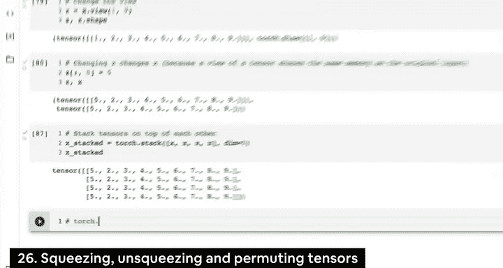

Which。Removes all single dimensions from a target tensor。

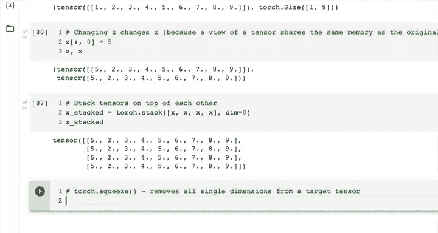

And how would you try that out， well here's what I would have done， I'd go to torch。queze。😡。

And see what happens。

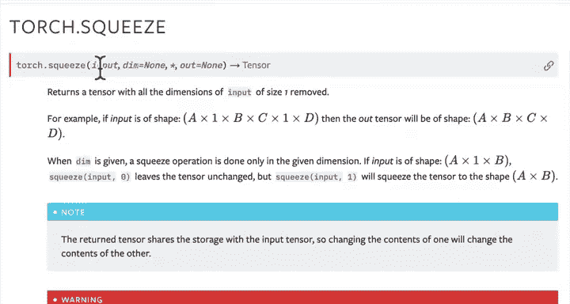

Open up the documentation。 Seze input dimension returns a tensor with all the dimensions of input size1 removed。

 And does it have some demonstrations。 Yes， it does。 Wow， Okay， so you could copy this in。

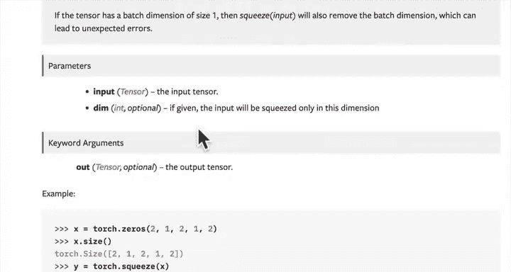

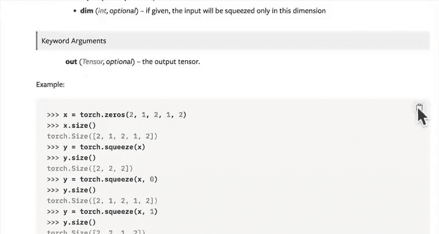

Straight into a notebook。Copy it here， but what I'd actually encourage you to do quite often is if you're looking up a new torch method you haven't used。

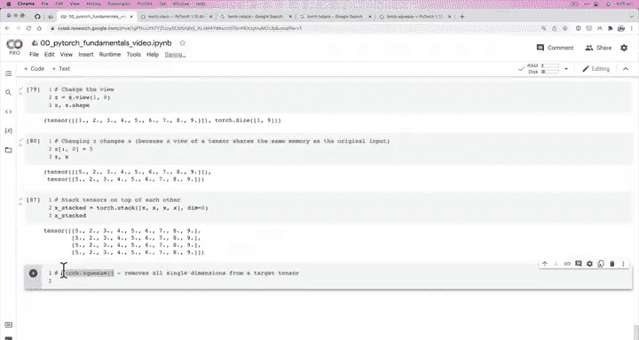

Code all of the example by hand and then just practice what the inputs and outputs look like。

 So x is the input here。 check the size of x， S x， well， set the squeeze of x to y。

 check the size of y。 so let's replicate something similar to this。

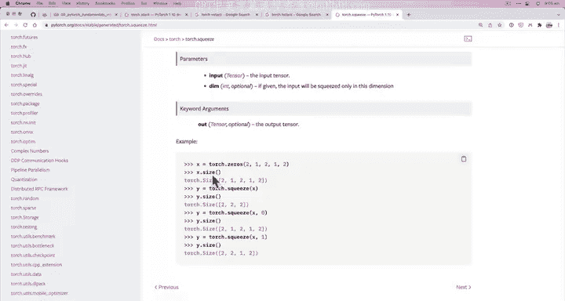

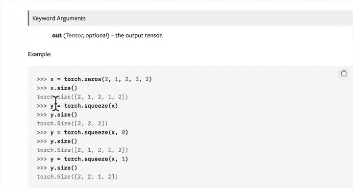

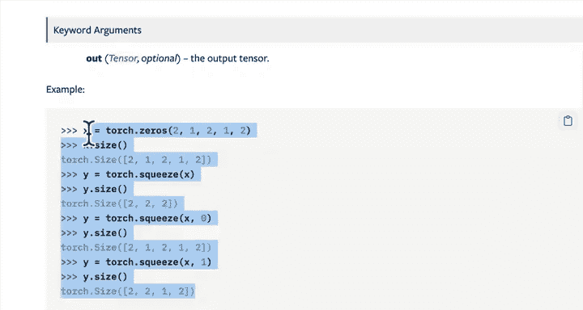

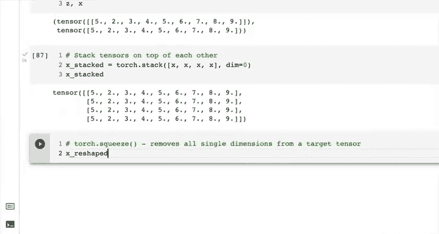

We'll go into here。We'll look at x3 shaped and we'll remind ourselves of x3 shaped dot shape。

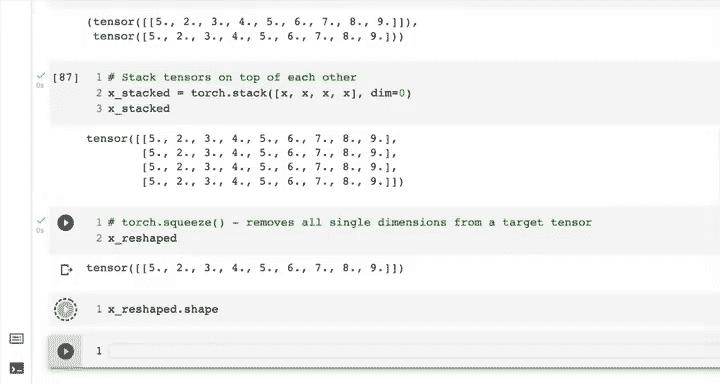

And then how about we see what x reshaped dot squeeze？

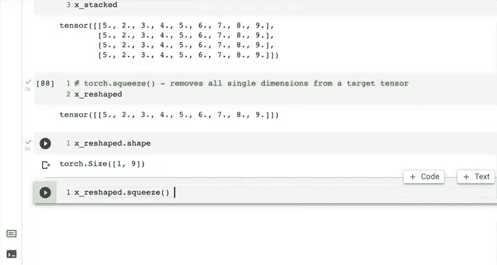

Looks like。Okay。What happened here？Well， we started with two square brackets。

And we started with a shape of 1，9 and removes all single dimensions from a target tensor。

And now if we call the squeeze method on x3 shaped， we only have one square bracket here。

 so what do you think the shape of x3 shaped dot squeeze is going to be？And check the shape here。

I's just 9。 So that's a squeeze method。 Removes all single dimensions。 If we had 1，1，9。

 it would remove all of the ones。 So it would just end up being 9 as well。 Now。

 let's write some print statements so we can。Have a little pretty output so。Previous tensor。

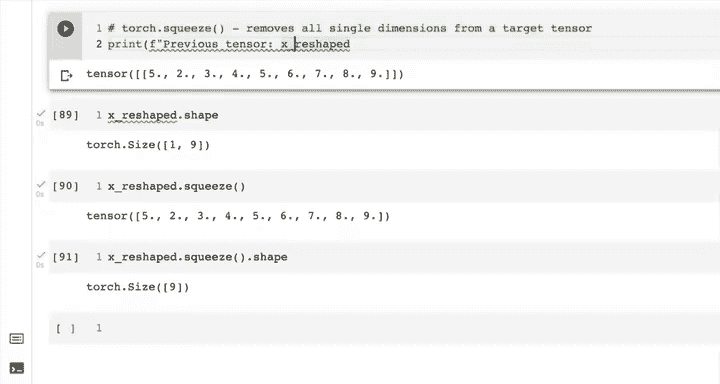

This is what I like to do， this is a form of visualize， visualize， visualize。

If I'm trying to get my head around something I print out each successive change to see what's happening that way I can go oh okay so that's what it was there and then I called that line of code there yes it's a bit tedious but you do this half a dozen times a fair few times I mean I still do it a lot of the time even though I've written。

😊。

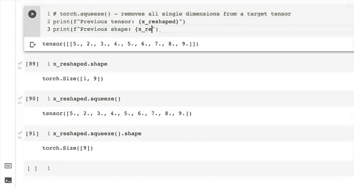

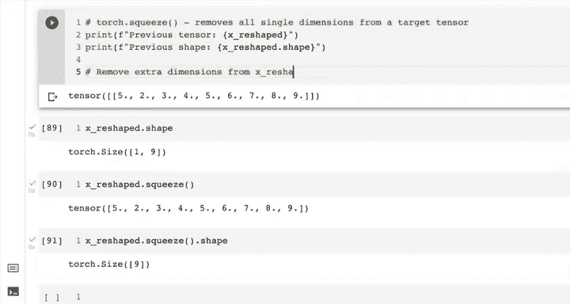

Thousands of lines of machine learning code， but it starts to become instinct after a while you start to go。

 oh okay， I've got a dimension mismatch on my tensors so I need to squeeze them before I put them into a certain function。

😊。

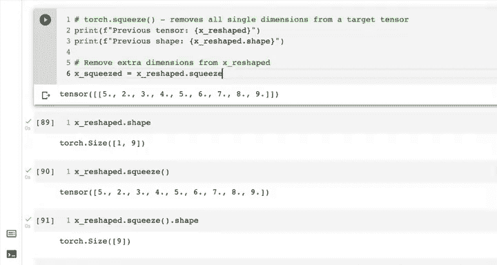

For a little while， but with practice。Just like riding a bike。

 right that trite saying is like when you first start， you're all wobbly all over the place。

 having to look up the documentation， Not that there's much documentation for riding a bike。

 You just kind of keep trying it， but that's the style of a coat I'd like you to adopt is to just try it first。

 Then if you're stuck， go to the documentation， look something up。

 printed out like this what we're doing quite cumbersome。

 but this is going to give us a good explanation for what's happening。 Here's our previous tensor。

 xshad。 And then if we look at the shape of xshad， it's one9。 And then if we call the squeeze method。

 which removes all single dimensions from a target tensor。 We have the new tensor。

 which is has one square bracket removed and the new shape is all single dimensions removed。

 So it's still the original values。 but just a different dimension。

 Now let's do the same as what we've done here with unsqueze。

 So we've given our tensors a hug and squeezed out all the single dimensions of them。

 now we're going unsqueeze them。 We're going to take a step back and let them grow a bit。😊。

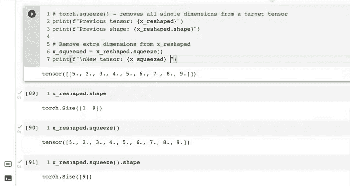

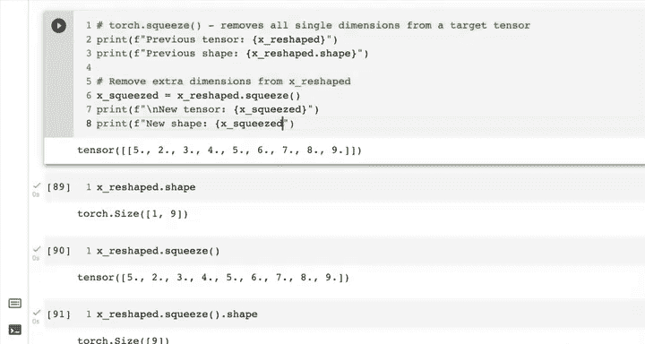

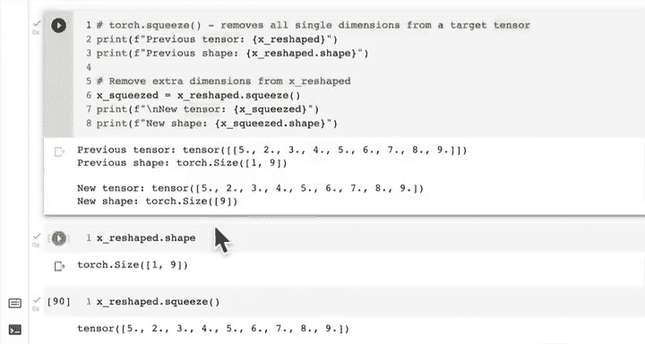

So torch unsqueeze ads。

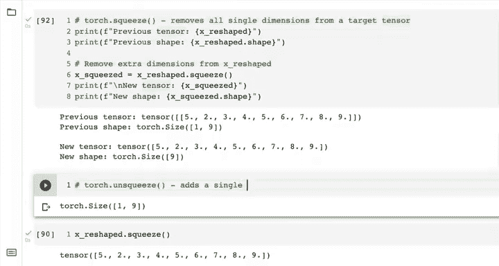

A single dimension。To a target Tensa。At a specific dim。

Dimenssion Now that's another thing to note in pi torch， whenever it says dim， that's dimension。

 as in this is a zeroth dimension， first dimension。 And if there was more here would'd go 2，3，4，5，6。

 etc。

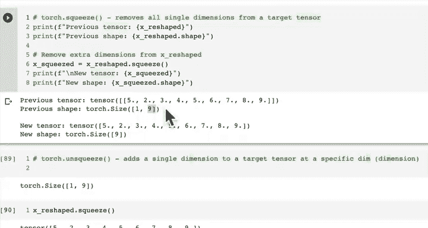

Because why tensess can have unlimited dimensions， so。Let's go previous target。Can be。X squeezeezd。

 so we'll get this squeezed version of our tensor， which is x squeezed up here。

 and then we'll go print the previous shape。Is going to be。X squeezed。Got shape。

And then we're going to add an extra dimension with unsqueeze。

Then we go x unsqueezed equals x squeezed， so our tens are before that we've removed the single dimension。

And we're going to put in unsqueeze。Dim， we'll do it on the zeroth dimension。

 And I want you to have a think about what this is going to output。 even before we run the code。

 Just think about because we've added an extra dimension on the zeroth dimension。

 what's the new shape of the unsqueezed tensor going to be。 So we're going to go X unscqueezed。

And then we're going to go print。We'll get our new tensor shape。Which is going to be X。

Unsquecezed dot shape。All right， let's have a look。😡，There we go。 So there's our previous tensor。

 which is the squeezed version， just as a single dimension here。 And then we have our new tensor。

 which with the unsqueezed method on dimension 0， we've added a square bracket on the zeroth dimension。

 which is this one here。 Now， what do you think is going to happen if I change this to one。😊。

Where is the single dimension going to be added？Let's have a look。

So instead of adding the single dimension on the zeroth。Dimenssion。

 we've added it on the first dimension here。 It's quite confusing because Python is zeroth index。

 So I kind of want to。 My brain's telling me to say first。

 but it's really the zeroth index here or the zeroth dimension。 Now， let's change this back to 0。

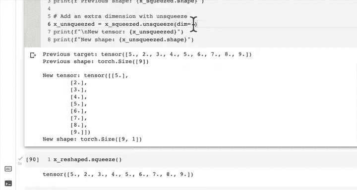

But that's just another way of exploring things。 Every time there's like a parameter that we have here。

 dim equals something like that could be shape， could be size， whatever。 Try changing the values。

 That's what I'd encourage you to do。 and even write some print code like we've done here。 Now。

 there's one more we want to try out。 And that's permute。 So torch dot permute。😊。

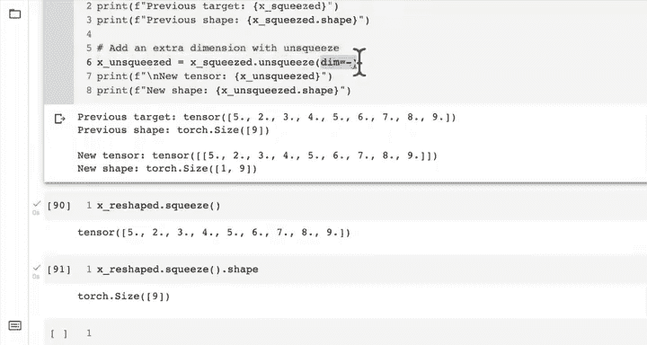

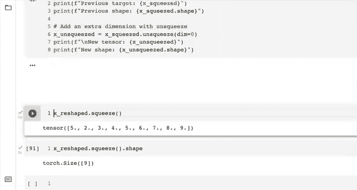

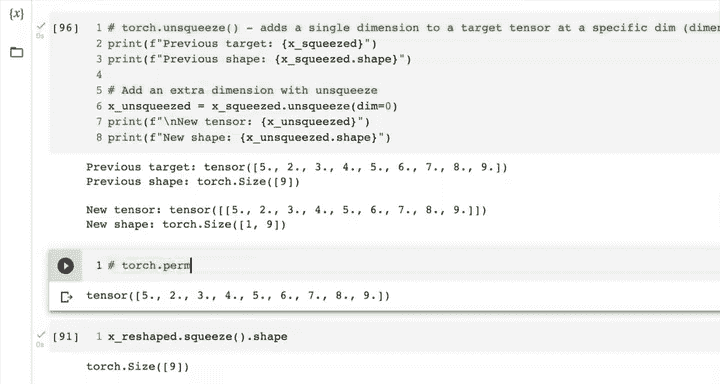

Rearranges。The dimensions。Of a target。Tsa in a。Specified order So if we wanted to check out。

 let's get rid of some of these extra tabs， Torch stop permute。

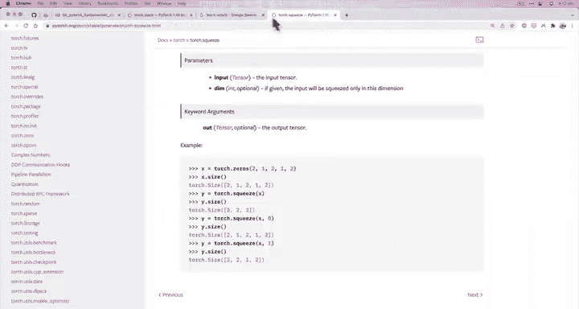

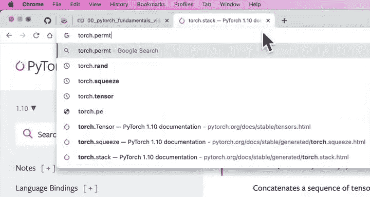

Let's have a look。This one took me a little bit of practice to get used to。Becauseuse again。

 working with zeroth dimensions， even though it seems like the first one。 So returns a view。 Okay。

 so we know that a view shares the memory of the original input tensor with its dimensions permuted。

 So permuted for me， I didn't really know what that word meant。 I just have mapped in my own memory。

 that permute means rearrange dimensions。 So the example here is we start with a random tensor。

 we check the size and then we'd have torch permute。 We're going to swap the order of the dimensions。

 So the second dimension is first， the zeroth dimension is in the middle。

 and the first dimension is here。 So these are dimension values。 So if we have torch and n 2，3，5。20。

1 has changed this one to be over here。 and then 0，1 is 2，3。 And now2，3 there。

 So let's try something similar to this。

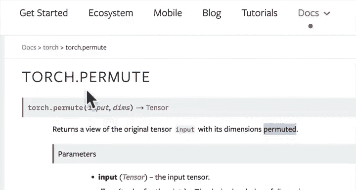

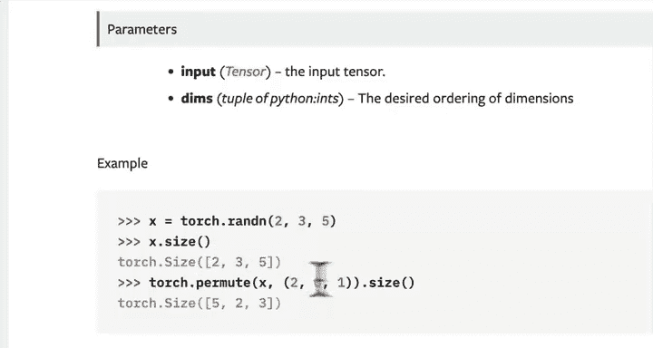

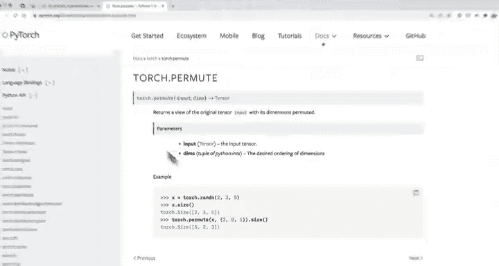

So one of the common places you'll be using permute or you might see permute being used is with images。

 So there's a data specific data format we've kind of seen a little bit before。

 not too much original equals torch dot R size equals So an image tensor we could go height with color channels on the end。

 So I'll just write this down。 So this is height width color channels remember much of。

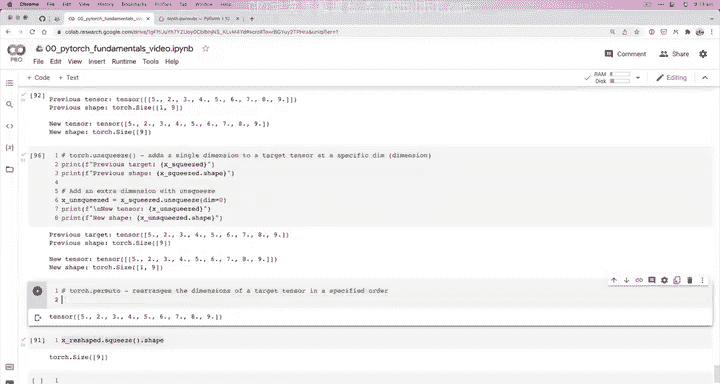

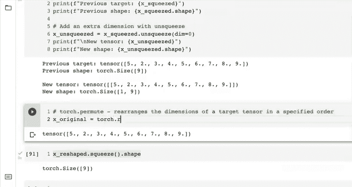

And I'm going to spell color Australian style much of deep learning is turning your data into numerical representations and this is quite common numerical representation of image data you have a tensor dimension for the height。

 a tensor dimension for the width and a tensor dimension for the color channels which is red green and blue because a certain number of red green and blue creates almost any color。

Now， if we wanted to permute this， so permute the original tensor to re。Arrange。The axis。

Or dimension， access or dimension are kind of used。In the same light for tensesors or dim order。

So let's switch the color channels to be the first or the zeroth dimension。

 so instead of height width color channels， it'll be color channels height width。

How would we do that with Permute， let's give it a shot。X permuted equals x original。Dot permed。

And we're going to take the second dimension because this takes a series of dims here。

 So the second dimension is color channels。 Remember， 0，1，2。 So2， we want two first。

 Then we want the height， which is a 0。 and then we want the width， which is one。

And now let's do this。Shifts axis。0 to 1，1 to 2， and 2。To 0。So this is the order as well。

 This two maps to 0。 This0 maps to the first index。 This one maps to this index。

 But that's enough talk about it。 Let's see what it looks like。 So print。Previous shape。

X original dot shape。And then we go here， print new shape。 This will be the permuted version。

 We want X permuted dot shape。Let's see what this looks like。Wonderful。

 this is exactly what we wanted。 So you see， let's just write a little note here。 Now this is。😊。

Color channels， height， width。So the same data is going to be in both of these tensors。

 so x original x permuted， it's just viewed from a different point of view because remember a permute is a view and what did we discuss a view shares the same memory as the original tensor so X permuted will share the same place and memory as x original even though it's from a different shape so a little challenge before we move on to the next video for you or before you move on to the next video try change one of the values in X original。

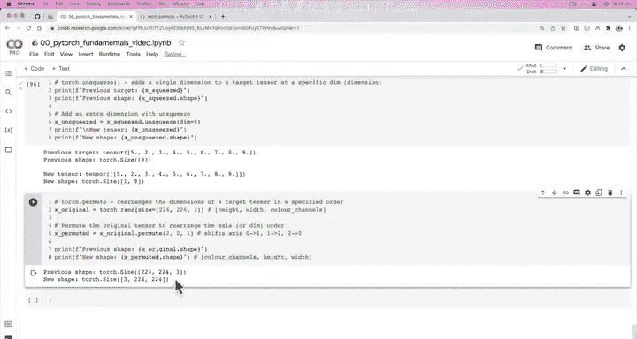

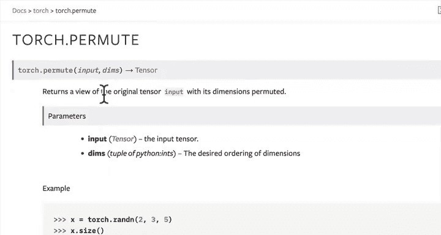

Have a look at X original and see if that same value， it could be。 Let's get one of this。

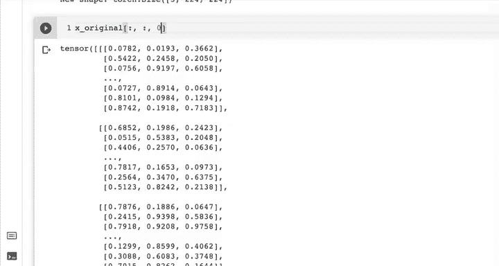

0，0。Go to all of the dimensions here，0。See what that is， or can we get a single value， maybe？Oops。Oh。

 no， we'll need a zero here， getting some practice on indexing here。Oh，0，0，0。There we go， Okay。

 so maybe we set that to。😊，Some value whatever you choose and see if that changes in X permuted。

 so give that a shot and I'll see you in the next video。Welcome back。

