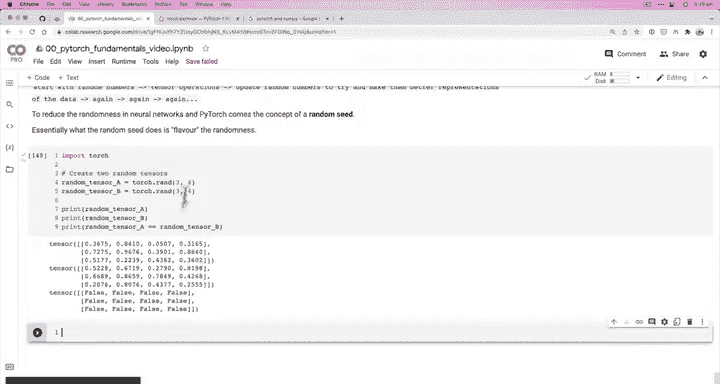
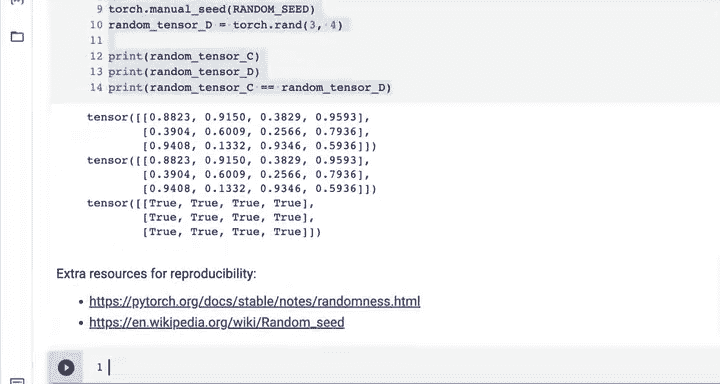

# mrdbourke《一天学会pytorch深度学习｜Learn PyTorch for deep learning in a day Literally》中英 - P26：29. Reproducibility.zh_en - GPT中英字幕课程资源 - BV1kx4y1r79d

Welcome back。 It's now time for us to cover。😊，The topic of reproducibility， if I could even spell it。

 that would be fantastic。 Reproducibility， trying to take the。😊，Random out of random。

 So we've touched upon。The concept of neural networks harnessing the power of randomness and what I mean by that is we haven't actually built our own neural network yet。

 but we will be doing that， and we've created tenss full of random values。And so in short。

 how our neural network learns。Is。Start with random numbers。Perform。Tensor operations。

Update random numbers。To try and make them better。Representations of the data。Again。Again， again。

Again。However。If you're trying to do reproducible experiments。

 sometimes you don't want so much randomness and what I mean by this is if we were creating random tensors from what we've seen so far is that every time we create a random tensor。

 let's create one here， Torch。t RAand and we'll create it a 33。Every time we run this cell。

 it gives us new numbers， so 752。There we go， Rand again。Right。

 so we get a whole bunch of random numbers here。Every single time。

 But what if you were trying to share this notebook with a friend。

 So say you went up share and you clicked the share link and you you sent that to someone and you're like。

 hey， try out this machine learning experiment I did and you wanted a little less randomness because neural networks start with random numbers。

 How might you do that。Well。Let's this right down to reduce the randomness。In neural networks。

And pie torch。Comes the concept of。Random seed。 So we're going to see this in action。

 but essentially。Let's write this down。Essential， what the random。Save does。Is。Favor。The randomness。

 So because of how computers work， they're actually not true randomness。

 And actually there's arguments against this。 And it's quite a big debate in the computer science topic。

 whatnot， but I am not a computer scientist machine learning engineer。

 So computers are fundamentally deterministic It means they run the same steps over and over again。

 So what the randomness we're doing here。 is referred to as pseudoranness or generated randomness。

 and the random seed， which is what you see a lot in machine learning experiments。

 flavors that randomness。 So let's see it in practice。 And at the end of this video。

 I'll give you two resources that I'd recommend to learn a little bit more about the concept of pseudoranness and reproducibility and pitorrch。

 Let's start by importing torch so you can start this notebook right from here。😊。

Create two random tensesors。We'll just call ace。Random tensor A equals torch dot Rand and we'll go  three。

4 and we'll go random tensor B。Equals torch。t RA， same size， 3，4。And then if we have a look at。

 let's go print。Random tensor a。Print。Random tensor。B。

 and then let's print to see if they're equal anywhere random tens are a equals。

Equals equals random tensor。B，Now what do you think this is going to do？

If we have a look at one equals one， what does it return？True。

 so this is comparison operator to compare two different tensesors。

 We're creating two random tensesors here。 We're going to have a look at them。

 We'd expect them to be full of random values。 Do you think any of the values in each of these random tenses is going to be equal to each other。

Well， there is a chance that they are， but it's highly unlikely。I'll be quite surprised if they are。

Oh， again， a connection might be a little bit。Oh there we go。 Bea。 So we have Tensor A Tensor of 3。

4 with random numbers， and we have Tensor B of 3，4 with random numbers。 So if we were。

 if I was to share this notebook with my friend or my colleague or even you。 if you ran this cell。

 you were going to get random numbers as well。 And you have every chance of replicating one of these numbers。

 but again， it's highly unlikely。 So again， I'm getting that automatic， save failed。

 you might get that， if your internet connection is dropping out。

 maybe that's something going on with my internet connection， but again， as we've seen。

 usually this resolves itself。 if you try a few times or just keep coding。

 if it really doesn't resolve itself， you can go file。

 is a download notebook or save a copy and drive download。 you can download the notebook。

 save it to your local machine， re upload it， So upload notebook and start again in another Google coab instance。

 But there we go。 it fixed itself。 wonderful。 troubleshooting on the fly， so。😊。

The way we make these reproducible is through the concept of a random seed。

 So let's have a look at that。 Let's make some random， but reproducible。Tenses。So import torch。

And we're going to。Set the random seed。By going torch dot。Manuel seeed。Random oh。

We don't have random set yet。I'm going to set my random seed。

You set the random C to some numerical value， 42 is a common one， you might see 0， you might see 1，2。

3，4，Essential you can set it to whatever you want and each of these you can think of 77。

100 as different flavors of randomness so I like to use 42 because it's the answer to the universe。

And then we go random seed， and now let's create some random tensesors。😊，Random tensor， C。

With the flavor of our random seed。3，4。 and then we're going to go torch tensa D equals tarch。 R34。

 Now let's see what happens。Well print out。Random tensor C and willll print out。Random tensor。D。

 and then we'll print out to see if they're equal anywhere， randomandom tends to C equals。

Random tensor。对。So let's find out what happens。Her。What gives。Well。We got randomness。

 We set the random seed。 We're telling piely torch， hey。

 flavor o randomness with 42 torch manual seed。 let's try。

Set the manual seed each time we call a random method。Let me go there。Much better。

 so now we've got some flavored randomness so a thing to keep in mind is that if you want to use the torch manual seed generally it only works for one block of code if you're using a notebook so that's just something to keep in mind if you're creating random tensesors one after the other we're using assignment like this。

 you should use torch manual seed every time you want to call the random method or some sort of randomness however。

 if we're using other torch processes usually what you might see is torch manualual seed to set right at the start of a cell and then a whole bunch of code is done down here。

😊，But because we're calling subsequent methods here。

 we have to reset the random seed otherwise if we don't do this， we comment this line。😊。

It's going to flavor the randomness ofrch random tensor C with torch manual seed。

 but then random tensor D is just going to have no flavor。 It's not going to use a random seed。

 so we reset it there。Wonderful， so I wonder， does this ever seed method， Let's go to dot R。

 Does this have。😊，Saade， sometimes they have a Saade method。 Saade， no， it doesn't。Okay。

 that's all right。The more you learn， but there's a documentation for Torch。tRand。

 and I said that I was going to link at the end of this video。😊。

So the manual seed is a way to or the random seed， but in torturerch it's called a manual seed is a way to flavor the randomness。

 So these numbers， as you see， are still quite random。

 but the random seed just makes them reproducible。 So if I was to share this with you。

 if you were to run this block of code， ideally， you're going to get the same numerical output here。

So with that being said？I'd like to refer to you to the pietorrch reproducibility document because we've only quite scratched the surface of this of reproducibility。

 We've covered one of the main ones。 But this is a great document on how to go through。

Reproducibility in pytorch。 So this is your extra curriculum for this。

 Even if you don't understand what's going on in a lot of the code here。

 just be aware of reproducibility because it's an important topic in machine learning and deep learning。

So we'll put this here。Extra resources for reproducibility。As we go P torch randomness。

 I'll change this into markdown and then finally the concept of a random seed is Wikipedia random seed。

So random see is quite a universal concept， not just for pi torch。

 there's a random seed to nupy as well， So if you'd like to see what this means。

 yeah initialize a pseudoran number generator， so that's a big word pseudoran number generator。

 but if you'd like to learn about more random number generation computing and what a random seed does is I'd refer to you to check out this documentation here。

Wh far out， we have covered a lot， but there's a couple more topics you should really be aware of to finish off the Pyto fundamentals。

You got this， I'll see you in the next video。