# mrdbourke《一天学会pytorch深度学习｜Learn PyTorch for deep learning in a day Literally》中英 - P27：30. Accessing a GPU.zh_en - GPT中英字幕课程资源 - BV1kx4y1r79d

Welcome back Now let's talk about the important concept of running tensesors or pietorrch objects。

 So running tensors and pietorrch objects。😡。

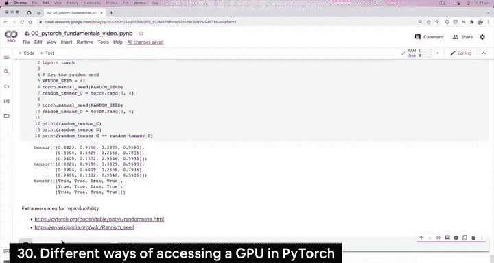

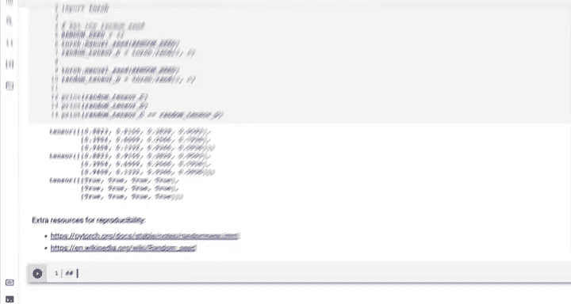

On GPUs。And making faster computations。

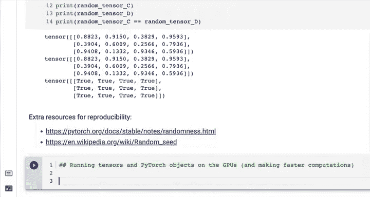

So。We've discussed that GPUs。Let me just scroll down a little bit here。

GPUs equal faster computation on numbers。Thanks to Kuda plus。And video hardware。Plus。

 pietorrch working behind the scenes to make。Everything hunky dory。Good。That's what hunky Dory means。

 by the way if you've never heard that before。😊，So let's have a look at how we do this Now we first need to talk about let's go here one getting a GPU There's a few different ways we've seen one before。

 number one easiest is to use what we're using right now。😊。

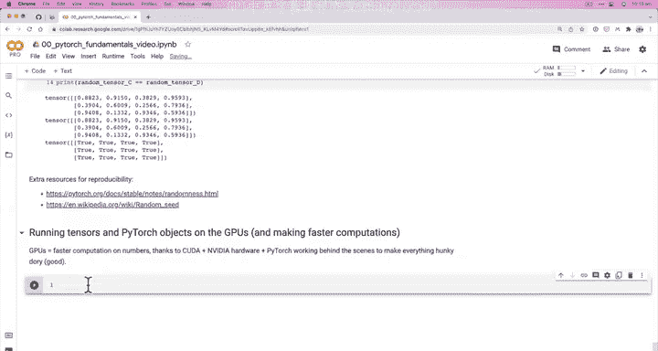

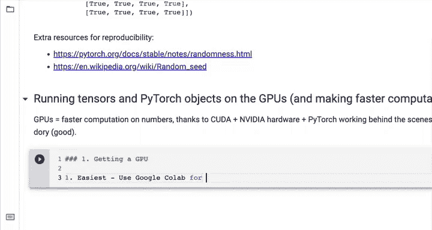

Use Google Co Lab for a free GPU。But there's also Google CoLab Pro， and I think that might even be。

 let's look up Google Coabab Pro。Choose the best that's right for you。

 I use Google Col La Pro because I use it almost every day。

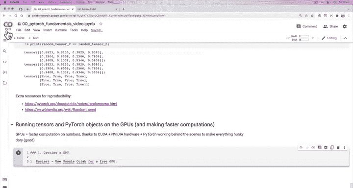

So yeah， I pay for collab Pro。 You can use collab for free， which is might be what you're using。

 There's also collab Pro plus， which has a lot more advantages as well。

 But collab Pro is giving me faster GPus。 So access to faster GPus。

 which means you spend less time waiting while your code is running more memory longer run time。

 So itll last a bit longer if you leave it running idle。

 And then collab Pro again is a step up from that。 I personally haven't had a need yet to use Google Collab Pro plus。

😊。

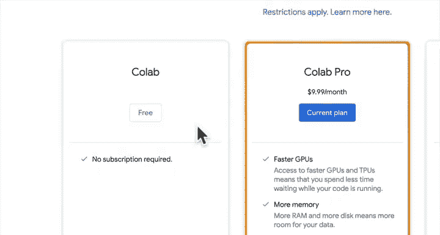

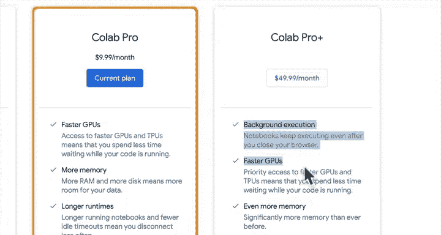

You can complete this whole course on the free tier as well。 but as you start to code more。

 as you start to run bigger models， as you start to want to compute more。

 you might want to look into something like Google Colab Pro or。

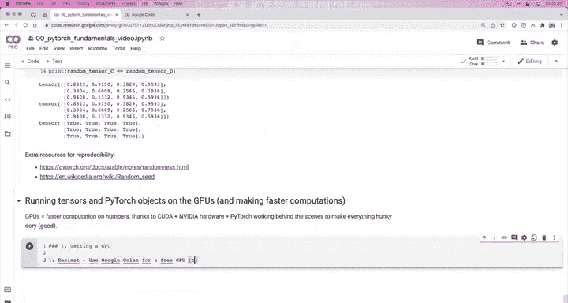

Let's go here。Options to upgrade as well。And then another way is use your own。GPU。Now。

This takes a little bit of setup。And requires the investment。Of purchasing。A GPU。

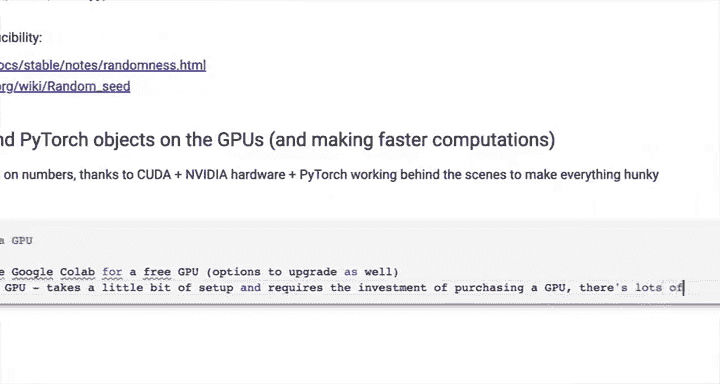

There's lots of options。So one of my favourite posts for。Getting a GPU。

Is yeah， the best GPus for deep learning in 2020 or something like this。 When we got。Daep learning。

Tim Detmos。This is。

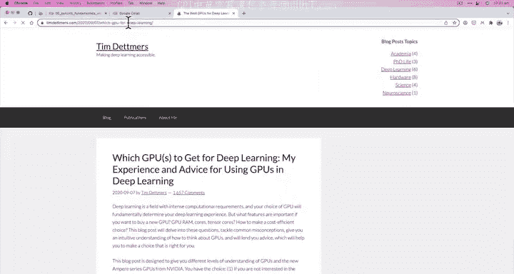

Yeah， which GPus to get for deep learning。 Now， I believe at the time of this video。

 I think it's been updated since this date。 So don't take my word for it。

 but this is a fantastic blog post for figuring out what GPus。😊。

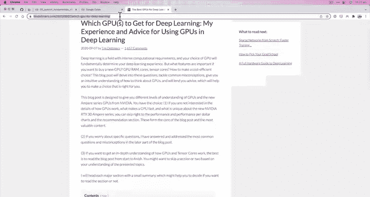

See this post for what option？

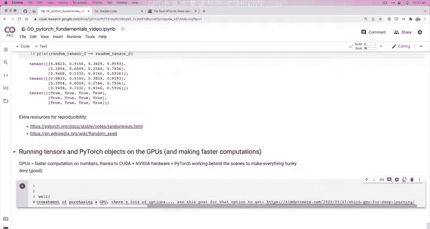

To get。And then， number three is。Use cloud computing， so such as。GCP。

 which is Google Cloud Platform AWS， which is Amazon Web Services or Azure。

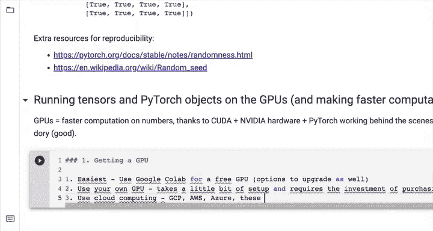

These services， which is Azure as by Microsoft， allow you to rent computers on the cloud and access them。

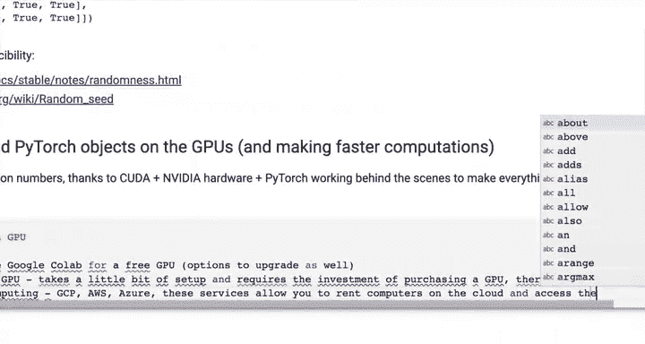

So the first option using Google coab， which is what we're using is by far the easiest and free。

 So there's big advantages there。 However， the downside is that you have to use our website here。

 Google Coab， you can't run it locally， you don't get the benefit of using cloud computing but my personal workflow is I run basically all of my small scale experiments and things like learning new stuff in Google coabab and then if I want to upgrade things run bigger experiments。

 I have my own dedicated deep learning PC， which I have built with a big powerful GPU and then also I use cloud computing if necessary。

 So that's my workflow start with Google coabab and then these two if I need to do some larger experiments。

 but because it's a begin of course we can just stick with Google coab for the time being。

 but I thought I'd make you aware of these other two options。

 And if you'd like to set up a GPU So for。😊，Two， three， Pytorrch plus GPU drivers， which is Kuda。

Takes a little bit of setting up。To do this， refer to pie torch。Set up。Documentation。So。

If we go to pytorch。 org， they have some great setup guide here。 Get started。

 and we have start locally。 This is if you wanted to run on your local machine。

 such as a Linux setup。 This is what I have。 Linux Kuda 11。3。

 its going to give you a Conda In store command to use Conda。

 And then if you want to use cloud partners， which is。😊。

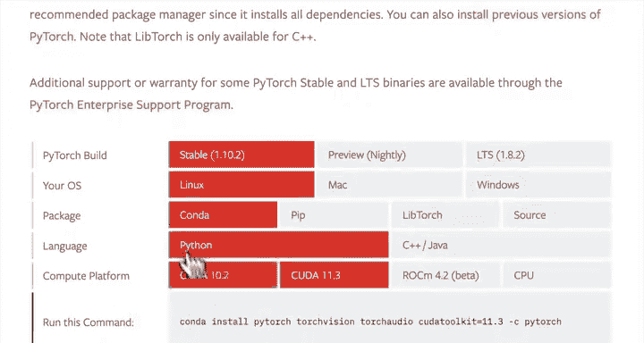

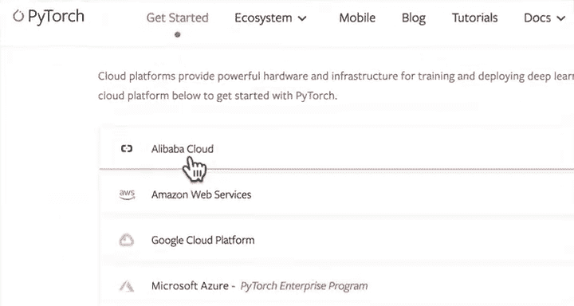

Alibaba Cloud， Amazon Web services， Google Cloud platform。 This is where you'll want to go。

 So I'll just link this in here。

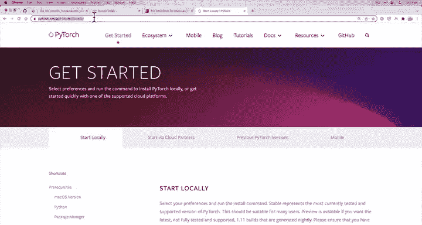

But for this course， we're going to be focusing on using Google Coabab。

 So now let's see how we might get a GPU in Google Coab。 and we've already covered this。

 but I'm going to recover it just so you know。We're going to change the runtime type。

 You can go in any notebook and do this runtime type， hardware accelerator。 we can select GPU。

 click save。Now this is going to restart our runtime and connect us to a runtime AkaA。

 a Google compute instance with a GPU。

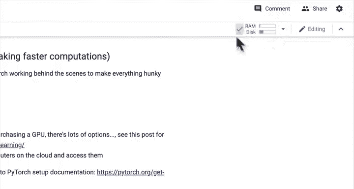

And so now if we run Nvidia SMI。I have a Tesla P100 GPU。So let's look at this Tesla P100。

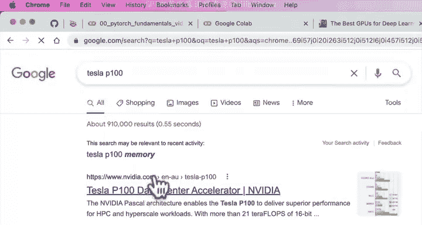

GPU， do we have an image？Yeah， so this is the GPU that I've got running， not the Tesla car， the GPU。

 So this is quite a powerful GPU。 That is because I have upgraded to coab Pro。 Now。

 if you're not using coabab Pro， you might get something like a Tesla K80。

 which is a slightly less powerful GPU than a Tesla P100。😊，But still a GPU nonetheless。

 and will still work faster than just running Pytorch code on the pure CPU。

 which is the default in Google Co Laab and the default in Pytorch。

And so now we can also check to see if we have GPU access with Pytorch。 So let's go here。

 This is number two。 Now， check for GPU access with Pytorch。

 So this is little command that's going to allow us。

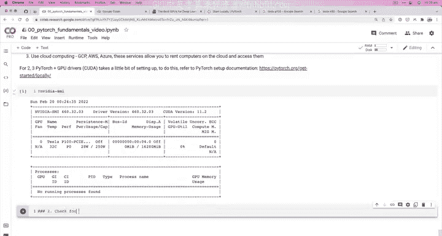

Or tell us if pie torch， just having the GPU here。This is， by the way。

 another thing that coabab has a good setup with is that all the connections between Pytorch and the Navidia GPU are set up for us。

 whereas when you set it up on your own GPU or using cloud computing。

 there are a few steps you have to go through， which we not going to cover in this course。

 I'd highly recommend you go through the getting started locally set up if you want to do that to connect Pytorch to your own GPU。

So let's check for the GPU access with Pilytorrch。This is another advantage of using Google Colaab almost zero setup to get started。

 So import torch。And then we're going to go。Torch。kuuda。t is available。

And remember Kuda is Nvidia's programming interface that allows us to use GPUus for numerical computing。

 There we go beautiful so big advantage of Google Coabab is we get access to a free GPU in my case I'm paying for the faster GPU but in your case you're more than welcome to use the free version all that means it'll be slightly slower than a faster GPU here and we now have access to GPUus with Pytorrch。

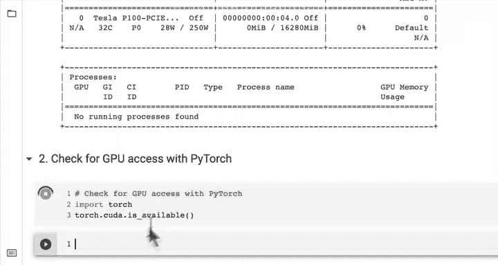

So there is one more thing。Known as device agnostic code。

 so set up device agnostic code Now this is an important concept in Pytorch because wherever you run Pytorch you might not always have access to a GPU。

But if there was access to a GPU， you'd like it to use it if it's available， so。

One of the ways that this is done in Pytorch is to set the device variable Now really you could set this to any variable you want。

 but you're going to see it used as device quite often， so Kuda if Torch dot Kuda is available。

Else CPU。So all this is going to say and we'll see where we use the device variable later on is set the device to use Kuda if it's available。

 so it is so true， if it's not available if we don't have access to a GPU that PyToch can use。

 just default to the CPU。😡，So with that being said， there's one more thing。

 you can also count the number of GPUus。 So this won't really apply to us for now because we're just going to stick with using one GPU。

 but as you upgrade your Pytorch experiments and machine learning experiments。

 you might have access to more than one GPU， so you can also count the devices here。

We have access to one GPU， which is this here。So the reason why you might want to count the number of devices is because if you're running huge models on large data sets。

 you might want to run one model on a certain GPU， another model on another GPU， and so on and so on。

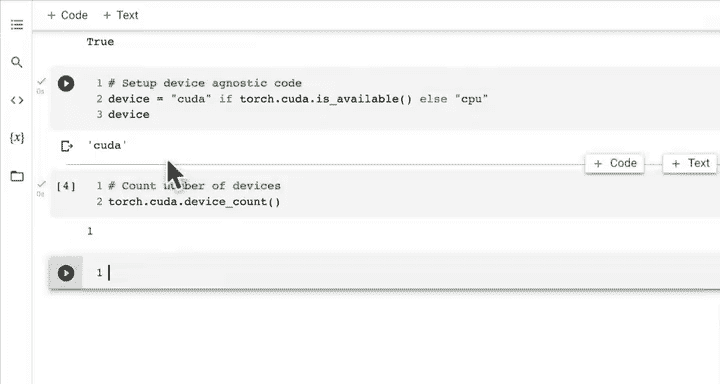

But final thing before we finish this video is if we go Pytorch device agnostic code。

Kuda semantics there's a little section in here called best practices This is。Basically。

 what we just covered there is setting the device argument。 Now， this is using the ag pass。

 But so yeah， there we go。 A dot device， Torch dot device Ker， Arg dot device torch dot device CPU。

 So this is one way to set it from the Python。

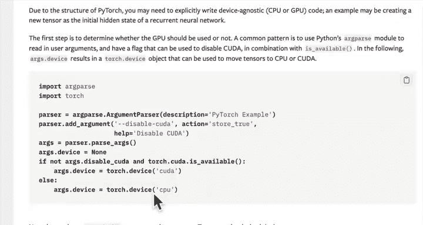

Arguments when you're running scripts， but we're using the version of running it through a notebook。

So check this out。I'll just link this here， device agnostic code。

 It's okay if you're not sure of what's going on here。

 we're going to cover it a little bit more later on throughout the course。

 but I'm going to right here。For pie torch， since it's capable of running compute on the GPU or CPU。

It's best practice。To set up device agnostic code。AG。Run on GPU。If available。

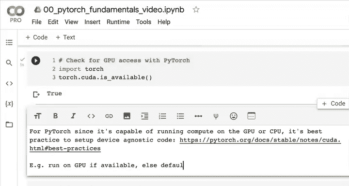

Else， default to CPU。So check out the best practices for using Kuda。

 which is namely setting up device agnostic code and let's in the next video see what I mean about setting our Pytorch tensors and objects to the target device。

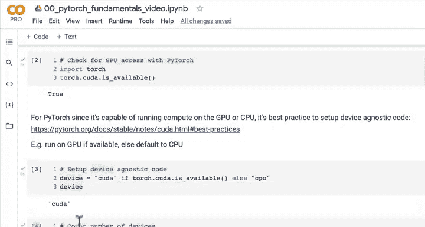