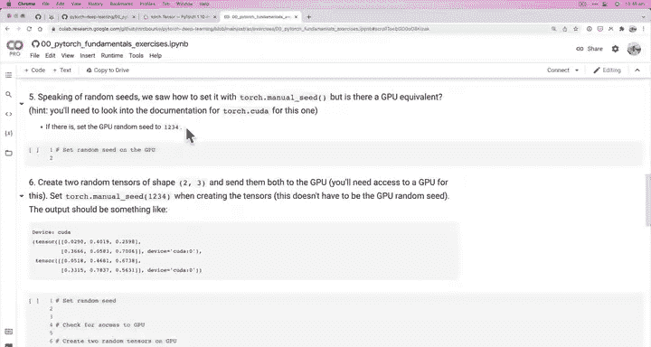
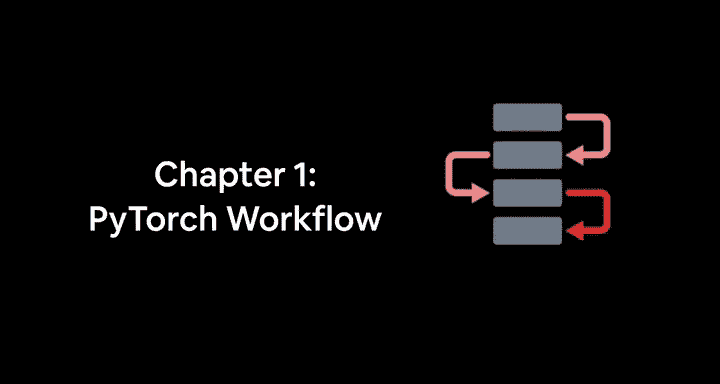

# mrdbourke《一天学会pytorch深度学习｜Learn PyTorch for deep learning in a day Literally》中英 - P28：31. Setting up device agnostic code.zh_en - GPT中英字幕课程资源 - BV1kx4y1r79d

Welcome back。 In the last video， we checked out a few different options for getting a GPU and then getting Piytorch to run on the GPU。

 And for now， we're using Google Coab， which is the easiest way to get set up because it gives us free access to a GPU faster ones if you set up with coab Pro。

 and it comes with Pytorch automatically set up to use the GPU if it's available。

 So now let's see how we can actually use the GPU。 So。😊，To do so。

 we'll look at putting tensesors and models。On the GPU。So the reason。

We want our tensors slash models on the GPU。Is because using GPU results in faster computations and if we're getting our machine learning models to find patterns in numbers。

 GPUs are great at doing numerical calculations and the numerical calculations we're going to be doing are tensor operations like we saw above。

So the tensor operations， well we've covered a lot。生围气啊。Tenssor operations， there we go。

lyulating tensors Tensor operations。 So if we can run these computations faster。

 we can discover patterns in our data faster。 We can do more experiments。

 and we can work towards finding the best possible model for whatever problem that we're working on。

😊，So let's see。We'll create a tensor as usual。😊，Create a Tensor now the default is on the CPU。So。

 ten0 equals。Torch dot tensor， and we'll just make it a nice， simple 1，1，2，3 and。Let's right here。

 Tensor， not on GPU will print out Tensor。 and this is where we can use。We saw this parameter before。

 device。Can we pass it in here？Deevvice equals CPU。Let's see what this comes out with。There we go。

 So if we print it out， Ten0sor 1，2，3 is on the CPU。

 But even if we got rid of that device parameter by default， it's going to be on the CPU。

 wonderfulnderful， so now。😊，Pytch makes it quite easy to move things to。 And I'm saying two。

 for a reason， to the GPU or to even better the target device。 So if the GPU is available。

 we use Kuda。 If it's not， it uses CPU。 This is why we set up the device variable。 So let's see。

Move Tensor to GPU if available。Tensor on GPU equals。Tensor。

2 device Now let's have a look at this Tensor on GPU。So this is going to shift。

The tensor that we created up here to the target device。Wonderful， look at that。 So now our tensor 1。

2，3 is on device Kuda 0。 Now， this is the index of the GPU that we're using because we only have one。

 It's going to be at index 0。 So later on， when you start to do bigger experiments and work with multiple GPus。

 you might have different tensors that are stored on different GPUus。 But for now。

 we're just sticking with one GPU keeping it nice and simple。😊。

And so you might have a case where you want to move actually。

 the reason why we set up device agnostic code is again， this code would work if we've run this。

 regardless if we had， so it won't error out， but regardless if we had a GP or not。

 this code will work so whatever device we have access to whether it's only a CPU or whether it's a GPU。

 this tensor will move to whatever target device， but since we have a GPU available， it goes there。

You'll see this a lot， this two method。Moves tenses， and it can be also used for models。

 We're going to see that later on， so just keep two device in mind。And then you might want to。

 for some computation such as using NumpI， NumpI only works with the CPU。

 so you might want to move tensors back to the CPU。Moving tensors back to the CPU。

So can you guess how we might do that's okay， if you don't know。We haven't covered a lot of things。

 but I'm going to challenge you anyway because that's the fun part of thinking about something。

 So let's see how we can do it。😊，Let's write down， if Tensor is on GPU， can't transform it to NI。

So let's see what happens if we take our tensor on the GPU and try to go nuy。What happens？

Or we get an error。 So this is another huge error。 Remember the top three errors in deep learning or pitorch。

 there's lots of them， but number one， shape errors， number two， data type issues。

 And with pitorch number3 is device issues。 So can't convert co to0 device type tensor to nu pi。

 So nupy doesn't work with the GP use tensor dot CPU to copy the tensor to host memory first。

 So if we call tensor do CPU， it's going to bring our target tensor back to the CPU。

 And then we should be able to use it with nu pi so。To fix。The GPU tensor with numpy。Issue。

 we can first set it。To the CPU。So Tensor back on CPU。Eals Tensor on GPU do CPUU。

 we're just taking what this said here， that's the beautiful thing about Pi torch is very helpful error messages。

 and then we're going to go nu P。And then if we go Tensor back on CPU， is this going to work。

 let's have a look。Oh， of course， it's not because I talked it wrong。And I've typed it again twice。

 third time， third times a charm。There we go。 Okay。

 so that works because we've put it back to the CPU first before calling nupy。

 And then if we refer back to our tensor on the GPU。Because we've reasciated this again。

 we got typoical law， classic。Because we've reassigned Tensor back on CPUU。

 our tensor on GPU remains unchanged。So that's the four main things about working with Piytorrch on the GPU。

 There are a few more tidbits， such as multiple GPUus。 But now you've got the fundamentals。

 We're going to stick with using one GPU。 And if you'd like to later on once you've learned a bit more research into multiple GPUus。

 Well， as you might have guessed， Pytorch has functionality for that two。

 So have a go at getting access to a GPU using coabab。 check to see if it's available。

 set up device agnostic code， create a few dummy tensors and just set them to different devices。

 See what happens if you change the device parameter。

Run a few errors by trying to do some nuy calculations with tensors on the GPU and then bring those tensors on the GPU back to Numpy and see what happens there。

So， I think we've covered。I think we've reached the end of the fundamentals。

 We've covered a fair bit。 Introuction to tensors， the min Maxs。

 a whole bunch of stuff inside the introduction to tensors， finding the positional min Maxs。

 reshaping， indexing， working with tensors and nuy reproducibility using a GPU and moving stuff back to the GPU far out Now。

 you're probably wondering， Daniel， we've covered a whole bunch。

 What should I do to practice all this。 Well， I'm glad you asked， let's cover that in the next video。

😊，Welcome back and you should be very proud of yourself right now。 We've been through a lot。

 but we've covered a whole bunch of Pytorch fundamentals。

 These are going to be the building blocks that we use throughout the rest of the course。

 But before moving on to the next section， I'd encourage you to try out what you've learned through the exercises and extra curriculum。

😊，Now I've set up a few exercises here based off everything that we've covered。

 if you go into learn Pytorch。Iio go to the section that we're currently on。

 this is going to be the case for every section by the way。

 so just keep this in mind is we're working on Ptch fundamentals。Now。

 if you go the Pytoch fundamentalals notebook， this is going to refresh。

 but that a you scroll down to the table of contents at the bottom of each one is going to be some exercises and extra curriculum。

 So these exercises here such as documentation reading because a lot you've seen me refer to the Pytorch documentation for almost everything we've covered a lot。

 but it's important to become familiar with that。 So exercise number one is read some of the documentation。

 Ex number two is create a random tensor with shape 7，7。3。

 perform a matrix multiplication on the tensor from 2 with another random tensor。

 So these exercises are all based off what we've covered here。

 So I'd'd encourage you to reference what we've covered in whichever notebook you choose could be this learn Pytoch do O could be going back through the one we've just coded together in the video。

😊，So I'm going to link this here。Exercises。See exercises for this notebook。Here呀。

So then how should you approach these exercises， So one way would be to just read them here。

 and then in coab or go file new notebook。Wait for the noble to load。

Then you could call this zero zero pie torch exercises or something like that。And then。

You could start off by importing torch。And then away you go for me。

 I'd probably set this up on one side of the screen， this one up on the other side of the screen。

 and then I just have the exercises here。So number one。

 I'm not going to really write much code for that， but you could have documentation reading here。

And then so this encourages you to read through Torch。tensor。Go through there。For 10 minutes or so。

 And then for the other ones， we've got create a random tensor with shape 7，7。

So could just comment that out。 So torch R 7，7。And there we go。Some are as easy as that。

 some are a little bit more complex as we go throughout the course。

 these exercises are going to get a little bit more in depth as we've learned more。

But if you'd like an exercise template， you can come back to the Github。

 This is the home for all of the course materials。 You can go into extras and then exercises。

 I've created templates for each of the exercises。 So Pytoch fundamentals exercises。

 if you open this up， this is a template for all of the exercises。 So you see there。

 create a random tensor with shapepe 7，7。 These are all just headings。

 And if you'd like to open this in coab and work on it。 How can you do that。 Well。

 you can copy this link here， come to Google Coabab， We'll go file， open notebook。😊，Gitthub。

You can type in the link there， click search。What's this going to do， Boom。

 P touch fundamentals exercises。 So now you can go through all of the exercises。

 This will be the same for every modular on the course and test your knowledge now。It is open book。

 You can use。The notebook here， the ones that we've coded together。

 but I would encourage you to try to do these things on your own first。 if you get stuck。

 you can always reference back。 and then if you'd like to see an example solutions。

 you can go back to the extras。 there's a solutions folder as well。

 and that's where the solutions live。 So the fundamental exercise solutions， but again。

 I would encourage you to try these out at least give them a go before having a look at the solutions。

😊，So just keep that in mind at the end of every module there's exercises an extra curriculum。

 the exercises will be code based， the extra curriculum is usually like reading based。

 so spend one hour going through the Pytch basic tutorial recommend the quick start and tensor sections and then finally to learn more on how atensor can represent data。

 watch the video what' a tensor which we refer to throughout this。

 but massive effort on finishing the pyt Funda section I'll see you in the next section。😊。

