# mrdbourke《一天学会pytorch深度学习｜Learn PyTorch for deep learning in a day Literally》中英 - P29：33. Introduction to PyTorch Workflow.zh_en - GPT中英字幕课程资源 - BV1kx4y1r79d

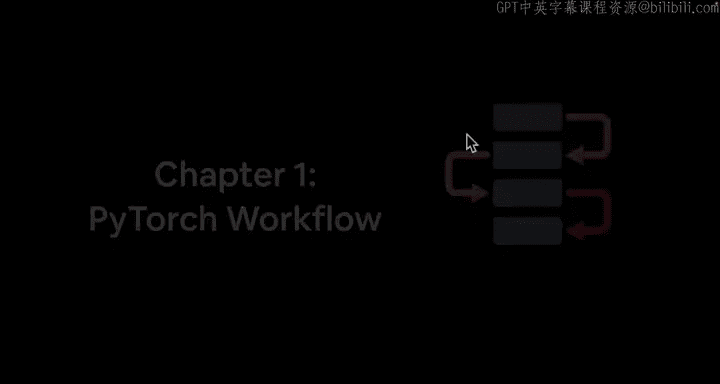

Friends， welcome back to。The Ptorrch workflow module。

 Now let's have a look at what we're going to get into。😡。

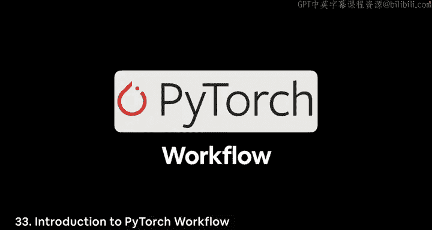

So this is a pytorch workflow。 And I say a。 how cool is that animation， because it's one of many。

 When you get into deep learning machine learning， you'll find that there's a fair few ways to do things。

 But here's the rough outline of what we're going to do。 We're going to get our data ready。

 Turn it into tensors because remember a tensor can represent almost any kind of data。

 We're going pick or build or pick a pretrain model。 We'll pick a loss function and optimizer。

 Don't worry if you don't know what they are。 We're gonna cover this。

 We're going build a training loop。 fit the model to make a prediction。

 So fit the model to the data that we have。 We'll learn how to evaluate our models。

 We'll see how we can improve through experimentation。 and we'll save and reload our trained model。

 So if you wanted to export your model from a notebook and use it somewhere else。

 This is what you want to be doing。😊。

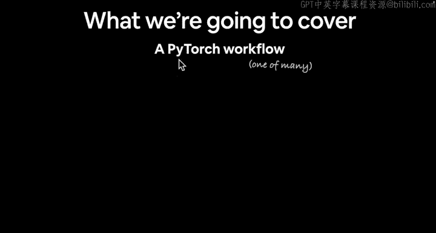

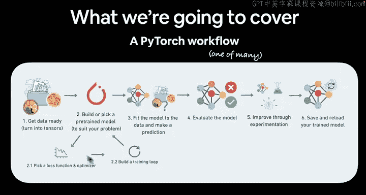

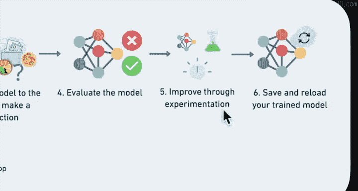

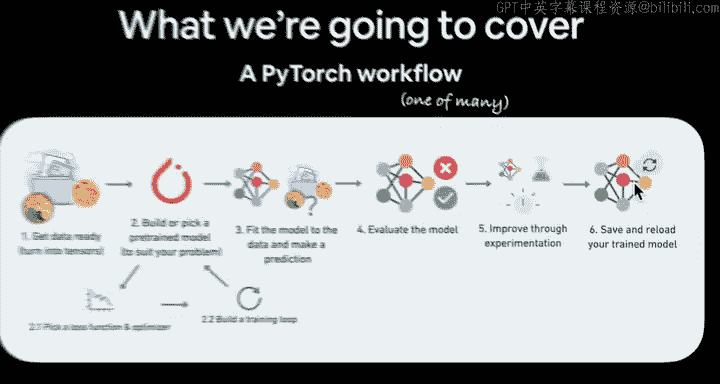

And so where can you get help？Probably the most important thing is to follow along with the code。

 We'll be coding all of this together。 Remember motto number one， if in doubt， run the code。

 Try it for yourself。 That's how you， that's how I learn best。 As I write code。 I try it。

 I get it wrong。 I try again and keep going till I get it right。

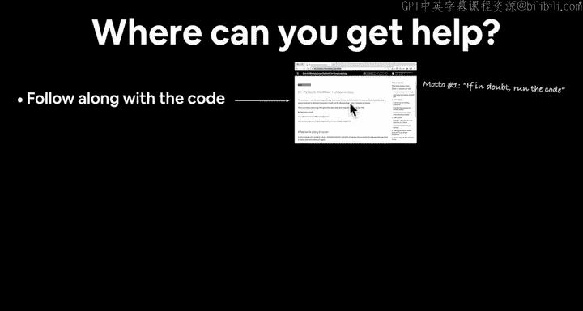

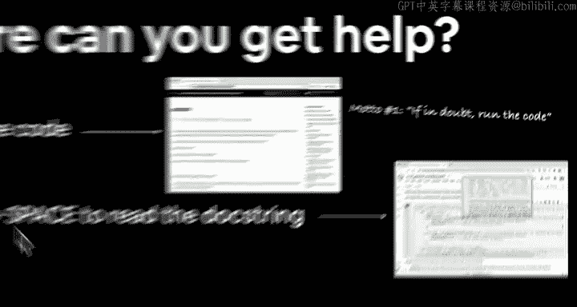

Read the dock string because that's going to show you some documentation about the functions that we're using。

 So on a Mac， you can use shift command in space in Google Coabab。 Or if you're on a Windows PC。

 it might be control here。If you're still stuck， try searching for it。

 you'll probably come across resources such as stack Overflow or the pietorrch documentation。

 we've already seen this a whole bunch and we're probably going to see it a lot more throughout this entire course actually because that's going to be the ground truths of everything pietororch。

Try again and finally， if you're still stuck， ask a question。

 So the best place to ask a question will be at the Pytorchde learning s discussions tab。

 And then if we go to Github， that's just under here。 So Mr。 debu Pytorch deep learning。

 This is all the course materials。 We see here， This is your ground truth for the entire course。

 And then if you have a question， go to the discussions tab。 new discussion。

 you can ask a question there。 And don't forget to please put the video and the code that you're trying to run And that way we can reference what's going on and help you out there。

 And also。😊。

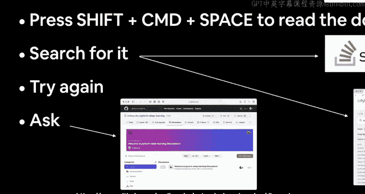

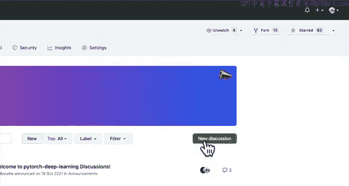

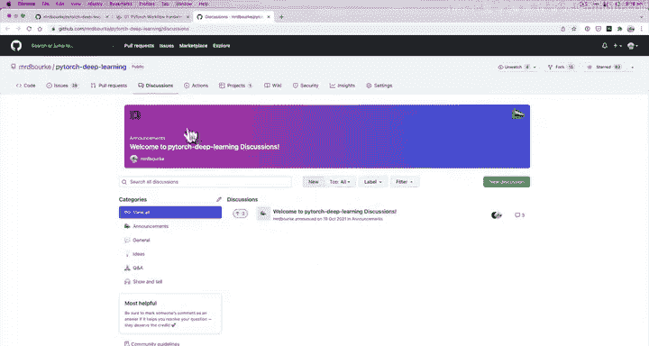

Don't forget， There is the book version of the course。 So learn Ptorch dot I O。

 By the time you watch this video， it'll probably have all the chapters here。

 But here's what we're working through。 This is what the videos are based on。 All of this。

 We're going to go through all of this。 How fun is that。 But this is just reference material。

 So you can read this at your own time。 We're gonna focus on coding together。 And speaking of coding。

😊。

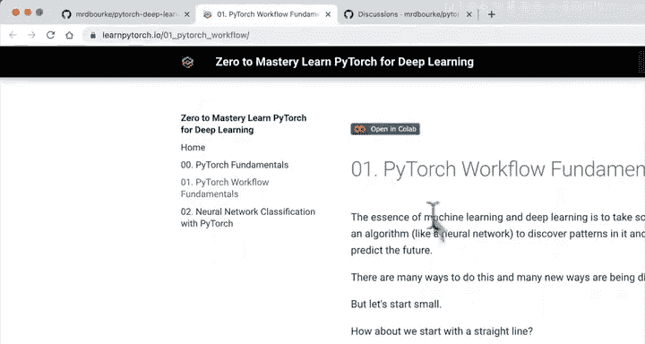

Let's code。 I'll see you over at Google Coab。

