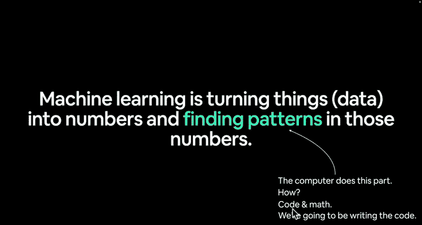
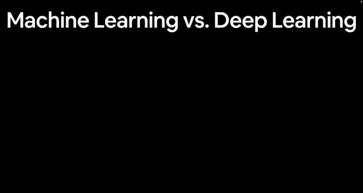
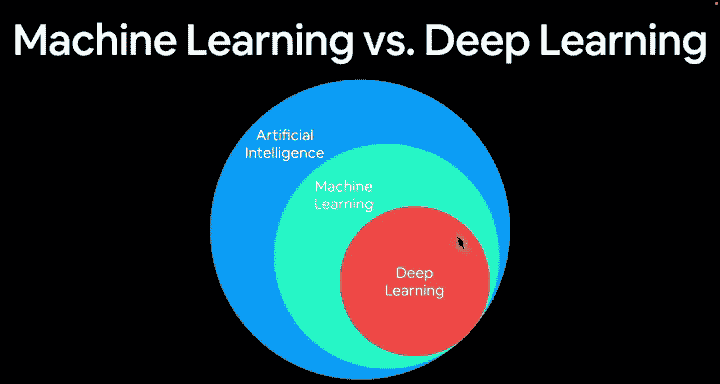
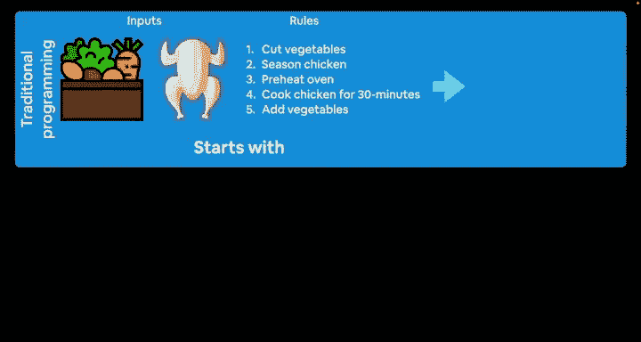
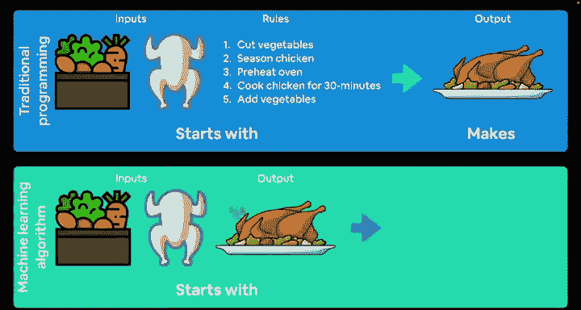
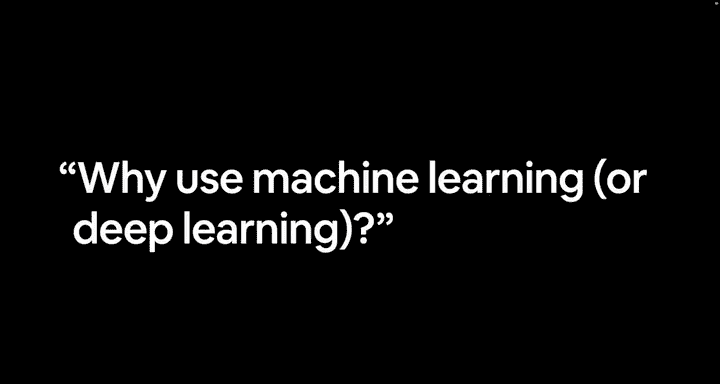
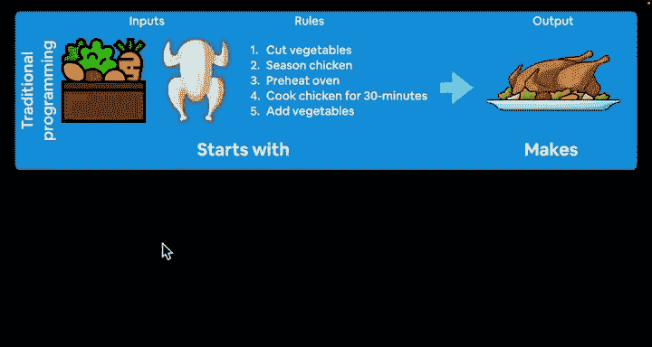
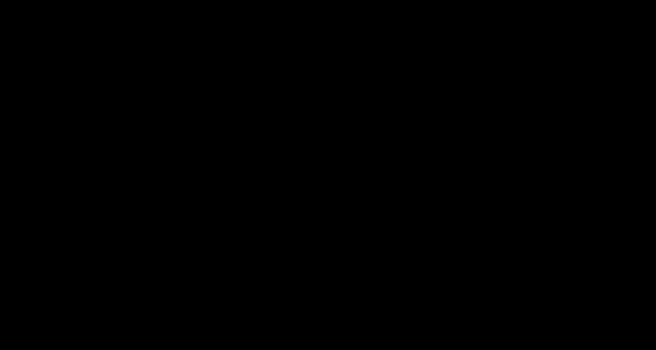

# mrdbourke《一天学会pytorch深度学习｜Learn PyTorch for deep learning in a day Literally》中英 - P2：0. Welcome and what is deep learning.zh_en - GPT中英字幕课程资源 - BV1kx4y1r79d

Hello， my name is Daniel， and welcome to the。😊，Deep learning with。Pietorch。

 course Now that was too good not to watch twice。 Welcome to the deep learning with。

Wuckles that fire。 pieytorrch course。 So this is very exciting。

 you're gonna see that animation quite a bit because， I mean， it's fun。

 And Pytorrchs symbol is aflameca of torch。 let's get into it。 So naturally。

 if you've come to this course， you might have already researched what is deep learning。

 But we're gonna cover it quite briefly。 And just in the sense of。😊。

How much you need to know for this course， Because we're going to be more focused on rather than just definitions。

 We're going to be focused on getting practical and seeing things happen。

So if we define what machine learning is because as we'll see in a second。

 deep learning is a subset of machine learning， machine learning is turning things， data。

 which can be almost anything， images， text， tables of numbers， video， audio files。

 almost anything can be classified as data into numbers， So computers love numbers。

 and then finding patterns in those numbers。 now。How do we find those patterns？ Well。

 the computer does this part， specifically a machine learning algorithm or a deep learning algorithm The things that we're going to be building in this course。

 How code and math。 Now， this course is code focused。 I want to stress that before you get into it。

 We're focused on writing code。 Now， behind the scenes。

 that code is going to trigger some math to find patterns in those numbers。

 If you would like to deep dive into the math behind the code。

 I'm going to be linking extra resources for that。 However。

 we're going to be getting hands on in writing lots of code to do lots of this。

And so if we keep going to break things down a little bit more。

 machine learning versus deep learning。 If we have this giant bubble here of artificial intelligence。

 you might have seen something similar like this on the Internet。

 I've just copied that and put it into pretty colours for this course。

 So you've got this overarching。

Big bubble of the topic of artificial intelligence， which you could define as， again。

 almost anything you want。 Then typically， there's a subset within artificial intelligence。

 which is known as machine learning， which is quite a broad topic。 And then within machine learning。

 you have another topic called deep learning。And so that's what we're going to be focused on working with Pytorch writing deep learning code。

 But again， you could use Pytorch for a lot of different machine learning things and truth be told I kind of use these two terms interchangeably。

 Yes， M is the broader topic and deep learning is a bit more nuanced but again。

 if you want to form your own definitions of these。 I'd highly encourage you to do so。

 this course is more focused on rather than defining what things are is seeing how they work。

 So this is what we're focused on doing。

Just to break things down， if you're familiar with the fundamentals of machine learning。

 you probably understand this paradigm， but we're going just rehash on it anyway。

 So if we consider traditional programming。 Let's say you'd like to write a computer program that's enabled to or has the ability to reproduce your grandmother's favorite or famous roast chicken dish。

 And so we might have some inputs here， which are some beautiful vegetables。

 a chicken that you've raised on the farm， you might write down some rules。

 This could be your program。 cut the vegetables。 Season the chicken， preheat the oven。

 cook the chicken for 30 minutes and add vegetables。

 Now it might not be this simple or it might actually be because yoursilian grandmother is a great cook。

 So she's put things into an art now and can just do it step by step。

 And then those inputs combined with those rules， makes this beautiful roast chicken dish。

So that's traditional programming。 Now， a machine learning algorithm typically takes some inputs and some desired outputs and then figures out the rules。

 So the patterns between the inputs and the outputs。 So where in traditional program。

 we had to hand write all of these rules。The ideal machine learning algorithm will figure out this bridge between our inputs and our idealized output Now。

 in the machine learning sense， this is typically described as supervised learning because you will have some kind of input with some kind of output also known as features and also known as labels and the machine learning algorithms job is to figure out the relationships between the inputs or the features and the outputs or the label So if we wanted to write a machine learning algorithm to figure out our Sicilian grandmother's famous roast chicken dish we would probably gather a bunch of inputs of ingredients such as these delicious vegetables and chicken and then have a whole bunch of outputs of the Finn product and see if our algorithm can figure out what we should do to go from these inputs to output。

 So that's almost enough to cover of the difference between traditional programming and machine learning as far as definition。

We're going to get hands on encoding these sort of algorithms throughout the course for now。

Let's go to the next video and ask the question why use machine learning or deep learning and actually before we get there。

 I'd like you to think about that， so going back to what we just saw。

 the paradigm between traditional programming and machine learning。

 why would you want to use machine learning algorithms， rather than traditional programming？😊。

So if you had to rottle these rules， could that get cumbersome？

So have a think about it and we'll cover it in the next video。

