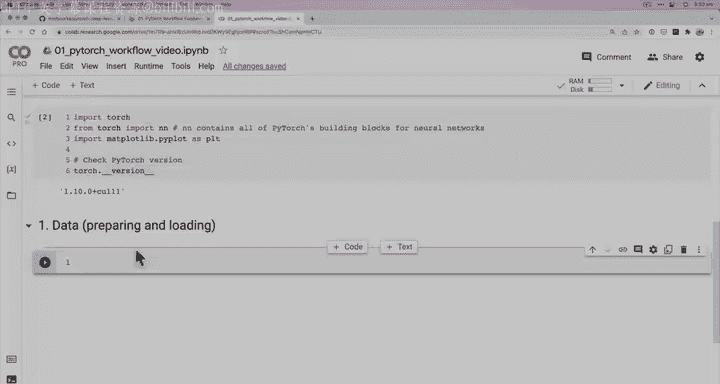
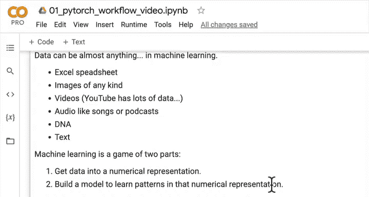
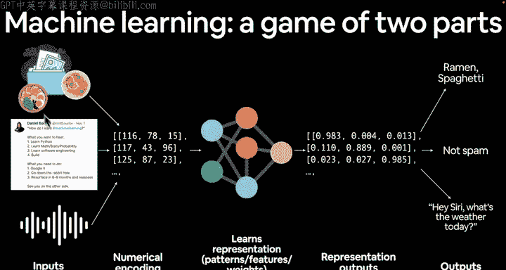
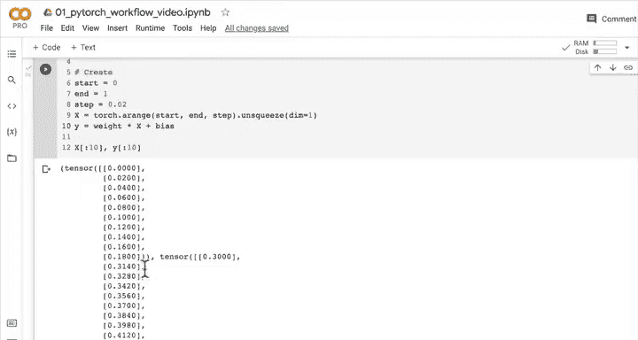
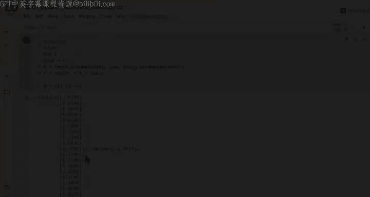

# mrdbourke《一天学会pytorch深度学习｜Learn PyTorch for deep learning in a day Literally》中英 - P31：35. Creating a dataset with linear regression.zh_en - GPT中英字幕课程资源 - BV1kx4y1r79d

Let's now get on to the first step of our Pytodge workflow。 and that is data， preparing and loading。

 Now， I want to stress data can be almost anything。

In machine learning。I mean， you could have an Excel spreadsheet， which is。Rizising columns。

Nice and formatted data。 you could have images。Of any kind。You could have videos， I mean。

YouTube has lots of data。You could have audio like songs or podcasts。

 you could have even DNA these days， Pat and DNA are starting to get discovered by machine learning。

And then， of course， you could have text like what we're writing here。 and so。😊。

What we're going to be focusing on throughout this entire course is the fact that machine learning。

Is a game of two parts。So， one。Get data into a numerical representation。2。

Build a model to learn patternss in。That numerical representation， of course， there's more around it。

 Yes， yes， yes。 I understand you can get as complex as you like。

 But these are the main two concepts And machine learning。

 When I say machine learning same goes for deep learning， You need some kind of。Oh， nuical， nuerical。

 I like that word， nu representation。 Then you want to build a model to learn patterns in that numerical representation。

 And if you want， I've got a nice， pretty picture that describes that machine learning a game of two parts。

 Let's refer to our data。 Remember， data can be almost anything。 These are our inputs。

 So the first step that we want to do is create some form of numerical encoding in the form of tensesors to represent these inputs。

 how this looks will be depending on the data depending on the numerical encoding you choose to use。

 Then we're going to build some sort of neural network to learn a representation。

 which is also referred to as patterns， features or weights。 within that numerical encoding。😊。

It's going to output that representation。 And then we want to do something without representation。

 such as in the case of this， we're doing image recognition， image classification。

 Is it a photo of ramen or spaghetti。 Is this tweet spam or not spam。

Is this audio file saying what it says here， remember。

 I'm not going to say this because my audio assistant that's also named this word here is close by and I don't want it to go off。

So this is our game of two parts。

One here is convert our data into a numerical representation。

 and two here is build a model or use a pre trained model to find patterns in that numerical representation。

And so we've got a little stationary picture here， turn data into numbers， part two。

 build a model to learn patterns in numbers。So with that being said， now let's create some data。😊。

To showcase this。3。To showcase this。Let's create some known。Data using the linear regression formula。

 Now， if you're not sure what linear regression is or the formula is， let's have a look。

 linearar regression formula。This is how I'd find it。 Okay， we have some fancy Greek letters here。

 but essentially we have y equals a function of x and B plus epsilon， okay。😊，there we go。

 a linear regression line has the equation in the form of y equals a plus B X。

 I like this one better。 This is nice and simple。 We're going to start from as simple as possible and work up from there。

 So y equals a plus Bx， where x is the explanatory variable and y is the dependent variable。

 The slope of the line is B， Now the slope is also known as the gradient and a is the intercept。

 okay， the value of when y， when x equals 0。 Now， this is just text on a page。

 This is formula on a page。 You know how I like to learn things。 Let's code it out。

 So let's write it here。😊，We'll use a linear regression。Formula to make a straight line。With known。

Parameters， I'm going to write this down， because parameter。Is。

A common word that you're going to hear in machine learning as well。

 So a parameter is something that a model learns。 So for our data set。

 if machine learning is a game of two parts， we're going to start with this。

 Number one is going to be done for us because we're going to start with a known representation。

A known data set。 And then we want our model to learn that representation。This is all just talk。

 Daniel， let's get into coding。 Yes， you're right。 You're right。 Let's do it。

 So create known parameters。So I'm going to use a little bit different names to what that Google definition did。

 So weight is going to be 0。7 and bias is going to be 0。3。 Now。

 weight and bias are another common two terms that you're going to hear in neural networks。

 So just keep that in mind。 But for us， this is going to be the equivalent of our weight will be B。

And our bias will be a。But forget about this for the time being， let's just focus on the code。

 So we know these numbers。But we want to build a model that is able to estimate these numbers。😡。

How by looking at different examples。 So let's create some data here。

 we're going to create a range of numbers。 Start equals 0 and equals 1。

 We're going to create some numbers between 0 and1， and they're going to have a gap。 So the step。

 the gap is going to be 0。02。 Now， we're going to create an x variable。 Y is x a capital here。Well。

 it's because typically x in machine learning， you'll find is a matrix or a tensor。

 And if we remember back to the fundamentals， a capital represents a matrix or a tensor and a lower case represents a vector。

 But in our case it's going to be a little confusing because x is a vector。 But later on。

 x will start to be a tensor and。AMa， so for now， we'll just keep the capital， not capital notation。

And we're going to create the formula here。Which is。Remember how I said our weight is in this case。

 the B and our bias is the a， so we've got the same formula here。 y equals weight times x plus bias。

 Now let's have a look at these different numbers so we'll view the first 10 of x and we'll view the first 10 of y。

 we'll have a look at the length of x and we'll have a look at the length of y。Wonderful。

 so we've got some values here。We've got 50 numbers of each。Thiss a little confusing。

 Let's just view the first 10 of X and Y first。 And then we can have a look at the lengths here。欢迎。X。

 length y。So what we're going to be doing。Is building a model to learn some values。

To look at the x values here。And learn what the associated y value is and the relationship between those。

 Of course， we know what the relationship is between x and Y， because we've coded this formula here。

 But you won't always know that in the wild。 That is the whole premise of machine learning。

 This is our ideal output。 And this is our input。The whole premise of machine learning is to learn a representation of the input and how it maps to the output。

So here are our input numbers。 And these are our output numbers。

 And we know that the parameters of the weight and bias are 0。7 and 0。3。

 We could have set these to whatever we want。 By the way， I just like the number 7 and 3。

 You could set these to 0。9， whatever， whatever。 The premise would be the same。 So oh。

 and what I've just done here。 I kind of just coded this without talking。

But I just did torch a range， and it starts at 0， and it ends at one， and the step is 0。02。

 So there we go，0，00 up by 002004。 And I've unsqueezed it。 So what does unsqueezed do。

 Removes the extra dimensions。 Oh sorry， adds are extra dimension。 Daniel。

 Youre getting confused here。 So if we remove that。😊，We get no extra square bracket。

 but if we add unsqueed， you'll see that we need this later on for when we're doing models。Wonderful。

 so let's just leave it at that。 That's enough for this video。 We've got some data to work with。

 Don't worry if this is a little bit confusing for now。

 We're going to keep coding on and see what we can do to build a model to infer patterns in this data。

 But right now， one you ever think this is tensor data。 But it's just numbers on a page。

 What might be a better way to hint。 This is a hint by the way， visualize it。

 What's our data exploreer's motto。😊。

Let's have a look at that in the next video。

Welcome back。