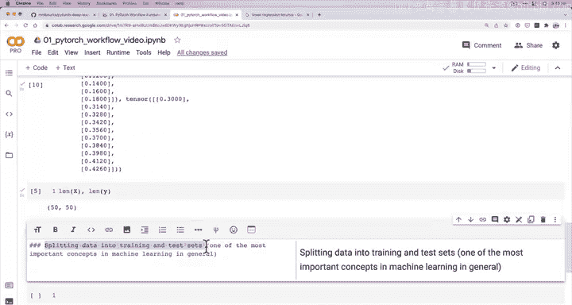
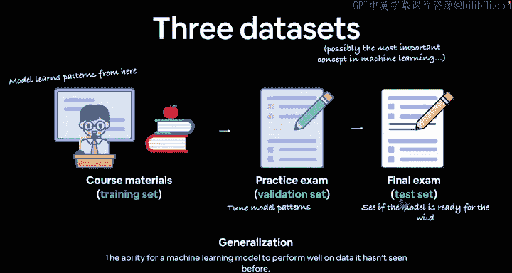
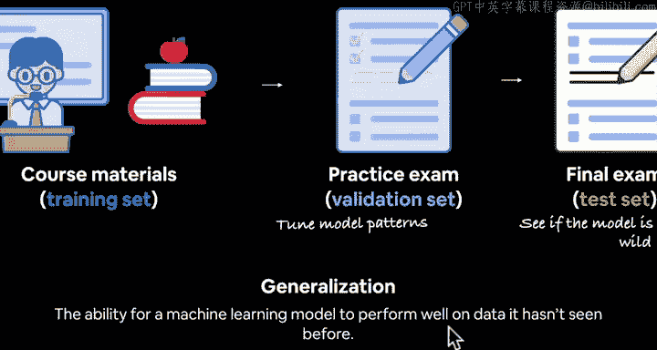
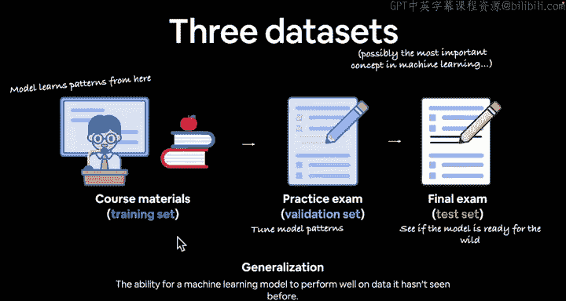
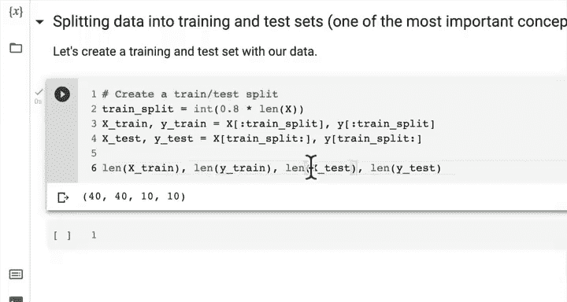
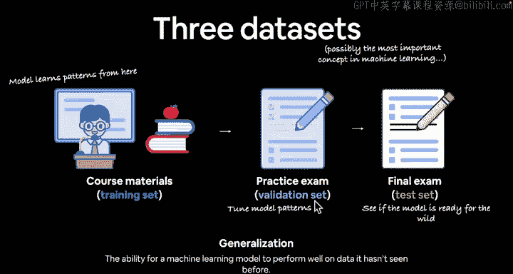
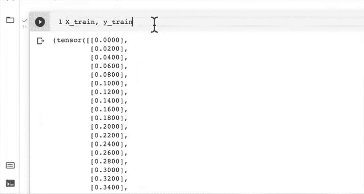
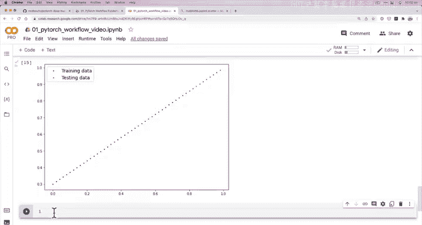
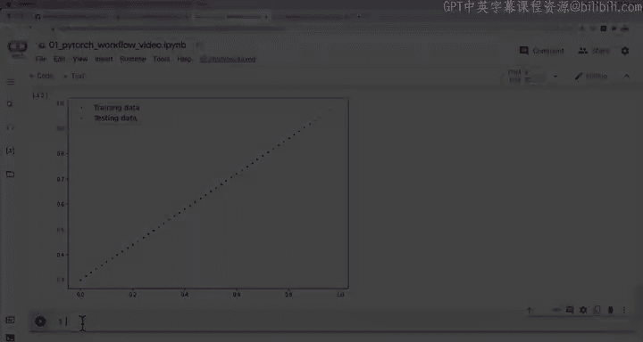

# mrdbourke《一天学会pytorch深度学习｜Learn PyTorch for deep learning in a day Literally》中英 - P32：36. Creating training and test sets (the most important concept in ML).zh_en - GPT中英字幕课程资源 - BV1kx4y1r79d

In the last video， we created some numbers on a page using the linear regression formula with some known parameters。

 Now there's a lot going on here， but that's all right。

 we're going to keep building upon what we've done and learn by doing。 So in this video。

 we're going to cover one of the most important concepts in machine learning in general。

 So splitting data into training and test sets。😊，One of the most important concepts in machine learning。

In general。Now， I know I've said this already a few times。One of the most important concepts。

 But truly， this is possibly。In terms of data， this is probably the number one thing that you need to be aware of。

 And if you've come from a little bit of a machine learning background。

 you probably well and truly know all about this。 But we're going to recover it anyway。

 So let's jump in to some pretty pictures。 Oh， look at that one。 speakingeaking of pretty pictures。

 but。

That's not what we're focused on。 now。 We're looking at the three data sets。

And I've written down here possibly the most important concept in machine learning。

 because it definitely is from a data perspective。So the course materials。

 imagine you're at university。So this is going to be the training set。

 and then you have the practice exam， which is the validation set， and then you have the final exam。

 which is the test set。And the goal of all of this is for generalization， so let's step back。

So say you're trying to learn something at university or through this course。

 you might have all of the materials， which is your training set。

 so this is where our model learns patterns from。And。😊，Then to practice what you've done。

You might have a practice exam， so the mid semesterster exam or something like that。

 Now let's to see if you're learning the course materials well。 So in the case of our model。

 we might tune our model on this plastic exam so we might find that on the validation set Our model doesn't do too well。

 and we adjust it a bit and then we retrain it and then it does better。😊，Before finally。

 at the end of semester， the most important exam is your final exam。

 And this is to see if you've gone through the entire course materials and you've learned some things。

 Now you can adapt to unseen material。 And that's a big point here。

 We're going to see this in practice， I that when the model learns something on the course materials。

 It never sees the validation set or the test set。😊，So say we started with 100 data points。

 You might use 70 of those data points for the training material。

 You might use 15% of those data points。 So 15 for the practice。

 And you might use 15 for the final exam， So this final exam is just like if you're at university learning something is to see if。

 hey， have you learnt any skills from this material at all。

 Are you ready to go into the wild into the quote unquote， real world。

 And so this final exam is to test your model's generalization， because it's never seen this data is。

Let's define generalization is the ability for a machine learning model or a deep learning model to perform well on data it hasn't seen before because that's our whole goal right。

 we want to build a machine learning model on some training data that we can deploy in our application or production setting and then more data comes in that it hasn't seen before and it can make decisions based on that new data because of the patterns it's learned in the training set。

So just keep this in mind， three data sets， training， validation test， and if we jump in。

To the B P Torch book。We've got split data。So we're going to create three sets， or in our case。

 we're only going to create two a training and a test。

 Why is that because you don't always need a validation set。

There is often a use case for a validation set， but。

The main two that are always used is the training set and the testing set and how much should you split Well。

 usually for the training set， you'll have 60 to 80% of your data。 If you do create a validation set。

 you'll have somewhere between 10 and 20。 And if you do create a testing set。

 it's a similar split to the validation set， you'll have between 10 and 20%。

 So training always testing always validation often， but not always。So with that being said。

 I'll let you refer to those materials if you want。 But now let's create。

A training and test set with our data。 So we saw before that we have 50 points。 We have X and Y。

 We have one to one ratio。 So one value of x relates to one value of y。

 And we know that the split now for the training set is 60% to 80%。 and the test set is 10 to 20%。

 So let's go with the upper bounds of each of these，80% and 20%， which is a very common split。

 actually 8020。So， let's go。Create a train test split。And we're going to go train split。

We'll create a number here so we can see how much so we want an integer of 0。8。

 which is 80% of the length of x。 What does that give us， Train split should be about 40 samples。

 Wonderful。 So we're going to create。40 samples of x and 40 samples of Y。

 our model will train on those 40 samples to predict what。The other 10 samples。

 So let's see this in practice。 So x train。Y train equals x。

 And we're going to use indexing to get all of the samples up until the train split。

 That's what this colon does here。 So hey， X up until the train split， Y up until the train split。

 and then for the testing oh。Thanks for that。 Auto correctr coab。 I didn't actually need that one。

X test。Why test equals。X， and then we're going to get everything from the train split onwards。

So the index onwards， that's what this notation means here。And why。

From the train split onwards as well。 Now， there are many different ways to create a train and test split。

 ours is quite simple here， but that's because we're working with quite a simple data set。

 One of the most popular methods that I like is Psyit learns train test split。

 We're going to see this one later on。 It adds a little bit of randomness into splitting your data。

 But that's for another video。 just to make you aware of it。So let's go length。X train。

We should have 40 training samples to。How many testing samples。Length X test and length Y test。

Wonderful，40，40，10，10， because we have training features。😊。

Training labels， testing features， testing labels。 So essentially。

 what we've created here is now a training set。 We've split our data。

Training set could also be referred to as training split。

 Yet another example of where machine learning has different names for different things。 So set。

 split， same thing。 Tra， split， test split。 This is what we've created。

 Remember the validation set is used often， but not always because our data set is quite simple。

 We're just sticking with the necessities。 Traing and test。 But keep this in mind。

One of your biggest， biggest， biggest hurdles in machine learning will be creating proper training and test sets。

 So it's a very important concept。 With that being said。

 I did issue the challenge in the last video to visualize these numbers on a page。

 We haven't done that in this video。 So let's move towards that next。

 I'd like you to think of how could you make these more visual。

Like these are just numbers on a page right now。Maybe。Matpltlibb can help。

Let's find out，Hey， hey， hey， welcome back。In the last video。

 we split our data into training and test sets。 And now， later on。

 we're going to be building a model to learn patterns in the training data to relate to the testing data。

 But as I said， right now， our data is just numbers on a page。 It's kind of hard to understand。

 You might be able to understand this， but I prefer to get visual。 So let's write this down。

 How might we。Beta visualize our data。And I'll put a capital here。 So we're grammatically correct。

 And this is where the data explorers。Motto comes in。Visualize。Visualize。Visualizing， ha ha。Right。

 so if ever you don't understand a concept， one of the best ways to start understanding it more for me is to visualize it。

 So let's write a function to do just that。 We're going to call this plot predictions。

 We'll see why we call it this later on。 That's the benefit of making these videos is that I've got a plan for the future。

 Although it might seem like I'm winging it。 There is a little bit of behind the scenes happening here。

 So we'll have the train data， which is our。😊，X train。 and then we'll have the train labels。

 which is our Y train。 And we'll also have the test data。 Yeah， that's a good idea。

 X test and we'll also have the test labels， equals。Oh， why test？Excuse me。

 He's looking at too many x's there and then the predictions。

 now we'll set this to none because we don't have any predictions yet。But as you might have guessed。

 we might have some later on。 So we'll put a little dock string here so that we're being nice and pythonic。

 So plot， training data。Test data。And compares predictions。Nice and simple。Nothing too outlandish。

 And then we're going to create a figure。😊，This is where Matplot Libb comes in。Plot figure。

 and we'll go fig size equals107， which is my favorite hand in poker。

 and will plot the training data in blue also happens to be a good dimension for a map plot lib plot。

 plot dot scatter。Train data。And creating a scatter plot here， we'll see what it does in a second。

Coour， we're going to give this a color of B for blue。

 That's what C stands for in Mattpotlib scatter。We'll go size equals 4， and label equals。

Training data。Now， where could you find information about this scatter function here。

 We've got command shift space。 Is that going to give us a little bit of a dock string。

Or sometimes if command not spaces is not working， you can also hover over this bracket。

 I think you can even hover over this。There we go。 But this is a little hard for me to read。

 Like it's， it's there， but it's got a lot going on。 X， Y， S， C， C map。 I， I just like to go。

That plot lib。Sca out。There we go。We've got a whole bunch of information there。

 a little bit easier to read for me here。😊，And then you can see some examples beautiful。

 So now let's jump back into here。So in our function plot predictions。

 we taken in some training data， test data， we've got the training data plotting in blue。

 what colour should we use for the testing data？How about green， I like that idea。

 P on scatter Test data Greens my favorite colour。What's your favorite column。C equals G。

 you might be able to just plot it in your favourite color here。Just remember， though。

 it'll be a little bit different from the videos。 And then we're going to call this testing data。

 So just the exact same line as above， but with a different set of data。 Now。

 let's check if there are predictions。 So are there predictions。 So if predictions。Is not none。Let's。

Ploot the predictions。Plot the predictions。If they。Exist。So plot， scatter， test data。

 And why are we plotting。The test data， remember， what is our scatter function。

 let's go back up to here， it takes in x and Y。So our predictions are going to be compared to the testing data labels。

 so that's the whole game that we're playing here。We're going to train our model on the training data and then to evaluate it。

 we're going to get our model to predict the Y values。As with the input of X test。

And then to evaluate our model， we compare how good our model's predictions are， in other words。

 predictions versus the actual values of the test dataset set。We're going to say this in practice。

Rather than just talk about it， so let's do our predictions in red。😊，And。Label equals， predictions。

 wonderful。So let's also show the legend because， I mean， we're legends。

 So I could just put in a mirror here。 Now I'm kidding。

 The legend is going to show our labels on the map plot Li plot。 So prop equals。

 size and prop stands for properties， well。It may or remain hot。 I just like to think it does。

 That's how I remember it。 So we have a beautiful function here to plot our data。😊。

Should we try it out？Remember， we've got hard coded inputs here。

 so we don't actually need to input anything to our function。

 We've got our train and test data ready to go。 If， in doubt， run the code。 Let's check it out。

 Do we make a mistake in our plot predictions function。You might have caught it。Hey， there we go。

 Beaful。 So because we don't have any predictions， we get no red dots。

 But this is what we're trying to do。 We've got a simple straight line。

 You can't get a much more simple data set than that。😊。

So we've got our training data in blue and we've got our testing data in green。

 So the whole idea of what we're going to be doing with our machine learning model is we don't actually really need to build a machine learning model for this。

 we could do other things， but machine learning is fun， So we're going to take in the blue dots。

 There's quite a pattern here right？ This is the relationship。

 we have an x value here and we have a y value。 So we're going to build a model to try and learn the pattern of these blue dots。

 so that if we fed our model our model， the x values of the green dots。

 Could it predict the appropriate y values for that because remember these are the test data set So pass our model X test to predict Y test。

😊，So blue dots is input。Green dots as the ideal output。 This is the ideal output。

 A perfect model would have red dots over the top of the green dots。 So that's what we。

 we will try to work towards。 Now， we know the relationship between x and Y。 How do we know that。

 Well we set that up above here。 This is our weight and bias。 We created that line。

 Y equals weight times x plus bias， which is the simple version of the linear regression formula。

 So M X plus C， you might have heard that in high school algebra。 So gradient plus intercept。😊。

That's what we've got。With that being said， let's move on to the next video and build a model。 Oh。

 this is exciting。 I'll see you there。😊。

