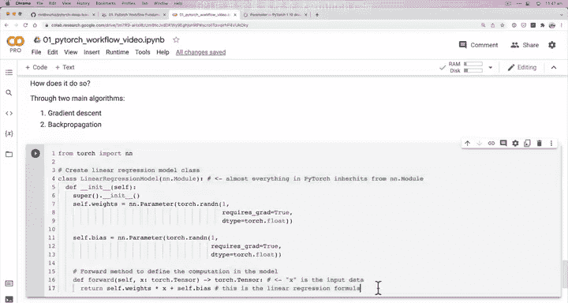
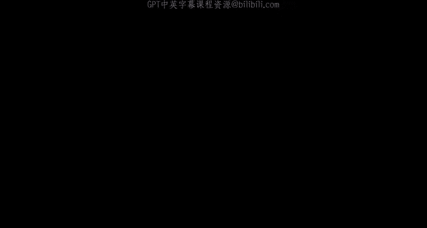
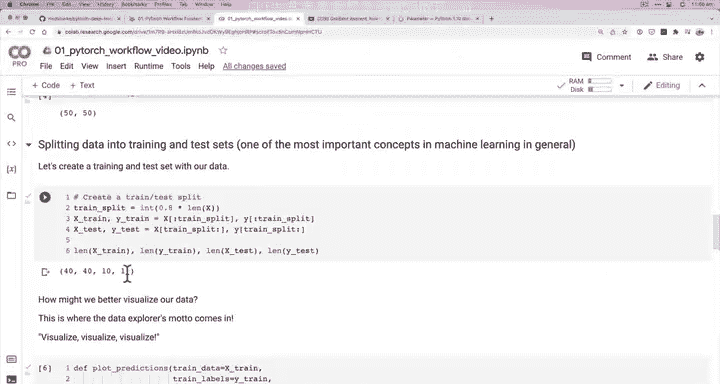
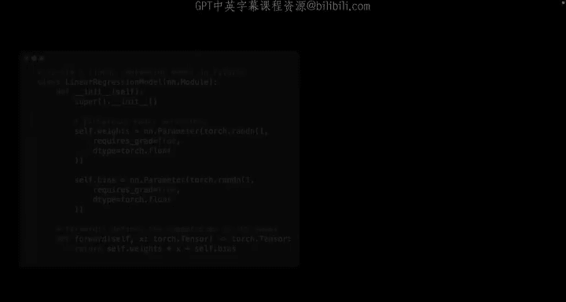
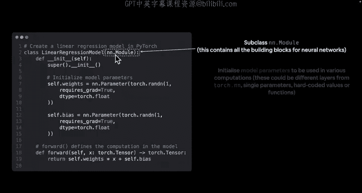
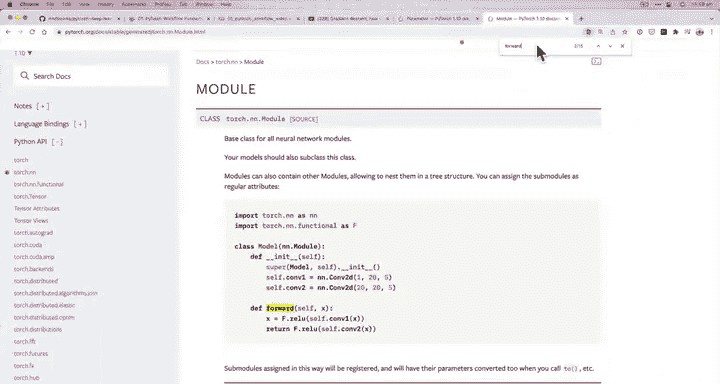
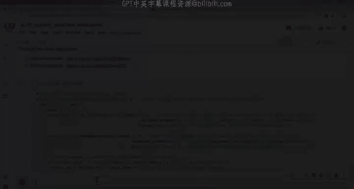

# mrdbourke《一天学会pytorch深度学习｜Learn PyTorch for deep learning in a day Literally》中英 - P33：38. Creating our first PyTorch model.zh_en - GPT中英字幕课程资源 - BV1kx4y1r79d

Welcome back。 In the last video we saw how to get visual with our data。

 We followed the data explorers's moto of visualize， visualize visualize。

 and weve got an idea of the training data that we're working with and the testing data that we're trying to build a model to learn the patterns in the training data。

 essentially this upwards trend here to be able to predict the testing data。

 So I just want to give you another heads up。 I took a little break after the recording last video。

 And so now my coabab notebook has disconnected。 So I'm going to click reconnect。

 and my variables here may not work。😊，So this is what might happen on your end。

 if you take a break from using Google Coabb and come back， if I try to run this function。

 they might have been saved。 looks like they have。 but if not， you can go restart and run all。

This is typically one of the most helpful troubleshooting steps of using Google Collab。

 If a cell say down here isn't working， you can always。Rerun the cells above。 And that may。

Help with a lower cell here， such as if this function wasn't instantiated because this cell wasn't run and we couldn't run this cell here。

 which calls this function here。 We just have to rerun this cell above so that we can run this one。

But now， let's get into。Building our first pintorch model。

 We're going to jump straight into the code， so。Our first pieytorch model。 Now。

 this is very exciting。Let's do it。So we'll turn this into Markdown。Now。

 we're going to create a linear regression model。 So let's look at linear regression formula again。

 We're going to create a model that's essentially going to run this computation。

 So we need to create a model that has a parameter for a， a parameter for B。 In our case。

 it's going to be weight and bias and a way to do this forwardd computation。 What I mean by that。

 we're going to see with code。 So let's do it。We'll do it with pure pytorch。

 So create a linear regression model class。 Now， if you're not experienced with using Python classes。

 I'm going to be using them throughout the course and I'm going to call this one linear regression model。

 If you haven't dealt with Python classes before。 That's okay。

 I'm going to be explaining what we're doing as we're doing it。 But if you'd like a deeper dive。

 I'd recommend you to real Python Python classes。😊，OOP in Python 3。 That's a good rhyming so。

I' just going to link this here。Because。We're going to be building。Classes throughout。Because course。

I'd recommend。Getting familiar with O O P， which is object oriented programming。

 little bit of a mouthful， hence the O O P。In Python。To do so。You can use the following resource。

From real Python。 But when I'm gonna go through that now。

 I'd rather just code it out and talk it out while we do it。 So we've got a class here。 Now。

 the first thing you might notice is that the class inherits from N N dot module。

 Now you might be wondering， Well， what's an N dot module。 Well， let's write down here。

 Almost everything in pitorrch。Inherits。From N N dot module。

 So you can imagine N N dot module as the Lego building bricks of Pytorrch model。

 And so N N dot module has a lot of helpful inbuil things that's going to help us build our pi toch models。

 And， of course， how could you learn more about it。 Well you could go。 N N dot module， Pytorrch。Mdel。

 here we go。Base class for all neural network modules。 Wo。

 your models should also subclass this class。 So that's what we're building。

 We're building our own pytoch model。 And so the documentation here says that your models should also subclass this class。

 And another thing with Pytoch。 This is what makes it。

 It might seem very confusing when you first begin。😊，But modules can contain other modules。

 So what I mean by it being a Lego brick is that you can stack these modules on top of each other and make progressively more complex neural networks as you go。

 But we'll leave that for later on。 For now， we're going to start with something nice and simple。

 And let's clean up our web browser。 So。We're going to create a constructor here。

 which is with the anit function。It's gonna take self as a parameter。

If you're not sure of what's going on here， just follow along with the code for now。

 and I'd encourage you to read this documentation here after the video。

 So then we have super dot ait。I know when I first started learning this， I was like。

 why dont we have to write a knit twice， And then what super and all that jazz， But just for now。

 just。Take this as being some required Python syntax。And then we have self dot weights。

 So that means we're going to create a weights parameter。 We'll see why we do this in a second。

 And to create that parameter。 we're going to use N， N dot parameter。

And just a quick reminder that we imported N N from torch before。And if you remember。

 NN is the building block layer for neural networks and within NN， so NN。

stands for neural network is module。So we've got NN dot parameter。Now。

 we're going to start with random parameters。 So torch shott R N。1。

 we're going to talk through each of these in a second。 So I'm also going to put requires。

Requires grad equals true。 We haven't touched any of these， but that's okay。

 D type equals torch dot float。So。Let's see what NN parameter tells us。What do we have here？

A kind of tensar that is to be considered a module parameter。

 So we've just created a module using N N module。Parameterters are torch tensor subclasses。

 so this is a tensorium itself。That have a very special property when used with modules。

 When they're an assigned as a module attribute， they are automatically added to the list of its parameters and will appear E G in module dot parameters iterator。

 we're going to see that later on。😊，Assigning a tensor doesn't have such effect。

 So we're creating a parameter here。 Now requires grad。 What does that mean， Well。

 let's just rather than just try to read the doctor in coabab。 Let's look it up N， N dot parameter。

What does it say requires grad optional if the parameter requires gradient。Hm。

What does requires gradient mean。Well， let's come back to that in a second。 And then for now。

 I just want you to think about it。D type equals torch dot float。 Now the data type here。

 torch dot float is， as we've discussed before， is the default for pi torch torch dot float。

 This could also be torch dot float 32。So we're gonna leave it as torch Fat 32。

 because pie torch likes to work with F 32。 Now， do we have。This， by default。We do。

 so we don't necessarily have to set requires grad equals true。 So just keep that in mind。

So now we've created a parameter for the weights。We also have to create a parameter for the bias。

Let's finish creating this。And then we'll write in the code。 Then we'll talk about it。 So R N。

Now requires grad equals true and D type equals torch dot float。There we go。

 And now we're going to write a forward method。 So forward method to define。The computation。

In the model。So， let's go deaf Ford。Which。Self。Takes in a parameter X， which is data。

 which X is expected to be of type torch tensor， and it returns a torch dot tensor。

And then we go here。And so we say X， we don't necessarily need this comment。

 I'm just going to write it anyway。 X is the input data。 So in our case。

 it might be the training data。 And then from here， we want it to return self dot weights。

Times x plus self dot bias。 Now， where have we seen this before。Well。

 this is the linear regression formula。Now。Let's take a step back into how we created our data。

 and then we'll go back through and talk a little bit more about what's going on here。

So if we go back up to our data。Where do we create that？We created it here。

 So you see how we've created known parameters， weight and bias， and then we created our y variable。

 our target using the linear regression formula， weight times x plus bias and x were a range of numbers。

So what we've done with our linear regression model that we've created from scratch。

 if we go down here。We've created a parameter， weight。This could just be weight if we wanted to。

We've created a parameter here， so when we created our data， we knew what the parameters。

 weight and bias were。The whole goal of our model is to start with random numbers。

 So these are going to be random parameters。And to look at the data。

 which in our case will be the training samples。And update those random numbers to represent the pattern here。

 So ideally， our model， if it's learning correctly， will take our weight。

 which is going to be a random value and our bias， which is going to be a random value。

 and it will run it through this forwardd calculation。

 which is the same formula that we use to create our data， and it will adjust the weight and bias。

To represent as close as possible， if not perfect， the known parameters。 So that's the premise of。

Machine learning。Now how does it do this through an algorithm called gradient descent so。

I'm just going to write this down because we've talked a lot about this。

 but I'd like to just tie it together here。So what our model。Does。So。Start with random values。

White and bias。Look at training data。And adjust the random values。

To better represent the or or get closer。2。The ideal。Values， so。The white。And bias。Values we use to。

Create the data。So that's what it's going to do。 It's going to start with random values and then continually look at our training data to see if it can adjust those random values to be。

What would represent this straight line here， Now， how does it do so。How does it do so？

Through two main algorithms。So one is gradient descent。And two is back propagation。So。

I'm going to leave it here for the time being。But。We're going to continue talking about this。

 gradient descent is why we have requires grad equals true。

And so what this is going to do is when we run computations using this model here。

Pytoch is going to keep track of the gradients of our weights parameter and our bias parameter。

 And then it's going to update them through a combination of gradient descent and back propagation。

Now I'm going to leave this as extracurricular for you to look through in gradient desent and back propagation。

 I'm going to add some resources here。 There will also be plenty of resources in the Pytoch workflow fundamentals book chapter on how these algorithms work behind the scenes。

We're going to be focused on the code， the Pytoch code to trigger these algorithms behind the scenes。

 So Pytorch， lucky for us， has implemented gradient descent and back propagation for us。

So we're writing the higher level code here to trigger these two algorithms。So in the next video。

 we're going to step through this a little bit more and then further discuss some of the most useful and required modules of prior torch。

 particularly NN and a couple of others。

So let's leave it there and I'll see you in the next video。Welcome back。 In last video。

 we covered a whole bunch in creating our first pytorrch model that inherits from N dot module。

 We talked about object oriented programming and how a lot of pytorch uses object oriented programming。

 I can't say that， I might just say O O P for now。 What I've done since the last video。

 though I've added two resources here for gradient descent and back propagation。

 These are two of my favorite videos on YouTube by the channel 3 blue1 Brown。

 So this is on gradient descent。 I would highly recommend watching this entire series， by the way。

 So that's your extra curriculum for this video in particular and for this course overall。

 is to go through these two videos。 even if you're not sure entirely what's happening。

 you will gain an intuition for the code that we're going to be writing with pytorch。

 So just keep that in mind as we go forward a lot of what Piytorrch is doing behind the scenes for us is taking care of these two algorithms for us。

😊，And we also created。2 parameters here in our model， where we've instantd them as random values。

 So one parameter for each of the ones that we use， the weight and bias for our data set。

 And now I want you to keep in mind that we're working with a simple data set here。

 So we've created our known parameters。 But in a data set that you haven't created by yourself。

 you've maybe gathered that from the Internet， such as images。

You won't be necessarily defining these parameters。Instead。

 another module from NN will define the parameters for you and will work out what those parameters should end up being。

But since we're working with a simple data set， we can define our two parameters that we're trying to estimate。

 This is a key point here。 I that our model is going to start with random values。

 That's the annotation I've added here。 Start with a random weight value， using torch random。

And then we've told it that it can update via gradient descent。

 So pytorch is going to track the gradients of this parameter for us。

 And then we've told it that the D type we want is float 32。

 We don't necessarily need these two set explicitly， because a lot of the time。

 the default in pytorch is to set these two requires grad equals true and D type es torchtop float。

 Does that for us behind the scenes。 But just to keep things as fundamental and as straightforward as possible。

 we've set all of this explicitly。So let's jump into the keynote。

 I'd just like to explain what's going on one more time in a visual sense。

 So here's the exact code that we've just written。 I've just copied it from here。

 and I've just made it a little bit more colour。

But here's what's going on。 So when you build a model in Pytorch。

 it subclasses the N N dot module class。 This contains all the building blocks for neural networks。

 So our class of model subclasss N N dot module。

Now。Inside the constructor， we initialize the model parameters。 Now。

 as we'll see later on with bigger models。We won't necessarily， always， explicitly。

Create the weights and biases。We might initialize whole layers。 Now。

 this is a concept we haven't touched on yet， but we might initialize a list of layers or whatever we need。

 So basically， what happens in here is that we create whatever variables that we need for our model to use。

And so these could be different layers from torchdot N N， single parameters。

 which is what we've done in our case， hard coded values or even functions。Now。

 we've explicitly set requires grad equals true for our model parameters。 So this。

 in turn means that pytorch behind the scenes will track all of the gradients for these parameters here。

 for use with torch dot autograd。 So Torch dot autograd module of pytorrch is what implements gradient descent。

 Now， a lot of this will happen behind the scenes for when we write our pytorch training code。

 So if you'd like to know what's happening behind the scenes。

 I'd highly recommend you checking out these two videos， Hences why I've linked them here。😊，Oh。

 and for many Pytorch Jot NN modules requires grad is true as set by default。Finally。

 we've got a Ford method。Now。Any subclass of N N dot module， which is what we've done。

 requires a forward method。 Now， we can see this in the documentation。 if we go torch。

Dot N N dot module。Click on module。Do we have Ford。Yeah， there we go。 So Ford。

We've got a lot of things built into an end do module， so。

You see here， this is a subclass of N N dot module。 And then we have Ford。

 So Ford is what defines the computation performed at every core。

 So if we were to call linear regression model and put some data through it。

The forward method is the operation that this module does， that this model does。 And in our case。

 our forward method is the linear regression function。 So keep this in mind。

 any subclass of N end dot module needs to override the forward method。

 So you need to define a forward method If you're going to subclass N N dot module。

We'll see this very hands on， but for now， I believe that's enough coverage of what we've done。

If you have any questions， remember， you can ask it in the discussions。

We've got a fair bit going on here， but I think we've broken it down a fair bit。

 The next step is for us to， I know I mentioned this in a previous video is to cover some Pytorch model building essentials。

 But we're going to cover a few more of them。 We've seen some already。

 But the next way to really start to understand what's going on is to check the contents of our model。

 Tra one and make some predictions with it。 So let's get hands on with that in the next few videos。

 I'll see you there。😊。

