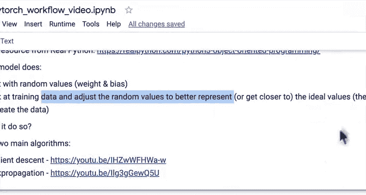
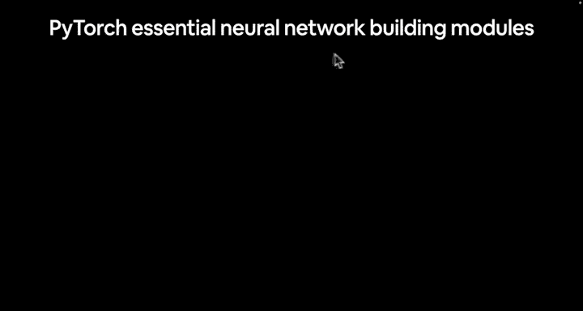
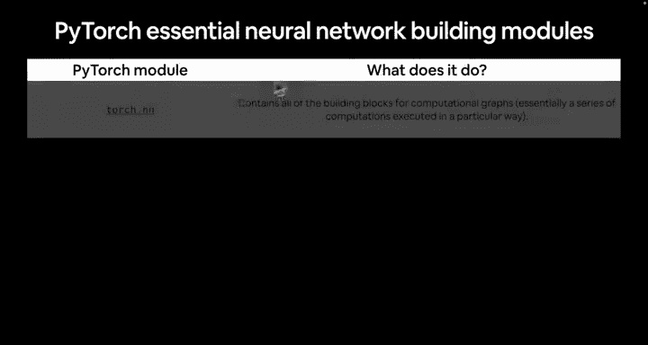
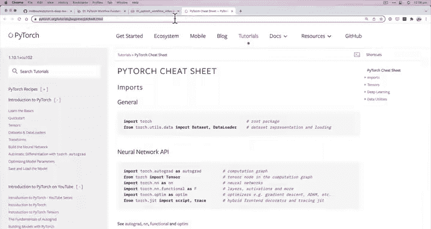

# mrdbourke《一天学会pytorch深度学习｜Learn PyTorch for deep learning in a day Literally》中英 - P34：40. Discussing important model building classes.zh_en - GPT中英字幕课程资源 - BV1kx4y1r79d

Welcome back In the last couple of videos， we stepped through creating our first Pytorch model。

 and it looks like there's a fair bit going on here。

 but some of the main takeaways is that almost every model in Pytorch inherits from NN dot module。

 and if you are going to inherit from NN dot module。

 you should override the forward method to define what computation is happening in your model。

And for later on， when our model is learning things， in other words。

 updating its weights and bias values from random values to values that better fit the data。

 it's going to do so via gradient descent and back propagation。

 And so these two videos are some extra curriculum for what's happening behind the scenes。

But we haven't actually written any code yet to trigger these two。

 So I'll refer back to these when we actually do write code to do that。 For now。

 we've just got a model that defines some forward computation。But。Speaking of models。

Let's have a look at a couple of pytorrch model building essentials。

 So we're not going to write too much code for this video， and it's going to be relatively short。

 But I just want to introduce you to some of the main classes that you're going to be interacting with in Pytorrch。

 And we've seen some of these already。 So one of the first is torch dot N N。

 So contains all of the building blocks for computational graphs。😊。

Computational graphs is another word for neural networks。Well。

 actually computational graphs is quite general， I'll just right here。😊。

A neural network can be considered。A computational graph。So， then we have。Toorch。DoNn dot parameter。

 we've seen this， So what parameters should our model try and learn？And then we can write here often。

A pie torch layer from torch。nn will set these for us。Then we've got torch。nn。t module。

Which is what we've seen here。And so Torchto end end up module is the base class for all neural network modules。

If you subclass it。You should overrite。Forward。Which is what we've done here。

 We've created our own forward method。So what else should we cover here？

We're going to see these later on， but I'm going to put it here， Torch。 Opimm。😊。

This is where the optimizes in Pytorch live， they will help with gradient descent。So optimizer。

 an optimizer is， as we've said before， that our model starts with random values。

 and it looks at training data and adjusts the random values to better represent the ideal values。

 The optimizer contains algorithms that's going to optimize these values instead of being random to being values that better represent our data。

 So those algorithms live in torch dot optt in。

And then one more for now。I'll link to extra resources。 And we're going to cover them as we go。

 That's how I like to do things。 cover them as we need them。 So all N N dot module。

 So this is the forward method。 I'm just going to explicitly say here that all N N module subclasses require you to overrite Ford。

😊，This method defines what happens。And the forward computation。So in our case。

 if we were to pass some data to our linear regression model。

The Ford method would take that data and perform this computation here。

 And as your models get bigger and bigger， our is quite straightforward here。

 this forwardd computation can be as simple or as complex as you like。

 depending on what you'd like your model to do。And so， I've got a。Nice and fancy slide here。

 which basically reiterates what we've just discussed Pi Torch essential neural network building modules。

 So the module Torch dot M N。

Toch。tnn。t module。Toed 없。Torch dot us dot data。 We haven't actually talked about this yet。

 And I believe there's one more Yeah， data loader。 We're going to see these two later on。

But these are very helpful when you've got a bit more of a complicated data set。 In our case。

 we've got just 50 integers for our data。 We've got a simple straight line。

 But when we need to create more complex data sets， we're going to use these。

 So this will help us build models。This will help us optimize our modelss parameters。

 and this will help us load data。 And if you'd like more。

 one of my favorite reasonses is the Piytorrch cheat sheet。 again。

 we're referring back to the documentation。 See all of this documentation， right。😊，As I said。

 this course is not a replacement for the documentation。

 It's just my interpretation of how one should best become familiar with bytorrch。

 So we've got imports， the general import torch from torch dot u dot data。

 We've got data set data loader。 Would you look at that。 We've got that mentioned here。 Data。

 data set data loader。 and torch script and J neural network API0 and X。

 I'll let you go through here。We're covering some of the most fundamental ones here。

 but there's of course Pytorch is quite a big library。

 so some extracurrula for this video would be to go through this for five to 10 minutes and just read you don't have to understand them all we're going to start to get more familiar with all these well not all of them because I mean that would require making videos for the whole documentation but a lot of these through writing them。

V code。So that's enough for this video。 I'll link this pie toch cheat sheet in the video here。

 And in the next video， how about we。😊。

We haven't actually checked out what happens if we do create an instance of our linear regression model。

I think we should do that。I'll see that。