# mrdbourke《一天学会pytorch深度学习｜Learn PyTorch for deep learning in a day Literally》中英 - P36：42. Making predictions with our model.zh_en - GPT中英字幕课程资源 - BV1kx4y1r79d

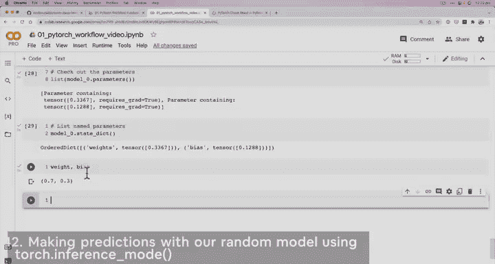

Welcome back。 In the last video， we checked out the internals of our first Pytor model。😊。

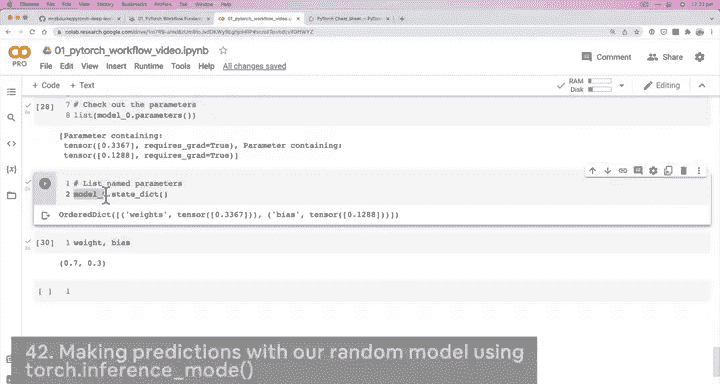

And we found out that because we're creating our model with torch dot or the parameters of our model with torch dot R。

 they begin as random variables。 And we also discuss the entire premise of deep learning is to start with random numbers and slowly progress those towards more ideal numbers。

 slightly less random numbers based on the data。 So let's see before we start to improve these numbers。

 Let's see what their predictive power is like right now。 Now。

 you might be able to guess how well these random numbers will be able to predict on our data。

 You're not sure what that predicting means， let's have a look。

 So making predictions using torch dot inference mode。 something we haven't seen， but as always。

 we're going to discuss it while we use it。😊。

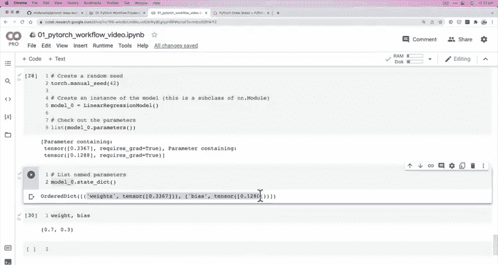

So to check our model's predictive power。Let's see。How well。It predicts。Why test？

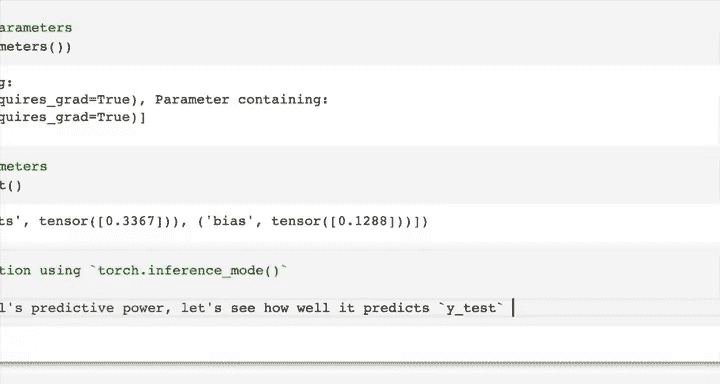

Based on X test。Becauseuse remember， again， another premise of a machine learning model is to take some features as input and make some predictions close to some sort of labels。

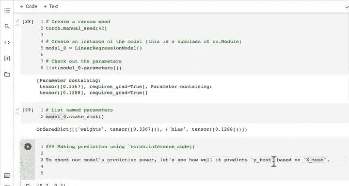

So， when we pass。

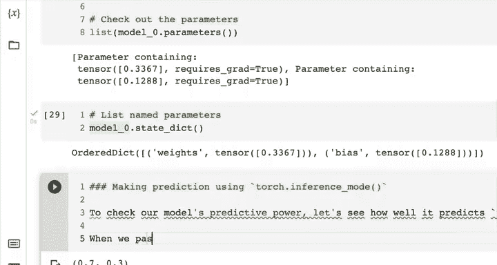

Data through our model。It's going to run it through the forwardd。

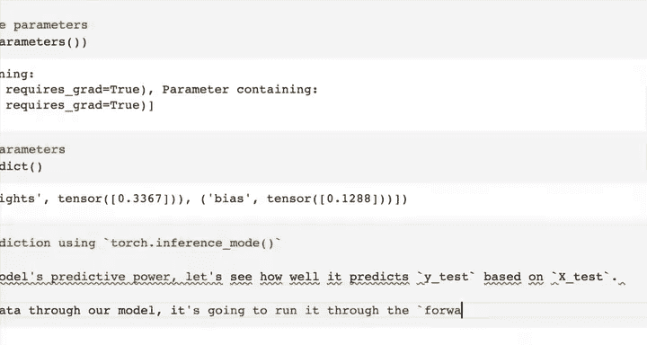

Mod。

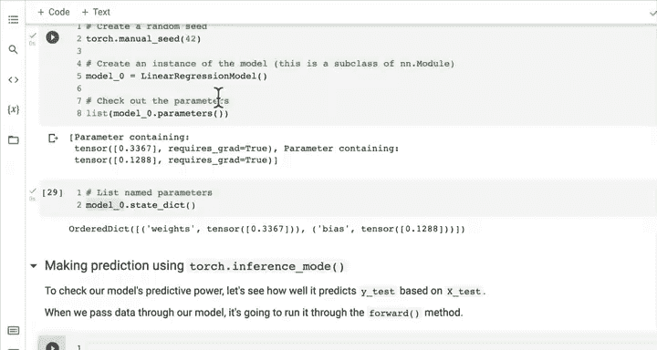

So here's where it's a little bit confusing。 We defined a forward method， and it takes x as input。

 Now I've done a little X， but we're going to pass it in a large x as its input。

 But the reason why I've done a little X is because oftentimes in Pytoch code you're going to find all over the Internet is that X is quite common。

Commonly used in the forward method here like this as the input data。

 So I've just left it there because that's what you're going to find quite often。

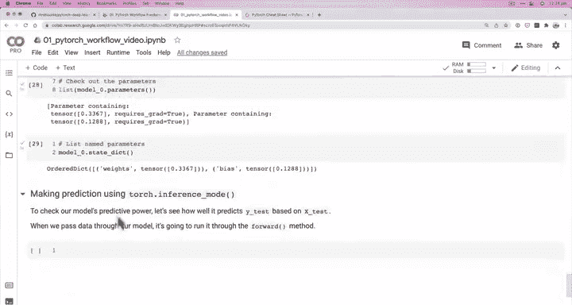

So let's test it out。 We haven't discussed what inference mode does yet。

 but we will make predictions with model。So with torch。inference mode。

 let's use it and then we will discuss what's going on。Y pres equals a model0 X test。

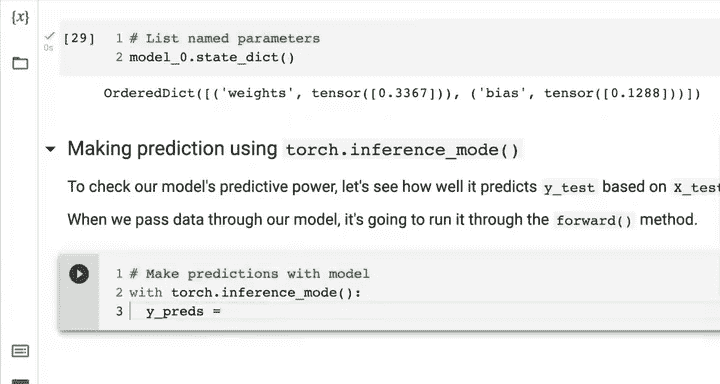

So that's all we're doing。We're passing the X test data。Through our model。Now。

 when we pass this X test in here， let's remind ourselves of what X test is。Ex test。

10 variables here。 And we're trying to。 Our ideal model will predict the exact values of Y test。

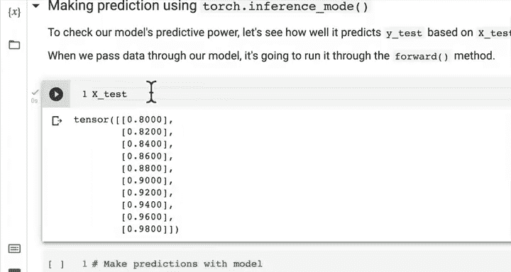

So this is what our model will do if it's a perfect model。 It will take these X test values as input。

 and it will return these Y test values as output。 That's an ideal model。

So the predictions are the exact same as the test dataset set。How do you think our model will go。

 considering it starting with random values as its parameters。

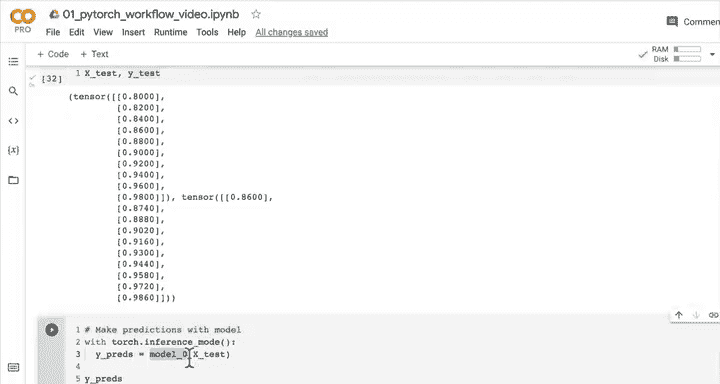

Well， let's find out， hey。

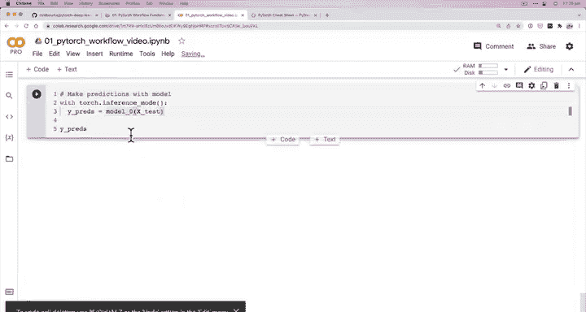

So we' can that why pres。Oh， what's happened here？

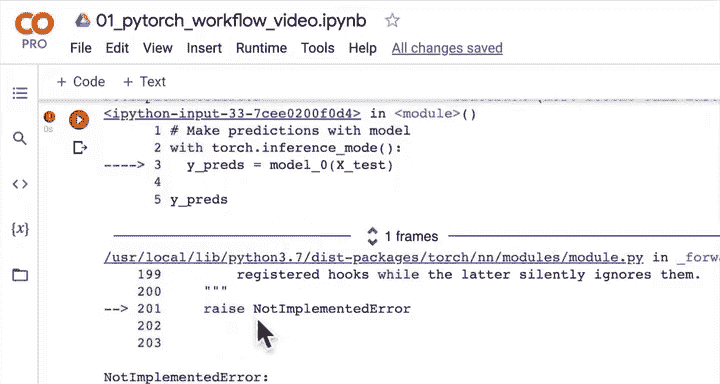

Not implemented error。 this is an error I get quite often in Google Coab when I'm creating a high toch model。

 Now， it usually happens。I'm glad we've stumbled upon this。 And I think I know the fix， But if not。

 we might see a little bit of troubleshooting in this video。😊，Is that when we create this。

 if you see this not implemented error。Right， it's saying that the Ford method， Here we go。

 Ford I'm implemented。 There we go。 It's a little bit of a rabbit hole。 This not implemented area。

 I've come across it a fair few times， and it took me a while to figure out that for some reason。

 the spacing。 So in Python。 you know how you have space space。 and that defines a function。

 space space。 There is another thing there and another line there。

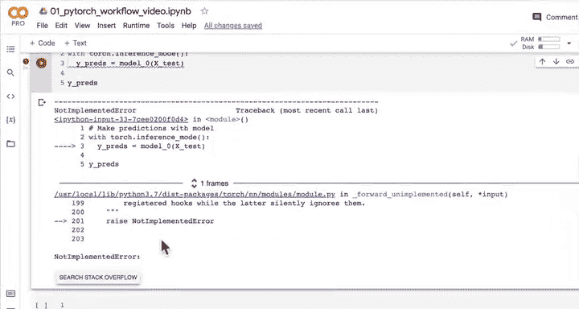

For some reason， if you look at this line in my notebook and by the way。

 if you don't have these lines or if you don't have these numbers， you can go into tools， settings。

Editor， and then you can define them here。 So show line numbers， show intation guides。

 all that sort of jazz there。 You can customize what's going on。

 But I just have these two on because I've run into this era fair few times。

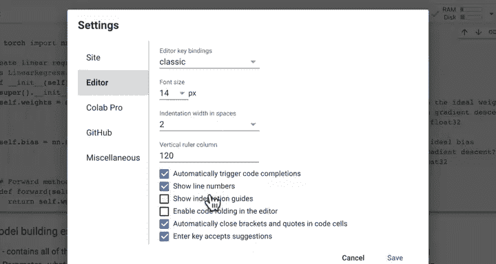

And so it's because that this forward method is not in line with this。Bracket here。

 So we need to highlight this and click shift tab， move it over。

 So now you see that it's in line here。And then if we run this。Won't change any output there。

 See that's the hidden gotcha。 I that when we ran this before， it found no error。

 But then when we run it down here。It works。 So just keep that in mind。

 I'm really glad we stumbled upon that because indentation errors。😊，Not implemented errors。

 One of the most common errors you'll find in pytorrch。 or in。

 well when you're writing Poytorrch code in Google Coab， I'm not sure why， but it just happened。

 So these are our models predictions so far by running the test data through our models forward method that we defined。

 And so if we look at why test， are these close。Oh my gosh， they are shocking。

 so why don't we visualize them？Ploot predictions。And we're going to put in predictions equals y pres。

Let's have a look。Oh my goodness， all the way over here。

Remember how we discussed before that an ideal model will have what red dots on top of the green dots because our ideal model will be perfectly predicting the test data。

 So right now， because our model is initialized with random parameters。

 it's basically making random predictions。 So theyre extremely far from where our ideal predictions are。

 is that we'll have some training data and our model predictions when we first create our model will be quite bad。

 but we want to write some code that will hopefully move these red dots closer to these green dots。

 We're going to see how we can do that in later videos。 but we did one thing up here。

 which we haven't discussed。 which is with torch dot inference mode。

 Now this is the context manager which is what happens when where making predictions。

 So making predictions another word for predictions is inference torch uses inference。

 So I'll try to use that a bit more。 but I like to use predictions as well。

 We could also just go why pres equals model。😊。

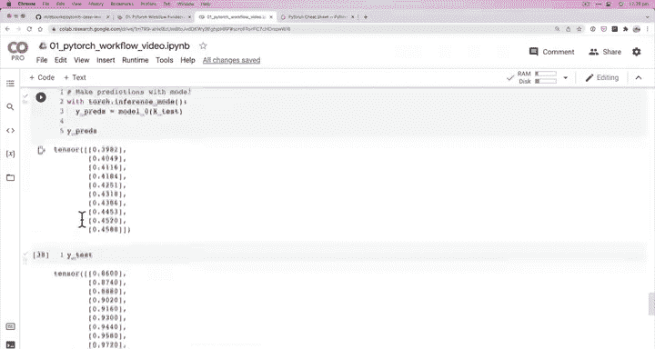

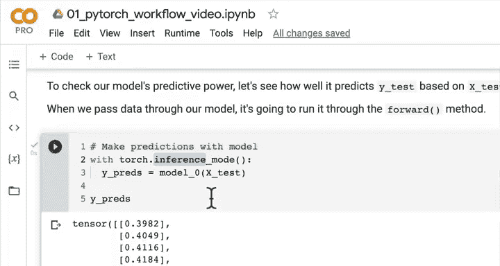

Or zero。Dot X test。And we're going to get quite a similar output。Right。

 but I've put on inference mode because I want to start making that a habit for later on when we make predictions。

 put on inference mode。 Now， why do this？ You might notice something different。

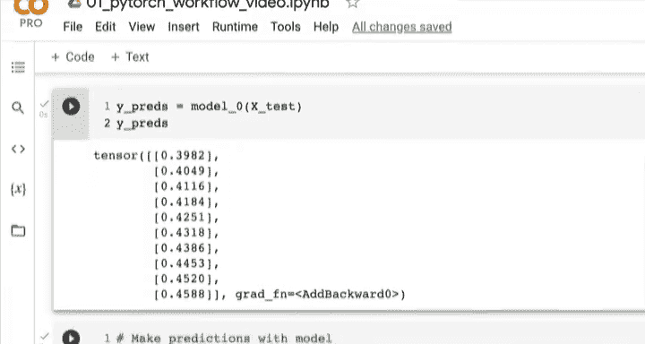

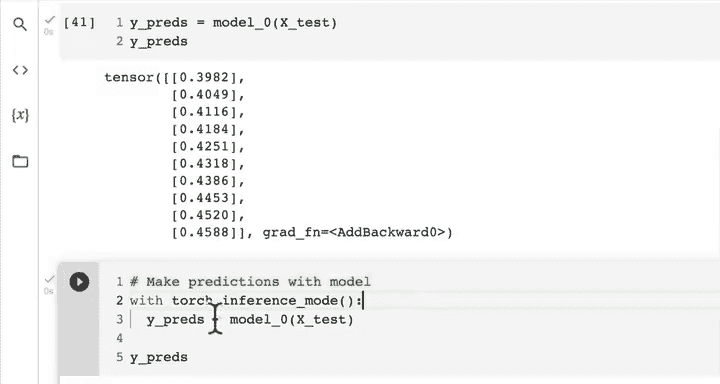

What's the difference here between the outputs？Why Pre equals model， there's no inference mode here。

 no contact manager。

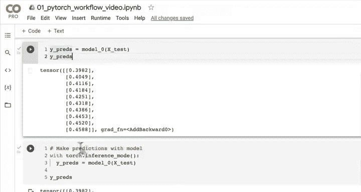

Do you notice that there's a grad function here？And we don't need to go into discussing what exactly this is doing here。

But do you notice that this one is lacking that grad function？

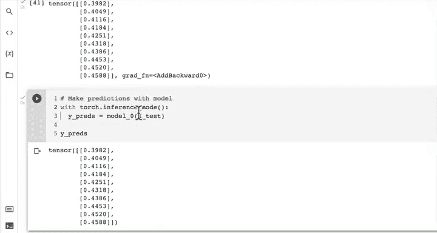

So do you remember how behind the scenes I said that Pyetorch does a few things？

With requires grad equals true， it keeps track of the gradients of different parameters so that they can be used in gradient descent。

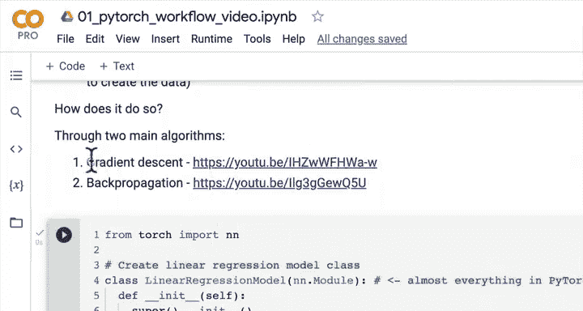

And back propagation。Now， what inference mode does is it turns off that gradient tracking。

So it essentially removes all of the because when we're doing inference， we're not doing training。

 so we don't need to keep track of the gradient， so we don't need to keep track of how we should update our models。

So inference mode disables all of the useful things that are available during training。

 What's the benefit of this， Well， it means that pytorch behind the scenes is keeping track of less data。

 So in turn， it will， with our small data set， it probably won't be too dramatic。

 but with a larger data set， It means that your predictions will potentially be a lot faster。

 because a whole bunch of numbers aren't being kept track of or a whole bunch of things that you don't need during prediction mode or inference mode。

 That's why it's called inference mode， are not being saved to memory。

 If you'd like to learn more about this。

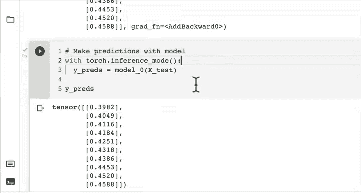

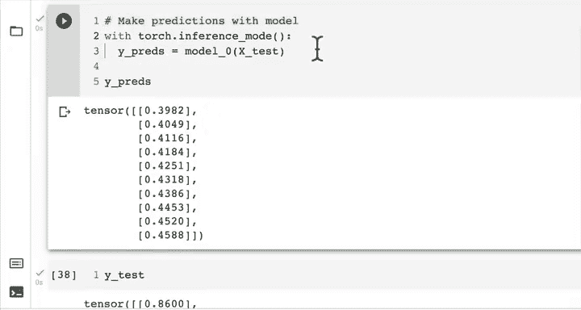

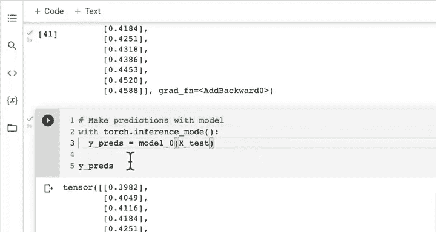

You go Pytorch inference mode， Twitter。I just remember to search for Twitter because they did a big tweet storm about it。

Here we go。 So， oh， this is another thing that we can cover。 I'm going to copy this in here。

 but there's also a blog post about what's going on behind the scenes。 Long story short。

 and makes you code faster。Want to make your inference code and pi torch run faster。

 Here's a quick thread on doing exactly that。 And that's what we're doing。

So I'm going to write down here。See more on inference mode here。

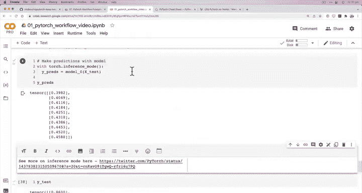

And I just want to highlight something as well， is that they referenced。

Torch nograd with the torch inference mode context manager。 Infer mode is fairly new in Pytorrch。

 So you might see a lot of code existing Pytorrch code with torch dot nograd。

 You can use this as well。 Why pres equals model 0。

 and this will do much of the same as what inference mode is doing。

 But inference mode has a few things that are advantageous over nograd。

 which are discussed in this thread here。 But if we do this。😊。

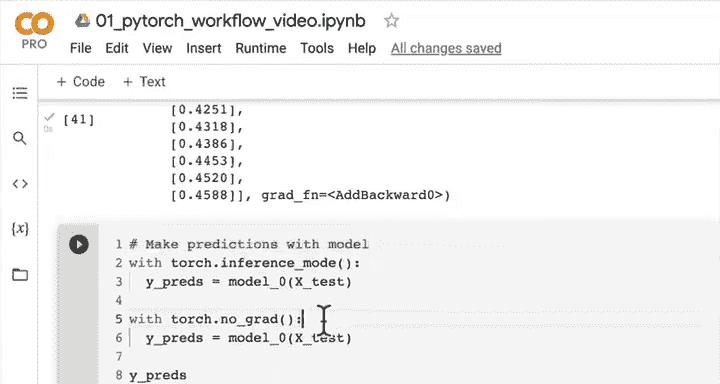

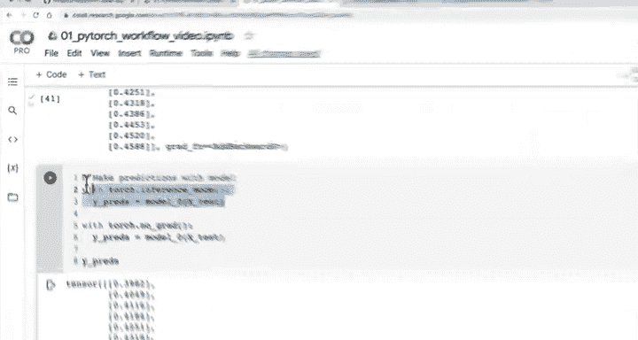

We get very similar output to what we got before。

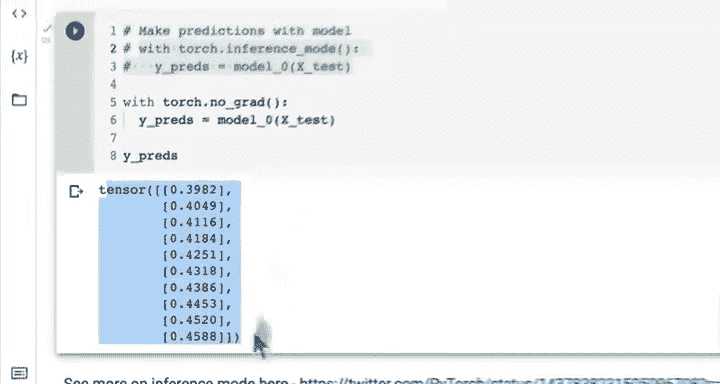

Grad function。But as you'll read in here and in the pilotto documentation。

 inference mode is the favoured way of doing inference for now。 I just wanted to highlight this so。

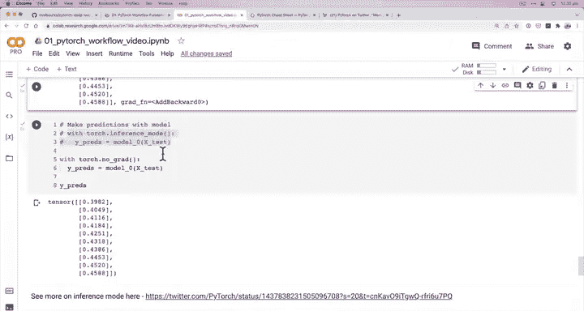

You can also do something similar with torch。Dot no grad。However。Inference。Moode is preferred。

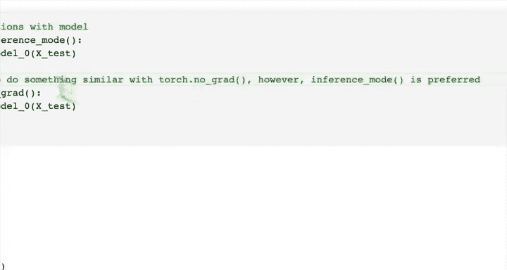

Al righty。So I'm just going to comment this out， so we just have one thing going on there。

The main takeaway from this video is that when we're making predictions。

 we use the context manager torched on inference mode。 And right now， because our models。

 variables or internal parameters are randomly initialized。

 our models's predictions are as good as random。So they're actually not too far off where。😊。

That our values are， at least the red dots aren't like scattered all over here。

 but in the upcoming videos， we're going to be writing some Pytorch training code to move these values closer to the green dots。

By looking at the training data here。So with that being said， I'll see you in the next video。😊。

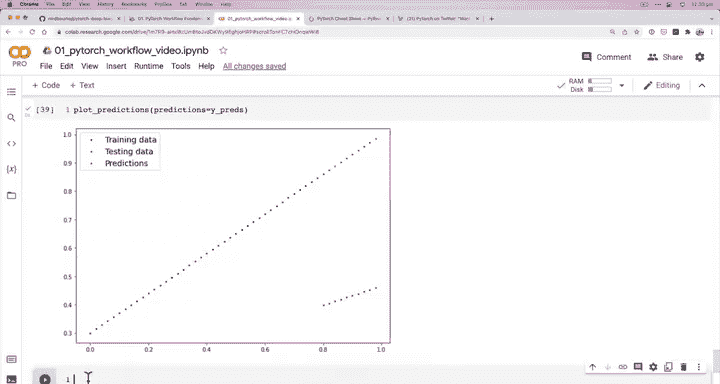