# mrdbourke《一天学会pytorch深度学习｜Learn PyTorch for deep learning in a day Literally》中英 - P39：45. PyTorch training loop intuition.zh_en - GPT中英字幕课程资源 - BV1kx4y1r79d

Welcome back。 In the last video， we set up a loss function。

 and we set up an optimizer and we discussed the roles of each。

 So loss function measures how wrong our model is。 The optimizer talks to the loss function and goes。

 well， if I change these parameters a certain way， does that reduce the loss function at all。

 And if it does， yes， let's keep adjusting them in that direction。 If it doesn't。

 let's adjust them in the opposite direction。😊，And I just want to show you。

 I added a little bit of text here just to concretely put down what we were discussing inside the optimr。

 you'll often have to set two parameters， parameterss and Lr。

 where parameterss is the model parameters you'd like to optimize for an example in our case。

 parameterss equals our model zero parameters， which were of course a weight and a bias and the learning rate。

 which is Lr in Opr， Lr stands for learning rate， and the learning rate is a hyperparameter。

 remember a hyperparameter， is a value that we the data scientist or machine learning engineer sets。

 whereas a parameter is what the model sets itself。

Defins how big or small a optimizer changes the model parameters。 So a small learning rate。

 So the smaller this value results in small changes。 a large learning rate results in large changes。

 So another question might be very valid question。 Hey。

 I've put this here already is which loss function and which optimizer should I use。

 So this is another tough one because it's problem specific。 But with experience in machine learning。

 I'm showing you one example here， you'll get an idea of what works for your particular problem for a regression problem like ours。

 a loss function of L1 loss， which is Me in Ptorrch。

 and an optimizer like torch at optim slash S GD like stochastic gradient descent。 will suffice。

 But for a classification problem， we're going to see this later on。 not this one specifically。

 whether a photo is a cat of a dog， that's just an example of a binary classification problem。

 you might want to use a binary classification loss。

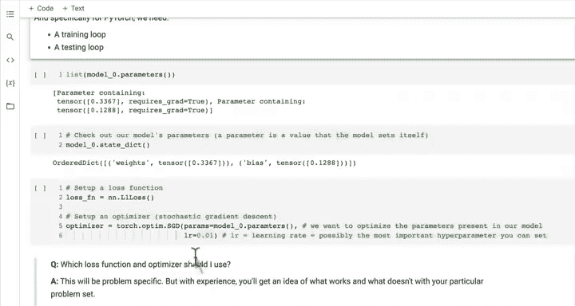

But with that being said， we now are moving on to。

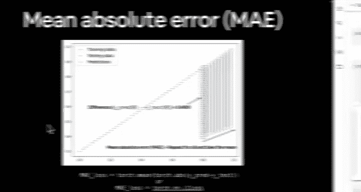

Well， his our whole goal is to reduce the Me of our model。 Let's get the work flow。

 We've done these two steps。 Now we want to build a training loop。 So let's get back into here。

 There's going to be a fair few steps going on。 We've already covered a few。 but， hey。

 nothing we can't handle together。 So building。

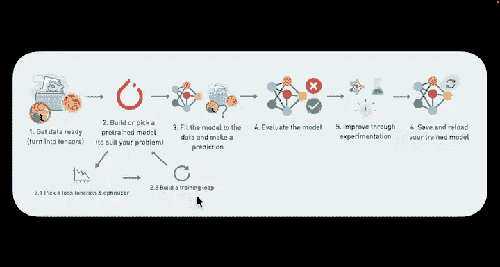

A training loop。And。Petorch。So， I thought about just。

Talking about what's going on in a training loop。 But we can talk about the steps after we've coded them。

How about we do that， So we want to build a training loop。And a testing loop。 How about we do that。

So。A couple of things。We need。And a training loop。So there's gonna be a fair few steps here。

 if you've never written a training loop before， but that is completely fine because you'll find that the first couple of times that you write this。

 you'll be like， oh my gosh， there's too much going on here。 But then when you have practice。

 you'll go， okay， I see what's going on here。 And then eventually。

 you'll write them with your eyes closed。 I've got a fun song for you to help you out。

 Remembering things。 It's called the unofficial pietorch optimization loop song。

 we'll see that later on， or actually， I'll probably delete that as an extension。 but。😊。

You'll see that you can also functionise these things。

 which we will do later in the course so that you can just write them once and then forget about them。

 But we're going to write it all from scratch to begin with。 so we know what's happening。

 So we want to。Or actually， step 0 is loop through。The data。

So we want to look at the data multiple times because our model is going to at first start with random predictions on the data。

 make some predictions。 We're trying to improve those。

 We're trying to minimize the loss to make those predictions we do a forwardd pass。So Ford pass。

 Why is it called a Ford pass？ So this involves data moving through our models， Ford。functionsuns。

Now， I say functions because there might be plural。 There might be more than one。

 And the forward method recall we wrote in our model up here。Ford。

A forward pass is our data going through this function here。 and if you want to look at it visually。

 let's look up a neural network graphic。😊，Images a Ford pass is just data moving from the input to the output layer。

 So starting here， input layer moving through the model。 So that's a Ford pass。

 Also called Ford propagation。 Another time where more than one name is used for the same thing。

 So we'll go back down here。 Ford pass。 And I'll just right here。 also called。Afward propagation。

Publication。Wonderful， and then we need to calculate。For loss。 So Ford pass， let me write this。

To calculate or to make predictions。Make predictions on data。So calculate the loss， compare。

Forward pass。Predictions， oh， there's some undergoing in the background here of my place。

 We might be in for a storm。 perfect time to write code。

 compareare forward past predictions to ground truth labels。

We're going to see all this in code in a second。 Calculate the loss。

 And then we're going to go optimize a 0 grad。 We haven't just spoken about what this is。

 but that's okay。 We're going to see that in a second， but not going put too much there。

 loss backward。 We haven't discussed this one either。

 There's probably three steps that we haven't really discussed。 We've discussed the idea behind them。

 but not too much in depth。 Opimr step。 So this one is。Loss backwards is move。Backwards。

 if the Ford passes forwards， like through the network。The forward pass is data goes in to out。

 The backward pass data goes or calculations happen backwards。 So we'll see what that is in a second。

Where were we over here。 Weve got too much going on。

 I'm getting rid of these moves backwards through。The network。To calculate the gradients， oh。O。

 the gradients of each of the parameters。Of our model with respect to the loss。 Oh my gosh。

 that is an absolute mouthful， but that'll do for now， optimizeise a step。

 This is going to use the optimizer to adjust our models's parameters。To try and improve the loss。

 so。Remember how I said in a previous video that I'd love you to watch the two videos I linked above one on gradient descent and one on back propagation。

 If you did， you might have seen like there's a fair bit of math going on in there。 Well。

 that's essentially how our model goes from random parameters to better parameters using math。

 Many people， One of the main things I get asked from machine learning is。

 how do I learn machine learning if I didn't do math。 Well。

 the beautiful thing about pieytorrch is that it implements a lot of the math of back propagation。

 So this is back propagation。 I'm gonna write this down here。 This is an algorithm called back。😊。

Back propagation， hence the loss backward。 We're going to see this encode in a second。

 Don't you worry， And this is gradient descent。So these two algorithms drive the majority of our learning。

 So back propagation， calculate the gradients of the parameters of our model with respect to the loss function and optimize our step。

 We'll trigger code to run gradient descent， which is to minimize the gradients。

 because what is a gradient。Let's look this up。 What is a gradient。

I know we haven't written a code yet， but we're going to do that。Images。Graadient， there we go。

 change in Y change in X。 gradient is from high school math。 The gradient is a slope。

So if you were on a hill， let's find a picture of a hill。Pture。Of a hill。There we go。

 This is a great big hill， so。If you're on the top of this hill and you wanted to get to the bottom。

How would you get to the bottom？Well， of course， you just walk down the hill。

 But if you're a machine learning model， what are you trying to do。

Let's imagine your loss is the height of this hill。

 you start off with your loss is really high and you want to take your loss down to 0。

 which is the bottom， right， Well， if you measure the gradient of the hill。

The bottom of the hill is in the opposite direction to where the gradient is steep。

Does that make sense。 So if the gradient here is an incline。

 We want our model to move towards the gradient being nothing， which is down here。

 And you could argue， yeah， the gradient's probably nothing up the top here。

 But let's just for argument's sake， say that we want to get to the bottom of the hill。

 So we're measuring the gradient。 And one of the ways an optimization algorithm works。

 is it moves our model parameters so that the gradient equals 0。

 And then if the gradient of the loss equals 0， while the loss equals 0，2。

 So now let's write some code。 So we're going to set up a parameter called or a variable called epoch。

 And we're going to start with one Even though this could be any value， let me define these as we go。

 So we're going to write code to do all of this。So epos and epoC is one loop through the data。

Dot dot dot。 So epochs， we're going start with one。 So one time through all of the data。

 we don't have much data。 And so for epoch。So let's go this。 This is step 0。0ero。

 loop through the data。By the way， when I say loop through the data。

 I want you to do all of these steps within the loop。And do dot dot dot。Look through the data。

 so for epoC in range epochs。Even though it's only going to be one， we can adjust this later。

 And because epochs， we've set this ourselves， it is a。This is。A hyperparameter。

Because we've set it ourselves。And I know you could argue that， hey。

 our machine lighting parameters of model 0 or our model parameters。

 Model 0 aren't actually parameters because we've set them。

 But in the models that you build in the future， they will likely be set automatically。

 rather than you setting them explicitly like we've done when we created model 0。 And oh my gosh。

 this has taking quite a while to run。 That's all right。 We don't need it to run fast。 We just。

 we need to write some more code。 Then you'll come on。 There's a step here。

 I haven't discussed either。 set the model to training mode。

So Pytoch models have a couple of different modes， the default is training mode。

So we can set it to training mode by going like this。Train。

So what does train mode do in a pi torch model。 My goodness。

 is there a reason my engineer is going this slow。That's all right。

 I'm just gonna discuss this with talking again。List。Train mode。Train mode in Pitorrch。Seets， oh。

 there we go。Requires grad equals true。 Now， I wonder if we do with torch dot no grad。 Remember。

 no grad is similar to inference mode。Will this adjust， See。

 I just wanted to take note of requires grads true。 Actually。

 what I might do is we do this in a different cell。Watch this。

 This is just going to be rather than me just spit words at you。

 I reckon we might be able to get at work in doing this。Oh， that didn't list the model parameters。

 Why did that not come out。Model0 dot ofval。So there's two modes， aval mode and train mode。

 model dot aval parameters。 He， we're experimenting together on the fly here。 And actually。

 this is what I want you to do as I want you to experiment with different things。

It's not gonna say requires grand equals false。With。Torch dot nograd。Model 0 dot parameters。

I don't know if this will work， but it definitely works behind the scenes。

 And what I mean by works behind the scenes and not here。

 It works behind the scenes when calculations have been made。

 but not if we're trying to explicitly print things out。Well。

 that's an experiment that I thought was going to work， and it didn't work。

 So train mode in Pytorrch sets all parameters。That require gradients to require gradients。

So do you remember with a picture of the hill？I spoke about how we're trying to minimize the gradient。

So the gradient is the stateness of the hill。If the height of the hill is a loss function and we want to take that down to 0。

 we want to take the gradient down to 0。 So same thing with the gradients of our model parameters。

 which are here with respect to the loss function， we want to try and minimize that gradient。

 So that's gradient descent。 is take that gradient down to 0。So model dot train。

 and then there's also model0 dot。A vowil， so。Turns off gradient tracking。

So we're going to say that later on。But。For now， I feel like this video is getting far too long。

 Let's finish the training loop in the next video。I'll see you there。Friends， welcome back。

 In the last video， I promised a lot of code， but we didn't get there。

 We discussed some important steps。 I forgot how much behind the scenes there is to apply towards training loop。

And I think it's important to spend the time that we did discussing what's going on because there's a fair few steps。

 but once you know what's going on， I mean later on we don't have to write all the code that we're going to write in this video。

 You can functionise it。 We're going to see that later on in the course and it's going to run behind the scenes for us。

 but we're spending a fair bit of time here because this is literally the crux of how our model learns So let's get into it。

So now we're going to implement the Ford pass， which involves our models's Ford function。

 which we defined up here when we built our model。The For pass runs through this code here。

 So let's just write that。So in our case， because we're training， I'm just going to write here。

 this is training。We're going to see dotval later on we'll talk about that when it comes。

Let's do the forwardd pass。 So the forward pass， we want to pass data through our models For method。

 we can do this quite simply by going Y pre。 So Y predictions， because remember。

 we're trying to use our ideal model is using X test to predict Y test on our test data set we make predictions on our test data set。

 we learn on our training data set。 So we're passing。

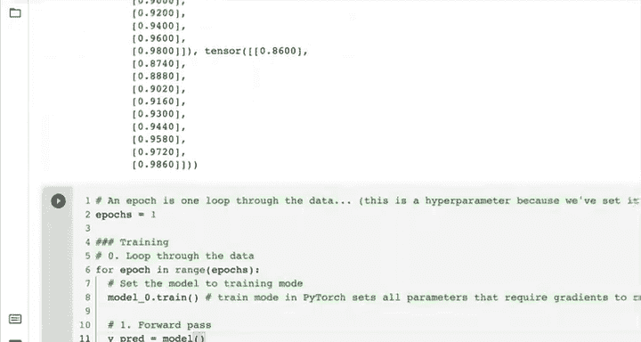

I going to get rid of that because we don't need that。

 So we're passing our model X train and model 0 is going to be our current model。 There we go。

 So we learn patterns on the training data to evaluate our model on the test data。 Number2。

 where we at。So we have to calculate the loss。 Now， in a previous video， we set up a loss function。

 So this is going to help us calculate the wat。 What kind of loss are we using。

 We want to calculate the MAe。 So the difference or the distance between our red dot and a green dot。

 and the formula would be the same if we had 10000 red dots and 10000 green dots。

 We're calculating how far they are apart。 and then we're taking the mean of that value。

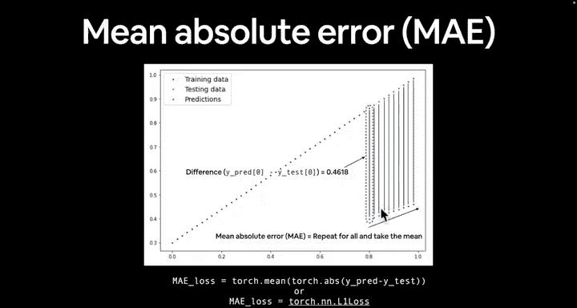

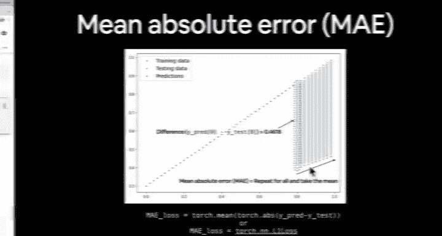

So let's go back here。So。Calculate。The loss。And in our case。

 we're going to set loss equal to our loss function， which is L1 loss in Ptorrch， but it is MAE。

Why pre and why train。 So we're calculating the difference between our models predictions on the training data set and the ideal training values。

 And if you want to go into。Torch dot N N loss functions。

That's going to show you the order because sometimes this confuses me to。

 what order the value go in here， But it goes prediction first then labels。

 and I may be wrong there because I get confused here。 My dyslexia kicks in。

 but I'm pretty sure it's predictions first then。Actual labels。

Do we have an example of where it's used。 Yeah， input first， Ta next。 So there we go。

 and truth be told， because it's mean absolute error， it shouldn't actually matter too much。

 But in the case of staying true to the documentation。

 let's do inputs first and then targets next for the rest of the course。Then we're going to go。

Optimizer0 grad。 haven't discussed this one， but that's okay。 I'm going to write the code。

 and then I'm going discuss what it does。 So what does this do。Actually， before we discuss this。

 I'm going to write these two steps because they kind of all work together。

 And it's a lot easier to discuss what optimizes0 grad does in the context of having everything else。

Perform back。Proagation。On the loss。With respect to the parameters of the model。

Back propagation is going to take the loss value。 So loss backward， I always say backwards。

 but it's just backward。 That's the code there。 And then number5 is step the optimizer。So， perform。

Graient descent。So optimizer dot step。 look at us。 We just wrote the five major steps of a training loop。

 Now， let's discuss how all of these work together， so。

It's kind of strange like the ordering of these。 You might think， oh， what should I do the order。

 Typically， the forwardd pass and the loss come straight up。

 Then there's a little bit of ambiguity around what order these have to come in。

 But the optimizer step should come after the back propagation。 So I just like to keep this order。

 how it is， because this works。 Let's just keep it that way。 But what happens here。 Well。

 it also is a little bit confusing in the first iteration of the loop， because we've got0 grad。

 But what happens here is that the optimizer makes some calculations in how it should adjust model parameters with regards to the back propagation of the loss。

 And so by default， these will。By default。How the optimizer。Changes will accumulate。Through the loop。

So。We have to0 them。Above。And step three for the next iteration of the loop。

So a big long comment there。 But what this is saying is。

 let's say we go through the loop and the optimizer chooses a value of one。 Change it by one。

 And then it goes through a loop again。 If we didn't zero it。

 if we didn't take it to 0 because that's what it is doing， it's going 1 to 0。 It would go， okay。

 next1，2，3，4，5，6，7，8， all through the loop， right， because we we're looping here。 if this was 10。

 it would accumulate the value that it's supposed to change 10 times But we wanted to start again。

 start fresh each iteration of the loop。 And now the reason why it accumulates。

 that's pretty deep in the piytor documentation from my understanding。

 there's something to do with like efficiency of computing， if you find out what the exact reason is。

 I'd love to know So we have to 0 it， then we perform back propagation。 if you recall。😊。

Back propagation is discussed。In here。And then with optimizer step， we form gradient descent。

 So the beauty of Pytorch， This is the beauty of Pytorch， is that it will。Perform back propagation。

 We're going to have a look at this in a second and gradient descent for us。

So to prevent this video from getting too long， I know we've just written code。

 but I would like you to practice writing a training loop yourself。

 Just write this code and then run it and see what happens。 Actually， you can comment this out。

 We're going to write the testing loop in a second。So your extra curriculum for this video is to one。

 rewrite this training loop is to two。

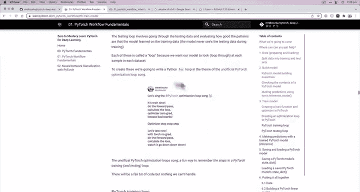

Sing the Pytorch optimization loop song， Let's go into here。If you w to remember the stepss， well。

 I've got a song for you。 This is the training loop song。 We haven't discussed the test step。

 but maybe you could try this yourself。

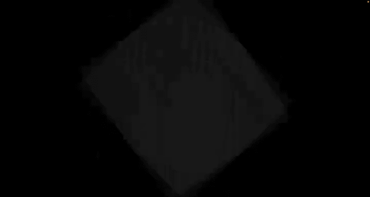

So， and this is an old version of the song。 Actually， I've got a new one for you。

But let's sing this together。 It's train time。 So we do the forward pass。 calculateulate the loss。

 Opimr 0 grad， loss backwards， Opimise a step， step step。

 now you only have to call optimize a step once。 This is just for jingle purposes。 But for test time。

 Let's test。 with Torch no grad。 do the forward pass。 calculate the loss。 watch to go down， down。

 down。 and that's from my Twitter。 but this is a way that I help myself remember the steps that are going on in the code here。

 And if you want the video version of it。 Well， you're just gonna have to search unofficial。😊。

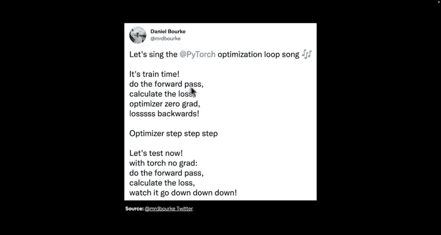

Pietorrch， Op loop song。Oh， look at that。 Who's that guy。 Well， he looks pretty cool。

 So I'll let you check that out in your own time。 But for now。😊。

Go back through the training loop steps。 I've got a colorful graphic coming up in the next video we're going to write the testing steps。

 and then we're going to go back one more time and talk about what's happening in each of them and again。

 if you'd like some even more extra curriculum， don't forget the videos I've shown you on back propagation and gradient descent。

😊，But for now。Let's leave this video here。 I'll see you in the next one。Friends， welcome back。

 In the last few videos we've been discussing the steps in a training loop in Pytorch。

 And there's a fair bit going on。 So in this video。

 we're going to step back through what we've done just to recap。

 And then we're going to get into testing。 And it's nice and early where I am right now。

 Sun's about to come up。 It's a very， very beautiful morning to be writing code。 So let's jump in。😊。

We've got a little song here for what we're doing in the training steps for an epo， arrange。

 Commodal dot train。 do the forwardd pass， calculateulate the loss。 Opimise a 0， grad last backward。

 Opimer step。 step， step。 That's the little jingle。 I use to remember the steps in here。

 because the first time you write it there's a fair bit going on。

 But subsequent steps and subsequent times that you do write it。 You'll start to memorize this。

 And even better later on， we're going to put it into a function。

 so that we can just call it over and over and over and over again。😊。

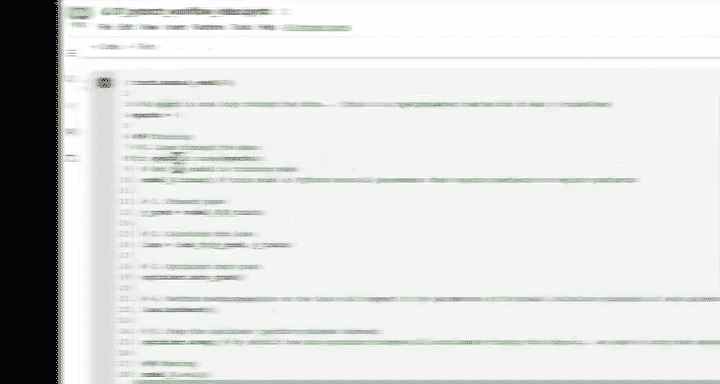

With that been said， let's jump in to a colourful slide， because that's a lot of code on the page。

 Let's add some color to it and understand what's happening that way you can refer to this and go， h。

 I see what's going on now。 So for the loop。 This is why it's called a training loop。

 We step through a number of epoch 1 epoch is a single forwardd pass through the data。

 So pass the data through the model for a number of epochs。 epoch is a hyperparameter。

 which means you could set it to 100。 You could set it to 1000。 You could set it to  one。

 as we're going to see later on in this video。😊。

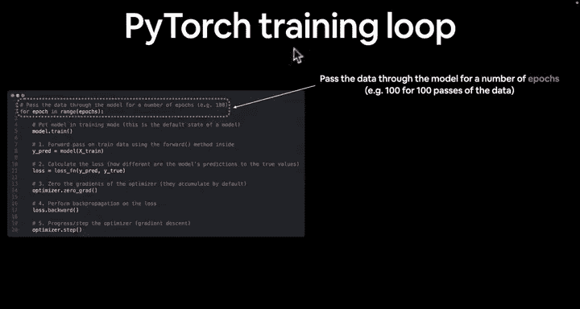

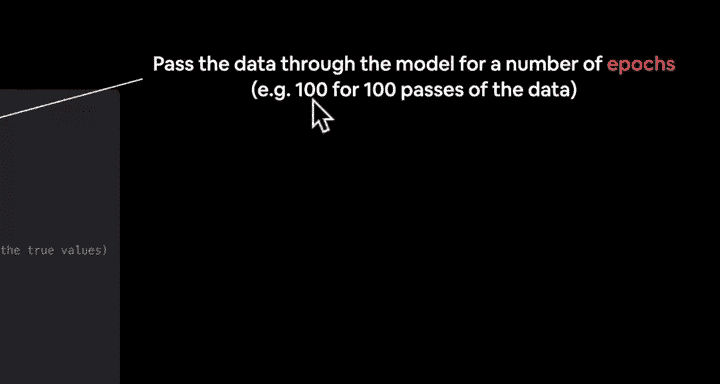

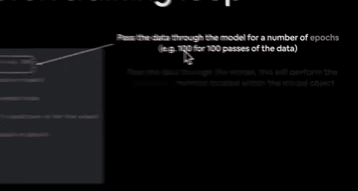

We skip this step with the colors， but we put the model in。 we call model dot train。

 This is the default mode that the model is in。Essential。

 it sets up a whole bunch of settings behind the scenes in our model parameters so that they can。

Track the gradients and do a whole bunch of learning behind the scenes with these functions down here。

 Pytorch does a lot of this for us。So the next step is the Ford pass We perform a forward pass on the training data in the training loop。

 this is an important note in the training loop is where the model learns patterns on the training data。

Whereas in the testing loop， we haven't got to that yet is where we evaluate the patterns that our model has learned or the parameters that our model has learned on unseen data。

 So we pass the data through the model， This will perform the forward method located within the model object。

 So because we created a model object。 you can actually call your models whatever you want。

 But it's good practice to， you'll often see it just called model。 And if you remember。

 we'll go back to the code。😊。

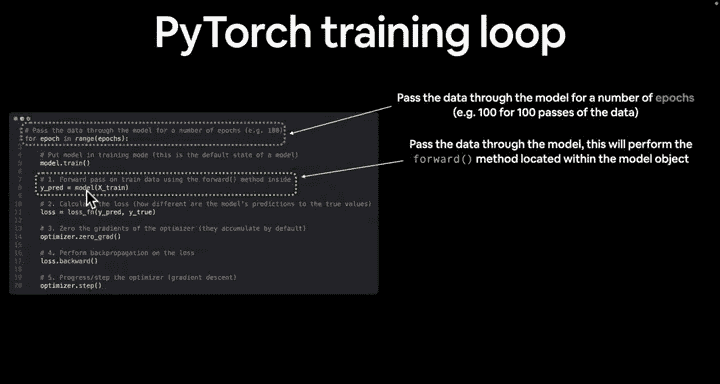

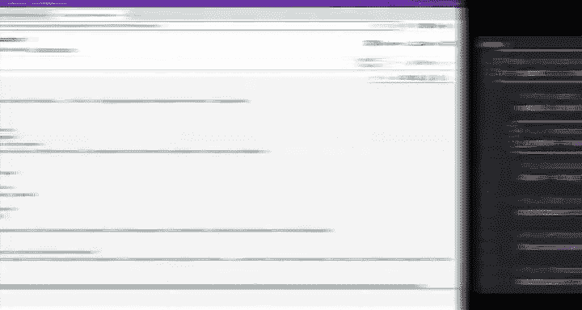

We created a forward method in our model up here。Which is this。Because our linear regression model。

 class subclass is N N dot module， we need to create our own custom forward method。

 So that's why it's called a Ford pass is because not only does it。 Well。

 the technical term is Ford propagation。 So if we have a look at a neural network。Pture。

Ford propagation just means going through the network from the input to the output。

 There is a thing called back propagation， which we're going to discuss in a second。

 which happens when we call loss stop backward， which is going backward through the model。

 But let's return to our colorful slide。We've done the Ford pass called a Ford method which performs some calculation on the data we pass it。

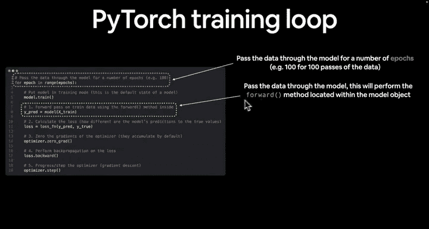

Next is we calculate the loss value， how wrong the model's predictions are。

 and this will depend on what loss function you use。

 what kind of predictions your model is outputting and what kind of true values you have。

 but that's what we're doing here we're comparing our models' predictions on the training data to what they should ideally be。

 and these will be the training labels。The next step。We zero the optimizer gradients。

 So why dont we do this？ Well， it's a little confusing for the first epoch in the loop。

But as we get down to optimizert step here， the gradients that the optimizer calculates accumulate over time so that for each epoch for each loop step。

 we want them to go back to0。 And now the exact reason behind why the optimizer accumulates gradients is buried somewhere within the Pytor documentation。

 I'm not sure the exact reason from memory， it's because of compute optimization。

 it just adds them up in case you wanted to know what they were。

 But if you find out exactly I'd love to know。😊，Next step is to perform back propagation on the loss function。

 That's what we're calling loss stop backward。 Now。

 back propagation is we compute the gradient of every parameter which requires grad equals true。

 And if you recall， we go back to our code。We've set requires grad equals true for our parameters。

 Now， the reason we've set requires grad equals true is not only so backproag can be performed on it。

But。😡，Let me show you what the gradients look like。 So let's go loss function curve。

 That's a good idea。So we're looking for some sort of convex curve here。There we go。 L 2 loss。

 We're using L1 loss at the moment。Is there a better one here。

All we need is just a nice looking curve。 here we go。So。

This is why we keep track of the gradients Behind the scenes。

 Pytorrch is going to create some sort of curve for all of our parameters that looks like this。 Now。

 this is just a 2D plot。 So the reason why we're just using an example from Google imagesmages is one because you're going to spend a lot of your time Googling different things and 2。

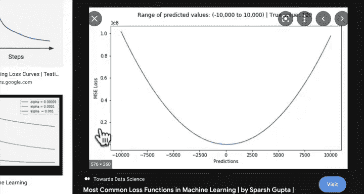

In practice， when you have your own custom neural networks right now， we only have two parameters。

 So it's quite easy to visualize a loss function curve like this。 But when you have， say。

 10 million parameters， you basically can't visualize what's going on。

And so Pytorch again will take care of these things behind the scenes。

 But what it's doing is when we say requires grad， Pytorch is going to track the gradients of each of our parameters。

 And so what we're trying to do here with back propagation and subsequently gradient descent is calculate where the lowest point is。

 because this is a loss function， this is ME loss， we could trade this out to be Me loss in our case。

 or L1 loss for our specific problem。But this is some sort of parameter。

 And we calculate the gradients because what is the gradient。 Let's have a look。

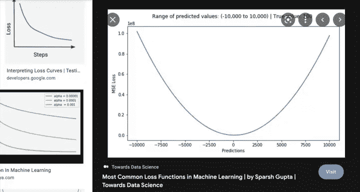

What is。A gradient。A gradient is。

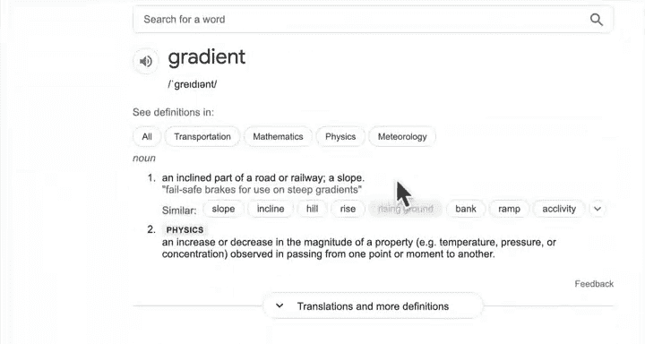

An inclined part of a road or railway。 No， we want it in machine learning。

What's it going to give us in machine learning， a gradient is a derivative of a function that has more than one input variable。

 Okay， let's dive in a little deeper。 See， here's some beautiful lost landscapes。

 We're trying to get to the bottom of here。 This is what gradient descent is all about。😊，So oh。

 there we go。 So this is a cost function， which is also a loss function。

 We start with a random initial variable。 What have we done。

 We've started with a random initial variable， right， okay， and then we take a learning step。

 beautifuli。 This is W。 So this could be our weight parameter。 Okay， we're connecting the dots here。

 This is exciting。😊，We've got a lot of tabs here， but that's all right。 Well。

 we'll bring this all together in a second。 And what we're trying to do is come to the minimum。 Now。

 why do we need to calculate the gradients？ Well， the gradient is what。

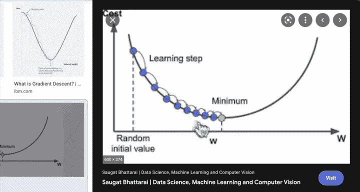

Oh value of weight。 Here we go。 This is even better。 I love Google imagesage。😊，So this is our loss。

 and this is a value of a weight， so we calculate the gradients y。😊。

Because the gradient is the slope of a line or the steepness。

 And so if we calculate the gradient here and we find that it's really steep。

Right up the top of this， this incline， we might head in the opposite direction to that gradient。

 That's what gradient descent is。 And so if we go down here， now， what are these step points。

 is a little thing that I' wrote down in the last video at the end of the last video。

 I haven't told you about yet， but I was waiting for a moment like this。And if you recall。

 I said kind of all of these three steps， optimize a0 grad loss backward。

 optimizeise a step altogether together。 So we calculate the gradients because we want to head in the opposite direction of that gradient to get to a gradient value of 0。

 And if we get to a gradient value of 0 with a loss function。 Well then the loss is also 0。

So that's why we keep track of the gradient with requires grad equals true。 And again。

 Pytorch does a lot of this behind the scenes。 and if you want to dig more into what's going on here。

 I'm going to show you some extra resources for back propagation。

 which is calculating this gradient curve here and gradient descent。

 which is finding the bottom of it towards the end of this video and again。

 if we started over this side， we would just go on the opposite direction of this。

So maybe this is our positive gradient here， and we just go in the opposite direction here。

 We want to get to the bottom。 That is the main point of gradient descent。And so if we come back。😊。

I said。Just keep this step size in mind here。 If we come back to where we created our loss function and optimizer。

I put a little tidbit here for the optimizer。Cause we've written a lot of code and we haven't really discussed what's going on。

 but I like to do things on the fly as we need them。

 So inside our optimizer we'll have main two parameters， which is parameterss。

 So the model parameters you'd like to optimize parameterss equals model0 dot parameters in our case。

 and pitorrch is going to create something similar to this curve， not visually。

 but just mathematically behind the scenes for every parameter。 Now this is a value of weight。

 So this would just be potentially the weight parameter of our network。 But again。

 if you have 10 million parameters， there's no way you could just create all of these curves yourself。

 that's the beauty of pitorrch， it's doing this behind the scenes through a mechanism called torch autograd。

 which is auto gradient calculation， And there's beautiful documentation on this。

 if you'd like to read more on how it works。 please go through that。

 but essentially behind the scenes it's doing a lot of this for us for each parameter。

 that's the optimizer。😊，Then within the optr， once we've told it what parameters to optimize。

 we have the learning rate。 So the learning rate is another hyperparameter that defines how big or small the optimizer changes the parameters with each step。

So a small learning rate results in small changes， whereas a large learning rate is in large changes。

 And so if we look at this curve here， we might at the beginning， start with large steps。

 so we can get closer and closer to the bottom。 But then as we get closer and closer to the bottom to prevent stepping over to this side of the curve we might do smaller and smaller steps。

 and the optimizer in pytorch， there are optimizes that do that for us。

 but there is also another concept called learning rate scheduling。Which is， again。

 something if you would like to look up and do more。 But learning rate scheduling essentially says。

 hey， maybe start with some big steps。 And then as we get closer and closer to the bottom。

 reduce how big the steps are that we take。 because if you've ever seen a coin。

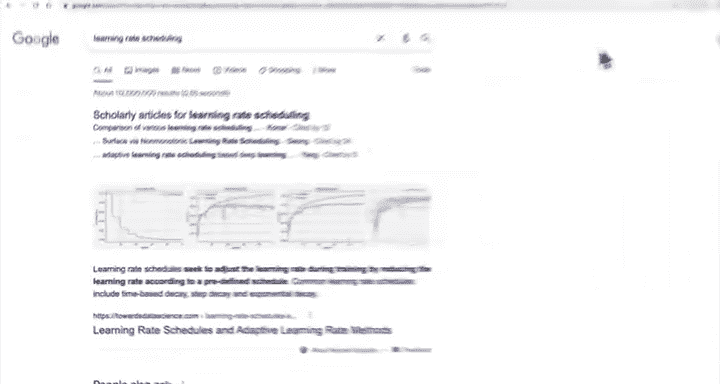

Coin at backov Co。This is my favourite analogy for this。

 If you've ever tried to reach a coin at the back of a couch。Like this， excited young chap。

If you're reaching towards the back of the couch， you take quite big steps as you say your arm was over here。

 You would take quite big steps until you get to about here。 And then the closer you get to the coin。

 the smaller and smaller your steps are otherwise what's going to happen。

 The coin's going to be lost， or if you took two small steps。 you'd never get to the coin。

 It would take forever to get there。 So that's the concept of the learning rate。 If you take。

2 big steps。 you're going to just end up over here。 If you takes two small steps。

 it's going to take you forever to get to the bottom here。

 And this bottom point is called convergence。 That's another term you're going to come across。

 I know I'm throwing a lot of different terms at you。

 But that's the whole concept of the learning rate。

 How big is your step down here in gradient descent。 gradient descent is this。

 back propagation is calculating these derivative curves or the gradient curves for each of the parameters in our model。

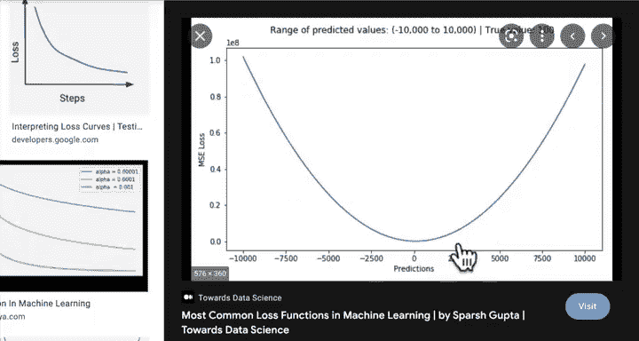

So let's get out of here。

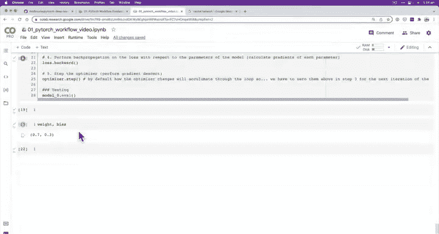

We'll go back to our training steps Where were we。 I think we're up to。Back propagation。

 Have we done backward， Yes， so the back propagation is where。

We do the backward steps of the forwardd pass， forwardd propagation go from input to output。

 back propagation。 We take the gradient of the loss function with respect to each parameter in our model by going backwards。

 That's what happens when we call loss stop backward。 Py to does that for us behind the scenes。

And then finally， step number five is step the optimizer。 we've kind of discussed that。 As I said。

 if we take a step， let's get our loss curve back up。

Lost function curve doesn't really matter what curve we use。

The optimizer step is taking a step this way to try and optimize the parameters so that we can get down to the bottom here。

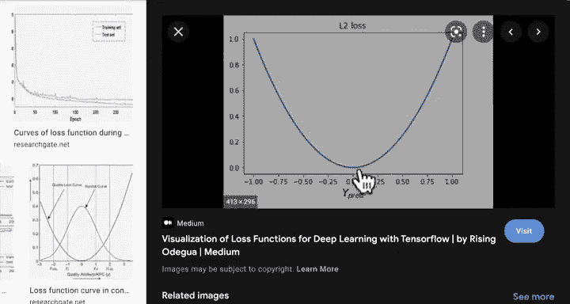

And I also just noted here that you can turn all of this into a function。

 so we don't necessarily have to remember to write these every single time the ordering of this。

 You'll want to do the forwardd pass first and then calculate the loss because you can't calculate the loss unless you do the forwardd pass。

 I like this ordering here of these three as well。 but you also want to do the optimizer step after the loss backward。

 So this is my favorite ordering。 It works。 If you like this ordering， you can take that as well。

With that being said， I think this video has gotten long enough。In the next video。

 I'd like to step through this training loop， one epoch at a time so that we can see。

 I know I've just thrown a lot of words at you that this optimizer is going to try and optimize our parameters each step。

 but let's see that in action how our parameters of our model actually change every time we go through。

😡，Each one of these steps。 So I'll see you in the next video。 Let's step through our model。

