# mrdbourke《一天学会pytorch深度学习｜Learn PyTorch for deep learning in a day Literally》中英 - P41：49. Writing testing loop code.zh_en - GPT中英字幕课程资源 - BV1kx4y1r79d

Welcome back。 In the last video， we did something super excited。 We saw our loss go down。

 So the loss is remember how different our model's predictions are to what we'd ideally like them。

 And we saw our model update its parameters through the power of back propagation and gradient descent all taken care of behind the scenes for us by pieytorrch。

 So thank you Pytorrch。 And again， if you'd like some extra resources on what's actually happening from a math perspective for back propagation and gradient descent。

 I would refer to you to these。 Otherwise， this is also how I learn about things。 gradient descent。😊。

There we go， how does gradient descent work， and then we've got back propagation。

And just to reiterate， I am doing this， just googling these things because that's what you're going to do in practice。

 You're going to come across a lot of different things that aren't covered in this course。

 And this is seriously what I do day to day as a machine learning engineer if I don't know what's going on。

 I just go to Google， read， watch a video， write some code。

 And then I'd build my own intuition for it， But with that being said。

 I also issued you the challenge of trying to run this training code， for 100 epochs。

 Did you give that a go， I hope you did， And how low did your loss value。

 Did the weights and bias get anywhere close to where they should have been。

 How do the predictions look。Now I'm going to save that for later on running this code for 100 epochs。

 For now， let's write some testing code。 And just a note。

 you don't necessarily have to write the training and testing loop together。

 You can functionise them， which we will be doing later on。 but for the sake of this intuition。

 building and code practicing and first time where we're writing this code together。

 I'm going to write them together so。Testing code， we call model dot of our。 What does this do。

 So this turns off。Different settings。In the model， not needed for。Evaluation。Slash testing。

 This can be a little confusing to remember when you're writing testing code。

 but we're gonna to do it a few times until it's habit。 So just make it a habit。

 if you're training your model call model dot train to make sure it's in training mode。

 if you're testing or evaluating your model。 So that's what a vow stands for evaluating call model do aval。

 So it turns off different settings in the model not needed for evaluations So testing。

 this is things like dropout。 we haven't seen what dropout is slash batch norm layers。

 But if we go into torch do an N。 I'm sure you'll come across these things。

In your future machine learning endeavors。So， drop out。Drop out layers， there we go and batch norm。

 do we have batch？Batch norm， there we go。 If you'd like to work out what they are。

 feel free to check out the documentation。 Just take it from me for now that model of our turns off different settings not needed for evaluation and testing。

Then we set up with Torch。t inference mode。Inference mode。So what does this do。

 Let's write down here。So this turns off gradient tracking。 So as we discussed。

 if we have parameters in our model。And it turns off actually a few more things。

And a couple more things。Behind the scenes。These are things， again， not needed for testing。

 So we discussed that if parameters in our model have requires grad equals true。

 which is the default for many different parameters in Pytorrch。Pytoch will behind the scenes。

 keep track of the gradients of our model and use them in lost up backward and optimize a step for back propagation and gradient descent。

 however。We only need those two back propagation and gradient descent during training。

 because that is when our model is learning。 when we are testing。

 we are just evaluating the parameters the patterns that our model has learned on the training data set。

 So we don't need to do any learning when we're testing。

 So we turn off the things that we don't need。 And is this going to have the correct spacing for me。

 I'm not sure we'll find out。 So we still do the forward pass。

In testing mode。Do the forward pass。 And if you want to look up torch inference mode。

 just go torch inference mode。 There's a great tweet about it。 that Pi torch did。

 which explains what's happening。

I think we've covered this before。 but yeah， want to make your inference code and Ptorrch run faster。

 Here's a quick thread on doing exactly that。 So inference mode is torch nograd。 Again。

 you might see torch nograd。 I think I'll write that down just to。

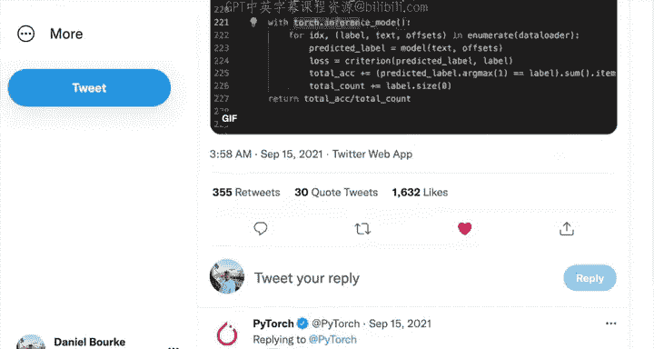

Let you know。 But here's what's happening behind the scenes。 A lot of optimization code。

 which is beautiful。 This is why we're using Pytorch。 so that our code runs nice and far。

 Let me go there。 You may also see with torch dot nograd in older piytorrch code。

 It does similar things， but inference mode is。😊，The faster way of doing things。

 according to the thread。 and according to there's a blog post attached to there as well， I believe。

So。You may also see Torch。 Nograd。In older。Ply torch code， which would be valid， but again。

 inference mode is the better way of doing things。So do forward pass。 So let's get our model。

 We want to create test predictions here。 So we're going to go model 0。

 There's a lot of code going on here， but I'm going to just step by step it in a second。

 We'll go back through it all。And then number two is calculate the loss。 Now。

 we're doing the test predictions here。 calculateulate the loss。Test predictions with Model0。

 So now we want to calculate the w。 We want to calculate the test loss。

 So this will be our loss function， the difference between the test pre and the test labels that's important。

 So for testing， we're working with test data for training。

 we're working with training data model learns patterns on the training data and it evaluates those patterns that it's learned the different parameters on the test data data it has never seen before。

 just like in a university course， you'd study the course materials。

 which is the training data and you'd evaluate your knowledge on materials you'd hopefully never seen before unless you sort of were friends with your professor and they gave you the exam before the actual exam that would be cheating right。

 So that's a very important point for the test data set。

 don't let your model see the test data set before you evaluate on Otherwise。

 you'll get poor results。And that's point out what's happening。 Epoch。 We're going to go epoch。

 And then I will introduce you to my little jingle to remember all of these steps because there is a lot going on。

 Don't you worry， I know there's a lot going on， but。Again， with practice， we're going to。No。

 what's happening here？Like it's the back of our hand。All right。So do we need this， Yeah。

 we could say that。 Oh no， we don't need test here。 Los。 This is loss， not test。

Print out what's happening。Okay。And we don't actually need to do this every epoch。

 we could just go say if epoch。Divided by 10 equals 0。 Pri out what's happening。

 Let's do that rather than clutter everything up， print it out， and we'll print out this。

So let's just step through what's happening。 We've got 100 epochs。 That's what we're about to run。

100 epochs。 Our model is trained for about 10 so far。 So it's got a good base。

 Maybe we'll just get rid of that base。 Start a new instance of our model。

So we'll come right back down。So our model is back to randomly initialized parameters， but。

 of course， randomly initialized， flavored with a random seed or 42。 Lovely， lovely。

 And so we've got our training code here。 We've discussed what's happening there。😊，Now。

 we've got our testing code。 We call model do aval， which turns off different settings in the model。

 not needed for evaluation slash testing。 We call with torch inference mode context manager。

 which turns off gradient tracking and a couple more things behind the scenes to make our code faster。

 We do the forward pass。 We do the test predictions。 We pass our model the test data。

 the test features to calculate the test predictions。

Then we calculate the loss using our loss function。

 We can use the same loss function that we used for the training data。

 and it's called the test loss because it's on the test data set。

 And then we print out what's happening。 because we want to know what's happening while our model is training。

 We don't necessarily have to do this。 But the beauty of Pytors。

 you can use basic python printing statements to see what's happening with your model。

 And so because we're doing 100 epochs， we don't want to clutter up everything here。

 So we're just print out what's happening every 10th epoch。 Again。

 you can customize this as much as you like what's printing out here。 This is just one example。

 If you had other metrics here， such as calculating model accuracy， we might see that later on。

 hintin hint。We might print out our model accuracy。So this is very exciting。

 Are you ready to run 100 epochs。 How low do you think our loss can go。😊。

This loss was after about 10。 So let's just save this here。 Let's give it a go。 Ready，3，2，1。

 let's run。Oh my goodness。 Look at that， whites。Here we go。

 Every 10 epochs were printing out what's happening。 So the0 the epoch， we started with losses is 3。

1，2。 Look at it go down。Yes， that's what we want。 And are our weights and bias。

 Are they moving towards our ideal weight and bias values of 0。7 and 0。3。 Yes。

 the're moving in the right direction here。 The loss is going down。 Epoch 20， wonderful。 epoch 30。

 even better。40，50 going down， down down。 Yes， this is what we want。 This is what we want。 Now。

 we're predicting a straight line here。 Look how low the loss gets。 after 100 epochs。 We've got。😊。

About three times less than what we had before。And then weve got these values are quite close to where they should be。

 05，629，03，5，7，3， or make some predictions。 What are they look like？Whyprereads new。

 this is the original predictions with random values， and if we make Ypres new。Look how close it is。

 After 100 epochs。 Now， what's our， do we print out the test loss， Oh no。

 we're printing out loss as well， Let's get rid of that。 I think this is this， yeah。

 that's this statement here。 Our code would have been a much cleaner if we didn't have that。

 but that's all right。 Life goes on。 So our test loss。

 because this is the test predictions that we're making， is not as low as our training loss。

 I wonder how we could get that lower。 What do you think we could do。😊，We just trained it for longer。

 And what happened。How do you think you could get these red dots to line up with these green dots。

 do you think you could？So that's my challenge to you for the next video。

 think of something that you could do to get these red dots to match up with these green dots。

 maybe train for longer。How do you think you could do that？

So give that a shot and I'll see in the next video we'll review what our testing code is doing。所以咧。

Welcome back。 In the last video， we did something super exciting。

 We trained our model for 100 epochs and look how good the predictions got。

 but I finish it off with challenging you to see if you could align the red dots with the green dots。

 And it's okay if you're not sure how the best way to do that。 That's what we're here for。

 We're here to learn what are the best way to do these things together。

 But you might have had the idea of potentially training the model for a little bit longer。

 So how could we do that。😊，Well， we' could just rerun this code。

So the model is going to remember the parameters that it has from what we've done here。

 and if we rerun it， well it's going to start from where it finished off。

 which is already pretty good for our data set， and then it's going to try and improve them even more。

This is a kindt stress enough。 like what we are doing here is going to be very similar throughout the entire rest of the course for training more and more models。

 So this step that we've done here for training our model and evaluating it is seriously like the fundamental steps of deep learning with pieytorrch is training and evaluating a model。

 and we've just done it。Although albeit to predict some red dots and green dots。That's all right。

 So let's try to line them up。 Hey， red dots onto green dots。

 I reckon if we train it for another 1 hundred0 epochs， we should get pretty darn close。readyy。

 three， two， one， I'm going to run this cell again。

Runs really quick because our data is nice and simple。 But look at this last we start at 02，4，4。

 Where do we get down to008， Oh my goodness。 So we've improved it by another 3 x or so。

 And Now this is where our models got really good on the test loss we've gone from000，5，6，4。

 and we've gone down to 005。 So almost 10 x improvement there。 And so we make some more predictions。

 What are our model parameters。 Remember the ideal ones here。

 we won't necessarily know them in practice。 but because we're working with a simple data set。

 we know what the ideal parameters are。😊，Model  zero state dig weights。

These are what they previously were。 What are they going to change to？Oh， would you look at that。

 Ho ho，0，6，9，9，0。 Now， again， if yours are very slightly different to mine， don't worry too much。

 That is the inherent randomness of machine learning and deep learning。

 even though we set a manual seed， it may be slightly different。The direction is more important。

 So if your number here is not exactly what mine is， it should still be quite close to 0。7。

 And the same thing with this one。 If it's not exactly what mine is， don't worry too much。

 the same with all of these loss values as well， The direction is more important。

So we're pretty darn close。 How do these predictions look， Remember。

 these are the original ones we started with random。 and now we've trained a model。So close。

So close to being exactly that。 So a little bit off。 But that's all right。

 We could tweak a few things to improve this。 But I think thats that's well and truly enough for this example purpose。

 You see what's happened。 Of course， we could just create a model and set the parameters ourselves manually。

 But where would be the fun in that。 We just wrote some machine learning code to do it for us through the power of back propagation and gradient descent。

 Now， in the last video， we wrote the testing loop。 We discussed a few of the steps here。

 But now let's go over it with a colourful slide。 Hey， because I mean， code on a page is nice。

 but colors are even nicer。 Oh， we haven't done this。 We might set up this in this video， too。😊。

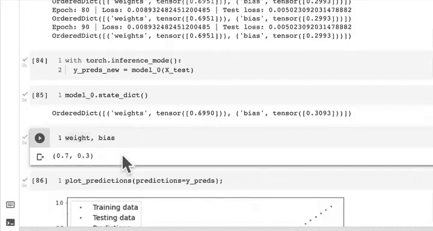

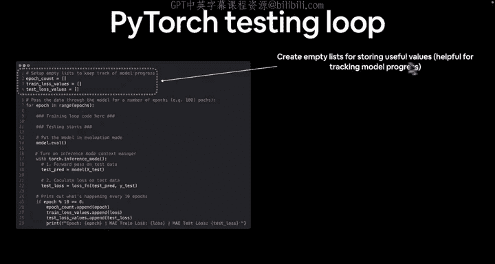

But let's just discuss what's going on。 createate an empty list for storing use for value。

 So this is helpful for tracking model progress。t we just do this right now。 Hey。

 we'll go here and we'll go。

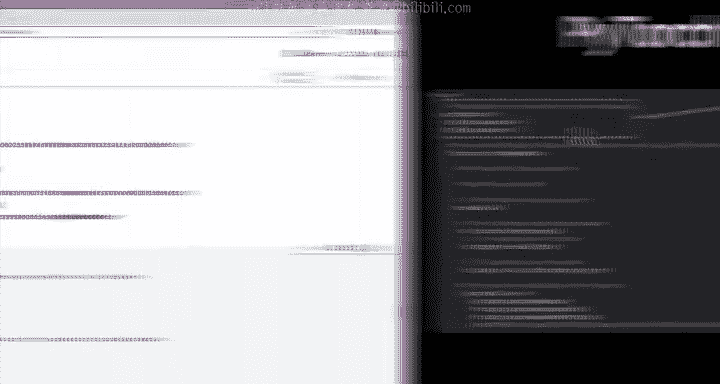

So what did we have epoch count？Equals that。 And then we'll go。Lost values。

 So why do we keep track of these， It's because。If we want to monitor our model's progress。

 this is called tracking experiments。 So track different values。

 If we wanted to try and improve upon our current model with a future model。 So our current results。

Such as this， if we wanted to try and improve upon it。

 we might build an entire other model and we might train it in a different setup。

 We might use a different learning rate， we might use a whole bunch of different settings。

 but we track the values so that we can compare future experiments to past experiments like the brilliant scientists that we are。

And so where could we use these lists， Well， we're calculating the loss here and we're calculating the test loss here。

 So maybe we each time append。What's going on here as we do a status update。 So epoch count。

Dot append。 And we're going to go the current epoch。And then we'll go Los values dot append。

 a current loss value。 and then we will do test loss values dot append the current test loss values。

 Wo。 And now let's instantiate our model so that it starts from fresh。

 So this is just create another instance。 So we're just gonna reinitialize our model parameters to start from zero。

 If we wanted to， we could functionize all of this so we don't have to go right back up to the top of the code。

 But just for demo purposes， we're doing it how we're doing it。 And I'm going to run this for。

 let's say 200 epochs because that's what we ended up doing right。

 We ran it for 200 epochs because we did 100 epochs twice。

 And I want to show you something beautiful。 One of the most beautiful sites in machine learning。

 So there we go， we run it for 200 epochs， we start with a fairly high training loss value and a fairly high test loss value。

 So remember， what is our loss value。 It's NAe。 So if we go back。

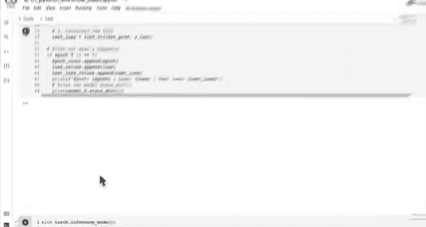

Yeah， this is what we're measuring for loss。 So this means for the test loss， On average。

 each of our dot points here， the red predictions are 0 point。

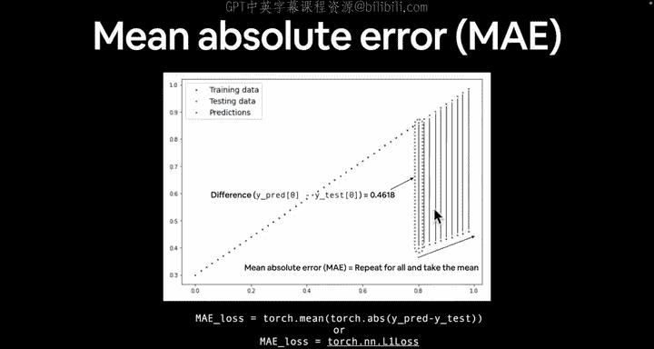

4，81。 That's the average distance between each dot point。 And then ideally， what are we doing。

 We're trying to minimize this distance。 That's the Me。 So the mean absolute error。

 And we get it right down to 0。05。 And if we make predictions。 What do we have here。

 we get very close to the ideal weight and bias。 Make our predictions。

 Have a look at the new predictions。 Y， very small distance here。 beautifulut。

 That's a low loss value。

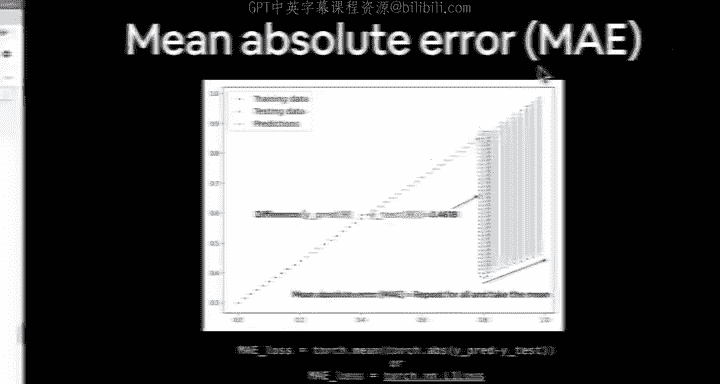

Ideally， they'd line up， but we've got as close as we can for now。

 So this is one of the most beautiful sight in machine learning。 So plot the loss curves。😊。

So let's make a plot because what were we doing， we were tracking the value of epoch count。

Loss values。 And test loss values。Let's have a look at what these all look like。

So epoch count goes up， Los values ideally go down。 So we'll get rid of that。

 We're going to create a plot， PLT dot plot。We're going to step back through the。

Test loop in a second， with some colorful。Slides， label equals train loss。

And then we're going to go plot。You might be able to tell what's going on here。 Test loss values。

 We're going to visualize it because that's the data Explorer's motto， right， is visualize。

 visualize， visualize。 This is equals see， coLive does this autocorr。

 That doesn't really work very well。 And I don't know when it does it and why it doesn't。Have we got。

I no， we didn't。 We didn't say Las Vegas。 So that's a good order。 correct。 Thank you， Coab。

So training and loss and test loss curves So this another term you're going to come across often is a loss curve Now you might be able to think about a loss curve if we're doing a loss curve and it's starting at the start of training。

 what do we want that curve to do？What do we want our lost value to do， We want it to go down。

 So what should an ideal loss curve look like Well， we're about to see a couple。 Let's have a look。

 Oh， what do we got wrong。We need to oh， turn it into nuumpy。Is this what we're getting wrong？

So why is this wrong？Losts values， why are we getting an issue？Test loss values。

It's because they're all tensor values。 So I think we should let's。I might change this to Nie。Oh。

 can I just do that if I just call this as an umpi array， we're going to try and fix this on the fly。

People Numpier array， will this turn this into a nuumpier array？Let's see if we get nu pie。

Of figuring these things out together。Numpy as nuump， because Matpl Lib works with nuumpy。 Yeah。

 there we go。 So can we do loss values， maybe。I'm gonna try one thing Torch dot tensor loss values。

 and then call。CPu。t南海。See what happens here。There we go。 Okay， so let's just copy this。

 So what we're doing here is our loss values are still。On Pytorch。

 and they can't be because Matpl Libb works with。Numpy and so what we're doing here is we're converting our loss values of the training loss to Numpy。

 And if you call from the fundamental section， we call CPU and Numpy。

 I wonder if we can just do straight up Numpy。Ca we're not working on there。 Yeah， Okay。

 we don't need CPU because we're not working on the GP yet， but we might need that later on。

 Will this work beautiful there we go。 One of the most beautiful sites in machine learning is a declining loss curve。

 So this is how we keep track of our experiments。Or one way， quite rudimentary。

 we'd like to automate this later on。But I'm just showing you one way to keep track of what's happening。

 So the training loss curve is going down here。 The training loss starts at 0。3。

 and then it goes right down。 The beautiful thing is they match up。

 If there was a two bigger distance behind the train loss in the test loss or sorry between。

 then we're running into some problems。 But if they match up closely at some point that means our model is converging and the loss is getting as close to0 as it possibly can。

 If we train for longer， maybe the loss will go almost basically to 0。

 But that's an experiment I'll leave you to try to train that model for longer。

 Let's just step back through our testing loop to finish off this video。

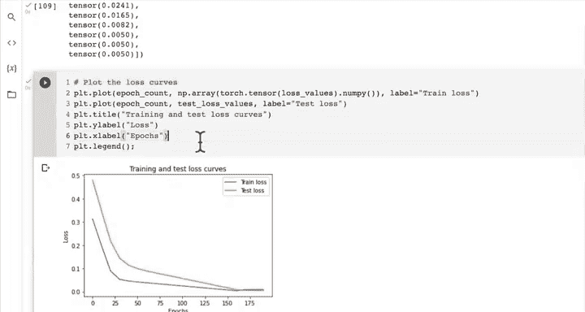

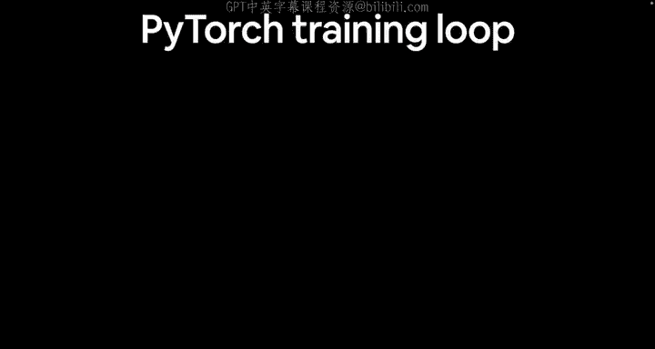

So we did that。 We created empty lists for strong useful values， storing useful values。

 strong useful values， told the model what we want to evaluate or that we want to evaluate。

 So we put it in evaluation mode。 It turns off functionality use for training， but not evaluations。

 such as drop out in batch normalization layers。 If you want to learn more about them。

 You can look them up in the documentation。

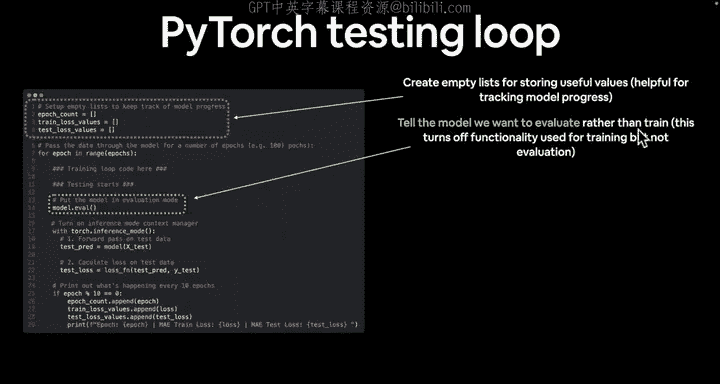

Turn on torch inference mode， so this is for faster performance。So we don't necessarily need this。

 but it's good practice。 So I'm going to say that， yes， turn on torch inference mode。

 So this disables functionality， such as gradient tracking for inference。

 gradient tracking is not needed for inference only for training。

Now we pass the test data through the model， so this will call the modelss implemented Ford method。

 the ForD pass is the exact same as what we did in the training loop except we're doing it on the test data。

 so big notion there， training loop， training data， testing loop， testing data。

Then we calculate the test loss value， how wrong the model's predictions are on the test data set。

 and， of course， lower is better。 Then finally， we print out what's happening so we can keep track of what's going on during training。

 We don't necessarily have to do this you can customize this print value to print out almost whatever you want because it's pytorrch is basically very beautifully interactive with pure Python。

 And then we keep track of the values of what's going on on epochs and train loss and test loss。

 We could keep track of other values here。 But for now， we're just going， okay。

 what's the loss value at a particular epoch for the training set and for the test set。

 And of course， all of this could be put into a function And that way we won't have to remember these steps off by heart。

 But the reason why we've spent so much time on this is because we're going to be using this training and test functionality for all of the models that we build throughout this course。

 So give yourself a pat in the back for getting through all of the。😊，videos。

 we've written a lot of code。 We've discussed a lot of steps。

 but if you'd like a song to remember what's happening。

 let's finish this video off with my unofficial pietorrch Op loop song。

 So for an epoch in arrange Commoddo dot train， do the forwardd pass。 calculate the loss。

 Opimr0 grad loss backward Opim a step， step step， note you and they have to call this once。

 But now let's test Commoddo dot of vow with tornch inference mode do the Ford pass。

 calculate the loss and then that real song goes for another epoch because you keep going back through。

 but we finish off with print out what's ha then and then， of course。😊。

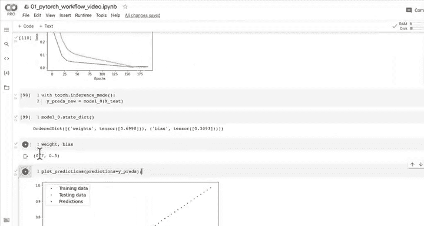

We evaluate what's going on With that being said， it's time to move on to another thing。

 but if you'd like to review what's happening， please， please。

 please try to run this code for yourself again and check out the slides and also check out the extra curriculum。

 Oh， by the way， if you want to link to all of the extra curriculum。

 just go to the book version of the course。 and it's all going to be in here。

 So that's there ready to go。 Everything I link as extra curriculum will be in the extra curriculum of each chapter。

😊。

I'll see you in the next video。