# mrdbourke《一天学会pytorch深度学习｜Learn PyTorch for deep learning in a day Literally》中英 - P42：51. Saving-loading a model.zh_en - GPT中英字幕课程资源 - BV1kx4y1r79d

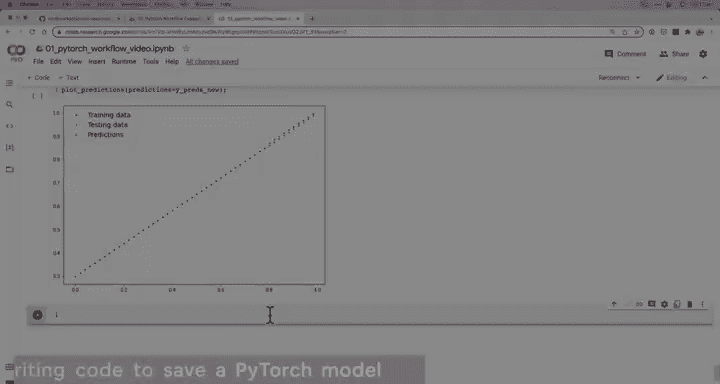

Welcome back。 In the last video， we saw how to train our model and evaluated by not only looking at the loss metrics and the loss curves。

 but we also plotted our predictions。 and we compared them。 Hey。

 have we got at these random predictions。 Quite terrible。

 But then we trained a model using the power of back propagation and gradient descent。

 And now look at our predictions。 They're almost exactly where we want them to be。

 And so you might be thinking， well， we've trained this model and it took us a while to write all this code to get some good predictions。

 How might we run that model again。 So I've took a little break after the last video。

 But now I've come back and you might notice that my Google coab notebook has disconnected。

 So what does this mean if I was to run this。😊，Is it going to work。

're going to connect to a new Google co La instance。

 But will we have all of the code that we've run above。

You might have already experienced this if you took a break before and came back to the videos。

 So plot predictions is no longer defined。 And do you know what that means。

 That means that our model is also no longer defined。 So we would have lost our model。

 We would have lost all of that effort of training。 Now， luckily。

 we didn't train the model for too long。 So we can just go run time， run all。

 And it's going to rerun all of the previous cells and be quite quick。

Because we're working with a small data set and using a small model。

 But we've been through all of this code， or whatever have we got wrong here。Model 0 state diict。 Oh。

 that's all right。 This is good。 We're finding errors。 So if you want to as well。

 you can just go run after。 It's going to run all of the cells after。Beautiful。

 and we come back down。 There's our model training。

 We're getting very similar values to what we got before。 There's the loss curves。

 beautifulut still going。 Okay， now our predictions are back because we've rerun all the cells and we've got our model here。

 So what we might cover in this video is saving。😊，A model in Pytorrch。

 Because if we're training a model。And you get to a certain point。

 especially when you have a larger model， you probably want to save it and then reuse it in this particular notebook itself。

 or you might want to save it somewhere and send it to your friend so that your friend can try it out。

 or you might want to use it in a week's time。 And if Google Coab is disconnected。

 you might want to be able to load it back in somehow。 So now。

 let's see how we can save our models in Pytorch。 so。😊，I'm going to write down here。

 there are three main methods。You should know about。For saving and loading models in pytorch。

 Because， of course， with saving comes loading。 So we're going to over the next two videos。

 discuss saving and loading。 So one is torch shot save。 And as you might guess。

 this allows you to save pytorch。😊，Object。In Pythons。Pickle format。

So you may or may not be aware of Python pickle。There we go。Python object serialization。 There we go。

 So we've got the pickle module implements a binary protocols or implements binary protocols for serializing and deializing a Python object。

 So serializing means I understand it as saving and decializing means that is loading。

 So this is what Pythtor uses behind the scenes， which is from pure Python。

So if we go back here in Python's pickle format， number two is torch。load。

 which you might be able to guess what that does as well。

 allows you to load a saved Pythtorrch object。And number three is also very important is taunch。nn。

module。loadstate deckt。Now， what does this allow you to do？ Well。

 this allows you to load a model's saved dictionary。Or save state dictionary。 Yeah。

 that's what we'll call it。 Sa state dictionary。 beautifuli。 And what's the model state dict。 Well。

 let's have a look。 Model 0 dot state diict。😊，The beauty of Pytorrch is that it stores a lot of your model's important parameters in just a simple python dictionary。

 Now， it might not be that simple because our model， again， only has two parameters in the future。

 You may be working with models with millions of parameters。

 So looking directly at the state dick may not be as simple as what we've got here。

 but the principle is still the same。 It's still a dictionary that holds the state of your model。

 And so I've got these three methods。 I want to show you where from。

 because this is going to be your extracur。 save and load models。

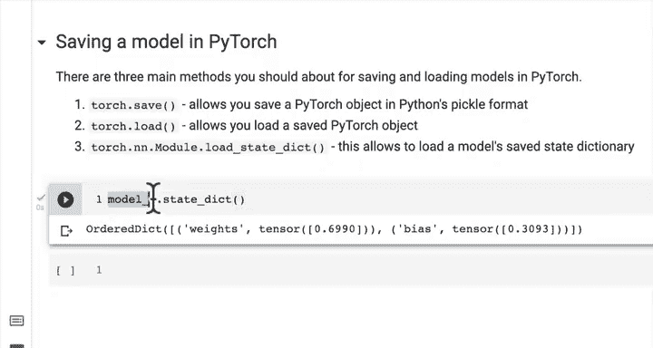

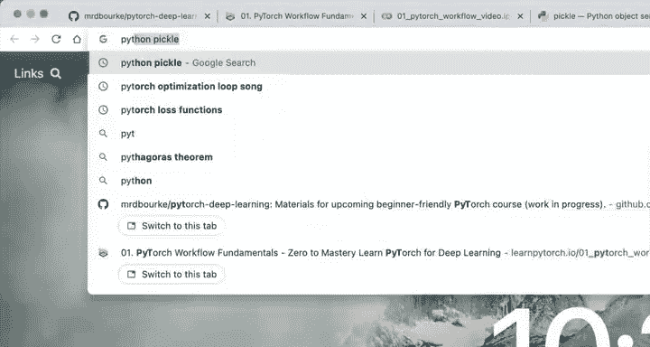

Your extra curriculum for this video。If we go into here， this is a very， very。

 very important piece of pipetorrch documentation or maybe even a tutorial。

 So your extra curriculum for this video is to go through it。 Here we go。

 We've got torch save Torch load torch module state di， that's where or load state di。

 That's where I've got the three things that we've just written down。😊。

And there's a fair few different pieces of information。 So what is a state dict。 So in ptorrch。

 the learnable parameters I。e。 the weights and biases of a torch Nn module， which is our model。

 Remember， our model subclasss N N module are contained in the model's parameters。

 access with model dot parameters a state dict is simply a python dictionary object that maps each layer to its parameter tensor。

 That's what we've seen。 And so then if we to a model。

 we can initialize the model And if we wanted to print the state dict， we can use that。

 The optimizer also has a state dickt。 So that's something to be aware of。

 you can go optimize a dot state dict。 And then you get an output here。

 And this is our saving and loading model for inference。 So inference again， is making a prediction。

 that's probably what we want to do in the future at some point。 For now。

 we've made predictions right within our notebook。 But if we wanted to use our model outside of our notebook。

 say in an application or in another notebook that's not this one。😊。

You'll want to know how to save and load it。 So the recommended way of saving and loading a Pyto model is by saving its state di。

Now， there is another method down here， which is saving and loading the entire model。

 So your extracurricular for this lesson。We're going go through the code to do this。

 But your extra curricula is to read all of the。Sections in here and then figure out what the pros and cons are of saving and loading the entire model versus saving and loading just the state deck。

So that's a challenge for you for this video。 I'm going to link this in here。

 And now let's write some code to save our model。So， pie torch。Save and load code。codeode。Tutorial。

Plus， extra curriculum。So， if we go。Saving our pytorch model。 So what might we want。

 What do you think the save parameter takes。If we have torch dot save。

 what do you think it takes inside it？Well， let's find out together。y， So let's import Part Lib。

 We're gonna to see why in a second。 This is Python's module for dealing with writing file parts。

 So if we wanted to save something to this is Google Coabs file section over here。

 But just remember if we do save this from within Google Coabab。

 the model will disappear if our Google Coabab notebook instance， disconnects。

 So I'll show you how to download it from Google Cola if you want。😊。

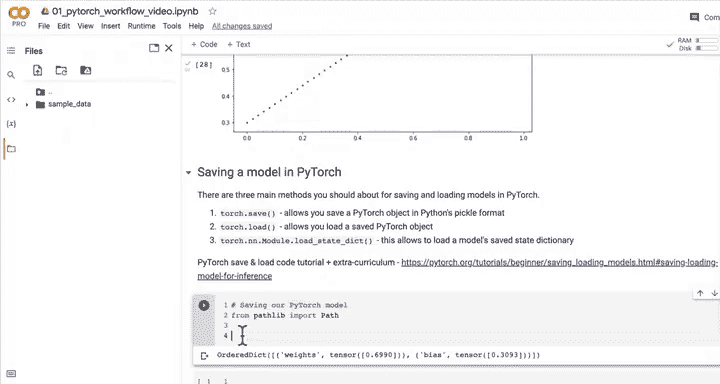

Google co La。Also has a way， save from Google Co Lab。

Google Coabb2 Google Drive to save it to your Google Drive if you wanted to。

 but I'll leave you to look at that on your own， if you like。

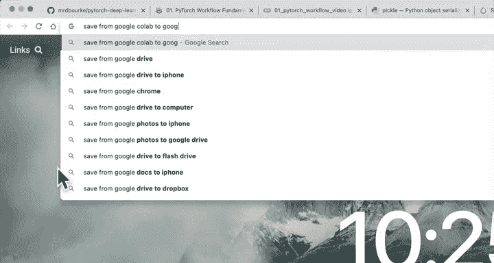

So we're first going to create a model directory。 So create models directory。

So this is going to help us create a folder over here called models。 And， of course。

 we could create this by hand by adding a new folder here somewhere。 But I like to do it with code。

 So model path。We're going to set this to PA， which is using the PA library here。

To create us a path called modelss simple， we're just going to save all of our models to the models file。

And then we're going to create model path。 We're going to make that directory model path dot MkD for make directory。

 We're going to set parents to equals true。And we're also going to set exist O equals to true。

 That means if it already existed， it won't throw us an error。 It will try to create it。

 but if it already exists， it'll just recreate the parent's directory or it'll leave it there。

 It won't error out on us。We're also going to create a model save path。This way。

 we can give our model a name right now， it's just model 0。

We want to save it under some name to the models directory。 So let's create the model name。

Model name equals。01， I'm going to call it01 for the section that way。

 if we have more models later on the course， we know which ones come from where。

You might create your own naming convention。Model workflow Pytorch workflow Model 0 dot Ph and now this is another important point。

 Pytorch objects usually have the extension do ph for Pytorch or dot PT So if we go in here and if we look up dot PT yeah a common convention is to save models using either a dot p or dot ph file extension。

 I'll let you choose which one you like I like dot ph。

 So if we go down here dot ph they both result in the same thing you just have to remember to make sure you write the right loading path and write saving path。

So now we're going to create our model save path， which is going to be our model path and because we're using the pathlib。

 we can use this syntax that we've got here。😊，Model path， slash model name。

 And then if we just print out。Model save path。 What does this look like？There we go。

 So it creates us a pos path using the pathlib library of models slash01 Pytorch workflow model 0 dot P T H。

 We haven't saved our model there yet。 It's just got the path that we want to save our model ready。

 So if we refresh this， We've got models over here。 Do we have anything in there。😊，No， we don't yet。

 So now is our step to save the model。 So 3 is save the model state d。

 Why are we saving the state dic， Because that's the recommended way of doing things if we come up here。

Saving and loading the model for inference， Save and load the state dic， which is recommended。

 we could also save the entire model， but that's part of your extra curriculum to look into that。

So let's use some syntax。 as's quite like this。 Torch do save。 And then we pass it an object。

 and we pass it a path of where to save it。 We already have a path。 And good thing is。

 we already have a model。 So we just have to call this。 Let's try it out。😊，So let's go print。F。

Saving model  to。And we'll put in the path here。Model save path。

I like to print out some things here and there that way we know what's going on。And oh。

 I don't need that capital， A， do I。Geting a little bit trigger happy here with the typing。

 So torch dot save。 And we're going to pass in the object parameter here。 And if we looked up torch。

 save。We can go， what does this code take， So Torch save object F， what is F， a file like object。

 Okay， or a string or OS path like object beautiful。

 That's what we've got a path like object containing a file name。 So let's jump back into here。

 The object is what It's our model 0 dot state di。 That's what we're saving。

 And then the file path is model save path。 youre ready， Let's run this and see what happens。😊。

Beautiful saving model to models。 So that's our model path。 And there's our model there。

 So if we refresh this， what do we have over here。 Woful， we've saved our trained model。

 So that means we could potentially if we wanted to， you could download this file here。

 That's going download it from Google Coab to your local machine。 That's one way to do it。

 But there's also a guide here to save from Google Collaboratory to Google Drive that way you could use it later on。

 So there's many different ways。 The beauty of Pitorrchches its flexibility。

 So now we've got a saved model。 But let's just check using our L S command。

 We're going check models。😊，Yeah， let's just check models。This is gonna to check here。So。

 this is list。Wonderful， there's our01 Pitorrch workflow Model 0 dot PH。 Now， of course。

 we've saved a model。😊，How about we try loading it back in and seeing how it works。

 So if you want a challenge。Read ahead in the documentation and try to use Torch。

 load to bring our model back in， see what happens。

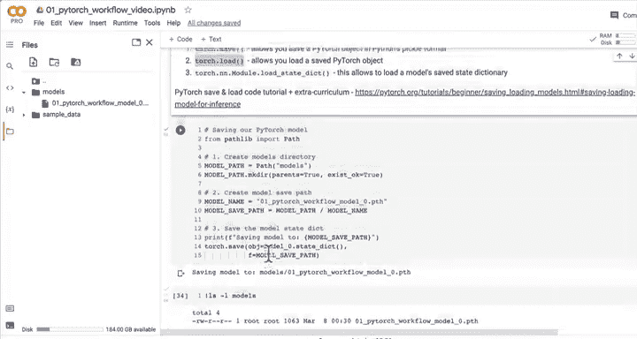

I'll see you in the next video。

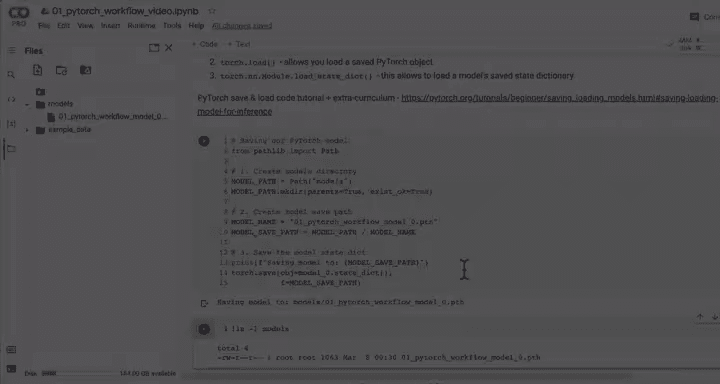

Welcome back。 In the last video， we wrote some code here to save our Pytorch model。

 And I'm just gonna exit out of this couple of things that we don't need just to clear up the screen。

 And now we've got our dot ph file because remember dot P or dot P as a common convention for saving a Pytorch model。

 We've got it saved there。 we didn't necessarily have to write all of this path style code。

 But this is just handy for later on if we wanted to functionize this and create it in。

 say a save dot pi file over here so that we could just call our save function and pass it in a file path where we wanted to save like a directory and a name and then it'll save it exactly how we want it for later on。

😊，But。Now we've got a saved model I issued a challenge of trying to load that model in。

 so do we have Torch。t load in here？Did you try that out， We've got， oh。

 we've got a few options here， Wonderful， But we're using one of the first ones。

 So let's go back up here。 If we wanted to check the documentation for torch dot load。

 We've got this option here， load。😊，What happens？ Los and objects save with torch do save from a file。

 Torch dot load uses Python's unpickling facilities。

 but treat storages which underlie tensors specially。

 They are first decilized on the CPU and then are moved to the device。 they were saved from。 Wo。

 So this is moved to the device。 if later on， when we're using a GP。

 this is just something to keep in mind。 We'll see that when we start to use a CPU and a GP。😊。

But for now， let's practice using the torch dot load method and see how we can do it。

 So we'll come back here and we'll go loading a pie torch model。 And since we。

So' going to start writing here since we saved our models state deck。

So just the dictionary of parameters from a model， rather than。The entire model。

We'll create a new instance of our model class and load the state deck。Load the saved state dick。

 That's better， State di。Into that。Now this is just words on a page。 let's see this in action。

 So to load in a state deck， which is what we saved， we didn't save the entire model itself。

 which is one option。 that's extra curriculum。But we saved just the model state di。

 So if we remind ourselves what model 0 dot state dick looks like， we saved just this。

 So to load this in， we have to。Instantiate a new class or a new instance of our linear regression model class。

 So to load in a saved state dick。We have to instantiate。A new instance of our model class。

So let's call this loaded Model0。I like that that way we can differentiate because it's still going to be the same parameters as model 0。

 But this way， we know that。This instance is the loaded version。

 not just the version we've been training before。 So we'll create a new version of it here。

 linear regression model。 This is just the code that we wrote above。Linear regression model。

 and then we're going to load the saved state deck of Model 0。And so， this will。

Update the new instance with updated parameters。So let's just check before we load it。😊。

We haven't written any code to actually load anything。 What does loaded Model 0。

 What does the estate deckck look like here。It won't have anything， it'll be initialized with what。

Oh， loaded。 That's what I called it loaded。See how it's initialised with random parameters。

 So essentially， all we're doing when we load a state dictionary into our new instance of our model is that we're going。

 hey， take the saved state deck from this model and plug it into this。

 So let's see what happens when we do that。 So loaded model。😊，0。

 remember how I said there's a method to also be aware of up here。

 which is torch nn module dot load state dick。 And because our model is a what。

 it's a subclass of torch dot N n dot module。 So we can call load state dit on our model directly or on our instance。

 So recall linear regression model is a subclass of N N dot module。 So let's call in。Load state dick。

 And this is where we call the torch dot load method。 and then we pass it the model save path。

 Is that what we called it because torch dot load， it takes in F So what's F a file like object or a string or OS path like object。

 So that's why we created this path like object up here。 Model save path。 So all we're doing here。

 we're creating a new instance， linear regression model， which is a subclass of Nn dot module。

 And then on that instance， we're calling in load state di of torch dot load model save path because what's saved at the model save path。

 our previous model state di， which is here。 So if we run this， let's see what happens。😊。

All keys match successfully。 That is beautiful。 And so see their values here。😊。

Loaded state deck of Model 0。 Well let's check the loaded version of that。We now have wonderful。

 We have the exact same values as above， but there's a little way that we can test this。😊。

So how about we go。Make some predictions。 So make some predictions。

Just to make sure with our loaded model。So let's put it in a vowel mode。

Because when you make predictions， you want it in evaluation mode， so it goes a little bit faster。

 and we want to also use inference mode。 So with Torch dot inference mode for making predictions。

We want to write this loaded model pres。 We're going to make some predictions on the test data as well。

 So loaded model 0， we're going to forward pass on the X test data。

 and then we can have a look at the loaded。Model pres。Wonderful。

 and then to see if the two models are the same， we can compare。😊。

Loaded model pres with original model pres。 So why pres。🎼These should be equivalent， equals equals。

 loaded model pres。Do we have the same thing， F， false， false。 What's going on here。Why pres？

How much different are they。Oh where has that happened。Have we made some model pres with this yet？

So how about we。Make some model pres。 This is troubleshooting on the fly team。

 So let's go Model 0 doval。And then with torch dot inference mode。

 this is how we can check to see that our two models are actually equivalent。 Y pres equals。

 I have a feeling why pres actually saved somewhere else equals model 0。

 And then we pass it the X test data。And then we might move this above here。

And then have a look at what Y Ps equals。Do we get the same output？Yes， we should。 wonderful。 Okay。

 beautiful。 So now we've covered saving and loading models or specifically saving the models state di。

 So we saved it here with this code。 And then we loaded it back in with load state dick plus torch load。

 And then we check to see by testing equivalentvalence of the predictions of each of our models。

 So the original one that we trained here， Model 0 and the loaded version of it here。

 So thats saving and loading a model in Pitorrch。 There are a few more things that we could cover。

 but I'm gonna to leave that for extracur。 We've covered the two main things。

 there are three main things，1，2，3。 If you'd like to read more。

 I'd highly encourage you to go through and read this tutorial here。 But with that being said。

 we've covered a fair bit of ground over the last few videos。

 How about we do a few videos where we put everything together。 just to reiterate what we've done。

 I think that'll be good practice。 I'll see in the next video。😊。

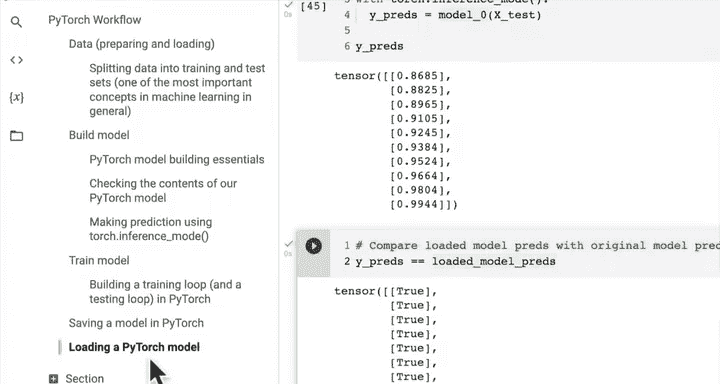

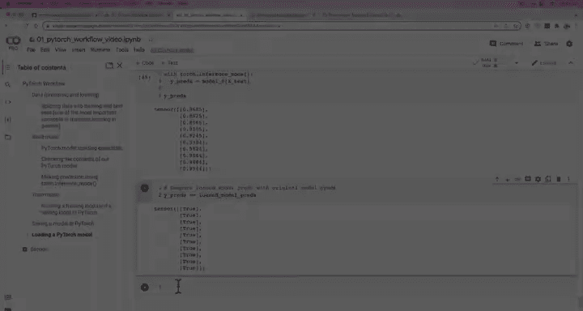

Welcome back。 Over the past few videos， we've covered a whole bunch of ground in a pieytorrch workflow。

 starting with data， then building a model。 Well， we split the data and we built a model。

 We looked at the model building essentials。 We checked the contents of our model。

 We made some predictions with a very poor model because it's based off random numbers。😊。

We spent a whole bunch of time figuring out how we could train a model。

 We figured out what the loss function is。 We saw an optimizer。 We wrote a training and test loop。

We then learned how to save and load a model empiretorrch。

 So now I'd like to spend the next few videos putting all this together。

 We're not going to spend as much time on each step。

 but we're just going to have some practice together so that we can reiterate all the things that we've done。

😊，So putting it all together。Let's go back through。The stepss above。And see it all。In one place。

Wonderful。So we're going to start off with 6。1。And we'll go have a look at our workflow。 So 6。

1 is data。But we're going to do one step before that。 and I'm just going to get rid of this。

 so we have a bit more space。So we've got our data ready。

 We've turned it into tensors way back at the start。 Then we built a model。

 and then we picked a loss function and an optimizer。 We built a training loop。 We trained our model。

 We made some predictions。 We saw that they were better。 We evaluated our model。

 we didn't use torch metrics， but we got visual。 We saw our red dots starting to line up with the green dots。

 We haven't really improve through experimentation。 We did a little bit of it， though。

 as in we saw that if we trained our model for more epochs。 We got better results。

 So you could argue that we have done a little bit of this， but there are other ways to experiment。

 We're going to cover those throughout the course。 and then we saw how to save and reload a trained model。

 So we've been through this entire workflow， which is quite exciting actually。

 So now let's go back through it， but we're going to do it a bit quicker than what we've done before。

 because I believe you've got the skills to do so now。 So let's start by importing pi torch。😊。

So you could start the code from here if you wanted to and mappllo Lib and actually， if you want。

 you can pause this video and try to recode all of the steps that we've done by putting some headers here like data and then build a model and then train a model。

 save and load a model， whatever and try to code it out yourself。😊，If not。

Feel free to follow along with me and we'll do it together。 So import torch。

From torch import oh would help if I could spell torch import N N because we've seen that we use N N quite a bit。

 And we're going to also import Matpllib because we like to make some plots because we like to get visual。

Visualize， visualize， visualize as PLT。 And we're going to check our Pythto version。That way。

 we know， if you're on an older version， some of the code might not work here。

 but if you're on a newer version， it should work。 if it doesn't， let me know。There we go，1。10。

 I'm using 1。10 for this。 By the time you watch this video， there may be a later version out。

And we're also gonna。 let's create some device， agnostic code。 So create device agnostic code。

 because I think we're up to this step now。😊，This means。If we've got access to a GPU。

Our code will use it。For potentially faster。Computing。If no GPU is available。

The code will default to using CPU。 We don't necessarily need to use a GP for our particular problem that we're working on right now。

 because it's a small model， and it's a small data set。

 but it's good practice to write device agnostic code。

 So that means our code will use a GP if it's available or a CPU by default。

 If a GP is not available。 So set up device agnostic code。

We're going to be using a similar setup up to this throughout the entire course from now on。

 So that's why we're bringing it back。 Kuda is available。

 So remember Kuda is Navidia's programming framework for their GPs， else use CPU。

 and we're going to print。What device are we using？Device。So what we might do is if we ran this。

 it should be just a CPU for now。Right， yours might be different to this if you've enabled a GPU。

 but let's change this over to use Couda。 And we can do that if you're using Google Coabab。

 we can change the runtime type by selecting GPU here。

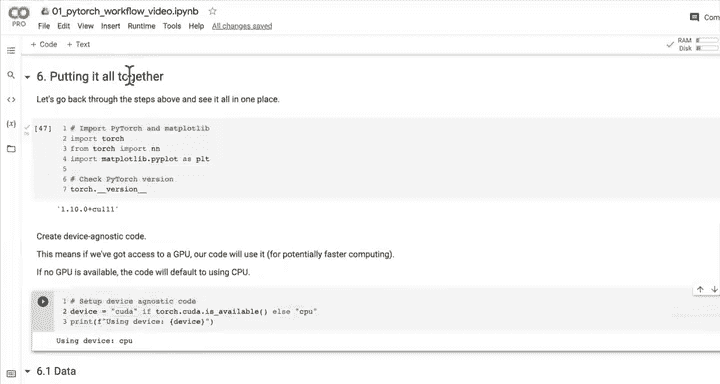

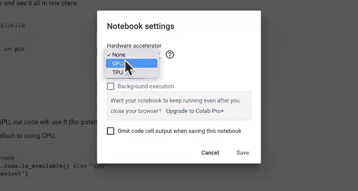

And then I'm going to save this。 But what's going to happen is it's going to restart the runtime。

 So we're going to lose all of the code that we've written above。How can we get it all back？Well。

 we can go。Run all。This is going run all of the cells above here。 They should all work。

 and it should be quite quick because our model and data aren't too big。 And if it all worked。

 we should have Couda as our device that we can use here。 Wonderful。

 So the beauty of Google Coab is that they've given us access to on NviDdia GPU。 So thank you。

 Google Coab。😊，Just once again， I'm paying for the paid version Google Coab。 you don't have to。

 The free version should give you access to a GPU， albeit it。

 it might not be as a later version as GPU as the pro versions give access to。

But this will be more than enough for what we're about to recreate。

 So I feel like that's enough for this video。 We've got some device agnostic code ready to go。

 And for the next few videos， we're going to be rebuilding this except using device agnostic code。

 So give it a shot yourself。 There's nothing in here that we haven't covered before。

 So I'll see you in the next video。 Let's create some data。😊。

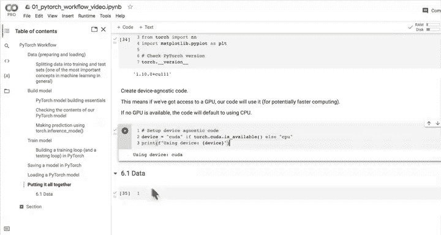