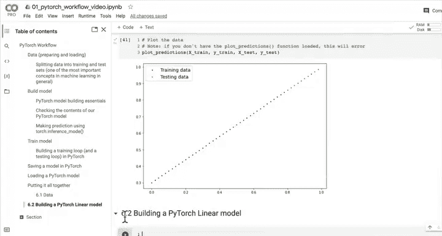
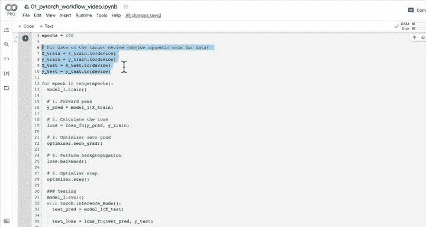
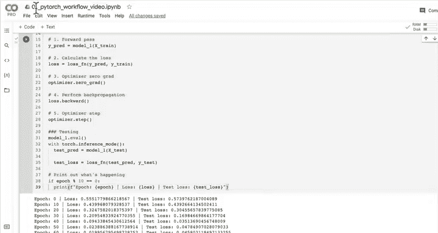
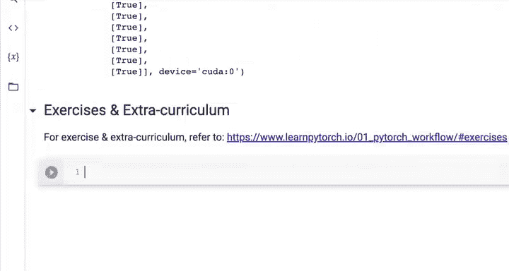
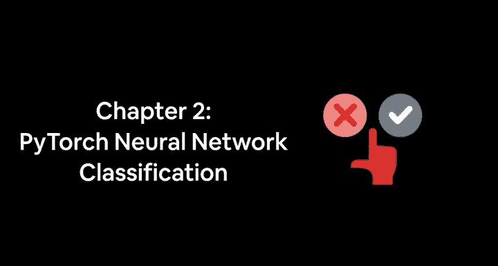

# mrdbourke《一天学会pytorch深度学习｜Learn PyTorch for deep learning in a day Literally》中英 - P43：54. Putting everything together.zh_en - GPT中英字幕课程资源 - BV1kx4y1r79d

Welcome back。 In the last video， we set up some device agnostic code。

 and we got ready to start putting everything we've learned together。

 So now let's continue with that。 We're going to recreate some data。

 Now we could just copy this code， but we're going to write it out together so we can have some practice creating a dummy data set。

😊，And we want to get to about this stage in this video。

 so we want to have some data that we can plot so that we can build a model to once again。

 learn on the blue dots to predict the green dots。So it'll come down here data。

 I'm going to get out of this as well so that we have a bit more room。 Let's now。Cect。3。

Data using the linear。Regression formula of y equals weight。Times， features plus bias。

 And you may have heard this as y equals。M， X plus C or M X plus B or something like that。

 Or you can substitute these for different names。 Iages。 When I learned this in high school。

 it was y equals M X plus C。 Yours might be slightly different。 Yeah， B X plus a。

 That's what they use here。 whole bunch of different ways to name things。

 but they're all describing the same thing。 So let's see this in code rather than formulaic examples。

 So we're going create our weight， which is 0。7 and a bias， which is 0。3。

 These are the values we previously used for a challenge you could change these to 0。1， maybe and 0。

2。 These could be whatever values you'd like to set them as。So weight and bias。

 the principle is going to be the same thing。We're going to try and build a model to estimate these values。

So we're going to start at zero and we're going to end at one。

So we can just create a straight line and we're going to fill in those between0 and one with a step of 0。

02。And now we'll create the X and Y features， X and Y。Which is features and labels， actually。

So x is our features and Y are our labels x equals torch do a range and x is a capital y is Z because typically x is a feature matrix。

 even though our's is just a vector now， we're going to unsqueeze this so we don't run into dimensionality issues later on。

You can check this for yourself without unsqueezed， errorsors will pop up。

And y equals weight times x plus bias。 you see how we're going a little bit faster now。

This is sort of the pace that we're going to start going for things that we've already covered。

 If we haven't covered something， will' slow down， but if we have covered something。

 I'm going to step it through， we're going to start speeding things up a little。

So if we get some values here， wonderful。 We've got some x values。

 and they correlate to some y values。 We're going to try and use the training values of x to predict the training values of y and subsequently for the test values。

 Oh， and speaking of training and test values。 How about we split the data。 So let's split the data。

Split data。 So we'll create the train split equalst 0。8。 We're going to use 80%， which is where 0。

8 comes from for the length of x。 So we use 80% of our samples for the training。

 which is a typical training and test split。8020。 Thereabouts。 You could use like 70，30。

 You could use 9010。 It all depends on how much data you have。

There's a lot of things in machine learning that are quite flexible。Train split。

 we're going to index on our data here so that we can create our splits。

Google Co Lab auto corrected my code in a。Nohel way just then。And we're gonna do。

The opposite split for the。Testing data。 Now， let's have a look at the lengths of these。

 If my calculations are correct， we should have about 40 training samples。And10。Testing samples。

And again， this may change in the future when you work with larger data sets。

 you might have 100000 training samples and 20000 testing samples。

 The ratio will often be quite similar。And then let's plot what's going on here。 So plot the data。

And note。If you don't have。The plot predictions。Function loaded。This will error。

So we can just run plot predictions here if we wanted to， and we'll pass it in X train， Y train。

X test， Y test。And this should come up with our。Ploot， wonderful。

 So we've just recreated the data that we've been previously using。

 we've got blue dots to predict green dots。 But if this function errors out because you've started the notebook。

😊，From here。Right from this cell and you've gone down from there。 just remember。

 you'll just have to go up here and copy this function。

We don't have to do it because we've run all the cells， but if you haven't run that cell previously。

 you could put it here and then run it， run it， and we'll get the same outcome here。 Wonderful。

 So what's next， Well， if we go back to our workflow。

 we've just created some data And have we turned it into tenses yet。😊，I think it's just still。

 oh yeah， it is， it's tenses because we use pie torch to create it。😊，But。

Now we're up to building or picking a model。 So we've built a model previously。

 We did that back in build model。 So you could refer to that code and try to build a model to fit the data that's going on here。

 So that's your challenge for the next video。 So building a high torch linear model。

 And why do we call it linear， Because linear refers to a straight line。 What's nonlinear。

 non straight。 So I'll see you in the next video。

Give it a shot before we get there， but we're going to build a high torch linear model。

Welcome back。 We're going through some steps to recreate everything that we've done。

 And in the last video， we created some dummy data and we've got a straight line here。

 So now by the workflow， we're up to building a model or picking a model in our case we're going to build one to suit our problem。

 So we've got some linear data and I've put building a pitorrch linear model here。

 I issued you the challenge of giving it a go。 You could do exactly the same steps that we've done in build model。

 but I'm going to be a little bit cheeky and introduce something new here。

 and that is the power of torch do Nn。😊，So let's see it all we're going to do is we're going to create a。

Linear model by subclassing。An dot module， because why a lot of Pytorch models subclass N N module。

 So class linear regression， what should we call this one？Lineing air regression model V 2。

 How about that And we'll subclass an end dot module。

 So much similar code to what we've been writing so far。

Or when we first created our linear regression model。

 And then we're going to put the standard constructor code here， de and it。Underscore， underscore。

 and it's going to take as an argument self。 and then we're going to call super dot。

Another underscore in it。Unders schoolol， underscore。Bracks， but we're going to， instead of。

 if you recall above back in the build model section， we initialized these parameters ourselves。

 and I've been hinting at。In the past， in videos we've seen before that oftentimes you won't necessarily initialize the parameters yourself。

You'll instead initialize layers。That have the parameters in built in those layers。

We still have to create a forward method， but what we're going to see is how we can use a torch linear layer to do these steps for us。

 So let's write the code and then we'll step through it。

So we're go use N N dot linear because why we're building a linear regression model and our data is linear and。

In the past， our previous model has implemented the linear regression formula。

 So for creating the model parameters。So we can go self。Dot linear layer。

Equals so this is constructing a variable that this class can use self linear layer equals Nn dot linear。

 Remember， Nn and Pytorche stands for neural network。

 and we have in features as one of the parameters and out features。As another parameter。

 this means we want to take as input of size 1 and output of size 1。 Where does that come from， Well。

 if we have a look at x train and Y train。We have。1 value。Of x， maybe there's too many here。

 X 5 will be the first five。5 and5。So， recall。We have one value of x equs to one value of y。

 So that means within this linear layer， we want to take as one feature， X to output one feature Y。

 And we're using just one layer here。 So the input and output shapes of your model in features。

 out features， What data goes in and what data comes out。

 these values will be highly dependent on the data that you're working with。

 And we're going to see different data or different examples of input features and output features all throughout this course。

 So but that is what's happening。 We have one in feature to one output feature。 Now。

 what's happening inside N n dot linear。 Let's have a look。 torch and n linear。

We go the documentation。😊，Applies a linear transformation to the incoming data。

 Where have we seen this before， Y equals X， A T plus B。 Now， they're using different letters。

 but we've got the same formula as。What's happening up here。

Look at the same formula as our data weight times x plus bias。

 And then if we look up linear regression formula once again。Linear regression formula。

We've got this formula here now。Again， these letters can be replaced by whatever letters you like。

 but this linear layer is implementing the linear regression formula that we created in our model before。

 So it's essentially doing this part for us。And behind the scenes。

 the layer creates these parameters for us。 So that's a big piece of the puzzle of piytorch。 I that。

 as I've said， you won't always be initializing the parameters of your model yourself。

 You'll generally initialize layers。 And then you'll use those layers in some forwardd computation。

 So let's see how we could do that。 So we've got a linear layer， which takes as in features。

1 and out features， One。 What should we do now。 Well， because with subclassed N N dot module。

 we need to。Override the forward method。 So we need to tell our model what should it do as the For computation。

 And in here， it's going to take itself as input， as well as X。

 which is conventional for the input data。 And then we're just going to return here。

Self dot linear layer， X。Right and actually we might use some typing here to say that this should be a torch tensor and it's also going to return a torch dot tensor。

That's using Python's type pins， so this is just saying hey。

 X should be a torch tensor and I'm going to return you a torch tensor because I'm going to pass x through the linear layer。

 which is expecting one in feature and one out feature。And it's going to this linear transform。

 That's another word for it。 again， Pytorch and machine learning in general has many different names for the same thing。

 I would call this linear layer。I'm going to write here。Also called。Linear transform。Probing layer。

Fully connected layer。Dense layer， intensorflow， so a whole bunch of different names for the same thing。

 but they're all implementing a linear transform， they're all implementing a version of linear regression y equals x a raspose plus B。

In features， out features， wonderful。 So let's see this in action。😊。

So we're going to go set the manual seed so we can get reproducibility as well。

 torch dot manual seed。And we're going to set model one equals linear regression。

This is Model one because we've already got Model zero， linear regression V2。

 and we're going to check Model1 and we're going to check its state dictionary。State diic。

 There we go。 What do we have inside this ordered dit， Has that not created anything for us。Model 1。

Don't stint thinkked。Order di， we haven't got anything here。In the a， model V2。Ideally。

 this should be outputting。A weight and a bias。 Yeah， variables， weight and bias。

 Let's dig through our code line by line and see what we've got wrong。Ah did you notice this？

The in function。 So the constructor had the wrong amount of underscores。

 So it was never actually constructing this linear layer。 troubleubhooting on the fly team。

 There we go。 beautiful。 So we have a linear layer。

 and we have it is created for us inside a weight and a bias。 So effectively。

 we've replaced the code we wrote above for build model initializing a weight and bias parameter with the linear layer。

 And you might be wondering why the values are slightly different。

 even though we've used the manual seed。 This。😊，Goes behind the scenes of how Pytoch creates its different layers。

 It's probably using a different form of randomness to create different types of variables。

 So just keep that in mind。 And to see this in action， we have a conversion here。

So this is what's going on。We've converted， this is our original model class linear regression。

 we initialized our model parameters here， we've got a weight and a bias。

 but instead we've swapped this in our linear regression model V2。 This should be V2。

To use linear layer。 And then in the forward method。

 we had to write the formula manually here when we initialize the parameters manually。

 But because of the power of torch dot Nn we have just pass it through the linear layer。

 which is going to perform some predefined forwardd computation in this layer。

 So this style of what's going on here is how you're going to see the majority of your pitorrch deep learning models created using preexisting layers from the torch dot Nn module。

 So if we go back into torch do Nn。Toorch it in in。We have a lot of different layers here。

 So we have convolutional layers， pooling layers， padding layers， normalization。

 recurrent transformer linear。 We're using a linear layer， dropout， et cetera， et cetera。

 So for all of the common layers and deep learning because that's what neural networks are。

 theyre layers of different mathematical transformations。

 Pytorch has a lot of prebuilt implementations。 So that's a little bit of a sneaky trick that I've done to alter our model。

 But we've still got basically the exact same model as we had before。 So what's next。 Well。

 is to train this model。 So let's do that in the next video。Welcome back。 So in the last video。

 we built a pi torch linear model， nice and simple using a single Nn dot linear layer with one in feature。

 one out feature， and we overri the forwardd method of Nn dot module using the linear layer that we created up here。

 So what's going to happen is when we do the forwardd parcel on our model。

 we're going to put some data in and it's going to go through this linear layer。

 which behind the scenes as we saw with torch Nn linear。😊，Behind the scenes。

 it's going to perform the linear regression。Formula here。 So y equals X A T plus B。

 But now case we've got weight and bias。So let's go back。 It's now time to write some training code。

 but before we do。Let's set the model。To use the target device。 And so in our cases。

 we've got a device of。Cuda。 but because we've written device agnostic cone。

 if we didn't have access to a couder device， a GPU， our default device would be a CPU。

 So let's check the model device。 We can do that first， up here。Check the model。Current device。

 because we're going to use the GPU here， or we're going to write device agnostic code。

That's better to say， device， agnostic code， that's the proper terminology。Devicice。

 what device are we currently using。This is the CPU right， so by default。

 the model will end up on the CPU。 But if we set it to Model 1 called dot 2 device。

 what do you think it's going to do now， if our current target device is couda。

 we've seen what 2 does in the fundamental section2 is going to send the model to the GPU memory。

 So now let's check where the parameters of our model live dot device。If we send them to the device。

 previously， it was the CPU， it's gonna to take a little bit longer while the GP gets fired up and goes。

 Pytoch goes， hey， I'm about to send you this model。 You're ready for it。 boom， there we go。

 wonderfulnderful。 So now our model is on the device or the target device， which is Kuda。

 And if kuda wasn't available。 The target device would be CPU。

 So this would just come out just exactly how we've got it here。 But with that being said， Now。

 let's get on some training code。 And this is the fun part。 What do we have to do。😊。

We've already seen this for training， we're just going to clear up our workspace a little bit here。

For training， we need。 this is part of the Py to workflow。 We need a loss function。

 What does a loss function do。Measures how wrong our model is。 We need an optimizer。

We need a training loop and a testing loop。And the optimizer， what does that do， Well。

 it optimizes the parameters of our model。 So in our case， Model1 dot state di， What do we have。

So we have some parameters here within the linear layer。 We have a weight， and we have a bias。

 The optimizer is going to optimize these random parameters。

So that they hopefully reduce the loss function， which remember。

 the loss function measures how wrong our model is。 So in our case。

 because we're working with a regression problem， let's set up the loss function。And by the way。

 all of these steps are part of the workflow。 We've got data ready。 We've built or picked a model。

 we're using a linear model。 Now we're up to here 2。

1 pick a loss function and an optimizer we're going to do build a training loop in the same session because you know what we're getting pretty dar good at this Los function equals what Well we're going to use L1 loss。

 So let's set that up N then dot L1 loss， which is the same as NAe。😊。

And if we wanted to set up our optimizer， what optimizer could we use， Well。

 Pytorrch offers a lot of optimizers in torch。opdm SGD。It's stochastic gradient descent。

 becauseuse remember， gradient descent is the algorithm that optimizes our model parameters。

Adom is another popular option for now we're going to stick with SGD Lr which stands for learning rate。

 in other words， how big of a step will our optimizer change our parameters with every iteration。

 a smaller learning rate so such as 0001 will be a small step and then a larger learning rate such as 0。

1 will be a larger step。Too big of a step。 Our model learns too much。

 and it explodes too small of a step。 Our model never learns anything。 But， oh。

 we actually have to pass parameterss first。 I forgot about that。

 Ive got ahead of myself with a learning rate。 parameterss is the parameters we'd like our optimizer to optimize。

 So in our case， it's model 1 dot parameters because Model 1 is our current target model。

 beautifuliful。 So we've got a loss function and an optimizer。 Now。😊，Let's write a training loop。

So I'm going to set torch manual seeds so we can try and get as reproducible as results as possible。

 Remember， if you get different numbers to what I'm getting。

 don't worry too much if they're not exactly the same。 The direction is more important。

 So that means if my loss function is getting smaller， yours should be getting smaller too。

 don't worry too much if your fourth decimal place isn't the same as what my values are。

 So we have a training loop。Ready to be written here。 Epochs。 How many should we do。 Well。

 we did 200 last time。 that worked pretty well， So let's do 200 again。

 Did you go through the extra curriculum yet， Did you watch the video for the unofficial pie torch。

Optimisation loop song had。This one here， listen to the unofficial pie torch optimization loop song。

 If not， it's okay。 Let's sing it together。 So for an epoch。😊，In range， epochs。

We're going to go through the song in a second。 We're going to set the model to train。In our case。

 it's Model one。Model to train Now step number one is what do the forward pass。

 This is where we calculate the predictions， So we calculate the predictions by passing the training data through our model and in our case。

 because the forwardd method in Model 1 implements the linear layer。

 this data is going to go through the linear layer。

 which is torch dot Nn dot linear and go through the linear regression formula。

And then we calculate the loss， which is how wrong our model's predictions are。

 So the loss of value equals loss Fn and here where we're going to pass in Y pre and Y train。

Then what do we do， We zero the optimizer， Opimr 0 grad， which， because by default。

 the optimize is going to accumulate gradients behind the scenes。 So every epoch。

 we want to reduce those back to 0。 so it starts from fresh。

We're going to perform back propagation here。Back propagation by calling loss stop backwards。

 If the forward pass goes forward through the network。

 the backwood pass goes backwards through the network。

 calculating the gradients for the loss function with respect to each parameter in the model。

So optimize a step， this next part is going to look at those gradients and go， you know what。

 which way should I optimize the parameters？So because the optr is optimizing the model parameters。

 it's going to look at the loss and go， you know what， I'm going to adjust the weight to be。

Increased， and I'm going to lower the bias and see if that reduces the loss。And then。

 we can do testing。We can do both of these in the same hit。 Now。

 we are moving quite fast through this because we spent a whole bunch of time discussing what's going on here。

So for testing， what do we do， we set the model into evaluation mode that's going to turn off things like dropout and batch normalization layers。

 We don't have any of that in our model for now， but just it's good practice to always call a vowel whenever you're doing testing and same with inference mode we don't need to track gradients and a whole bunch of other things Pytorch does behind the scenes when we're testing or making predictions。

 So we use the inference mode context manager。This is where we're going to create test pre。

 which is going to be our test predictions。 because here we're going to pass the test data features。

Ford pass through our model， and then we can calculate the test loss， which is our loss function。

 And we're going to compare the test pre to Y test。Wonderful。

 and then we can print out what's happening。So what should we print out？How about。If apoch。

Divided by 10 equals 0。 So every 10 epochs， let's print something out， print。

We'll do an F string here， epoch。Is epoch。And then we'll go loss， which is the training loss。

 can just be equal to the loss。 and then we'll go test loss is equal to。Test loss。

 So do you think this will work。It's okay if you're not sure。八。Let's find out together。 Hey， Oh。

 we've got a。We need a bracket， there。Oh my goodness。 What's going on。

Runtime error expected all tensors to be on the same device。 of course。

Do you know what's happening here？But we found at least two devices， Couda and CPU。 Yes， of course。

 that's what's happened。 So what have we done up here， we put our model on the GPU。

 But what's going on here， our data， as our data on the GPU。😊，No， it's not by default。

 It's on the CPU。 So we haven't written device agnostic code for our data。 So let's write it here。

 put data on the target device。Deevice， agnostic code for data， so。Remember。

 one of the biggest issues with Pytorch aside from shape errors is that you should have your data or all of the things that you're computing with on the same device。

 So that's why if we set up device agnostic code for our model， we have to do the same for our data。

 So now let's put X train to device。 Y train equals Y train to device。

 This is going to create device agnostic code。 In our case。

 it's going to use couda because we have access to a couda device。 But if we don't。

 this code will still work， it will still default to CPU。So this is good。 I like that。

 We got that error because that's some of the things you're going to come across in practice， right。

 So now let's run this。 What's happening here。 Hey， look at that wonderful。

 So our loss starts up here， nice and high。 And then it starts to go right down here for the training data。

 And then the same for the testing data。 beautiful。 right up here。 And then all the way down。 Okay。

 so this looks pretty good on the test data set。 So how can we check this。

 How can we evaluate our model。😊，Well， one way is to check its state dick so。Stay diiced。

What are we got here， What are our weight and bias。 Oh my gosh， so close。

 So we just set weight and bias before to be 0。7 and 0。3。

 So this is what our model has estimated our parameters to be based on the training data。0。6968。

 That's pretty close to 0。7 nilly perfect。 And the same thing with the bias，0。

3025 versus the perfect value is 0。03。 But remember， in practice。

 you won't necessarily know what the ideal parameters are。

 This is just to exemplify what our model is doing behind the scenes。

 It's moving towards some ideal representative parameters of whatever data we're working with。😊。

So in the next video， I'd like you to give it a go of or before we get to the next video。

 make some predictions with our model and plot them on the original data。

 How close to the green dots match up with the red dots and you can use this plot predictions formula or function that we've been using in the past。

 So give that a go and I'll see you in the next video， But congratulations。

 look how quickly we just trained a model。😊。

Using the steps that we've covered in a bunch of videos so far and device agnostic code are so good。

 I'll see you soon。😊。

In the last video， we did something very， very exciting。

 We worked through training an entire neural network。

 Some of these steps took us an hour or so worth of videos to go back through before。

 But we coded that in one video。 So you ready listen the song just to remind ourselves of what's going on for an epoch in arrange。

 Commar or dot train Do the forwardd pass， calculateulate the loss， Opimr 0 grad。 loss backward。

 Opim a step， step， step。 Let's test Commar or do of vow with tor inference mode。

 Do the forwardd pass， calculateulate the loss， print out what's ha， naan。😊，And then we do it again。

 again， again， for another repo in a range。 Now， I'm kidding。 We'll just leave it there。

 We'll just leave it there。 But that's the unofficial pieytorrch optimization loop song。

 We created some device agnostic code so that we could make the calculations on the same device as what our model is because the models also using device agnostic code。

😊，And so now we've got to evaluate our models。 So we've looked at the loss and the test lost here。

 and we know that our model's loss is going down。 But what does this actually equate to when it makes predictions。

 That's what we're most interested in， right？ And we've looked at the parameters。

 They're pretty close to the ideal parameters。 So at the end of last video。

 I issued you the challenge to making。And evaluating predictions to make some predictions and plot them。

 I hope you gave it a shot。Let's see what it looks like together hey。

 so turn the model into evaluation mode why because every time we're making predictions or inference we want our model to be in a Valel mode and every time we're training。

 we want our model to be in training mode。And then we're going to。

Make predictions on the test data because we train on the train data and we evaluate our model on the test data data that our model has never actually seen except for when it makes predictions。

With torch inference mode， we turn on inference mode whenever we make inference or predictions。

 So we're going to set y pres equal to model 1。 and the test data goes in here。

 Let's have a look at what the Y pres look like。Wonderful， so we've got a tensor here。

 It shows us that they're still on the device Coer。 Why is that， Well， that's because previously。

 we set the model 1 to the device， the target device， the same with the test data， so。😊，Subsequently。

 our predictions are also on the coer device。 Now， let's bring in the plot predictions function here。

 So check out our model predictions。Visually。We're going to adhere to the data explorelorer's motto or visualize。

 visualize， visualize， plot predictions。And predictions。Are going to be set to。He calls why pres。

 And let's have a look How good do these look。 Oh， no。Weve got another error。 type error。

 Can't convert couder device type tensor toy。 of course。 Look what we've done。

 So our plot predictions function。 If we go back up， where did we define that。

What does our plot predictions function use， It uses mappl Lib， Of course。

 A mappl Lib works with nu Pi， not pitorrch。 and nupy is CPU based。 So， of course。

 we're running into another error down here。 because we just said that our predictions are on the couda device。

 They're not on the CPU。 They're on a GP。 So it's giving us this helpful information here。

 Use tensor dot CPU to copy the tensor to host memory first。 So this is our tensor。

 Let's call dot CPU and see what happens then。 Is that going to go to。😊，CPU viewed oh my goodness。

 Look at that。Look at that。 Go the linear layer。The red dots。

 the predictions are basically on top of the testing data。 that is very exciting Now， again。

 you may not get the exact same numbers here， and that is perfectly fine。

 but the direction should be quite similar。 So your red dots should be basically on top of the green dots。

 If not very slightly off， but that's okay。 That's okay。 We just want to focus on the direction here。

 So thanks to the power of back propagation。😊，Here and gradient descent。

 our models's random parameters have updated themselves to be as close as possible to the ideal parameters。

 And now the predictions are looking pretty darn good for what we're trying to predict。

 But we're not finished there， we've just finished training this model。

 What would happen if our notebook disconnected right now。 Well， that wouldn't be ideal would it。

 So in the next part， we're going move on 26。5 saving and loading a trained model。😊，So。

I'm going to give you a challenge here as well， is to go ahead。And go back and refer to this。

 this code here， saving a model in Pitorrch， loading a pie torch model and see if you can save model 1。

The state dictionary of Model1 and load it back in and get something similar to this。

Give that a shot， and I'll see you in the next video。Welcome back。 In the last video。

 we saw the power of the torch dot N N dot linear layer and back propagation and gradient descent。

 And we've got some pretty darn good predictions out of our model。 So that's very exciting。

 congratulations。 You've now trained two machine learning models。 but it's not over yet。

 We've got to save and load our trained model。 So I issued you the challenge in the last video to try and save and load the model yourself。

 I hope you gave that a go。 But we're going to do that together in this video。

 So we're going to start by importing path because we would like a file path to save our model， too。

😊，And the first step we're going to do is create models directory。

 We don't have to recreate this because I believe we already have one。

 but I'm going to put the code here just for completeness。

 And this is just so if you didn't have a models directory， this would create one。 So model path is。

Going to go to path。Models。And then， we'd like to。Model path dot makedo。

 We're gonna to call makedo for make directory。 We'll set parents equal to true。 And if it exists。

 okay， that'll also be true。 So we won't get an error。 Oh my gosh， Google Colla。 I didn't want that。

 We won't get an error if it already exists。 And2， we're going to create a model save path。

 So if you recall that Pytorch objects in general have the extension of what。

This is a little pop quiz before we get to the end of this sentence。

 So this is going to be pietorrch workflow for this module that we're going through this one here。

 Cha 01。Pytorch workflow Model1， and they usually have the extension dot P for Ptorch or PH for Pytorch as well。

 I like PT H。But just remember， sometimes you might come across slightly different versions of that P or P H。

 And we're going to create the model save name or the save path。 It's probably a better way to do it。

Is going to be model path。 And then we can use because we're using the path Lib module from Python。

 we can save it under model name。 And so if we look at this， what do we get model save path。

We should get， oh， path is not defined。 Oh， too many capitals here。 Daniel。

 The reason why I'm doing these in capitals is because oftentimes hyperpara such as epochs and machine learning are set as hyperparameter。

 L R could be learning rate， and then you could have as well， model name equals ya ya， ya。

 But that's just a little bit of nomenature trivia for later on。And model save path， we've done that。

 Now we're going to save the model state dictionary rather than the whole model。

 saveve the model state d。Which you will find the pros and cons of in where。

In the Ptoch documentation for saving and loading a model。

 which was a little bit of extra curriculum for a previous video。

 but let's have a look at our model save pipe printed out and we'll go torch save。

 We'll set the object that we're trying to save to equal model1 dot state di。

 which is going to contain our trained model parameters。😊，We can inspect what's going on in here。

 state decked。They'll show us our model parameters。

 remember because we're only using a single linear layer， we only have two parameters。

 but in practice， when you use a model with maybe hundreds of layers or tens of millions of parameters viewing the state di explicitly like we are now might not be too viable of an option。

 but the principle still remains a state dit contains all of the models trained or associated parameters。

And what state they're in？And the final path we're going to use is， of course， the model save path。

 which we've seen here is apossix path。 Let's save our model。

Wonderful saving model2 this file path here。 And if we have a look at our folder。

 we should have two saved models now。 beautiful， two saved models。

 This one for us from the workflow we did before up here。

 saving a model in pitorrch loading a ptorrch model and now the one we've got， of course。

 Model 1 is the one that we've just saved beautiful。 So now let's load a model。

 We're going to do both of these in one video load a pi toch model， you know what。

 because we've had a little bit of practice so far。 And we're gonna pick up the pace。

 So let's go loaded， let's call it， we create a new instance， of loaded model 1， which is， of course。

 our linear regression model V2， which is the version 2 of our linear regression model class。

 which subclass what subclasss and end dot module， So if we go back here up here to where we created it。

 So linear regression model V2 uses a linear layer rather than the previous iteration of linear regression model。

 which we created。😊，买 up here啊。If we go up to here。

 which explicitly defined the parameters and then implemented a linear regression formula in the forwardd method。

 the difference between what we've got now is we use ptorchs pre built linear layer。

 and then we call that linear layer in the forwardd method。

 which is probably the far more popular way of building pi toch models is stacking together pre built Nn layers and then calling them in some way in the forwardd method。

So let's load it in。So we'll create a new instance of linear。Regression model V2。

And now what do we do？We've created a new instance。 I'm just going to get out of this。

 Make some space for us。We want to load the model state di， the saved Model1 state di， which is。

The state diict that we just saved beforehand。 So we can do this by going loaded Model 1。

 calling the load state diict method， and then passing it torch dot load。

 And then the file path of where we saved that high torch object before。

 But the reason why we use the pathlib is so that we can just call model save path in here。Wonderful。

 and then let's check out what's going on。Or actually。

 we need to put the target model or the loaded model。To the device。

 the reason being is because we're doing all of our computing with device agnostic code。

 So let's send it to the device。 And I think that'll be about it。Let's see if this works。 All。

 there we go。 Linear regression Model V2 in features 1 out features 1 bias equals true。

 wonderfulnder。 Let's check those parameters。 Hey， next loaded Model 1 dot parameters。

 Are they on the right device。 Let's have a look。😊，Beautiful。

 and let's just check the loaded state dictionary of loaded Model 1。

 Do we have the same values as we had previously， Yes， we do。 Okay。

 so to conclusively make sure what's going on， let's evaluate the loaded model。😊。

Avaluate loaded model。Loaded Model 1， What do we do for making predictions or what do we do to evaluate。

 We call dot aval。 And then if we're going to make some predictions。

 we use torch inference mode with torch inference mode。 And then let's create loaded Model1 pres。

Equals loaded model。1， and we'll pass it the test data。

 And now let's check for equality between Y pres， which is our previous Model 1 pres that we made up here。

 Ypres。 And we're going to compare them to the fresh loaded Model 1 pres。

 And should they be the same。Yes， they are beautiful。 And we can see that they're both on the device。

 Couda。 How amazing is that， so。😊，I want to give you a big congratulations because you've come such a long way。

 We've gone through the entire pitorrch workflow from making data。

 preparing and loading it to building a model， all of the steps that come in， building a model。

 There's a whole bunch there， making predictions training a model。

 we spent a lot of time going through the training steps。 but trust me。

 it's worth it because we're going to be using these exact steps all throughout the course。

 And in fact， you're gonna be using these exact steps when you build pitorrch models after this course。

 And then we looked at how to save a model so we don't lose all our work。

 we looked at loading a model。 and then we put it all together using the exact same problem。

 But in far less time And as you'll see later on， we can actually make this even quicker by functionizing some of the code we've already written。

 But I'm gonna save that for later。 I'll see you in the next video where I'm just gonna to show you where you can find some exercises and all of the extracur I've been talking about throughout this section 01 pitorrch workflow。

😊。

我是以为。😊，Welcome back。 In the last video， we finished up putting things together。😊。

By saving and loading our trained model， which is super exciting because let's come to the end of the Pytorch workflow section。

 So now this section is going to be exercises and extra curriculum。

 albeit better yet where you can find them。 So I'm going to turn this into markdown。

 And I'm going to write here for exercises。😊，And extra curriculum。Refer to。

So within the book version of the course materials， which is at learn Pytorrch do Io。

 where in the01 section Pytorch workflow fundamentalals。

 there'll be more here by the time you watch this video likely。

 and then if we go down here at the end of each of these sections。

 we've got the table of contents over here。 We've got exercises and extracur I listed a bunch of things throughout this series of01 videos like what's gradient descent。

 and what's back propagation。 So I've got plenty of resources to learn more on that。

 there's the loading and saving pytorch documentation there's the pytorrch cheat sheet。

 there's a great article by Jeremy Howard。 or a deeper understanding of what's going on in torch do N N and there's。

 of course the unofficial pytorrch optimization loop song by yours truly which is a bit of fun。

 and here's some exercises。 So the exercises here are all based on the code that we wrote throughout section 01。

 So there's nothing in the exercises that we。😊，Haven't exactly covered。 and if so。

 I'll be sure to put a note in the exercise itself。

 but we've got create a straight line data set using the linear regression formula。😊。

And then build a model by subclassing and end dot module。 So for these exercises。

 there's an exercise notebook template， which is， of course， linked here。

And in the Pytorch deep learning Github， if we go into here and then if we go into extras and if we go into exercises。

 you'll find all of these templates here。 They're numbered by the same section that we're in。

 This is Pytorch workflow exercises。So if you wanted to complete these exercises。

 you could click this notebook here， open in Google Co Lab。I'll just wait for this to load。😊。

There we go。 And you can start to write some code here。

 You could save a copy of this in your own Google Drive and go through this。

 It's got some notes here on what you should be doing。 You can， of course。

 refer to the textbased version of them。 They're all here。

 And then if you want an example of what some solutions look like now， please。

 I can't stress enough that I would highly highly recommend trying the exercises yourself。

 you can use the book that we've got here， this is just all the code from the videos。

 you can use this， you can use I've got so many notebooks here。

 Now you can use all of the code that we've written here to try and complete the exercises。

 but please give them a go yourself。 And then if you go back into the extras folder。

 you'll also find solutions。 and this is just one example solutions for section 01。

 but I'm going get out of that so you can't cheat and look at the solutions first。

 but there's a whole bunch of extra resources all contained within the Pyto deep learning repo Exs exercises solutions。

😊，And they're also in the book version of the course。 So I'm just going to link this in here。

I'm going to put this right at the bottom here。Wonderful， but that is it。

 That is the end of the section01 pi torch workflow。😊，So exciting。

 we went through basically all of the steps in a high torch workflow， getting data ready。

 turning into tensors， build or pick a model， Pick a loss function on optr。 We built a training link。

 We fit the model to the data。 We made a prediction。 We evaluated our model。

 We improved through experimentation by training for more epochs。 We'll do more of this later on。

 and we saved and reload our trained model。 But let's going finish one。

 I will see you in the next section。😊。

