# mrdbourke《一天学会pytorch深度学习｜Learn PyTorch for deep learning in a day Literally》中英 - P44：60. Introduction to machine learning classification.zh_en - GPT中英字幕课程资源 - BV1kx4y1r79d

Friends， welcome back。 We've got another very exciting module。 You ready。

 neural network classification with。😊。

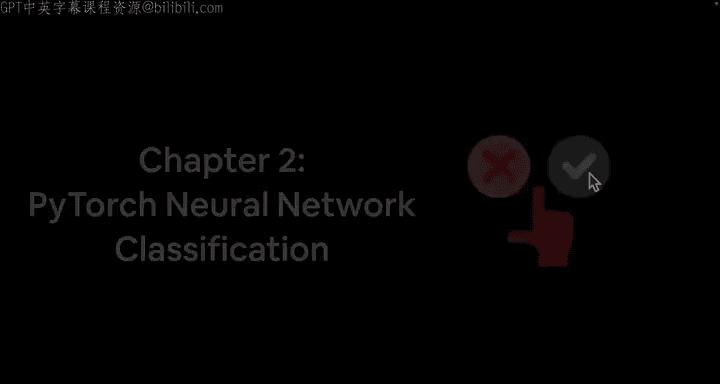

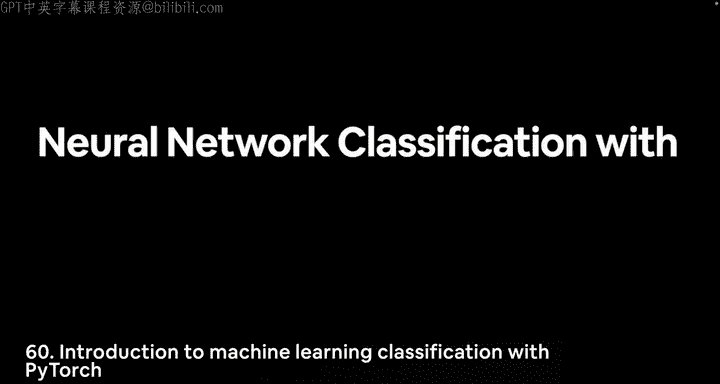

Oh。Pitetorch。 Now， combining this module once we get to the end with the last one。

 which was regression。 So remember， classification is predicting a thing。

 but we're going to see this in a second。 And regression is predicting a number。

 Once we've covered this， we've covered two of the the biggest problems in machine learning。

 predicting a number or predicting a thing。 So let's start off with before we get into any ideas or code。

 where can you get help。😊。

First things first is follow along with the code if you can。 if， in doubt， run the code。

 Try it for yourself。 write the code。 I can't stress how important this is。

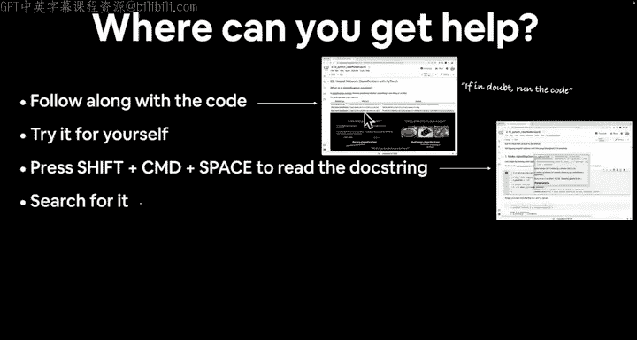

If you're still stuck press shift command and space to read the dock string of any of the functions that we're running。

 If you are on Windows it might be control， I want a Mac。 or I put command here。

 If you're still stuck， search for your problem。 If an error comes up。

 just copy and paste that into Google。 That's what I do。

 You might come across resources like stack overflow。 or of course， the pytorch documentation。

 We'll be referring to this a lot again throughout this section。 And then finally， oh wait。

 if you're still stuck。 try again， if in doubt， run the code。 And then finally。

 if you're still stuck， don't forget， you can ask a question。

 the best place to do so will be on the course Github， which will be at the discussions page。

 which is linked here。😊，If we load this up， there's nothing here yet because as I record these videos。

 the course hasn't launched yet， but press new discussion， talk about what you've got problem with X。

 Y Z。Leave a video number here and a timestamp。And that way we'll be able to help you out as best as possible。

 so video number， timestamp and then your question here and you can select Q&A。Finally。

Don't forget that this notebook that we're about to go through is based on chapter 2 of the Ze to mastery Learn Pytorch for Deep Learning。

 which is neural network classification with Pytorch。

 All of the text base code that we're about to write is here that was a little spoiler and don't forget this is the home page So my Github repost slash Pytorch deep learning for all of the course materials。

 everything you need will be here So that's very important how can you get help but this is the number one follow along with the code and try to write it yourself。

😊。

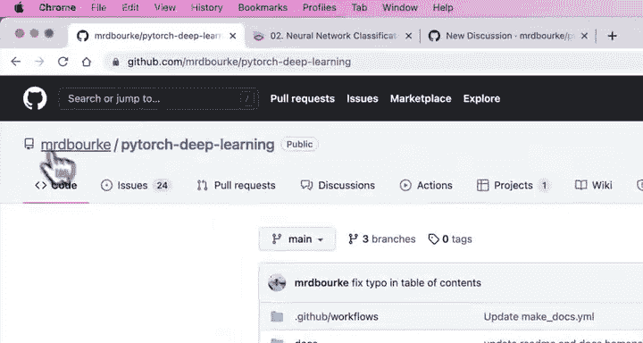

Well， with that being said， when talking about classification， what is a classification problem Now。

 as I say， classification is one of the main problems of machine learning。

 So you probably already deal with classification problems or machine learning powered classification problems every day。

😊，So let's have a look at some examples。Is this email spam or not spam。

 Did you check your emails this morning or last night or whenever。

 So chances are that there was some sort of machine learning model behind the scenes。

 It may have been a neural network It may have not that decided that some of your emails weren't spam。

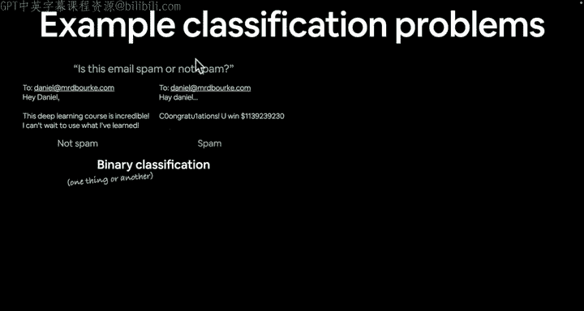

So to Daniel at Mr Debo dot com。 Hey， Daniel， this deep learning course is incredible。

 I can't wait to use what I've learned。 that's such a nice message。

 If you want to send that email directly to me， you can， that's my actual email address。

 But if you want to send me this email， Well， hopefully my email。

 which is hosted by some email service to text this as spam。

 because although that is a lot of money and it would be very nice。

 I think if someone can't spell too well， are they really going to pay me this much money。

 So thank you， email provider for classifying this is spam。 And now。

 because this is one thing or another， not spam or spam， This is binary classification。

 So in this case， it might be one here， and this is a0。 So or0 or one。 So one thing or another。

 that's binary classification。 If you can split it into one thing or another， binary classification。

😊。

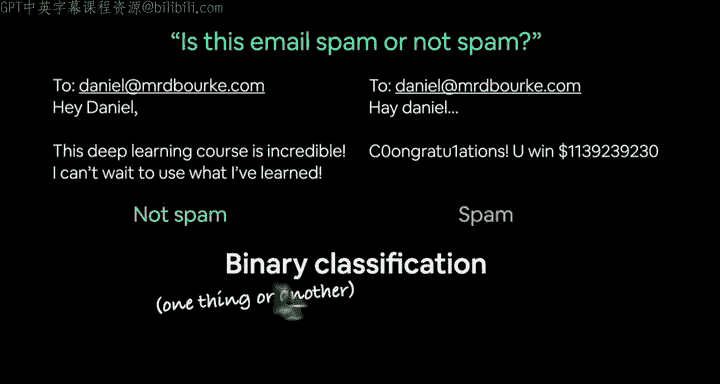

And then we have an example of。So we had the question。

 We asked our photos app on our smartphone or whatever device you're using。

 Is this photo of sushi steak or pizza。 We wanted to search our photos for every time we've eaten sushi or every time we've eaten steak or every time we've eaten pizza far out。

 and this looks delicious。 But this is multi class classification。 Now， why is this。

 because we've got more than two things。 We've got 1，2，3。 And now this could be 10 different foods。

 It could be 100 different foods， It could be 1000 different categories。 So the imagenet data set。

 which is a popular data set for computer vision， imagenet。😊。

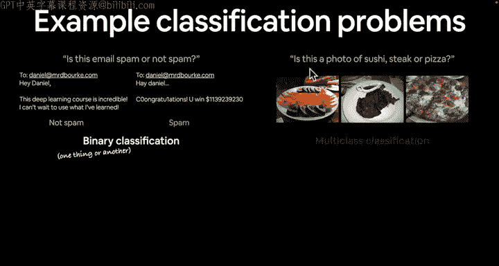

We go to here。Does it say 1000 anywhere，1 K。Or 1000。No， it doesn't。 but if we go image net 1 K。

Download imagenet data。 Maybe it's here。It won't say it， but you're just， oh， there we go。

100 object classes。So this is multiclass classification because it has1 thousand classes。

 That's a lot， right， So that's multi class classification， more than one thing or another。😊。

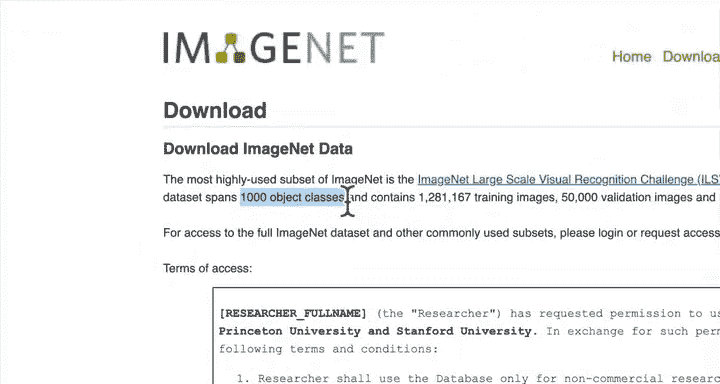

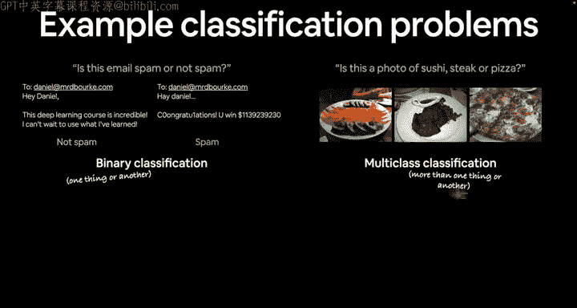

Then， finally。We might have。Multi label classification。

 which is what tags should this article have When I first got into machine learning。

 I got these two mixed up a whole bunch of times。 Multiclass classification has multiple classes such as sushi steak pizza。

 but assigns one label to each。 So this photo would be sushi in an ideal world。

 This is steak and this is pizza。 So one label to each。

 whereas multi label classification means you could have multiple different classes。

 But each of your target samples such as this Wikipedia article。 What tags should this article have。

 It may have more than one label。 It might have three labels， It might have 10 labels。 In fact。

 What if we went to the Wikipedia page。 for deep learning。 Wikipedia。 and does it have any labels。

 Oh， there we go。😊。

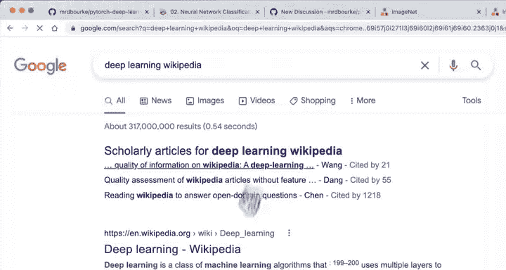

Where was that。I mean， you can try this yourself。 This is just the Wikipedia page for deep learning。

 There is a lot。 There we go categories， deep learning， artificial neural networks。

 artificial intelligence and emerging technologies。

 So that is an example if we wanted to build a machine learning model to say read all of the text in here and then go tell me what are the most relevant categories to this article。

 It might come up with something like these In this case， because it has one，2，3，4。

 It has multiple labels rather than just one label of deep learning。

 It could be multila classification。 So it'll go back。 But there's a few more。

 These will get you quite far in the world of classification。😊。

AndSo let's dig a little deeper on binary versus multiclass classification。

 You may have already experienced this。 So in my case。

 if I search on my phone in the photos app for photos of a dog。 It might come here。

 If I search for photos of a cat， it might come up with this。

 But if I wanted to train an algorithm to detect the difference between photos of These are my two dogs。

 Are they cute。 then're nice entire and they're sleeping like a person。 This is 7， number 7。

 that's her name。 And this is Bella。 This is a cat that me and my partner rescued。

 And so I'm not sure if what this cat's name is actually， So I'd love to give it a name， but I can't。

 So binary classification。 If we wanted to build an algorithm， we wanted to feed it。

 say 10000 photos of dogs and 10000 photos of cats。

 And then we wanted to find a random image on the Internet and pass it through to our model and say。

 hey， is this a dog or is this a cat。 It would be binary classification。

 because the options are one thing or another dog or cat。 But then for multi。😊。

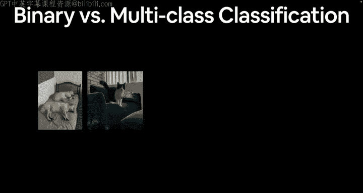

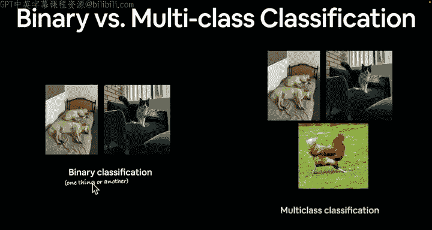

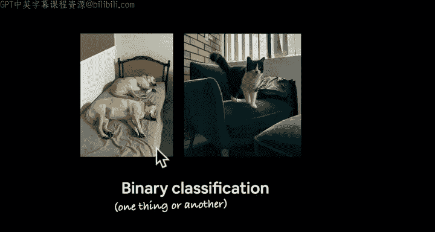

Clas classification， let's say we've been working on a farm and we've been taking some photos of chickens because they groovy right。

 Well， we updated our model and added some chicken photos in there。

 We will now be working with a multiclass classification problem because we've got more than one thing or another。

😊。

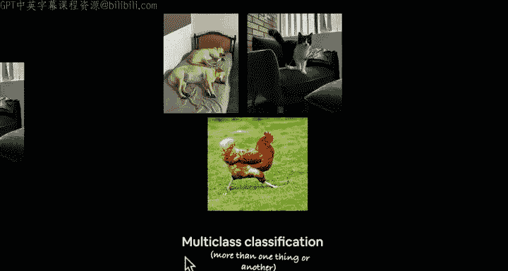

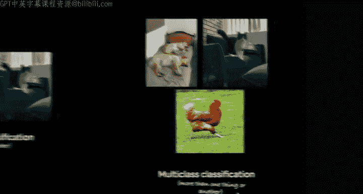

So。Let's jump in to what we're going to cover。 This is broadly， by the way。

 because this is just text on a page。 You know， I like to just write code of what we're actually doing。

 So we're going to look at the architecture of a neural network classification model。

We're going check what the input shapes and output shapes of a classification model are。

 features and labels， In other words， because remember， machine learning models。

 neural networks love to have numerical inputs and those numerical inputs often come in tensors。

 tensors have different shapes， depending on what data you're working with。

 We're gonna to see all of this in code。 creating custom data to view fit and predict on。

 We're going to go back through our steps in modeling。

 We cover this a fair bit in the previous section。 but creating a model for neural network classification。

 It's a little bit different to what we've done， but not too outlandishly different。

 We're going to see how we can set up a loss function and an optr for a classification model。

 We'll recreate a training loop and evaluating loop or a testing loop。

 We'll see how we can save and loaddown models。 We'll harness the power of nonlinearity。 Well。

 what does that even mean。 Well， if you think of what a linear line is。 What does that。😊。

It's a straight line， so you might be able to guess what a linear line looks like。

And then we'll look at different classification evaluation methods。

 So ways that we can evaluate our classification models and how are we going to do all this。 Well。

 of course， we're going to be part cook， part chemist， part artist， part science。 But for me。

 I personally prefer the cook side of things， because we're going to be cooking up lots of code。

 So in the next video before we get into coding。 Let's do a little bit more on What are some classification inputs and outputs。

 I'll see you there。😊。

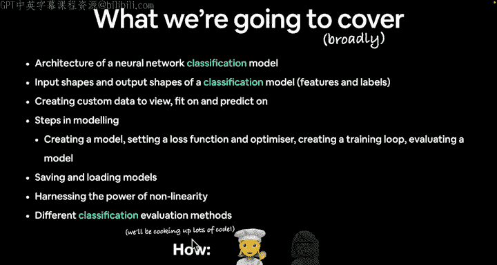

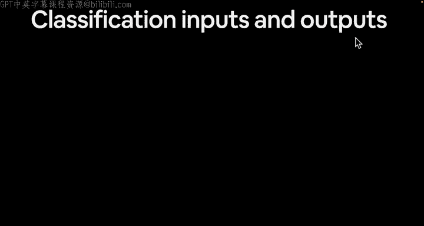