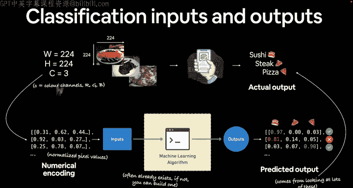
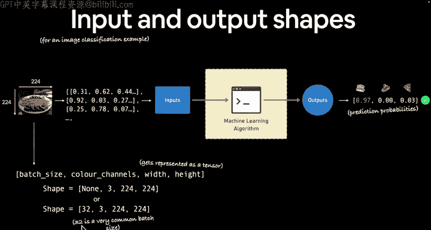
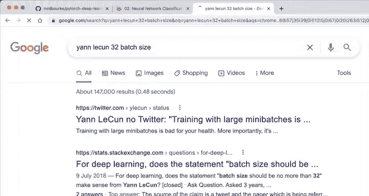
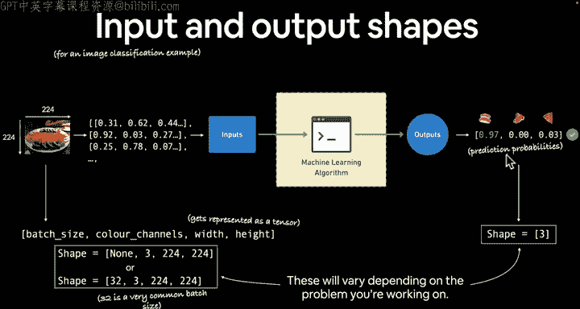
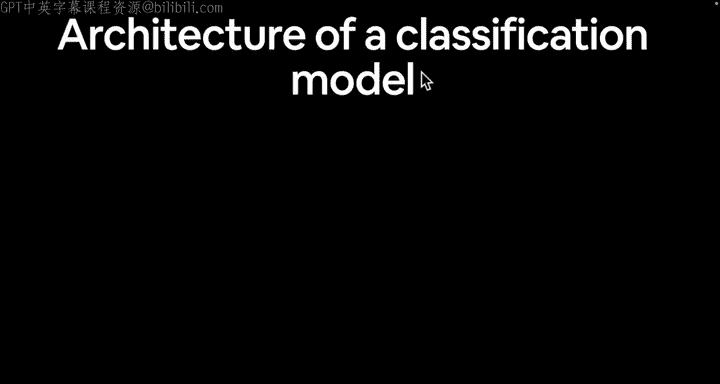

# mrdbourke《一天学会pytorch深度学习｜Learn PyTorch for deep learning in a day Literally》中英 - P45：61. Classification input and outputs.zh_en - GPT中英字幕课程资源 - BV1kx4y1r79d

Welcome back in the last video we had a little bit of a brief overview of what a classification problem is。

 but now let's start to get more hands on by discussing what the actual inputs to a classification problem look like and the outputs look like。

😊，And so let's say we had our beautiful food photos from before。

 and we were trying to build this up here called maybe Food Viion to understand what foods are in the photos that we take。

 And so what might this look like。😊，Well。Let's break it down to inputs。

 some kind of machine learning algorithm。 and then outputs。 In this case， the inputs。

 we want to numerically represent these images in some way， shape or form。

 Then we want to build a machine learning algorithm。 Hey， one might actually exist。

 We're going to see this later on in the transfer learning section for our problem。

 And then we want some sort of outputs。 And in the case of food vision。 We want to know， okay。

 this is a photo of sushi。 And this is a photo of steak。 And this is a photo of pizza。

 You could get more。Hands on and technical and complicated。

 But we're just going to stick with single label multi class classification。

 so it could be a sushi photo， It could be a steak photo， or it could be a pizza photo。

So how might we numerically represent these photos。 Well。

 let's just say we had a function in our app that every photo that gets taken automatically gets resized into a square into 224 width and 22 4 height。

 This is actually quite a common dimensionality for computer vision problems。😊。

And so we've got the width dimension， we've got the height， and then we've got this C here。

 which isn't immediately recognizable， but in the case of pictures。

 they often get represented by width height color channels and the color channels is red。

 green and blue， which is each pixel in this image has some value of red。

 green or blue that makes whatever color is displayed here。

 and this is one way that we can numerically represent an image by taking its width。

 its height and color channels and whatever number makes up this particular image。

 We're going to see this later on when we work with computer vision problems。

So we create a numerical encoding， which is the pixel values here。

 Then we import the pixel values of each of these images into a machine learning algorithm。

 which is often already exist。 And if it doesn't exist for our particular problem， hey， well。

 we're learning the skills to build them now， we could use piytorrch to build a machine learning algorithm for this。

😊，And then outputs， What might these look like。 Well， in this case。

 these are prediction probabilities， which the outputs of machine learning models are never actually discrete。

 which means it is definitely pizza。 It will give some sort of probability value between 0 and 1。

For say the closer to one， the more confident our model is that it's going to be pizza and the the closer to0 is means that。

 hey， this photo of pizza。 let's say this one。When we're trying to predict sushi。 Well。

 it doesn't think that it's sushi。 So it's giving a quite a low value here and then the same for steak。

 but it's really high The value here for pizza。 We're going to see this hands on。

 And then it's the opposite here。 So it might have got this one wrong。

But with more training and more data， we could probably improve this prediction。

 That's the whole idea of machine learning。 Is that if you adjust the algorithm。

 if you adjust the data。You can improve your predictions。And so。The ideal outputs that we have here。

This is what our model is going to output。 But for our case of building out food vision。

 we want to bring them back to so we could just put all of these numbers on the screen here。

 but that's not really going to help people。 We want to put out labels of what's going on here。

 so we can write code to transfer these prediction probabilities into these labels to。

And so how did these labels come about， how do these predictions come about。

 Well it comes from looking at lots of different samples， So this loop we could keep going。

 improve these， find the ones where it's wrong， add more images here。

 train the model again and then make our app better。

And so if we want to look at this from a shape perspective。

We want to create some tensess for an image classification example。 So we're building food vision。

We've got an image again。 This is just reiterating on some of the things that we've discussed。

 We've got a width of 22，4 and a height of 224。 This could be different。 This could be 300300。

 This could be whatever values that you decide to use。 Then we numerically encoded in some way。

 shape or form。 We use this as the inputs to our machine learning algorithm because what computers a machine learning algorithms。

 They love numbers。 They can find patternss in here that we couldn't necessarily find or maybe we could if you had a long enough time。

 but I'd rather write an algorithm to do it for me。 than it has some outputs。

 which comes in the form prediction probabilities。 The closer to one。

 the more confident model is and saying， hey， this is。

 I'm pretty damn confident that this is a photo of sushi。 I don't think it's a photo of stakes。

 I'm giving that0。 It might be a photo of pizza。 But I don't really think so。

 I'm giving it quite a low prediction probability。😊。

And so if we have a look at what the shapes are for our tens here。 If this doesn't make sense。

 don't worry， we're going to see the code to do all of this later on。 But for now。

 we're just focusing on a classification， input and output。

 The big takeaway from here is numerical encoding， outputs and numerical encoding。

 but we want to change these numerical codingings from the outputs to something that we understand。

 Sa the word sushi。But this tensor may be batch size。 We haven't seen what batch size is。

 That's all right。 We're going to cover it colour channels with height。

 So this is represented as a tensor of dimensions。 It could be none here。

 None is a typical value for a batch size， which means it's blank。 So when we use our model。

 and we train it。 All the code that we write with pytorage， we'll fill in this behind the scenes。😊。

And then we have three here， which is colour channels， Then we have 2，2，4， which is the width。

 Then we have 2，24 as well， which is the height。 Now there is some debate in the field on the ordering。

 we're using an image as our particular example here on the ordering of these shapes。 So say。

 for example， you might have height width color channels。

 typically width and height come together in this order。

 or they're just side by side in the tensor in terms of their where the dimension appears。

 but color channels sometimes comes first， that means after the batch size or at the end here。

 But Pytorage the default for now is color channels width height。

 though you can write code to change this order。😊，Because tens are quite flexible。

 And so or the shape could be 32 for the batch size，3，2，2，4，2，2，4。

 because 32 is a very common batch size。 And you don't believe me。 Well， let's go here。

Yarn Laoon，32 batch size。Now， what is a batch size。Great tweet。 Just keep this in mind for later on。

 Training with large mini batches is bad for your health。 More importantly。

 it's bad for your test error。 Friends don't let friends use mini batches larger than 32。

 So this is quite an old tweet， however。It still stands quite true because like today， it's 2022。

 when I'm recording these videos， there are batch sizes a lot larger than 32。

 but 32 works pretty darn well for a lot of problems。

 And so this means that if we go back to our slide。That if we use a batch size of 32。

 our machine learning algorithm looks at 32 images at a time。 Now， why does it do this？ Well。

 because sadly， our computers don't have infinite compute power in an ideal world。

 we look at thousands of images at a time， But it turns out that using a multiple of8 here is actually quite efficient？

 And so if we have a look at the output shape here， Why is it 3， Well。

 because we're working with three different classes，1，2，3。 So we've got shape equals 3。Now。

 of course， as you could imagine， these might change depending on the problem you're working with。

 So say if we just wanted to predict if a photo was a cat or a dog。

 we still might have this same representation here because this is the image representation。 However。

 the shape here， maybe two， or will be two because it's cat or dog rather than three classes here。

 but a little bit confusing as well with binary classification。

 you could have the shape just being one here。But we're going to see this all hands on。

 Just remember the shapes vary with whatever problem you're working on。

 the principle of encoding your data as a numerical representation stays the same for the inputs。

 and the outputs will often be some form of prediction probability based on whatever clash you're working with。

So on the next video。😊，Right before we get into coding。

 let's just discuss the high level architecture of a classification model。 And remember。

 architecture just like the schematic of what a neural network is。 I'll see you there。😊。

