# mrdbourke《一天学会pytorch深度学习｜Learn PyTorch for deep learning in a day Literally》中英 - P46：62. Architecture of a classification neural network.zh_en - GPT中英字幕课程资源 - BV1kx4y1r79d

Welcome back。 In the last video， we saw some example classification inputs and outputs。

 The main takeaway that the inputs to a classification model， particularly in neural network。

 want to be some form of numerical representation， and the outputs are often some form of prediction probability。

😊，So let's discuss the typical architecture Java classification model and hey。

 this is just going to be text on a page， but we're going to be building a fair few of these。😊。

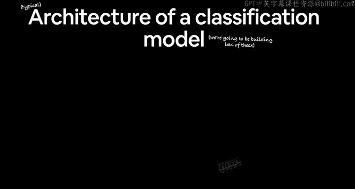

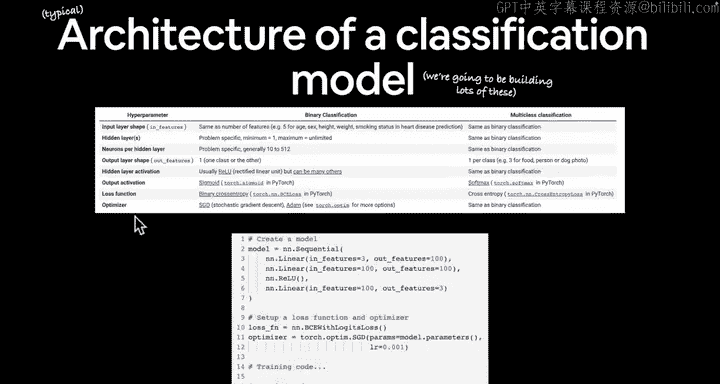

So we've got some hyperparameter over here。 We've got binary classification and we've got multiclass classification。

 Now there are some similarities between the two in terms of what problem we're working with。

 But there also are some differences here and by the way。

 this has all come from if we go to the book version of the course。

 we've got what is a classification problem。 and we've got architecture of a classification neural network。

 So all of this text is available at Learnptorch。io and in section 2。 So we come back。😊。

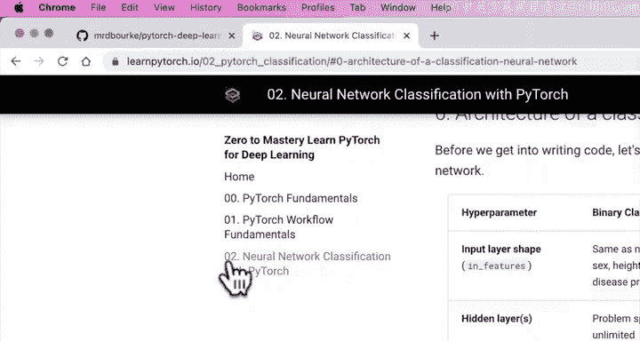

So the input layer shape， which is typically decided by the parameter in features。

 as you can see here。Is the same of number of features。

 So if we were working on a problem such as we wanteded to predict whether someone had heart disease or not。

 we might have five input features， such as one for age， a number for age。 It might be in my case。

28 sex could be male height 180 cime。 if I've been growing overnight。 It's really close to 177 Wait。

 Well， it depends on how much ofve eaten， but it's around about 75 kilos and smoking status。

 which is0， So it could be 01 because remember we want numerical representation。 So for sex。

 it could be 0 for males， one for female height could be its number。

 weight could be its number as well。 All of these numbers could be more could be less as well。

 So this is really flexible。 And it's a hyperpara， why。

 because we decide the values for each of these。 So in the case of our image prediction problem。

 we could have in features equals 3 for number of color channels。 And then we go。

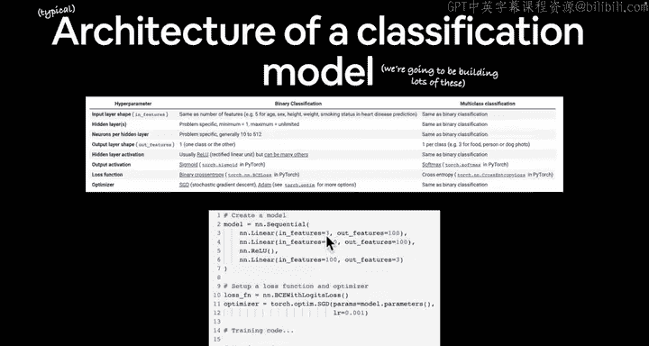

Hidden layers。 So there's the blue circle here。 I forgot that this was all timed and colorfulful。

 But let's just discuss hidden layers。Each of these is a layer， an n dot linear， an n dot linear。

 an N dot re， and N dot linear。 So that's the kind of the syntax you'll see in pi torch for a layer is N N dot something。

 Now， there are many different types of layers in this in pi torch。 if we go torch and N。

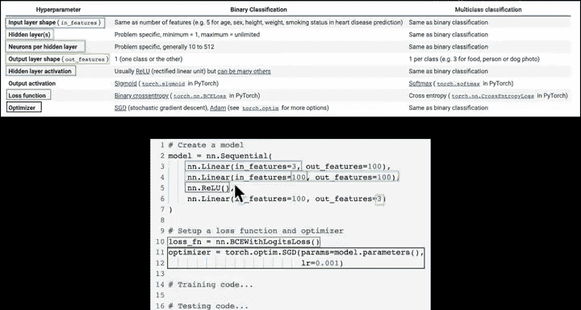

Basically， everything in here is a layer in a neural network。

 and then if we look at what a neural network looks like。Neural network。Recall that。

All of these are different layers of some kind of mathematical operation， input layer， hidden layer。

 You could have as many hidden layers as you want。Do we have resnet。Architecture。

The resnet architecture， some of them have 50 layers。 Look at this。 Each one of these is a layer。

And this is only the 34 layer version。 I mean， there's resnet 152， which is 152 layers。

 We're not at that yet， but we're working up the tools to get to that stage。

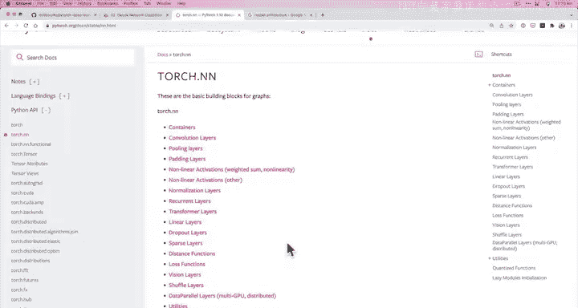

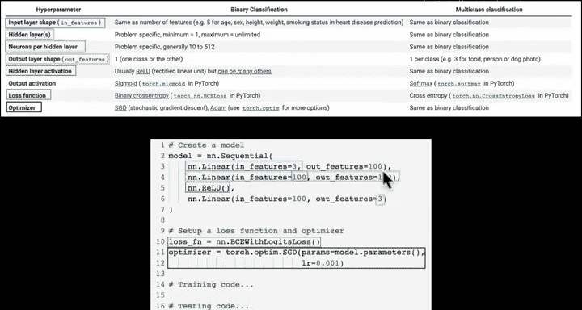

Let's come back to here。 the neurons per hidden layer。 So we've got these out features。

 the green circle， the green square。 Now this is， if we go back to our neural network picture。

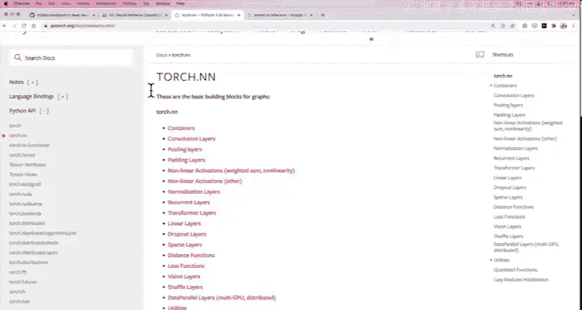

This is these。 Each one of these little things is a neuron， some sort of parameter。 So if we had 100。

What would that look like？Well， we'd have a fairly big graphic。

 So this is why I like to teach with code， because you could customize this as flexible as you want。

 So behind the scenes， Py torch is going to create。😊。

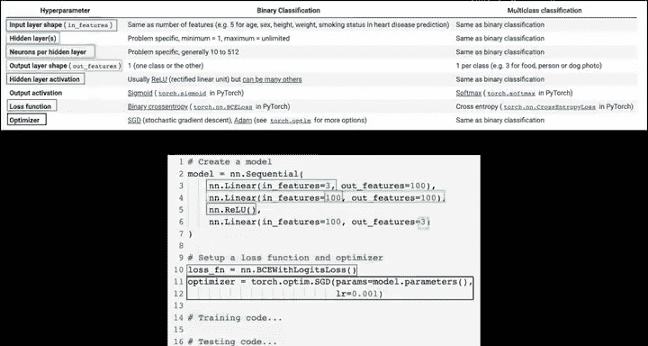

100 of these little circles for us。 And within each circle is what some sort of mathematical operation。

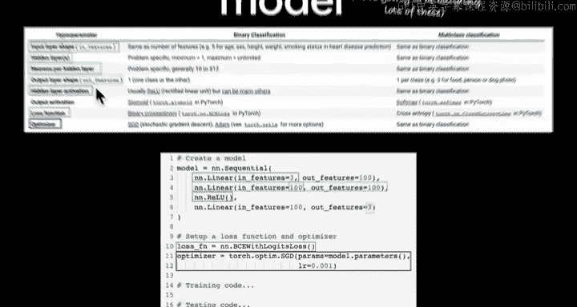

So if we come back， what do we got next， output layer shape。

 So this is how many output features we have。 So in the case of binary classification is one one class or the other。

 we're going to see this later on。 Multiclass classification is you might have three output features。

 one per class， E G， one for food， person or dog if you are building a food person or dog。

 image classification model。Hidden layer activation， which is， we haven't seen these yet。 Reou。

 which is a rectified linear unit， but can be many others because Pytorch， of course。

 has what has a lot of nonlinear activations。 We're going to see this later on。 Remember。

 I'm kind of planting the seed here。 We've seen what a linear line is。

 but I want you to imagine what a nonlinear line is。

 It's going to be a bit of a superpower for our classification problem。😊。

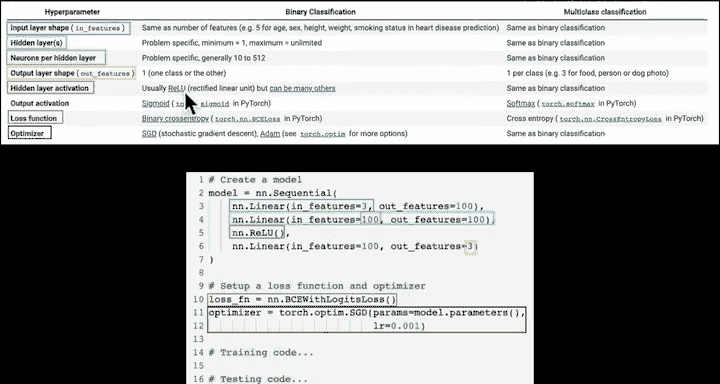

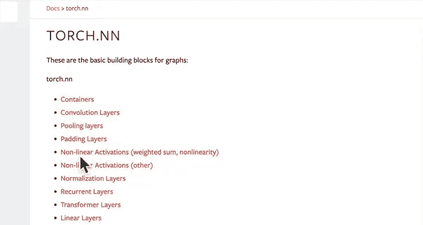

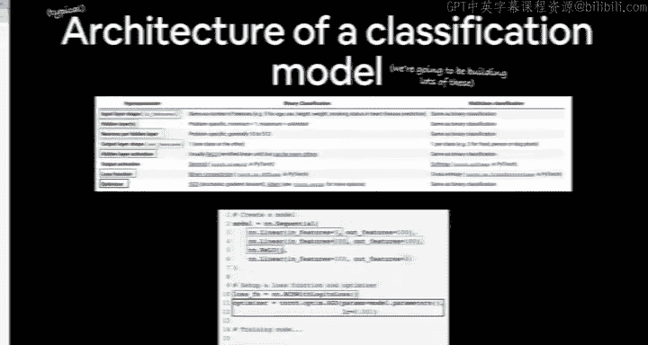

What else do we have， output activation， We haven't got that here， but we'll also see this later on。

 which could be sigmoid for which is generally sigmoid for binary classification。

 but softms for multiclass classification。 A lot of these things are just names on a page。

 We haven't seen them yet。 I like to teach them as we see them。

 But this is just a general overview of what we're going to cover。 Los function。 What loss function。

 or what does a loss function do。 It measures how wrong our models's predictions are compared to what the ideal predictions are。

 So for binary classification， we might use binary cross entropy loss in Ptorrch and for multiclass classification。

 we might just use cross entropy rather than binary cross entropy。 Get it， binary classification。

 binary cross entropy。 and then optimizer Sgd is stochastic gradient descent。

 We've seen that one before。 Another common option is the atom optr， and， of course。

 the torch dot optim package has plenty more options。😊。

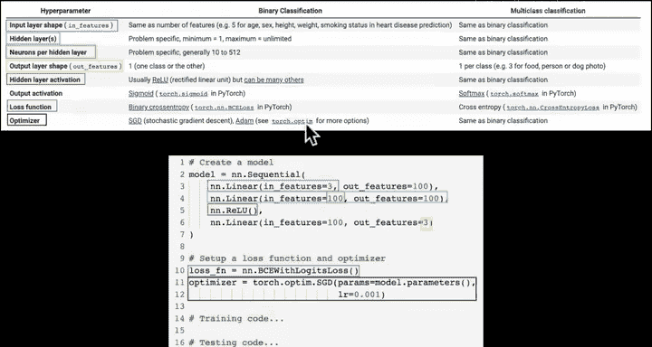

So。This is an example multi class classification problem。 This network here。 Why is that。

 And we haven't actually seen N N do sequential， But as you could imagine， sequential stands for。

 it just goes through each of these steps。 So multi class classification。

 because it has three output features more than one thing or another。

 So three for food person or dog。 But going back to our food vision problem。

 we could have the input as sushi steak。

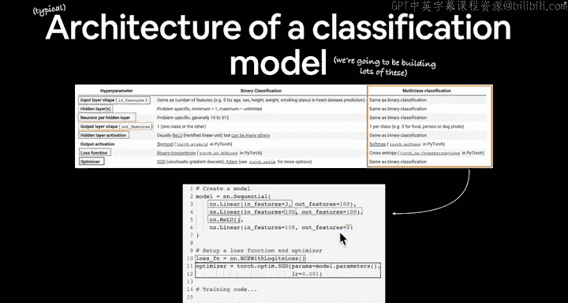

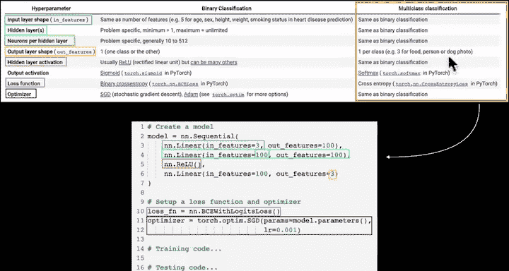

Or pizza。 So we've got three output features， which would be one prediction probability per class of image。

 We have three classes， sushi， steak， or pizza。Now。

 I think we've done enough talking here and enough just pointing to text on slides。

 How about in the next video。Let's code， I'll see you in Google Coabab。

Welcome back Now we've done enough theory of what a classification problem is。

 what the inputs and outputs are and the typical architecture。

 let's get in and write some code so I'm going get out of this and going to go to coabab。research。

google。com so we can start writing some Pytorch code I'm going to click new notebook we're going to start exactly from scratch。

😊。

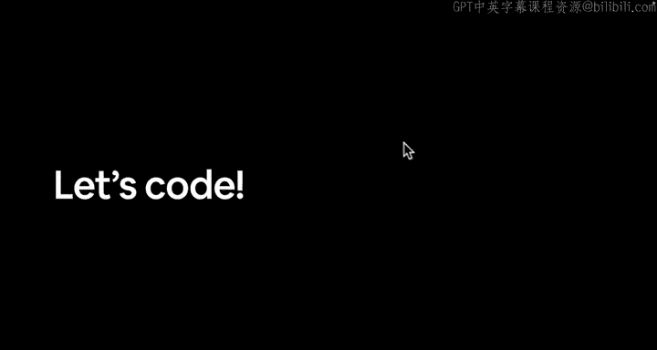

I'm going to name this section two and let's call it neural network。Classification with。Pie to watch。

I'm going to put underscore video because I'll just show you， you'll see this in the Github repo。

 But for all the video notebooks， the ones that I write code during these videos that you're watching。

 the exact code is going to be saved on the Github repo under video notebooks。 So there's 00。

 which is the fundamentals。 and there's the workflow underscore video。

 But the reference notebook with all the pretty pictures and stuff is in the main folder here。

 So Pytch classification that I poem B。 Oh actually， they will just rename it that。😊。

Pytor classification， but we know it's with neural networks。P to watch， classification。Okay。

 and let's go here。 We'll add a nice title， So O2。Neural network。Classification with pieytorch。

 And so we'll remind ourselves。 classificationification is a problem of predicting。

Whether something is。One thing or another。And there can be multiple。Things。

As the options such as email， spam or not spam， photos of dogs or cats or pizza or sushi or steak。

Lots of talk about food。 And then I'm just going to link in here this。Resource。

 because this is the book version of the course。 These are what the videos are based off， so。

Book version。Of this notebook。And then all the resources are in here。All other resources。

In the Github， and then stuck。Ask a question here。Which is under the discussions tab。

We'll copy that in here that way we've got everything linked and ready to go， but as always。

What's our first step in our workflow， This is a little test。 See if you remember。Well， it's data。

 of course， because all machine learning problems start with some form of data。

 We can't write a machine learning algorithm to learn patterns in data that doesn't exist。

 So let's do this video。 We're going to make some data。Of course。

 you might start with some of your own that exists。 But for now。

 we're going to focus on just the concepts around the workflow so we're going to make our own custom data set。

 and to do so。I'll write the code first， and then I'll show you where I get it from。

 We're going to import the Psyit Learn library。 One of the beautiful things about Google Coabab is that it has Psyit Learn available。

 if you're not sure what psyit Learn is。 It's a very popular machine learning library。

 Pytorch is mainly focused on deep learning， but Psyit loan is focused on a lot of things around machine learning。

 So Google Coab， thank you for having psyit Learn already installed for us。😊。

But we're going to import the make circles data set。 And rather than talk about what it does。

 let's see what it does。 So make 1 thousand samples。We're going to go N samples。Equals 1000。

And we're going to create circles。You might be wondering why circles。 Well。

 we're going to see exactly Y circles later on。 So X and Y， we're going to use this variable。

 How would you say nomenclature as capital X and Y， Y is that because x is typically a matrix。

 features and labels。So let's go here， mate circles。 and we're going to make end samples。

 So10 different samples。 We're going to add some noise in there。 just for a little bit of randomness。

 Why not？ You can increase this as you want。 I've found that 0。

03 is fairly good for what we're doing。 And then we're going to also pass in the random state variable。

 which is equivalent to sitting a random or setting a random seed。

 So we're flavouring the randomness here。😊，Wonderful。So now let's have a look at the length of x。

 which should be。What。😡，And length the Y。Oh， we don't have Y underscore。

 getting a bit trigger happy with this keyboard here。1000。

 So we have 1000 samples of x co with 1000 or paired with 1000 samples of Y features， labels。

 So let's have a look at the first five of x。 So print。First， five samples of X。

 and then we'll put in here X。 and we can index on this。5， co we're adhering to the data。

 explorelorerss motto of。Visualize， visualize， visualize。First， five samples of why。

 And then we're going to go Y， same thing here。Wonderful， let's have a look。

I we'll get a new line in here just so。Looks a bit better。Wonderful， so numerical。

 our samples are already numerical。 This is one of the reasons why we're creating our own data set。

 We'll see later on how we get non numerical data into numbers。 But for now， our data is numerical。

 which means we can learn it with our model or we can build a model to learn patterns in here。

 So this sample has the label of one。😊，And this sample has the label of one as well。 Now。

 how many features do we have per sample， if I highlight this line， how many features is this。

It would make it a bit easier if there was a comma here， but we have two features of x。

 which relates to one label of y。And so far， we've only seen， let's have a look at all of why。

We've got zero on one， so we've got two classes。 What does this mean， zero or one。

 one thing or another。Well， it looks like binary classification to me because we've got only0 or only one。

 If there was 0，1，2， it would be。Monti class classification， because we have more than two things。

 So let's x out of this。 Let's keep going and do a little bit more data exploration。

So how about we make a data frame with pandas of circle data？

There is truly no real definite way of how to explore data for me。

 I like to visualize at multiple different ways， or even look at random samples in the case of large data sets such as images or text or whatnot。

 If you have 10 million samples， perhaps visualizing them one by one is not the best way to do so。

So random can help you out there。 So we're going create a data frame。

 and we can insert a dictionary here。 So I'm going to call the features in this part of X X1。

 And these are going to be x 2。 So let's say I write some code to index on this。

 So everything in the zeroth index will be x1 and everything in the。First index。

 there we go will be x2。 let me clean up this code。 This should be on different lines。很唱。

And then we've got， let's put in the label。As why。So this is just a dictionary here。 So x1 key to x0。

 x2， a little bit confusing because of0 indexing， but x feature 1， x feature 2， and the label is Y。

 Let's see what this looks like。We'll look at the first 10 samples。Okay， beautiful， so。We've got x1。

 some numerical value， x2 another numerical value correlates to or matches up with label 0。

 But then this one。😊，0442208 and negative that number。Matches up with label 0。

 So I can't tell what the patterns are just looking at these numbers。 You might be able to。

 but I definitely can't。 We've got some ones。 All these numbers look the same to me。

 So what can we do next。Well。How about we visualize， visualize， visualize。

 And instead of just numbers in a table， let's get graphical this time。 Viize， visualize， visualize。

So we're going to bring in our friendly mappl lib。Import mat plot lib， which is。

A very powerful plotting library。I'm just going to add some cells here。

 so we've got some space map plot Li dot pie plot。As PLT。That's right。 We've got this P dot scatter。

 We're going to do a scatter plot equals x。 and we want the first index。

 and then y is going to be x as well。So that's going to be on the Y axis。

 And then we want to color it with labels。 We're going to see what this looks like in a second。

 and then the color map。C map stands for color map is going to be plot dot color map。

 P L T and then red， yellow， blue， one of my favorite color outputs。

 So let's see what this looks like。 You ready。There we go。 There's our circles。

 That's a lot better for me。😊，So。What do you think we're going to try and do here if this is our data and we're working on classification。

We're trying to predict if something is one thing or another。

So our problem is we want to try and separate these two circles。

 So say given a number here or given two numbers an an x1 and an x2， which are coordinates here。

 we want to predict the label， is it going to be a blue dot or is it going to be a red dot。

So we're working with binary classification。 So we have one thing or another。

 Do we have a blue dot or a red dot。 So this is going to be our toy data here。 And a toy problem is。

 let me just write this down。 This is a common thing that you'll also hear in machine learning note。

😊，The data we're working with is often referred to。As a toy data set。

A data set that is small enough to experiment on。But still sizable。

Enough to practice the fundamentals。 And that's what we're really after in this notebook is to practice the fundamentals of neural network classification。

 So we've got a perfect data set to do this。 And by the way， weve got this from psyt learn。

 So this little function here， made all of these samples for us。

 And how could you find out more about this。😊。

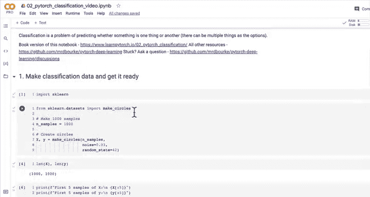

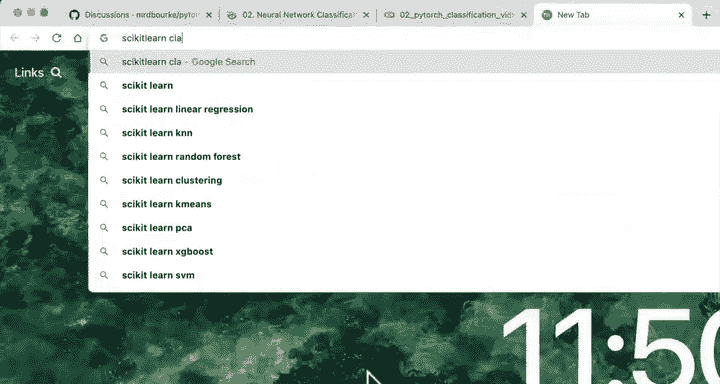

Function here。 Well， you could go psyt learn classification data sets。

 There are actually a few more in here that we could have done。 I just like the circle1。 toy datas。

 we saw that。 So this is like a toy box of different dataset sets。

 So if you'd like to learn more about some dataset sets that you can have a look in here and potentially practice on with neural networks or other forms of machine learning models from psyt learn。

 Check out this psyt learn。 I can't speak highly enough。 I know this is a pytorch course。

 We're not focused on this。 but they kind of all come together in terms of the machine learning and deep learning world。

 You might use something from psyt learn。 like we've done here to practice something。

 And then you might use pytorch for something else。 like what we're doing here。 Now。

 with that being said。😊，What are the input and output shapes of our problem？

Have a think about that and also have a think about how we'd split this into training and test。

So give those a go， we covered those concepts in some previous videos。

 but we'll do them together in the next video。 I'll see you there。😊。

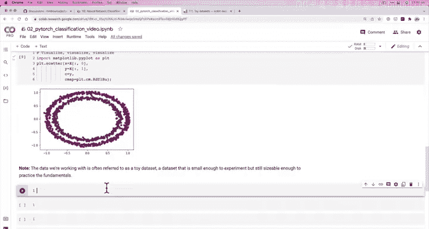