# mrdbourke《一天学会pytorch深度学习｜Learn PyTorch for deep learning in a day Literally》中英 - P47：64. Turing our data into tensors.zh_en - GPT中英字幕课程资源 - BV1kx4y1r79d

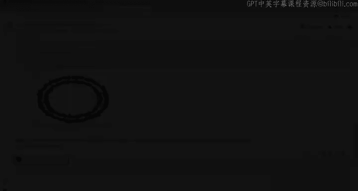

Welcome back in the last video we made some classification data so that we can practice building a neural network in Pytorrch to separate the blue dots from the red dots。

 so let's keep pushing forward on that and I'll just clean up here a little bit but where are we in our workflow？

😊。

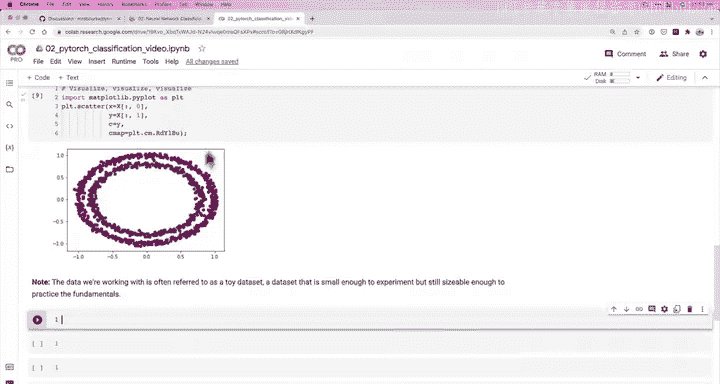

What have we done so far， Well， we've got our data ready a little bit。

 We haven't turned it into tensess。 So let's do that in this video。

 and then we'll keep pushing through all of these。

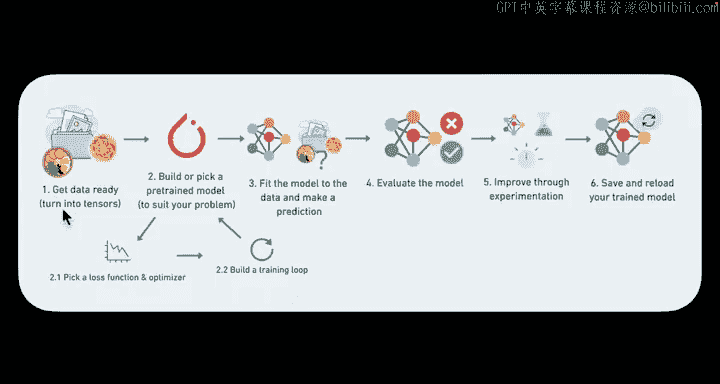

So in here， I'm going make this heading。1。1， check input and output shapes。

The reason we're focused a lot on input and output shapes is Y because machine learning deals a lot with numerical representations as tensors and input and output shapes are some of the most common errors like if you have a mismatch between your input and output shapes of a certain layer of an output layer you're going to run into a lot of errors there So that's why it's good to get acquainted with。

 whatever data you're using， whatever are the input shapes and whatever are the output shapes you'd like。

 So In our case we can go X。Dot shape and Y dot shape。

So we're working with nupy arrays here if we just look at x。

 That's what the make circles function has created for us。 we've got an array。

 but as our workflow says， we'd like it in tenses If we're working with piytorch。

 we want our data to be represented as pytorrch tenseors of that data type。

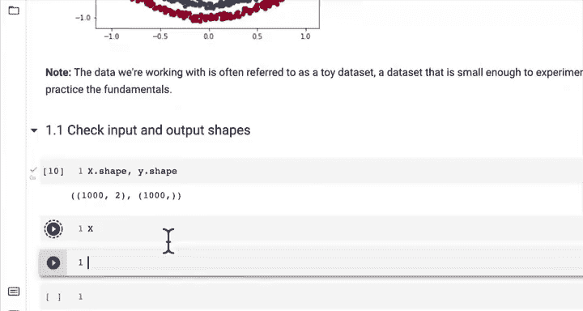

And so we've got a shape here。 we've got 1000 samples， and X has two features， and y has no features。

 It's just a single number。 It's a scalar。 So it doesn't have a shape here。

 So there's 1000 samples of y 000 samples of x，2 samples of x equals one Y label。 Now。

 if you're working with a larger problem， you might have 1000 samples of X。

 but x is represented by 128 different numbers， or 200 numbers or as high as you want。

 or just 10 or something like that。 So just keep in mind that this number is quite flexible of how many features represent a label。

Why is the libel here。But let's keep going。So， you the first。Example of features and labels。

So let's make it explicit with what we've just been discussing。 We'll write some code to do so。

 We'll get the first sample of x， which is the zeroth index and we'll get their first sample of y。

 which is also the zeroth index。 We could get really anyone because they're all of the same shape。

But print。Values for one sample of x。 What does this equal x sample？And the same for Y。

 which is y sample。 And then we want to go print F。String for one sample of X。

 we'll get the shape here。Examp dot shape。And the same for why。And then we'll get Y sample dot shape。

Beautiful， what's this going to do。Well， we've got one sample of x。

 So this sample here of these numbers。 We've got a lot going on here，7，5，4，2，4，6，2，5， and 0，2，3，1，4。

8，0，7，4。 I mean， you can try to find some patterns in those。

 if you do all the best here and the same for Y。 So this is we have the y sample this correlates to a number one。

 a label of one。😊，And then we have shapes for one sample of x， which is2。

 So we have two features for Y。 It's a little bit confusing here because y is a scalar。

 which doesn't actually have a shape。 It's just one value。 So for me， in terms of speaking this。

 teaching it out loud will be two features of x， trying to predict one number for y。And so。

 let's now。Create another heading， which is 1。2。 Let's get our data into tensets。

Turn data into tensesors， We have to convert them from nupi。

 and we also want to create train and test splits。 Now。

 even though we're working with a toy data set here。

 the principle of turning data into tensesors and creating train and test splits will stay around for almost any data set that you're working with。

So let's see how we can do that。 So we want to turn data。Inter tensesors， and。For this。

 where you need to import torch。 We'll get pi torch， and we'll check the torch version。

 It has to be at least 1。10。And I might just put this down in the next cell。

Just make sure we can import Pytorrch。 There we go，1。10 plus kuda 111。

 If your version is higher than that， that is okay。 The code below should still work。

 And if it doesn't， let me know。So x equals torch dot。From Numpy， why are we doing this。

 while it's because x is a nuy array？And if we go x dot， does it have a D type attribute？Float 64。

 can we just go type？我 maybe。Type， oh， there we go。 Numpy and D array。 Can we just go type X。

Numpy and D array。 So we want it in a torch tensor。 So we're going to go from Numpy。

 We saw this in the fundamental section， and then we're going to change it into type torch dot float。

 Float is an alias for floatat 32。 We could type the same thing。These two are equivalent。

 I'm just going to type torch floatat for writing less code。

And then we're going to go the same with Y torch from Numpy。 Now。

 why do we turn it into a torch float？ Well， that's because if you recall the default type of nuumpy arrays is。

If we go， might just put out this in a comma X dot D type is float 64。 There we go。 However。

 pi torch， the default type is float 32。 So we're changing it into pi torchs default type。 Otherwise。

 if we didn't have this little section of code here。 dot type torch dot float。

 Our tensors would be of float 64 as well。 And that may cause errors later on。

 So we're just going for the default data type within pi torch。

 And so now let's have a look at the first。5 values of x and the first five values of Y。

 What do we have。Beautiful， we have tensor data types here。 And now。

 if we check the data type of x and we check the data type of Y， what do we have。 And then one more。

 I'm just go type。😊，X。So we have our data into tensors。 wonderful。 But now， so it's torch dot Tensor。

 beautiful。 But now we would like training and test sets。 So let's go split。😊，Data into。

Training and test sets。 and a very， very popular way to split data is a random split。

 So before I issued the challenge of how you would split this into a training and test set。

So because these data points are kind of scattered all over the plagues。

 we could split them randomly。So let's see what that looks like。

To do so I'm going to use our faithful psyit learn again。

 remember how I said psyit Learn has a lot of beautiful methods and functions for a whole bunch of different machine learning purposes。

 Well one of them is for a train test split。😊，Oh my goodness， Pto。 I didn't want auto correct there。

Train test split。 Now， you might be able to guess what this does。

 These videos are going to be a battle between me and Coat labs auto correct。 Sometimes it's good。

 Other times it's not。So we're going set this code up。 I'm going to write it。

 or we're going to write it together。 So we've got Xtrain for our training features and X test for our testing features。

 And then we also want our training labels and our testing labels。

 That order is the order that train test split works in。 and then we have train test split。

 Now if we wrote this function and we wanted to find out more。 I can press command shift space。

 which is what I just did to have this， but truly I don't have a great time reading all of this。

 You might， but for me， I just like going train test split。

 and possibly one of the first functions that appears。 Yes， is psy learn。

 how good is that So psyit learnt model selection do train test split。

 Now split arraysal matrices into random train and test subset beautiful。

 We've got a code example of what's going on here。 You can read what the different parameters do。

 but we're going to see them in action。 This is just another example of where machine learning libraries such as。

😊，Cyt learn， we've used Mapl Lib， we've used pandas。

 They all interact together to serve a great purpose。

 But now let's pass in our features and our labels。😊，This is the order that they come in， by the way。

 and we have the returns splitting。 So the order here I've got the order goes X train X test。

 Y train Y test took me a little while to remember this order。

 But once you've created enough train and test splits with this function。

 you kind of know this off by hard。 So just remember features first， train first and then labels。

Let me jump back in here。So I'm going to put in the test size parameter of 0。2。

 This is percentage wise。 so let me just right here， 0。2 equals 20% of data will be test。And。

80% will be trained If we wanted to do a 5050 split。 That kind of split doesn't usually happen。

 but you could go 0。5， but the test size says， hey， how big in percentage wise。

 do you want your test data to be。 And so behind the scenes train test split will calculate what's 20% of our X and Y samples。

 So we'll see how many there is in a second。 But let's also put a random state in here。

 because if you recall back in the documentation， train test split split data randomly into random train and test subsets。

 and random state， What does that do for us。 While this is a random C equivalent of。

 it's very similar to。Torch dot manualual seed。However， because we are using P psyt loan。

 setting Torch dot manual seed will only affect Ptorrch code rather than psyt loan code。

So we do this so that we get similar random splits。

 as in I get a similar random split to what your random split is。 And， in fact。

 they should be exactly the same。 So let's run this and then we'll check the length of X train。

And length of X test。 So if we have 1000 total samples。

 and I know that because above in our make circles function， we said we want 1000 samples。

 That could be 10000。 That could be 100。That's the beauty of creating your own dataset set。

And we have length Y train if we have 20% testing values。

How many samples are going to be dedicated to the test sample，20% of 1000 is。280%。

 which is because training is going to be。Training here。 So 100-20% is 80%。 So 80% of 1000 ears。

 Let's find out。Run all beautiful。 so we have 800 training samples， 200 testing samples。😊。

This is going to be the data set that we're going to be working with。 So in the next video。

 we've now got training and test sets。 We've started to move through our beautiful Pytorch workflow here。

 We've got our data ready。 We've turned it into tensesors。 We've created a training and test split。

 Now it's time to build or pick a model。 So I think we're still in the building phase。

 Let's do that in the next video。😊。

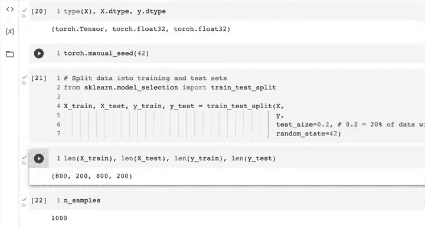

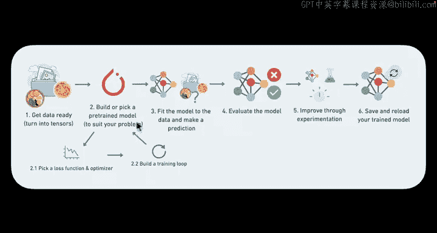

Welcome back In the last video， we split our data into training and test sets and because we did an 8020 split。

 we've got about 800 samples to train on and 200 samples to test on remember the training set is so that the model can learn patterns Pat that represent this dataset here。

 The circles data red dots or blue dots。 and the test data set is so that we can evaluate those patterns。

 and I took a little break before， but you can tell that because my notebook is disconnected。

 but if I wanted to reconnect it， what could I do， we can go here run time run before。

 that's gonna run all of the cells before， it shouldn't take too long because we haven't done any large computations。

 but this is good timing because we're up to part2。😊，Building。A model。

 And so there's a fair few steps here， but nothing that we haven't covered before。

 We're going to break it down。 So let's build a model。To classify。Our blue and red dots。And。To do so。

We want to。Tensers， I want two， not tens。 That's all right。So let me just make some space here。

 There we go。 So number one， let's set up device agnostic code。

 So we get in the habit of creating that。So our code will run on an accelerator。

I kind't name Phil ceter。 It doesn't matter you know what I mean。GPU。If there is one。2。

What should we do next。Well， we should construct a model because if we want to build a model。

 we need a model。 Con a model。 And we're going to go by subclassing。And then dot module。

Now we saw this here in the previous section with subclass N N dot module， in fact。

 all models imp to subclass and end dot module。And let's go define。Loss function。And optimizer。

And finally， oh。Good collabs， auto correctr is。😊，Not ideal。 And then we'll create a training。

And test loop， though this will probably be in the next section。

 We'll focus on building a model here。 And， of course。

 all of these steps are in line with what they're in line with this。

 So we don't have device agnostic code here。 But we're just going do it now so that we have a habit。

 These are the main steps。 Pick or build a pretrain model， suit your problem。

 Pick a loss function and optimizer， Build a training loop。 So let's have a look。😊。

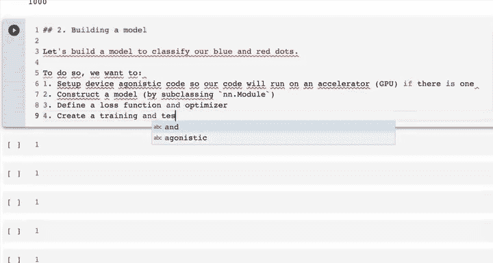

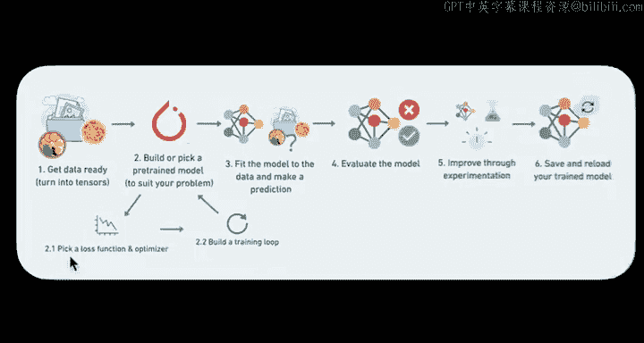

How can we start this off， So we'll import pie torch。And and then we've already done this。

 but we're going to do it anyway for completeness， just in case you wanted to。

Run your code from here， import NN， and we're going to make device agnostic code。

So we'll set the device equal to Kuda。If torch dot kuda。Is available。Else CPU。

 which will be the default。 The CPU is the default。 If there's no GP。

 which means that Couda is available or of our Pytoch code will default to using the CPU。

Devicice now we haven't set up a GPU yet so far。 You may have。 But as you see。

 my target device is currently CPU。 How about we set up a GPU， We can go into here runtime， change。

 runtime type GPU。 And I'm going to click save。 Now。

 this is going to restart the runtime and reconnect。

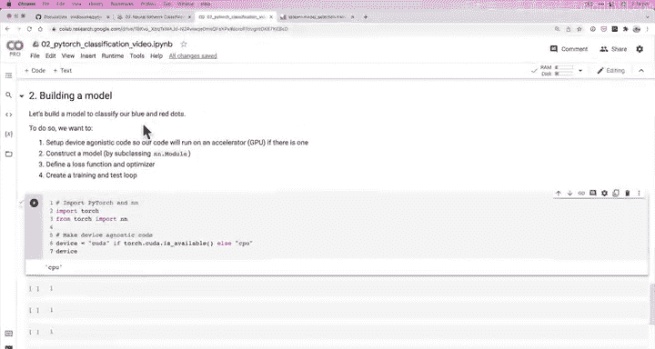

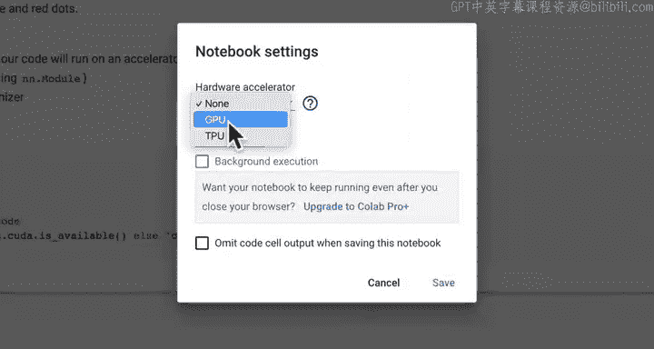

So once it reconnects。Beautiful， we could actually just run this code cell here。

This is going to set up the GPU device。 But because we're only running this cell。

 if we were to just set up Xtrain， we've not been defined。 So because we've restarted our run time。

 let's run all or we can just run before。So this is going to rerun all of these cells here。

And do we have X train now， Let's have a look。Wonderful， yes， we do。 Okay， beautiful。

 So we've got device agnostic code。 In the next video， let's get on to constructing a model。😊。

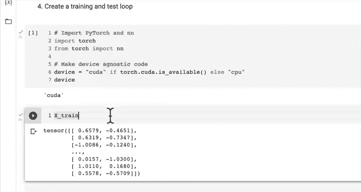

I'll see you there。