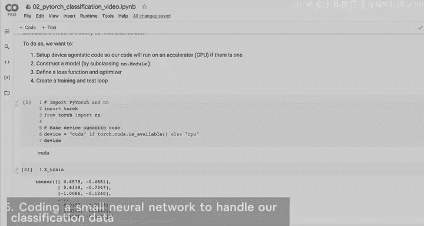
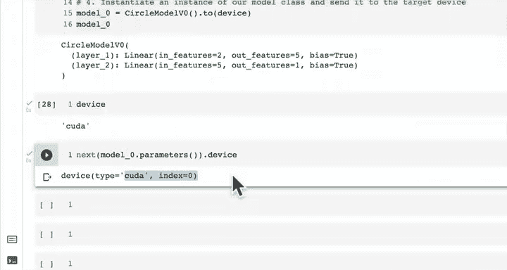
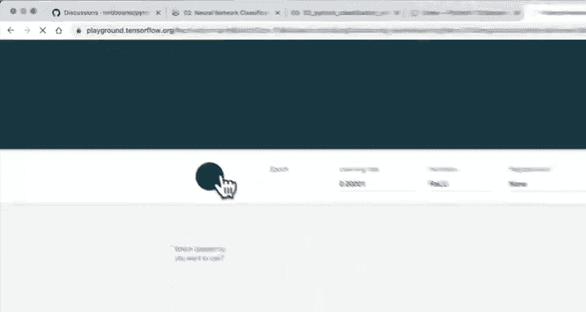
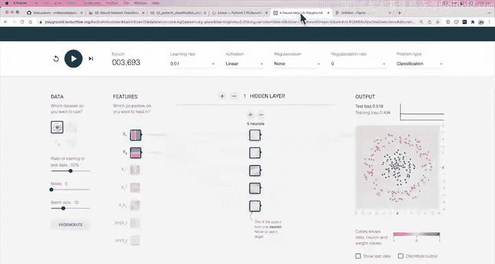

# mrdbourke《一天学会pytorch深度学习｜Learn PyTorch for deep learning in a day Literally》中英 - P48：66. Coding a neural network for classification data.zh_en - GPT中英字幕课程资源 - BV1kx4y1r79d

Welcome back In the last video we set up some device agnostic code this is going to come in later on when we send our model to the target device and also our data to the target device。

 this is an important step because that way if someone else were to run your code or you were to run your code in the future because we've set it up to be device agnostic by default it will run on the CPU。

 but if there's an accelerator present。😊，Well， that means that it might go faster because it's using a GP rather than just using a CPU。

 So we're up to step 2 here， construct a model by subclassing and then module。

 I think we're going to write a little bit of text here just to plan out the steps that we're doing。

 Now we've。Set up device， agnostic code。Let's create a model。That so we're going to break it down。

 We've got some sub steps up here， but we're going break it down。

 even this one down into some sub sub stepss。 So number one is we're going to subclass。

And then got module。And am a reminder here。I want to make some space just so where we're coding in about the middle of the page。

 So almost all models。And pietorrch， subclass N end dot module。

 because there's some great things that it does for us behind the scenes。

 And step 2 is we're going to create2 and then。dot linear。Lars。

And we want these that are capable to handle our data。

 so that are capable of handling the shapes of our data。Step 3。

 we want to define or defines a forward method。 Why do we want to define a forward method， Well。

 because we're subclassing N N dot module， right。And so the Ford method defines a Ford method。

That outlines the For pass or Ford computation。Of the model。And number 4， we want to。Instiate， well。

 this， this doesn't really have to be the part of creating it， but we're going to do anyway。

 instantiate an instance of our model class。And send it。To the target。Device。So。

Goon to be a couple of little different steps here。

 but nothing too dramatic that we haven't really covered before。 So let's go number one。

Construct a model that subclasses an endOt module。So I'm going to code this all out。

 Well we're going to code this all out together， and then we'll go back through and discuss it and then maybe draw a few pictures or something to check out what's actually happening。

 So circle model。V1， because we're going to try and split some circles， red and blue circles。

 this is our data up here。This is why it's called circle model because we're trying to separate the blue and red circle。

Using a neural network。 So we've subclassed N N dot module。 And when we create a class in Python。

 we'll create a constructor here and it and then put in super dot underscore a net。

And then inside the constructor， we're going to create our layers。 So this is number two。

 create two N N linear layers capable of handling the shapes of our data。

 So I'm going to write this down here。2， create two。To NN dot linear layers。Capable of handling。

The shapes of our data。 And so if we have a look at Xtrain。What are the shapes here。

 What's the input shape because Xtrain is our features right now。

 features are going to go into our model。So we have 800 training samples。

 This is the first number here of size 2 each。 So 800 of these and inside each is two numbers。 Again。

 depending on the data set you're working with， your features may be 100 in length， a vector of 100。

 or it may be a different size tensor altogether。 or there may be millions。

 It really depends on what data set you're working with because we're working with a simple data set。

 We're going to focus on that。 but the principle still the same。

 You need to define a neural network layer that is capable of handling your input features。

 So we're going to make layer 1 equals an n dot linear。

And then if we wanted to find out what's going on in an end dot linear。

 we could run shift command space on my computer because it's a Mac。

 maybe shift control space if you're on Windows。 So we're going to define the end features。

 What would in features be here。Well， we just decided that our X has two features。

 so in features is going to be two。And now， what is the out features This one is a little bit tricky。

So in our case， we could have out features equal to one if we wanted to just pass a single linear layer。

 but we want to create two linear layers here。 So why would out features be one。Well。

 that's because if we have a look at the first sample of why train。We would want。U to input。

 or maybe we'll look at the first five。We want to map。

One sample of x to one sample of y and y has a shape of one， or well。

 really it's nothing because it's a scalar， but we would still put one here so that it outputs just one number。

But we're going change this up。 We're going put it into5。 and we're going create a second layer。

 Now this is an important point of joining together neural networks in features here。

 What do you think the in features of our second layer is going to be。

 If we have produced an out feature of 5 here。 Now， this number is arbitrary。 We could do 128。

 We could do 256。 General， it's multiples of 8，64。 We're just doing 5 now because we're keeping it nice and simple。

 We could do 8。 Multis of 8 is because of the efficiency of computing。

 I don't know enough about computer hardware to know exactly why that's the case。

 But that's just a rule of thumb in machine learning。

 So the in features here has to match up with the out features of a previous layer。

 Otherwise we'll get shape mismatch errors。 And so let's go here。 out features。

 So we're going to treat this as the output layer。 So this is the out features equals 1， so。😊。

Takes in two features。And upscales to five features。 So five numbers。 So what this does。

 what this layer is going to do is take in these two numbers of x， perform an n dot linear。

 Let's have a look at what equation it does。And end dot linear。

 is's going to perform this function here。On the inputs。And it's going to upscale it to5 features。

 Now， why would we do that， Well， the rule of thumb here。

 because this is denoted as a hidden unit or how many hidden neurons there are。

The rule of thumb is that the more hidden features there are。

 the more opportunity our model has to learn patterns in the data。

 So to begin with it only has two numbers to learn patterns on。 But if when we upscale it to 5。

 it has five numbers to learn patterns on。 Now， you might think。

 why don't we just go straight to like 10000 or something。

 But there is like an upper limit here to sort of where the benefits start to trail off。

 We're just using5 because it keeps it nice and simple。

 And then the in features of the next layer is 5 so that these two line up。

 We're gonna map this out visually in a moment。 but let's keep coding。 We've got in features 2 for x。

 And now this is the output layer。 So takes in five features。😊。

From previous layer and outputs a single feature。 And now this is same shape。Same shape as Y。

So what is our next step， We want to define a forward method， A For computation， a For pass。

 So the forward method is going to define the forward computation。 And as an input。

 it's going to take X， which is some form of data。 And now here's where we can use。

Layer one and layer two。 So now let's just go return。Or we'll put a note here of what we're doing，3。

 we're going to go define a forward method。That outlines the forwardd pass。So forward。

 and we're going to return and here's some notation we haven't quite seen yet。

 and then we're going to go self layer 2 and inside the brackets we'll have self layer 1 inside those brackets we're going to have X。

So the way this goes is x goes into layer 1。And then the output of layer one goes into layer 2。

So whatever data we have， So our training data， X train goes into layer 1 performs the linear calculation here。

 and then it goes into layer 2 and then layer 2。Is going to。Output go to the output。

 So X as the input， layer 1， computation， layer 2 output。 So we've done that。 Now， let's do step 4。

 which is。Instantiate an instance of our model class。And send it to the target device。

 So this is our model class。Circle model v0。We're just going to create a model because it's the first model we've created of this section。

 Let's call it model 0。 And we're going to go circle model。V1。And then we're going to go dot 2。

 and we're going need to pass in device， because that's our target device。

 Let's now have a look at model 0， and then。哦。Typo， yep， classic。What did we get wrong here， Oh。

 do we not pass in self， Se up， There we go。Little typo， classic， but。

The beautiful thing about creating a class here is that we could put this into a Python file。

 such as modeled do Pi， and then we wouldn't necessarily have to rewrite this all the time。

 We could just call it。😊，And so let's just check what device it's on。

 So target device is Kuda because we've got a GPU。 Thank you， Google Coab。 And then if we wanted to。

 let's go。Next， Model 0 dot parameters。 We'll call the parameters and then we'll go device。

Cuda， beautiful。 So that means our models parameters are on the couda device。 Now。

 we've covered enough code in here for this video。 So if you want to understand it a little bit more。

 go back through it。 But we're going to come back in the next video and make it a little bit more visual。

 So I'll see you there。😊，Welcome back。 In the last video， we did something very， very exciting。

 We created our first multilayer neural network， but right now this is just code on a page。

 but truly this is what the majority of building machine learning models in Pytorrch is going to look like。

 You're going to create some layers or as simple or as complex as you like。

 And then you're going to use those layers in some form of forwardd computation。😊。

To create the forward pass。 So let's make this a little bit more visual。

 If we go over to the Tensorflow playground。 and now Tensorflowlow is another deep learning framework。

 similar to pi torch。 It just allows you to write code such as this。😊。

To build neural networks， fit them to some sort of data to find patterns and data and then use those machine learning models in your applications。

But， let's create this。Oh， by the way， this is playground。 Tensorflow。 org。

 This is a neural network that we can train in the browser if we really wanted to。

 So that's pretty darn cool。 But we've got a data set here。

 which is kind of similar to the data set that we're working with。😊，We have a look at our circles 1。

 Let's just say it's close enough。 It's circular。 That's what we're after。 But if we increase this。

 we've got five neurons now， we've got two features here， X1 and x 2。

 Where is this reminding you of what's happening。 There's a lot of things going on here that we haven't covered yet。

 but don't worry too much。 We're just focused on this neural network here。

 So we've got some features as the input。We've got five hitting units。

 This is exactly what's going on with the model that we just built。 We pass in X1 and X 2。

 our values。 So if we go back to our data set。These are x1 and x2。We pass those in。

 so we've got two input features， and then we pass them to a hidden layer。

 a single hidden layer with five neurons。 What have we just built？If we come down into here。

 to our model。We've got in features 2 out features 5， and then that feeds into another layer。

 which has in features 5 and out features 1。 So this is the exact same model that we've built here。

 Now， if we just turn this back to linear activation because we're sticking with linear for now。

 We'll have a look at different forms of activation functions later on。

 and maybe we put the learning rate。 we've seen the learning rate to 0。01， we've got epochs here。

 got classification。 and we're going to try and fit this neural network to this data。

 Let's see what happens。😊，哦。The test loss is sitting about halfway，0。5。 so about 50% loss。

So if we only have two classes and we've got a loss of 50%， what does that mean？

Whether the perfect loss was 0 and the worst loss was one， then we just divide one by2 and get 50%。

 but we've only got two classes。 So that means if our model was just randomly guessing。

It would get a loss of about 0。5 because you could just randomly guess whatever data point belongs to blue or orange in this case。

 So in a binary classification problem， if you have the same number of samples in each class in this case。

 Blue dots and orange dots。 randomly guessing will get you about 50%， just like tossing a coin。

 toss a coin 100 times， and you get about 50，50， might be a little bit different。

 but it's around about that over the long term。 So we've just fit for 3000 epochs。

 and we're still not getting any better loss。 I wonder if that's going to be the case for our neural network。

 And so to draw this in a different way。I'm going to come to a little tool called Figjam。

 which is just a whiteboard that we can put shapes on and it's based in the browser。

 so this is going to be nothing fancy。 It's going to be a simple diagram。 say this is our input。😊。

And I'm going to make this green because my favourite color is green。And then we're going to have。

 let's make some different coloured dots。 I want a blue dot here。 So this can be dot  one。And dot 2。

I'll put another dot here。I'll zoom out a little so we have a bit more space。

 and maybe that was too much。50% looks all right。So let me just move this around。

 might move these up a little。 So we're building a neural network here。

 This is exactly what we just built。And so let me go here。Or maybe we'll put this as input X1。

 so this will make a little bit more sense。And then we， maybe we can copy this。Now， this is x2。

And then we have some form of。Output， let's make this one。And we're going color this orange。

So output。Right， so you can imagine have we got connected dots here。 They will connect these。

 So our inputs are going to go through all of these。Wonder if I can draw here。Okay。

 this is going to be a little bit more complex， but that's all right。 So this is what we've done。

 We've got two input features here。 And if we wanted to keep drawing these， we could。

All of these input features are going to go through all of these hidden units that we have are just drew the same arrow twice。

 That's okay。But this is what's happening in the Ford computation method。😊。

It can be a little bit confusing for when we coded it out。 Why is that。Well， from here。

 it looks like we've only got an input layer into a single hidden layer in the blue。

And an output layer。 But truly， this is the same exact shape。

You get the point and then all of these go to the output。

 but we're going to see this computationally later on so。Whatever dataset set you're working with。

 you're going to have to manufacture some form of input layer Now this may be you might have 10 of these if you have 10 features。

All four of them， if you have four features。And then if you wanted to adjust these， well。

 you could increase the number of hidden units or the number of out features of a layer。

 What just has to match up is that the layer it's going into has to have a similar shape as the what's coming out of here。

 So just keep that in mind as you're going on。 And in our case。

 we only have one output So we have the output here， which is why。So this is a visual version。

 We've got the Tensorflow playground。 You could play around with that。

 You can change this to increase。 Maybe you want5 hidden layers with five neurons in each。

 This is a fun way to explore。😊。

This is a challenge actually go to playground。tensorflow。org。

 replicate this network and see if it fits on this type of data。😊，What do you think， will it。Well。

 we're going have to find out in the next few videos。

 So I'm going show you in the next video another way to create the network that we just created。😊。

This one here with even less code than what we've done before。 I'll see you there。

