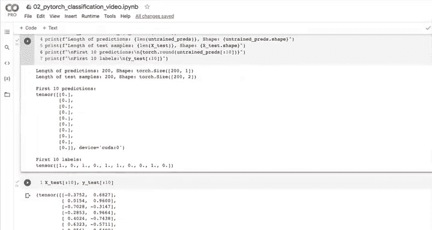
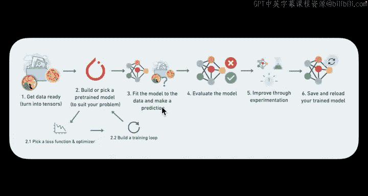

# mrdbourke《一天学会pytorch深度学习｜Learn PyTorch for deep learning in a day Literally》中英 - P49：68. Using torch.nn.Sequential.zh_en - GPT中英字幕课程资源 - BV1kx4y1r79d

Welcome back In the last video we discussed。 Well， actually， in the previous video to last。

 we coded up this neural network here， circle model V0 by subclassing and indoor module。

 we created two linear layers， which are capable of handling the shape of our data in features2。

 because Y we have two x features out features， we're upscaling the two features to 5。

 so that it gives our network more of a chance to learn。

 And then because we've upscaled it to five features。

 the next subsequent layer has to be able to handle five features as input。

 And then we have one output feature because that's the same shape as our Y here。

 Then weve get a little bit visual by using the Tensorflow playground。

 Did you try out that challenge， make five in layers with five neurons。😊，Did it work？

And then we also get a little bit visual in Figma as well。

 This is just another way of visualizing different things。

 You might have to do this a fair few times when you first start with neural networks。

 but once you get a bit of practice， you can start to infer what's going on through just pure code。

 So now let's keep pushing forward。 How about we replicate this with a simpler way because our network is quite simple。

 That means it only has two layers。 That means we can use。Let's replicate the model above。

Using NN dot sequential。And I'm going to code this out。

 And then we can look up what N N sequential is。 But I think you'll be able to comprehend what's happening by just looking at it。

 So N， N， which is torch at N， N。We can do tordo N N， but we've already imported Nn。

 We're going to call Nn dot sequential。And then we're going to go N， N dot linear。

 And what was the in features of our。And end linear。Well， it was two because we have two in features。

 and then we're going to replicate the same out features。 Remember。

 we could customize this to whatever we want，10，101，28。 I'm going to keep it at 5， nice and simple。

 And then we'll go N N dot linear。And the in features of this next layer is going to be five because the out features of the previous layer was5。

 and then finally the out features here。Is going to be one because we want one y value to our 2 x features。

 And then I'm going to send that to the device。 and then I'm going to have a look at Model 0。

So this is of course， going to override our previous model 0， but have a look。

 the only thing different is that this is from the circle model V0 class we've subclassed and end up module。

😊，And the only difference is the name here。 This is just from sequential。And so。

Can you see what's going on here。So energy amount of guess sequential it。

Imples most of this code for us behind the scenes。Because we've told it that it's going to be sequential。

 it's just going to go， hey， step the code through this layer and then step the code through this layer。

It outputs basically the same model， rather than。U creating our own forward method。

 you might be thinking， Daniel， why don't you show us this earlier。

 That looks like such an easy way to create a neural network compared to this。 Well， yes。

 you're 100% right。 That is an easier way to create a neural network， however。

The benefit of subclassing。 and that's why I started from here。

 is that when you have more complex operations such as things you'd like to construct in here and a more complex forwardd pass。

 it's important to know how to build your own subclasses of N N dot module。

 But for simple straightforward， stepping through each layer one by one。 So this layer first。

 and then this layer， you can use N N dot sequential。 In fact， we could move this code。Up into here。

 so we could do this。Self dot。We'll call this two linear layers。Equals Nn dot sequential。

And we could have layer one。And we could go self。Self dot layer 1。And or actually。

 we'll just recode it。 We'll go NN dot linearar。 So it's so it's the same code as what we've got below in features。

If I could type that it wouldd be great n features equals 2 out features equals 5。

 and then we go N N dot。La。And then we go in features。

Equals what equals5 because it has to line up out features equals 1。

And then we've got two linear layers， and then if we wanted to get rid of this， return。

Two linear layers and we'll pass it X。Remake it。There we go， well。

 because we've created these as well， let's get rid of that。Beautiful。

 so that's the exact same model。 But just using N N dot sequential。

 Now I'm going to get rid of this so that our code is not too verbose。That means a lot going on。

But this is the flexibility of pieytorrch， so just keep in mind that there's a fair few ways to make a model。

 the simplest is probably sequential and then subclassing is this is a little bit more complicated than what we've got。

 but this can extend to handle a lot more complex neural networks。

 which you'll likely have to be building later on。So let's keep pushing forward。

 Let's see what happens if we pass some data through here。

 So we'll just rerun this cell to make sure we've got our model 0 instantiated。

We'll make some predictions with the model。 So， of course， if we have a look at。

Our Modelel 0 dot state deck。 Oh， this will be a good experiment。So look at this， so we have weight。

 a weight tensor。😊，A bias tensor， a weight tensor and a bias tensor。

 So this is for the first of the0th layer。 These two here with the0 dot。

 And then the one dot weight is 4。 Of course， the first index layer。 Now， have a look inside here。

 Now you see how out features is 5。Well， that's why our bias parameter has five values here and the same thing for this weight value here。

And the weight value here， why is this have 10 samples，1，2， three，4，5，6，7，8，9，10。

 because two times 5 equals 10。So this is just with a simple two layer network。

 look at all the numbers that are going on behind the scenes。Imagine coding all of these by hand。

Like there's something like 20 numbers or something here。

Now we've only done two layers here now the beauty of this is that in the previous section we created all of the weight and biases using NN dot parameter and random values。

 you'll notice that these are all random too。Again， if yours are different to mine。

 don't worry too much because they're going to be started randomly and we haven't set a random seed。

But the thing to note here is that Pytorch is creating all of these parameters for us behind the scenes。

 and now when we do back propagation and gradient descent， when we code our training loop。

 the optimizer is going to change all of these values ever so slightly to try and better fit or better represent the data so that we can split our two circles。

And so you can imagine how verbose this could get if we had， say，50 layers with。

128 different features of each。 So let's change this up， see what happens。

Watch how quickly the numbers get out of hand。 Look at that。

We just changed one value and look how many parameters our model has。

You might be able to calculate that by hand， but I personally don't want to。

So we're going to let Pytorch take care of a lot of that for us behind the scenes。

 So for now we're keeping it simple， but that's how we can crack our models open and have a look at what's going on。

Now， that was a little detour。 It's time to make some predictions with random numbers。

 I just wanted to highlight the fact that our model is， in fact。

 instantiated with random numbers here。 So the untrained pres Model 0， We're going to pass in X test。

 and of course， we have to send the test data to the device。 Otherwise。

 if it's on a different device we'll get errors because Pytorch likes to make calculations on the same device。

 So we'll go print。 Let's do a nice print statement of length of predictions。😊。

We're going to go length。Or then untrained pres。 We'll pass that in there， and then we'll go。Oh no。

 we need to squiggle and then we'll go shape。Shape is going to be untrained Pres dot shape。

So this is again， following the data exploreer's motto of visualize， visualize， visualize。

 and sometimes print is one of the best one to do so。 So length of test samples。

You might already know this or we've already checked this together， haven't we X test？

And then we're going to get。The shape， which is going to be x test dot shape。Wonderful。

 and then we're going to print。 What's our little error here。On it， coabs tricking me。

 So let's go first，10 predictions。And we're going to go untrained pres。

So how do you think these predictions will fare？They're doing it with random numbers。

 And what are we trying to predict again while we're trying to predict whether a dot is a red dot or a blue dot or 0 or one。

And then we'll go first， 10 labels。Is going to be。We'll get this on the next line。

And we'll go why test。Beautiful， so let's have a look at this。 untrained predictions。

 So we have length of predictions is 200。😊，Length of test samples is 200。

 but the shapes are different， what's going on here？😊，Y test。 And let's have a look at X test。Oh。

 well， I better just have a look at why test。Why don't we have a two there？Oh。

 I've done X test dot shape。Oh， that's test samples。 That's okay。 And then the predictions are one。

 yes。 So why test， let's just check the first 10 X test。

 So a little bit of clarification needed here with your shapes。 So maybe we'll get this over here。

 because I like to do features first and then labels。😊，What did we miss here。

 Oh X test 10 and Y test。 See， we're troubleshooting on the fly here。

 This is what you're going to do with a lot of your coat。 So there's our test values。

 There's the ideal labels。 But our predictions， they don't look like our labels。

 What's going on here。 We can see that they're on the couder device， which is good。 We said that。

 We can see that they got gradient tracking。 Oh， we didn't with Torch。

 We didn't do inference mode here。 That's a poor habit of us。 Excuse me。Let's inference mode this。

There we go。 So you notice that the gradient tracking goes away there。

And so our predictions are nowhere near what our test labels are。

 but also they're not even in the same like ballpark， like these are whole numbers。

 one or0 and these are all floats between one and0。 So maybe rounding them。

 Will that do something So where's our pres here。 So we go torch dot round。😊，What happens there？Oh。

 they're all0。Well， our model is probably going to get about 50% accuracy Why is that because all the predictions look like they're going to be 0。

 and they've only got two options， basically， head or tails， so。

When we create our model and when we evaluate it， we want our predictions to be in the same format as our labels。

 but we're going to cover some steps that we can take to do that in a second。

 What's important to take away from this is that there's another way to replicate the model we've made above using an end dot sequential。

 We've just replicated the same model as what we've got here。

 and N dot sequential is a simpler way of creating a pitoch model。

 but it's limited because it literally just sequentially steps through each layer in order。

 whereas in here， you can get as creative as you want with the forward computation。😊。

And then inside our model， Pytorrch has behind the scenes。

 created us some weight and bias tensesors for each of our layers with regards to the shapes that we've set。

And so the handy thing about this is that if we got quite ridiculous with our layers。

 Pytorch would still do the same thing behind the scenes。

 create a whole bunch of random numbers for us。 And because our numbers are random。

 It looks like our model isn't making very good predictions。

 But we're going to fix this in the next few videos when we move on to。

Fitting the model to the data and making a prediction。 But before we do that。

 we need to pick up a loss function and an optimizer and build a training loop。

 So let's get onto to these two things。

