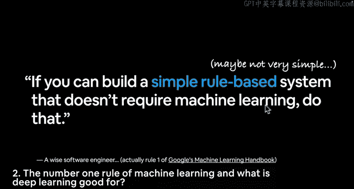
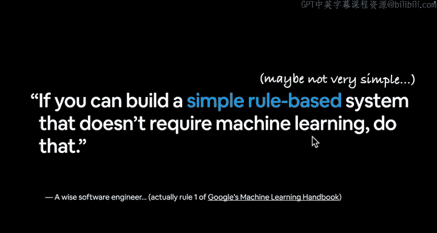
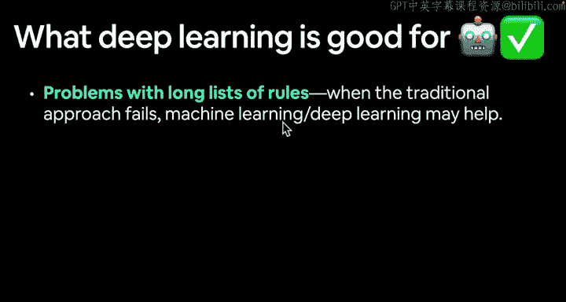
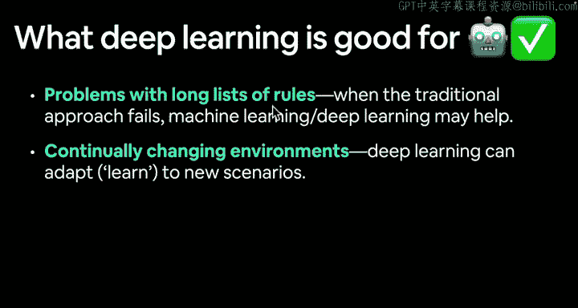
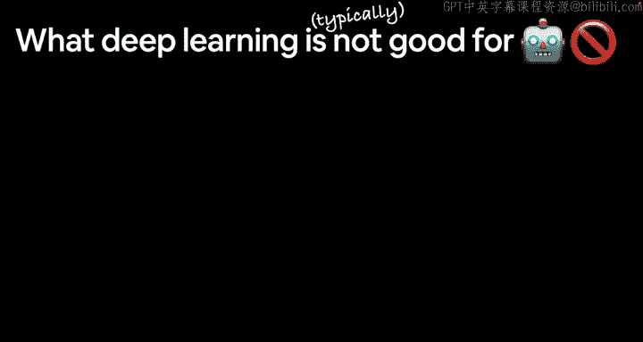
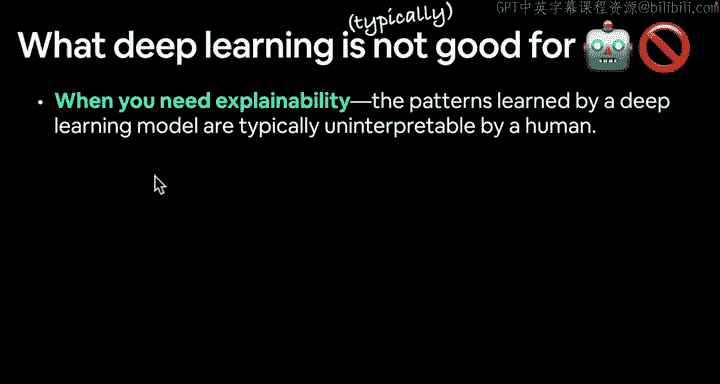
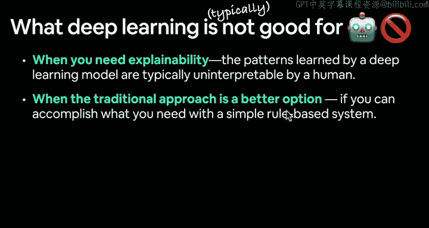
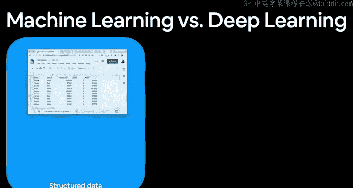

# mrdbourke《一天学会pytorch深度学习｜Learn PyTorch for deep learning in a day Literally》中英 - P4：2. The number one rule of ML.zh_en - GPT中英字幕课程资源 - BV1kx4y1r79d

In the last video， we familiarized ourselves with Google's number one rule of machine learning。

 which is basically if you don't need it， don't use it and with that in mind。

 what should we actually be looking to use machine learning or deep learning for？

Well， problems with long list of rules。 So when the traditional approach fails。 So remember。

 the traditional approach is you have some sort of data input。

 you write a list of rules for that data to be manipulated in some way， shape or form。

 And then you have the outputs that you know。 But if you have a long。

 long list of rules like the rules of driving a car。

 which could be hundreds could be thousands could be millions who knows。

 That's where machine learning and deep learning may help。

 and it kind of is at the moment in the world of self-driving cars。

 machine learning and deep learning the state of the art approach。

Continually changing environments。 So whatever the benefits of deep learning is that it can keep learning if it needs to。

 And so it can adapt and learn to new scenarios。 So if you update the data that your model was trend on。

 it can adjust to new different kinds of data in the future。 So similar to if you are driving a car。

 you might know your own neighborhoodhood very well。

 But then when you go to somewhere you haven't been before。

 Sure you can draw on the foundations of what you know， but you're going to have to adapt。

 How fast should you go， where should you stop， where should you park these kinds of things。

 So with problems with long list of rules or continually changing environments。

Or if you had a large， large data set。 And so this is where deep learning is flourishing in the world of technology。

 So let's give an example。 One of my favorites is the food 1，0，1 data set。

 which you can search for online， which is images of 101 different kinds of foods。 Now。

 we briefly looked at what a rule list might look like for cooking your grandmother's famous Sicilian roast chicken dish。

😊，But can you imagine if you wanted to build an app that could take photos of different food。

How long your list of rules would be to differentiate 101 different foods。It'd be so long。

 you need rule sets for every single one。 Let's just take one food， for example。

 How do you write a program to tell what a banana looks like。I mean。

 you'd have to code what a banana looks like， but not only a banana。

 what everything that isn't a banana looks like。 So keep this in mind what deep learning is good for。

 problems with long list of rules， continually changing environments or discovering insights within large collections of data。

Now， what deep learning is not good for。 And I'm going write typically here， because， again。

 this is problem specific。 Deep learning is quite powerful these days。

 and things might change in the future。 So keep an open mind。 if there's anything about this course。

 it's not for me to tell you exactly what's what。 It's for me to spark a curiosity into you to figure out what's what。

Or even be yet， what's not， what？So when you need explainability。As we'll see。

 the patterns learned by a deep learning model， which is lots of numbers called weights and biases。

 We'll have a look at that later on are typically uninterpreted by a human。

 So some of the times deep learning models can have a million，10 million，100 million a billion。

 Some models are getting into the trillions。Of parameters， When I say parameters。

 I mean numbers or patterns in data。 Remember， machine learning is turning things into numbers and then writing a machine learning model to find patterns in those numbers。

 So sometimes those patterns themselves can be lists of numbers that are in the millions。

 And so can you imagine looking at a list of numbers that has a million different things going on。

It's going to be quite hard。 I find it hard to understand3 or four numbers， let alone a million。

And when the traditional approach is a better option。 again。

 this is Google's rule number one of machine learning。

 If you can do what you need to do with a simple rule based system， Well。

 maybe you don't need to use machine learning。

Or deep learning。 again， I'm going to use the deep learning and machine learning terms interchangeably。

 I'm not too concerned with definitions。 You can form your own definitions， but just so you know。

 from my perspective， Ml and deep learning are quite similar。 when errors are unacceptable。

 So since the outputs of a deep learning model aren't always predictable we'll see that deep learning models are probabilistic。

 that means when they predict something they're making a probabilistic bet on it。

 whereas in a rulebased system， you kind of know what the outputs are going to be every single time。

 So if you can't have errors based on probabilistic errors。 Well。

 then you probably shouldn't use deep learning and you'd like to go back to a simple rule based system。

And then finally， when you don't have much data。 so deep learning models usually require a fairly large amount of data to produce great results。

 However， there's a caveat here。 you know， at the start， I said typically。

 we're going to see some techniques of how to get great results without huge amounts of data。

 And again， I wrote typically here because there are techniques。

 you can just research deep learning explainability， you're going to find a whole bunch of stuff。

 you can look up examples of when machine learning versus deep learning。

 and then when errors are unacceptable， again， there are ways to make your model reproducible。

 So it predicts， you know what's going to come out。 So we do a lot of testing to verify this as well。

😊，And so。

What's next， I've got machine learning versus deep learning。

 And we're going to have a look at some different problem spaces in a second and mainly breaking down in terms of what kind of data you have。

 not going to do this Now。 Pre this video from getting too long。 We'll cover all these colourful。

 beautiful pictures in the next video。

