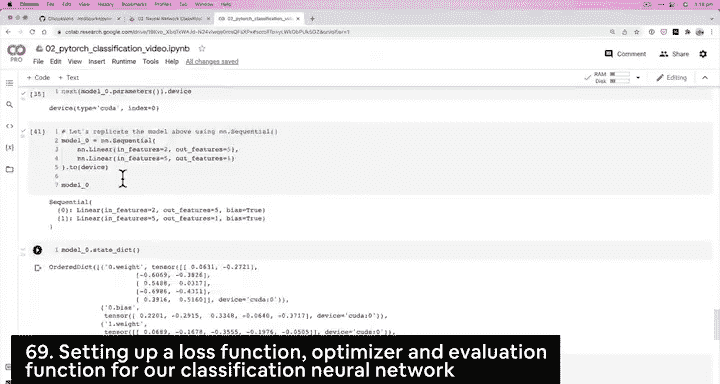
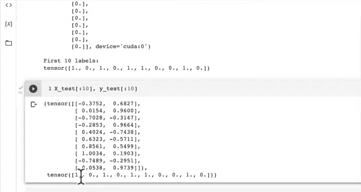
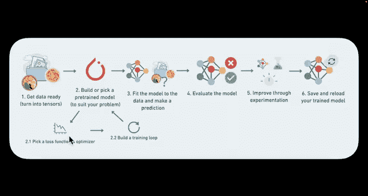

# mrdbourke《一天学会pytorch深度学习｜Learn PyTorch for deep learning in a day Literally》中英 - P50：69. Loss, optimizer and evaluation functions for classification.zh_en - GPT中英字幕课程资源 - BV1kx4y1r79d

Welcome back。 So over the past few videos， we've been setting up a classification model to deal with our specific shape of data。

 Now， recall， depending on the data set that you're working with。

 will depend on what layers you use for now， we're keeping it simple and end linear as one of the most simple layers in Pytorch。

 We've got two input features。 We're upscaling that to five output features。

 So we have five hidden units。 And then we have one output feature。

 And that's in line with the shape of our data。 So two features of x equals one number for Y。

 So now let's continue on modeling with where we're up to。😊。

We have build or pick a model。 So we've built a model。

 Now we need to pick a loss function and optimizer。 we're getting good at this。 So let's go here。

 Se up loss function。And optimizer。 Now， here comes a question。

 If we're working on classification previously， we used。

 let's go to the next one and dot L1 loss for regression， which is MAe mean absolute error。

 But just a heads up that won't necessarily work with a classification problem。

 So which loss function or optimizer should you use。 So。Again。This is problem specific。

 but with a little bit of practice， you'll get used to using different ones。So， for example。

 for regression。You might want， which is regressions predicting a number and I know it can get fusing because it looks like we're predicting a number here。

 We are essentially predicting a number， but this relates to a class。 So for regression。

 you might want MAE or ME， which is mean absolute。Absolute error。Or mean squared error。

And for classification。You might want binary cross entropy。Or categorical cross entropy。

 which is sometimes just referred to as cross entropy。 Now， where would you find these things out。

Well， through the Internet， of course。 So you could go， what is binary cross entropy。

 I'm going to leave you this for your。Extra curriculum to read through this。

 we've got a fair few resources here。 understanding binary cross entropy slash log loss。

By Daniel Gooddoy， Oh， yes。Great first name， my friend。

 This is actually the article that I would recommend to。

 if you want to learn what's going on behind the scenes through binary cross entropy。 For now。

 there's a lot of math there。 We're going be writing code to implement this。

 So Piytorrch has done this for us。Essential， what does a loss function do。 Let's remind ourselves。😊。

Go down here。As a reminder。The loss function。Measures how wrongg。Your models's predictions are。

So I'm also gonna to leave a reference here to I've got a little table here in the book version of this course。

 So 0。2 neural network classification with Pytorch set up loss function and Opr。

 So we've got some example loss functions and optimizes here。

 such as stochastic gradient descent or SGD optimizer atom optimize is also very popular。

 So I've got problem type here and then the Pytorch code that we can implement this with。

We've got binary cross entropy loss， we've got cross entropy loss mean absolute error。

 ME mean squared error， MSE， so you want to use these two for regression。

 there are other different loss functions you could use， but these are some of the most common。

That's what I'm focusing on。 the most common ones that are going to get you through a fair few problems。

 We've got binary classification， multi class classification。 What are we working with。

We're working with binary classification， so we're going to look at Torch。nn Bce。

 which stands for binary cross entropy。😊，Loss with Loits， what the hell is alogit。And B CE loss。

 this is confusing。 And trust me， when I first started using Pytorch。

 I got a little bit confused about why they have two here， but we're going to explore that anyway。

 So what is a logit。So if you search what is a logic。

 you'll get this and you'll get statistics and you'll get the log odds formula， in fact。

 if you want to read more， I would highly encourage it。So you could go through all of this。

 We're going to practice writing code for it instead，Luckiily Pytorch does this for us。😊，But。

Logit is kind of confusing in deep learning。 So if we go， what is a logit in deep learning。

 it kind of means a different thing。It's kind of just a name of what。Yeah there we go。

 What is the wordlogitts and Tensorflow， As I said， Tensorflowlow is another deep learning framework。

So let's close this。What do we got， We got a whole bunch of definitions here。Los La， yeah。

This is one of my favorite。 In context of deep learning。

 the logits layer means the layer that feeds into the softm。 So softm is a form of activation。

 We're going to see all of this later on， because this is just words on a page right now。

 Softm or other such normalization。 So the output of the softm are the probabilities for the classification task and its input is the logits layer。

😊，Whoa， there's a lot going on here， so let's just take a step back and get into writing some code。

And for optimizers， I'm just going complete this。 and for optimizers。Two of the most common。

And useful R， SGD and atom。However。Pytorch has many built in options。

And as you start to learn more about the world of machine learning。

 you'll find that if you go to torch。opim or torch。nn。So if we have dot Nn。What do we have in here。

 Losss functions There we go。 Beauti。 That's what we're after。 L 1 loss， which is M A E， M S E loss。

 crossenttropy loss， CT T C loss， all of these different types of loss here will depend on the problem you're working on。

 But I'm here to tell you that for regression and classification two of the most common of these。

 See， this is that confusion Again。 B C E loss， B， C E with logits loss， what the hells are logit。😊。

My goodness。 Okay， that's enough。 And optim， these are different optimizers。

 We've got probably a dozen or so here， algorithms。Out of Delta， out of grad Adam Dowe。

 this can be pretty full line when you first get started。

 but for now just stick with SGD and the atom optimizer。 there two are the most common Again。

 they may not perform the best on every single problem。

 but they will get you fairly far just knowing those and then you'll pick up some of these extra ones as you go。

But let's just get rid of all of。 maybe we'll。 So I'll put this in here， this link。

So we'll create our loss function。For the loss function。We're going to use。Torch dot N N dot B E。

With Loitt's loss。 this is exciting。For more on what。Binary cross entropy， which is BE。

 A lot of abbreviations in machine learning and deep learning is。Check out this article。And then。

For a definition on what elogit is， we're going to see alogit in a second in deep learning。

 because again， deep learning is one of those fields and machine learning。

 which likes to be a bit rebellious。 you know， likes to be a bit different from the pure mathematic type of fields and statistics in general。

 beautiful galtism and for different。Optimizes。See torch dot opt in。

 But we've covered a few of these things before。 And finally， I'm going to put up here。

And then for some common choices of loss functions and optimizers。Now， don't worry too much。

 This is why I'm linking all of these extra resources。 A lot of this is covered in the book。 So。

 as we just said， set up loss function Opr。 We just talked about these things。 But， I mean。

 you can just go to this book website and reference it。 Oh， we don't want that。 We want。

We want this link。Come on， Daniel， you can't even copy and paste， heys ways to code。

I know I've been from this code this whole time。 So let's write some。

 So let's set up the loss function。😊，What did we say it was。

 We're going to call that L O S FN for loss function， and we're going to call BE with logits loss。

 So B with logitts loss。 This has the sigmoid activation function built in。

 Now we haven't covered what the sigmoid activation function is， but we are going to。

 Don't you worry about that。Built in。In fact， if you wanted to learn what the sigmoid activation function is。

 how could you find out sigmoid activation function， but we're going to see it in action。

Actation functions in neural networks。 This is the beautiful thing about machine learning。

 There's so much stuff out there。 People have written some great articles。 You've got formulas here。

 Pytorch has implemented that behind the scenes for us。 So thank you， Piytorch。 But if you recall。😊。

Sigmoid activation function built in。 Where did we discuss the architecture of a classification network。

 What do we have here。Right back in the 0th chapter of this little online book thing that we heard here。

 Biary classification。 We have output activation。 Oh， Oh， look at that。

 So sigmoid torch dot sigmoid and P torch。😊，All right。 And then for multi class classification。

 we need the soft max。 Okay， names on a page again。

 But this is just a reference table so we can keep coming back to。

And so let's just keep going with this。 I just want to highlight the fact that Nn dot BCceE loss also exists。

So this requires BCCE loss。Equs。Requires inputs to have gone through the sigmoid activation function prior to。

Input to BceE loss。And so let's look up the documentation。

 I'm going to comment that out because we're going to stick with using this one。 Now。

 why would we stick with using this one， Let's check out the documentation， hey。Torch dot N N。

 And I realized this video was all over the place， but we're going to step back through B C loss with Los。

 Did I even say this， right。With Loits slot so with I got the width around the wrong way。

So let's check this out。 So this loss combines a sigmoid layer with the BE loss in one single class。

 So if we go back to the code， BE loss is this。 So if we combined an N dot sequential。

And then we passed in N N dot sigmoid。 and then we went N N dot B C E loss。

We'd get something similar。To this。 But if we keep reading in the documentation， because that's just。

 I just literally read that it combines sigmoid with B E loss。

 But if we go back to the documentation， why do we want to use it？

 So this version is more numerically stable than using a plain sigmoid by a B C E loss。

 followed by a B C E loss as by combining the operations into one layer。

 we take advantage of the log sum X trick for numerical stability， beautiful。

 So if we use this log function， Los function for our binary cross entropy。

 we get some numeric stability。 Wo， So there's our loss function。😊。

We've got the sigmoid activation function built in。

And so we're gonna see the difference between them later on， like in the flash optr。

 We're gonna choose。Let's stick with S GD。 Hey， old faithful， stochastic gradient descent。

 And we have to set the parameters here， the parameters， parameter， parametersms。

Equal to our model parameters would be like， hey， stochastic gradientding descent。

 please update if we get another code cell behind here。 please update our model parameters。马龙。

With respect to the loss， because we'd like our lost function to go down。

So these two are going to work in tandem again when we write our training loop and we'll set our learning rate to 0。

1。 We'll see where that gets us。 So that's what the optimizer is going to do。

 It's going to optimize all of these parameters for us， which is amazing。

 And the principle would be the same， even if there was 100 layers here and 10000 a million different parameters here。

 So we've got a loss function。 We've got an optimizer And how about we create an evaluation metric。

 So let's calculate accuracy at the same time， because that's very helpful with classification problems is accuracy。

 Now， what is accuracy。 Well， we could look up formula for accuracy。😊。

So true positive over true positive plus true negative times 100。 Okay。

 let's see if we can implement something similar to that just using pure pi torch。 Now。

 why would we want accuracy， Because the accuracy is out of 100 examples。

What percentage。Does our model。Get right。So for example。

 if we had a coin toss and we did 100 coin tosses in our model predicted heads 99 out of 100 times。

 and it was right every single time， it might have an accuracy of 99% because it got one wrong。

 So 99 out of 100， it gets it right。So， F accuracy， FN。Accurency function。

We're going to pass it Y true。 So remember any type of evaluation function or loss function is comparing the predictions to the ground truth labels。

 So correct equals。 This is going to see how many of our y true or y threads are correct。

 So torch equal stands for hey， how many of these samples Y true are equal to Y thread。

 And then we're going to get the sum of that。 And we need to get the item from that because we want it as a single value in Python。

 And then we're going to calculate the accuracy。 ACC stands for accuracy。Ales， correct。

Divided by the length of samples that we have as input。

 And then we're going to times that by 100 and then return the accuracy。Wonderful。

 so we now have an accuracy function。 We're going to see how all of three of these come into play when we write a training loop。

😊，Which we might as well get started on the next few videos， heh？I'll see you there。

