# mrdbourke《一天学会pytorch深度学习｜Learn PyTorch for deep learning in a day Literally》中英 - P52：71. Train and test loops.zh_en - GPT中英字幕课程资源 - BV1kx4y1r79d

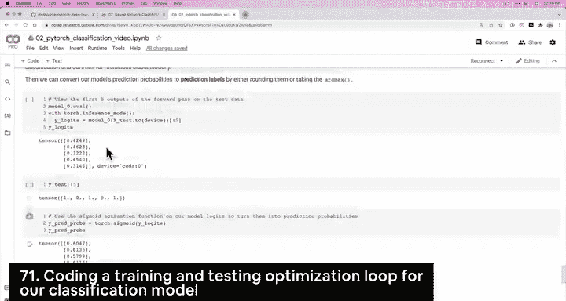

Welcome back in the last few videos we've been working through creating a model for a classification problem。

 and now we're up to training a model。 and we've got some steps here。

 but we started off by discussing the concept of logits， Lots are the raw output of the model。

 whatever comes out of the forward functions of the layers in our model。

 And then we discussed how we can turn those logts into prediction probabilities using an activation function。

 such as sigmoid for binary classification and softmax for multiclass classification。

 we haven't seen softmax yet， but we're going to stick with sigmoid for now because we have binary classification data。

 and then we can convert that from prediction probabilities to prediction labels because remember when we want to evaluate our model。

 we want to compare apples to apples。 We want our modelss predictions to be in the same format as our test labels。

 And so I took a little break after the previous video。

 So my coab notebook has once again disconnected。😊。

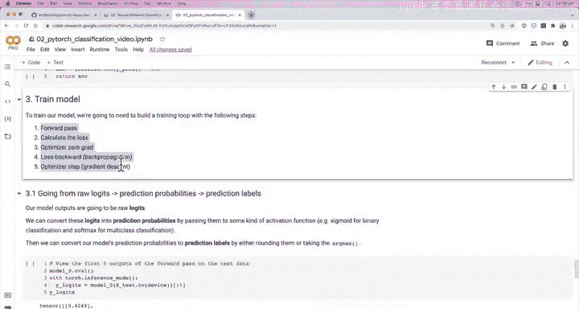

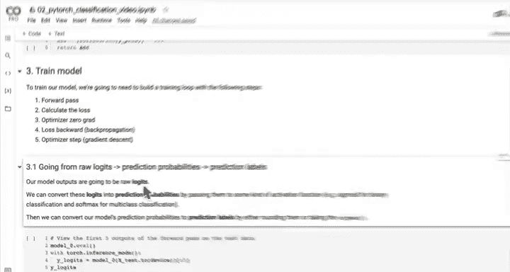

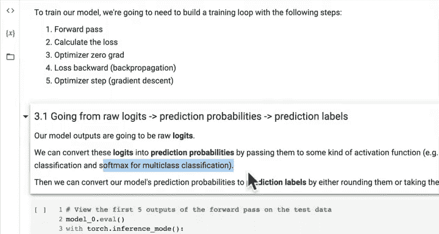

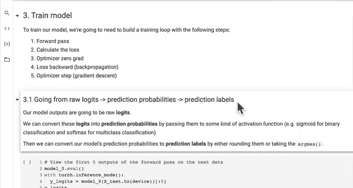

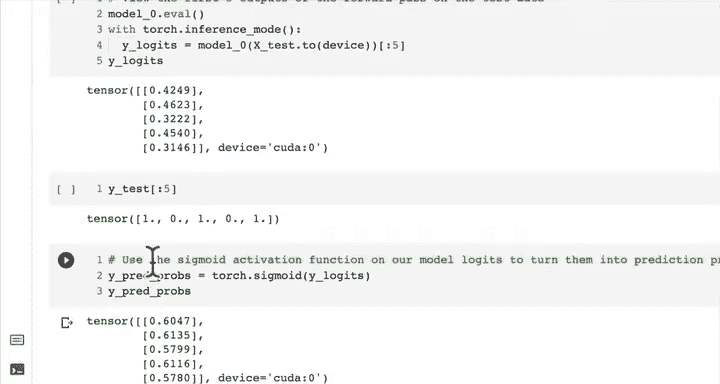

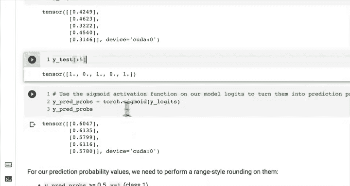

So I'm just going to run all of the cells before here。 it's going to reconnect up here。

 We should still have a GPU present。 That's a good thing about Google coLab is that if you change the runtime type to GPU。

 it'll save that wherever it saves。😊。

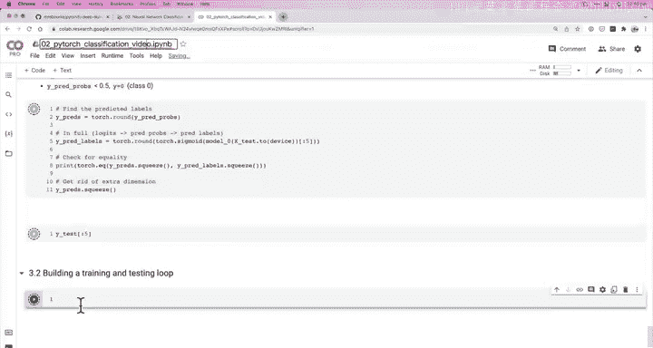

The Google Coab notebook so that when you restart it， it should still have a GPU present。

 And how can we check that， of course， Well， we can type in device， We can run that cell。

 and we can also check Nvidia SI。 It'll tell us if we have an Nvidia GPU with Coudr enabled ready to go。

 So what's our device。

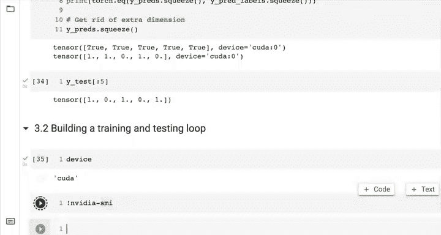

Kuda， wonderful。

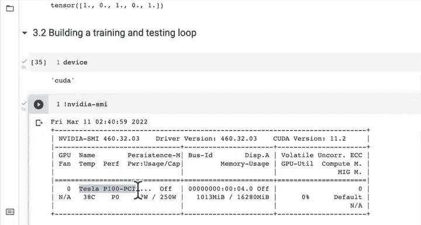

And NviIDdia SMI， excellent， I have a Tesla P 100 GPU。😊，Ready to go。 So with that being said。

 let's start to write a training loop。 Now， we've done this before， and we've got the steps up here。

Do the forward pass， calculate the loss。 We've spent enough on this。

 So we're just going to start jumping into right code。 There is a little tidbit in this one， though。

 but we'll conquer that when we get to it。So I'm going to set a manual seed。Toch do manual seed。

And I'm going to use my favorite number 42。 This is just to ensure reproducibility if possible。 Now。

 I also want you to be aware of there is also another form of random seed manual seed。

 which is a kuder random seed。

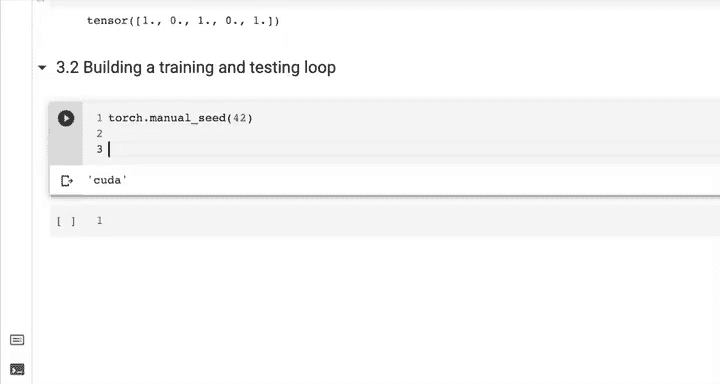

Do we have the pie torch？Yeah， reproducibility。So Torch。couda。Dot manual seed dot seed。Hm。😊。

There is a couda seed somewhere。

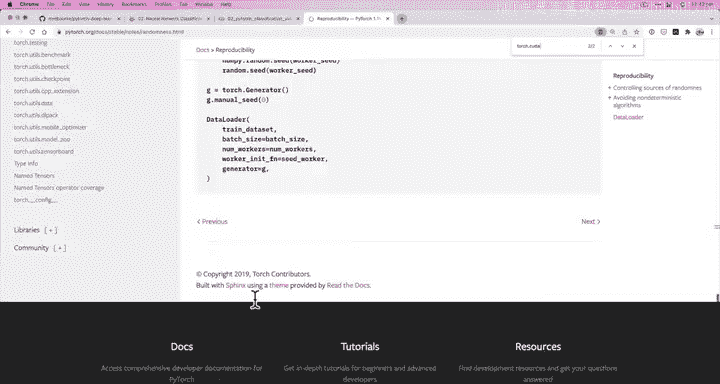

Let's try and find out。Kuda。😔。

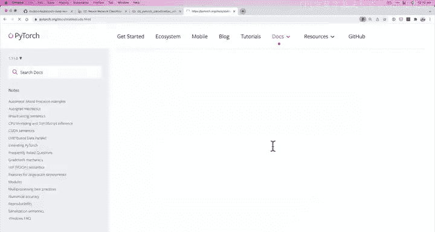

I think Pytoch have just had an upgrade to their documentation。

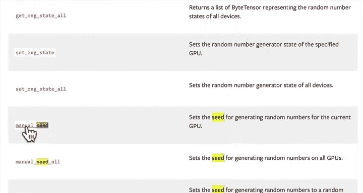

Sed。Yeah， there we go， Okay， I knew it was there。😊。

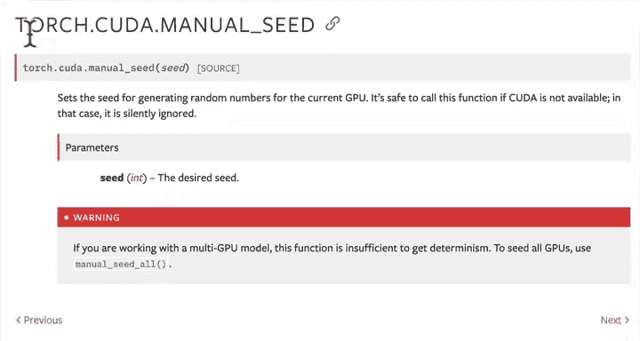

So tochdokuer。manual seeed。 So if we're using kuda， we have a kuda manual seed as well。

 so let's see what happens if we put that Torchtkuuder。manual seed。42。

 we don't necessarily have to put these。 It's just to try and get as reproducible as numbers as possible on your screen and my screen。

 Again， what is more important is not necessarily the numbers exactly being the same lining up between our screens。

 It's more the direction of which way they're going。 So let's set the number of epochs。

We're going to train for 100 epochs， epoch equals 100。But again， as you might have guess。

 the couda manual seed is for if you're doing operations on a couder device。

 which in our case we are， well then perhaps we'd want them to be as reproducible as possible So speaking of Kuder devices。

 let's put the data to the target device because we're working with or we're writing data agnostic code here so I'm going to write Xtrain Ytrain equals Xtrain2 device comma Ytrain dot2 device that'll take care of the training data。

And I'm going to do the same for the testing data equals X test2 device。

Because if we're going to run our model。

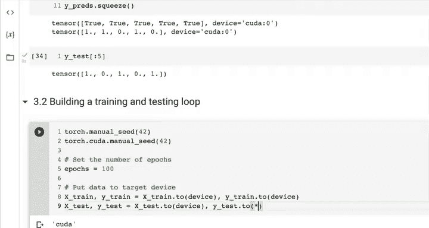

On the couder device， we want our data to be there， too。 And the way we're writing our code。

 our code is going to be device agnostic。 Have I said that enough yet。

 So let's also build our training and evaluation loop。

 Because we've covered the steps in here before， we're going start working a little bit faster through here。

 And don't worry， I think you're up to it。 So for an epoch and a range of epochs。 What do we do。

 We start with training。😊。

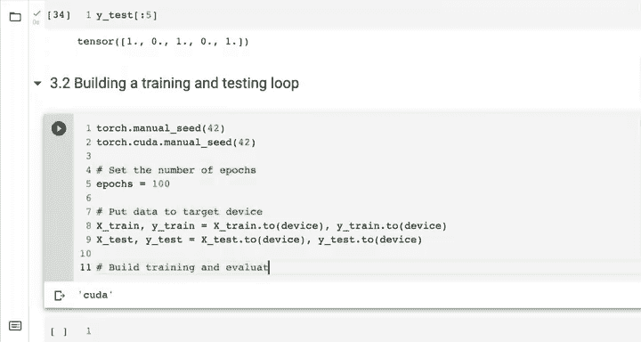

So let me just write this。Training。Model 0 do train。 That's the model we're working with。

 we call the train， which is the default， but we're going to do that anyway。

 and as you might have guessed the code that we're writing here is you can functionise this So we're going to do this later on。

 but just for now the next couple of videos， the next module or two we're going to keep writing out the training loop in full。

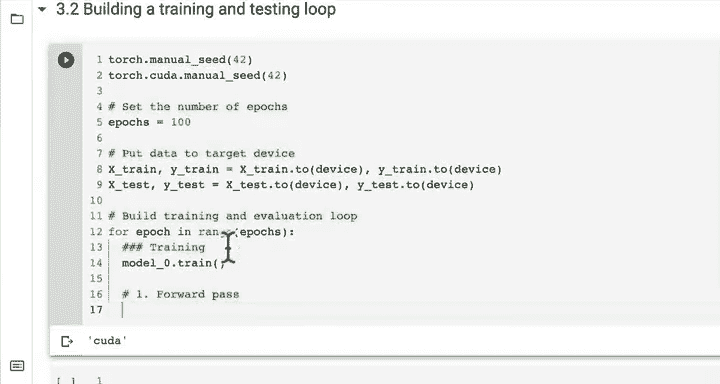

So this is the part， the forwardd pass where there's a little bit of a tidbit here compared to what we've done previously and that is because we're outputting raw logitts here。

 if we just pass our data straight to the model， So model0 x train and we're going to squeeze them here to get rid of an extra dimension you can try to see what the output sizes look like without squeeze but I're just going to call squeeze here。

 remember squeeze removes an extra one dimension from a tensor and then to convert it into prediction labels we go torch dot round and torch dot sigmoid because torch dot sigmoid is an activation function which is going to convert logitts into what convert the logits into prediction probabilities So y loggiits and I'm just going to put a node here So this is going to go turn logitts into pre pros into。

😊，Ped。Lbels。So we've done the forwardd pass， so that's a little tidbit there。

 we could have done all of this in one step， but I'll show you why we broke this apart。

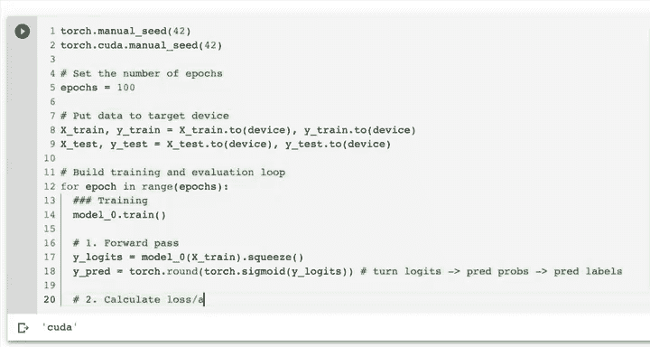

So now we're going to calculate loss slash accuracy。

 We don't necessarily have to calculate the accuracy， but we did make an accuracy function up here。

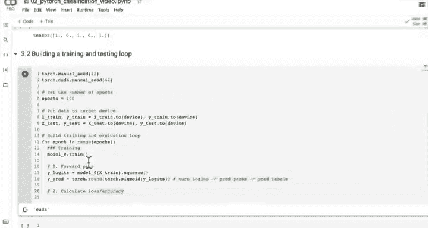

So that we can calculate the accuracy during training。

 we could just stick with only calculating the loss。

 but sometimes it's cool to visualize different metrics。

 loss plus a few others while your model is training。So let's write some code to do that here。

So we'll start off by going loss equals loss Fn and Y logits。

 here's the difference of what we've done before。Previous in the notebook 01 up to 02 now。

 we passed in the prediction right here。 But because what's our loss function。

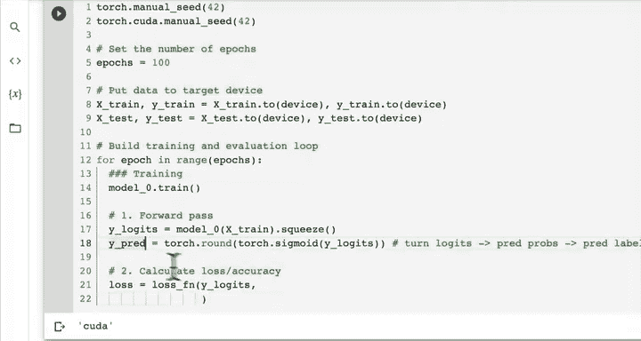

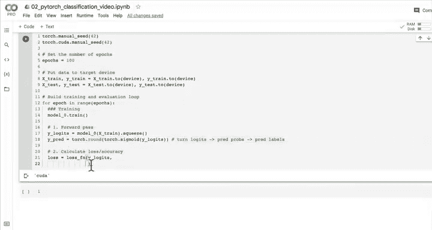

Let's have a look at our loss function。Let's just call that， see what it returns。

 BCE with Loitts loss， so the BCE with Loits expects logits as input。So as you might have guessed。

 loss function without。

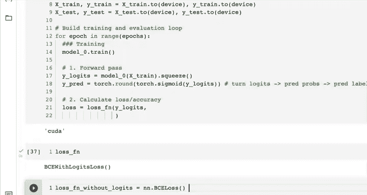

Logits， if we had NN dot BCceE loss， notice how we haven't got with Logits。

 and then we called loss FN。

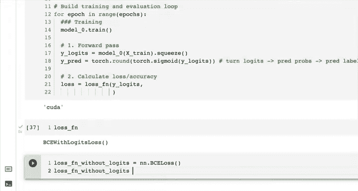

FN sensoror function， by the way， without logits， what do we get？

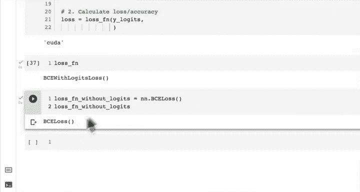

So BCE loss so this loss expects prediction probabilities as input。

 so let's write some code to differentiate between these two。 As I said。

 we're going to be sticking with this one。 Why is that Because if we look up torch BC with Loits loss The documentation states that it's more numerically stable So this loss combines a sigmoid layer and the BCE loss into one single class and is more numerically stable So let's come back here。

 we'll keep writing some code。

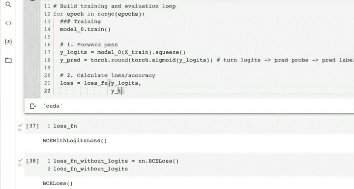

And the accuracy is going to be accuracy FN。 So our accuracy function。

 there's a little bit of a difference here is y true equals Y trained for the training data。

So this will be the training accuracy， and then we have y pre equals y pre。So。

This is our own custom accuracy function that we wrote ourselves。

 This is a testament to the Pythonic nature of Pytorch as well。

 We've just got a pure Python function that we've slotted into our training loop。😊。

Which is essentially what the loss function is behind the scenes。Now。Let's write here。

 NN dot BE with Loits loss。Expects raw logits So the raw output of our model as input。 Now。

 what if we were using a B E loss on its own here， Well， let's just write some code for that。

 So let's call loss function。 And then we want to pass in Y pre。

 or we can just go why or torch sigmoid。 So why would we pass in torch sigmoid on the logits here。

 Because remember calling torch dot sigmoid on our logits turns our logits into prediction probabilities。

 and then we would pass in Y train here。 So if this was B loss。

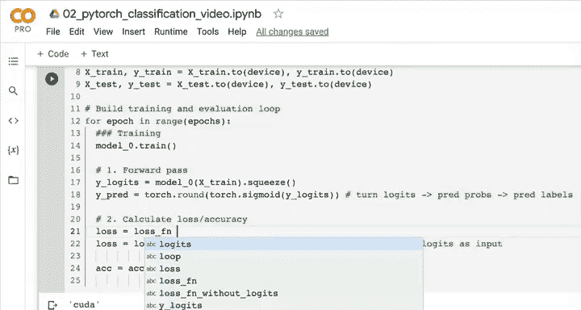

Expects， this expects prediction。Probabilities as input。

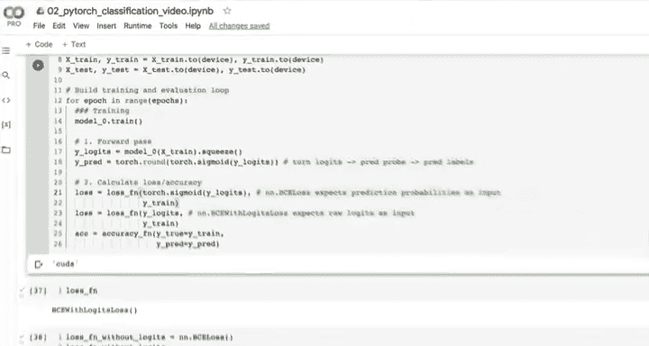

So does that make sense， That's the difference between with logits。

 So our loss function requires logits as input， whereasas if we just did straight up B E loss。

 we need to call torch dot sigmoid on the logits because it expects prediction probabilities as input。

 Now I'm going to。Comment that out because our loss function is BC with Loitts loss。

 but just keep that in mind for some reason you stumble across some pytorch code that's using B loss。

 not BC with logitts loss。 and you find that torch dot sigmoid is calling here or you come across some errors because your inputs to your loss function are not what it expects。

 So with that being said， we can keep going with our other steps。 So we're up to optimizer0 grad。

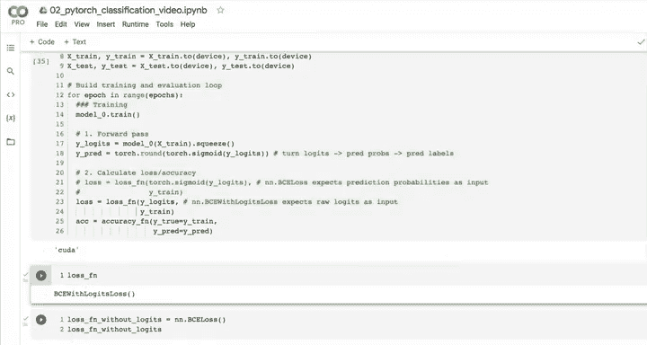

So optimizer dot zero grad。This is step 3， by the way。

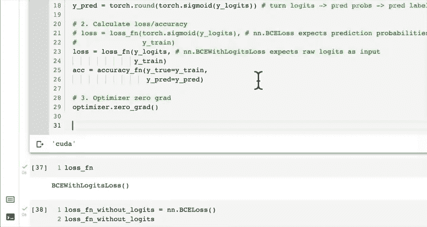

And what's after this， Once we've zero gradeed the optimizer， we do。

Number four was his loss backward。We can go last backward。And then we go， what's next。

 Optimise a step， step， step。So optimizer dot step and I'm singing the unofficial Pytor optimization loop song there。

😊，This is back propagation。Calculate the gradients with respect to all of the parameters in the model。

 and the optimizer step is update the parameters to reduce the gradients。So gradient descent。

 hence the descent。 Now， if we want to do testing， well。We know what to do here now。 We go model 0。

 What do we do。 We call model do ofval when we're testing。 And if we're making predictions。

 That's what we do when we test。 we make predictions on the test data set using the patterns that our model has learned on the training data set。

 We turn on inference mode because we're doing inference。 We want to do the forward pass。😊。

And of course， we're going to compute the test logits because logits are the raw output of our model with no modifications。

 X test dot squeeze。 We're going to get rid of an extra one dimension there。

Then we create the test pre， which is we have to do a similar calculation to what we've done here for the test pre。

 which is torch dot round for our binary classification。

 we want prediction probabilities which we're going to create by calling the sigmoid function on the testlogits prediction probabilities that are 0。

5 or above to go to1 and prediction probabilities under 0。

5 to go to label 0 so two is calculate the test loss。😊，Test， loss， slash accuracy。

How would we do this？ Well， just have we've done before。

And we're going to go loss FN test logitts because our loss function we're using what we're using BC with Loitts loss expects Los's input。

 where do we find that out in the documentation， of course， then we come back here， testlogits。

 we're going to compare that to the Y test labels， and then for the test accuracy。

 what are we going to do。

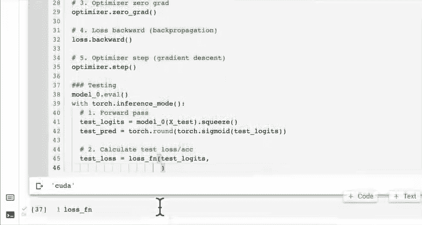

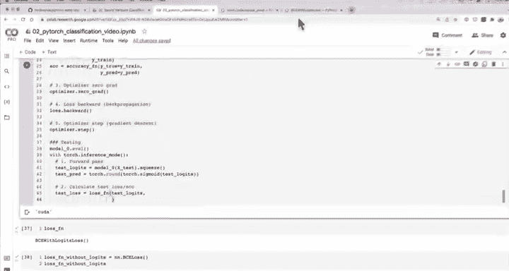

We're going to call accuracy FN。On why true equals Y test and why pre equals test Prena。

 You might be thinking， why did I switch up the order here for these。 Oh， and by the way。

 this is important to know with Loit's loss。

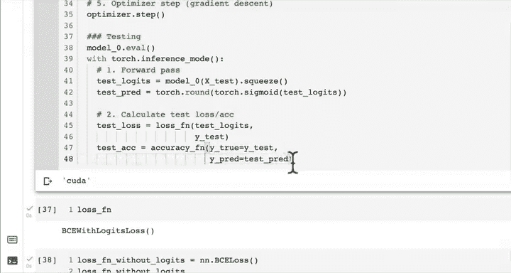

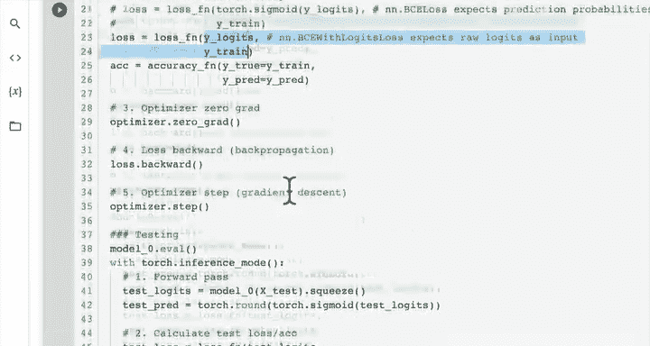

So with these loss functions， the order here matters of which way you put in your parameters。

 So predictions come first and then true labels for our loss function。

 You might be wondering why I've done at the reverse for our accuracy function。 why true and why pre。

 That's just because I like to be confusing。 Well， not really。

 It's because if we go to psychet learn， I base a lot of my structured code of how psyt learn。

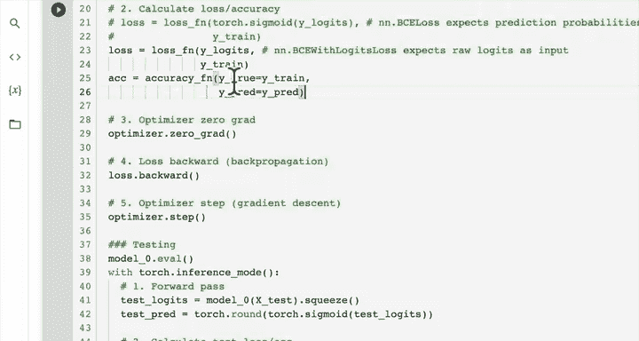

Structures Ss the psyit Learn metrics accuracy score。

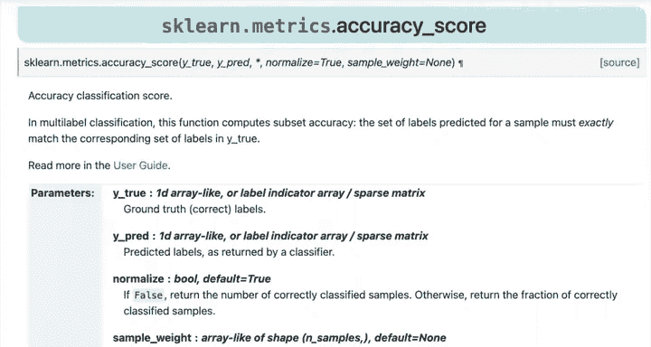

Goes why true why pre。 So I based it off that order because the psit learn metrics package is very helpful。

 So I've based our metric evaluation metric function of this one。 Whereas Pytorr's loss function。

 Does it in the reverse order。 And it's important to get these in the right order。

 exactly why they do it in that order。 I couldn't tell you why。

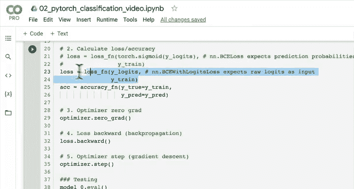

And we've got one final step， which is to print out what's happened and。Yeah。Happening。

So how about we go， We're doing a lot of epochs here，100 epochs。

 So we'll divide the epoch by 10 to print out every epoch or every 10th epoch。 sorry。

 And we have a couple of different。Metrics that we can print out this time。

 so we're going to print out the epoch number。apoch。And then we're going to。Print out the loss。

 So loss。 How many decimal points。 We'll go 0。5 here。 This is going to be the training loss。

 We'll also do the accuracy， which will be the training accuracy。

 We could write train act here for our variable to be a little bit。

 make them a little bit more understandable。 And then we go here。

 But we're just gonna leave it as loss and accuracy for now because we've got test loss over here。

 Test loss。And we're going to do the same five decimal points here。

 and then we're going to go test accuracy as well。Test act dot。We'll go two for the accuracy。

 And because it's accuracy。 we want a percentage。 This is the percent out of 100 guesses。

 What's the percentage that our model gets right on the training data and the testing data。

 As long as we've coded all the functions correctly。 Now， we've got a fair few steps here。

 my challenge to you is to run this。 And if there are any errors。 try to fix them。

 No doubt there's probably one or two or maybe more that we're going to have to fix in the next video。

 But speaking of next videos， I'll see you there。 let's train our first。

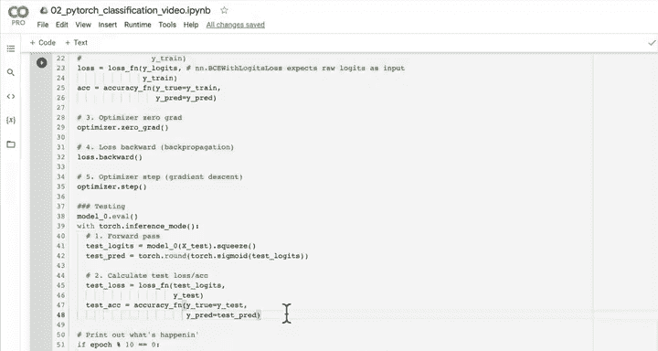

Classification model。 this is very exciting。I'll see you soon。

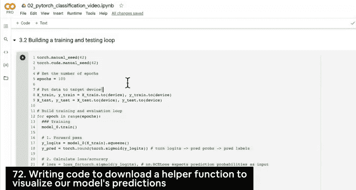

Welcome back。 In the last video， we wrote a mammoth amount of code， but nothing that we can't handle。

 we've been through a lot of these steps。 We did have to talk about a few tidbits between using different loss functions。

 namely the B loss， which is binary cross entropy loss and the BC with logits loss。

 we discussed that the B lost in ptorrch expects prediction probabilities as input。

 So we have to convert our models logits， logits of the raw output of the model。

 to prediction probabilities using the torch dot sigmoid activation function。

 And if we're using B with logits loss。 It expects raw logits as input as sort of the name hints at。

 And so we just pass it straight away。 the raw logits。

 whereas our own custom accuracy function compares labels to labels。

 And that's kind of what we've been stepping through over the last few videos is going from logits to pre pros to pre labels because that's the ideal output of our model is some kind of label。

😊。

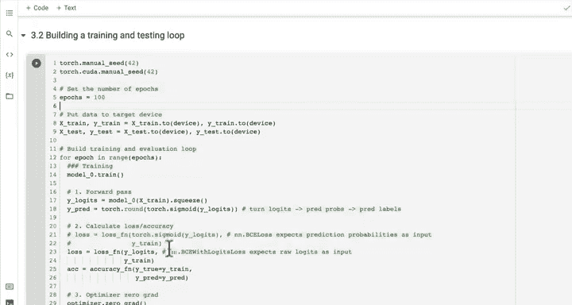

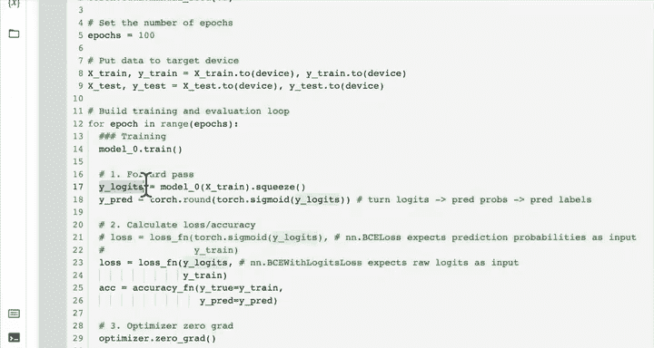

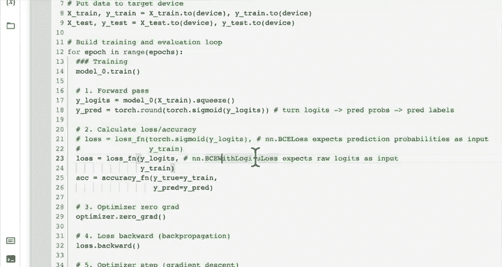

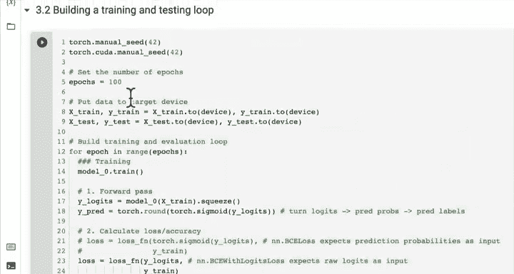

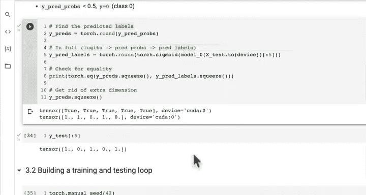

That we， as humans， can interpret。And so let's keep pushing forward。

 You may have already tried to run this training loop。 I don't know if it works。

 We wrote all this code together in the last video， and it's probably an error somewhere。

 So you're ready。 We're going to train our first classification model together for 100 epochs If it all goes to plan in 3。

2，1， let's run。😊，Oh my gosh， it actually worked the first time。😊，I promise you。

 I didn't change anything in here from the last video。 So let's inspect what's going on。

 It trains pretty fast。 Why， well， because we're using a GPU。

 so it's going to be accelerated as much as it can anyway。 And our data set is quite small。

 and our network is quite small。 So you won't always get networks training this fast。

 They did 100 epochs in like a second。😊，So， the loss，6997，3。It doesn't go down very much。

 The accuracy even starts high， and then goes down。What's going on here。

 Our model doesn't seem to be learning anything。 So what would an ideal accuracy be。

 An ideal accuracy is 100。 And what's an ideal loss value。 Well，0， because lar is better for loss。

 This is confusing。 And now if we go。Have a look at our blue and red dots。 Where's our data。

So I reckon， do we still have a data frame here。How many samples do we have of each， Let's inspect。

 Let's do some data analysis。Where do we create a data frame here？Now， circles。

 do we still have this instantiated circles dot label dot。 We're going to call on pandas here。

 value counts。 Is this going to output how many of each okay。

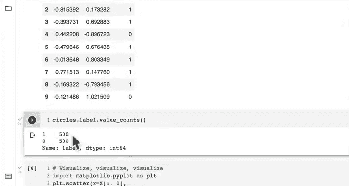

Wellow， we've got 500 of class 1 and 500 of class 0。 So we have 500 red dots and blue dots。

 which means we have a balanced data set。 So if we're getting。

 we're basically trying to predict heads or tails here。

 So if we're getting an accuracy of under 50% or about 50%。 if you rounded it up。

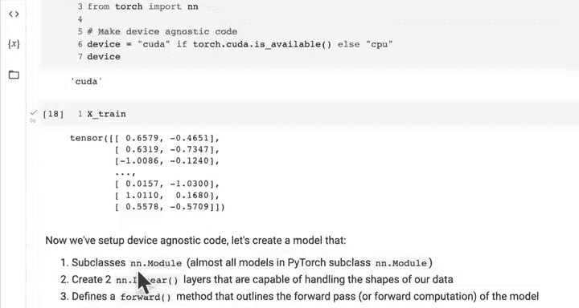

Our model is basically doing as well as guessing。 or what gives。 Well。

 I think we should get visual with this。 So let's make some predictions with our model。

 because these are just numbers on the page。 It's hard to interpret what's going on。

 But our intuition now is because we have 500 samples of each or in the case of the training dataset set。

 We have 400 of each because we have 800 samples in the training data set。

 And we have in the testing data set。 We have 200 total samples。 So we have 100 of each。

 We're basically doing a coin flip here。 Our model is as good as guessing。 So。😊。

Time to investigate why our model is not learning。 And one of the ways we can do that is by visualizing our predictions。

 So let's write down here from the metrics。 It looks like our model。Isn't learning anything。So。

 to inspect it。Let's make some。Predictions。And make them visual。And we'll right down here。

 in other words。Visualize， visualize， visualize。All right， so we've trained a model。

 We've at least got the structure for the training code here。

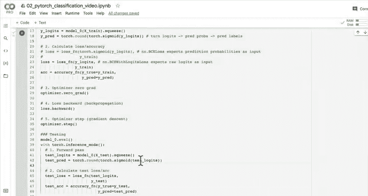

Like this is the right training code。 We've written this code before。

 So you know that this set up for training code does allow a model to train。

 So there must be something wrong with either how we've built our model。 The data said。

 but let's keep going and investigate together。 So to do so。

 I've got a function that I've prebuilt earlier。 did I mention that where learning side by side of a machine learning cooking show。

 So this is an ingredient I prepared earlier。 a part of a dish。 So to do so。

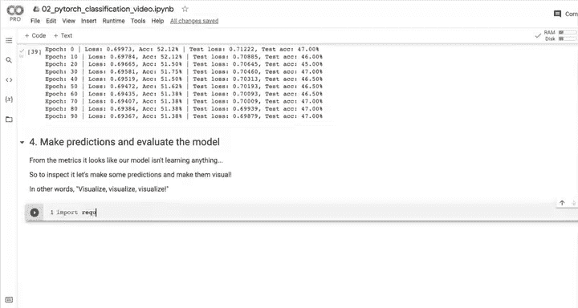

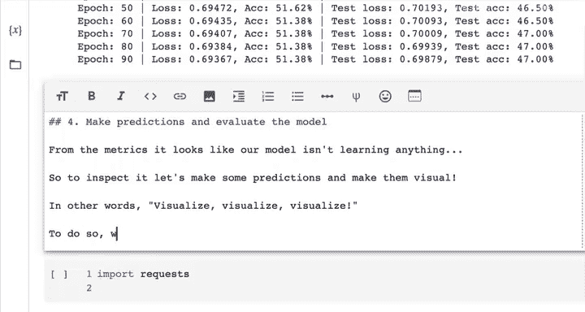

We're going to import a function called plot decision。

Or maybe I'll turn this into cone plot decision boundary。Welcome to the Cook Show。

Cooking with machine learning。 What model will we cook up today。

 So if we go to Pytorrch deep learning。

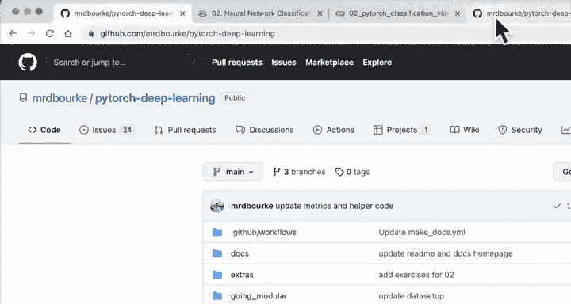

Well it's already over here， but this is the home repo for the course。

 the link for this will be scattered everywhere。😊，But there's a little function here called helper functionss。

 Pi， which I'm going to fill up with helper functions throughout the course。

 And this is the one I'm talking about here。 plot decision boundary。

 Now we could just copy this into our notebook， or I'm going to write some code to import this programmatically so we can use other functions from in here。

 Here's our plot predictions function that we made in the last section01。

 but this plot decision boundary is a function that I got inspired by to create from made with Ml do com。

😊。

Now， this is another resource， a little bit of an aside。

 I highly recommend going through this by Goku Mahandas。

 It gives you the foundations of neural networks and also Ml ops， which is a field。

 which is based on getting your neural networks and machine learning models into applications that other people can use。

 So I can't recommend this。😊。

Resource enough。 So please， please， please check that out。

If you want another resource for machine learning， but this is where this helper function came from。

 So thank you， Goku Mahandez。 I've made a little bit of modifications for this course。

 but not too many。 so we could either copy that。😊，Paste it in here， Or we could write some code to。

Import it for us magically or using the power of the Internet， right， because that's what we are。

 We're programmers。 We're machine learning engineers。 We're data scientists。 So from Partthlibb。

 So the request module in Python is a module that allows you to make request。

 a request is like going to our website。 Hey， I'd like to get this code from you or this information from you。

 Can you please send it to me。 So that's what that allows us to do。 And Partlib。

 we've seen Partlib before， but it allows us to create file parts。 because why， well。

 we want to save this helper function dot pi script to our Google coabab files。

 And so we can do this with a little bit of code。 So download helper functions。😊。

From learn Pytorrch Repo。If it's not already downloaded。So。

Let's see how we can do that。 Ca So we're gonna write some if else code to check to see if the path of helper functions。

Dot pi already exists。 We don't want to download it again， so。

At the moment， it doesn't exist。 So this if statement is going to return false。

 So let's just print out what it does if it returns true。 Helper functions dot pi already exists。

 We might。 We could even probably do a try and accept loop here。

 But if else will help us out for now。So if it exists else。Print。Downloading。Helper functions dot pi。

 So ours doesn't exist。 So it's going to make a request。 or let's set up our request requests。

Dot get。 And here's where we can。

Put in a URL。 But we need the raw version of it。 So this is the raw version， if we go back。

This is just Pythology deep learning。 the repo for this course slash helper functions。

 If I click raw。 I'm going to copy that。 Oh， don't want to go in there。 I to go into request get。

 type that in。 This has to be in a string format。 So we get the raw URL。

 and then we're going to go with open。 We're going to open。

A fire called helper functions dot pi。And we're going to set the context to be right binary which is WB as file F is a common short version of writing file because we're going to call file dot right and then request dot content so this code is basically saying hey request。

 get the information that's at this link here， which is of course all of this code here。

 which is a Python script， and then we're going to create a file called helpber functions do pi。

 which gives us write permissions， we're going to name it F which is short for file。

 and then we're going to call on it file do right the content。Of the request。

 So instead of talking through it， how about we see it in action， We'll know if it works。

 if we can from helper functions， import plot predictions。

 We're going to use plot predictions later on， as well as plot decision boundary。

So plot predictions we wrote in the last section。Wonderful。

I'm gonna write here。 Downing helper functions dot pi。 Did it work。 We have helper functions dot pi。

 Look at that。 We've done it programmatically。 Can we view this in Google code。 Oh my goodness， yes。

 we can。 Look at that。 So this may evolve by the time you do the course。

 But these are just some general helper functions rather than writing all of this out。

 If you would like to know what's going on。 in plot decision boundary。

 I encourage you to read through here。 and what's going on。 You can step by step it yourself。

 There is nothing here that you can't tackle yourself。 It's all just python code。

 No secrets just Python code。 we've got， we're making predictions with a Pytorch model。

 And then we're testing for multiclass or binary。 So we're going get out of that。 But now。

 let's see the ultimate test is if the plot decision boundary function works。😊，So again。

 we could discuss。Plot decision boundary of the model。

We could discuss what it does behind the scenes。To the cans come home。

 but we're going to see it in real life here。I like to get visual。So fig size 126。

 we're going to create a plot here because we are adhering to the data。

Expllorer's motto of visualize， visualualize， visualize。

 and we want to subplot because we're going to compare our training and test sets here。Train。

And then I'm going to go PLT， or actually we'll plot the first one， plot decision boundary。

Now because we're doing a training plot here， we're going to pass in Model0 and X train and Y train。

 Now this is the order that the parameters go in if we press command shift space。

I believe Google Coab， if it's working with me， will。Put up a dock string。 There we go。

 Pott decision boundary。 Look at the inputs that it takes model， which is torch and N dot module。

 And we've got X， which is our x value， which is a torch tensor。 And y。

 which is our torch tensor value here。 So that's for the training data。 Now。

 let's do the same for the testing data。 plot dot subplot。 This is going to be 1，2，2 for the index。

 This is just number of rows of the plot number of columns。 And this is the index。

 So this plot will appear on the first slot。 we're going to see this anyway。

 Anything below this code will appear on the second slot。 P L T dot title。

 And we're going to call this one test。 Then we're going to call plot decision boundary。

 If this works， this is going to be some serious magic。

 I love visualualization functions in machine learning。😊，Okay， you ready？3，2，1。 Let's check it out。

 How's our model doing。Oh look at that。 now it's clear。 So behind the scenes。

 This is the plots that plot decision boundary is making。 Of course， this is the training data。

 This is the testing data。 Not as many dot points here。 but the same sort of line of what's going on。

 So this is the line that our model is trying to draw through the data。

 No wonder it's getting about 50 per cent accuracy And the loss isn't going down。

 It's just trying to split the data straight through the middle。 It's drawing a straight line。

 but our data is circular。 Why do you think it's drawing a straight line。😊。

Well， do you think it has anything to do with the fact that our model is just made using pure linear layers。

 Let's go back to our model。 What's it comprised on just a couple of linear layers。

 What's a linear line。 If we look up linear line， Is this going to work with me。

 I don't actually It might。 There we go。 linear line。 All straight lines。

 So I want you to have a think about this， even if you're completely new to deep learning， Can we。

 you can answer this question， Can we ever separate this circular data with straight lines。

I mean， maybe we could if we like drew straight lines here， but then trying to curve them around。

 but there's an easier way We're going to see that later on for now。

 how about we try to improve our model。So the model that we built。We've got 100 epochs。

 I wonder if our model will improve if we trained it for longer。

 So that's a little bit of a challenge before the next video。

See if you can train the model for 1000 epochs。 Does that improve the results here。

 And if it doesn't improve the results here， have a think about why that might be。

I'll see you in the next video。