# mrdbourke《一天学会pytorch深度学习｜Learn PyTorch for deep learning in a day Literally》中英 - P53：73. Discussing options to improve a model.zh_en - GPT中英字幕课程资源 - BV1kx4y1r79d

Welcome back。 In the last video， we wrote some code to download a series of helper functions from our helper functions do pi。

 And later on， you'll see why this is quite standard practice as you write more and more code is to write some code。

 store them somewhere， such as a Python script like this。

 And then instead of us rewriting everything that we have in helper functions。

 we just import them and then use them later on。 This is similar to what we've been doing with Pytorrch。

 Pytorch is essentially just a collection of Python scripts that we're using two build neural networks。

 Well， there's a lot more than what we've just done。 I mean， we've got one here。

 but Pytorrch is a collection of probably hundreds of different python scripts。

 But that's beside the point we're trying to train a model here to separate blue and red dots。😊。

But our current model is only drawing straight lines。

 And I got you to have a think about whether our straight line model。

 our linear model could ever separate this data。 Maybe it could。

And I issued the challenge to see if it could if you train for 1000 epochs。

So did it improve at anything， Is the accuracy any higher？Well。Speaking of training for more epochs。

 we're up to section number5， improving a model。This is from a model perspective。

 So now let's discuss some ways if。You were getting results after you train a machine learning model or a deep learning model。

 whatever kind of model you're working with。 And you weren't happy with those results。

 So how could you go about improving them？ So this is going to be a little bit of an overview of what we're going to get into。

 So one way is to add more layers。 So give the model more chances to learn about。

Patterns in the data， why would that help， Because if our model currently has two layers。Model 0。

Dot state died。Well， we've got。However， many numbers here，20 or so。 So this is zeroth layout。

 This is the first layout。 If we had 10 of these， well we'd have 10 times the amount of parameters to try and learn。

The patterns in this data a representation of this data。 Another way is to add more hidden units。

So what I mean by that is we created this model here and each of these layers has five hidden units。

The first one outputs， out features equals 5， and this one takes in features equals 5。

 so we could go from。Go from five hidden units to  ten0 hidden units。

The same principle as above applies here is that the more parameters our model has to represent our data that potentially now。

 I say potentially here because some of these things might necessarily work。

 So our data set is quite simple。 So maybe if we added too many layers。

 our models is trying to learn things that are too complex。

 It's trying to adjust too many numbers for the data set that we have。

 The same thing for more hidden units。 What other options do we have。 Well， we could。Fit for longer。

 Give the model more of a chance to learn because every epoch is one pass through the data。

 So maybe 100 times looking at this data wasn't enough。 So maybe you could fit for 1 thousand times。

 which was the challenge。 then there's changing the activation functions。

 which we're using sigmoid at the moment， which is generally the activation function you use for a binary classification problem。

 but there are also activation functions you can put within your model。 there's a little hint。

 we'll get to that later， then there's change the learning rate。

 So the learning rate is the amount the optimizer will adjust these every epoch。

 and if it's too small， our model might not learn anything because it's taking forever to change these numbers。

 but if also on the other side of things。 if the learning rate is too high。

 these updates might be too large and our model might just explode。

 There's an actual problem in machine learning called exploding。😊。

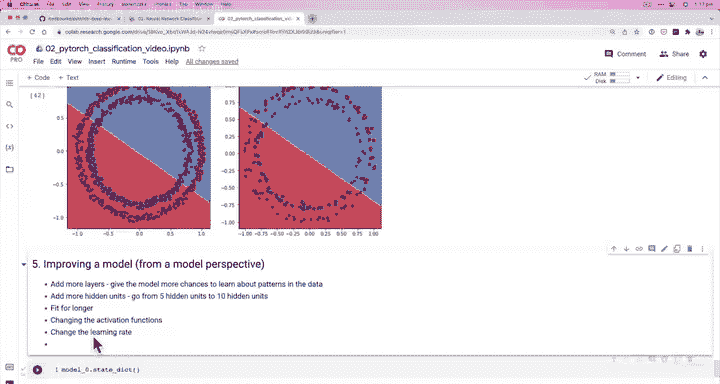

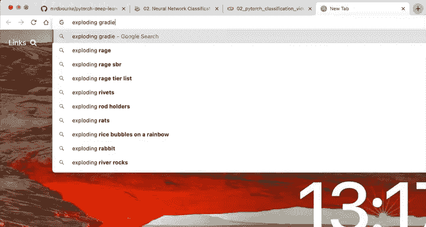

Graient problem。Where the numbers just get too large on the other side。

 there's also a vanishinging problem where the gradients just go basically to 0 too quickly。

And then there's also change the loss function But I feel like for now。

 sigmoid and binary cross entropy pretty good， pretty standard。

 So we're going to have a look at some options here， add more layers and fit for longer。

 maybe changing the learning rate， but let's just add a little bit of color to what we've been talking about right now we've fit the model to the data and made a prediction。

 I'm just going to step through this。😊。

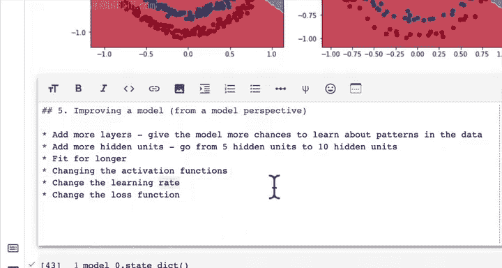

Where are we up to， We've done this， We've done this。 We've done this， too。

 We've built a training loop。 We've fit the model to the data， made a prediction。

 We've evaluated our model visually， and we're not happy with that。 So we're up to number 5。

 We're going to improve through experimentation。 We don't need to use Tensor board just yet。

 We're going to talk about this as at a high level。 Tensor board is a tool or a utility from Pytorch。

 which helps you to monitor experiments。 We'll see that later on。 And then we'll get to this。

 We won't save our model until we've got one that we're happy with。😊。

And so if we look at what we've just talked about， improving a model from a model's perspective。

 Let's talk about the things we've talked about with some color this time。

 So say we've got a model here。 This isn't the exact model that we're working with。

 but it's similar structure。 We've got 1，2，3，4 layers。 We've got a loss function。

 B C with Loits loss。 We've got an optimizer， optimizer stochastic gradient descent。

 And if we did write some training code， this is 100pos。

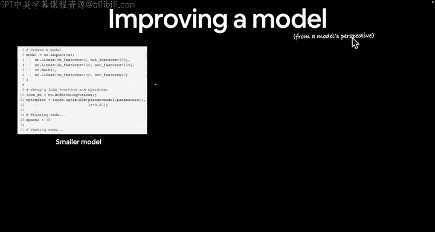

And then the testing code here， I've just cut it out because it wouldn't fit on the slide。

 Then if we wanted to go to a larger model， let's add some colour here so we can highlight what's happening。

 adding layers。 Okay， so this one's got 1，2，3，4，5，6 layers。 and we've got another。

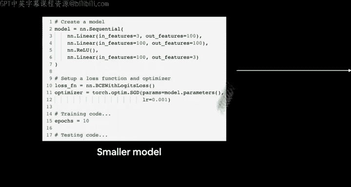

Coour here， which is， I'd say this is like a little bit of a greeny blue。

 In the number of hidden units。 Okay， so the hidden units are these features here。

 We've gone from 100 to 128 to 128。 Remember， the out features of a previous layer have to line up with the in features of a next layer。

Then we've gone to 256。 Wow， So remember how I said multiples of8 are pretty good。

 generally in deep learning。 Well， this is where these numbers come from。

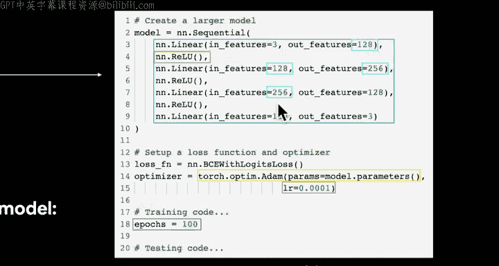

And then what else do we have Change slice add activation functions。 We haven't seen this before。

 N N dot Reello。 If you want to jump ahead and have a look at what N N dot Reello is。

 how would you find out about it。😊。

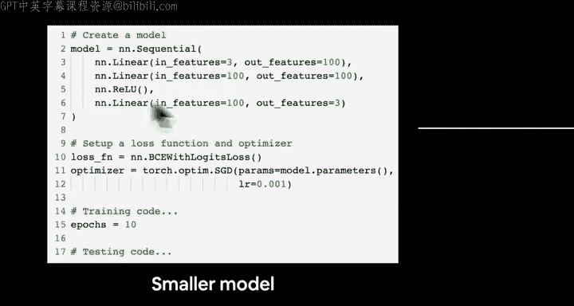

Well， I just Google N dot Reou。But we're going to have a look at what this is later on。😊。

We can see here that this one's got one， but this larger model has some relos scattered between the linear layers。

Maybe that's a hint。 If we combine a linear layout with。

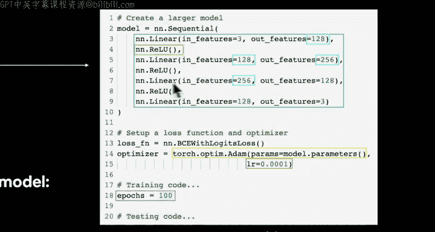

A relu。 What's a relu layer。 I'm not gonna spoil this。 We're gonna find out later on。

 Change the optimization function。 I。 So we've got S G D。

 Do you recall how I said atom is another popular one that works fairly well across a lot of problems as well。

 So Adam might be a better option for us here， the learning rate as well。

 So maybe this learning rate was a little too high。 And so we've divided it by 10。 And then finally。

 fitting for longer。 So instead of 10 epos， we've gone to 100。

 So how about we try to implement some of these with our own model to see。😊。

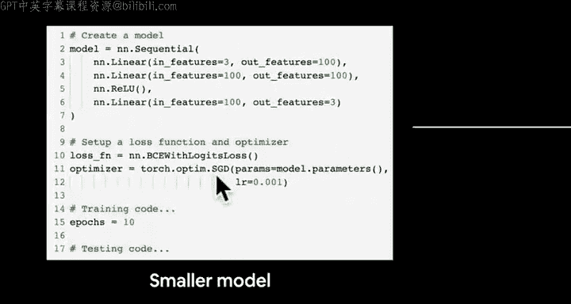

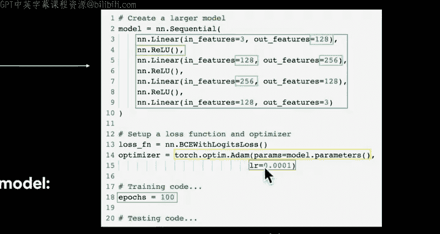

If it improves what we've got going on here， because， frankly， like this isn't satisfactory。

 we're trying to build a neural network here。 neural networks are supposed to be these models that can learn almost anything。

 And we can't even separate some blue dots from some red dots。 So in the next video。

 how about we run through writing some code to do some of these steps here。 In fact。

 if you want to try yourself。 I'd highly encourage that。

 So I'd start with trying to add some more layers and add some more hitting units and fitting for longer。

 You can keep all of the other settings the same for now。😊。

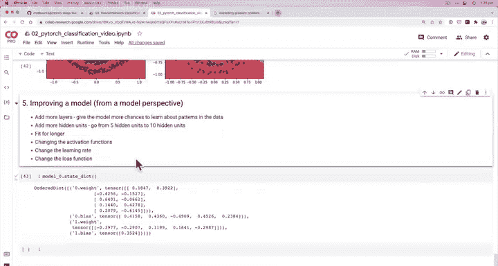

But I'll see you in the next video。

Welcome back。 in the last video， we discussed some options to improve our model from a model perspective。

 and namely we're trying to improve it so that the predictions are better so that the patterns it learns better represent the data so we can separate blue dots from red dots。

 And you might be wondering why we said from a model perspective here。

 So let me just write these down。😊，These options。All from a models perspective。

Because they deal directly with the model。Rather than the data。

 So there's another way to improve a model's results is if the model was sound already in machine learning and deep learning。

 you may be aware that generally if you have more data samples。

 the model learns or gets better results because it has more opportunity to learn。

 So's a few other ways to improve a model from a data perspective。

 but we're going to focus on improving a model from a model's perspective。So。

And because these options are all values， we as。Machine learning。Engineers and data scientists。

Can change。They are。Referred to。As hyperparameter。So a little bit of an important distinction here。

 parameters are the numbers within a model， the parameters here， like these values。

 the weights and biases are parameters are the values a model updates by itself。

 hyperpara are what we as machine learning engineers and data scientists such as adding more layers。

 more hidden units fitting for longer number of epochs， activation functions， learning rate。

 loss functions。Are hyperpara because they're values that we can change。

 So let's change some of the hyperparameter of our model。So we'll create circle model V1。

 we're going to import from NN dot module as well， we could write this model using NN dot sequential。

 but we're going to subclass NN dot module for practice。Why would we use NN dot sequential well。

 because as you'll see our model is not too complicated， but with some class NN dot module。In fact。

 N N dot sequential。 So if we write here， N N dot sequential。Is also a version of N N dot module。

 But we subclass N N dot module here for one for practice。 And for later on， if we wanted to。

 or if you wanted to make more complex models， you're going to see a subclass of N N dot module a lot in the wild。

 So the first change we're going to update is。The number of hidden units。 So out features。

 I might write this down before we do it。Let's try and improve our model by。Adding more hidden units。

So， this will go from。5， and we'll increase it to 10。And we want to。Increase the number of layers。

 So we want to go from 2 to 3。 We'll add an extra layer and then increase the number of epochs。

So we're going to go from 100 to 1000。 Now， what can you。

We're going to put on our scientist hats for a second。

 What would be the problem with the way we're running this experiment。

If we're doing all three things in one hit， why might that be problematic？Well。

 because we might not know which one offered the improvement if there is any improvement or degradation。

 So just to keep in mind going for it， I'm just doing this as an example of how we can change all of these。

 But generally， when you're doing machine learning experiments。

 you'd only like to change one value at a time and track the results。

 So that's called experiment tracking and machine learning。

 We're going to have a look at experiment tracking a little later on in the course。

 But just keep that in mind。 A scientist likes to change one。

Variable of what's going on so that they can control what's happening。

But we're going to create this next layer here， layer2， and of course， it takes the same number。

Of out features as in features as the previous layer。This is too， because why our X train has。

Let's look at just the first five samples has two features。So now we're going to create self layer 3。

 which equal callss an and dot linear。The in features here is going to be 10 y because the layer above has out features equals 10。

 So what we've changed here so far is we've got hidden units previously in V0 of this model was 5。

 and now we've got a third layer which previously before was2。

So these are two of our main changes here， and out features equals1 because y。

 let's have a look at speaking of Y。Our y is just one number。 So remember， the shapes。

 the input and output shapes of our model is one of the most important things in deep learning。

 We're going to see different values for these shapes later on。

 But because we're working with this data set， we're focused on two in features and one out feature。

So now that we've got our layers prepared， what's next？Well， we have to override the For method。

 because every subclass of N end dot module has to implement a forwardd method。

 So what are we going to do here。Well， we could。 let me just show you one option。 We could go Z。

 which would be Z for Loitts。 Loitts is actually represented by Z Fun fact。

 but you could actually put any variable here。 So this could be X1 or you could reset X if you wanted to。

 I just look putting a different one because it's a little less confusing for me。

 And then we could go update Z by going。Self layer 2。

 And then the because Z above is the output of layer 1， it now goes into here。 And then if we go Z。

Again， equals self layer 3。What's this going to take， It's going to take Z from above。

 So this is saying， hey， give me X， put it through layer 1， assign it to Z。

 and then create a new variable Z or override Z with self layer 2 with Z from the as the input。

 And then we've got Z again， the output of layer 2 as the input for layer 3。

 And then we could return Z。So that's just passing our data through each one of these layers here。

 But a way that you can leverage speed ups in pietorrch is to。Call them all at once。 So layer 3。

 and we're going to put self。Dot。Layer 2， and this is generally how I'm going to write them。

 but it also behind the scenes， because it's performing all the operations at once。

 you leverage whatever speed ups you can get。Hope this should be lie 1。So it goes in order here。

 So what's happening。 Well， it's computing the inside of the brackets first。

 So layer 1 x is going through layer 1。 and then the output of。

X into layer 1 is going into two layer 2。 And then the same again for layer 3。 So this way。

This way of writing operations， leverages， speed ups。Where possible。Behind the scenes。

And so we've done our forward method there， we're just passing our data through layers with it extra hidden units and an extra layer overall。

 so now let's create an instance of circle model V1。

 which we're going to set to Model1 and we're going to write circle model V1 and we're going to send it to the target device because we like writing device agnostic code。

And then we're going to check out Model one。So let's have a look at what's going on there。 Beaiful。

 So now we have a three layered model with more hidden units。

 So I wonder if we trained this model for longer， are we going to get improvements here。

 So my challenge to you is we've already done these steps before。

 We're going to do them over the next couple of videos for completeness。😊，But we need two one。

Create a loss function。So I'll give you a hint。 It's very similar to the one we've already used。

 and we need to create an optimizer。And then once we've done that， we need to write a training。

And evaluation loop for Model one。So give that a shot。Otherwise。

 I'll see you in the next video we'll do this all together。Welcome back。 In the last video。

 we subclassed N do module to create circle model V1， which is an upgrade on circle model v0。

 in the fact that we added more hidden units。 So from5 to 10。

 and we added a whole extra layer and we've got an instance of it ready to go。

 So we're up to in the workflow。 We've got our data。 Well， we haven't changed the data。

 So we've built our new model。 We now need to pick a loss function。

 and I hinted out before that we're going to use the same loss function as before。

 the same optimizer。 You might have already done all of these steps。

 So you may know whether this model works on our data set or not。

 but that's what we're gonna to work towards finding out in this video。 So we've built our new model。

 Now let's pick a loss function and optimizer。 we could almost do all of this with our eyes closed now。

 build a training loop， fit the model to the data， make a prediction and evaluate the model。

 We'll come back here。 and let's set up a loss function。😊，And by the way。

 if you're wondering like why would adding more features here。

 we've kind of hinted at this before and why would an extra layer improve our model， Well， again。

 it's back to the fact that if we add more neurons。

 if we add more hidden units and if we add more layers， it just gives our model more numbers。

To adjust， so look at what's going on here， layer 1， layer 2。Look how many more we have。Compared to。

Model  zero dot state deck。We have all of these。 This is Model 0， and we just upgraded it。

 Look how many more we have from just adding an extra layer and more hidden units。

So now we have our optimizer can change these values to， hopefully。

Create a better representation of the data we're trying to fit。

So we just have more opportunity to learn patterns in our target data set。

 So that's the theory behind it。 So let's get rid of these。 Let's create a loss function。😊。

What are we going to use Well we're going to use Nn。bce with Loits loss。

And our optimizer is going to be what we're going to keep that as the same as before。 Torch。

opdim do sgd。 But we have to be aware that because we're using a new model。

 we have to pass in parameterss of model 1。 These are the parameters we want to optimize。

 and the Lr is going to be 0。1。 Is that the same Lr we used before Learn rate is 0。1。 Oh。

 potentially that our learning rate may be too big。0。1。Where do we create our optimizer。

 so we've written a lot of code here。Optimizer there we go。0。1。 That's a run。 So we'll keep it at 0。

1 just to keep as many things the same as possible。So we're going to set up torch。

tmanual seed 42 to make training as reproducible as possible， torch。kuar。manualsed。42 now。

 as I said before， don't worry too much if your numbers aren't exactly the same as mine。

 the direction is more important， whether it's good or bad direction。So now let's set up epochs。

 We want to train for longer this time as well。 So 1000 epochs。

 This is one of our three improvements that we're trying to do。 adding more hidden units。

 increase the number of layers and increase the number of epochs。

 So we're going to give our model 100 looks at the data to try and improve its patterns。

 So put data on the target device。We want to write device agnostic code and yes。

 we've already done this， but we're going to write it out again for practice because even though we could functionise a lot of this。

 it's good while we're in still the foundation stages to practice what's going on here because I want you to be able to do this with your eyes closed before we start to functionise it So put the training data and the testing data to the target device。

 whatever it is CPU or GPU and then we're going to well what's our song。😊，For any pocket range。

Let's loop through the epos we're going to start off with training What do we do for training while we set Model1 to train and then what's our first step Well we have to forward pass what's our outputs of the model Well the raw outputs of a model are Loitts so model one we're going to pass it the training data and we're going to squeeze it so that we get rid of an extra one dimension if you don't believe me that we would like to get rid of that one dimension try running the code without that dot squeeze and why pred equals torch dot round。

😊，And torch dot sigmoid Y， we're calling sigmoid on our logits to go from logits to prediction probabilities。

To prediction。Lbels。And then what do we do next， Well， we calculate the loss。Slash accuracy。To here。

 And remember， accuracy is optional， but loss is not optional。 So we're going to pass in here。

 Our loss function is going to take in。 I wonder if it'll work with just straight up wide pre。

I don't think it will because we're using， we need logitts in here。 why logitts and why train。

 Because why。Oh， Google Car La correcting the wrong thing。

We have Y logitts because we're using BCE with logits loss here。So let's keep pushing forward。

 We want our accuracy now， which is our accuracy function。And we're going to pass in the order here。

 which is the reverse of above， a little confusing。

 but I've kept the evaluation function in the same order as pste loan。 Y pre equals Y pre。Three。

 we're going to zero the gradients of the optimizer。Optimer0 grad。

 And you might notice that we've started to pick up the pace a little。 That is perfectly fine。

 If I'm typing too fast， you can always slow down the video or you could just watch what we're doing and then code it out yourself afterwards。

 The code resources will always be available。 We're going to take the loss backward。😊。

And perform back propagation。The only reason we're going faster is because we've covered these steps。

 So anything that we sort of spend time here， we've covered in a previous video optimize a step。

 and this is where the adjustments to all of our models parameters are going to take place to hopefully create a better representation of the data。

 And then we've got testing。 What's the first step that we do in testing。 Well。

 we call Model 1 do vow to put it in evaluation mode。

 and because we're making predictions we're going to turn on torch inference mode， predictions。

 I call them predictions， Some other places call it inference。😊，Remember。

 machine learning has a lot of different names for the same thing。 For pass。

 So we're going to create the testlogits here。Equals Model 1 X test。

 And we're going to squeeze them because we won don't want the extra one dimension。

 I going add some code cells here so that we have more space。

 And I'm typing in the middle of the screen。Then I'm going to put in test pre here。

 how do we get from logits to predictions well we go torch do round and then we go torch。

 sigmoid y sigmoid because we're working with a binary classification problem and to convert logits from a binary classification problem to prediction probabilities。

 we use the sigmoid activation function。And then we're going to calculate the loss。

So how wrong is our model on the test data， So test lost equals loss function。

 We're going to pass it in the test logits。And then we're going to pass it in why test for the ideal labels。

 and then we're going to also calculate test accuracy and test accuracy is going to take in Y true equals y test or the test labels and y pre equals test pre so the test predictions。

Test predictions here。 And our final step is to print out what's happening， so。

Brent out what's happening。 every tutorial needs a song。 If I could， I'd teach everything with song。

😊，Song and dance。 So because we're training for 1000 epochs。

 how about every 100 epochs we print out something。 So print F string。

 and we're going to write epoch in here。 So we know what epoch our models on。

 and then we're going to print out the loss。 Of course， this is going to be the training loss。

 because the test loss has test at the front of it。 and then the accuracy here。 Now， of course。

 this is going to be the training accuracy。😊，Let me go here。And then we're going to pipe。

 and we're going to print out the test loss。And we want the test loss here。

 we're going to take this to five decimal places again when we see the printouts of the different values。

 do not worry too much about the exact numbers on my screen appearing on your screen because that is inherent to the randomness of machine learning So have we got the direction is more important。

Have we got， We need a percentage sign here， Ca that's going to be a bit more complete for accuracy。

 Have we got any errors here， I don't know。 I've just， we've just all coded this free hand。 Right。

 There's a lot of code going on here。So we're about to train our next model。

 which is the biggest model we've built so far in this course， three layers。

 10 hidden units on each layer。 Let's see what we've got3，2， one run。Oh， what。😮，What1000 epochs。

 an extra hidden layer， more hidden units。 And we still。 our model is still basically a coint toss。

50 per cent。 Now， this can't be for real。 Let's plot the decision boundary。😊。

Ploot the decision boundary。To find out， let's get a bit visual。Pt figure。Actually。

 to prevent us from writing out all of the plot code， let's just go up here and we'll copy this。 Now。

 you know， I'm not the biggest fan of copying code， but for this case， we've already written it。

 So there's nothing really new here to cover。 And we're going just change this from model 0 to model 1。

 Because why it's our new model that we just trained。 And so behind the scenes。

 plot decision boundary is going to make predictions with the target model on the target data set and put it into a nice visual representation for us。

 I said nice visual representation。 What is this look like。

 We've just got a coin toss on our data set。 Our model is just， again。

 it's trying to draw a straight line to separate？ C data。 Now， why is this。

 Our model is based on linear is our data No nonlinear。maybe I've revealed a few of my tricks。

I've done a couple of reveals over the past few videos， but。😊，This is still quite annoying。

 and it can be fairly annoying when you're training models and they're not working， so。

How about we verify that this model can learn anything， Because right now。

 it's just basically guessing for our data set。 So this model looks a lot like the model we built in Section 0。

1。 Let's go back to this。 This is the learn Pytoch dot I O book， Pytoch workflow fundamentals。

 Where do we create a model， model buildingEssentials。Where did we build a model？

Linear regression model。Yeah， here。 and end do linear。But we built this model down here。

 So all we've changed。From 0，1 to here， as we've added a couple of layers。

 the forward computation is quite similar。 If this model can learn something on a straight line。

Can this model learn something on a straight line。So that's my challenge to you， is。

Grab the data that we created in this previous notebook。 So data。

 you could just reproduce this exact data set and see if you can write some code to fit the model that we built here。

This one here。On the data set that we created in here。

 because I want to verify that this model can learn anything because right now。

 it seems like it's not learning anything at all。 And that's quite frustrating。 So give that a shot。

 and I'll see you in the next video。

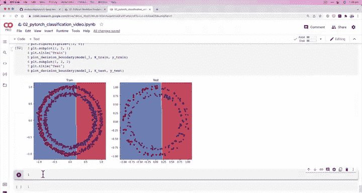