# mrdbourke《一天学会pytorch深度学习｜Learn PyTorch for deep learning in a day Literally》中英 - P54：76. Creating a straight line dataset.zh_en - GPT中英字幕课程资源 - BV1kx4y1r79d

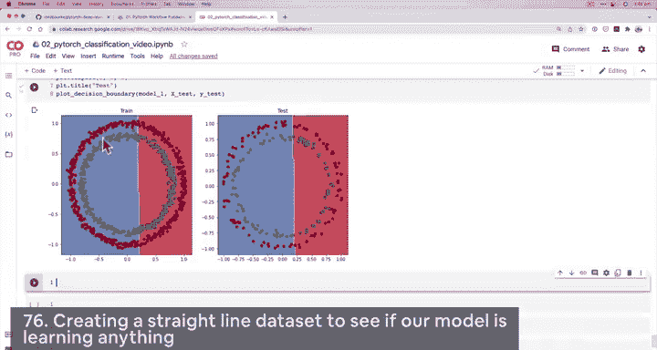

Welcome back。 In the past few videos， we've tried to build a model to separate the blue from red dots yet。

 Our previous efforts have proven futile， but don't worry， we're going to get there。

 I promise you we're going to get there。 And I may have a little bit of inside information here。

 but we're going to build a model to separate these blue dots from red dots。

 a fundamental classification model。 And we tried a few things in the last couple of videos such as training for longer。

 So more epochs。 We added another layer。 We increase the hidden units。

 because we learned of a few methods to improve a model from a model perspectives。

 such as upgrading the hyperparameter， such as number of layers， more hidden units。

 fitting for longer， changing the activation functions， changing the learning rate。

 We haven't quite done that one yet and changing the loss function。😊。

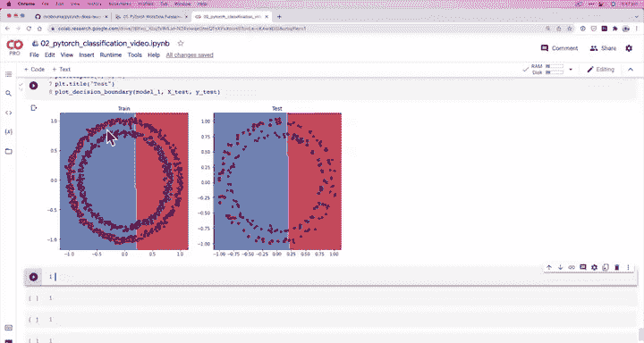

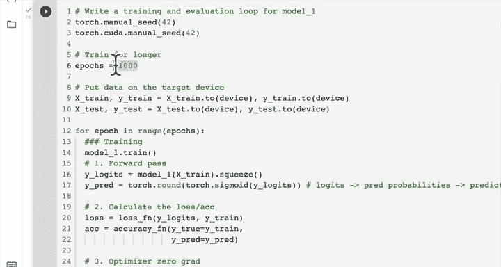

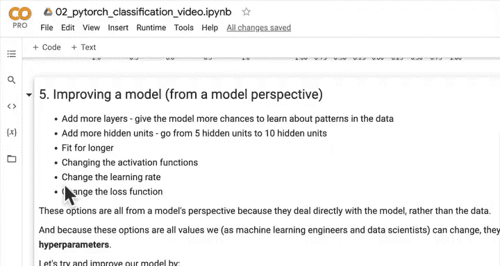

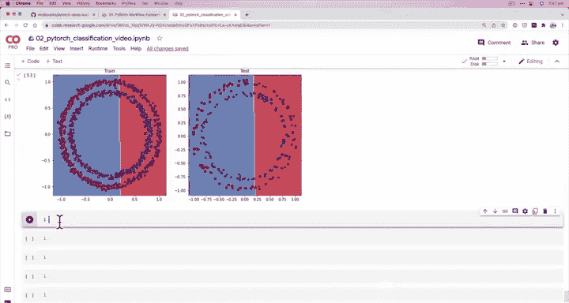

One way that I like to troubleshoot problems is。

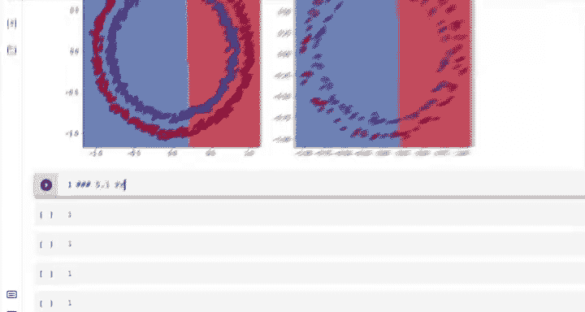

We're going to put a subheading here， 5。1， we're going to prepare or preparing data to see if our model can fit a straight line。

So。One way to troubleshoot。This is my trick for troubleshooting problems， especially neural networks。

 but just machine learning in general to troubleshoot a larger problem。Is to test out。

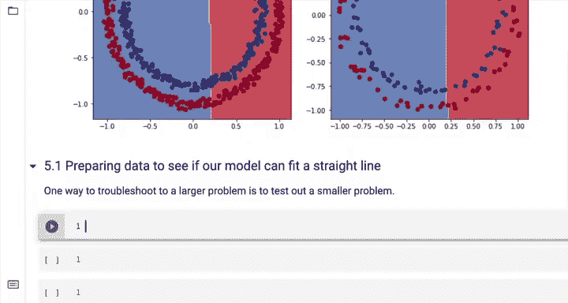

A smaller problem。And so why is this， Well， because we know that we had something working in a previous section。

 So 0，1 Pytorch workflow fundamentals， we built a model here that worked。 And if we go right down。

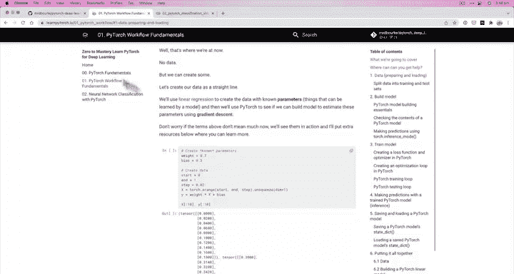

We know that this linear model can fit a straight line。

 So we're going to replicate a data set to fit a straight line to see if the model that we're building here。

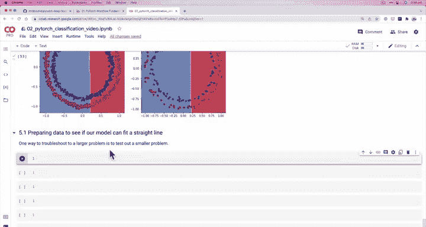

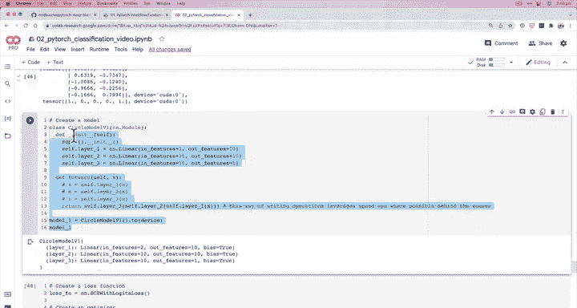

Can learn anything at all， because right now it seems like it can't。

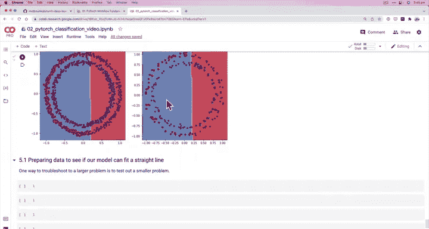

It's just tossing a coin to split between our data here， which is not ideal。 So let's make some data。

But yeah， this is the， let's create a smaller problem。

 one that we know that works and then add more complexity to try and solve our larger problem。

 So create some data。 This is going to be the same as notebook O1。

And I'm going to set up weight equals 0。7。 Bas equals 0。3。

 We're going to move quite quickly through this， because we've seen this in。

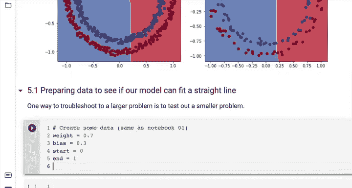

Module1， but the the overall takeaway from this is we're going to see if our model works on any kind of problem at all or do we have something fundamentally wrong？

Create data。I'm going to call it X regression because it's a straight line and we want it to protect a number rather than a class。

 So you might be thinking， oh， we might have to change a few things of our model architecture。 Well。

 we'll see that in a second。Dot unsqueze。And we're going to go on the first dimension here or dems  one。

 And why regression。We're going to use the linear regression formula as well。

 weight times X X regression。 that is because we're working with a new data set here。Plus， the bias。

 So this is linear regression。

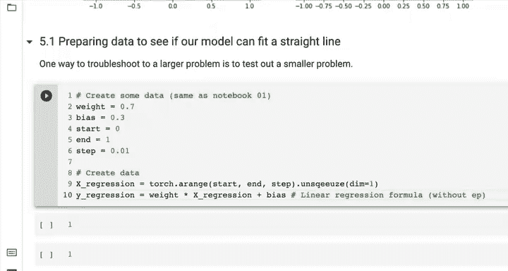

Formula。Without epsilon。 So it's a simplified version of linear regression。

 but the same formula that we've seen in a previous section。 So now let's check the data。

 Nothing we really haven't covered here， but we're going to do a sanity check on it to make sure that we're dealing with what we're dealing with is not just a load of garbage。

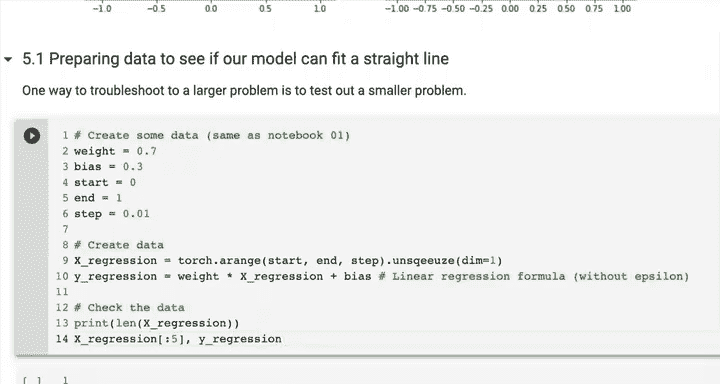

Cause it's all about the data and machine learning。 I can't stress to you enough。

 That's the data Explorer's motto is to。😊，Visualize， visualize， visualize。 Oh。

 what did we get wrong here， unsqueezed。 Did you notice that typo。

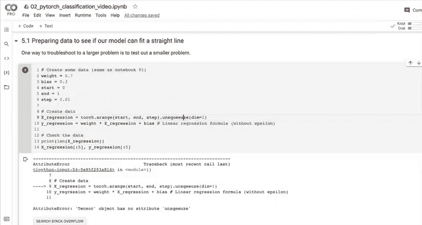

Why didn't you say something。I'm kidding。 There we go。 Okay， so we've got 100 samples of X。

 we've got a different step size here， but that's all right。

 Let's have a little bit of fun with this。 And we've got one x value per y value。

 This is a very similar data set to what we use before。 Now， what do we do once we have a data set。😊。

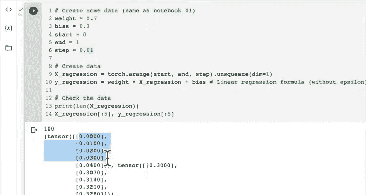

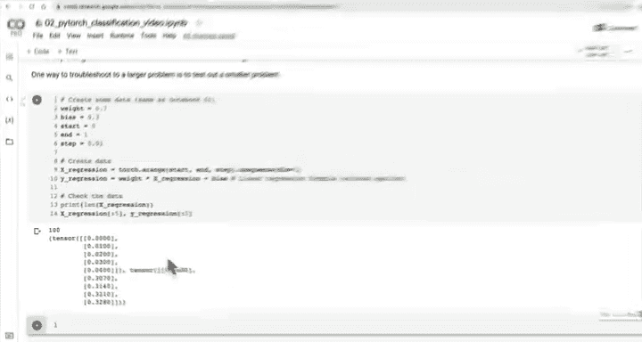

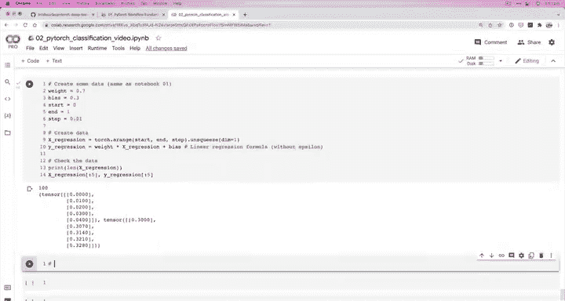

Well， if we haven't already got training in test splititzs， we better make them。

So create train and test splits。And then we're going to go train split。

We're going to use 80% equals int。0。8 times the length of。Or we could just put 100 in there。

 but we're gonna。Be specific here。 And then we're going to go X train regression， Y。

 train regression。Equals， what do these equal Well。

 we're going to go on X regression and we're going to index up to the train split。

On the X and then for the Y Y regression， we're going to index up to the train split。

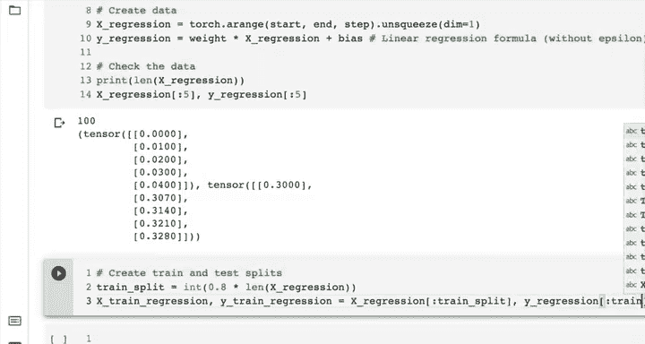

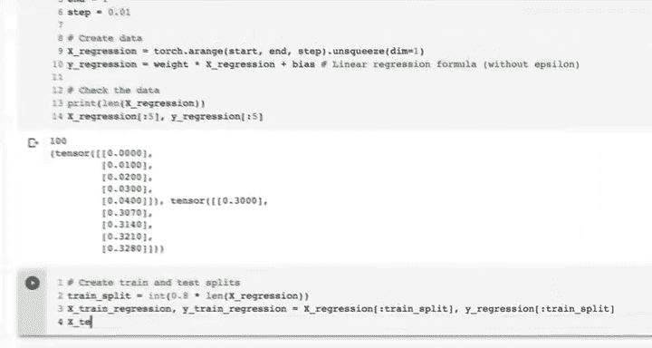

Wonderful， and then we can do the same on the test or creating the test data。😊。

Nothing really new here that we need to discuss with're creating training in test sets。

 what do they do for each of them？

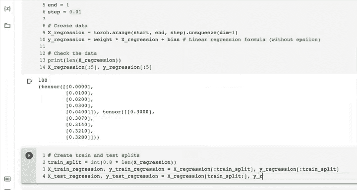

Well， the model is going to hopefully learn patterns in。

Training data set that is able to model the testing data set。 And we're gonna see that in a second。

 So if we check the length。

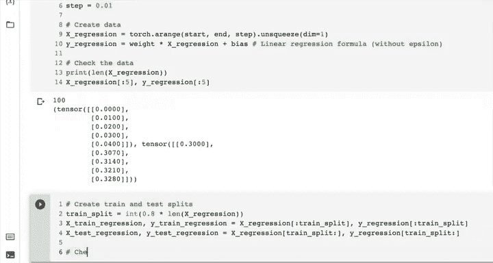

Of each， what do we have， length， X train regression。 We might just check。X train， X test。

Reggression。What do we have here。And then we're gonna go at length。Why train regression？

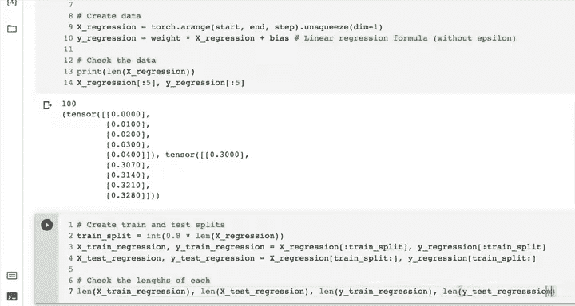

Long variable names here， excuse me for that， but we want to keep it separate from our already existing X and Y data。

What values do we have here。80，2080，20 beautiful。 So 80 training samples to 100 testing samples。

 That should be enough。 Now， because we've got our helper functions。

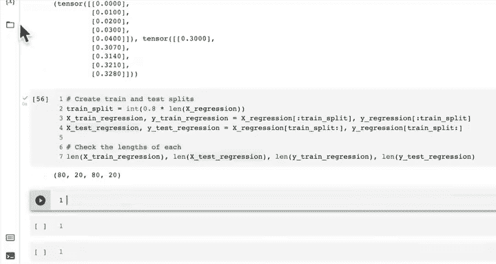

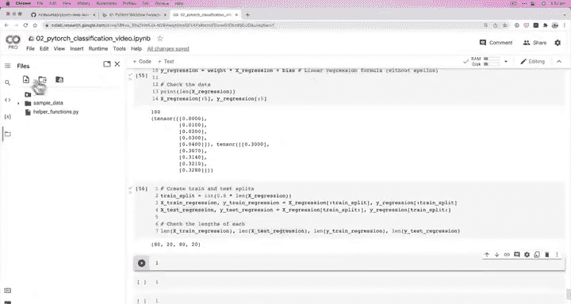

File here。 And if you don't have this， remember we wrote some code up here before to where is it？

To download it from the course Github， and we imported plot predictions from it。 Now。

 if we have a look at helpber functions dot pi， it contains the plot predictions function that we created in。

The last section， section 0。1。 There we go。 P predictions。

 So we're just running this exact same function here， or we're about to run it。

 It's going to save us from retyping out all of this。

 That's the beauty of having a helper functions dot pie file。

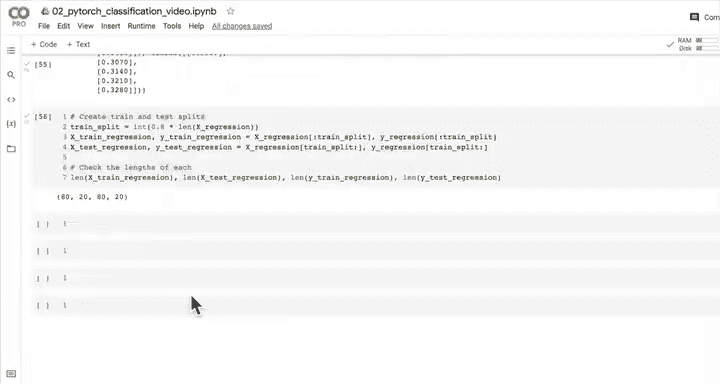

So if we come down here， let's plot our data to visually inspect it right now it's just numbers on a page and we're not going to plot really any predictions。

Because we don't have any predictions yet， but we'll pass in the train data。

Is equal to x train regression。 and then the next one is the train labels， which is equal to Y train。

Regression。And then we have the test data， which is equal to X test。Regression。

 and then we have the test。Lbels。

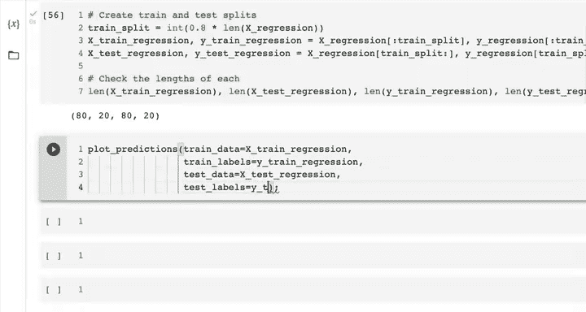

Now， I think this should be labels， too。 Yeah， there we go。 Why test regression。

It might be proven run as we try to run this function。 Okay， there we go。

 So we have some training data and we have some testing data。 Now， do you think that our model。

Model 1。If we have a look， what's Model one？Could fit this data。

Does it have the right amount of in and out features， We may have to adjust these slightly。

 So I'd like you to think about that。 Do we have to change the input features to our model for this data set and do we have to change the out features of our model for this data set。

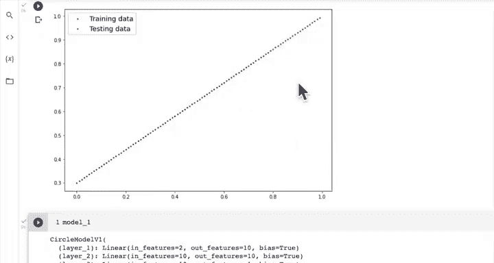

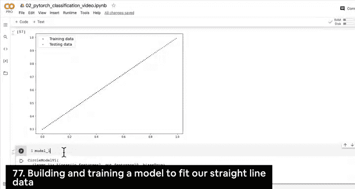

We'll find out in the next video。Welcome back。 We're currently working through a little side project here。

 but really the philosophy of what we're doing。 we just created a straight line data because we know that we've built a model in the past back in section 01 to fit a straight line data and why are we doing this Well。

 because the model that we've built so far is not fitting or not working on our circular data here on our classification data set。

 And so one way to troubleshoot a larger problem is to test out a smaller problem first。 So later on。

 if you're working with a big machine learning data。

 you probably start with a smaller portion of that dataset first Likewise。

 with a larger machine learning model instead of starting with a huge model。

 you'll start with a small model So we're taking a step back here to see if our model is going to learn anything at all on a straight line dataset so that we can improve it for a non-s straightight line data and there's another hemp。

😊。

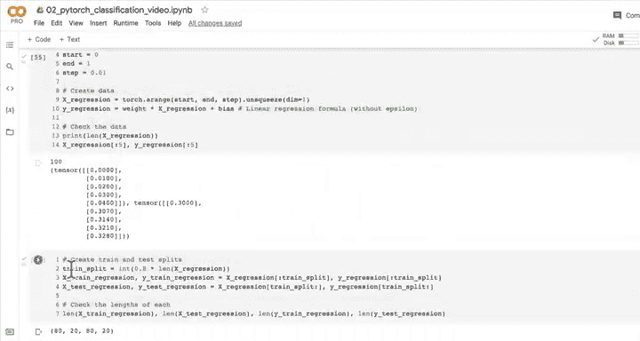

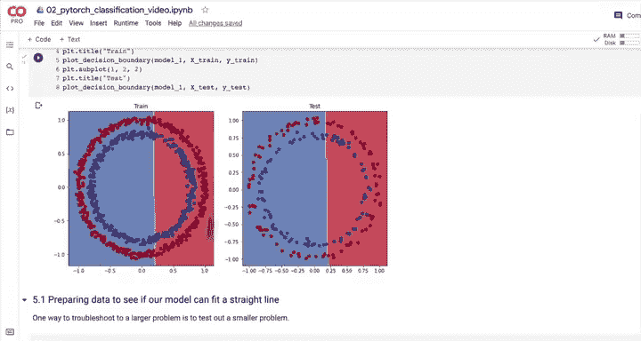

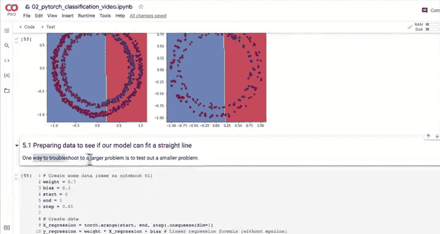

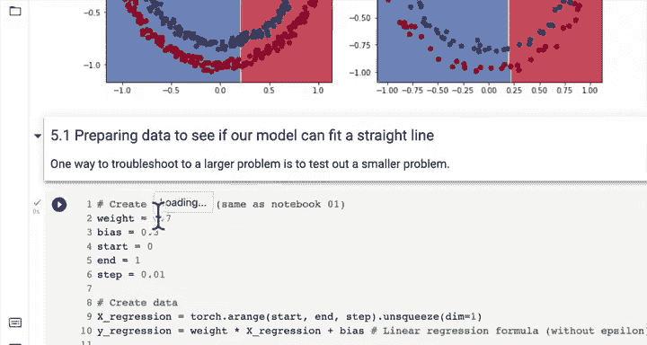

Oh， we're going to cover it in a second。 I promise you， but let's see how now we can adjust。😊。

Model1 to fit a straight line。 And I issued you the question at the end of last video。

 Do we have to adjust the parameters of model1 in any way shape or form to fit this straight line data。

 and you may have realized or you may not have that our model 1 is set up for our classification data。

 which has two X input features， whereas this data。

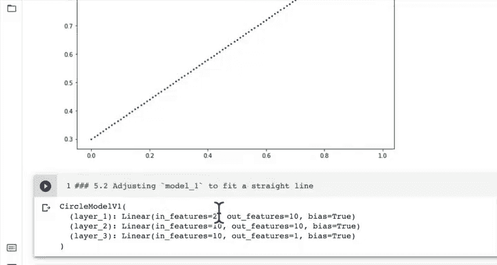

If we go x。Train regression。How many input features do we have， We just get the first sample。

There's only one value， or maybe we get the first 10。There's only one value per。

Let's remind ourselves。 This is input and output shapes。

 One of the most fundamental things in machine learning and deep learning。 And trust me。

 I still get this wrong all the time。 So that's why I'm harping on about it。

 We have one feature per one label。 So we have to adjust our model slightly。

 We have to change the in features to be one instead of two。

 The out features can stay the same because we want one number to come out。😊。

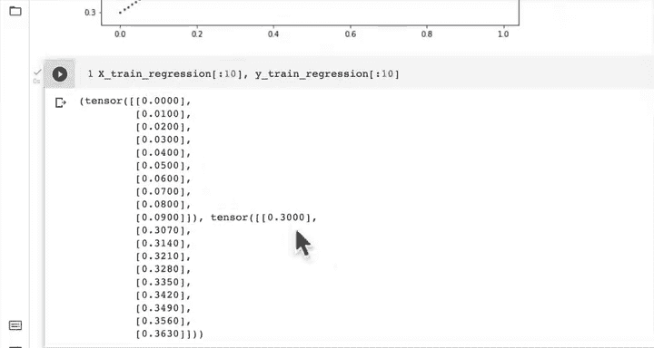

So what we're going to do is code up a little bit different version of Model 1。 So same architecture。

As Model 1。But using Nn dot sequential， we're going to do the faster way of coding a model here。

 Let's create model 2 and Nn dot sequential。 The only thing that's going to change is the number of input features。

 So this will be the exact same code as Model1。 and the only difference， as I said。

 will be features or in features is one and then we'll go out features equals 10。

 So 10 hidden units in the first layer。 And of course， the second layer。😊。

The number of features here has to line up with the out features of the previous layer。

 This one's going to output 10 features as well。 So we're scaling things up from one feature to 10 to try and give our model as much of a chance or as many parameters as possible。

 Of course， we could make this number quite large。 We could make it 1000 features if we want。

 But there is an upper bound on these things。 And I'm going to let you find those in your experience as a machine learning engineer and a data scientist。

 But for now， we're keeping it nice and small。 so we can run as many experiments as possible。

 beautifulut。 Look at that。 We've created a sequential model。

 What happens with N N dot sequential data goes in here， passes through this layer。

 Then it passes through this layer。 Then it passes through this layer and what happens when it goes through the layer。

 It triggers the layerss forwardd method， the internal forwardd method in the case of N dot linear we've seen it。

 It's got。😊。

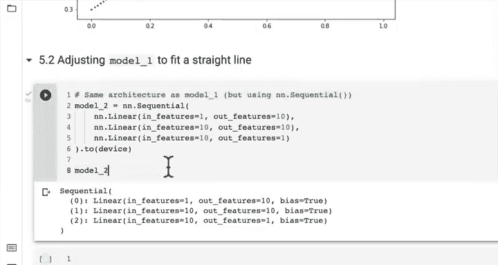

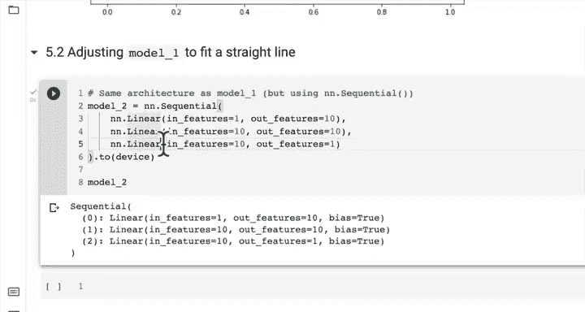

The linear regression formula。 So if we go Nn dot linear。

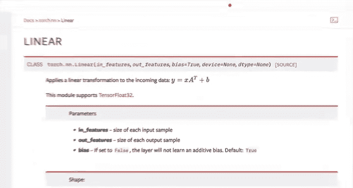

It performs this mathematical operation， the linear transformation。But we've seen that before。

 Let's keep pushing forward。 Let's create a loss， and an optimizer。Loss。And optimize。

 we're going to work through our workflow。 So loss function， we have to adjust this slightly。

 We're going to use the L1 loss because why we're dealing with a regression problem here rather than a classification problem。

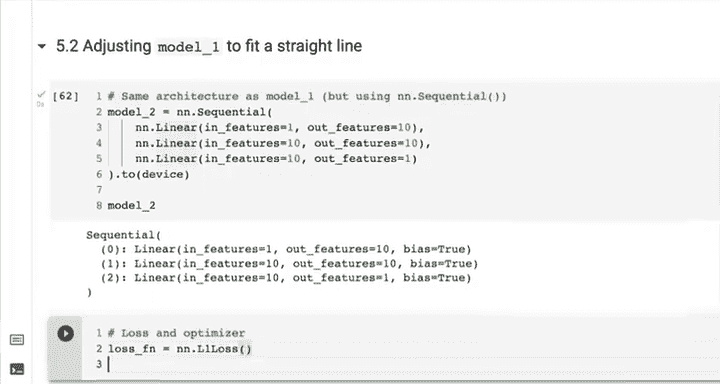

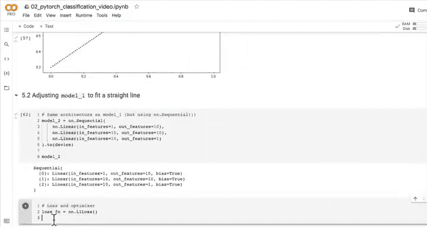

And our optimr， What could we use for our optr， How about we bring in just the exact same optr S GD that we've been using for our classification data。

 So model 2 dot parameters or parameters always get a little bit confused。

And we'll give it an L of 0。1， because that's what we've been using so far。

 This is the parameters here。 So we want to our optimizer to optimize our Model 2 parameters here with a learning rate of 0。

1。 The learning rate is what。

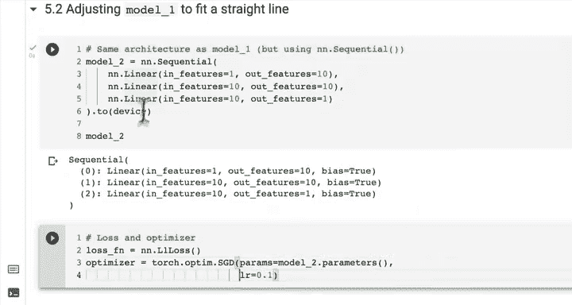

The amount each parameter will be or the multiplier that will be applied to each parameter。H epoch。

So now let's train the model。 Do you think we could do that。In this video， I think we can。

 So we might just train it on the training data set。

 and then we can evaluate it on the test data set separately。 So we'll set up both manual seeds。

 Coa and。Because we've set our model to the device up here。 so it should be on。

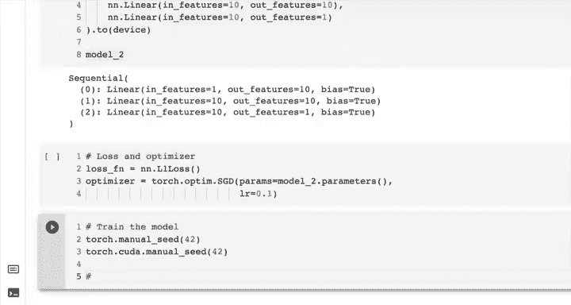

The GPU or whatever device you have active。😊，So you said the number of epochs。

 How many epochs should we set。Well， we said 100 before。 So we'll keep it at that。

 Epochx equals 1000。 And now we're getting really good at this sort of stuff here。

 Let's put our data。

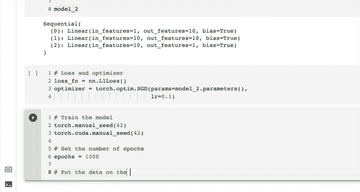

Put the data on the target device。

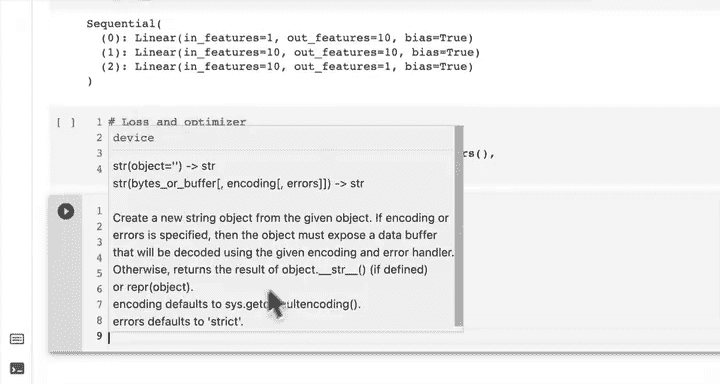

And I know we've done a lot of the similar steps before， but there's a reason for that。

 I've kept all these in here because I'd like you to by the end of this course is to sort of know all of this stuff off by heart。

 And even if you don't know it all off by heart because trust me， I don't， you know where to look。

So X train regression， we're going to send this to device。

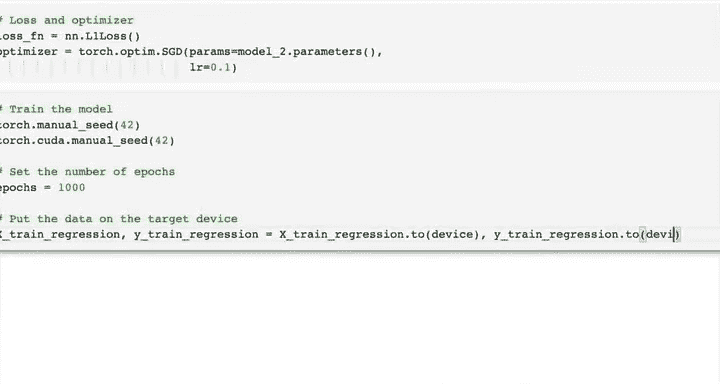

And then we're going to go why train regression， just a reminder or something to get you to think while we're writing this code。

What would happen if we didn't put our data on the same device as a model？

We've seen that arrow come up before。But what happens？Well， I've just kind of given away。

 haven't you Daniel， Wow， that was a great question。 Our code will there off。😊，Oh。Well don't worry。

 there's plenty of questions I've been given you that I haven't given the answer to you。

Device are beautiful。 We've got a device， agnostic code for the model and for the data。

 And now let's loop through epochs。 So train。😊。

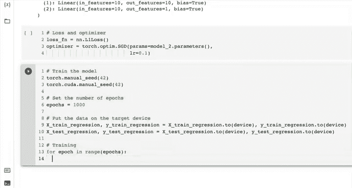

We're going for epoch in range epoch for an epoch in range。 do the forwardd pass。Calculate the last。

 So y pre equals model 2。This is the Ford pass。X train。Regression。

 it's all gonna to work out hunky Dory because our model and our data are on the same device。

 Los equals what We're going bring in our loss function。

 We're going compare the predictions to why train。Regression to the Y labels。 What do we do next。

 Optim a zero grad。

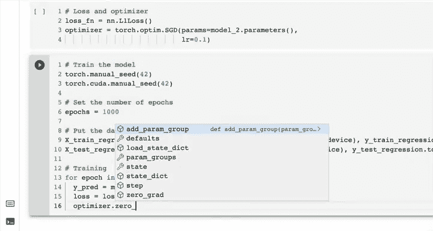

Optimizer dot 0 grad。 We're doing all of this without our comments。 Look at us go， Los backward。

 And what's next。 Optimr step， step， step。 And， of course， we could do some testing here。😊。

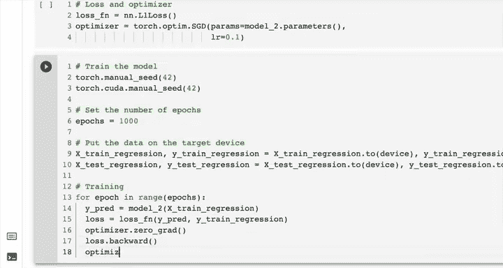

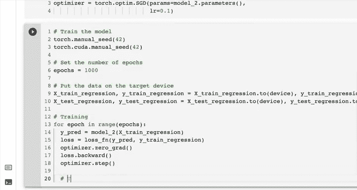

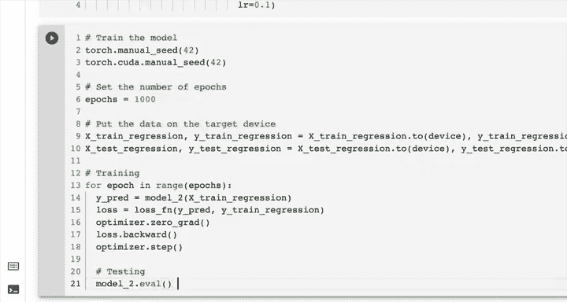

Testing， we'll go to Model2 dotval。

And then we'll go with Torch dot inference mode。

We'll do the forward pass。 We'll create the test predictions equals Model 2 dot X test regression。

And then we'll go the test loss equals。

Loss FN on the test predictions and versus the Y test labels。

Beautiful。Look at that。We've just done an optimization loop。

 something we've spent a whole hour on before， maybe even longer in about 10 lines of code。 And。

 of course， we could shorten this by making these a function。 But we're going to see that later on。

 I'd rather ask give a little bit of practice while this is still a bit fresh。😊。

Print out what's happening。

Let's print out what's happening， what should we do so because we're training for a thousand epochs。

 I like the idea of printing out something every100 epochs that should be about enough of a step。

Epoch， what do we got？We'll put in the Epo here with the F string， and then we'll call the loss。

 which will be loss。 And maybe we'll get the first5。Of those five decimal places， that is。

 we don't have an accuracy， do we。Because we're working with regression。

And we'll get the test loss out here。 And that's going to be 05 F as well。 beautiful。

 Have we got any mistakes， I don't think we do。 We didn't even run this code cell before。

 We'll just run these three again。 see if we got。😊。

Look at that， oh my goodness， is our loss， our loss is going down。😮。

So that means our model must be learning something。

Now， what if we adjusted the learning rate here， I think if we went 0。01 or something。

 will that do anything。Oh yes， look how low our loss gets on the test data set。

 but let's confirm that we've got to make some predictions。😊。

Or maybe we should do that in the next video。 Yeah， this one's getting too long。

 but how good is that， we created a straight line data set and we've created a model to fit it。

 we set up a loss in an optimizer already and we put the data on the target device we trained and we tested so our model must be learning something。

 but I'd like you to give a shot at confirming that by using our plot predictions function So make some predictions with our trained model don't forget to turn on inference mode and we should see some red dots here fairly close to the green dots on the next plot。

😊。

Give that a shot， and I'll see you in the next video。

