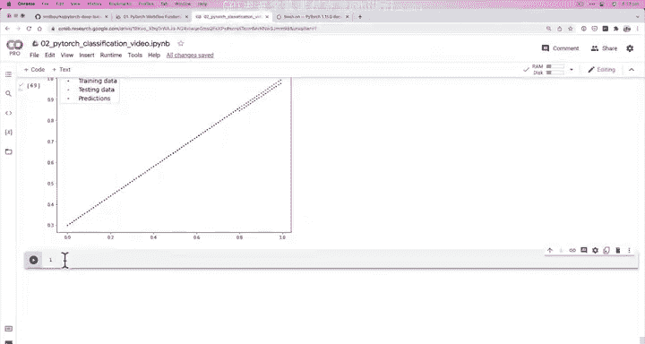

# mrdbourke《一天学会pytorch深度学习｜Learn PyTorch for deep learning in a day Literally》中英 - P55：78. Evaluating our models predictions.zh_en - GPT中英字幕课程资源 - BV1kx4y1r79d

Welcome back。 In the last video， we did something very exciting。

 We solved a smaller problem that's giving us a hint towards our larger problem。

 So we know that the model that we've previously been building。

 Model 2 has the capacity to learn something。 Now， how did we know that？ Well。

 it's because we created this straight line data set。

 we replicated the architecture that we used for Model 1。

 recall that Model 1 didn't work very well on our classification data。

 but with a little bit of an adjustment， such as changing the number of in features。

 and not too much different training code， except for a different loss function， because。😊，Well。

 we use MAE loss with regression data。And we changed the learning rate slightly because we found that maybe our model could learn a bit better。

 And again， I'd encourage you to play around with different values of the learning rate。 In fact。

 anything that we've changed， try and change it yourself and just see what happens。

 That's one of the best ways to learn what goes on with machine learning models。

 But we trained for the same number of epochs。 We set up device agnostic code。

 we did a training and testing loop。 go what this looks。 Oh my goodness。 Well done。

 And our loss went down。 So what does that tell us what it tells us that model2 or this specific architecture has some capacity to learn something。

 So we must be missing something。 And we're gonna get to that in a minute， I promise you。😊。

But we're just going to confirm that our model has learned something。

 and it's not just numbers on a page going down by getting visual。 So turn on。

 we're going make some predictions and plot them。 And you may have already done this because I issued that challenge at the last of at the end of the last video。

 So turn on evaluation mode。 Let's go Model 2 dot aval。And let's make predictions。

 which are also known as inference。And we're going to go with tarch dot inference mode。

Inference mode。With Torch startt inference mode。Make some predictions。

 We're going to save them as Y pres， and we're going to use Model 2。

 and we're going to pass it through X test regression。

 This should all work because we've set up device agnostic code， plot data and predictions。

To do this， we can， of course， use our plot predictions function that we imported via our helpber functions dot pi function。

 The code for that is just a few cells above。 if you'd like to check that out。😊。

But let's set up the train data here。Train data parameter， which is X train regression。And。

My goodness。Good co lab。I'm already typing fast enough。 You don't have to slow me down by。

Giving me the wrong auto corrects， train label equals Y train regression。

And then we're going to pass in our test data equals X test regression。

And then we're going to pass in test labels， which is why test regression。

 We've got too many variables going on here。 My goodness， gracious。

 We could have done better with naming。 But this will do for now， is why pres。

 And then if we plot this， what does it look like， Oh， no， we got an error。 Now， secretly。

 I kind' of knew that that was coming ahead of time。

 That's the advantage job been the host of this machine learning cooking show， So Ty Pera。

 how do we fix this。 Remember how I asked you in one of the last videos。

 what would happen if our data wasn't on the same device。😊，As our model。 well， wed get an error。

 right， But this is a little bit different as well。 We've seen this one before。

 We've got couda device type Tensor to numy。 Where is this coming from， Well。

 because our plot predictions function， uses mappllib and behind the scenes Mapotlib references nuy。

 which is another numerical computing library。 However， Numpy uses a CPU， rather than the GP。

 So we have to call dot CPU， This helpful message is telling us called tensor dot CPU before we use our tensors with Ny。

 So let's just call dot CPU on all of our tensor inputs here。 and see if this solves our problem。😊。

Wonderful， looks like it does。 Oh my goodness。 Look at those red dots So close。 Well， okay。

 so this just confirms our suspicions。 What we kind of already knew is that our model did have some capacity to learn。

 It's just the data set。 When we changed the data set， it worked， So。😊。

Is it our data that our model can't learn on？Like this circular data， or is the model itself。

 Remember， our model is only comprised of linear functions。 What is linear。

 Linear is a straight line， but is our data made of just straight lines。

I think it's got some non linearities in there。 So the big secret I've been holding back will reveal itself starting from the next video。

 So if you want a head start on it， I'd go to torch N N。😊，And if we have a look at the documentation。

 we've been speaking a lot about linear functions。 What are these。Nonline activations。

 And I'll give you another spoiler。 We've actually seen one of these nonlinear activations。😊。

Throughout this notebook。 So go and check that out， see what you can infer from that。

 And I'll see you in the next video。 Let's get started with。😊。

Nonlineities。