# mrdbourke《一天学会pytorch深度学习｜Learn PyTorch for deep learning in a day Literally》中英 - P56：79. The missing piece non-linearity.zh_en - GPT中英字幕课程资源 - BV1kx4y1r79d

Welcome back。 In the last video， we saw that the model that we've been building has some potential to learn。

 I mean， look at these predictions。 You could get a little bit better， of course。

 get the red dots on top of the green dots， but we're just going to leave that the trend is what we're after。

 Our model has some capacity to learn except this is straight line data and we've been hinting at it a fair bit is that we're using linear functions。

 And if we look up linear data。😊，What does it look like？Well， it has a quite a straight line。

 If we go linear and just search linear。 What does this give us。 Linear means straight。

 There we go straight。 And then what happens if we search for non linear。

 I kind of hinted at this as well。 No nonlinear。 Oh， we get some curves。 We get curved lines。

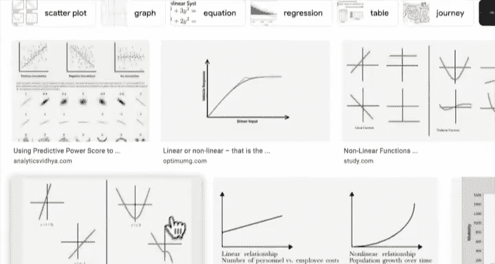

So linear functions， straight， non linear functions。Now。

 this is one of the beautiful things about machine learning and I'm not sure about you。

 but when I was in high school， I kind of learned a concept called line of best fit or y equals M X plus C or y equals M X plus B and it looks something like this。

 And then if you wanted to go over these， you use quadratic functions and a whole bunch of other stuff。

😊，But one of the most most fundamental things about machine learning is that we build neural networks and deep down neural networks are just a combination。

 It could be a large combination of linear functions and nonlinear functions。

 So that's why in Torch do N N， we have nonlinear activations and we have all these other different types of layers。

 but essentially what they're doing deep down is combining straight lines with if we go back up to our data。

😊。

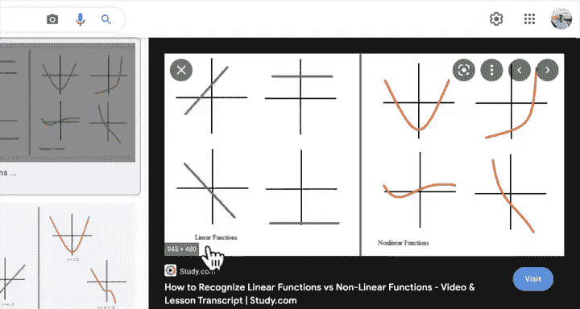

Non straight lines。 So， of course， our model didn't work before。

 because we've only given it the power to use linear lines。

 We've only given it the power to use straight lines。 But our data is what It's curved。

 although it's simple， we need non linearity to be able to model this data set。 And now。

 let's say we are building a pizza detection model。 So let's look up some images of pizza。

 one of my favorite foods images。😊，Pizza， right？ So could you model pizza with just straight lines。

 Are you're thinking Daniel， you can't be serious。 A computer vision model doesn't look for just straight lines in this。

 And I'd argue that， yes， it does， except we also add some curved lines in here。

 That's the beauty of machine learning。 Could you imagine trying to write the rules of an algorithm to detect that this is a pizza。

 maybe you could put in， oh， it's a curve here。 And if you see red and no， no， no， no no。

 imagine if you' trying to do 100 different foods。 your program would get really large。 Instead。

 we give our machine learning models if we come down to the model that we created。

 We give our deep learning models。 The capacity to use linear。 andline functions。

 We haven't seen any nonlinear layers just yet。 or maybe we've hinted at some。 but that's all right。

 So we stack these on top of each other， these layers。 And then the model figures out。

 what patterns in the data it should use what lines it to draw to draw patterns through。

 not only pizza。 but another foods such as sushi。😊。

If we wanted to build a food image classification model， it would do this。

 the principle remains the same。 So the question I'm going to pose to you， we'll get out of this。Is。

We'll come down here。We've unlocked the missing piece， or we're about to。

 We're going to cover it over the next couple of videos。 the missing piece of our model。

And this is a big one。This is going to follow you throughout all of machine learning and deep learning。

 non linearity。 So the question here is。What patterns could you draw if you were given。An infinite。

Amount of straight and non straight lines。Or in machine learning terms。An infinite amount。

 But really， it's， but really。It。Is finite by infinite in machine learning terms。

 This is a technicality。 It could be a million parameters。 It could be。

 as we've got probably 100 parameters in our model。

 So just imagine a large amount of straight and not in straight lines， an infinite amount of。

Linear and non nonlinear functions。You could draw some pretty intricate patents， couldn't you。

 And that's what gives machine learning and especially neural networks the capacity to not only fit a straight line here。

 but to separate two different circles， but also to do crazy things like drive a self-driv car。😊。

Or at least power the vision system of a self driving car。

 of course after that you need some programming to plan what to actually do with what you see in an image。

😊，But we're getting ahead of ourselves here。 Let's now start diving into linearity。

 And the whole idea here is combining the power of linear and nonlinear functions。

Straight lines and non straight lines。 Our classification data is not comprised of just straight lines。

 It's circles。 So we need non linearity here。 So recreating non linear data， red and blue circles。

 We don't need to recreate this， but we're going to do it anyway for completeness。

So let's get a little bit of a practice， make and plot data。

 This is so that you can practice the use of non nonlinearity on your own。

 that plot Lib bit dot pi plot as Plt。 we're going to go a bit faster here because we've covered this code above。

 So import， make circles， which is going to recreate the exact same circle data set that we've created above number of samples we'll create1000 and we're going to create x and Y equals what make circles。

 pass it in number of samples beautiful。Coabab， please。

 I wonder if I can turn off auto correctrect on coabab。 I'm happy to just see all of my errors。😊。

In the flesh， they look at that。 but I't want that。I want noise like that。

 Maybe I'll do that in the next video。We're not going to spend time here looking around how to do it。

We can work that out on the fly later for now。 Well I'm too excited to share with you the power of nonlinearity。

 So here， X， we're just going plot what's going on。

 We've got two x features and we're going to color it with the flavor of Y because we're doing a binary classification。

 and we're going to use my one of my favorite C maps。

 which is colour map and we're going to go PLT dot C for C map and red。😊，Blue。What do we get？Okay。

 red， circle， blue circle。 Hey， is it the same color as what's above。I like this colour better。

Did we get that right up here。Oh my goodness。 look how much code we've written。 Yeah。

 I like the other blue。 I'm going to bring this down here。😊。

It's all about aesthetics and machine learning。 It's not just numbers on a page。 Daniel。

 how could you be so crasss。Let's go there。Okay， that's the better colour red and blue。 That's small。

 lively， isn't it， So now let's convert to train and test。

 and then we can start to build a model with non linearity。 Oh， this is so good。Okay， convert。

Data to tenses and then to train and test splits。 Nothing we haven't covered here before。So。

 import torch。But it never hurts to practice code， right。

 Import torch from S K learn dot model selection。Import。

Train test splitlin so that we can split our red and blue dots randomly。

And we're going to turn data into tensesors。And we'll go x equals torch from nuy。

 and we'll pass in X here。And then we'll change it into type torch dot float。 Why do we do this。

 Well， because。Oh my godness， auto correct。 It's getting the best of me here。

You watch it me live go this stuff and battle with auto correctr that's what this whole course is when I really teaching Pytorch am I just battling with Google Col Las auto correct？

😊，We are turning it into torch dot float with a type here because why Numpy's default。

 which is what makes circles users behind the scenes Numpy is actually used in a lot of other machine learning libraries。

 pandas built on Numpy Psychic learn does a lot of nuumpy Mapllibb Numpy that's just showing the what's the word is it ubiquitous ubiquity I'm not sure maybe if not you can correct me the ubiquity of Numpy and it test sets。

 but we're using Py torch to leverage the power of autograd。

 which is what powers our gradient descent and the fact that it can use GPUs。

So we're creating train and test splits here with train test split。X， y。

And we're going to go test size equals 0。2。 and we're going to set random。Random state equals 42。

 And then we'll view our first。5 samples， are these going to be。Tensors， fingers crossed。

 We have got an era。 beautiful。 We have tensesors here。 Okay， now we're up to the exciting part。

 We've got our data set back。😊，I think it's time to build a model with linearity。

 So if you'd like to peek ahead， check out torch and N again。 This is a little bit of a spoiler。

 Go into the nonlinear activations。 See if you can find the one that we've already used。

 That's your challenge。Can you find the one we've already used and go into here and search what is a linear function？

So give that a go and see what comes up。I'll see you in the next video。

Welcome back Now put your hand up if you're ready to learn about non linearity。😡。

And I know I can't see your hands up， but I better see some hands up or I better feel some hands up because my hands up because non linearity is a magic piece of the puzzle that we're about to learn about。

 So let's title this section，Build a model with non linearity。😊，So just to reemphasse。

 linear equals straight lines。And。In turn， nonlinear。Equals non straight。Lines。

And I left off the end of the last video giving you the challenge of checking out the torch dot Nn module。

 looking for the nonlinear function that we've already used。 Now。

 where would you go to find such a thing and oh what are we have in here， No nonlinear activations。

 And there's going to be a fair few things here， But essentially all of the modules within torch do N。

 either some form of layer in a neural network if we recall let's go to a neural network we've seen the anatomy of a neural network。

Generally， you'll have an input layer and then multiple hidden layers and some form of output layer。

 Well， these multiple hidden layers can be almost any combination of what's in torch do M。

 and in fact， they can almost be any combination of function you could imagine。

 whether they work or not。Is another question。 But Pytorch implements some of the most common layers that you would have as hidden layers。

 and they might be pooling layers， padding layers， activation functions。

 and they all have the same premise。 They perform some sort of mathematical operation on an input。

And so if we look into the non linear activation functions， you might have find an then dot sigmoid。

 Where have we used this before， There's a sigmoid activation function in math terminology and takes some input X performs this operation on it。

 And here's what it looks like if we did it on a straight line， but。😊。

I think we should put this in practice。 And if you want an example， well， there's an example there。

 All of the other nonlinear activations have examples as well。

 but I'll let you go through all of these in your own time。 otherwise we're going to be here forever。

 and N dot Relu is another common function， we saw that when we looked at the architecture of a classification network So with that being said。

 how about we start to code a classification model with non nonlineararity。 And of course。

 if you wanted to， you could look up what is alinear function。😊。

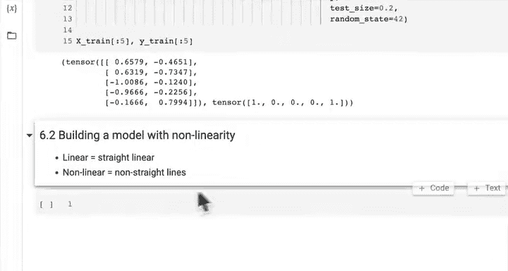

If you wanted to learn more， nonlinear means the graph is not a straight line。 Oh， beautiful。

 So that's how I'd learn about nonlinear functions。 But while we're here together。

 how about we write some code。😊，So let's go build a model with non linear。Actiation。Functions。

 and just one more thing before， just to reemphase what we're doing here。 before we write this code。

 I've got， I just remembered， I've got a nice slide。

 which is the question we posed in the previous video， the missing piece， non linearity。

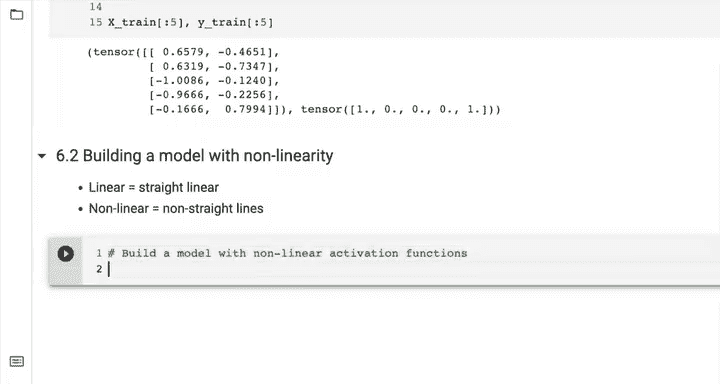

But the question I want you to think about is what could you draw if you had an unlimited amount of straight？

In other words， linear and non straight non nonlinear lines。

 So we've seen previously that we can build a model。

 a linear model to fit some data that's in a straight line。 Line data。

 But when we're working with nonlinear data。 Well， we need the power of nonlinear functions。

 So this is circular data。 And now this is only a 2D plot keep in mind there。

 whereas neural networks and machine learning models can work with numbers that are in hundreds of dimensions。

 impossible for us， humans to visualize。 But since computers love numbers。

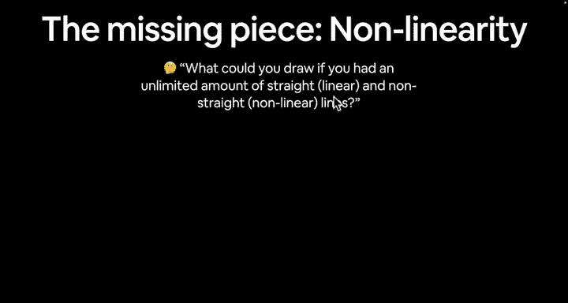

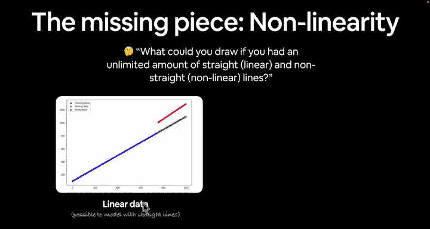

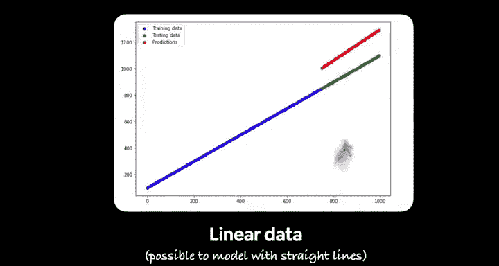

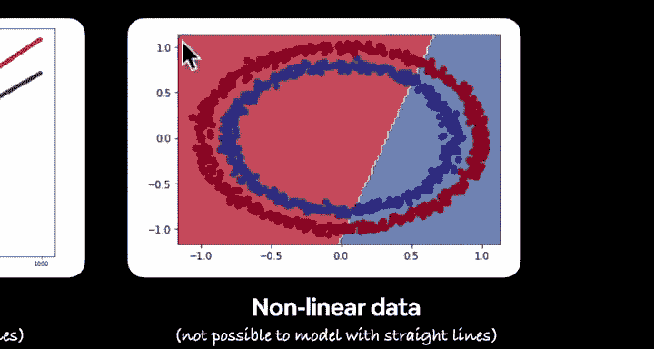

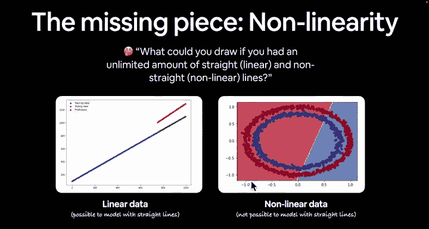

It's a piece of cake to them， so。From torch import N N。

 we're going to create our first neural network with nonlinear activations。 This is so exciting。

 So let's create a class here。 We'll create circle model。 We've got circle model V1 already。

 We're going to create circle model V 2。😊，And we'll inherit from an end dot module。

 and then we'll write the constructor， which is the init function， and we'll pass in self here。

And then we'll go self or super sorry， too many S words， dot underscore， underscore and knit。

 underscore。 there we go。 So we've got the constructor here。

 And now let's create a layer1 self dot layer1 equals just the same as what we've used before。

 and then dot linear。We're going to create this quite similar to the model that we've built before。

 except with one added feature。And we're going to create in features。

 which is akin to the number of X features that we have here。 again。

 if this was different if we had three x features， we might change this to three。

 but because we're working with two， we'll leave it as that。

 We'll keep out features as 10 so that we have 10 hidden units。And then we'll go layer 2。

 and then dot linear。 again， these values here are very customizable because why。

 Because they're higher parameters。 So let's line up the out features of layer 2。

 and we'll do the same with layer 3。Because layer 3 is going to take the outputs of layer 2。

 So it needs in features of 10， and we want out layer 3 to be the output layer。

 and we want one number as output。 So we'll set one here。 Now， here's the fun part。

 We're going to introduce a non linear function。 We're going introduce the Reou function。

 Now we've seen sigmoid。 Re is another very common one。 It's actually quite simple。

 But let's write it out first。 and then dot relu。😊，So， remember。

Torch do N N stores a lot of existing nonlinearar activation functions so that we don't necessarily have to code them ourselves。

 However， if we did want to code a relu function， let me show you it's actually quite simple。

 If we dive into N N do re or Relu， however， you want to say it。

 I usually say Reello applies the rectified linear unit function element wise。

 So that means element wise on every element in our input tensor。

 And so it stands for rectified linear unit。 And here's what it does。 Basically it takes an input。

 If the input is negative it。Turns the input to0， and it leaves the positive inputs how they are。

 And so this line is not straight。Now you could argue， yeah， well。

 it's straight here and then straight there。 But this is a form of a non nonlinear activation function。

 So it goes boom， if it was linear， it would just stay straight there like that。

 But let's see it in practice。 Do you think this is going to improve our model， Well。

 let's find out together。 Ford， we need to implement the forwardd method。

And here's what we're going to do。 Where should we put。Where should。

We put our nonlinear activation functions。So I'm just going to put a node here。

Reello is a non nonlinear。Actation function。And remember， wherever I say function。

 it's just performing some sort of operation on a numerical input。

 So we're going to put a nonlinear activation function in between each of our layers。

 So let me show you what this looks like。 Se dot layer 3。😊，We're going to start from the outside in。

Self dot Reello， and then we're going to go self dot layer 2。

And then we're going to go self dot Reello。 And then there's a fair bit going on here。

 but nothing we can't handle layer 1。 And then here's the X。

 So what happens is our data goes into layer 1， performs a linear。Operation with N N dot linear。

 Then we pass the output of layer 1 to a re function。 So we。Whereas Ra up here。

 we turn all of the negative outputs of our model of our of layer 1 to 0。

 and we keep the positives how they are。And then we do the same here with layer 2。And then finally。

 the outputs of layer 3 stay as they are。 We've got out features there。

 We don't have a re on the end here because we're going to pass the outputs to the sigmoid function later on。

 And if we really wanted to， we could put self dot sigmoid here。😊，Its Nn dot sigmine。

But I'm going to， that's just one way of constructing it。

We're just going to apply the sigmoid function to the logits of our model because what are the logits。

 the raw output of our model？And so let's instantiate our model， this is going to be called Model 3。

 which is a little bit confusing， but we're up to Model 3， which is circle model V2。

 and we're going to send that to the target device。And then let's check Model 3。

 What does this look like？Wonderful， so it doesn't actually show us where the res appear。

 but it just shows us what are the parameters of our circle model V2 now。😊。

I'd like you to have a think about this， and my challenge to you is to go ahead and see if this model is capable of working on our data。

 on our circular data。😊，So we've got the data sets ready， you need to set up some training code。😊。

My challenge to you is write that training code and see if this model works。

 But we're going to go through that over the next few videos。

 And also my other challenge to you is to go to the Tensorflow playground and recreate our neural network here。

 You can have two hidden layers。 Does this go to 10。

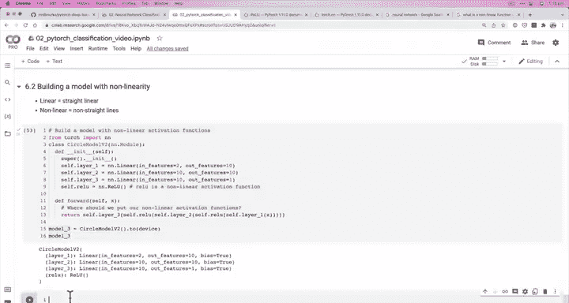

Well it only goes to 8。 Well'll keep this at 5。So build something like this。

 So we've got two layers with five。 It's a little bit different to ours because we've got two layers with 10 and then put the learning rate to 0。

01。 or what do we have，0。1 with stochastic gradient descent。

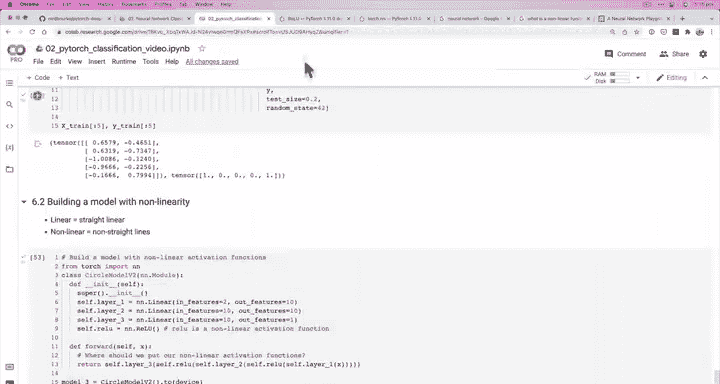

We've been using 0。1， so we'll leave that。 So this is the Tensorflow playground and then change the activation here。

Instead of linear， which we've used before， change it to Relu， which is what we're using。

And press play here and see what happens。I'll see you in the next video。Welcome back。

 In the last video I left off leaving the challenge of recreating this model here。

 It's not too difficult to do。 We've got two hidden layers and five neurons。 We've got our data set。

 which looks kind of like ours。 But the main points here。 I have to learning rate of 0。1。

 which is what we've been using， but to change it from， we've previously used a linear activation。

 to change it from linear to relu， which is what we've got set up here in the code。 Now。

 remember Reello is a popular and effective nonlinear activation function。

 And we've been discussing that we need nonlineararity to model nonlinear data。

 And so that's the crux or what neural networks are。

 Art neural networks not to get confused with the brain neural networks。

 But who knows this might be how they work too， I don't know。 I'm neurosurgeon or a neuroscientist。

 Art neural networks， are a large。😊。

Combination of linear。 So this is straight and non straight non linear。Functions。

Which are potentially able to find patterns in data。 And so for our data， it's quite small。

 It's just a blue and a red circle。 But this same principle applies for larger data sets and larger models。

 combined linear and nonlinear functions， So we've got a few tabs going on here。

 Let's get rid of some。 Let's come back to here。 Did you try this out， Does it work。

 Do you think it'll work。😊，I don't know。 Let's find out together。 Read，3，2，1。 Look at that。

Almost instantly， the training loss goes down to 0， and the test losses basically0 as well。

 Look at that。 That's amazing。 We can stop that there。 And if we change the learning rate。

 maybe a little lower， let's see what happens。😊，It takes a little bit longer to get to where it wants to go to。

 So that's the power of changing the learning rate。 Let's make it really small。 What happens here。

 So that was about 300 epochs。 The loss started to go down。If we change it to be really small， oh。

 we're getting a little bit of a trend。Is it starting to go down。

We're already surpass the epochs that we had。 So see how the learning rate is much smaller。

 That means our model is learning much slower。 So this is just a beautiful visual way of demonstrating different values of the learning rate。

😊，We could sit here all day and that might not get to lower， but let's increase it by 10 x。

And that was over  a thousand epochs， and it's still at about 0。5， let's say。Oh， we got a better。 Oh。

 we're going faster already。 So not even at。500 or so epochs， where about 0。4。

 That's the power of the learning rate will increase it by another 10 x。 or reset， start again。 Oh。

 would you look at that much faster this time， That is beautiful。

 There is nothing better than watching a loss curve go down。😊，In the world of machine learning。

 that is。 And then we reset that again。 and let's change it right back to what we had and we get to0 in basically under 100 epochs。

 So that's the power of the learning rate， little visual representation。 Spea of learning rates。

 It's time for us to build an optr。 and a loss function。 So let's right here。

 we've got our nonlinear model Set up loss and optimizer。

 you might have already done this because of the code This is code that we've written before。

 But we're going to redo it for completeness and practice。 So we want a loss function。

 We're working with logts here。 and we're working with binary cross entropy。

 So what loss do we use binary cross entropy。 Sorry。

 we're working with a binary classification problem， Blue dots or red dots torch dot optim。😊。

What are some other binary classification problems that you can think of？We want Model 3。

Dot parameters。 they're the parameters that we want to optimize this model here。

 and we're going to set our Lr to 0。1， just like we had in the Tensorflow playground。Beautiful。

 so some other binary。Classification poems I can think of would be email。

 spam or not spam credit cards。So， equals fraud。Or not fraud。

What else you might have insurance claims。Equals who's at fault or not at fault。

 If someone puts in a claim speaking about a car crash， whose fault was it。

 was the person submitting the claim， were they at fault or was the person who was also mentioned in the claim。

 Are they not at fault。 So there's many more。 but there' are just some I can think of off the top of my head。

 But now， let's train our model with non lineararity。Who。Oh， we're on a roll here。

Training a model with non linearity。 So we've seen that if we introduce a nonlinear activation function within a model。

 Remember， this is a linear activation function。 And if we train this。

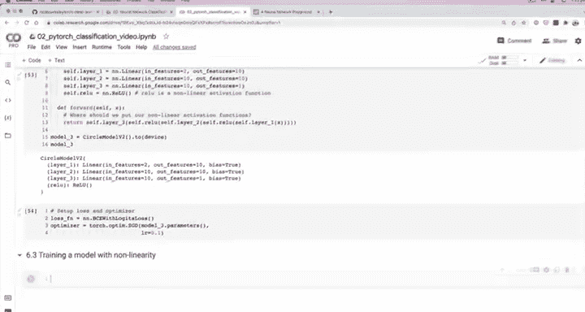

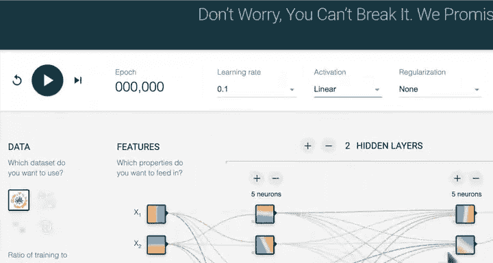

The loss doesn't go down， but if we just adjust this to add a reello in here。

We get the loss going down。 So hopefully this replicates with our pure Pi torch code。😊。

So let's do it hey， so we're going to create random seeds because we're working with Kuda we'll introduce the kuda random seed as well。

 Torch do manual seed again， don't worry too much if your numbers on your screen aren't exactly what mine are that's due to the inherent randomness of machine learning In fact。

 stochastic gradient descent stochastic again stands for random。

 or we're just setting up the seeds here so that they can be as close as possible。

 but the direction is more important。So if my loss goes down， your loss should also go down。

On target device。And then we're going to go X train。So this is setting up device agnostic code。

 we've done this before， but we're going to do it again for completeness just to practice every step of the puzzle。

 that's what we want to do。We want to have experience。 That's what this course is。

 It's a momentum builder so that when you go to other repos and machine learning projects that use Pytorrch。

 you can go， does this code set device， agnostic code。

What problem are we working on is it binary or multiclass classification。

 So let's go loop through data。Again， we've done this before， but we're going to set up the epochs。

 Let's do 1000 epochs。 Why not。So we can go for epoch in range epochs。 What do we do here。

 Well we want to train。 So this is training code。 We set our model， model 3 dot train。

And I want you to start to think about how could we functionise this training code。

 We're going to start to move towards that in a future video。 So one is Ford pass。

 We've got the logits。 Why the logitts， Well， because the raw output of our model without any activation functions towards the final layer。

Classified as Loitts or called Loitts， and then we create wide pre as in prediction labels by rounding the output。

Of torch dot sigmoid of the Loits。So this is going to take us from logits to prediction。

Probabilities to prediction。Labels。And then we can go two， which is calculate the loss。

That's from my unofficial pie torch song。 Calulate the last。YouGo loss equals loss FN Y logits。

 because remember。We've got B CE with Loits loss， and takes in。Loits as first input。

 And that's going to calculate the loss between our models， Loits and the Y training labels。

And we will go here。 We'll calculate accuracy using our accuracy function。

 And this one is a little bit backwards compared to pitorrch。

 But we pass in the Y training labels first。 But it's constructed this way because it's in the same style as psychic loan。

3， we go。😊，Optimizeizer 0 grad。 we zero the gradients of the optimizer。

So that it can start from fresh， calculating the ideal gradients every epoch。

So it's going to reset every epoch， which is fine。 Then we're going to perform back propagation。

 Pytor is going to take care of that for us by calling loss backwards。

 and then we will perform gradient descent。 So step the optimizer to see how we should improve our model parameters。

 So optimizer dot step。Oh， and I want to show you speaking of model parameters。

 let's check our Model 3 do state deck。So the ReLO activation function actually doesn't have any parameters。

So you'll notice here， we've got weight。 we've got bias of layer 1， layer 2 and a layer 3。

 So the Relu function here doesn't have any parameters to optimize if we go N， N dot Relu。

Does it say what it implements want the There we go。 So it's just the maximum of 0 or x。

 So it takes the input and takes the max of 0 or x。 And so when it takes the max of 0 or x。

 if it's a negative number。0 is going to be higher than a negative number。

 So that's why it zeros all of the negative inputs。

 And then it leaves the positive inputs how they are。

 because the max of a positive input versus 0 is。The positive input。

 So this has no parameters to optimize。 That's why it's so effective， because。You think about it。

 Every parameter in our model needs some little bit of computation to adjust。

 And so the more parameters we add to our model， the more compute that is required。 So generally。

 the kind of trade off in machine learning is that， yes， more parameters。

Have more of an ability to learn， but you need more compute。 So let's go Model 3 dot aval。

 And we're going to go with torch dot inference mode if I could spell inference that'd be fantastic。

 We're going to do what we're going to do the forwardd pass。

 So test logits equals model 3 on the test data。 And then we're going to calculate the test pre labels。

 by calling torch dot round on torch do sigmoid on the test logitts。

And then we can calculate the test loss。 How do we do that equals loss F N on。

Test logits versus Y test。And then we can also calculate the test accuracy。

I'm just going to give myself some more space here。So I can code in the middle of this screen。

Equals accuracy function on what we're going to pass in Y true equals Y test。

And then we will pass in why pre equals test pre。 beautiful。

 A final step here is to print out what's happening。 Now， this will be very important because。1。

 it's fun to know what your model is doing。 And two， if our model does actually learn。

 I'd like to see the loss values go down and the accuracy values go up。 As I said。

 there's nothing much more beautiful in the world of machine learning than watching a loss function go down or a loss value go down and watching a loss curve go down。

 So let's print out the current epoch。 and we'll print out the loss。

 which will just be the training loss。 and we'll take that to four decimal places。😊。

And then we'll go accuracy here and this will be A and we'll take this to two decimal places and we'll put a little percentage sign there and then we'll break it up by putting in the test loss here。

And we'll put in the test loss。Because remember， our model learns patterns on the training data and then evaluates those patterns on the test data set。

So and we'll pass in test act here。 And no doubt there might be an error or two within all of this code。

 but we're going to try and run this because we've seen this code before， but I think we're ready。

 We're training our first model here with non linearities built into the model。😊，You ready，3，2，1。

 let's go。Well， of course。Module torch Kuda has no attribute Mans R， just a typo standard man U L。

There we go。 Had to sound that out。 Another one。 What do we get wrong here。 Oh。

 target size must be same as input size。 Where did it mess up here。What do we get wrong， test loss。

 testlogits on why test。嗯。So these two aren't matching up。Model 3 X test。And why test。

 what's the size of。So let's do some troubleshooting on the fly。 Hey。

 not everything always works out as you want。 So length of X test， we've got a shape issue here。

 remember how I said one of the most common issues in deep learning is a shape issue。

 So I've got the same shape here。Let's check test Los dot shape and why test dot shape。

We'll print this out。So 200， oh， here's what we have to do。 with that's what we missed dot squeeze。

 see how I've been hinting at the fact that we needed to call dot squeeze。

 So this is where the discrepancy is。 Our test loadits dotch shape。

 We've got an extra dimension here。 And what are we getting here。 A value error on the target size。

 which is a shape mismat。 So we've got target size 200 must be the same input size as torch size 201。

 So did we squeeze this。 that's why the training worked。 Okay， so we've missed this。

 Let's just get rid of this。 So we're getting rid of the extra one dimension by using squeeze。

 which is the one dimension here。 We should have everything lined up。 There we go。 Okay。

 Look at that。😊，Yes。Our accuracy has gone up， albeit， not by too much。 It's still not perfect。 Ily。

 we'd like this to be towards 100 per cent and loss to be lower。

 but I feel like we've got a better performing model， don't you， Now。

 that is the power of non linearity。 All we did was we addeded in a Reello layer or just two of them。

 Relu here， Relu here。 But what did we do。 We gave our model the power of straight lines， Oh。

 straight linear of straight lines and non straight lines， so。😊。

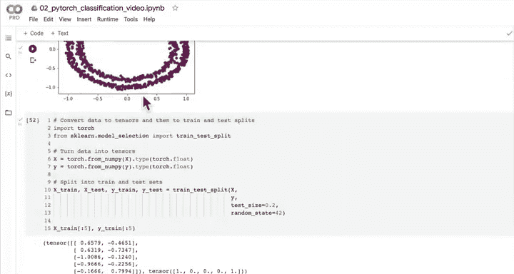

It can potentially draw a line to separate these circles。 So in the next video， let's draw a line。

 plot our model decision boundary using our function and see if it really did learn anything。😊。

I'll see you there。Welcome back。 In the last video， we trained our first model。 and as you can tell。

 we're the biggest smaller only face， But we trained our first model that harnesses both the power of straight lines and nons straight lines or linear functions and nonlinear functions。

 And by the thousand thepo， we look like we're getting a bit better results， than just pure guessing。

 which is 50% because we have 500 samples of red dots and 500 samples of blue dots。

 So we have evenly balanced classes。 Now， we've seen that if we added a relu activation function。😊。

With the data set similar to ours with a Tensorflow playground， the model starts to fit。

 but it doesn't work with just linear。 There's a few other activation functions that you could play around with here。

 You could play around with the learning rate， regularization。 If you're not sure what that is。

 I'll leave that as actually curriculum to look up。

 But we're gonna retire the Tensorflow playground for now。

 because we're gonna go back to writing code。 So let's get out of that and let's get out of that。

 we now have to evaluate our model because right now， it's just numbers on a page。

 So let's right down here。😊。

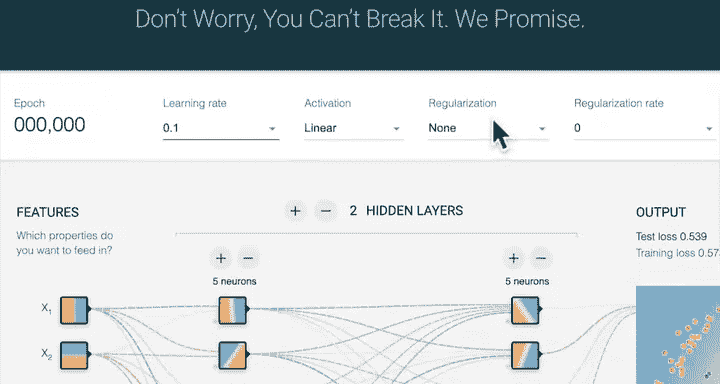

6。4， what do we like to do to evaluate things， It's visualize， visualize， visualize。

 So evaluating a model trained with non linear activation functions。

And we also discussed the point that neural networks are really just a big combination of linear and nonlinear functions。

 trying to draw patterns in data。 So with that being said。

 let's make some predictions with our model 3， our most recently trained model。

 We'll put it into a vowel mode， and then we'll set up inference mode。InP mode， beautiful。

 And then we'll go pres equals torch dot round。 and then torch dot sigmoid。

 We could functionize this。 Of course， Model 3。 and then pass in X test。 And you know what。

 we're gonna squeeze these here because we ran into some troubles in the previous video。

 I actually really liked that we did because then we got to troubleshoot a shape error on the fly。

 because that's one of the most common issues you're going to come across in deep learning。

 So y pres。😊，Let's check them out and then let's check out why test。 We want Y test 10。So remember。

 when we're evaluating predictions， we want them to be in the same format as our original labels。

 We want to compare apples to apples。 And if we compare the format here。

 do these two things look the same。 Yes， they do。 they're both on kuda and they're both floats。

 We can see that it's got this one wrong。 whereas the other ones look pretty good。

 This light look pretty good。 if we visualize it。 So now let's you might have already done this because I issue the challenge of plotting the decision boundaries。

😊，plt decision boundaries and let's go to PLT dot figure and we're going to set up the fig size to equal 126 because again。

 one of the advantages of hosting a machine learning cooking show is that you can code ahead of time and then we can go PLT dot title。

Is train。 And then we're going to call our plot decision boundary function， which we've seen before。

 plot decision boundary。 And we're going to pass this one in。 We could do Model 3。

 but we could also pass it in our older models  too。 Model 1。 That doesn't use an non nonlinearity。

 In fact， I reckon that'll be a great comparison。 So。😊。

We'll also create another plot here for the test data， And this will be on index number 2。

 So remember， subplot is。A number of rows， number of columns index where the plot appears。

 We'll give this one a title。Pite dot title。 this a big test， and。Google Coab， I didn't want that。

 As I said， this course is also a battle between me and Google Coabs auto correctr。

So we're going to model  three and we'll pass in the test data here。And behind the scenes。

 our plot decision boundary function will create a beautiful graphic for us。

 perform some predictions on the X， the features input。

 and then we'll compare them with the Y values。 Let's see what's going on here。😊，Look at that。 Yes。

 our first nonlinearn model。Okay， it's not perfect。

 but it is certainly much better than the models that we had before Look at this Model one has no linearity。

😊，Model 1 equals no non linearity。 I've got double negative there。Whereas。

Model 3 equals has non linearity。So do you see the power of non linearity or better yet the power of linearity or linear straight lines with non straight lines。

 So I feel like we could do better than this， though。Here's your challenge is to， can you improve。

Model 3 to do better。 What did we get。79% accuracy to do better than 80% accuracy。On the test data。

I think you can。So that's the challenge。 And if you're looking for hints on how to do so。

 where can you look。 Well， we've covered this improving a model。 So maybe you add some more layers。

 maybe you add more hidden units。 Maybe you fit for longer。 Maybe you if you add more layers。

 you put a radio activation function on top of those as well。

 Maybe you lower the learning rate because right now we've got 0。1。 So give this a shot。

 try and improve it， I think you can do it。But we're going to push forward。

 That's going to be your challenge for some extra curriculum。I think in the next section。

 we've seen our nonlinear activation functions in action。 Let's write some code to replicate them。😊。

I'll see you there。Welcome back in the last video or left off with the challenge of improving Model3 to do better than 80% accuracy on the test data。

 I hope you gave it a shot， but here are some of the things I would have done as I potentially add more layers and maybe increase the number of hidden units and then if we needed to fit for longer and maybe lower the learning rate to 0。

01， but I'll leave that for you to explore because that's the motto of the data scientist right。

 is to experiment experiment experiment。😊，So let's go in here。

We've seen our nonlinear activation functions in practice。 Let's replicate them。

 So replicating nonlinear activation functions。 And remember， neural networks。Rather than us。

Telling the model。What to learn？We give it the tools to discover patterns in data。And it。

Tries to figure out the best patterns on its own。And what are these tools？That's right down here。

 we've seen this in action。 and these tools are linear and non linear。Functions。

So a neural network is a big stack of linear and nonlinear functions for us。

 We've only got about four layers or so four or five layers， but as I said。

 other networks can get much larger， but the premise remains some form of linear and nonlinear manipulation of the data。

 So let's get out of this。 Let's make our workspace a little bit more cleaner。

Replicating nonlinear activation function。 So let's create a tensor to start with。

 Everything starts from the tensor。And we'll go A equals torch。A range。

 and we're going to create a range from negative 10 to 10 with a step of one。

 and we can set the D type here to equal torch。Dot floatat 32， but we don't actually need to。

 that's going to be the default。 So if we set a here， A dot D type。Then we've got torch F 32。

 And I'm pretty sure if we got rid of that。 Oh， we've got torch in 64。 Why is that happening， Well。

 let's check out a。Oh， it's because we've got integers as our values because we have a step as one。

 If we turn this into a float， what's going to happen。We get floatat 32， but we'll keep it。

 Otherwise， this is going to be one， about 100 numbers。 Yeah， no， there's too many。

 Let's keep it at negative 10 to 10， and we'll set the D type here to torch Fat 32。Beautiful。

 so it looks like Pytorrch's default data type for integers is N 64。

 but we're going to work with Float 32 because Float 32。

 if our data wasn't Float 32 with the functions we're about to create， we might run into some errors。

So let's visualize this data。I want you to guess， is this a straight line or non straight line？

You've got three seconds， one， two， three。Straight lawn。There we go。

 we've got negative 10 to positive 10 up here all nine close enough。😊。

And so how would we time this straight line， if it's a straight line， It's linear。

 How would we perform the relu activation function on this？ Now， we could， of course， call torch Reo。

On a。Actually， let's in fact just plot this PLT dot plot on Torch Reello。What does this look like。

Boom， there we go。 But we want to replicate the Reou function。 So let's go N N dot Reou。

What does it do。You've seen this before。So we need the max。 We need to return based on an input。

 We need the max of 0 and x。So let's give it a shot。我看不清啊。Again， we need more space。

 can never be enough codes phase here。I like riding lots of code。 I don't know about you。

 but let's go Reello。😊，We'll take an input X， which will be some form of tensor。

 and we'll go return torch dot maximum。 I think you could just do torch dot max。

 but we'll try maximum。A torch。Dot tensor0。 So the maximum is going to return the max between whatever this is。

 one option and whatever the other option is， so。Inputs must be tensesors。

So maybe we could just give a type hint here that this is torch dot Tensor。

And this should return a tensor to return torch dot tenor。Beautiful， you're ready to try it out。

 Let's see what our Re function does。😊，Ralu a wonderful。

 It looks like we got quite a similar output to before。 Here's our original a。😊。

So we've got negative numbers。 There we go。 So recall that the Reou activation function turns all negative numbers into 0 because it takes the maximum between 0 and the input。

 And if the input's negative， well then zero is bigger than it。

 And it leaves all of the positive values as they are。 So that's the beauty of Relu， quite simple。

 but very effective。😊，So let's plot Relu。Actiation function， our custom one。We will go plt。plot。

We'll call our reello function on a。Let's see what this looks like。Oh， look at us。 Go Well done。

 just the exact same as the torch Re function Eas as Z。

 And what's another nonlinear activation function that we've used before。😊，Well。

 I believe one of them is， if we go down to here， what did we say before。Sigmoid， where is that？

 Where are you， Sigmoid， Here we go。Hello， sigmoid， Oh， this has got a little bit more going on here。

 One over one plus exponential of negative x。 So sigmoid or this little symbol for sigmoid of X。

 which is an input。We get this， so let's try and replicate this。 I might just bring this one in here。

Right now let's do the same for sigmoid。So what do we have here？Well。

 we want to create a custom sigmoid， and we want to have some sort of input X。

 and we want to return one divided by。 Do we have the。The function in sigmoid。

1 divided by one plus exponential。1 plus torch dot EP for exponential on negative X。

 And we might put the bottom side in brackets so that it does that operation。

I reckon that looks all right to me。😊，So， one divided by one。Plus， torch exponential of negative X。

 Do we have that， Yes， we do。 Well， there's only one real way to find out。 Well。

 let's plot the torch version of sigmoid。Tauch dot sigmine， and we'll pass in X。See what happens。

 and then。Oh， we have a， my bad。 A is our tensor。 What do we get， We get a curved line wonderful。

 And then we go PLt dot plot。 And we're going to use our sigmoid function on a。😊。

Did we replicate torch' sigmoid function？ Yes， we did。 now。See。

 this is what's happening behind the scenes with our neural networks。 Of course。

 you could do more complicated。Actiation functions or layers。 And whatnot。

 And you can try to replicate them。 In fact， that's a great exercise to try and do。

 But we've essentially across the videos and the sections that we've done。

 we've replicated our linear layer。 and we've replicated the Re。

 So we've actually built this model from scratch。 or we could if we really wanted to。

 but it's a lot easier to use pitorrchs layers because we're building neural networks here like Lego bricks stacking together these layers in some way。

 shape or form。 And because they're a part of pitorrch。

 we know that they've been error tested and they compute as fast as possible behind the scenes and use GPU and get a whole bunch of benefits。

😊，Pytororch offers a lot of benefits by using these layers rather than writing them ourselves。

And so this is what our model is doing。 It's literally like to learn these values and decrease the loss function and increase the accuracy。

 It's combining。Linear layers and non nonlinear layers or nonlinear functions。

 Where's our reello function here， A reello function like this behind the scenes。

 So just combining linear and nonlinear functions to fit a data set and that premise remains。

 even on our small data set and on very large data sets and very large models。

So with that being said， I think it's time for us to push on。 We've covered a fair bit of code here。

But we've worked on a binary classification problem。

Have we worked on a multi class classification problem yet。

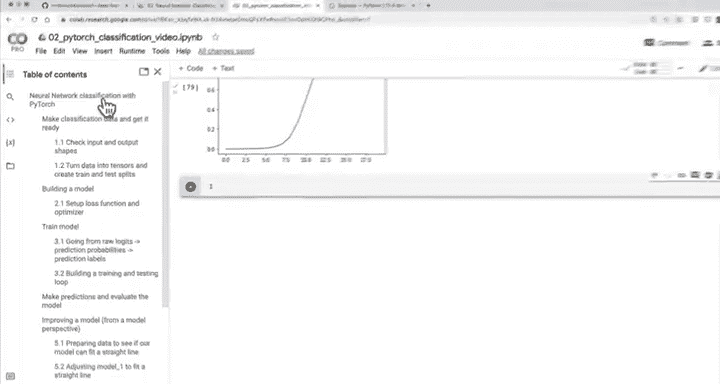

Do we have that here， Where my fun graphic。We have。Multi class classification。

 I think that's what we cover next。 We're going to put together all of the steps in our workflow that we've covered for binary classification。

 But now let's move on to a multi class classification problem。😊。

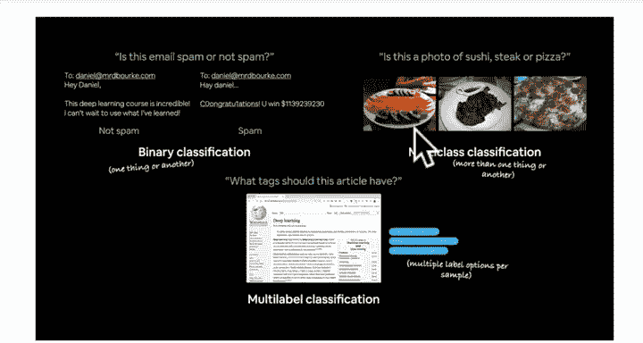

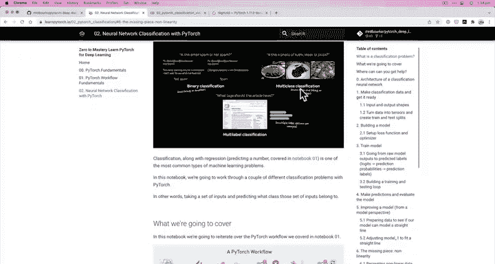

If you with me。I'll see you in the next video。

