# mrdbourke《一天学会pytorch深度学习｜Learn PyTorch for deep learning in a day Literally》中英 - P57：84. Putting it all together with a multiclass problem.zh_en - GPT中英字幕课程资源 - BV1kx4y1r79d

Welcome back in the last few videos we've been harnessing the power of non linearity。😊，Specifically。

 nons straightight line functions。 And we replicated some here。

 And we learned that a neural network combines linear and nonlinear functions to find patterns in data。

 And for our simple red verse blue dots。 once we added a little bit of nonlineararity。

 We found the secret source of to start separating our blue and red dots。

 And I also issued you the challenge to try and improve this。 And I think you can do it。

 So hopefully you've given that go。 But now let's keep pushing forward。

 we're going to reiterate over basically everything that we've done。

 except this time from the point of view of a multiclass classification problem。

 So I believe we're up to section 8， putting it all together。😊，With。

A multi class classification problem。 beautiful。 And recall the difference between binary classification equals one thing or another。

 such as cat verse dog。 If you are building a cat verse dog image classifier， spam versus。

 not spam for。😊，Say emails that were spam or not spam or even Internet posts on Facebook or Twitter or one of the other Internet services。

And then fraud or not fraud for credit card transactions。And then， multi class classification。

Is more than one thing or another。 So we could have cat versus dog versus chicken。

So I think we've got all the skills to do this。 Our architecture might be a little bit different for a multiclass classification problem。

 but we've got so many building blocks now。 it's not funny。 Let's clean up this。

 and we'll add some more code cells。 and just to reiterate。 So we've gone over nonlineararity。

 The question is， what could you draw if you had an unlimited amount of straight linear and nons straight nonlinear lines。

 I believe you could draw some pretty intricate patterns。

 And that is what our neural networks are doing behind the scenes。

 And so we also learned that if we wanted to just replicate some of these nonlinear functions。

 Some of the ones that we've used before， we could create a range。

 linear activation is just the line itself。 And then if we wanted to do sigmoid。😊。

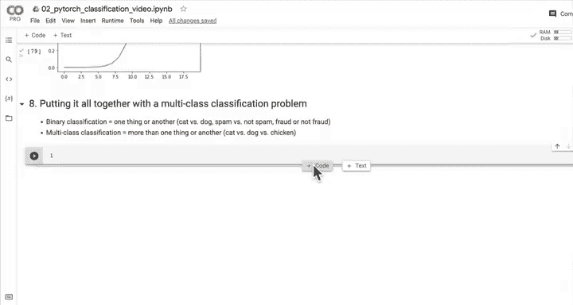

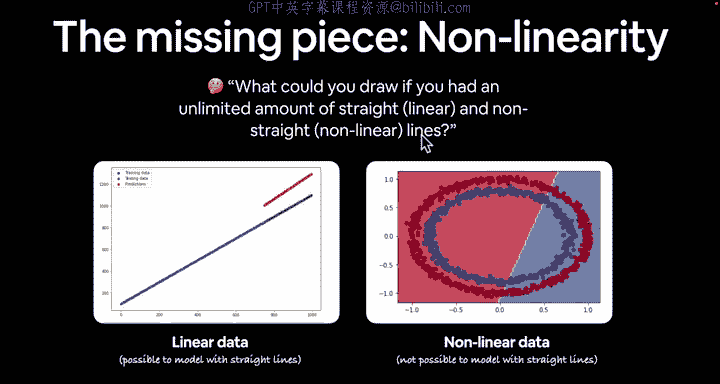

We get this curl here。And then if we wanted to do Reello。Well。

 we saw how do replicate the re function as one。 These both are nonlinear and， of course。

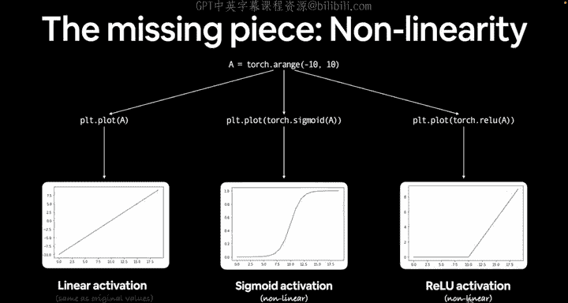

Torch dot N N has far more nonlinear activations where they came from just as it has far more different layers。

 And you'll get used to these with practice。 And that's what we're doing here。

 So let's go back to the keynote。 So this is what we're going to be working on。

 Multiclass classification。 So there's one of the big differences here。

 We use the soft max activation function versus sigmoid。 So's another big difference here。

 instead of binary cross entropy， We use just cross entropy。

 But I think most of it's going to stay the same。 We're going to see this in action in a second。

 But let's just describe our problem space。😊。

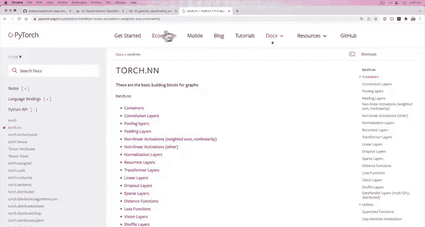

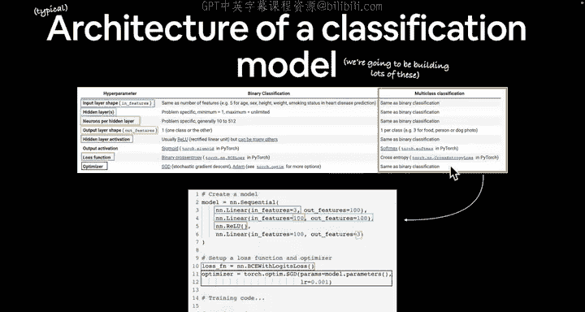

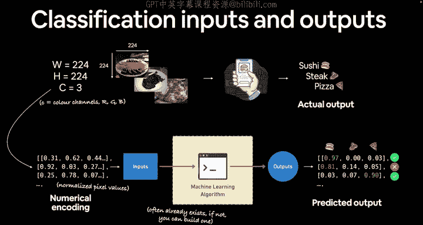

Just to go visual。We've covered a fair bit here。 Well done， everyone。

 So binary versus multiclass classification， binary， one thing or another，0 or one。

 multi class could be three things， could be 1000 things， could be 5000 things could be 25 things。

 So more than one thing or another。😊。

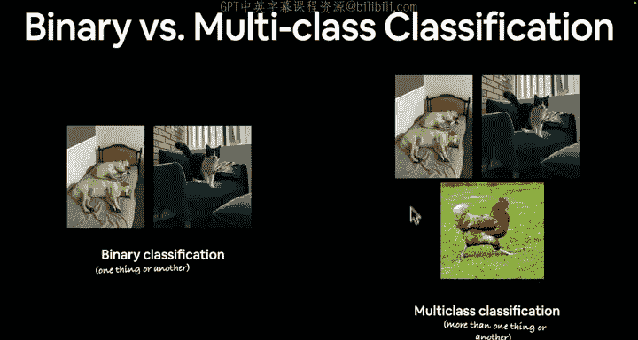

But that's the basic premise we're going to go with。 Let's create some data， hey。8。1。

Creating a 2 multiclass data set。And so to create our data set。

 we're going to import our dependencies。We're going to reimport torch even though we already have it just for a little bit of completeness and we're going to go mappllib。

So we can plot， as always， we like to get visual where we can visualize， visualize， visualize。

 We're going to import from pst learn dot data sets。 Let's get make blobs。 Now。

 where would I get this from。 So S K learn dot data sets。 What do we get。Toy data sets。

Do we have classification。Toy data sets， do we have blobs？If we just go make psyt learn。

Classification。Data sets。What do we get？Here's one option。There's also make blobs beautiful。

Make blobs。 This is the code for that。 So let's just copy this in here。And make blobs。

 we're going to see this in action anyway。 make blobs， as you might have guessed。

 it's make some blobs for us。I like blobs， it's a fun word to say blobs。😊。

So we want train test split because we want to make a data set。

 and then we want to split it into train and test。 Let's set the number of hyperpar。

 So set the hyper。For data creation Now I got these from the documentation here， number of samples。

 how many blobs do we want， how many features do we want， so say for example。

 we wanted two different classes that would be binary classification say for example you wanted 10 classes you could set this to 10 and we're going to see what the others are in practice。

 but if you want to read through them you can well and truly do that。So let's set up。

 We want numb classes。 Let's double what we've been working with。

 We've been working with two classes， red dots or blue dots。 Let's step it up a notch。

 We'll go to four classes。 watch out everyone。 And we're going to go number of features will be 2。

 So we have the same number of features。 and then the random seed is going to be 42。

 you might be wondering why these are capitalized。 Well。

 generally if we do have some hyperparameter that we say set at the start of a notebook。

You'll find it's quite common for people to write them as capital letters just to say that， hey。

 these are some settings that you can change。You don't have to。

 but I'm just going to introduce that anyway because you might stumble upon it yourself。

So create multi class data。 We're going to use the。Make blobs function here。

 so we're going to create some X blobs， some feature blobs and some label blobs。

 We'll see what these look like in a second。😊，I know I'm just saying blobs a lot。But we pass in here。

 none samples。 How many do we want， Let's create 100 as well。 That could really be a hyperpar。

 but we'll just leave that how it is for now。 numberumber of features is going to be nu features。

Centers equals numb。Classesses。So we're going to create four classes because we've set up number classes equal to 4。

 And then we're going to go centre standard deviation。

 We'll give them a little shake up add a little bit of。Randomness in here。Give the clusters。

A little shake up。We'll mix them up a bit， make it a bit hard for our model。

 but we'll see what this does in a second。Random state equals random seed。

 which is our favorite random seed 42。 Of course， you can set it whatever number you want。

 But I like 42。 when we need a comm here， of course。😊，Beautiful， now， what do we have to do here。

 Well， because we're using psyt loan and psycht loan leverages nuy。

 So let's turn our data into tenses。 turn data into tenses。

 And how do we do that while we grab Xblob。😊，And we call torch from Numpy from Nmy， if I could type。

 that would be fantastic。That's al right。 We're doing pretty well today。 Have't made too many typos。

 We did make a few and a couple videos before， but hey。I'm only human。

So we're go torch from Numppy and we're going to pass in the Y blob and we'll turn it into torch dot float because remember Numpy defaults as floatat 64。

 whereas P torch likes floatat 32。So， split into。Training and test。And。

We're going to create X blob train Y or X test。 X blob test。 We'll keep the blob namenclature here。

 Y blob train and Y blob test。 And here's again， where we're going to leverage the train test split function from p Psyit learn。

 So thank you for that psyte learn。X blob， and we're going to pass the Y blob。 So features， labels。

 X is the features， Y are the labels and a test size。 we've been using a test size of 20%。

 That means 80% of the data will be for the training data。

 That's a fair enough split with our data set。And we're going to set the random seed to random seed because generally。

 normally train test split is random， but because we want some reproducibility here。

 we're passing random seeds。Finally， we need to get visual， so let's plot the data right now。

 we've got a whole bunch of code and a whole bunch of talking， but not too much visuals going on。

 So right down here， visualize， visualize， visualize。😊，And we can call in plot dot figure。

 What size do we want， I'm going to use my favorite hand in poker， which is 10，7。

 because it's generally worked out to be a good plot size for in my experience anyway。

 We'll go X blob。And we want the zeroth index here， and then we'll grab Xblob as well。

 And you might notice that we're visualizing the whole data set here。 That's perfectly fine。

We could visualize train and test separately if we really wanted to。

 but I'll leave that as a little challenge to you and we're going to go red， yellow， blue。Wonderful。

What do we get wrong， Oh， Of course， we got something wrong。 Centre ST TD， did we spell centre wrong。

Cluster STD。 That's what I missed。So， cluster STD。Standard deviation。 What do we get wrong。

 Random seed。 Oh， this needs to be random state。 Oh， another typo。 You know what， just as I said。

 I wasn't getting too many typos I get three。 There we go。 Look at that。

 Our first multi class classification data set。 So if we set this to 0。

 what does it do to our clusters， just take note of what's going on here。

 particularly the space between all the dots。😊，Now， if we set this cluster STD to0， what happens？

We get dots that are really just look at that。 That's too easy。 Let's mix it up。 right。 All right。

 Now you can pick whatever value you want here。 I'm going to use 1。

5 because now we need to build a model that's going to draw some lines between these four colours。

 two axes， four different classes。😊，But it's not going to be perfect because we've got some red dots that are basically in the blue dots。

 And so what's our next step。 Well， we've got some data already。It's now time to build a model。

So I'll see in the next video， let's build our first multi class classification model。

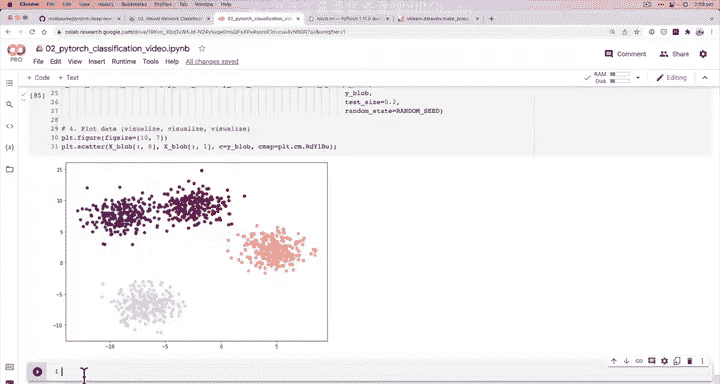

Welcome back。 In the last video， we created our multiclass classification data set using pschit Learns Make blobs function。

 And now， why are we doing this？ Well， because we're going to put all of what we've covered so far together。

 But instead of using binary classification or working with binary classification data。

 we're going to do it with multiclass classification data。 So with that being said。

 let's get into building our multiclass classification model。😊，So we'll create a little heading here。

Building a multi class。Classification model in Pytorrch。

And now I want you to have a think about this。We spent the last few videos covering non linearity。

 Does this data set need non nonlinearity， As in could we separate this data set with pure straight lines。

 or do we need some non straight lines as well。Have a think about that， It's okay。

 if you're not sure we're going to be building a model to fit this data anyway or draw patterns in this data anyway。

 And now before we get into coding a model。 So for multiclass classification。

 we've got this for the input layer shape， we need to define the input features。

 So how many in features do we have for the hidden layers well。

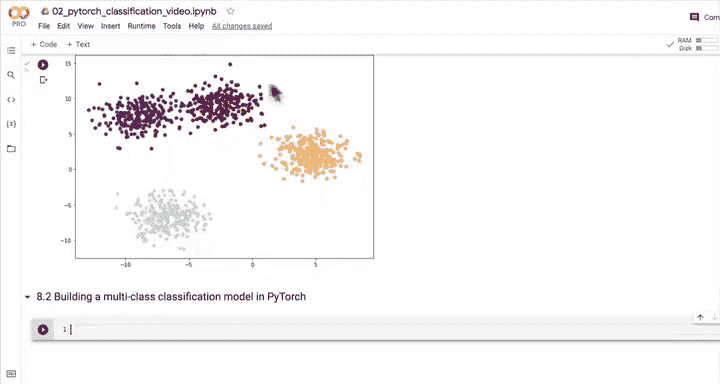

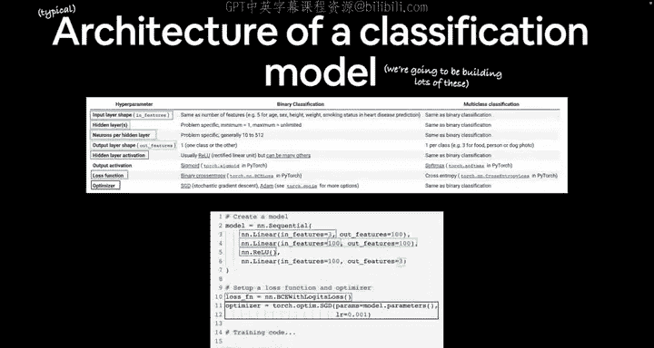

We could set this to whatever we want， but we're going to keep it nice and simple for now。

For the number of neurons per hidden layer。Again， this could be almost whatever we want。

 But because we're working with a relatively small data set， we've only got four different classes。

 We've only got 1000 data points。 We'll keep it small as well。 But you could change this。 Remember。

 you can change any of these because they're hyper parameters for the output layer shape。 Well。

 how many。Output features do we want？We need one per class。 How many classes do we have？

We have four clusters of different dots here， so we'll need。4 output features。

 And then if we go back， we have an output activation of softm。 We haven't seen that yet。

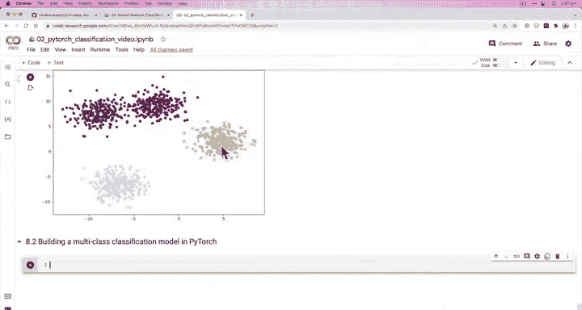

And then we have a loss function rather than binary cross entropy。 We have cross entropy。

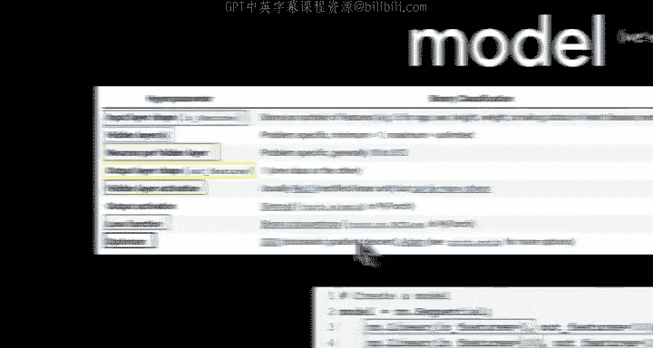

And then optimizer as well is the same as binary classification。

 two of the most common SGD stochastic gradient descent or the atom optimizer。 But of course。

 the Torch Opdm package has many different options as well。

 So let's push forward and create our first multiclass classification model。😊。

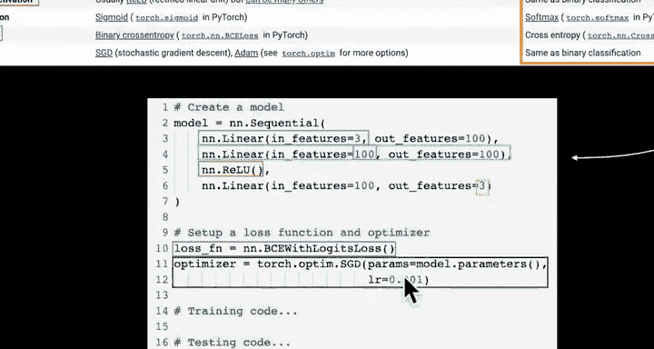

First we we going to create。Or we're going to get into the habit of creating device， agnostic code。

 and we'll set the device here。Equals kuda。Nothing we haven't seen before。But again。

 we're doing this to put it all together so that we have a lot of practice。Is available。Else， CPU。

And let's go device。So we should have a GPU available。 Beaful Kuda。 Now， of course， if you don't。

 you can go change runtime type， select GPU here。 That will restart the runtime。

 you'll have to run all of the code。 That's before this cell as well。

 but I'm going to be using a GPU。 You don't necessarily need one because our data sets's quite small and our models aren't going to be very large。

 but we set this up， So we have device agnostic code。

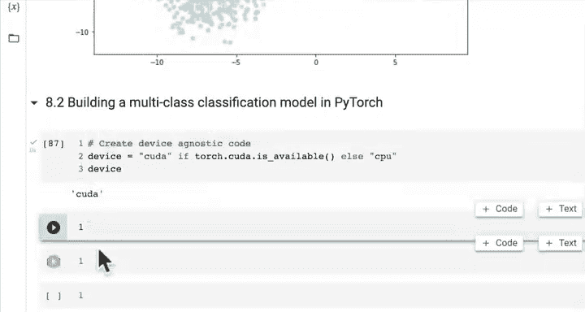

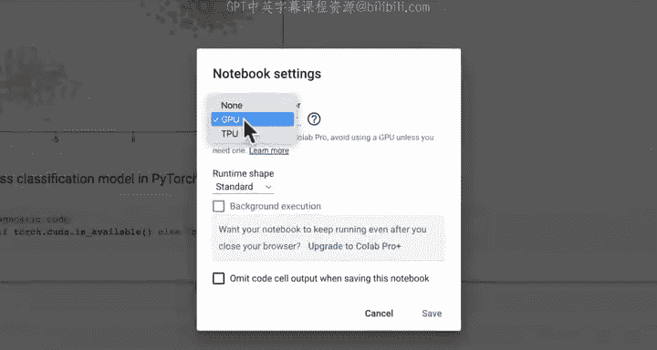

And so let's build a multi class classification model。 Look at us go。

 just covering all of the foundations of classification in general here and。😊。

We now know that we can combine linear and nonlinear functions to create。

Neural networks that can find patterns in almost any kind of data So I'm going to call my class here blogb model。

 and it's going to of course inherit from an end dot module。

 and we're going to upgrade our class here。 We're going to take some inputs here and I'll show you how to do this if you're familiar with Python classes you would have already done stuff like this。

 but we're going to set some parameters for our models because as you write more and more complex classes。

 you'll want to take inputs here and I'm going to pre build the or preset the hidden units parameter to8。

Because I've decided， you know what， I'm going to start off with eight hidden units and if I wanted to change this to 128。

 I could。😊，But in the constructor here， we've got some options。 So we have input features。

 We're going to set these programmatically as inputs to our class when we instantiate it。

 the same with output features as well。 And so here we're going to call self。I no， super。 sorry。

 I always get this mixed up Dot it。And underscore underscore， beautiful。

 so we could do a dock string here as well。😊，So let's write in this。Initializes。Multiclass。

Classification。If I could spell class eification model。Oh， this is great。

 And then we have some as here。😊，This is just a standard way of writing Dock strings。

 If you want to find out this is Google Python Docstring guide。

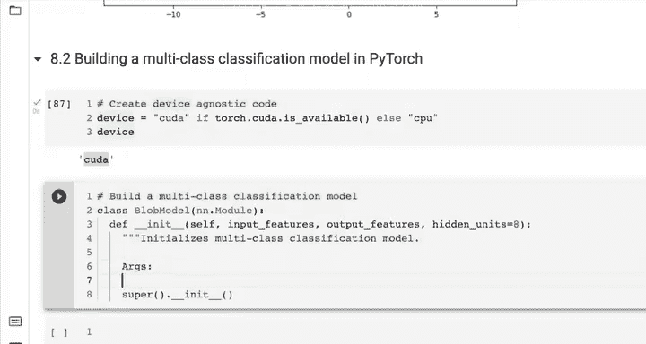

There we go。 Google Python style guide。 This is where I get mine from。 You can scroll through this。

 This is just a way to write Python code。 Yeah， there we go。

So we've got a little sentence saying what's going on。 We've got as。 We've got returns。

 and we've got errors if something is going on。So I highly recommend checking that out just a little Tdbit。

 so this is if someone was to use our class later on， they know what the input features are。😊。

Input features， which is an int， which is number。Of input features。To the model。 And then， of course。

 we've got output features， which is also an int。Which is number。Of output features of the model。

 And we've got the red line here is telling us we've got something wrong， but that's okay。

 And then the hidden features， are， well， this is number of output classes for the case of multi class classification。

And then the hidden units。Ent and then number of hidden units。

Between layers and then the default is8 beautiful。 and then under that， we'll just do that。

Is that gonna to fix itself。 Yeah， there we go。 We could put in what it returns。Returns。

 whatever it returns。 and then an example use case， but I'll leave that for you to fill out。

If you like， so let's instantiate some things here。

 What we might do is write self dot linear layer stack。Self dot linear layer stack。

 and we will set this as Nn dot sequential。 Oh， we haven't seen this before。

 but we're just going to look at a different way of writing a model here previously when we created a model。

 what did we do？Well， we instantiated each layer as its own。Prameter here。

And then we called on them one by one。 But we did it in a straightforward fashion。

 So that's why we're going to use sequential here to just step through our layers。

 We're not doing anything too fancy。 So we'll just set up a sequential stack of layers here and recall that sequential。

 just steps through， passes the data through each one of these layers1 by one。

 And because we've set up the parameters up here。 input features can equal to input features。

And output features。What is this going to be， Is this going to be output features or is this going to be hidden units。

 It's going to be hidden units because it's not the final layer。

 We want the final layer to output our output features。

So input features this will be hidden units because remember the subsequent layer needs to line up with the previous layer。

Output features we're going to create another one that outputs hidden units。

And then we'll go NN dot linear。In features。Equs hidden units because it takes the output features of the previous layer。

 So as you see here， the output features of this feeds into here。

 The output features of this feeds into here。 And then finally， this is going to be our final layer。

 We'll do three layers。Output features equals， output features。Wonderful。

 so how do we know the values of each of these？ Well。

 let's have a look at x train dot shape and Y train dot shape。So in the case of X。

 we have two input features and in the case of Y， well。

 this is a little confusing as well because y is a scalar。

But what do you think the values for Y are going to be。Well， let's go N。

 or is there torch not unique， I'm not sure。 Let's find out together， hey。

Toorch unique 0 on1 Y train。 Oh， we need why blob train。 That's right。 Blob。

 I'm too used to writing blog blob， and we need blob train， but I believe it's the same here。

And then， blob。There we go， so we have four。Classes， so we need an output features value of 4。

 And now， if we wanted to add non linearity here。We could put it in between our layers here like this。

But I asked the question before， do you think that this data set needs non linearity？Well。

 let's leave it in there to begin with。 And one of the challenges for you， Oh， do we need comm here。

 I think we need comm here。One of the challenges for you will be to test the model with non linearity and without non linearity。

 So let's just leave it in there for the time being what's missing from this。Well。

 we need a forward method。 So def For self X， what can we do here？ Well。

 because we've created this as a linear layer stack using Nn dot sequential， we can just go return。

 Linear layer stack。 and pass it X and what's going to happen。

 whatever input goes into the forwardd method is just going to go through these layers sequentially。

Oh， we need to put Sephia。Because we've initialized it in the constructor。 beautifulful。

 And now let's create an instance。Of blood model。And send it to the target device。

We'll go Model four equals。Blood model。And then we can use our input features parameter。

 which is this one here。 And we're going to pass it a value of what。2， and then output features。

 Y because we have two x features。 Now， the output features is going to be the same as the number of classes that we have for。

 if we had 10 classes， we'd set it to 10。 So we'll go 4 and then the hidden units is going to be 8 by default。

 So we don't have to put this here， but we're going to put it there anyway。And then， of course。

 we're going to send this to device。And。Then we're going to go model4。What do we get wrong here。

Unexpected。Keyword argument， output features。 Do we spell something wrong。

 No doubt we've got a spelling mistake。Output features。Output features。Oh， out features a。

That's what we needed。 out features， not。Output。I got a little confused there， okay。There we go。

 Okay， beautiful。 So just recall that the parameter here for an endt linear。

 Did you pick up on that is output features， not output features。 Out features。

 a little confusing here is our final layer。 output layers， number of features there。😊。

So we've now got a multiclass classification model that lines up with the data that we're using。

 So the shapes line up。 beautiful。 Well， what's next。 Well， we have to create a loss function and。

 of course， a training loop。 So I'll see you in the next few videos。 And let's do that together。😊。

Welcome back。 In the last video， we created our multiclass classification model。

 and we did so by subclassing an end do module， and we've set up a few parameters for our class constructor here。

 So that when we made an instance of the blog model， we could customize the input features。

 the output features。 Remember， this lines up with how many features X has。

 and the output features here lines up with how many classes are in our data。

 So if we had 10 classes， we could change this to 10。 and it would line up。

 And then if we wanted 128 hidden units， Well we could change that。

 So we're getting a little bit more programmatic with how we create models here。

 And as you'll see later on， a lot of the things that we've built in here can also be functionized in a similar matter。

 But let's keep pushing forward。 what's our next step。 If we built a model。

 if we refer to the workflow you'd see that we have to。😊。

Create a loss function and an optimizer for a multi class。Classification。Model。

And so what's our option here if for're creating a loss function。

 where do we find loss functions in Piytorrch， I'm just going to get out of this and I'll make a new tab here。

 And if we search torch。nn。😊，Because torch to an N is the basic building box for graphs。

 In other words， neural networks。 Where do we find loss functions。 Here we go， beautiful。

 So we've seen that L1 loss or MSE loss could be used for regression predicting a number。

 And I'm here to tell you as well that。😊，For classification。

 we're going to be looking at cross entropy loss。 Now， this is for multi class classification。

 for binary classification。 We work with B C E loss。 And， of course， there's a few more here。

 but I'm going to leave that as something that you can explore on your own。

 Let's jump in to cross entropy loss。😊，So what do we have here， this criterion computes。

 remember a loss function in pytorrch is also referred to as a criterion。

 you might also see loss function referred to as cost function， COST。But I call them loss functions。

 So this criterion computes the cross entropy loss between input and target。 Okay。

 so the input is something and the target is our target labels。

It is useful when training a classification problem with C classes。 There we go。

 So that's what we're doing。 Wherere training a classification problem with C classes C is a number of classes。

 If provided the optional argument， weight should be a 1 D tensor assigning a weight to each of the classes。

 So we don't have to apply a weight here， But why would you apply a weight。 Well。

 it says if we look out weight here。😊，This is particularly useful when you have an unbalanced training set。

 So just keep this in mind as you're going forward。

 if you wanted to train a data set that has imbalanced samples in our case we have the same number of samples for each class。

 but sometimes you might come across a data set with maybe you only have 10 yellow dots。

 and maybe you have 500 blue dots and only 100 red and 100 light blue dots。

 So you have an imbalanced data set。 So that's where you can come in have a look at the weight parameter here。

 But for now we're just going to keep things simple。

 we have a balanced data and we're going to focus on using this loss function。

 If you'd like to read more， please you can read on here， and if you wanted to find out more。

 you could go what is crossenttropy loss。And I'm sure you'll find a whole bunch of loss functions。

 There we go。 There's the ML cheat sheet。 I love that。 The ML glossssary。

 That's one of my favorite websites towards data science。 you'll find out website， Wikipedia。

 Machine learning mastery is also another fantastic website。

 but you can do that all in your own time。😊，Let's code together， hey？😊，We'll set up a loss function。

 Oh， and one more resource before we get into code is that we've got the architecture。

 Well the typical architecture of a classification model。

 the loss function for multi class classification is cross entropy or torch dot N N dot cross entropy loss。

 Let's code it out。 If in doubt， code it out。 So。😊。

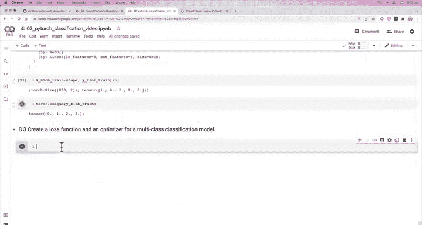

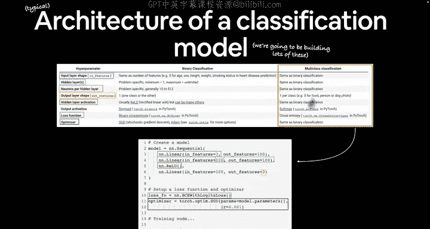

Create a loss function。For multi class classification。

And then we go loss Fn equals Nn dot cross entropy loss， beautiful。

 And then we want to create an optimizer。Create an optimizer。For multi class classification。AndNow。

 the beautiful thing about optimizers is they're quite flexible。

 They can go across a wide range of different problems。 So the optimizer。 So two of the most common。

 And I say most common because they work quite well across a wide range of problems。

 So that's why I've only listed two here。 But， of course， within the torch dot optim module。

 You will find a lot more different optimizers。 But let's stick with S GD for now。 And we'll go back。

 We'll go。😊。

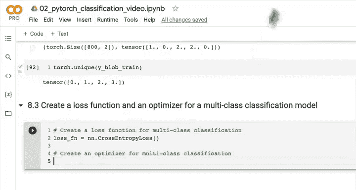

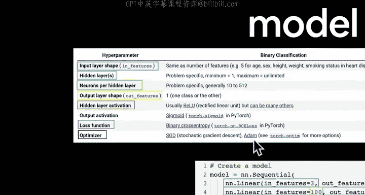

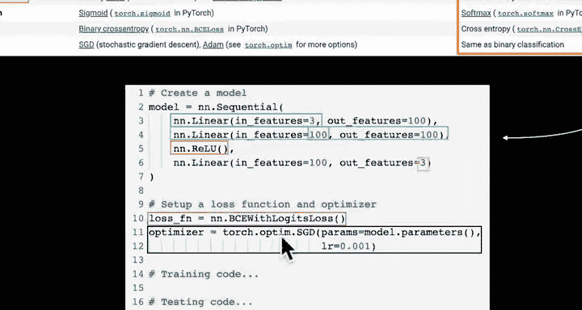

Optimizer equals torch dot Opim for Opr， S G D for stochastic gradient descent。

 The parameters we want our optimizer to optimize Model 4。 We're up to our fourth model already。

 Oh my goodness。Model4 dot parameters， and we' set the learning rate to 0。1。 Of course。

 you could change the learning rate if you wanted to。 In fact。

 I'd encourage you to see what happens if you do， because why the learning rate。Is a hyperparameter。

Hyperparmeter。I'm better at writing code than I am at spelling。You can change。Wonderful。

 so we've now got a loss function and an optimizer for a multi class classification problem。

 What's next。😊，Well， we could start to build。Building a training loop。We could start to do that。

 But I think we have a look at what the outputs of our model are。 So more specifically。

 so getting prediction probabilities for a multi class。Pie torch。Model。

 so my challenge to you before the next video is to have a look at what happens if you pass X blob test through a model。

 And remember， what is a model's raw outputs。 What is that referred to as。Oh。

 I'll let you have a think about that before the next video。 I'll see you there。😊，Welcome back。

 In the last video， we created a loss function and an optimizer for our multiclass classification model and recall the loss function。

😊，Measures how wrong our model's predictions are。And the optimizer。

Optimizer update our model parameters。To try and reduce。The loss。So that's what that does。

 And I also issued the challenge of doing a forward pass with Model 4。

 which is the most recent model that we created。And， oh。

Did I just give you some code that wouldn't work？Did I do that on purpose。 Maybe， maybe not。

 you'll never know。 So if this did work， what are the raw outputs of our model。

 Let's get some raw outputs of our model。 And if you recall。

 the raw outputs of a model are called Loitts。So we got a runtime error expected all tensors to be on the same device are。

 of course。 why did this come up？ Well， because if we go next model 4。Dot parameters。

 And if we check device， what happens here。 Oh， we need to bring this in。 Our model is on。

The couder device， whereas our data is on the CPU。 still， Can we go X is our data ater。

 Can we check the device parameter of that， I think we can。I might be proven wrong here。Oh。

 it's on the CPU。 Of course， we're getting a runtime error。 Did you catch that one， if you did。😊。

Well done。 So let's see what happens。 But before we do a For pass。

 how about we turn our model into a vowel mode to make some predictions with torch dot inference mode or make some predictions。

 We don't necessarily have to do this because it's just tests， but it's a good habit。哦。Why pres。Es。

 what do we get？Why breads and maybe we'll just view the first 10。What do we get here。

 Oh my goodness。 A whole bunch of numbers on a page。

 Is this the same format as our data or our test labels。 Let's have a look。😊，No， it's not。 Okay， Oh。

 we need why blob test， excuse me。We're gonna make that mistake a fair few times here。

 So we need to get this into the format of this。 How can we do that Now。

 I want you to notice one thing as well， is that we have one value here。Per one value。

 except that this is actually four values。 Now， why is that？ We have 1，2，3，4。

While that is because we set the out features up here， our model outputs， four features。Per sample。

 So each sample right now has four numbers associated with it。 And what are these called。

 These are the logs。 Now， what we have to do here。 So let's just write this down in order to evaluate。

And train and test our model。We need to convert our models outputs。Outputs。

 which arelogit to prediction。Probabilities and then to prediction labels。So we've done this before。

 but for binary classification。 So we have to go from logitts to pre pros to pre。Labels， allright。

 I think we can do this。 So we've got some logits here。 Now。

 how do we convert these logits to prediction probabilities。Well， we use an activation function。

 And if we go back to our architecture。 What's our output activation here for a binary classification。

 we use sigmoid， But for multiclass classification。

 this is the two main differences between multiclass classification and binary classification。

 One uses softmax。 One uses cross entropy。 It's going take a little bit of practice to know this off by heart。

 It took me a while， but that's why we have nice tables like this。

 And that's why we write a lot of code together。 So we're going to use a softmax function here to convert out logits。

 Our models's raw outputs， which is this here。 to prediction probabilities。 And let's see that。😊，So。

Convert our model's lowit outputs to prediction probabilities。So let's create why pre pros。

 So I like to call prediction probabilities pre pros for short。So torch dot softm。

 and then we go Y Loits， and we want it across the first dimension。

So let's have a look If we print why Loits well get the first five values there and then look at the conversion here。

 Y logs or why pre pros。 That's what we want to compare。 Pre pros。5。Let's check this out。Oh。

 what did we get wrong here。Why logitts， do we have Ylogits。 Oh， no。

 we should change this to Ylogitts， because really， that's the raw output of our model here。

Why loggiits， Let's rerun that。 Check that。 We know that these are different to these。

 but we ideally want these to be in the same format as these。 our test labels。

 These are our models predictions。 And now we should be able to convert。There we go。 Okay， beautiful。

 What's happening here。 Let's just get out of this。And we will add a few code cells here。

 So we have some space。Now， if you wanted to find out what's happening with torch dot softm。

 what could you do， We could go torch softm， see what's happening。Softmax。Okay。

 so here's the function that's happening。 We replicated some nonlinear activation functions before。

 So if you wanted to replicate this， what could you do？ Well， if and doubt， code it out。

 You could code this out。 You've got the tools to do。

 So we've got softmax to sum X input takes the exponential of X。

 So torch exponential over the sum of torch exponential of X。

 So I think you could code that out if you wanted to。 But let's for now。

 just stick with what we've got， We've got some logitts。😊，Here， and we've got some softm。

 some logits that have been passed through the softm function。 So that's what's happened here。

 We've passed our logits as the input here， and it's gone through this activation function。😊。

These are prediction probabilities。 And you might be like， Daniel。

 these are still just numbers on a page。 but you'll also notice that none of them are negative。Okay。

 and there's another little tidbit about what's going on here。 If we sum one of them up。

 let's get the first one。Will this work？And if we go torch。t sum， what happens？Oh。

 they all sum up to one。 So that's one of the effects of the softm function。

 And then if we go torch dot max of Y pre pros。So this is a prediction probability for multiclass。

 you'll find that for this particular sample here， the zeroth sample， this is the maximum number。

 And so our model， what this is saying is our model is saying this is the prediction probability。

 This is how much I think it is class 0。 This number here。 It's in order。

 This is how much I think it is class 1。 This is how much I think it is class2。

 This is how much I think it is class 3。 And so we have one value for each of our four classes。

 a little bit confusing because it's zeroth indexed。 but the maximum value here is this index。

 And so how would we get the particular index value of whatever the maximum number is across these values。

😊，Well， we can take the Ag max。And we get tensor  one。 So for this particular sample， this one here。

Our model。And these guesses or these predictions aren't very good。 Why is that， Well。

 because our model is still just predicting with random numbers， we haven't trained it yet。

 So this is just random output here， Basically， But for now。

 the premise still remains that our model thinks that for this sample using random numbers。

 it thinks that index 1 is the right class or class number one for this particular sample。

 And then for this next one。 what's the maximum number here。

I think it would be the0th index and the same for the next one。 What's the maximum number here， Well。

 it would be the0th index as well。 But， of course， these numbers are going to change once we've trained our model。

So how do we get the maximum index value of all of these？So this is where we can go， Con our models。

Prediction probabilities。To prediction。Prediction labels。So let's do that。

 We can go Ypres equals torch dot argmax on Ypre pros。

 And if we go across the first dimension as well。 So now let's have a look at Y pres。

Do we have prediction labels in the same format？As。Out Y Lob test。Beautiful， yes， we do。

 although many of them are wrong， as you can see。😊，Ideally， they would line up with each other。

 But because our model is predicting or making predictions with random numbers。 So they haven't been。

 our model hasn't been trained。 All of these are basically random outputs。 So hopefully。

 once we train our model， it's going to line up the values of the predictions are going to line up with the values of the test labels。

 But that is how we go from。Our models raw outputs to prediction probabilities。

 to prediction labels for a multi class classification problem。So let's just add the steps here。

 Loits。Raw output of the model。Pread pros to get the prediction probabilities use torch dot softm or the softm activation function。

 Pre labels Take the arg max of the prediction probabilities。

So we're going to see this in action later on when we evaluate our model。

 but I feel like now that we know how to go from logits to prediction probabilities to pre labels。

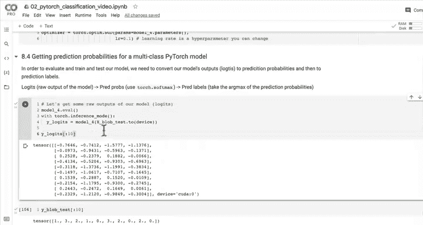

We can write a training loop。 So let's set that up，8。5， create a training loop。And testing loop。

For a multi class。Pie torch model， This is so exciting。I'll see in the next video。

 Let's build our first training and testing loop for a multiclass piy torch model。

 And I'll give you a little hint。 It's quite similar to the training and testing loops we've built before。

 So you might want to give it a shot。 I think you can。😊，Otherwise。

 we'll do it together in the next video。