# mrdbourke《一天学会pytorch深度学习｜Learn PyTorch for deep learning in a day Literally》中英 - P58：88. Troubleshooting a mutli-class model.zh_en - GPT中英字幕课程资源 - BV1kx4y1r79d

Welcome back。 In the last video， we covered how to go from。Raw logitts。

 which is the output of the model， the raw output of the model for a multiclass pi torch model。

 Then we turned our logits into prediction probabilities using torch dot softmax。

 and then we turned those prediction probabilities into prediction labels by taking the arg max。

 which returns the index of where the maximum value occurs in the prediction probability。

 So for this particular sample these four values because it outputs four values because we were working with four classes If we were working with 10 classes。

 it would have 10 values， the principle of these steps would still be the same。😊。

So for this particular sample， this is the value that's the maximum。 So we would take that index。

 which is one for this one。 the index 0 has the maximum value for this sample same again and then same again。

 I mean， these prediction labels are just random， right， So they're quite terrible。

 But now we're going to change that because we're going to build a training and testing loop for our multiclass model。

 Let's do that。So fit the multi class。Model to the data。Let's go set up some manual seeds。

Torch dot manual seed again， don't worry too much if our numbers on the page are not exactly the same。

 that's inherent to the randomness of machine learning。

 We're setting up the manual seeds to try and get them as close as possible。

 but these do not guarantee complete determinism， which means the same output。

 but we're going to try。 The direction is more important。Seep number of epochs。

We're going to go epochs。 How about we just do 100。 I reckon we'll start with that。

 We can bump it up to 1000 if we really wanted to。Let's put the data to the target device。

What's our target device。 Well， doesn't really matter because we've set device agnostic code。

 So whether we're working with a CPU or a GP， our code will use whatever device is available。

 I'm typing blog again。 So we've got X blob train Y blob train。

 This is going to go where it's going to go to the device。And why blob。Train to device。

And we're going to go X blob test， and then Y blob test equals X blob test to device。Otherwise。

 we'll get device issues later on， and we'll send this to device as well。 Beaut。 Now。

 what do we do now， Well， we loop through data。Lo through data。 So for an epoch in。

Rang epoch for an epoch in a range。Epochs， I don't want that order correct。 Come on Google Collab。

 work with me here。We're training our first multi class classification model。

 This is serious business。 Now， I'm joking。 It's actually quite fun。 So model 4 dot train。😊。

And let's do the forward pass。 I'm not going to put much commentary here because we've been through this before。

 But what are the logitts， The logitts are raw outputs of our model。 So we'll just go Xblob train。

And。X test。 I didn't want that。 X blob train。 Why did that do that。

 I need to turn off auto correct in Googleco。 I've been saying it for a long time。

 Y pre equals torch dot softm。 So what are we doing here。

 We're going from logits to prediction probabilities here。 So torch softm。😊，Why Lologs？

Across the first dimension。And then we can take the arg max of this and dim equals 1。 In fact。

 I'm going to show you a little bit of， oh， I've written blog here。

 Maybe autocor would have been helpful for that。A little trick。

 you don't actually have to do the torch softm。 the Loitts。

 if you just took the arg max of the Loitts is a little test for you。

 just take the arg max of the Loitts and see， do you get the same similar outputs as what you get here？

So I've seen that done before， but for completeness。

 we're going to use the Somax activation function because you'll often see this in practice。

And now what do we do， We calculate the loss。 So the loss FM。

 where you're going to use categorical cross entropy here or just cross entropy loss。

 So if we check our loss function， what do we have。We have cross entropy loss。

 We're going to compare our models logits to Y blob。Train。And then what are we going to do。

 We're going to calculate the accuracy。Because we're working with a classification problem。

 It'd be nice if we had accuracy， as well as loss。Accuracy is one of the main classification evaluation metrics。

Why pre equals y pre。Why pre。And now what do we do， Well， we have to 0 grab the optimizer。

 Opimr 0 grad。 and we go last backward， and then we step the optimizer。 Opr step， step， step。

So none of these steps we haven't covered before。We do the forward pass。

 we calculate the loss and any evaluation metric we choose to do so， we zero the optr。

 we perform back publication on the loss and we step the optimizer。

 the optimizer will hopefully behind the scenes update the parameters of our model to better represent the patterns in our training data。

And so we're going to go testing code here。 What do we do for testing code well or inference code。

We sent our model to a Valel mode。That's going to turn off a few things behind the scenes that our model doesn't need。

 such as dropout layers， which we haven't covered。 but you're more than welcome to check them out if you go torch N N。

没。Dropout layers。 Do we have dropout。Drop out layers， beautiful。

 and another one that it turns off is Mat Nor。Beautiful， and also， you could search this。

 What does model dot aval do， And you might come across。Stuck Overflow question。

 one of my favorite resources， so there's a little bit of extracur。😊。

But I prefer to see things in action。So with torch inference mode， again。

 this turns off things like gradient tracking and a few more things。

 So we get as fast as code as possible because we don't need to track gradients when we're making predictions。

 We just need to use the parameters that our model has learned。

 We want X blob test to go to our model here for the testlogitts。 And then for the test pres。

 we're going to do the same step as what we've done here。

We're going to go to torch dot softmax on the test Loits。Across the first dimension。

 and we're going to call the arg max on that to get the index value of where the maximum prediction probability value occurs。

We're going to calculate the test loss。Or loss function。

 We're going to pass in what the test logits here。 Then we're going to pass in why blob test compare the test logits behind the scenes。

 Our loss function is going to do some things that convert the test logitts into the same format as our test labels and then return us a value for that。

Then we'll also calculate the test accuracy here by passing in the Y true as Y blob test。

And we have the Y pre equals Y pre。Wonderful， and then what's our final step。 Well。

 we want to print out what's happening。'Cause I love seeing metrics as our model trains is one of my favorite things to watch。

😊，If we go， if epoch， let's do it every 10 epochs because we've got 100 so far equals 0。

Let's print out a nice F string with epoch。And then we're going to go loss。 What are we put in here。

 We'll get our loss value， but we'll take it to four decimal places and we'll get the training accuracy。

 which will be Arc and we'll take this to two decimal places。

And we'll get a nice percentage sign there。 and we'll go test loss equals test loss and。

We'll go there and finally， we'll go test a at the end here。 Test act。

 Now I'm sure by now we've written a fair few of these。

 you're either getting sick of them or you're like， wow， I can actually do the steps through here。

 And so don't worry， we're going to be functionising all of this later on。

 but I thought I'm going to include them as much as possible so that we can practice as much as possible together。

 So you're ready。 We're about to train our first multiclass classification model in three，2，1。

 let's go no typos Of course， what did we get wrong here。😊，Oh， this is a fun error。 Runtime error。

 N L L Los Ford reduce coer kernel 2D index， not implemented for float。 Okay。

 that's a pretty full on bunch of words there。 I don't really know how to describe that。

 but here's a little hint。 We've got float there。 So we know that floatat is what Float is a form of data。

 It's a data type。 So potentially because that's our hint。 We've said not implemented for float。

 So maybe we've got something wrong up here。 Our data is of the wrong type。😊。

Can you see anywhere where our data might be the wrong type？Well， let's print it out。

 Where's our issue here， Why Loits， Why blob train， okay。Why blob train and why Los。

 What does why blob train look like。Why blob train。Okay， and what's the D type here？Float， okay。

 so it's not implemented for float。Maybe we have to turn them into a different data type。

What if we went type。Torch。Long tensa。What happens here。Expected all tenses to be on the same device。

 but found at least two devices。 Oh my goodness。 What do we got wrong here。Type torch， long tensor。

Friends， guess what？ I found it。 And so it was to do with this pesky little data type issue here。

 So if we run this again。 And now this one took me a while to find。

 And I want you to know that that behind the scenes， even though again。

 this is a machine learning and cooking show It still takes a while to troubleshoot code And you're going to come across this。

 But I thought rather than spend 10 minutes doing it in a video， I'll show you what I did。

 So we went through this。 And we found that there's something going on here。

 I don't quite know what this is。 And that seems quite like a long string of words。

 not implemented for float。 And then we looked back at the line where it went wrong。

 And so that we know that maybe the float is hinting at that one of these two tensesors is of the wrong data type。

 Now， why would we think that it's the wrong data type。 Well。

 because any time you see float or int or something like that。

 it generally hints at one of your data types being wrong。

 And so the error is actually right back up here where we。😊，created our tensor data。

So we turned our labels here into floats， which generally is okay in Ptorrch。 However。

 this one should be of type torch dot long tensor， which we haven't seen before。

 but if we go into torch long tensor。Let's have a look。Pch shot tenser。Do we have long tensor。

Here we go，64 B integer signed， so。Why do we need torch dot long tensor。 And again。

 this took me a while to find。 So I want to express this that in your own code。

 you probably will butt your head up against some issues and errors that do take you a while to find and data types is one of the main ones。

 But if we look in the documentation for cross entropy lost。

 The way I kind of found this out was this little hint here。

 The performance of the crition is generally better when the target contains class indices。

 as this allows for optimized computation。 But I read this。

 and it says target contains class indices。 And I'm like， Aler indices already。

 but maybe they should be integers and not floats。 But then if you actually just look at the sample code。

 you would find that they use D type es torch dot long。 Now。

 that's the thing with a lot of code around the Internet is that sometimes the answer you're looking for is a little bit buried。

 But if and doubt， run the。And put your head up against a wall for a bit and keep going。

 So let's just rerun all of this and see， Do we have an error here。

 Let's train our first multiclass classification model together。 No errorss， fingers crossed。

 what did we get wrong here。 Okay， so we've got different size。

 we're slowly working through all of the errors in deep learning here。 value error。

 input batch size 200 to match target size 200。 So this is telling me maybe our test data。

 which is of size 200， is getting mixed up with our training data， which is of size 800。😊，So。

 we've got test loss。The testlogits。Model 4， what's the size Let's print out。Print。

Testlogot dot shape and wine blob test。So troubleshooting on the fly here， everyone。What are we got？

Tot size，800。Where are our test labels coming from？Why blob test equal goes， oh， there we go。

 did you catch that before， Maybe you did， Maybe you didn't， But I think we should be right here。

 Now， if we just comment out this line。 So we've had a data type issue and we've had a shape issue。

 Two of the main in machine learning。 Oh， and again， we've had some issues。 Why blob test。

 What's going on here。 I thought we' just change the shape。Oh， no。

 we have to go up and reassign it again， because。Now， this is definitely why blob， yes。

Let's rerun all of this， reassign our data。We are running into every single era here。

 but I'm glad we're doing this because otherwise you might not see how to troubleshoot these type of things。

😊，So the size of a tent so much matched。 the size。 Oh， we're getting the issue here。 test pres。

 Oh my goodness。 We have written so much code here。Test spread。 So instead of why bread。

This should be test spreads。Fingers crossed， Are we training our first model yet or what。

 There we go。 Okay， I'm gonna printing out some stuff。 I don't really want to print out that stuff。

 And I want to see the loss go down。 So I'm going to。So， friends。

I hope you know that we've just been through some of the most fundamental troublehooting steps。

 And you might say， oh， Daniel let's a cop outca you're just coding wrong。 And， in fact。

 I code wrong all the time。But we've now worked out how to troubleshoot them。

 shape errors and data type errors。 But look at this。 After all of that。 Thank goodness。

 Our loss and accuracy。 Go in the directions that we want them to go。 So our loss goes down。

 and our accuracy goes up。 Bea。 So it looks like that our model is working on a multi class classification data set。

 So how do we check that。 Well， we're going evaluate it in the next step by visualize， visualize。

 visualize， So you might want to give that a shot， See if you can use our plot decision boundary function。

😊，We'll use our model to separate the data here， So it's going to be much the same as what we did for binary classification。

 but this time we're using a different model and a different data set。I'll see you there。

Welcome back In the last video。 we went through some of the steps that we've been through before in terms of training and testing a model。

 but we also butted our heads up against two of the most common issues in machine learning and deep learning in general。

 And that is data type issues and shape issues。 But luckily。

 we were able to resolve them and trust me， you're going to run across many of them in your own deep learning and machine learning endeavors。

 So I'm glad that we got to have a look at them and sort of I could show you what I do to troubleshoot them。

 But in reality， it's a lot of experimentation。 run the code， see what errors come out。

 Google the errors read the documentationation。 Try again。 But with that being said。

 it looks like that our model。😊，Our multi class classification model has learned something。

 The loss is going down。 The accuracy is going up， but we can further evaluate this by。😊。

Making and evaluating。Predictions with a pie torch。Multiclass。Model， so how do we make predictions？

 We've seen this step before， But let's reiterate， make predictions。

 We're going to set our model to what mode， a vowel mode。

 And then we're going to turn on what context manager。Inference mode。Cause we want to make inference。

 We want to make predictions。 Now， what do we make predictions on or what are the predictions they're going to be lowits。

 Because why they are the raw outputs of our model。 So we'll take Model 4。

 which we just trained and we'll pass it the test data。 Well， it needs to be blob test， by the way。

 I keep getting that variable mixed up。 We just had enough problems with the data to Daniel。

 We don't need any more。 You're completely right。 I agree with you。

But we're probably gonna come across some more problems in the future。 Don't you worry about that。

 So let's view the first 10 predictions。Why Loits， what do they look like？Al right。

 just numbers on the page。 They're raw logits。 Now， how do we go from， go from logitts。To。

Prediction probabilities。How do we do that with a multi class model。

 We go Y preed pros equals torch dot softm on the Y Loitts。

 And we want to do it across the first dimension。 And what do we have when we go Preed probs。

Let's go up to the first 10。Are we apples to apples yet。What does our why blob test look like？

We're not apples to apples yet， but we're close。 So these are prediction probabilities。

 You'll notice that we get some fairly different values here。

 And remember the one closest to one here， the value closest to one， which looks like it's this。

 The index of the maximum value is going to be our models predicted class。 So this index is index 1。

 And as it correlate here。 Yes， one beautiful。 Then we have index 3， which is the maximum value here。

3， beautiful。 And then we have what do we have here， index 2， Yes， okay， wonderful。

 But let's not step through that。 We're programmers。 We can do this with code。

 So now let's go from pre probs。😊，To pre labels。 So why。Pres equals。 How do we do that？ Well。

 we can do torch dot arg max on the Y pre probs。 And then we can pass de equals 1。

 We could also do it this way。 Y pre pros called dot arg max。

 There's no real difference between these two。 But we're just going to do it this way Call torch dot arg max。

 Y pres， Let's view the first 10。 Are we now comparing apples to apples when we go Y blob test。Yes。

 we are。 Have a go at that。 Look 1，3，2，1，0，3，1，3，2，1，0，3。 beautiful。

 Now we could line these up and look at and compare them all day。 I mean， that would be fun。

 But I know what' something that would be even more fun。 Let's get visual。 So plot don't figure。😊。

And we're going to go fig size equals 126， just because the beauty of this being a cooking show is。

 I kinda know what ingredients work from ahead of time。

 despite what you saw in the last video with all of that troubleshooting。

 But I'm actually glad that we did that， because seriously。😊，Shape issues and data type issues。

 You're going to come across a lot of them。 There two of the main issues I troubleshoot。

 A from device issues。 So let's go X blob train and Y blob train。

And we're going to do another plot here。 We're going to get subplot 1，2，2。

 and we're going to do this for the test data test and then plot decision boundary。Pot。

Decision boundary with Model 4。On X blob test and Y blob test as well。 Let's see this。

 Did we train a multi class。 Oh my goodness。 Yes， we did。 Our code worked faster than I can speak。

 Look at that beautiful looking plot。 We've separated our data almost as best as what we could。 Like。

 there's some here that are quite inconspicuous。 And now， what's the thing about these lines。😊。

With this model have worked， I posed the question a fair few videos ago When we created our multi class model that could we separate this data without nonlinear functions。

So how about we just test that since we've got the code ready， Let's go back up。

 We've got nonlinear functions here。 We've got relu here。

 So I'm just going to recreate our model there。 So I just took Reou out。 That's all I did。

 commented it about。 This code will still all work。 and all fingers crossed it Well。

 Don't count your chickens with what they hatched。 Daniel'll come on。

 We're just gonna rerun all of these cells。😊，All the code's going to stay the same。

 all we did was we took the non linearity out of our model。Is it still going to work？Oh my goodness。

 it still works。Now， why is that。Well， you'll notice that the lines are a lot more straighter here。

 Did we get different metrics， I'll leave that for you to compare。

 Maybe these will be a little bit different。 I don't think they're too far different。

But that is because our data is linearly separable。

 so we can draw straight lines only to separate our data。 However。

 a lot of the data that you deal with in practice will require linear and nonlinear。

 hence why we spent a lot of time on that。 Like the circle data that we covered before。

 And let's look up an image of a pizza。If you are building a food vision model to take photos of food and separate different classes of food。

 could you do this with just straight lines。You might be able to。

 but I personally don't think that I could build a model to do such a thing。 And， in fact。

 Pytoch makes it so easy to add the nonlineararities to our model。

 We might as well have them in so that our model can use it if it needs it。

 and if it doesn't need it。 well， hey， it's going to build a pretty good model。 As we saw before。

 if we included the nonlinearities in our model。 So we could uncom these and our model is still going to perform quite well。

 That is the beauty of neural networks。 I that they decide the numbers that should represent our data the best。

😊，And so with that being said， we've evaluated our model。

 We've trained our multiclass classification model。 We've put everything together。

 We've gone from binary classification to multiclass classification。

 I think there's just one more thing that we should cover。 And that is， let's go here。😊。

Section number nine， a few more classification metrics。So。As I said before， evaluating a model。

 let's just put it here to evaluate our model。Our classification models， that is。

Evaluating a model is just as important as training a model。So I'll see you in the next video。

 Let's cover a few more classification metrics。Welcome back。 In the last video。

 we evaluated our multiclass classification model visually。

 and we saw that it did pretty darn well because our data turned out to be linearly separable。

 So our model， even without nonlinear functions could separate the data here。 However。

 as I said before， most of the data that you deal with。

 will require some form of linear and nonlinear functions。

 So just keep that in mind and the beauty of pytorch is that it allows us to create models with linear and nonlinear functions quite flexibly。

 So let's write down here。 if we wanted to further evaluate our classification models。

 We've seen accuracy。 So accuracy is one of the main methods of evaluating classification models。

 So this is like saying out of 100 samples。😊，How many does our model get right？And so。

We've seen our model right now is that testing accuracy of nearly 100 per cent。

 So it's nearly perfect。 But， of course， there were a few tough samples， which I mean。

 a little bit hard。 Some of them are even within the other samples。

 So you can forgive it a little bit here for not being exactly perfect。

What are some other metrics here， Well， we've also got precision。And we've also got recall。

Both of these will be pretty important when you have classes with different amounts of values in them。

 So precision and recall accuracy is pretty good to use when you have balance classes。

So this is just text on a page for now。 F1 score， which combines precision and recall。

 There's also a confusion matrix。And there is also a classification report。 So I'm going to show you。

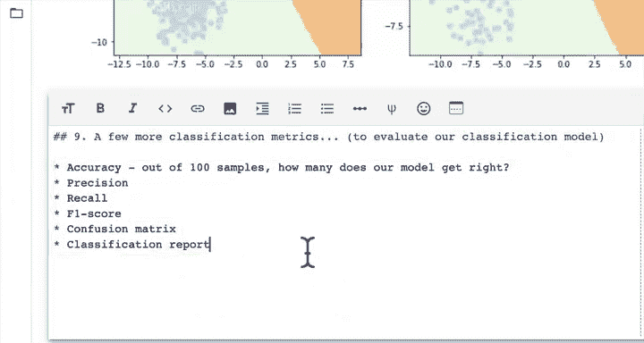

A few code examples of where you can access these。 And I'm going to leave it to you as extra curriculum to try each one of these out。

 So let's go into the keynote。 And by the way， you should paint yourself on the back here。

 because we've just gone through all of the ptorch workflow for a classification problem。

 not only just binary classification。 We've done multi class classification as well。

 So let's not stop there， though。Remember， building a model。

 evaluating a model is just as important as building a model。 So we've been through non linearity。

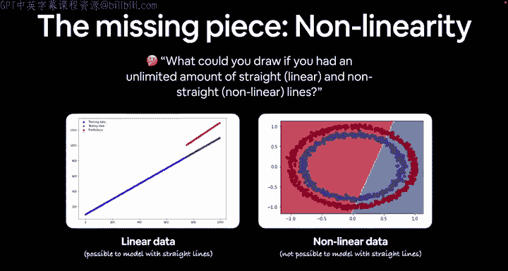

We've seen how we could replicate nonlinear functions。

We've talked about the machine learning explorelorer's motto， visualize， visualize， visualize。

Machine learning practitioner's motto is experiment， experiment experiment。

 I think I called out in the machine learning or data scientist motto。 Same thing， you know。

 and steps in modelling with Pyth。 we've seen this in practice。

 So we don't need to look at these slides。 I mean， they'll be available on the Github if you want them。

 But here we are。 Some common classification evaluation methods。😊。

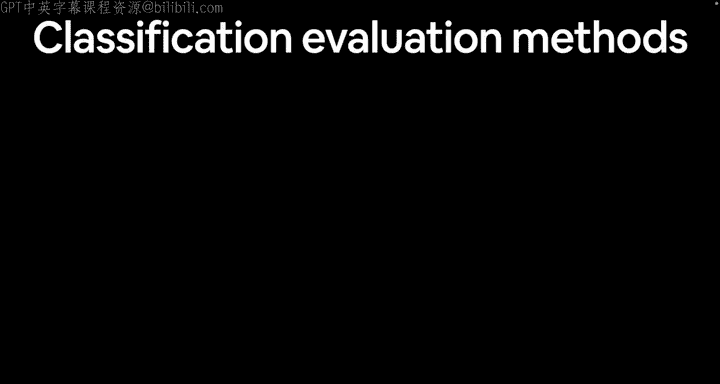

So we have accuracy。 There's the formal formula if you want， But there's also code。

 which is what we've been focusing on。 So we wrote our own accuracy function， which replicates this。

 By the way， TP stands for not toilet paper and stands for true positive T N is true negative false positive F P false negative F N。

 And so the code， we could do torch metrics。 Oh， what's that。 But when should you use it。

 the default metric for classification problems。 Note it is not the best for imbalance classes。

 So if you had， for example，1000 samples of one class。

 So number one label number one but you had only 10 samples of class0。

 So accuracy might not be the best to use for then。 for。😊。

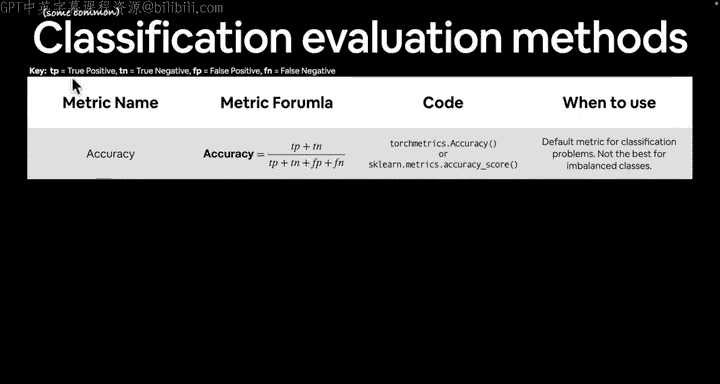

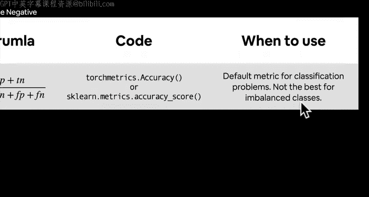

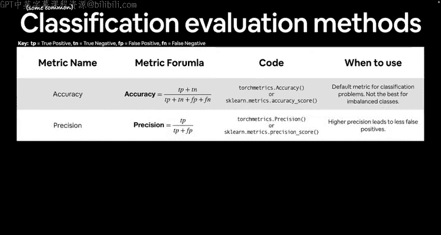

In balanceance data sets， you might want to look into precision and recall。

 So there's a great article called， I think it's beyond accuracy。Precision and recall。

 which gives a fantastic overview of there we go。 This is what I'd recommend。

 There we go by Will Coerin。😊，So I'd highly recommend this article as。Some extra curriculum here。

See this article for when to use precision recall。

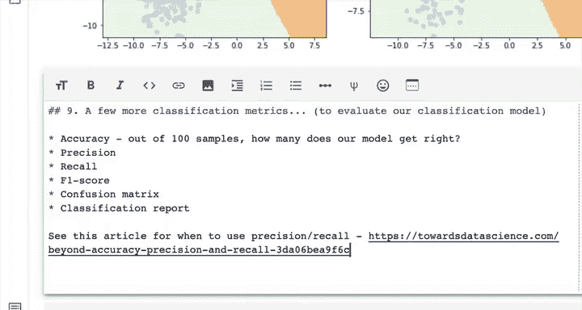

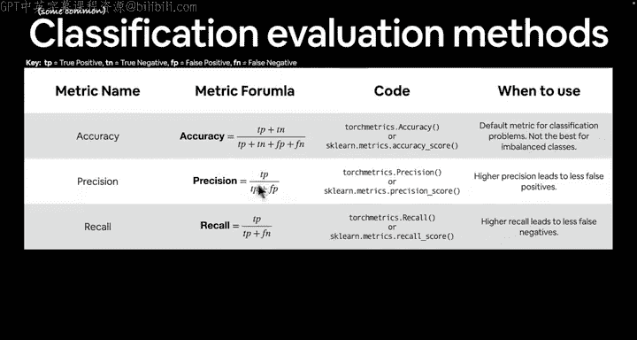

We'll go there。Now， if we look back， there is the formal formula for precision。

 true positive over true positive plus false positive。

 so higher precision leads to less false positives。 So if false positives are not ideal。

 you probably want to increase precision if false negatives not ideal。

 you want to increase your recall metric， however， you should be aware that there is such thing as a precision recall trade off and you're going to find this in your experimentation。

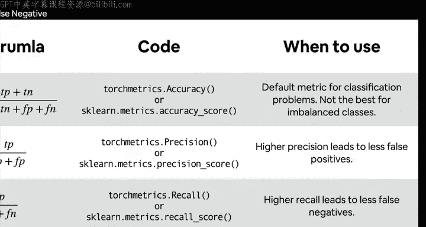

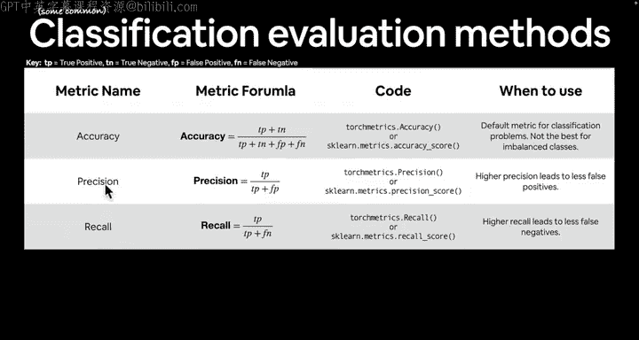

Precision， recall， trade off。So that means that generally if you increase precision you lower recall and inversely if you increase precision。

 you lower recall so check out that just to be aware of that， but again。

 you're going to learn this through practice of evaluating your models If you'd like some code to do precision and recall。

 you've got torch metrics precision or torch metrics recall as well as psyt learn So p PsytL has implementations for many different classification metrics。

 torch metrics is a pitorrch like library。

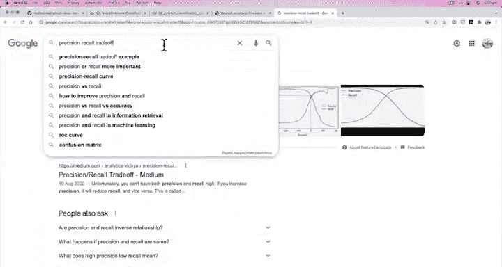

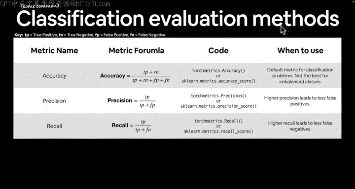

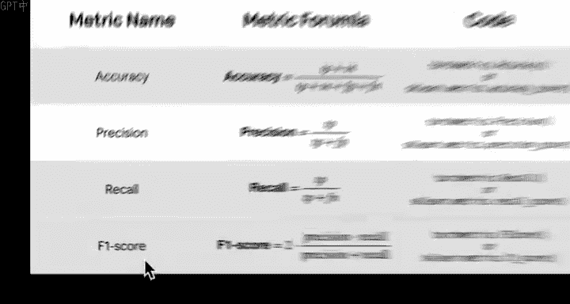

And then we have F1 score which combines precision and recall。

 so it's a good combination if you want something in between these two。

 and then finally there's a confusion matrix I haven't listed here， classification report。

 but I've listed it up here and we can see a classification report in PsK learn classification report。

 classification report kind of just puts together all of the metrics that we've talked about。😊。

And we can go there。But I've been talking a lot about torch metrics。

 So let's look up torch metrics accuracy。Torch metrics。 So this is a library。

 I don't think it comes with Google coabb at the moment， but you can import torch metrics。

 and you can initialize a metric。 So we've built our own accuracy function。

 But the beauty of using torch metrics is that it uses pitorrch like code。

 So we've got metric pres and target。 and then we can find out what the value of the accuracy is。

 And if you wanted to implement your own metrics， you could subclass the metric。😊，Class here。

 But let's just practice this， so。Let's check to see if I'm going to grab this and copy this in here。

If you want。Access to a lot of pieytorrch metrics， C。Torch metrics。So can we import torch metrics。

 maybe it's already in Google Co Lab。No， not here。 but that's all right。 We'll go Pip install。

Torch metrics。 So Google Coabb has access to torch metrics。

And that's going to download from torch metrics。 It shouldn't take too long。

 It's quite a small package， beautiful。 And now we're going to go from torch metrics。😊，Import。

Accuracy。Wonderful， and let's see how we can use this。 So set up metric。

So we're going to go torch metric， underscore accuracy。 We could call it whatever we want， really。

 but we need accuracy here。 I'm just going to set up the class。

 and then we're going to calculate the accuracy of our multiclass model by calling it torch metric。

Accuracy， and we're going to pass it why pres and why blob test。Let's see what happens here。Oh。

 what did we get wrong。Runtime error expected all tensors to be on the same device。

 but found at least two devices Oh， of course。Now， remember how I said torch metrics implements pi torch like code。

 Well let's check what device this is on。It's on the CPU。

 So something to be aware of that if you use torch metrics。

 you have to make sure your metrics are on the same device by using device agnostic code as your data。

 So if we run this， what do we get。Beautiful， we get an accuracy of 99。5%。

 which is in line with the accuracy function that we coded ourselves。

 So if you'd like a lot of prebuilt metrics functions。

 be sure to see either psyt loan for any of these or torch metrics for any pytorch like metrics。

 But just be aware if you use the pytorrch version， they have to be on the same device。

 And if you'd like to install it， What do we have， Where's the metrics module metrics。😊。

Do we have classification。 There we go。 So look how many different types of classification metrics there are from torch metrics。

 So I'll leave that for you to explore The resources for this will be here。

 This is an extra curriculum article for when to use precision recall and another。

Extracur would be to go through the torch metrics module for 10 minutes and have a look at the different metrics for classification。

So with that being said。I think we've covered a fair bit。

But I think it's also time for you to practice what you've learned。

 So let's cover some exercises in the next video。I'll see you there。Welcome back。 And the last video。

 we looked at a few more classification metrics， a little bit of a high level overview for some more ways to evaluate your classification models。

 And I linked some extra curriculum here that you might want to look into as well。

 But we have covered a whole bunch of code together。

 But now it's time for you to practice some of this stuff on your own。

 And so I have some exercises prepared。 Now， where do you go for the exercises。 Well， remember。

 on the lone Pitorch do audio book。 for each one of these chapters， there's a section Now。

 just have a look at how much we've covered。 If I scroll， just keep scrolling。 Look at that。

 We've covered all of that in this module。 That's a fair bit of stuff。

 But down the bottom of each one is an exercises section。

 So all exercises are focusing on practicing the code in the sections above all of these sections here。

 I've got number 1，2，3，4，5，6，7。😊，Yes，7 exercises， nice， writing plenty of code， and then， of course。

 extra curriculum。 So these are some challenges that。😊。

I've mentioned throughout the entire section 02， but I'm going to link this in here。Exercises。

But of course， you can just find it on the Learnpie ToStbook。

So if we come in here and we just create another heading exercises。And extra curriculum。

And then we just write in here。See exercises and extra curriculum。Here有。And so， if you'd like。

A template of the exercise code。 you can go to the Pyto deep learning repo。

 And then within the extras folder， we have exercises and solutions。

 You might be able to guess what's in each of these。Exercises。

 we have O2 pytorrch classification exercises。 This is going to be some skeleton code。 And then。

 of course， we have the solutions as well。 Now， this is just one form of solutions。

 but I'm not going to look at those because I would recommend you looking at the exercises first before you go into the solutions。

 So we have things like import torch。 Set up device agnostic code。 create a data set。

Turn data into a data frame and then et cetera， et cetera。

 for the things that we've done throughout this section。 So give that a go， try it on your own。

 And if you get stuck， you can refer to the notebook that we've coded together。

 All of this code here。 you can refer to the documentation， of course。

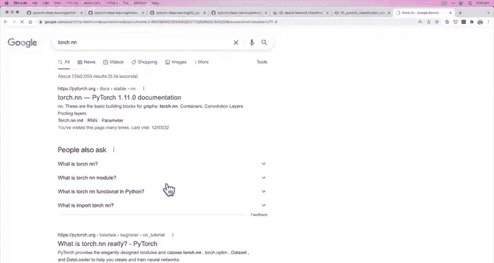

And then you can refer to as a last resort， the solutions notebooks。

 So give that a shot and congratulations on finishing。😊，Section 0，2， Pi torch classification。Now。

 if you're still there， you're still with me。Let's move on to the next section。

 We're going to cover a few more things of deep learning with Pytorch。

是以的。