# mrdbourke《一天学会pytorch深度学习｜Learn PyTorch for deep learning in a day Literally》中英 - P59：92. Introduction to computer vision.zh_en - GPT中英字幕课程资源 - BV1kx4y1r79d

Hello and welcome back。 We've got another section。 We've got computer vision and convolutional neural networks with。

😊，Petorch Now computer visionsion is one of my favourite， favourite deep learning topics。

 but before we get into materials， let's answer a very important question and that is。

 where can you get help？😊。

So first and foremost， is to follow along with the code as best you can。

 We're going to be writing a whole bunch of Pytorch computer vision code and remember our motto。

 if in doubt， run the code。 See what the inputs and outputs are of your code and that's try it yourself。

 If you need the dock string to read about what the function you're using does。

 you can press shift commanded space in Google code Lab or it might be control if you're on Windows。

 Otherwise， if you're still stuck， you can search for the code that you're running。

 you might come across stack overflow or the pytorch documentation。

 We've spent a bunch of time in the Pytorch documentation already。

 and we're going to be referencing a whole bunch in the next module in section 3 we're up to now。😊。

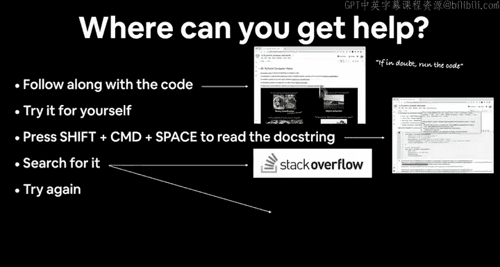

If you go through all of these four steps， the next step is to try it again， if in doubt。

 run the code。 and then of course if you're still stuck。

 you can ask a question on the Pythtage deep learninging repo Discions tab。 Now， if we open this up。

 we can go new discussion and you can write here， Section 03 for the computer vision my problem is。

 and then in here。😡，You can write。Some code。 be sure to format it this verse you can that way it'll help us answer it。

 and then go。What's happening here。Now， why do I format the code in these backtics here。

 It's so that it looks like code and that it's easier to read when it's formatted on the Github discussion。

 Then you can select a category if you have a general chat， an idea， a poll。

 a Q&A or a show and tell of something you've made what you've learned from the course for question and answering。

 youll want to put it as Q& A and you can click start discussion and it'll appear here and that way they'll be searchable and we'll be able to help you out。

 So I'm going to get out of this。 and speaking of resources。 we've got the pytor deep learning repo。

 the links will be where you need the links。 All of the code that we're going to write in this section is contained within the section 3 notebook Pytorch computer vision。

 Now this is a beautiful notebook annotated with heaps of text and images。

 you can go through this on your own time and use it as a reference to help out。

 if you get stuck on any of the code we write through the videos check it out in this notebook because it's probably here somewhere。

😊。

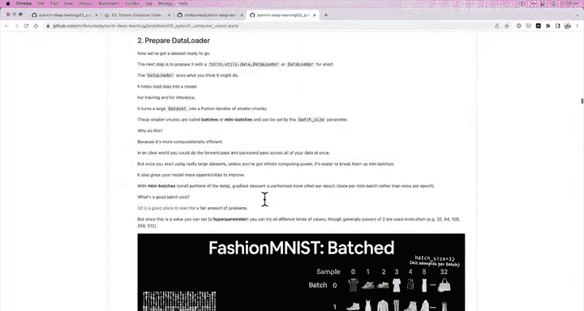

And then finally， let's get out of these。If we come to the book version of the course。

 this is Lne Ptounch dot。 I O。 We've got home。 This will probably be updated by the time you look at that。

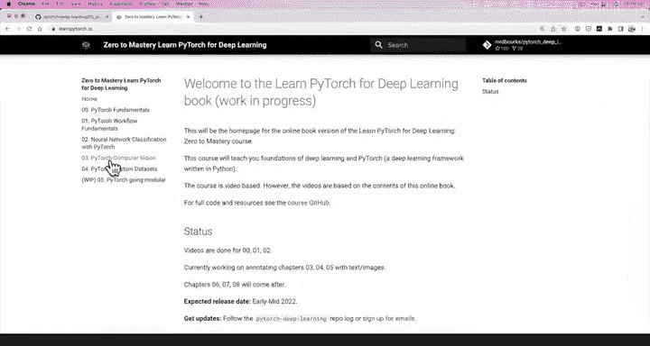

But we have Section 03， which is Pytorch Comp Vi。 It's got all of the information about what we're going to cover in a book format。

 And you can， of course， skip ahead to different subtitles。 see what we're going to write here。

 All of the links you need and extra resources will be at learn Pytorch dot I O。

 And for this section， it's Pytorch Comp vision。 With that been said。😊，Speaking of computer vision。

 you might have the question， what is a computer vision problem， Well， if you can see it。

 it could probably be phrased at some sort of computer vision problem。

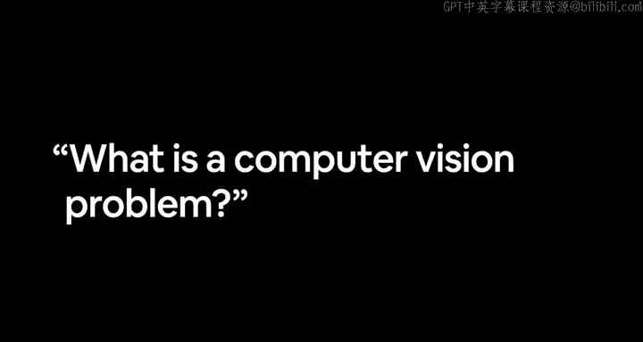

That's how broad computer vision is。 So let's have a few concrete examples。

 We might have a binary classification problem， such as if we wanted to have two different images。

 Is this photo of steak or pizza， We might build a model that understands what steak looks like in an image。

 This a beautiful dish that I cooked， by the way， This is of me eating pizza at a cafe with my dad。

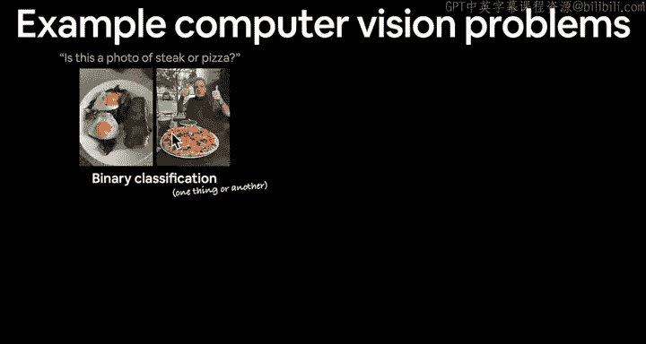

And so we could have binary classification， one thing or another。

 And so our machine learning model may take in the pixels of an image and understand the different patterns that go into what a state looks like and the same thing with a pizza。

 Now， the important thing to note is that we won't actually be telling our model what to learn。

 It will learn those patterns itself from different example of images。😊。

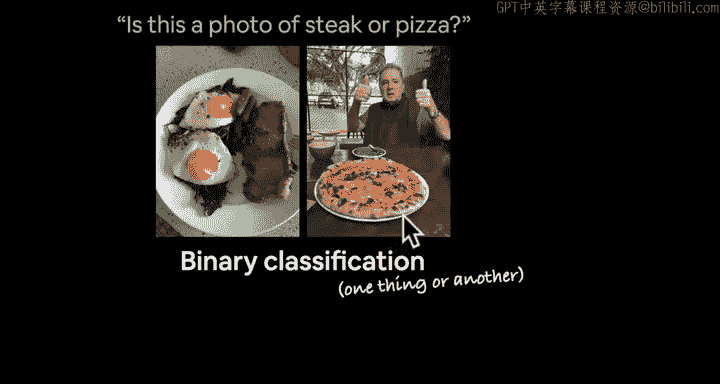

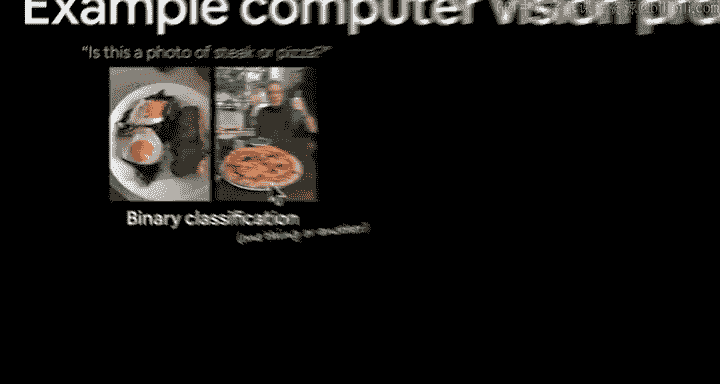

Then we could step things up and have a multi class classification problem。

 You're noticing a trend here， we've covered classification before。

 but classification can be quite broad。 It can be across different domains。

 such as vision or text or audio。😊。

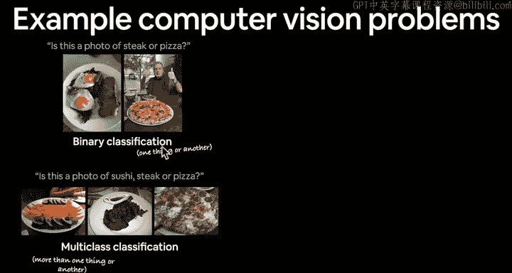

But if we were working with multi class classification for an image problem we might have。

 is this a photo of sushi， steak or pizza？ And then we have three classes instead of two。 But again。

 this could be 100 classes。Such as what nurify uses， which is an app that I'm working on。

 We go to nurify。t app。This is bare bones at the moment。 But right now。

 nuutrify can classify up to 100 different foods。 So if you were to upload an image of food。

Let's give it a try， nurify。We'll go into images。And we're go into sample food images。

 And how about some chicken wings， What does it classify this as Chicken wings， beautiful。

 And then if we uploaded an image of not food， maybe， let's go to nutrify。 This is on my computer。

 by the way， you might not have a sample folder set up like this。

 And then if we upload a photo of a cyber truck， What does it say。😊，No food found。

 Please try another image。 So behind the scenes， nuutrify is using the pixels of an image and then running them through a machine learning model and classifying it first。

 whether it's food or not food。 And then if it is food， classifying it as what food it is。

 So right now， it works for 100 different foods。😊，So if we have a look at all these。

 it can classify apples， artichokes， avocado's， barbecue sauce。

 Each of these work at different levels of performance。

 But that's just something to keep in mind of what you can do。

 So the whole premise of nuutrify is to upload a photo of food and then learn about the nutrition about it。

 So let's go back to our keynote。 What's another example。😊。

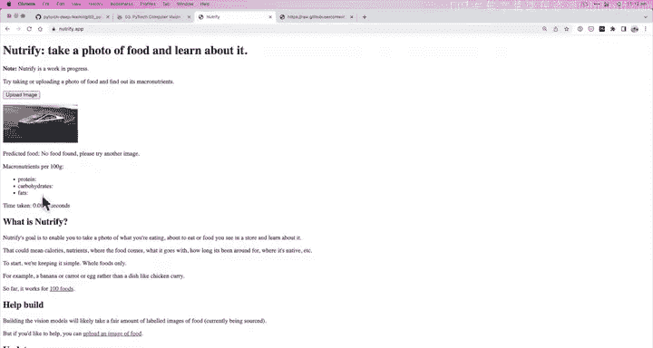

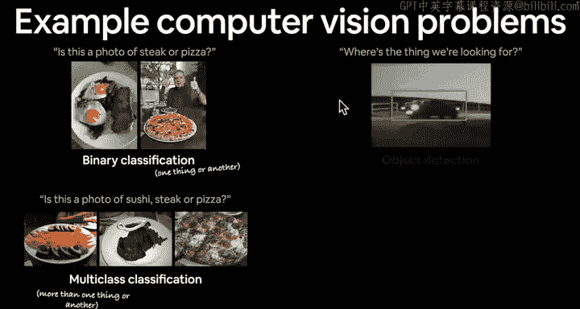

Well， we could use computer vision for object detection where you might answer the question is。

 where's the thing we're looking for。 So， for example， this car here。

 I caught them on security camera， actually did a hit and run on my new car wasn't that much of an expensive car。

 but I parked it on the street And this person the trailer came off the back of their car and hit my car and then they just picked the trailer up and drove away。

 but I went to my neighbor's house and had a look at their security footage and they found this car。

 So potentially you could design a machine learning model to find this certain type of car。

 It was an orange dude， by the way， but the images were in black and white to detect to see if it ever recognizedd a similar car that comes across the street and you could go。

 hey， did you crash into my car the other day。 I didn't actually find who it was。 So sadly。

 it was a hit and run。😊。

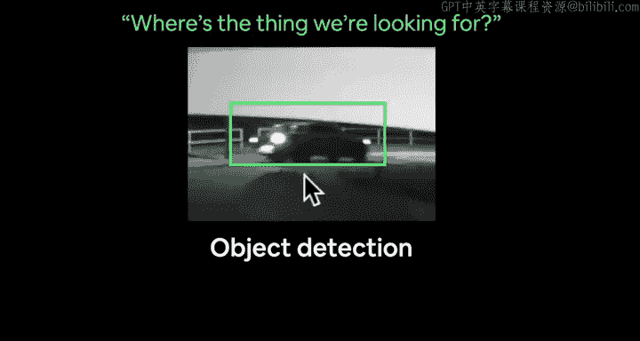

But that's object detection， finding something in an image。

 And then you might want to find out what are the different sections in this image。

 So this is a great example of what Apple uses on their devices， iPhones and iPads and whatnot。

 to segregate or segment the different sections of an image。 So person one， person 2， skin tones。

 hair， sky original。 And then it enhances each of these sections in different ways。

 So that's a practice known as computational photography。

 But the whole premise is how do you segment different portions of an image。

 And then there's a great blog post here that talks about how it works and what it does and what kind of model that's used。

 I'll leave that as extracur。 if you'd like to look into it。😊。

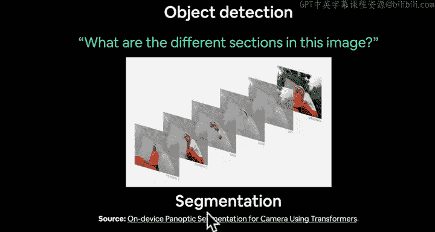

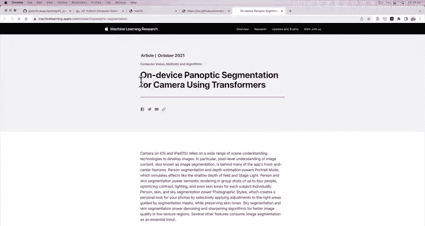

So if you have these images， how do you enhance the sky， how do you make the skin tones look。

 how they should？

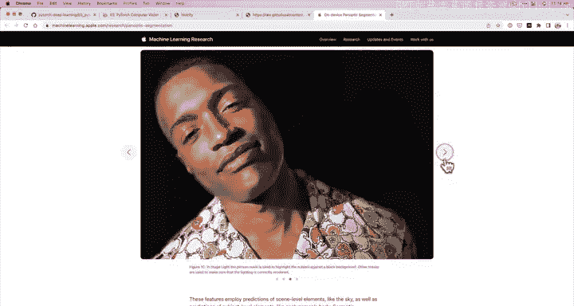

How do you remove the background if you really wanted to？ So all of this happens on device。

So that's where I got that image from， by the way。Semantic Mars。And this is another great blog。

 Apple machine learning Research。 So to keep this in mind。

 we're about to see another example for computer visionion， which is Tesla computer vision。

 A lot of companies have websites such as Apple machine learning research where they share a whole bunch of what they're up to in the world of machine learning。

 So in Tesla's case， they have eight cameras on each of their self-driving cars that fuels their full self-driving data software And so they use computer vision to understand what's going on on the image and then plan what's going on So this is three dimensionmensal vector space and what this means is they're basically taking these different viewpoints from the eight different cameras feeding them through some form of neural network and turning the representation of the environment around the car into a vector So a long string of numbers and why would it do that Well because computers understand numbers far more than they understand images So we might be able to recognize what's happening here。

 But for a computer to understand it， we have to turn it into。😊。

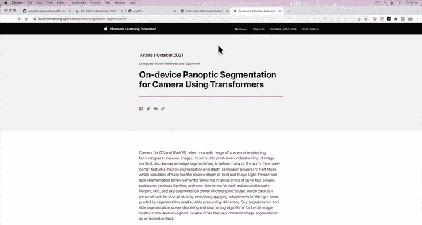

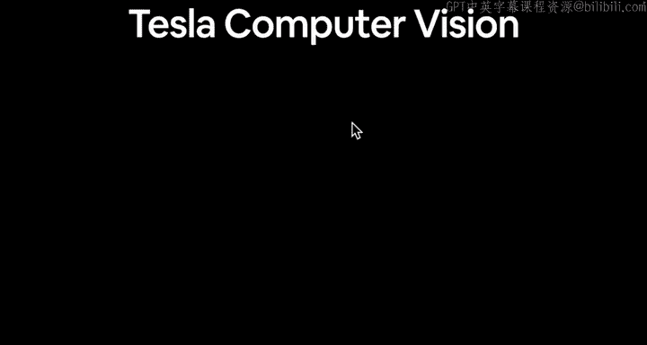

Desp。And so if you want to have a look at how Tesla uses computer vision。

 So this is from Tesla's AI Day video。 I'm not going to play at all because it's three hours long。

 but I watched it， and I really enjoyed it。 So there's some information there。

 And there's a little tidbit there。 If you go to two hours and one minute and 31 seconds of the same video。

 have a look at what Tesla do。😊。

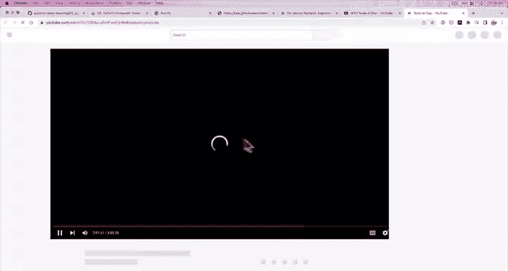

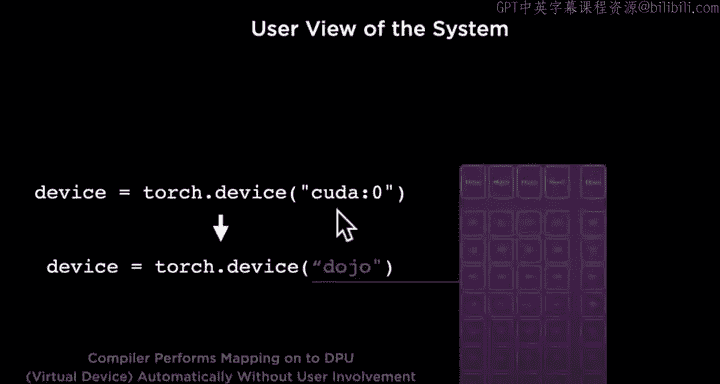

Well， would you look at that， Where have we seen that before？That's some device agnostic code。

 but with Tesla's custom Dojo chip。

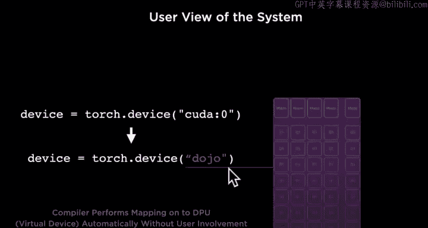

So Tesla uses Pytoch， so the exact same code that we're writing。

 Tesla uses similar Pytoch code to of course， they write Pytoch code to suit their problem。

 but nonetheless they use Pytoch code to train their machine learning models that power their self driving software。

 So how cool is that。😊。

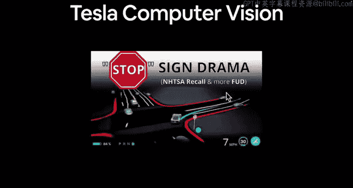

And if you want to have a look at another example， there's plenty of different Tesla self driving videos。

😊，So， oh， we can just play it right here。 I was going to click the link。 So look。

 this is what happens。If we have a look in the environment。Tesla the cameras。

 understand what's going on here。 And then it computes it into this little graphic here on your heads up display in the car。

 And it kind of understands， well， I'm getting pretty close to this car。

 I'm getting pretty close to that car。 And then it uses this information about what's happening。

 this perception to plan where it should drive next。😊。

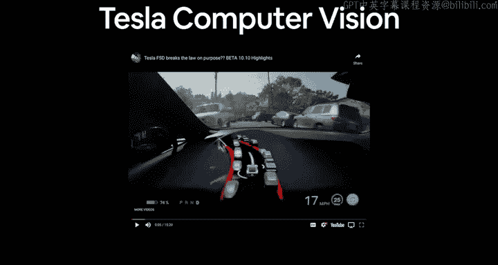

And， I believe。Here， it ends up going into。 it has to stop。Yeah， there we go。

Because we've got a stop sign。 Look at that。 It's perceiving the stop sign。 It's got two people here。

 just sort a car drive past across this street。 So that is pretty darn cool。

 That's just one example of computer vision， one of many。 And how would you find out。

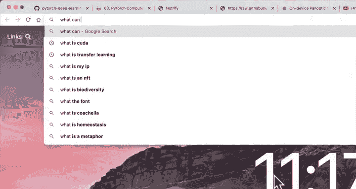

What computer vision can be used for。 Here's what I do。 What can computer vision be used for。

Plenty more resources。 So oh， there we go。27 most popular computer vision applications in 2022。

 So we've covered a fair bit there。But what are we going to cover specifically with Pytorch code。

 Well， broadly， My bad， we're going to get a vision data set to work with using Torch vision。

 So Pytorch has a lot of different domain libraries。

 Torch vision helps us deal with computer vision problems and theres existing data sets that we can leverage to play around with computer vision。

 We're going to have a look at the architecture of a convolutional neural network。

 also known as a CNN with Pytorch。😊，We're going to look at an end to end multiclass image classification problem。

 So multiclass is what more than one thing or another could be three classes could be 100。

 We're going to look at steps at modeling with CNNs in piytorrch。

 So we're going to create a convolution or network with pitorrch。

 We're going to pick a loss function and optimize it to suit our problem。

 We're going to train a model， training a model a model， a little bit of a typo there。

 And then we're going to evaluate a model。 right， So we might have typos with our text。

 but we'll have less typos in the code。 And how we going to do this。 Well， we could do it cook。

 so we could do a chemists。😊，Well， we're going to do it a little bit of both。Part art， part science。

 But since it's a machine learning cooking show， we're going to be cooking up lots of code。

 So in the next video， we're going to cover the inputs and outputs of a computer vision problem。

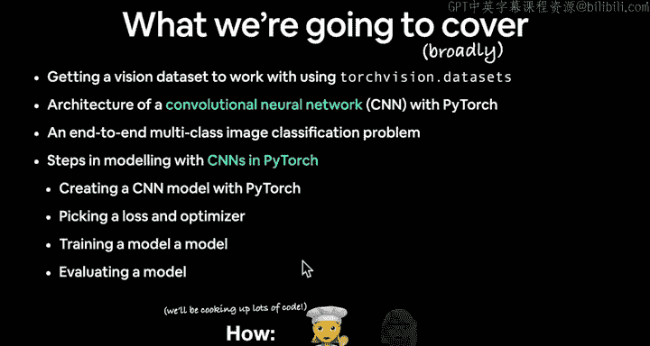

I'll see you there。