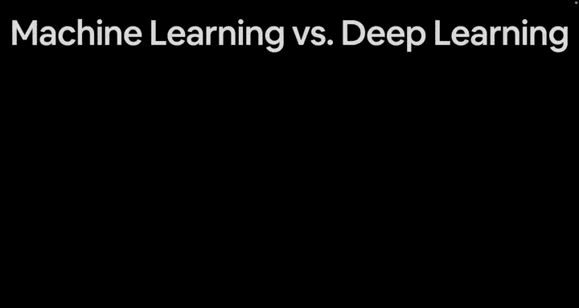
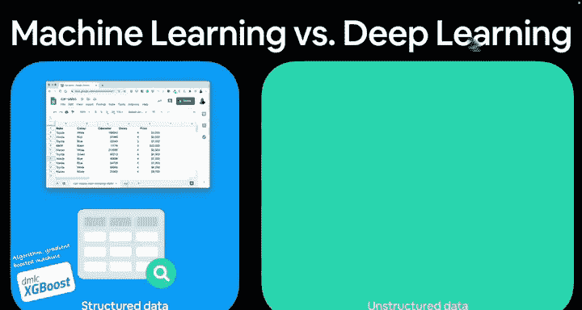
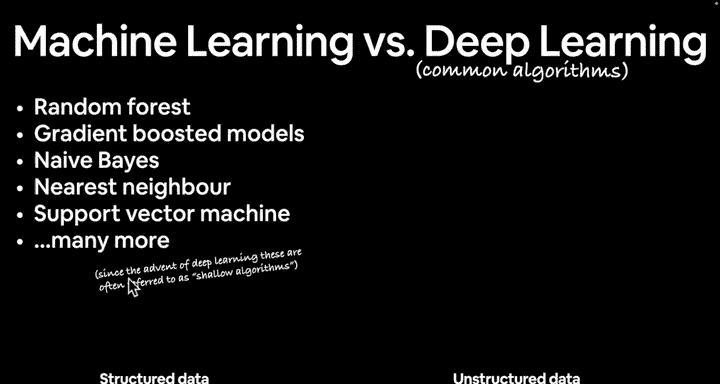
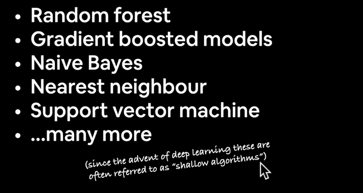
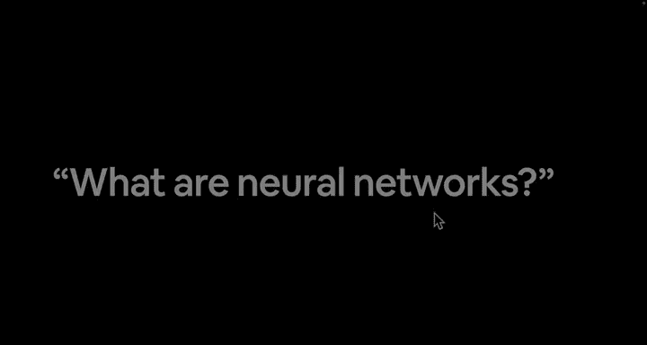

# mrdbourke《一天学会pytorch深度学习｜Learn PyTorch for deep learning in a day Literally》中英 - P5：3. Machine learning vs deep learning.zh_en - GPT中英字幕课程资源 - BV1kx4y1r79d

Welcome back。 So in the last video， we covered a few things of what deep learning is good for and what deep learning is typically not good for。

 So let's dive in to a little more of a comparison of machine learning versus deep learning again。

 I'm going to be using these terms quite interchangeably。

 but there are some specific things that typically you want traditional style of machine learning techniques versus deep learning。

 however， this is constantly changing。 So again， I'm not talking in absolutes here。

 I'm more just talking in general。 and I'll leave it to you to use your own curiosity to research the specific differences between these two。

 but typically for machine learning like the traditional style of algorithms。

 although they are still machine learning algorithms。

 which is kind of a little bit confusing where deep learning and machine learning differ。

Is you want to use traditional machine learning algorithms on structured data。

 So if you have tables of numbers， this is what I mean by structured。Rose。

And columns structured data。 And possibly one of the best algorithms for this type of data is a gradient boosted machine。

 such as X G boost。 This is an algorithm that you'll see in a lot of data science competitions and also used in production settings when I say production settings。

 I mean， applications that you may interact with on the Internet or use on a day to day。

 So that's production。

XG boost is typically the favorite algorithm for these kinds of situations。 So again。

 if you have structured data， you might look into X boost rather than building a deep learning algorithm。

 but again， the rules aren't set in stone。 That's where deep learning and machine learning is kind of an art kind of a science。

 I that sometimes X G boost is the best for structured data。

 but there might be exceptions to the rule。But for deep learning。

 it is typically better for unstructured datat。 What I mean by that is data that's kind of all over the place。

 It's not in your nice， standardised rows and columns。

 So say you had natural language such as this tweet by this person whose name is quite similar to mine and has the same Twitter account is me。

 Oh， maybe I wrote that。 How do I learn machine learning。 What you need to hear。

 Learn Python Learn math。Starts probability， software engineering build。 What you need to do。

 Google it， go down the rabbit hole， resurfa in 6 to 9 months and reassess。 I like that。

Or if you had a whole bunch of text， such as the definition for deep learning on Wikipedia。 again。

 this is the reason why I'm not covering as many definitions in this course is because。

 look how simple you can look these things up。 Wikipedia is going to be able to define deep learning far better than what I can。

 I'm more focused on just getting involved in working hands on with this stuff than defining what it is。

 And then we have。Images， if we wanted to build a burger， take a photo app thing。

You would work with image data， which doesn't really have much of a structure。

 although we'll see that there are ways for deep learning that we can turn this kind of data to have some sort of structure through the beauty of a tenser。

 And then we might have audio files， such as if you are talking to your voice assistant。

 I'm not going to say one because a whole bunch of my devices might go crazy。

 if I say the name of my voice assistant， which rhymes with。I'm not even going to say that out loud。

 And so typically for unstructured data， you'll want to use a neural network of some kind。

 So structured data， gradient boosted machine or a random forest or a tree based algorithm。

 such as X boost and unstructured data， neural networks。 So let's keep going。

Let's have a look at some of the common algorithms that you might use for structured data machine learning versus unstructured data。

 Deep learning。 So randomand For is one of my favorites gradient boost of models。

 nave bays nearest neighbor support vector machine SVM and then many more but since the advent of deep learning。

 these often referred to as shallow algorithms。 So deep learning， why is it called deep learning。

 Well as we'll see is that it can have many different layers of algorithm you might have an input layer。

100 layers in the middle and then an output layer， but we'll get hands on with this later on。

 and so common algorithms for deep learning and neural networks， fully connected neural network。

 convolutional neural network recurrent neural network transformers have taken over over the past couple years and of course。

 many more and the beautiful thing about deep learning and neural networks is is almost as many problems that it can be applied to is as many different ways that you can construct them。

So this is why I'm putting all these dot points on the page and I can understand if you haven't had much experience with machine learning or deep learning。

 this can be a whole bunch of information overload。 But good news is。

 what we're going to be focused on building with piytorch is neural networks fully connected neural networks and convolutional neural networks。

 the foundation of deep learning， but the excellent thing is the exciting thing is is that if we learn these foundational building blocks。

 we can get into these other styles of things here。😊，And again， part art。

 part science of machine learning and deep learning is depending on how you represent your problem。

 depending on what your problem is， many of the algorithms here and here can be used for both。

So I know I've just kind of bedazzled you in saying that， oh， well。

 you kind of use these ones for deep learning。 You kind of use these ones for machine learning。

 But depending on what your problem is， you can also use both。

 So that's a little bit of confusion of machine learning。 But that's a fun part about it， too。

 is use your curiosity to figure out what's best for whatever you're working on。

 And with all this talk about neural networks， How about in the next video。

 we cover what are neural networks。 Now， I'd like you to Google this， before we watch the next video。

 Because there's gonna be hundreds of definitions of what they are。

 And I'd like you to start forming your own definition of what a neural network is。😊。

I'll see you in the next video。