# mrdbourke《一天学会pytorch深度学习｜Learn PyTorch for deep learning in a day Literally》中英 - P60：93. Computer vision input and outputs.zh_en - GPT中英字幕课程资源 - BV1kx4y1r79d

So in the last video we covered what we're going to cover broadly。

 and we saw some examples of what computer vision problems are。

 essentially anything that youre able to see， you can potentially turn into a computer vision problem and we're going to be cooking up lots of machine learning or specifically pie torch computer vision code。

 you see I' fix that typo。😊。

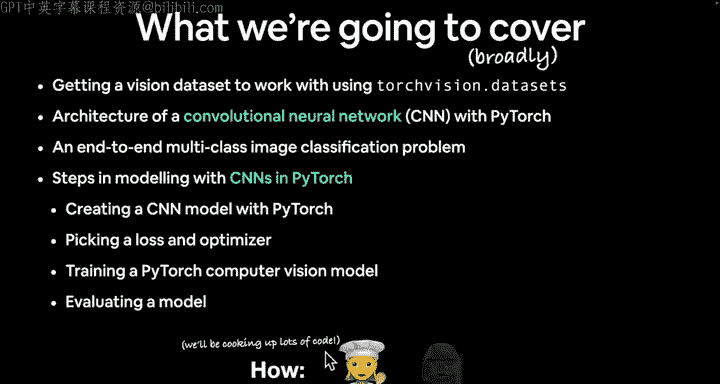

Now let's talk about what the inputs and outputs are of a typical computer vision problem。

So let's start with a multiclass example and say we wanted to take photos of different images of food and recognize what they were。

 So we're replicating the functionality of nuutrify。

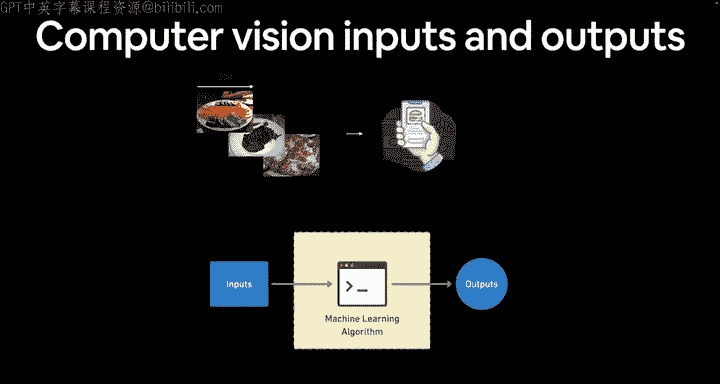

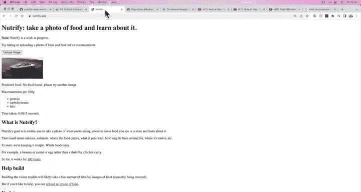

So take a photo off food and learn about it。So we might start with a bunch of food images that have a height and width of some sort。

 So we have width equals 224 height equals 224。 and then they have three color channels。 Y 3。 Well。

 that's because we have a value for red， green and blue。 So if we look at this up。😊。

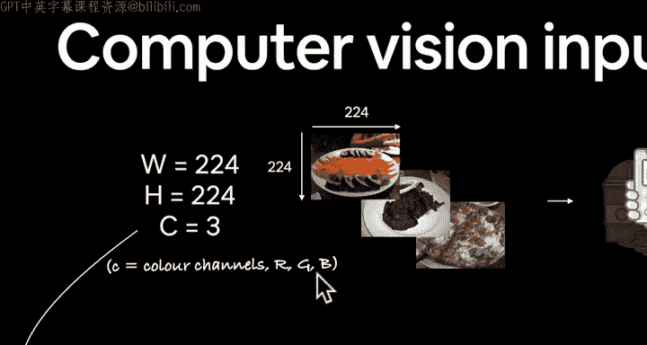

If we go red， green， blue image format。So 24 bit RGB images。

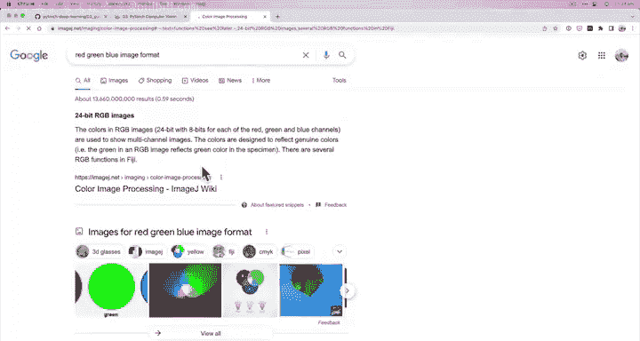

So。A lot of images or digital images have some value for a red pixel， a green pixel and a blue pixel。

 And if you were to convert images into numbers， they get represented by some value of red。

 some value of green and some value of blue。 That is exactly the same as how we' represent these images。

 So， for example， this pixel here might be a little bit more red。

 a little less blue and a little less green because it's close to orange。

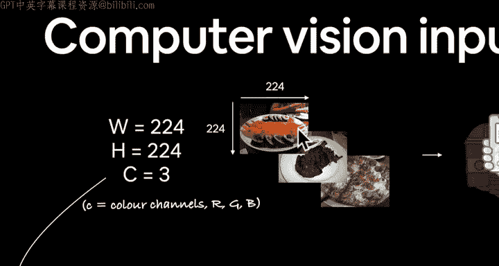

And then we convert that into numbers。 So what we're trying to do here is essentially what we're trying to do with all of the data that we have with machine learning is represented as numbers。

 So the typical image format to represent an image because we're using computer vision So we're trying to figure out what's in an image。

 The typical way to represent that is in a tensor that has a value for the height。

 width and color channels。😊。

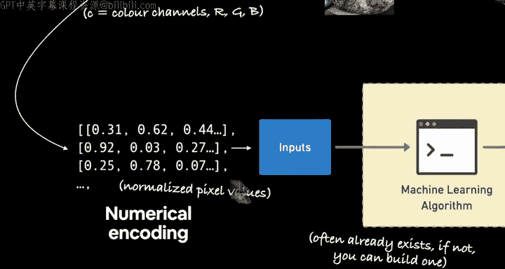

And so we might numerically encode these， in other words， represent our images as a tensor。

 and this would be the inputs to our machine learning algorithm。 and in many cases。

 depending on what problem you're working on， an existing algorithm already exists for many of the most popular computer vision problems。

 and if it doesn't， you can build one。 And then you might fashion this machine learning algorithm to output the exact shapes that you want。

 In our case， we want three outputs。 We want one output for each class that we have。

 we want a prediction probability for sushi。 and want a prediction probability for steak。

 and we want a prediction probability for pizza。 Now， in our case。

 in this iteration looks like our model got one of them wrong because the highest value was assigned to the wrong class here。

 So for the second image it assigned a prediction probability of 0。81 for sushi。 Now。

 keep in mind that you could change these classes to whatever your particular problem is。

 I am just simplifying this in making it3。 you could have 100。😊。

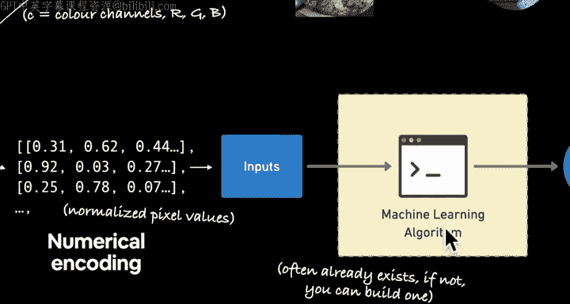

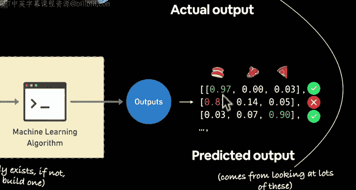

You could have 1000。 You could have 5。 It's just， it depends on what you're working with。

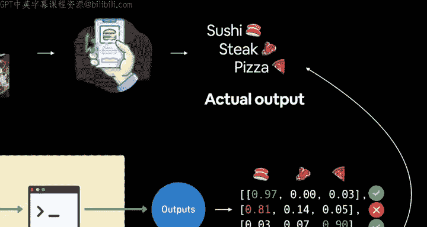

And so we might use these predicted outputs to。Enhance our app。

 So if someone was to take a photo of their plate of sushi， our app might say， hey。

 this is a photo of sushi。 here's some information about those the sushi rolls or the same for steak。

 the same for pizza。 Now it might not always get it right， because after all。

 that's what machine learning is。 It's probabilistic。😊，So how would we improve these results here。

 Well， we could show our model more and more images of sushi steak and pizza so that it builds up a better internal representation of said images。

 So when it looks at images it's never seen before or images outside its training data set。

 it's able to get better results。😊，But just keep in mind， this whole process is similar。

 no matter what computer vision problem you're working with。

 you need a way to numerically encode your information。

 You need a machine learning model that's capable of fitting the data in the way that you would like it to be fit In our case。

 classification。 you might have a different type of model。 if you are working with object detection。

 a different type of model。 if you are working with segmentation。

 And then you need to fashion the outputs in a way that best suit your problem as well。

So let's push forward。😊，Oh， by the way， the model that often does this is a convolutional neural network。

 In other words， a CNN， however， you can use many other different types of machine learning algorithms here。

 It's just that convolutional neural networks typically perform the best with image data。

 although with recent research there is the transformer architecture or deep learning model that also performs fairly well or very well with image data。

 So just keep that in mind going forward， but for now we're going to focus on convolutional neural networks。

😊。

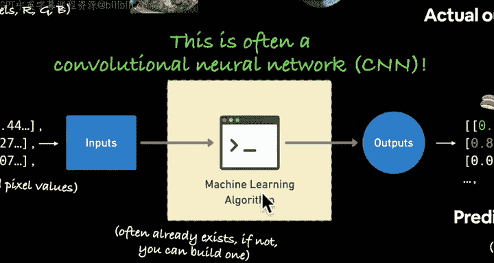

And so we might have input and output shapes because remember one of the chief machine learning problems is making sure that your tensor shapes line up with each other。

 the input output shapes。 So if we encoded this image of stake here。

 we might have a dimensionality of batch size with height color channels。

 and now the ordering here could be improved， it's usually height then width So alphabetical order and then color channels last So we might have the shape of none224。

2243。 Now where does this come from So none could be the batch size Now it's none because we can set the batch size to whatever we want。

 say for example 32 then we might have a height of 2 to4 and width of 224 and  three color channels Now height and width are also customizable you might change this to be 512 by 512 What that would mean is that you have more numbers representing your image and incense would take more computation to figure out the patterns because there is simply more information encoded。

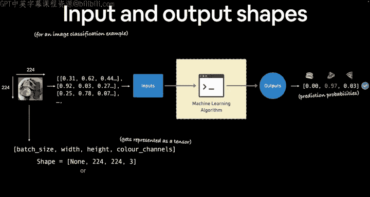

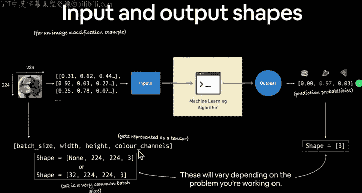

In your image， but 224，224 is a common starting point for images。

And then 32 is also a very common batch size， as we've seen in previous videos。 But again。

 this could be changed depending on the hardware you're using， depending on the model you're using。

 you might have a batch size of 64。 You might have a batch size of 512。 It's all problem specific。

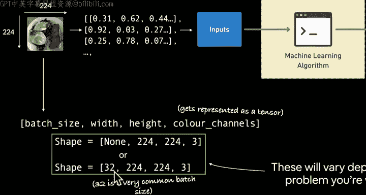

And that's this line here。 These will vary depending on the problem you're working on。

 So in our case， our output shape is three because we have three different classes for now。

 But again， if you have 100， you might have an output shape of 100。 If you have 1000。

 you might have an output shape of 1000。 the same premise of this whole pattern remains。 though。

 numerically encode your data， feed it into a model and then make sure the output shape fits your specific problem。

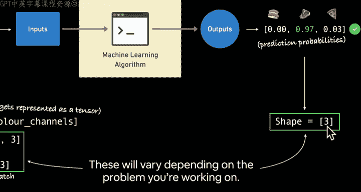

And so for this section， computer vision with Ptorunch。

 we're going to be building CNNNs to do this part。 We're actually going to do all of the parts here。

 but we're going to focus on building a convolutional neural network to try and find patterns in data because it's not always guaranteed that it will。

😊。

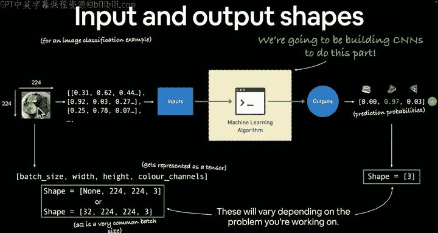

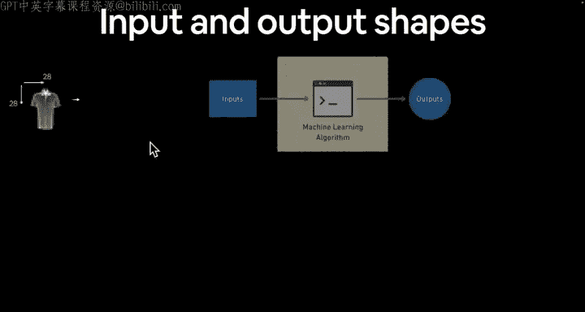

Finally， let's look at one more problem。 say you had gray scale images of fashion items。

 and you have quite small images。 They're only 28 by 28。😊。

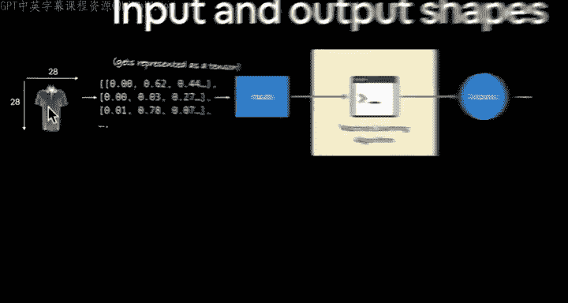

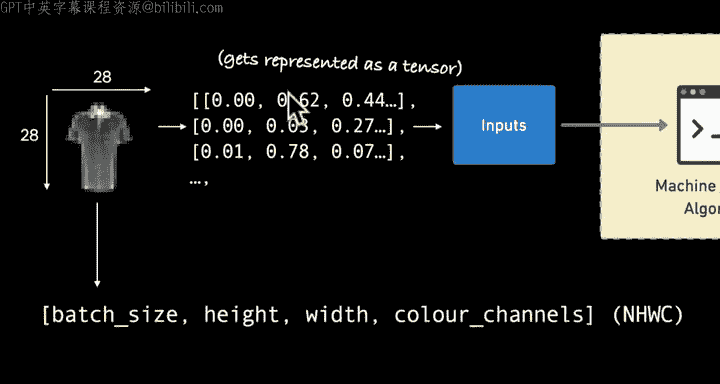

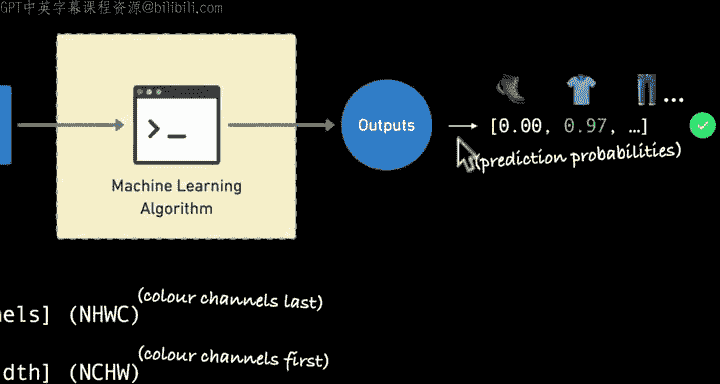

The exact same pattern is going to happen。 You numerically represent it。

 Use it as inputs to a machine learning algorithm。 And then hopefully your machine learning algorithm outputs the right type of clothing that it is。

 In this case， is a tshirt。 But I've got dot dot dot here because we're going to be working on a problem that uses 10 different types of items of clothing。

 And the image is a grayscale。 So there's not much detail。

 So hopefully our machine learning algorithm can recognize what's going on in these images。

 There might be a boot。 There might be a shirt。 There might be pants。 There might be a dress。

 etc cea， et cetera。😊，But we numerically encode our images into dimensionality of batch size。

 height with color channels。 This is known as N， H。

WC or number of batches or number of images in a batch height with C。

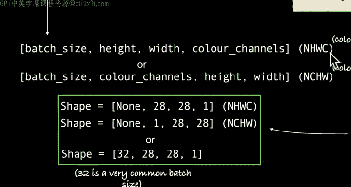

Or color channels。 This is colour channels last。 Why am I showing you two forms of this。

 Do you notice colour channels in this one is color channels first， So color channels height width。

 Well， because you come across a lot of different representations of data full stop。

 but particularly image data in pieytorrch and other libraries。

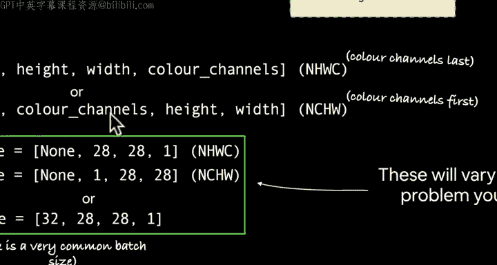

Many libraries expect color channels last。 However。

 Pytorch currently at the time of recording this video may change in the future。

 defaults to representing image data with color channels first。 Now。

 this is very important because you will get errors if your dimensionality is in the wrong order。

 And so there are ways to go in between these two。 and there's lot of debate of which format is the best。

 It looks like color channels last is going to win over the long term。

 just because it's more efficient， But again， that's outside the scope。 But just keep this in mind。

 We're going to write code to interact between these two。

 But it's the same data just represented in different order。

And so we could rearrange these shapes to how we want colour channels last or colour channels first。

And once again。The shapes will vary depending on the problem that you're working on。

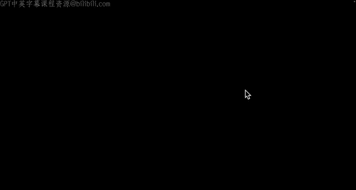

So with that being said， we've covered the input and output shapes。

How are we going to see them with code。 Well， of course， we're going to be who。

Following the pytorrch workflow that we've done。 So we need to get our data ready。

 turn it into tensess in some way， shape or form。 We can do that with tort division transforms。 Oh。

 we haven't seen that one yet， but we will。 We can use torch us data dot data set。

 Us dot data dot data loader。😊，We can then build a model or pick a pre trained model to suit our problem。

 We've got a whole bunch of modules to help us with that Torch an end Tor an N module。

 Torch visionion dot models。😊。

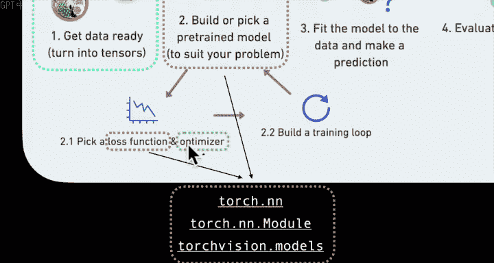

And then we have an optimizer and a loss function。We can evaluate the model using torch metrics or we can code our own metric functions。

We can， of course， improve through experimentation， which we will see later on， which we've actually。

 we've done that， right， We've done improvement through experimentation。

 We've tried different models。 We've tried different things。😊。

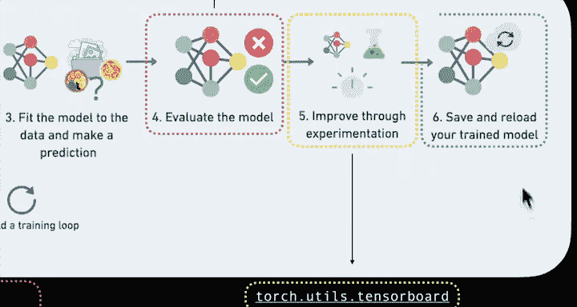

And then finally， we can save and reload our trained model if we wanted to use it elsewhere。

So with that being said， we've covered the workflow。

 This is just a high level overview of what we're going to code。 You might be asking the question。

 what is a convolutional neural network or a CNN。 Let's answer that in the next video。

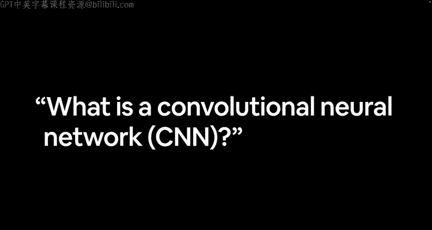

我で。