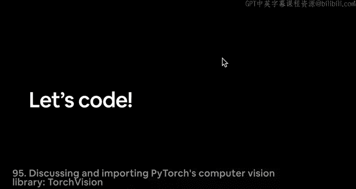
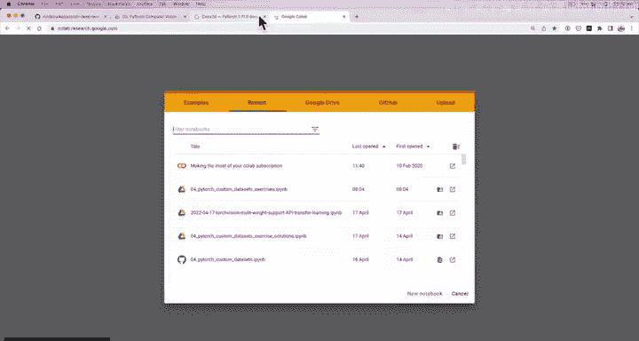
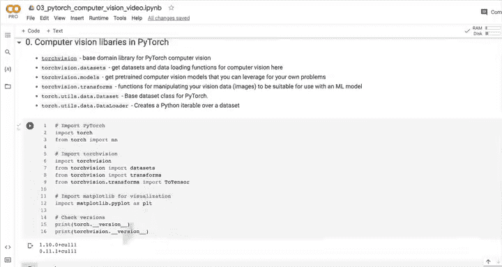

# mrdbourke《一天学会pytorch深度学习｜Learn PyTorch for deep learning in a day Literally》中英 - P62：95. TorchVision.zh_en - GPT中英字幕课程资源 - BV1kx4y1r79d

Welcome back。 Now， we've discussed a bunch of fundamentals about computer vision problems and convolution on neural networks。

 But rather than talk to more slides， let's start to code them out。

 I'm going to meet you at coab dorearch do Google dot com。 Is going to clean up some of these tabs。😊。

And I'm going to start a new notebook。And then I'm going to name this one。

 This is going to be 03 pie torch computer vision， and I'm going to call mine video。

 So just so it has the video tag。Because if we go in here。

 if we go video notebooks of the Pytage deep learning repo， the video notebooks are stored in here。

 They've got the underscored video tag。 So the video notebooks have all of the code I write exactly in the video。

 But there are some reference notebooks to go along with it。 So let me just write heading here。

 Pytorage computer vision。😊，And I'll put a resource here， see reference notebook。Now， of course。

 this is the one。 that's the ground truth。 It's got all of the。Code that we're going to be writing。

You're going to put that in here， explain with text and images and whatnot。 And then finally。

 as we've got C reference。Online book and that is at learnplytorunch。io at section number three。

Plytoch Comp vision。I'm going to put that in there。

 And I'm going to turn this into mark down with command M M。 beautiful。 So let's get started。

 I'm going to get rid of this。 Get rid of this。😊，How do we start this off， Well。

 I believe there are some computer vision libraries。That you should be aware of。

 computer vision libraries in Pytorch。So this is just going to be a text based cell。

 but the first one is Torch vision， which is the base domain library for Pytorrch。Computer vision。

So if we look up towards vision， what do we find？We have Torch Viion 0。12。

 that's the version that Toch visionion is currently up to at the time of recording this。So， in here。

This is very important to get familiar with if you're working on computer vision problems。 And。

 of course， in the documentation， this is just another tidbit。

 we have torch audio for audio problems。 We have torch text for text。 Torch vision。

 which is what we're working on Torch rack for recommendation systems。

 torch data for dealing with different data pipelines， Torch serve。

 which is for serving pytorrch models。 and pytorch on Xla。

 So I believe that stands for accelerated linear algebra devices。

 You don't have to worry about these ones for now。 We're focused on torch vision。 However。

 if you would like to learn more about a particular domain。 This is where you would go to learn more。

 So there's a bunch of different stuff that's going on here， Transing an augmenting images。

 So fundamentally， computer vision is dealing with things in the form of images。

 Even a video gets converted to an image， We have models in pretrained weights。

 So as a reference before， you can use an existing model that works on in existing computer vision problem for your own problem。

 So're going to cover that in section， I think it's。😊，For transfer learning。 And then we have datas。

 which is a bunch of computer vision data sets， U operators a whole bunch of stuff here。

 So Pytorch is really， really good for computer vision。 I mean。

 look at all the stuff that's going on here。 But that's enough talking about it。

 Let's just put it in here。😊，Torch vision， this is the main one。

I'm not going to link to all of these， all of the links for these， by the way。

 is in the book version of the course， Py Toch Comp Vision。😊，And we have what we're going to cover。

 finally。Computer vision libraries in Pytorrch， Torch vision， data sets， models， transforms， etc。

But let's just write down the other ones。So we have torch vision。Nott datas。

 something to be aware of。So get data sets and data loading functions。For computer vision here。

Then we have Torch vision。So these all come from Torch vision models is get pre trained computer vision。

 So when I say pre trained computer vision models。We're going to cover this more in transfer learning。

 as I said， pretrain computer vision models are models that have been already trained on some existing vision data and have trained weights。

 trained patterns that you can leverage for your own problems。😊。

That you can leverage for your own problems。Then we have Torchvision dot transforms。

And then we have functions for manipulating。Your vision。Data， which is， of course， images。

To be suitable for use with an M L model。 So remember， what do we have to do when we have。

Image data or almost any kind of data for machine learning。 we have to prepare it in a way。

 So it can't just be pure images。 So that's what transforms help us out with。

 Transforms helps to turn our image data into numbers so we can use it with a machine learning model。

 And then， of course， we have some。 These are the torch u。 This is not vision specific。

 It entirety of Pytorrch specific。 And that's data set。

 So if we wanted to create our own data set with our own custom data。

 We have the base data set class for Pytorrch。And then we have finally， torch us data。

 These are just good to be aware of because you'll almost always use some form of data set slash data loader with whatever piey torch problem you're working on。

 So this creates a。😊，Python， iterable。Over a data set。Wonderful。

 I think these are most of the libraries that we're going to be using in this section。

 Let's import some of them， hay， so we can see what's going on。😊，Let's go import pie torch。

Import pie torch。So import torch。We're also going to get N N， which is stands for neural network。

 What's N N N。 Well in N N， of course， we have lots of layers， lots of loss functions。

 a whole bunch of different stuff for building neural networks。

 We're going to also import torch vision。And then we're going to go from Torch vision。

Import data sets because we're going to be using data sets later on to get a data set to work with。

From Torch Viion。Will import transforms。You could also go from Tor Viion。Dot transforms。Import。

2 tensor。 This is one of the main ones you'll see for computer vision problems。2 tensor。

 You can imagine what it does。But let's have a look。 transformforms to tensor。

Transforming and augmenting images。So look where we are。 We're in pytorch。

org svis slash stable slash transforms over here。 So we're in the torch vision section。

 and we're just looking at transforming and augmenting images。😊，So transforming what do we have。

 Transforms a common image transformations of our in the transforms module。

 They can be trained together using compose beautiful。 So if we have two tensor， what does this do。

Convert a pill image or nuy andy array to a tensor。 Beaiful。 That's what we want to do later on。

 isn't it？ Well， this is going to be given you a spoiler。

 is we want to convert our images into tensesors so that we can use those with our models。

 But there's a whole bunch of different transforms here。

 And actually one of your extracur is to be to read through each of these packages for 10 minutes。

 So that's about an hour of reading。 but it will definitely help you later on if you get familiar with using the Pytorch documentation。

 After all， this course is just a momentum builder。 We're going to write Heaavestorch code。

 But fundamentally， you'll be teaching yourself a lot of stuff by reading the documentation。

 Let's keep going with this。 Where were we up to。😊，When we're getting familiar with our data。

 Maplot Libb is going to be fundamental for visualization。Remember， the data Explorer's motto。

 visualize， visualize， visualize， become one with the data。 So we're going to import mapplotlib。

 piepl as PLT。And then finally， let's check the versions。So， print， torch dot version。

underscore underscore version and print Torch vision。 So by the time you watch this。

 there might be a newer version of each of these modules out。If there's any errors in the code。

 please let me know。 But this is just a bare minimum version that you'll need to complete this section。

 I believe at the moment， Google Coabab is running 1。11。For torch。 and maybe。Or maybe 1。10。

We'll find out in a second。 It just connected。So we're importing pie torch。Okay， there we go。

So my Pytorch version is 1。10， and it's got Kuder available and Torch Viion is 0。11。

 So just make sure if you're running in Google Coab， if you're running this at a later date。

 you'll probably have at minimum these versions， you might even have a later version。

 So these are the minimum versions required for this upcoming section。

 So we've covered the base computer vision libraries in Pytorch。

 we've got them ready to go How about in the next video， we cover getting a data set。😊。

I'll see you there。