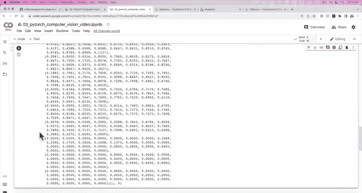
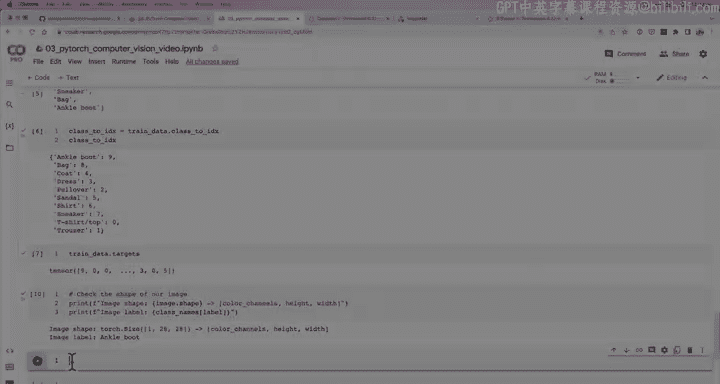
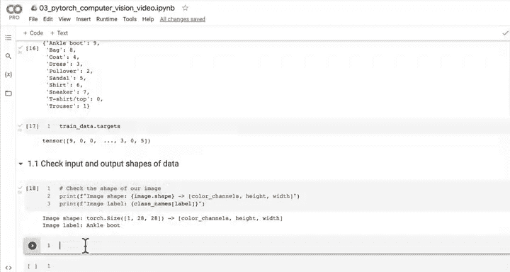
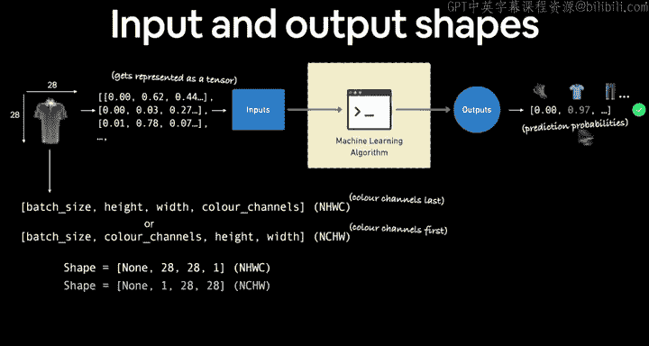
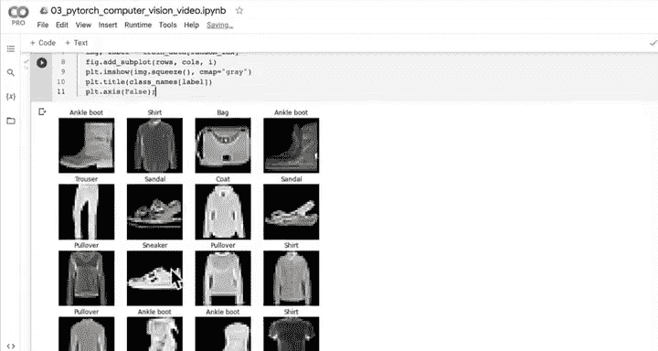
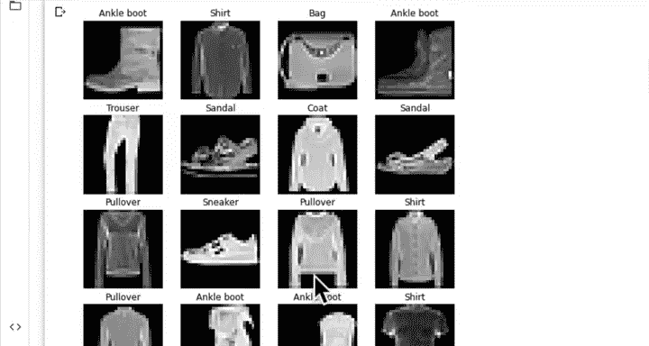
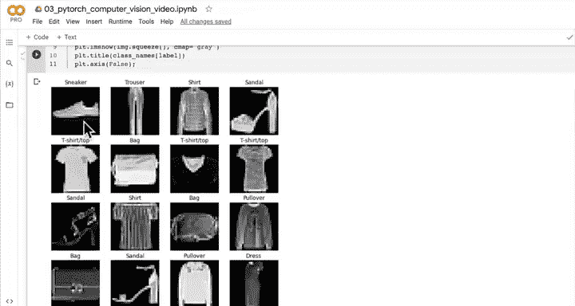
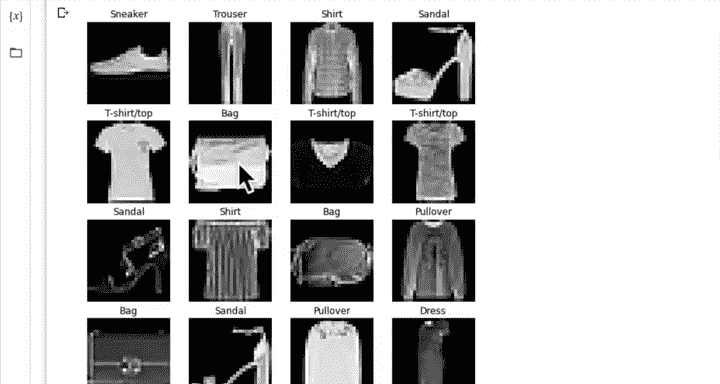
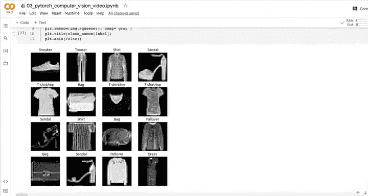

# mrdbourke《一天学会pytorch深度学习｜Learn PyTorch for deep learning in a day Literally》中英 - P63：96. Getting a computer vision dataset.zh_en - GPT中英字幕课程资源 - BV1kx4y1r79d

Welcome back。 So in the last video， we covered some of the fundamental computer vision libraries in Pytorrch。

 The main one being torch vision and then modules that stem off torch vision。 And then， of course。

 we've got torchutils do data dot data set， which is the base data set class for Pytorrch and data loader。

 which creates a Python irriable over a data。 So let's begin where most machine learning projects do。

 And that is getting a data set。😊，Getting a data set。 I'm going to turn this into markdown。

And the data set that we're going to be used to demonstrating some computer vision techniques is fashion Mnes。

Which is a take of the data set we'll be using。Is fashion Mnist。

 which is a take on the original Mnist data set， Mnist database。

Which is Modified National Institute of Standards and Technology Database。

 which is kind of like the hello world in machine learning and computer vision。😊。

Which is these are the sample images from the Mnines test data set。

 which are gray scale images of handwritten digits。 So this， I believe。

 was originally used for trying to find out if you could use computer vision at a postal service to。

 I guess， recognize postcodes and whatnot。 I may be wrong about that。 But that's what I know。Yeah。

1998。 So all the way back at 1998。 How cool is that。

 So this was basically where convolutional neural networks were founded。

 I'll let you read up on the history of that， but。Neural networks started to get so good that this data set was quite easy for them to do really well。

 And that's when fashion Ms came out。 So this is a little bit harder。 if we go into here。

This is by Zlando Research fashionion Mnist， and it's of grayscale images of pieces of clothing。

So like we saw before at the input and the output， what we're going to be trying to do is turning these images of clothing into numbers and then training a computer vision model to recognize what the different styles of clothing are。

And here's a dimensionality plot of all the different items of clothing。

Visualizing where similar items are grouped together。 There's the shoes and whatnot。

 Is this interactive。Oh no。 It's a video。 Excuse me。

There we go to serious machine learning researchers。We are talking about replacing MnT。

 Ms is too easy。 Mns is overused。 Mnis cannot represent modern C tasks。 So even now， fashion Mist。

 I would say， has also been pretty much sold。 but it's a good way to get started。 Now。

 where could we find such a data set， We could download it from Github。

 But if we come back to the torch vision documentation。 Have a look at data sets。

 We have a whole bunch of built in data sets。 And remember。

 this is your extracurricular to read through these for 10 minutes or so each。 But we have a example。

 we could download imagenet if we want。😊，We also have some base classes here for custom data sets。

 We'll see that later on。 But if we scroll through， we have image classification data sets。

 Caltech 101。 I don't even know what all of these are。 There's a lot here。 C5 100。

 So that's an example of 100 different items。 So that would be 100 class multi class classification problem。

 C5 10 is 10 classes。😊，We have EMnist。We have fashion Mnes。 Oh， that's the one we're after。

 But this is basically what you would do to download a data set from Torchvision dot data sets。

 You would download the data in some way， shape or form。

 And then you would turn it into a data loader。 So imagenet is one of the most popular or is probably the gold standard。

😊，Data set for computer vision evaluation。It's quite a big data set， it's got millions of images。

 but that's the beauty of Torch vision is that it allows us to download example data sets that we can practice on。

😊，I would even perform research on from a built in module。

So let's now have a look at the fashion MNIS data set。How might we get this。

 So we've got some example code here， or this is the documentation。

 Torchvision dot data sets dot fashion Mnest。 We have to pass in a route。

 So where do we want to download the data set。We also have to pass in whether we want the training version of the dataset or whether we want the testing version of the dataset。

 Do we want to download it， Yes or no， Should we transform the data in any way shape or form。

 So where we're going to be downloading images through this function call or this class call。

 Do we want to transform those images in some way。 What do we have to do to images before we can use them with a model。

 We have to turn them into a tensor so we might look into that in a moment。

 And target transform is do we want to transform the labels in any way shape or form。

So often the datasets that you download from Torchvision datas are pretty formatted in a way that they can be quite easily used with pitorrch。

 but that won't always be the case with your own custom data sets。 However。

 what we're about to cover is just important to get an idea of what the computer vision workflow is。

 And then later on you can start to customize how you get your data in the right format to be used with the model。

 Then we have some different parameters here and whatnot。

 Let's just rather than look at the documentation if in doubt， code it out。😊。

So we'll be using fashion MNT。And we'll start by。 I'm gonna just put this here。From Torchvision。

t datas。I'm going put the link there。And we'll start by getting the training data。

Set up training data。 you're gonna to make some code cells here so that I can code in the middle of the screen。

Set up training data。Train data equals data sets dot fashion Mist， because recall we've already。

From torch vision。We don't need to import this again， I'm just doing it for demonstration purposes。

 but。From Torch Viion， import data sets so we can just call data set stop fashionash Mist。

And then we're going to type in root。😊，See how the do string comes up and tells us what's going on。

 I personally find this a bit hard to read in Google collabs。 So if I'm looking up the documentation。

 I like to just go into here。 But let's code it out。 So root is going to be data。

 So where to download data 2。We'll see what this does in a minute。Then we're going to go train。

 We want the training version。Of the data set。 So as I said。

 a lot of the data sets that you find in Torchvision dot data sets have been formatted into training data set and testing data set already。

 So this bulling tells us。Do we want the training data set？So if that was false。

 we would get the testing data set or fashion MNT， do we want to download it？Do we want to download？

Yes， no。 So， yes， we do。 We're going to set that to true。 Now。

 what sort of transform do we want to do？ So because we're going to be downloading images and what do we have to do to our images。

To use them with a machine learning model， we have to convert them into tensors。

 So I'm going to pass their transform to tensor。 but we could also just go torch vision dot transforms。

Dot2 tensor。 That would be the exact same thing as what we just did before。

 And then the target transform。 Do we want to transform the labels， No， we don't。

 We're going to see how they come or the targets。 Sorry， Hi Torch。

 this is another way another naming convention often uses target for the target that you're trying to predict。

 So using data to predict the target， which is I often use data to predict a label。

 They're the same thing。 So how do we。Want to transform the data？And。How do we want to transform？

The libs slash targets。And then we're going to do the same for the test data。

 So we're going to go data sets。You might know what to do here。

 it's going to be the exact same code as above except we're going to change one line。

We want to store it in data。We want to download the training data set as false because we want the testing version。

Do we want to download it， Yes， we do。 Do we want to transform it the data， Yes， we do。

 We want to use2 tensor to convert our image data to tensors。

 and do we want to do a target transform？ Well， no， we don't。

 We want to keep the label slash the targets as they are。 Let's see what happens when we run this。

Downloading fashion M its beautiful。So this is going to download all of the labels where we have train images。

 train labels， lovely test images， test labels beautiful。

 so that's how quickly we can get a data set by using Torch visionion datas。

 Now if we have a look over here， we have a data folder because we set the route to be data and if we look what's inside here we have fashion MNest exactly what we wanted。

 then we have the raw， and then we have a whole bunch of files here。

 which Torchvis has converted into datas for us。😊，So let's get out of that and this process would be much the same if we used almost any data set in here。

 of course， they might be slightly different depending on what the documentation says and depending on what the data is。

 but that is how easy Torvision。 datasets makes it to practice on example computer vision datasets。

So let's go back。Let's check out some parameters or some attributes of our data。

How many samples do we have？So we'll check the length。So we have 60。

000 training examples and 10000 testing examples， so what we're going to be doing is we're going to be building a computer vision model to find patterns in the training data and then use those patternss to predict on the test data and so let's see a first training example。

 see the first training example。So we can just index on the train data。 Let's get the zeroth index。

 and then we're going to have a look at the image and the label。Oh， my goodness。W bunch of numbers。

Now you see what the two tensor has done for us。So we've downloaded some images。

 and thanks to this torch vision transforms to Tensor。 How would we find the documentation for this？

 Well， we could go and see what this does， transforms to Tensor。We can go to Tensor。 There we go。

 What does this do？Convert a pill image， so that's Python image library image or nupyy array to a tensor。

This transform does not support torch script， So it converts a pill image or nup array height width color channels in the range 0 to 255 to a torch float tensor of shape C here。

 This is what I was talking about how Pi torch defaults with a lot of transforms to C HW。

 So color channels first height then width in the range of0 to1。

 So typically red green and blue values are between 0 and 2，55。

 But neural networks like things between 0 and1。 And in this case。

 it is now in the shape of color channels first， then height， then width。 However。

 some other machine learning libraries prefer height width， then color channels。

 Just keep that in mind。 We're going to see this in practice later on。So we've got the image。

 We've got a label。 Let's check out some more details about it。 Remember how we discussed， oh。

 there's our label， by the way。 So 9， we can go train data dot classes。

 find some information about our class names。Class names。Beautiful， so number 9 would be 0，1，2，3，4，5。

6，7，8，9。 So this particular tensor seems to relate to an ankle boot。 How would we find that out。

 Well， one second， I'm just going to show you one more thing， class to I D X。

 Let's go train data dot class to I D X。 What does this give us。😊，Class to audioX。

This is going to give us a dictionary of different labels and their corresponding index。

 So if our machine learning model predicted 9 or class 9。

 we can convert that to ankle boot using this attribute of the train data。

 There are more attributes so that you can have a look at if you like。 You can go train data dot。

 Then I just push tab to find out a bunch of different things。

You could go data as the data that'll be the images， and then I believe you can also go targets。

So targets， that's all the labels。Which is one big long tensor。 Now let's check the shape。

Check the shape。Of our image， so image dot shape and label dot shape。

 What are we going to get from that？Oh， label doesn't have a shape。 Why is that， Well。

 because it's only an integer。So， oh， beautiful。 Look at that。

 So our image shape is we have a colour channel of one。

 So let me print this out in something prettier。😊，Print。Image shape。

 which is going to be image shape。 Remember how I said it's very important to be aware of the input output shapes of。

Your models and your data。 It's all part of becoming one with the data。 So that is what our image。

Shape is。And then if we go next， this is print。Image label， which is。Label。

 but will index on class names for label。And then we'll do that。Wonderful。

 so our image shape is currently in the format of color channels's heightight width。

 Weve got a bunch of different numbers。 that's representing our image。 It's black and white。

 It only has one color channel。 Why do you think it only has one color channel。😊，Well。

 because it's black and white。 So if we jump back into the keynote， fashion emnes。

 we've already to discuss this。 grayscale images have one color channel。

 So that means that for black， the pixel value is 0 and for white。

 it's some value for whatever color is going on here。 So if it's a very high number， say it's one。

 it's going to be pure white。 if it's like 0。001， it might be a faint white pixel。

 But if it's exactly 0， it's going to be black。 So color images have three color channels for red。

 green and blue， grayscale have one color channel。😊。

But I think we've done enough of visualizing our images as numbers。 How about in the next video。

 we visualize our image as an image。

I'll see you there。

Welcome back。 So in the last video， we checked the input output shapes of our data。

 and we downloaded the fashion Mnes data set， which is comprised of images or grayscale images of T shirts。

 trousers， pullovers， dress， coat， sandal， shirt， sneaker， bag， ankle boot。 Now。

 we want to see if we can build a computer vision model to decipher what's going on in fashion Mnes。

 So to separate， to classify different items of clothing based on their numerical representation。😊。

And。Part of becoming one with the data is， of course， checking the input output shapes of it。

 So this is a fashion Mnes data set from Zlando research。

Now if you recall， why do we look at our input output shapes， Well， this is what we looked at before。

 We have 28 by 28 grayscale images that we want to represent as a tensor。

 We want to use them as input into a machine learning algorithm。

 typically a computer vision algorithm such as a CNN。

 then we want to have some sort of outputs that are formatted in the ideal shape that we'd like。

 So in our case we have 10 different types of clothing， So we're going to have an output shape of 10。

 but our input shape is what。😊。

So by default， pie torch turns tensesors into color channels first。

 So we have an input shape of none 1，28，28。 So none is going to be our batch size， which， of course。

 we can set that to whatever we'd like。And so our input shape format is in N C， HW。

 or in other words， color channels first。 But just remember。

 if you're working with some other machine learning libraries。

 you may want to use color channels last。So let's have a look at where that might be the case。

 we're going to visualize our images。So I'll make a little heading here。1。2。

 Now this is all part of becoming one with the data。Otherwise words。

 understanding its input output shapes， how many samples there are， what they look like。😊，Visualize。

 visualize， visualize。 Let's import Matpllib。I'm just going to add a few code cells here。

 import mappl lib。Dot pie plot。Pylo as PLT。Now， let's create our image and label is our train data0。

 and we're going to print the image shape so we can understand what。

Iputs are going into our mappl lib function。And then we're going to go plot。im show。

 and we're going to pass in our image and see what happens because recall。

 what does our image look like image。Our image is this big tensor of numbers。

And we've got an image shape 128，128。 Now， what happens if we call plot。t M show What happens there？

Oh。We get an error in shape 128128 for image data。😊，Now， as I said。

 this is one of the most common errors of machine learning is a shape issue。

 So the shape of your input tensor doesn't match the expected shape of that tensor。

 So this is one of those scenarios where our data format。

 So color channels first doesn't match up with what mappllib is expecting。

 So mapplotlib expects either just height and width。 So no color channel for gray stale images。

 or it also expects the color channels to be last。 So we'll see that later on， but for gray scale。

 we can get rid of that extra dimension。 by passing in image dot squeeze。

So do you recall what squeezeeze does？It's going to remove that singular dimension。

 If we have a look at what goes on now。Beautiful， we get an ankle boot。 Well。

 that's a very pixelated ankle boot， but we're only dealing with 28 by 28 pixels。

 So not a very high definition image。 Let's add the title to it。😊，We're going to add in the label。

Beautiful， so we've got the number 9 here。 So where if we go up to here， That's an ankle boot。 Now。

 let's plot this in gray scale。 How might we do that， We can do the same thing。

 We can go plot P L T dot M show。 We're going pass in image dot squeeze。😊。

And we're going to change the color map C map equals gray。 So in mappl Lib。

 if you ever have to change the colors of your plot。

 you want to look into the C map property or parameter， or sometimes it's also shortened to just see。

But in this case， I show is CMm and we want a plot title。

 and we're going to put in class names and the label integer here。So we have a look at it now。

 we have an ankle boot。 and we can remove the axises Too if we wanted to plot dot axis and turn that off。

 That's going to remove the axis。 So there we go。 That's the type of images that we're dealing with。

 But that's only a singular image。 How about we harness the power of randomness and have a look at some random images from our data set。

 So how would we do this。 Let's go plot more images。We'll set a random seed。

 so you and I are both looking at as similar as possible images， 42。Now。

 we'll create a plot by calling plot dot figure。 and we're going to give it a size。

 and we might create a 9 by 9 grid。 So we want to see 9 random images from our data set。 So rows。

 coals。Or sorry， maybe we'll do 4 by 4。 That'll give us 16。 We're going to go4 I in range。

 and we're going to go one to rows times columns plus one。 so we can print I。

 What's that going to give us。We want to see 16 images， or thereabouts。So 16 random images， but。

Used with a manual C to 42 of our dataset set。 This is one of my favorite things to do with any type of data set that I'm looking at。

 whether it be text image， audio doesn't matter。 I like to randomly have a look at a whole bunch of samples at the start so that I can become one with the data。

 With that been said， let's use this loop to grab some random indexes。

 We can do so using torches random int。 So random integer。 between 0 and length of the training data。

 This is going to give us a random integer in the range of 0 and however many training samples we have。

 which in our case is what 60000 or thereabouts。😊，So we want to create the size of one。

 and we want to get the item from that so that we have a random index。 What is this going to give us。

Oh， excuse me， Maybe we print that out。There we go。 So we have random images now。

 because we're using manual seed， it will give us the same numbers every time。 So we have 3，7，5，4，2。

3，7，5，4，2。 And then if we just commented out the random seed， will'll get different。

Numbers every time。But this is just to demonstrate， we'll keep the manual see there for now。

 You can comment that out if you'd want different numbers or different。Images。

 different indexes each time。 So we'll create the image and the label by indexing on the training data at the random index that we're generating。

And then we'll create our plot。 So fig or we'll add a subplot， Fig add。Subplot。

 and we're going to go rows Cols I。 So at the ifF index。 we're going to add a subplot。

 Remember we set rows and columns up to here。 And then we're going to go Plt dot M show。

 We're going to show what we're going to show our image。

 but we have to squeeze it to get rid of that singular dimension as a color channel。 Otherwise。

 we end up with an issue with mappot Lib。 We're going to use a color map of gray。

 So it looks like the image we plotted above。 And then for our title。

 it's going to be our class names indexed with our label。

 And then we don't want the aes because that's going to clutter up our plot。

 Let's see what this looks like。😊，Oh my goodness， look at that。 It worked first go。

 Usually visualizations take for a bit of trial and error。😊。

So we have ankle boots， we have shirts， we have bags， we have ankle boots， sandal， shirt。

 pull over all。😊，Do you notice something about the data set right now？Pull over and shirt。

To me they look quite similar， do you think that will cause an issue later on when our model is trying to predict between a pullover and a shirt？

How about if we look at some more images？We'll get rid of the random see so we can have a look at different styles。

So we have a sandal， ankle boot coat， T shirt， top， shirt， oh。

Is that a little bit confusing that we have a class for T shirt and top and shirt？

Like I'm not sure about you， but what's the difference between a T shirt and a shirt？

This is just something to keep in mind as a T shirt on top does that look like it could be maybe even a dress？

Like the shape is there。 So this is just something to keep in mind going forward。 Chances are。

 if we get confused on our， like you and I looking at our data set。

 if we get confused about different samples and what they're labeled with。

Our model might get confused， later on。So let's have a look at one more and then we'll go into the next video。

😊，So we have sneaker， trousers， shirt， sandal， dress， pullover bag， bag， T shirt。

 Oh that's quite a difficult one。 Doesn't look like there's even much going on in that image， but。

The whole premise of building machine learning models to do this would be。

 could you write a program that would take in the shapes of these images and figure out。

 write a rule based program that would would go， hey。

 if its looked like a rectangle with a buckle in the middle， it's probably a bag。I mean。

 you probably could after a while， but I prefer to write machine learning algorithms to figure out patterns and data。

 So let's start moving towards that。 We're now going to go on figuring out how we can prepare this data to be loaded into a model。

I'll see you there。