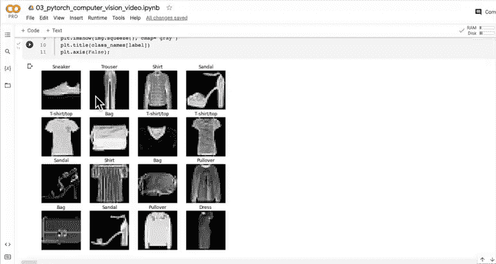
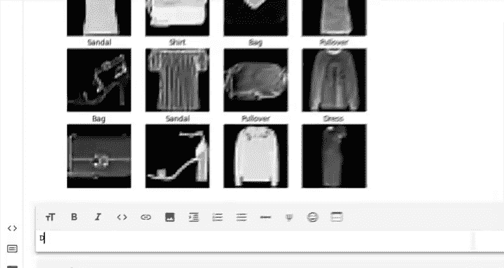
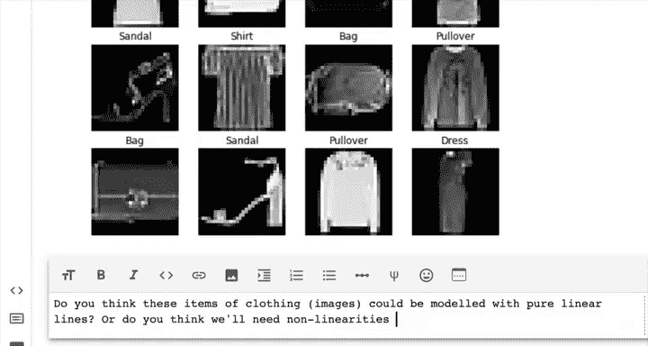
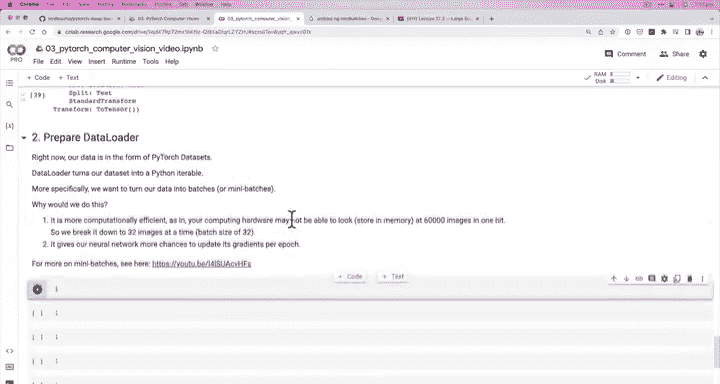
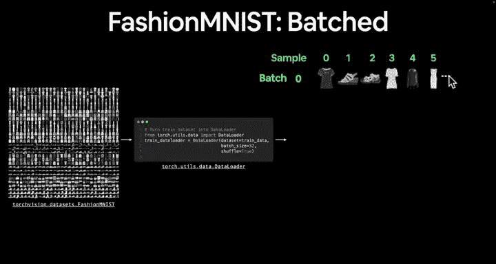

# mrdbourke《一天学会pytorch深度学习｜Learn PyTorch for deep learning in a day Literally》中英 - P64：98. Mini-batches.zh_en - GPT中英字幕课程资源 - BV1kx4y1r79d

All right， All right， All right。 So we've got 60000 images of clothing that we'd like to build a computer vision model to classify into 10 different classes。

 And now that we've visualized a fair few of these samples。

 do you think that we could model these with just linear lines。

 So straight lines or do you think we'll need a model with nonlinearity。

So I'm going to write that down。😊，So。

Do you think。These。Items of clothing。Images。Could be modeled with pure linear lines。

 or do you think well need。Non lineararity。Don't have to answer that。 Now。

 We could test that out later on。 You might want to skip ahead and try to build a model yourself with linear lines or nonlinearities。

 We've covered linear lines and nonlinearities before。

 but let's now start to prepare our data even further to prepare。

Data loader。So， right now。Our data is in the form of P toch datas。So let's have a look at it。

Train data。There we go。 So we have data set， which is of fashion Mnist。 And then if we go test data。

We see a similar thing except we have a different number of data points and we have the same transform on each。

 we've turned them into tensors， so we want to convert them from a data set。

 which is a collection of all of our data into a data loader recall that a data loader turns our data set into a python iterable。

So I'm going to turn this into markdown。Beautiful。More specifically。Specifically can I spell right。

 doesn't really matter。 We want to just code right。 We're not here to learn spelling。😊。

We want to turn。Our data into batches。Or mini batches。Why would we do this？Well。

 we may get away with it by building a model to look at all 60。

000 samples of our current data set because it's quite small。

 it's only comprised of images of 28 by 28 pixels。😊，And when I say quite small， yes， 60。

000 images is actually quite small for a deep learning scale data set。

 and modern data sets could be in the millions of images。😊。

But if our computer hardware was able to look at 60000 samples of 28 by 28 at one time。

 it would need a fair bit of memory。 So we have Ram space up here。 We have GPU memory。

 we have compute memory。😊，But chances are that it might not be able to store millions of images in memory。

 So what you do is you break a data set from， say， 60000 into groups of batches or mini batches。

 So we've seen batch size before。 Why would we do this， Well， one。It is more computationally。

Efficient。As in your computing hardware。May not be able to look。Stor in memory。啊。

60000 images in one hit。 So we break it down to 32 images at a time。 This would be batch size of 32。

 Now， again，32 is a number that you can change，32 is just a common batch size that you'll see with many beginner style problems。

 As you go on， you'll see different batch sizes。 This is just to exemplify the concept of mini batches。

 which is very common in deep learning。 And why else would we do this。

The second point or the second mind point is it。Gives。

Our neural network more chances to update its gradients。Per epoch。 So what I mean by this。

 This will make more sense when we write a training loop。

 But if we were to just look at 60000 images at one time， we would per epoch。

 So per iteration through the data， we would only get one update per epoch across our entire data set。

 Whereas if we look at 32 images at a time。 our neural network updates its internal states。

 its weights。 every 32 images， thanks to the optimizer。

 This will make a lot more sense once we write our training loop。

 But these are the two of the main reasons for turning our data into mini batches in the form of a data loader。

 Now， if you'd like to learn more about the theory behind this。

 I would highly recommend looking up Andrew Ong mini batches。 There's a great lecture on that。😊。

So yeah， large scale machine learning， mini batch gradient descent， mini batch gradient descent。

 Yeah， that's what it's called mini batch gradient descent。 If you look up some results on that。

 you'll find a whole bunch of stuff。I might just link this one。I'm going to pause that。

I'm going to link this。In there。😊，So。For more on mini batches。四器啊。Now， to see this visually。

 I've got a slide prepared for this。 So this is what we're going to be working towards。

 There's our input and output shapes。 We want to create batch size of 32 across all of our 60000 training images。

 and we're actually going to do the same for our testing images。

 but we only have 10000 testing images。😡。

So this is what our data set is going to look like Baed。 So we're going to write some code。

 namely using the data loader from Torshot uil data。 We're going to pass it a data set。

 which is our train data。 We're going to give it a batch size。

 which we can define as whatever we want for us。 We're going to use 32 to begin with。

And we're going to set shuffle equals true if we're using the training data。

 Why would we set shuffle equals true。 Well， in case our data set for some reason has order。

 say we had all of the pants images in a row。 We had all the ts shirt images in a row。

 We had all the sandal images in a row。 We don't want our neural network to necessarily remember the order of our data。

 We just wanted to remember individual patterns between different classes。 So we shuffle up the data。

 we mix it。 We mix it up。 And then it looks something like this。 So we might have batch number 0。

 and then we have 32 samples。 Now I ran out of space when I was creating these， but we got do dot。

 That was fun。 up to 32。 So this is setting batch size equals 32。 So we look at 32 samples per batch。

😊。

We mix all the samples up。And we go batch batch， batch， and we'll have。

 however many batches we have willll have number of samples divided by the batch size。

 So 60000 divided by 32。 What's that 1800 or something like that。

 So this is what we're going to be working towards。 I did want to write some code in this video。

 But I think to save it getting too long， we're going write this code in the next video。

 If you would like to give this a go on your own。 Here's most of the code we have to do。

 So there's the train data loader。 do the same for the test data loader。

 And I'll see you in the next video。 And we're gonna to batchify our fashion Mnes data set。😊。

