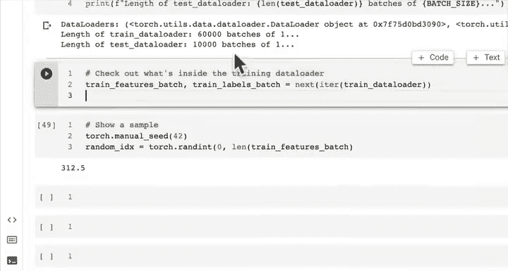
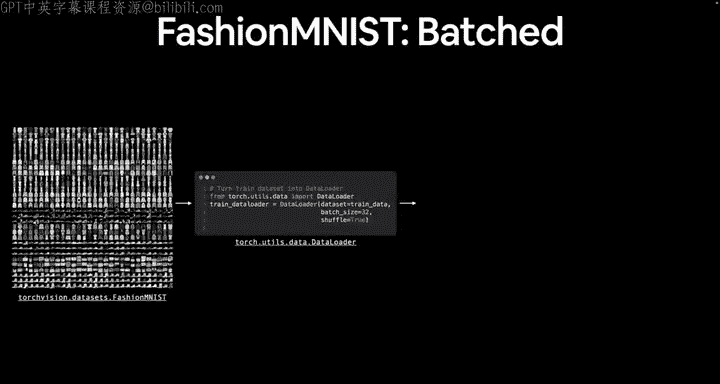
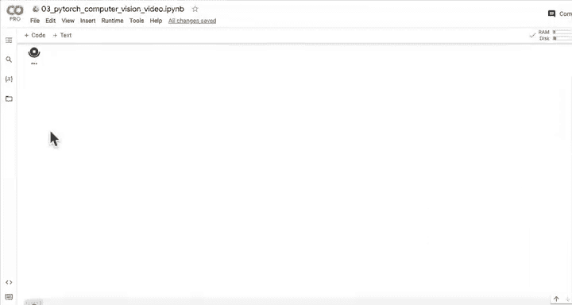
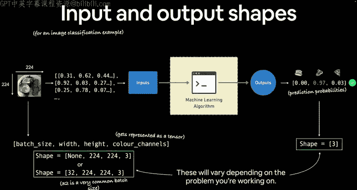
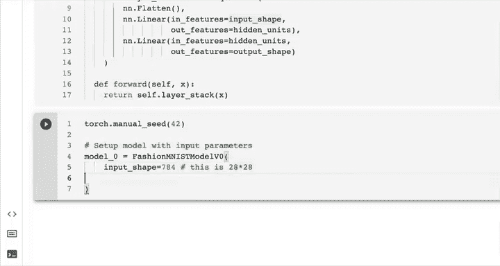
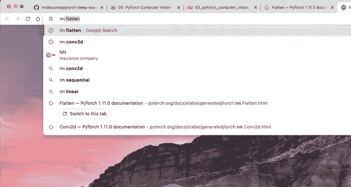
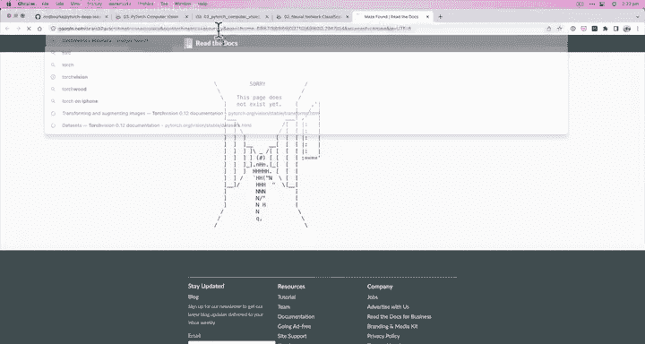
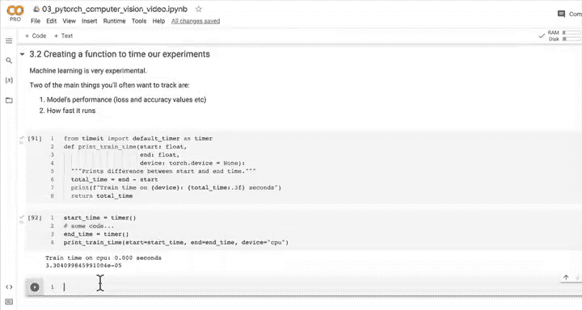

# mrdbourke《一天学会pytorch深度学习｜Learn PyTorch for deep learning in a day Literally》中英 - P65：99. Creating DataLoaders.zh_en - GPT中英字幕课程资源 - BV1kx4y1r79d

Welcome back。 In the last video， we had a brief overview of the concept of mini batches。

 And so rather than our computer looking at 60000 images in one hit， we break things down。

 We turn it into batches of 32。 Again， the batch size will vary depending on what problem you're working on。

 but 32 is quite a good value to start with and try out。😊，And we do this for two main reasons。

 if we jump back to the code， while we do this， it is more computationally efficient。

 So if we have a GPU with， say 10 gig of memory， it might not be able to store all 60000 images in one hit in our data set because it's quite small。

 it may be our two but it's better practice for later on， to turn things into mini batches。

 and it also gives our neural network more chances to update its gradients per epoch。

 which will make a lot more sense once we write our training loop， But for now。

 we've spoken enough about the theory， Let's write some code to do so。

 So I'm going to import data loader from torch dot us do data importport data loader。

 And this principle， by the way， preparing a data loader。😊，Goes the same for not only images。

 but for text， for audio， whatever sort of data you're working with。

 many batches will follow you along or batches of data will follow you along throughout a lot of different deep learning problems。

So， set up。The batch size hyperparameter。 Remember。

 a hyperparameter is a value that you can set yourself。 So batch size equals 32。 and it's practice。

 You might see it typed as capitals。 You won't always see it。

 but you'll see it quite often a hyperparameter typed as capitals。

And then we're going to turn data sets into iterables。So， batches。

So we're going to create a train data loader here of our fashionash MNest data set。

We're going to use data loader。 We're going to see what the dock string is， or actually。

 let's look at the documentation， torch data loader。😊，This is some extra curriculum for you to。

 by the way， is to read this data page Taunt U， not data because。😊。

No matter what problem you're going with with deep load or pytorch。

 you're going to be working with data。 So spend 10 minutes just reading through here。

 I think I might have already assigned this， but this is just so important that it's worth going through again。

 Read through all of this。 Even if you don't understand all of what's going on。

 It's just it helps you know where to look for certain things。 So what does it take。

 Data loader takes a data set。 We need to set the batch size to something is the default of one。

 That means that we would create a batch of one image at a time In our case。

 Do we want to shuffle it。 Do we want to use a specific sampler， There's a few more things going on。

 numberumb of workers。 numberumb of workers stands for how many core on our machine do we want to use to load data。

 General， the higher the better for this one， But we're going keep most of these as the default。

 because most of them are set to pretty good values to begin with。

 I'll let you read more into the other parameters here。 We're going focus on the first three。

Data set， batch size and shuffle true or false。Let's see what we can do。

So data set equals our train data， which is 60，000 fashion Mns， and then we have a batch size。

 which we're going to set to our batch size hyperparameter。

 so we're going to have a batch size of 32。And then finally， do we want to shuffle the training data。

 Yes， we do。And then we're going to do the same thing for the test data loader。

 except we're not going to shuffle the test data。😊，Now you can shuffle the test data if you want。

 but in my practice， it's actually easier to evaluate different models when the test data isn't shuffled。

So you shuffle the training data to remove order and so your model doesn't learn order。

 but for evaluation purposes， it's generally good to have your test data in the same order because our model will never actually see the test data set during training。

 we're just using it for evaluation So the order doesn't really matter the test data load。

 it's just easier if we don't shuffle it because then if we evaluate it multiple times it's not been shuffled every single time。

So let's run that。 And then we're going to。Check it out。

 our train data loader and our test data loader。Beautiful， we've got instances of torch U data。

 data loader do data loader。 And now let's check out what we've created， hey。😊。

I always like to print different attributes of whatever we make。Check out what we've created。

 This is all part of becoming one with the data。So， print。If I'm going to go data loaders。

And then pass in， this is just going to output basically the exact same as what we've got above test data loader。

And we can also see what attributes we can get from each of these by going train data loader。

 I don't need caps lock there， Tra data loader full stop， and then we can go tab。

 We've got a whole bunch of different attributes。 We've got a batch size We've got our data set。

 do we want to drop the last， as in if our batch size overlapped with our 60000 samples。

 do we want to get rid of the last batch， say， for example， the last batch and they had 10 samples。

 Do we want to just drop that， Do we want to pin the memory that's going to help later on if we wanted to load our data faster。

 A whole bunch of different stuff here if youd like to research more。

 you can find all the stuff about what's going on here in the documentation。

But let's just keep pushing forward。 What else do we want to know。

 So let's find the length of the train。Da load up。We will go length。Train data loader。

 So this is going to tell us how many batches there are batches of which of course， is batch size。

And we want print。Length。Of test data loader。We want length test data loader。Baches of batch size。

Dot dot dot。 So let's find out some information。 What do we have。 Oh， there we go。

 So just we're seeing what we saw before with this one。 But this is more interesting here。

 length of train data loader。 Yeah， we have about 1875 batches of 32。

 So if we do 60000 training samples divided by 32。😊，Yeah， it comes out to 1875。

 And if we did the same with 10000 for testing samples of 32， it comes out at 313。

 This gets rounded up。 So this is what I meant that the last batch will have maybe not 32 because 32 doesn't divide evenly into 10000。

 But that's okay。And so。This means that our model is going to look at 1875 individual batches of 32 images。

 rather than just one big batch of 60000 images。 Now， of course。

 the number of batches we have will change if we change the batch size。So we have 469 batches of 1。

28。 And if we reduce this down to one， what do we get， We have a batch per sample。

 So 60000 batches of 1，10000 batches of one。 But we're going to stick with 32。

But now let's visualize。 So we've got the in trained data loader。

 How would we visualize a batch or a single image from a batch。So let's show a sample。

I'll show you how you can interact with their data loader。We're going to use randomness as well。

 So we'll set a manual seed and and we'll get a random index。 R Id X equals torch， Rand int。

We're going go from zero to length of train features batch。 Oh where did I get that from。

 excusecuse me， getting ahead of myself here， I want to check out what's inside the training data loader。

 We'll check out what's inside the training data loader because the test data load is going to be similar。

 So we want the train features batch。 So I say features as in the images themselves and the train labels batch is going to be the labels of our data set or the targets in Pytorch terminology。

So next， it data loader。 So because our data loader has。1875 batches of 32。

 We're going turn it into an iterriable with itta。 and we're going to get the next batch with next。

And then we can go here， train features。Btch dot shape。And we'll get train labels。Batch dot shape。

 what do you think this is going to give us？Well， there we go。 Look at that。 So we have a tensor。

 each batch。 We have 32 samples。 So this is batch size， and this is color channels。

 and this is height， and this is width。 And then we have 32 labels associated with the 32 samples。

 Now， where have we seen this before。

If we go back。Throughout Canote。Iput and output shapes。 So we have shape equals 32，28，281。

 So this is color channels's last， but ours is currently in。Cour channels， first。Now， again。

 I sound like a broken record here， but these will vary。

 depending on the problem you're working with， if we had larger images。

 what would change or the height and width dimensions would change if we had color images。

 the color dimension would change， but the premise is still the same。

 We're turning our data into batches so that we can pass that to a model。Let's come back。

 Let's keep going with our visualization。So we want to visualize one of the random samples from。

A batch。And then we're going to go image， label。Eles， train features。

Batch and we're going to get the random IDx from that and we'll get the train labels batch。

And we'll get the random I X from that。 So we're matching up on the。We've got one batch here。

 train features， batch， train labels batch， and we're just getting the image and the label at a random index within that batch。

So， oh， excuse me。 I need to set this equal there。And then we're going to go Plt。Doc show。

 What are we going to show？We're going to show the image。

 but we're going to have to squeeze it to remove that singular dimension。

 and then we'll set the C map equal to gray。And then we'll go PLT dot title will' set the title。

 which is going to be the class names indexed by the label integer。And then we can turn off the aes。

You can use off here， or you can use false。Depends on what you'd like to use。

 let's print out the image size。Because you can never know enough about your data， and then print。

Let's also get the label。Lable and。Label shape or label size。Now label will be。Just a single integer。

 so it might not have a shape， but that's okay。 Let's have a look。Oh bag。 See， look。

 that's quite hard to understand。 I wouldn't be out a detector。 That's a bag。

 Can you tell me that you could write a program to understand that。

 that just looks like a warped rectangle to me。 But if we had a look at another one。

We'll get another random。 Oh， we've got a random seed。

 So it's going to produce the same image each time。So we have a shirt。 Okay， shirt。

 So we see the image size there，1，28，28。 Now recall that the image size is， it's a single image。

 So it doesn't have a batch dimension。 So this is just colour channels height width。We' go again。

Label 4， which is a coat。And we could keep doing this to become more and more familiar with our data。

 but these are all from this particular batch that we created here。Coat。And we'll do one more。

 another coat。 We'll do one more just to make sure it's another coat。 There we go。 We've got a bag。

 beautiful。 So we've now turned our data into data loaders。

 so we could use these to pass them into a model。😊，But we don't have a model。

 So I think it's time in the next video。 we start to build model 0。 We start to build a baseline。

I'll see you in the next video。Welcome back So in the last video we got our data sets or our data set into data loaders。

 so now we have 1，875 batches of 32 images or for the training data set rather than 60。

000 in one big data set and we have 13 or 313 batches of 32 for the test data set。😊。

Then we learned how to visualize it from a batch。 and we saw that we have still the same image size。

 one color channel 28，28。 All we've done is we've turned them into batches。

 so that we can pass them to our model。 And speaking of model。 Let's have a look at our workflow。

 Where are we up to。 Well， we've got our data ready。

 We've turned it into tensess through a combination of torch visionion transforms。

 Torchutils data dot data。 We didn't have to use that one cause Torchvision do data sets did it for us with the fashion Ms data set。

 but we did use that one。 We did torch us do data， the data loader to turn our data sets into data loaders。

 Now we're up to building or picking a pretrained model to suit your problem。

 So let's start simply Let's build a baseline model And this is very exciting because we're going to build our first model。

 our first computer vision model。 albeit be at a baseline。 but that's an important step。

 So I'm just going to write down here。😊，When starting to build a series of machine learning。

Modeelling。Experiments。It's best practice to start with a baseline model。I'm going to turn this into。

Mockdown。A baseline model。So a baseline model。Is a simple model。You will try and improve upon。

With subsequent。Models。Models slash experiments。So you start simply。In other words。

Start simply and add complexity when necessary， because neural networks are pretty powerful， right。

 And so they have a tendency to almost do too well on our data set。

 That's a concept known as overfitting， which we'll cover a little bit more later。

But we build a simple model to begin with a baseline。

 And then our whole goal will be to run experiments， according to the workflow。

 improve through experimentation。 Again， this is just a guide that's not set in stone。

 but this is the general pattern of how things go。 Get data ready。Build a model。 fit the model。

 evaluateval， improve the model。 So the first model that we build is generally a baseline。

 And then later on， we want to improve through experimentation。😊，So let's start building a baseline。

 But I'm going to introduce to you a new layer that we haven't seen before。

 And that is creating a flatten layer。 Now， what is a flatten layer。 Well。

 this is best seen when we code it out。 So let's create a flatten model。

 which is going just going to be N N dot flatten and where could we find the documentation for this。

 we go N N flatten。Flatten and pie torch， what does it do？

Flattens a continuous range of dims into a tensor for use with sequential。

So there's an example there， but I'd rather， if in doubt， code it out。😊。

So we'll create the flatten layer and of course， all NN dot flatten or NN dot modules could be used as a model on their own。

So， we're going to get。A single。Sample， so x equals train features batch。

Let's get the first one zero。 What does this look like？Sos a tena。X。

 maybe we get the shape of it as well， X shape。What do we get， There we go。 So that's the shape of X。

 Keep that in mind when we pass it through the flatten layer。

Do you have an inkling of what flatten might do？So our shape to begin with is what 128，28。Now， let's。

Flaten the sample。 So output equals。 We're going to pass it to the flatter model X。

So this is going to perform the forwardd pass internally on the flatten layer。

So perform forward pass。Now let's print out what happened。Print out what happened。Print。Shape before。

Flattening equals x dot shape。And we're going to print shape after flattening equals output dot shape。

 So we're just taking the output of the flat model and printing its shape here。Oh。

Do you notice what happened。Well， we've gone from 128，28 to 1784。Wow， what does the output look like？

Output， a。The values are now in all one big vector。 And if we squeeze that。

 we can remove the extra dimension。So you've got one big vector of values。 Now。

 where did this number come from？Well， if we take this， and this is what shape is it。

 We've got colour channels。 We've got height， we've got width。And now， we flattened it to be。

Color channels。Hight。With。So we've got one big。

Feature vector because 28 by 28 equals what， we've got one value per pixel。7，8，4。

One value per pixel in our output vector。Now， where did we see this before？

If we go back to our keynote， if we have a look out， Tesla's takes eight cameras。

 and then it turns it into a three dimensional vector space。Vectctor space。

 So that's what we're trying to do here。 We're trying to encode whatever data we're working with In Tesla's case。

 They have eight cameras。 Now， theirs has more dimensions than ours because they have the time aspect because they're dealing with video and they have multiple different camera angles。

 We're just dealing with a single image here。 But regardless， the concept is the same。

 We're trying to condense information down into a single vector space。

 And so if we come back to here。 Why might we do this。 Well。

 it's because we're going to build a baseline model。

 And we're going to use a linear layer as the baseline model。

 And the linear layer can't handle multidimensal data like this。

 We want it to have a single vector as input。 Now， this will make a lot more sense after we've coded up our model。

 So let's do that。From torch。Import N N。We're going to go class， fashion Mnist model V0。

We're going to inherit from N N dot module。 and inside here。

 we're going to have an function in the constructor。 We're going to pass in self。

We're going to have an input shape。Which will use a type hint。

 which will take an integer because remember， input shape is very important for machine learning models。

We're going to define a number of hidden units， which will also be an integer。

 And then we're going to define our output shape， which will be。

 What do you think our output shape will be， How many classes are we dealing with。

We're dealing with 10 different classes， So our output shape will be。

I'll save that for the later one。I'll let you guess for now， or you might already know。

 We're going to initialize it。And then we're going to create our layer stack。

Self dot layer stack equals N N dot sequential。 Re that sequential。

 whatever you put inside sequential。 If data goes through sequential。

 it's going to go through it layer by layer。 So let's create our first layer。

 which is going to be N N dot flatten。So that means anything that comes into this first layer。

 what's going to happen to it。It's going to flatten its external dimensions here。

 So it's going to flatten these into something like this。So we're going to flatten it first。

 flatten our data。 Then we're going to pass in our linear layer。

And we're going to have how many in features， This is going to be input shape。

Because we're going to define our input shape here。And then， we're going to go。Out features。

Equals hidden units。And then we're going to create another linear layer here。

And we're going to set up in features， equals hidden units。 Why are we doing this？

And then out features equals output shape， Why are we putting the same out features here as the in features here？

Well， because subsequent layers。The input of this layer here。

Its input shape has to line up with the output shape of this layer here。

Hence why we use out features as hidden units for the output of this N enddot linear layer。

And then we use in features as hidden units for the input value of this hidden layer here。

So let's keep going。Let's go D will create the forwardd pass here because if we subclass an end dot module。

 we have to override the forwardd method。The forwardd method is going to define what it's going to define the forward computation。

Of our model。 So we're just going to return self dot layer stack。Of x。

So our model is going to take some input X， which could be here X。 in our case。

 it's going to be a batch at a time。 And then it's going to pass each sample through the flatten layer。

 It's going to pass the output of the flatten layer to this first linear layer。

 Then it's going to pass the output of this linear layer to this linear layer。 So that's it。

 Our model is just two linear layers with a flatten layer。

 The flatten layer has no learnable parameters。 Only these to do。And we have no non linearities。

 So do you think this will work。Does our data need nonlinearities？Well。

 we can find out once we fit our model to the data。But let's set up an instance of our model。

 so torch。Dot manual seed。Let's go。Set up model with input parameters。

So we have Model 0 equals fashion Mn model。Which is just the same class that we wrote above。

And here's where we're going to define。The input shape equals 784。Where do I get that from。Well。

 that's here。That's 28 by 28。 So the output of flatten needs to be the input shape here。

So we could put 28 by 28 there。 or we're just going to put 784 and then write a comment here。

 This is 28 by 28。

Now， if we go。I wonder if NN dot linearar will tell us。And then dot linear。

Or tell us what it expects as in features。Size of each input sample。Shape。

Where star means any number of dimensions， including none in features。Lia white。Well。

 let's figure it out。 Let's see what happens。 if in doubt， code it out， heh。😊。

We'll see what we can do。Hiden units。Equals， let's go with 10 to begin with。 How many。

Units in the hidden layer。And then the output shape is going to be what？

Output shape is length of class names。Which will be。1。For every class。Beautiful。

 and now let's go model 0。 We're going to keep it on the CPU to begin with。

 We could write device agnostic code， but to begin， we're going to send it to the CPU。😊。

I might just put that up here， actually， to CPU， and then let's have a look at Model0。Wonderful。

So we can try do a dummy For pass and see what happens， so let's create dummy X。Eles torch。

Rand will create it as the same size of an image。Just a singular image。

 So this is going to be a batch of one color Channel 1， height 28， height 28。

 And we're going to go model 0。And pass through dummy X。

 So this is going to send dummy X through the forwardd method。 Let's see what happens。Okay。

 wonderful。 So we get the output of 1，2，3，4，5，6，7，8，9，10 logits。 beautifuliful。

 That's exactly what we want。 So we have one logit value per class that we have。 Now。

 what would happen if we got rid of flatten。😊，Then we ran this， ran this， ran this。 What do we get。

Oh， mat 1 and mat 2 shapes cannot be multiplied。So we have 28 by 28 and 7。 Okay。

 what happens if we change our input shape to 28？We're getting shape mismatches here。

What happens here， Oh， Okay， we get an interesting output。But this is still not the right shape。

 is it。So that's where the flatten layer comes in。 What is the shape of this？Oh， we get 1，1，28，10。

 Oh， so that's why we put in flatten so that it combines it into a vector。So we get rid of this。

 See if we just leave it in this shape。 We get 28 different samples of 10， which is not what we want。

 We want to compress our image into a singular vector and pass it in。

 So let's re instantsantiate the flatten layer。And let's make sure we've got the right input shape here。

 28 by 28。And let's pass it through。Torch size 110， that's exactly what we want， one logt per class。

So this can be a bit fiddly when you first start， but it's also a lot of fun once you get it to work。

 And so just keep that in mind， I showed you what it looks like when you have an error。😊。

One of the biggest errors that you're going to face in machine learning is。

Different tensor shape mismatches， so。Just keep in mind the data that you're working with and then have a look at the documentation for what input shape certain layers expect。

So with that being said， I think it's now time that we start moving towards training our model。

I'll see you in the next video。Welcome back。 In the last video， we created Model 0。

 which is going to be our baseline model for our computer vision problem of detecting different types of clothing in 28 by 28 grayscale images。

 And we also learned the concept of making sure our or we rehashed on the concept of making sure our input and output shapes line up with where they need to be。

 We also do a dummy Ford pass with some dummy data。

 This is a great way to troubleshoot to see if your model shapes are correct。

 if they come out correctly。 And if the inputs lining up with where they need to be。

 And just to rehash on what our model is going to be or what's inside our model。

 if we check model 0 state deck。😊，What we see here is that our first layer has a weight。Tensor。

 it also has a bias， and our next layer， has a weight tensor， and it also has a bias。 So these are。

 of course， initialized with random values。 But the whole premise of deep learning machine learning is to pass data through our model and use our optimizer to update these random values to better represent the features in our data。

 And I keep saying features， but I just want to rehash on that before we move on to the next thing。

 feature in data could be almost anything。 So， for example。

 the feature of this bag could be that it's got a rounded handle at the top。 It has a edge over here。

 It has an edge over there。 Now， we aren't going to tell our model what features to learn about the data。

 The whole premise of it is to， or the whole fun， the whole magic behind machine learning is that it figures out what features to learn。

😊，And so that is what the weights and bias matrices or tensors will represent is different features in our images。

 and there could be many because we have 60000 images of 10 classes。 So let's keep pushing forward。

 It's now time to set up a loss function and an optimizer。Speaking of optimizers。 So 3。1。

 set up loss Opr and evaluation metrics。 Now， recall in notebook 2。

 I'm going to turn this into markdown。We created， oh， I don't need an emoji there。So。This is。

 by the way， we're just moving through this workflow。 We've got our data ready into tenses。

 We've built a baseline model。 It's now time to pick a loss function and an optimizer。So。

If we go back to Google crimeme， let's right here。Loss function。

 What's our loss function going to be Since we're working with multi class。Data， our loss function。

Will be N， N dot cross entropy loss。And our optimizer。😊，We've got a few options here with the optr。

 but we've had practice in the past with S GD， which stands for storcchastic gradient descent and the atom optimizer。

 So our optimizer， let's just stick with S GD， which is kind of the。Entry level Opr， Torch Optim SGD。

For stochastic。Graient。Desent， and finally， our evaluation metric。Since we're working。

On a classification problem。Let's use accuracy， as our。Evaluation。Metric。

So recall that accuracy is a classification evaluation metric。 Now， where can we find this， Well。

 if we go into learn Ptorch do I O。😊，This is the beauty of having online reference material。In here。

 neural network classification with pitorrch in this notebook book Section 02， we created。

 Do we have different classification methods， Yes， we did。

 So we've got a whole bunch of different options here for classification evaluation metrics。

 We've got accuracy， precision， recall F1 score， a confusion matrix。 Now。

 we have some code that we could use。 If we wanted to use torch metrics for accuracy， we could。😊。

And torch Ma is a beautiful library that has a lot of evaluation， oh。😊。

It doesn't exist。What happened in torch metrics， Maybe I need to fix that。Link。Tch metrics。

Has a whole bunch of different pytor metrics。 So very useful library。

 But we also coded a function in here。Which is accuracy FM。

 So we could copy this straight into our notebook here， or I've also。

 if we go to the Pi To deep learninging Gitthub， I'll just bring it over here。

 I've also put it in helper functions do pi。 Now， this is a script of common functions that we've used throughout the course。

 including if we find accuracy function here。Calculate accuracy。 Now。

 how would we get this helper functions file， this Python file into our notebook。

One way is to just copy the code itself straight here。 But let's import it as a Python script。

 So import requests。 Then we're going to go from part Lib import path。 So we want to download。

This is actually what you're going to see。 very common practice in larger Python projects。

 especially deep learning and machine learning projects。

 is different functionality split up in different python files。

 And that way you don't have to keep rewriting the same code over and over again。

 Like you know how we've written a training and testing loop a fair few times。 Well。

 if we've written it once and it works。 We might want to save that to a dot p file so we can import it later on。

 But let's now write some code to import this helper functions dot p file into our notebook here。

 So download。😊，Helper functions from Learn P Torch repo。

So we're going to check if our helper functions。Got pi。 If this already exists。

 we don't want to download it， so we'll print。Helper functions dot high already exists。

Skipping download。Skipping download dot dot dot。 And we're going to go elses here。

If it doesn't exist， so we're going to download it， downloading。Alba functions dot pi。

 And we're going to create a request here with the request library equals requests。Dot get。 Now。

 here's where we have to pass in the URL of this file。

 It's not this URL here when dealing with Github。To get the actual URL to the files， many files。

 you have to click the raw button。 So I'll just go back and show you， click raw here。

 and we're going to copy this raw URL here。 it's just text here。

This is what we want to download into our coabab notebook。And we're going to write it in there。

 request es requestquest do get。 and we're going to go with open。

And here's where we're going to save our helper functions Do high。We're going to write binary。

As file， F is for file， we're going to go F dot right request dot content。 So what this is saying is。

Python is going to create a file called helpber functions dot pi and give it right binary permissions as F F is for file。

 short for file。 And then we're going to say F dot right， hey request。

 get that information from helper functions dot pi here。 and write your content to this file here。

 So let's give that a shot。Beautiful， so downloading helpper Fun Stop pilott's have a look in here。😊。

Do we have help a functions Stop high？Yes， we do。 Wonderful。

 So now we can import our accuracy function。 Where is it。 There we go。 Import accuracy function。😊。

So this is very common practice when writing lots of Python code is to put helper functions into dot Py scripts。

 So let's import the accuracy metric。Accur sesymmetric。From helper functions。

 of course we could have used torch metrics as well， that's another perfectly valid option。

 but I just thought I'd show you what it's like to import your own helper function script。Of course。

 you can customize helper functions do P to have whatever you want in there。 So see this。

 we've got from helpler functions， import accuracy function。😊，Whats he saying could not be resolved。

 Is this going to work。It did。😊，And where you can go accuracy function， do we get a dock string？嗯。

Seems like coab isn't picking things up， but that's all right。 It looks like it still worked't。

 We'll find out later on if it actually works when we train our model。

So set up loss function and Opr。So I'm going to set up the loss function equals NN dot cross entropy。

Loss， and I'm going to set up the optimizer here as we discussed before as torch dot optim dot Sgd for stochastic gradient descent。

 The parameters I want to optimize are the parameters from model 0， our baseline model。

 which we had a look at before， which are all these random numbers We'd like our optimizer to tweak them in some way shape or form to better represent our data。

 And then I'm going to set the learning rate here。 How much should they be tweaked each epoch。

 I'm going to set to 0。1。 nice and high because our data set is quite simple， It's 28 by 28 images。

 there are 60000 of them。 But again， if this doesn't work。

 we can always adjust this and experiment experiment experiment。 So let's run that。

 we've got a loss function。 I is gonna give me a doc string。There we go。

 So calculates accuracy between truth and predictions。 Now。

 where does this doctrine string come from， Well， let's have a look。 Hoper functions。

That's what we wrote before。Good on ask for writing good dogc strings。 accuracy function。 Well。

 we're going to test all these out in the next video when we write a training loop， so。😊，Oh。

 actually， I think we might do one more function before we write a training loop。

How about we create a function to time our experiments。Yeah， let's give that a go in the next video。

 I'll see you there。Welcome back。 In the last video。

 we downloaded our helper functions dot pi script and imported our accuracy function that we made in notebook 2。

 But we could really beef this up。 Our helpper functions dot pi file。

 We could put a lot of different helper functions in there and import them。

 So we didn't have to rewrite them。 That's just something to keep in mind for later on。😊，But now。

 let's create a function to time our experiments。 So creating a function to time our experiments。

 So one of the things。😊，About machine learning is that it's very experimental。

 You've probably gathered that so far。So let's right here。 So machine learning is very experimental。

Two of the nine things。You'll often want to track。1。

 your model's performance such as its loss and accuracy values。Et cetera。 And two， how fast it runs。

So usually you want a higher performance and a fast model。 That's the ideal scenario。 However。

 you could imagine that if you increase your model's performance。

 you might have a bigger neural network， it might have more layers， it might have more hidden units。

 It might degrade how fast it runs because you're simply making more calculations。

 So there's often a trade off between these two。 And how fast it runs will really be important if you're running a model。

 say on the Internet or say on a dedicated GP or say on a mobile device。

 So these are two things to really keep in mind。 So because we're tracking our model's performance with our loss value in our accuracy function。

 let's now write some code to check how fast it runs。 And I did on purpose above。

 I kept our model on the CPU。😊，So we're also going to compare later on how fast our model runs on the CPU versus how fast it runs on the GPU。

 So that's something that's coming up。Let's write a function here。

We're going to use the time module from Python。 So from time it， import the default timer。

 as I'm going to call it timer。 So if we go Python default timer。

 do we get the documentation for here we go。Time it。So do we have default timer？Wonderful。

 so the default timer， which is always timed at Perth counter。

 You can read more about Python timing functions in here。😊，But this is essentially just going to say。

 hey， this is the exact time that our code started。

 and then we're going to create another stop for when our code stopped and then we're going to compare the start and stop times and that's going to basically be how long our model took to train。

😊，So we're going to go de print train time。This is just going to be a display function。 So start。

 we're going to get the float type hint， by the way。Start an end time。

 So the essence of this function will be to compare start and end time。

 and we're going to set the torch or the device here or pass this in as torch dot device。

 and we're going to set that default to none because we want to compare how fast our model runs on different devices。

So I'm just going to write a little do string here， Prince。Difference。Between start and end time。

And then， of course， we could add more there for the arguments。 But that's a quick one liner。

 Tell us what our function does。 So total time equals n minus start。 And then print。

 We're going write here， train time on。Whichever device we're using might be CPU， might be GPU。

Total time equals。We'll go to three and we'll say seconds。

 three decimal places that is and return total time。Beautiful， so， for example。

 we could do start time equals。Timer and then end time。Equals timer。

And then we can put in here some code。Between those two。 And then if we go print。Train， oh。

 maybe we need timer like this。We'll find out， if in doubt， code it out， you know。

We'll see if it works。Start equals。Start Tom。And n equals n time。And device equals。

 we're running on the CPU right now。CPU， let's see if this works。Wonderful。

 so it's a very small number here。😊，So train time on CPU。

Very small number because the start time is basically on this exact line。

Comment basically takes no time to run。 then M time is on here。 We get。3。

304 times 10 to the power of negative 5。 So quite a small number。

 But if we put some modeling code in here， it's going to measure the start time of。

This cell it going to model our code in there。 Then we have the end time。

 and then we find out how long our model took the train。 So with that being said。

 I think we've got all of the pieces of the puzzle。For creating some training and testing functions。

So we've got a loss function。 We've got an optimizer。 We've got evaluation metric。

 We've got a timing function。 We've got a model。 We've got some data。😊。

How about we train our first baseline computer vision model in the next video， I'll see you there。

