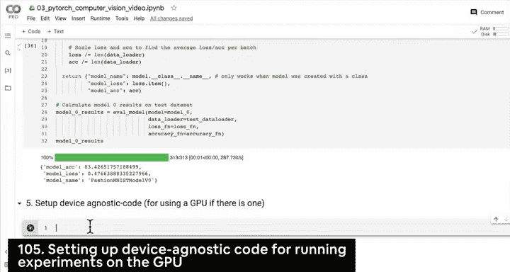
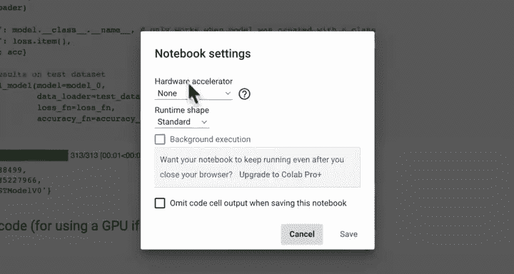
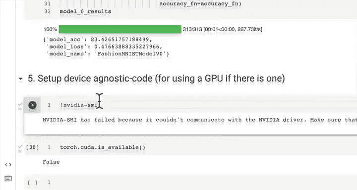
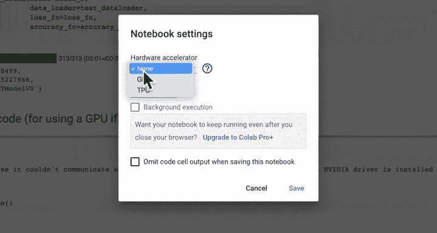
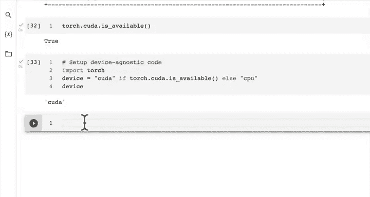

# mrdbourke《一天学会pytorch深度学习｜Learn PyTorch for deep learning in a day Literally》中英 - P67：105. Running experiments on the GPU.zh_en - GPT中英字幕课程资源 - BV1kx4y1r79d

How'd you go。Did you give it a shot， Did you set up some device agnostic code。

 I hope you gave it a go， But let's do it together。 This won't take too long。

 The last two videos have been quite long。

So if I wanted to set device agnostic code， I wanted to see if I have a GPU available， do I。

 I can check it from NaviDdia SMI that fails because I haven't activated a GPU in Google Coab yet。

 I can also check here Torch Kuda is available。That will。

Pytorch will check if there's a GPU available with Ka。 and it's not。

 So let's fix these two because we want to start using a GPU and we want to set up device agnostic code。

 So no matter what hardware our system is running， Pytorch leverages it。

 So we're going select GPU here， I'm going to click save and you'll notice that our Google coab notebook will start to reset and we'll start to connect。

 there we go， we've got a GPU on the backend， Python 3 Google Comp engine backend GPU。

 do we have to reset this。

Nvidia SI， wonderful。 I have a Tesla T 4 GPU with 16 GB of memory。 That is wonderful。

 And now do we have a GPU available。😊，Oh， torch is not defined。

 Will you notice the numbers of these cells。1，2， that means because we've reset our run time to have a GPU。

 we have to rerun all the cells above so we can go run before。 That's gonna run all the cells above。

 make sure that we download the data， make sure that we download the helper functions file。

 If we go back up。 We should see our data may be downloading。 It shouldn't take too long。

 That is another advantage of using a relatively small data set that is already saved on Pytoch data sets。

Just keep in mind that if you use a larger data set and you have to re downloadload it into Google Coab。

 it may take a while to run。And if you build bigger models， they may take a while to run。

 So just keep that in mind for your experiments going forward。 Start small， increase when necessary。

So we'll rerun this。 We'll rerun this。 And finally， we're going to， oh， there we go。 We've got a GPU。

 wonderful， but we'll write some device agnostic code here， Se up device， agnostic code。😊。

So import torch Now realistically you will quite often do this at the start of every notebook。

 but I just wanted to highlight how we might do it if were in the middle and I wanted to practice running a model on a CPU only before stepping things up and going to a GPU so device equals Couda this is for our device agnostic code if torch。

 couda is available and it looks like this is going to return true else use the CPU。

And then we're going to check device。Wonderful， couda。

So we've got some device agnostic code ready to go。 I think it's time we built another model。😊。

And I asked the question before， do you think that the data set that we're working with requires linearity？

So the shirts and the bags and the shoes， do we need non linear functions to model this？ Well。

 it looks like our baseline model without non linearities did pretty well at。Moodeling our data。

 So've got a pretty good test accuracy value。 So 83%。 So out of 100 images。

 it predicts the right one，83% of the time，83 times out of 100。

 It did pretty well without non linearities。Why don't we try a model that uses nonlinearities and runs on the GPU。

 so you might't want to give that a go， see if you can create a model with nonlinear functions。

 try Nn。relu， run it on the GPU， and see how it goes。Otherwise。

 we'll do it together in the next video。

C咧。