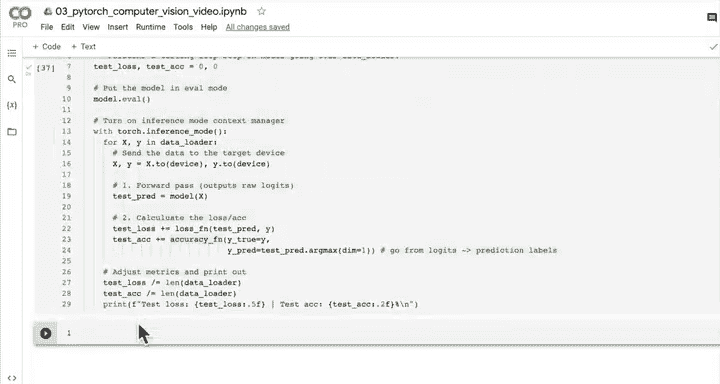
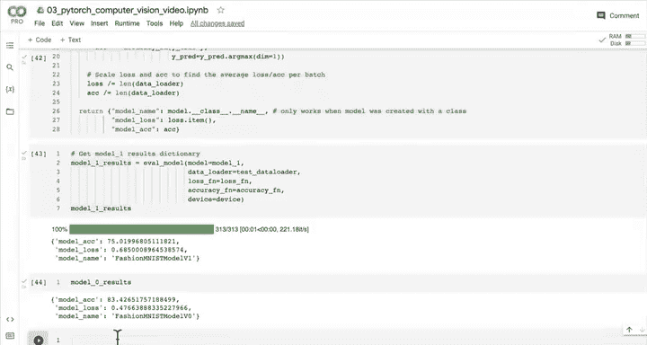

# mrdbourke《一天学会pytorch深度学习｜Learn PyTorch for deep learning in a day Literally》中英 - P69：108. Creating a train-test loop.zh_en - GPT中英字幕课程资源 - BV1kx4y1r79d

So we've got a loss function ready and an optimizer， what's our next step？😊，Well。

 it's to create training and evaluation loops。 So let's make a heading here。

 And we're going to call this functionizing training and evaluation or slash testing loops。

Because we've written similar code quite often for training and evaluating slash testing our models。

Now we're going to start moving towards functionising code that we've written before because that's not only a best practice。

 it helps reduce errors because if you're writing and training loop all the time。

 we may get it wrong if we've got one that works for our particular problem， hey。

 we always well save that as a function so we can continually call that over and over and over again。

So how about we and this is going to be very rare that I'm going to allow you to do this is that is we're going to copy this training。

 and you might have already attempted to create this。😊，That is the function called， let's create。

A function 4。1。Training loop。And we're going to call this。Train step。

And we're going to create a function for the testing loop。I'm going to call this test step。 Now。

 these are just what I'm calling them。 You can call them whatever you want。

 I just understand it quite easily by calling it train step。 And then we can。

 for each epoch in a range， we call our training step。

 and then the same thing for each epoch in a range， we can call a testing step。

 This will make a lot more sense。 Once we've coded it out。

So let's put the training code here to functionise this。 Let's start it off with train step。 Now。

 what parameters should our train step function take in？Well let's think about this， we need a model。

 we need a data loader。We need a loss function。And we need an optimizer。

We could also put in an accuracy function here if we wanted to。And， potentially。It's not here。

 but we could put in what target device we'd like to compute on。And make our code device agnostic。

 So this is just the exact same code we went through before。 We loop through a data loader。

 We do the forward pass。 We calculate the loss， We accumulate it。We zero the optimizer。

 We perform back propagation in respect to the loss with the parameters of the model。

 And then we step the optimizer2。Hopefully improve the parameters of our model to better predict the data that we're trying to predict。

So let's craft a train step function here。 We'll take a model。

 which is going to be torch Nn dot module。T paint。And we're going to put in a data loader。

Which is going to be of type torch us。Dot data do data loader。

Now we don't necessarily need to put this in these type hints。

 but they're relatively new addition to Python and so you might start to see them more and more and it also just helps people understand what your code is expecting。

So loss function， we're going to put in an optimizer。Torch dot obimm。Which is a type optimizer。

We also want an accuracy function。 We don't necessarily need this either。

 These are a lot of nicer havebs。 The first four are probably the most important。

 and then the device。 So torch。This is going to be torch do device equals device。

 So we'll just hard code that to be our already set device parameter。And we'll just write in here。

Performs。Training step with model。Trying to。Learn on。Data loader。Nice and simple。

 We could make that more explanatory if we wanted to， but we'll leave it at that for now。

And so right at the start， we're going to set up train loss and train Act equals 0，0。

 We're going to introduce accuracy here so we can get rid of this。

 Let's just go through this line by line。 What do we need to do here。Well， we've got four batch X。

 Y in enumerate train data loader， but we're going to change that to data loader up here。

 so we can just change this to data loader。Wonderful， and now we've got Model0 dot train。😊。

Do we want that。Well， no， because we're going to keep this model agnostic。

 We want to be able to use any model with this function。 So let's get rid of this model dot train。

 But we are missing one step here is put data on target。Devicice。

 and we could actually put this model dot train。啊皮呀。Put model into training mode。 Now。

 this will be the default for the model， but just in case we're going to call it anyway。

 model dot train。Put data on the target device。 So we're going to go X， Y equals X dot 2 device。

 Y dot2 device， wonderful。And the forward pass， we don't need to use model 0 anymore。

 We' are just going to use model that's up here。The loss function can stay the same because we're passing in a loss function up there。

The train loss can be accumulated。 That's fine， but we might also accumulate now the train accuracy。

Calculate loss。And accuracy per batch。 So train Act equals or plus equals our accuracy function on y true。

Equals y and y pre equals y pre。 So the outputs here， Y pre。 we need to take because the raw outputs。

Outputs the raw logits from the model。Because our accuracy function expects our predictions to be in the same format as our true values。

 we need to make sure that they are。 we can call the Argms here on the first dimension。

 this is going to go from logits to prediction labels。We can keep the optimizer0 grab the same。

Because we're passing in an optimizer up here， we can keep the loss backwards。

 because the loss is just calculated there， we can keep optimizer step。

 and we could print out what's happening， but we might change this up a little bit。

 We need to divide the total train loss。And accuracy。

I just want to type in accuracy here because now we've added in accuracy mentor。😊，Ac。

 so train Act divided equals length。Train data loader。 Oh no， sorry。

 we can just use the data loader here。仔啦老啦。Data loader。And we're not gonna to print out。

Per batch here。 I'm just gonna get rid of this。 We'll make at the end of this step。

 we will make our print out here， print。Notice how it's at the end of the step because we're outside the for loop now。

😡，So we're going to here we're accumulating the。Loss on the training data and the accuracy on the training dataset per batch。

 and then we're finding out at the end of the training step。

 so after it's been through all the batches in the data loader。

We're finding out what the average loss is per batch and the average accuracy is per batch。

 and now we're going to go train loss。Is going to be。The train loss。on。5。And then we're going to go。

Train Act is going to be train Act。And we're going to set that to 0。2 F。get that there。Percentage。

Wonderful。So if all this works， we should be able to call our train step function and pass it in a model。

 a data loader， a loss function， an optimize an accuracy function and a device。

And it should automatically do all of these steps。 So we're going to find that out in a later video in the next video we're going to do the same thing we've just done for the training loop with the test step。

 but here's your challenge with this video is to go up to the testing loop code we wrote before and try to recreate the test step function in the same format that we've done here。

😊，So give that a go， and I'll see you in the next video。Welcome back。 In the last video。

 we functionized our training loop。 So now we can call this training step function。

 And instead of writing all this training loop code again。 Well。

 we can train our model through the art of a function。 Now， let's do the same for our testing loop。

 So I issued you the challenge in the last video to give it a go。

 I hope you did because that's the best way to practice pi torch code is to write more pi torch code。

 let's put in a model， which is going to be torch。 and then dot module。😊。

And we're going to put in a data loader。'Becauseuse we need a model and we need data。

 the data loader is going to be， of course the test data loader here， torch。utils。data。da loader。

 and then we're going to put in a loss function， which is going to be torch nt module as well。

Becauseuse we're going to use。And end up cross entropy loss。 We'll see that later on。

We're going to put in an accuracy function。 We don't need an optimizer because we're not doing any optimization in the testing loop。

 we're just evaluating and the device can be torched on device。

 and we're going to set that as a default to the target device parameter。Beautiful。

 so I'll put a little doctoring here。 So performs a testing loop step on model going over data loader。

😊，Wonderful。So now let's set up a test loss and a test accuracy。

 because we'll measure test loss and accuracy without testing loop function。

 and we're going to set the model into， I'll just put a comment here。put the model。In a vel mode。

 So model dot aval， we don't have to use any underscore here， as in model 0。

 because we have a model coming in the top here。Now， what should we do？Well。

 because we're performing a test step， we should turn on inference mode。 So turn on inference mode。

Inference mode context manager。Remember， whenever you're performing predictions with your model。

 you should put it in model。val。 and if you want as many speed ups as you can get。

 make sure the predictions are done within the inference mode。Because remember。

 inference is another word for predictions within the inference mode context manager。

 So we're going to loop through our data loader for x and Y in data loader。

 We don't have to specify that this is X test。Well why test， we could if we wanted to。

 but because we're in another function here， we can just go 4 x Y in data loader。

We can do the forwardd pass。After we send the data to the target device。😊，Target device。

 So we're going to have x， Y equals x dot2 device。 and the same thing with y。

We're just doing best practice here， creating device， agnostic code。Then what should we do。

 Well we should do the thing that I said before， which is the forward pass。

 Now that our data and model be on the same device， we can create a variable here。

 Test pre equals model， we're going to pass in X。And then what do we do， We can calculate the loss。

 So two。Calculate the loss slash accuracy。We're going to accumulate it per batch， so。

We'll set up test loss equals loss function。Oh， plus equals loss function。

 We're going to pass it in test pre and Y， which is our truth label。

 and then the test act where you will accumulate as well。

 using our accuracy function We pass in Y true equals Y。 and then Y pre。

 What do we have to do to Y pre。Well I'll test pre， we have to take the arg max to convert it from。

 So this is going to outputs raw logits。 Remember， a model's raw output is referred to as logits。

 And then here we have to go from logits to prediction。Libels。Beautiful oh。Little typo here。

 Did you catch that one。Tap， tap。Beautiful， oh， look how good this function is looking。

 Now we're going to adjust the metrics。 So adjust metrics and print out。

 You might notice that we're outside of the batch loop here。 right？

 So if we draw down from this line for and we write some code here。

 we're still within the context manager。 This is important because if we want to adapt a value created inside the context manager。

 We have to。😊，Modify it still within that context manager。 Otherwise， P To will throw an error。

 So try to write this code if you want， outside the context manager and see if it still works。

So test loss， we're going to adjust it to find out the average test loss and test accuracy per batch across a whole step。

So we're going to go length， data loader。Now we're going to print out what's happening。

 print out what's happening。 So test loss， which we put in here where we're going to get the test loss。

 let's get this to five decimal places。And then we're going to go test arc。

 And we will get that to two decimal places。 You could do this as many decimals as you want。

 You could even times it by 100 to get it in proper accuracy format。

 And we'll put a new line on the end here， wonderful。😊。

So now it looks like we've got functions I haven't run this cell yet for a training step and a test step。

 So how do you think we could replicate if we go back up to our training loop that we wrote before。😊。

How do you think we could replicate the functionality of this， except this time using our functions。

Well， we could still use this for epoch in TQDM range epochs。

But then we would just call our training step for this training code， our training step function。

 and we would call our testing step function passing in the appropriate parameters for our testing loop。

So that's what we'll do in the next video， we will leverage our two functions。

 train step and test step to train Model1， but here's your challenge for this video， give that a go。

 so use our training step and test step function to train Model1 for3 epochs and see how you go but we'll do it together in the next video。

😊。

Welcome back。 How'd you go， Did you create a training loop or a pytoch optimization loop using our training step function and a test step function。

 Were there any errors。😊，In fact， I don't even know， but how about we find out together， hey。

 how do we combine these two functions to create an optimization loop？😊，So I'm going to go torch。

t manual seed。42。And I'm going to measure the time of how long our training and test loop takes。

 This time we're using a different model。 So this model uses linearities， and it's on the GPU。

 So that's the main thing we want to compare is how long our model took on CPU versus GP。

So I'm going to import from timeE， import default timer as timer。

And I'm going to start the train time。 train time， start。On GPU equals timer。

And then I'm just right here， set epochs。I'm going to set epochx equal to3 because we want to keep our training experiments as close to the same as possible so we can see what little changes do want。

 And then it's。Create a optimization and evaluation。Loop， using train step。And test step。

So we're going to loop through the epochs for epoch in TQDM。 So we get a nice progress bar in epochs。

Then we're going to print。Epoch。Little print out of what's going on。Epoch， and we'll get a new line。

 and then maybe 1，2，3，4，5，6，7，8 or something like that。 Maybe I'll miscounted there。

 But that's all right。 Tra step。 What do we have to do for this Now， we have a little dock string。

 We have a model。 What model would we like to use， We'd like to use model 1， We have a data loader。

 What data loader would we like to use。 Well， we'd like to use our train data loader。

We also have a loss function， which is our loss function。We have an optimizer。Which is our。Optimizer。

And we have an accuracy function。Which is our accuracy function。 And oops， forgot to put Fn。

And finally， we have a device which equals device， but we're going to set that anyway。😊。

So how beautiful is that for creating a training loop。

 Thanks to the code that we've functionised before。 And just recall。

 we set our optimizer and loss function in a previous video。

 You could bring these down here if you really wanted to so that they're all in one place。😊。

Either way up， but we can just get rid of that because we've already said it。Now。

 we're going to do the same thing for our test step。 So what do we need here。

 Let's check the dock string。 We could put a little bit more information in this dock string if we wanted to to really make our code more reusable。

 and so that if someone else was to use our code or even us in the future knows what's going on。

 But let's just code it out because it just still fresh in our minds。 Model equals Model 1。

 what's our data letter going to be for the test step。😊，It's going to be our test data loader。

Then we're going to set in a loss function， which is going to be just the same loss function。

 We don't need to use an optimizer here because we are only evaluating our model。

 but we can pass in our accuracy function。Accuracy function。 And then finally。

 the device is already set， but we can just pass it in anyway。Look at that。

 Our whole optimization loop in a few lines of code。 Isn't that beautiful。

 So these functions are something that you could put in。😊，Like our helper functions dot pi。

And that way you could just import it later on， and you don't have to write your training loops all over again。

😊，But we'll see more of an example of that later on in the course。So let's keep going。

 We want to measure。The train time， right， So we're going to create once it's been through these steps。

 we're going to create train time and on CPU。And then we're going to set that to the timer。😊。

So all this is going to do is measure at value in time。 Once this line of code is run。

 it's going to run all of these lines of code。 So it's going to perform the training and optimization loop。

 And then it's going to， oh， excuse me。 this should be GPU。

It's going to measure a point in time here。So once all this codes run， measure a point in time there。

 And then finally， we can go total train time。For model one is equal to。Print， train time。

Which is our function that we wrote before。And we pass it in a start time。

 and it prints the difference between the start and end time on a target device。 So let's do that。

 Start equals what。Train time start on GPU。The end is going to be。Train time and on GPU。

And the device is going to be。Devicice。Beautiful， so are you ready to run our next modeling experiment。

 Model 1， We've got a model running on the GPU， and it's using nonlinear layers。

 and we want to compare it to our first model， which our results were model 0 results。😊。

And we have total train time。On model 0， yes， we do。 So this is what we're going for。

 Does our model 1 beat these results， and does it beat this result here， So 3，2，1。

 do we have any errors， No， we don't。 Okay， train step got an unexpected keyword loss， oh。

Did you catch that， I didn't type in Los function。Let's run it again。 There we go。 Okay。

 we're running。We've got a progress bar， it's going to output at the end of each epoch。

 there we go training loss。All right， test accuracy， training accuracy。 This is so exciting。

 I love watching neural networks train。 Okay， we're improving per epoch。 That's a good sign。😊。

But we've still got a fair way to go。 Oh， okay， so what do we have here。Well， we didn't beat how。H。

 it looks like we didn't beat our model zero results with the nonlinear layers。😊。

And we only just slightly had a faster training time。 Now， again。

 your numbers might not be the exact same as what I've got here。 right。

 So that's a big thing about machine learning is that。It uses randomness。

 so your numbers might be slightly different。 The direction should be quite similar。

 and we may be using different GPU。 So just keep that in mind。 Right now， I'm using a。Nvidia SmiI。

 I'm using a Tesla T4， which is at the time of recording this video。 Wednesday。

 April 202022 is a relatively fast GPU for making inference。 So just keep that in mind。

 your GP in the future may be different and your CPU that you run may also have a different time here。

 So if these numbers are like 10 times higher， you might want to look into seeing if your code is there's some error。

 if they're 10 times lower well，y， you're running it on some fast hardware。

 So it looks like my code is running on couda slightly faster than the CPU but not dramatically faster。

 and that's probably akin to the fact that our data set isn't too complex and our model isn't too large。

 What I mean by that is our model doesn't have like a vast amount of layers。

 and our data set is only comprised of like this is the layers our model has。😊。

And our data set is only comprised of 60，000 images that are 28 by 28。So as you can imagine。

 the more parameters in your model， more features in your data， the higher this time is going to be。

 and you might sometimes even find that your model is faster on CPU。

 So this is the train time on CPU。You might sometimes find that your model's training time on a CPU is。

 in fact， faster for the exact same code running on a GPU。 Now， why might that be， Well。

 let's write down this here。Let's go note。Sometimes。Depending on your data， slash hardware。

You might find that your model。Trains faster on CPU。Then， GPU。Now， why is this。

So one of the number one reasons is that one， it could be。

That the overhead for copying data slash model。To and from the GPU。Outweighs the compute benefits。

offffered。Why the GPU。So that's probably one of the number one reasons is that you have to。

For data to be processed on a GPU， you have to copy it because it is by default on the CPU。

 If you have to copy it to that GP， you have some overhead time for doing that copy into the GPU memory。

 And then although the GPU will probably compute faster on that data once it's there。

 you still have that back and forth of going between the CPU and the GPU。

 And the number two reason is that the hardware。Yourour。Using as a。

Better CPU in terms of compute capability。Then the GPU Now this is quite a bit rarer。

 usually if you're using a GPU like a fairly modern GPU， it will be faster at computing。

 deep learning or running deep learning algorithms than your general CPU。

 but sometimes these numbers of compute time are really dependent on the hardware that you're running。

So you'll get the biggest benefits of speed ups on the GPU when you're running larger models。

 larger data sets and more compute intensive layers in your neural networks。

 And so if you'd like a great article on how to get the most out of your GPUs。

 It's a little bit technical。 But this is something to keep in mind as you progress as a machine learning engineer is how to make your GPUs。

😊，Go bur。 And I mean that bur from first principles。There we go。

Making deep learning go brew as in your GPU is going brew because it's running so fast from first principles。

 So this is by Horace He， who works on Ptorrch。 And it's great。

 It talks about compute as a first principle。 So here's what I mean by copying memory and compute。

 There might be a fair few things you're not familiar with here， but that's okay。

 but just be aware bandwidth。 So bandwidth costs are essentially the cost paid to move data from one place to another。

 That's what I was talking about copying stuff from the CPU to the GPU。 And then also。

 there's one more。😊，Where is it overhead， overhead is basically everything else。

 I called it overhead。 There are different terms for different things。 This article is excellent。

 So I'm going just copy this in here， and。You'll find this in the resources， by the way。

 So for more on how to make your models compute faster。四系。Lovely， so right now。

 our baseline model is performing the best in terms of results and in terms of， or actually。

 our model computing on the GPU is performing faster than our CPU。 Again。

 yours might be slightly different for my case， for my particular hardware， Couder is faster。

 except Model 0。 our baseline is better than model 1。😊，So what's to do next？Well。

 is to keep experimenting， of course。I'll see you in the next video。😊，Welcome back。 Now。

 before we move on to the next modeling experiment， let's get a results dictionary for our model 1。

 our model that we trained on。 So just like we've got one for Model 0。

 let's create one of these for model 1 results， and we can create that with our our model function。😊。

So we'll go right back down to where we were。 I'll just get rid of this cell。And let's type in here。

Get Model1 results dictionary。 This is helpful。 So later on。

 we can compare all of our modeling results because they'll all be in dictionary format。

 So we're going Model 1 results equals a vow model on a model equals model 1 and we can pass in a data loader。

 which is going to be our test data loader。😊，Then we can pass in a loss function。

 which is going to equal our loss function， and we can pass in our accuracy function。

E callss accuracy function。Wonderful， and then if we check out our Model one results， what do we get？

😊，Oh， no， we get an error。Do we get the code right？😊，That looks right to me。Oh， what does it say。

 Runtime error expected all tenors to be on the same device， but found at least two devices。

 Couda and CPU。 Of course。 So why did this happen， Well。

 let's go back up to our aval model function wherever we defined that。Here we go。I see。

 So this is a little gotcha and Pytorch or in deep learning in general。

 There's a saying in the industry that deep learning models fail silently。

 And this is kind of one of those ones。It's because our data and our model are on different devices。

So remember how I said the three big errors are shape mismatches with your data and your model device mismatches。

 which is what we've got so far。 and then data type mismatches。

 which is if your data is in the wrong data type to be computed on。

 So what we're going to have to do to fix this is let's bring down our v model function down to where we were。

 And just like we've done in our test step and train step functions。

 where we've created device agnostic data here。 we've sent our data to the target device。

 will'll do that exact same thing in ourV model function。 And this is just a note for going forward。

 it's always handy to where you can create device agnostic code。

 So we've got our newavval model function here， for X， Y in our data loader。😊，Let's make our data。

Devicice agnostic。 So just like our model is device agnostic。 We've sent it to the target device。

 We will do the same here。 X dot 2 device， and then Y dot 2 device。Let's see if that works。

 we will just rerun this cell up here。 I'll grab this。

We're just going to write the exact same code as what we did before。

 but now it should work because we've sent our。We could actually also just pass in the target device here。

 device Eagles device。That way we can pass in whatever device we want to run it on。

And we're going to just add in device here。 device equals device。

And let's see if this runs correctly。Beautiful， so if we compare this to our model 0 results。

 it looks like our baseline still out in front。😊，But that's okay。 We're going to in the next video。

 start to step things up and notch and move on to convolutional neural networks。

 This is very exciting。 And by the way， just remember。

 if your numbers here aren't exactly the same as mine， don't worry too much。

 If they're outlandishly different， just go back through your code and see if it's maybe a cell hasn't been run correctly or something like that。

 If there are a few decimal places off。 That's okay。

 That's due to the inherent randomness of machine learning and deep learning。😊。

But with that being said， I'll see in the next video。

 Let's get our hands on convolutional neural networks。😊。

