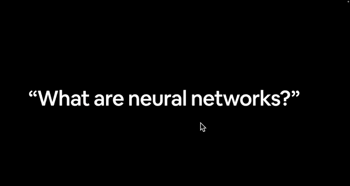
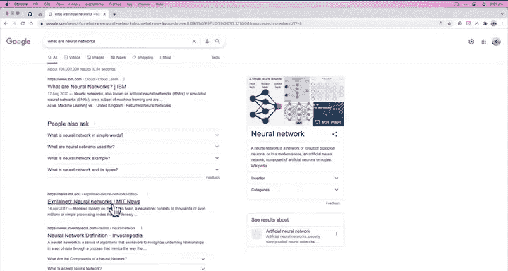
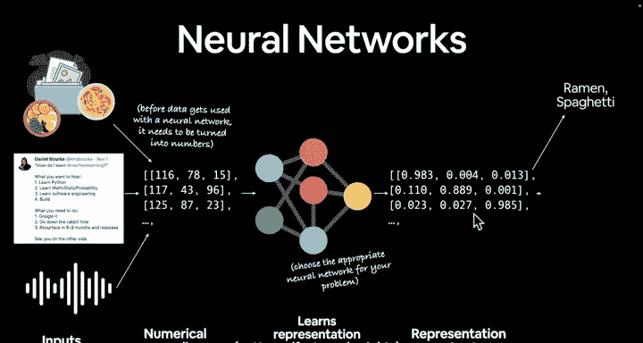
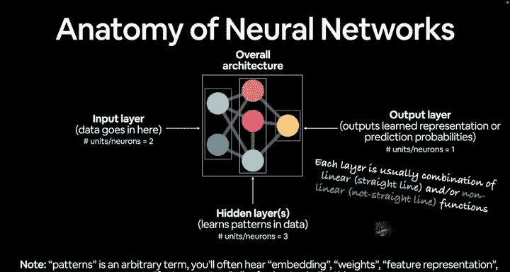
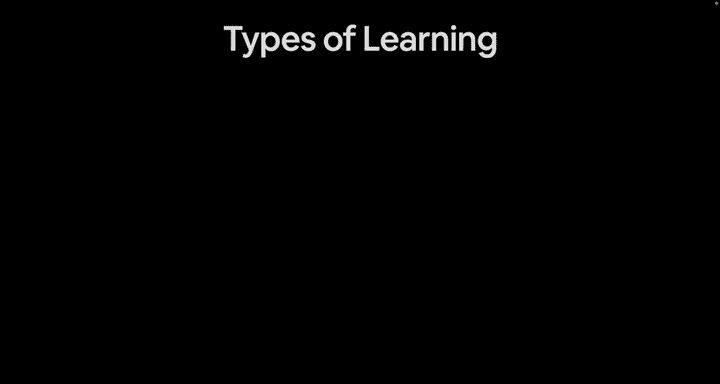

# mrdbourke《一天学会pytorch深度学习｜Learn PyTorch for deep learning in a day Literally》中英 - P6：4. Anatomy of neural networks.zh_en - GPT中英字幕课程资源 - BV1kx4y1r79d

Welcome back。 In the last video， I left you with the cliff hanger of a question。

 What are neural networks， And I gave you the challenge of Googling that。

 But you might have already done that by the time you've got here。 Let's just do that together。

 If I type in。

What are neural networks， I've already done this。What are neural networks， Explain neural networks。

 neural network definition。 There are hundreds of definitions of things like this online neural network in five minutes。

 A3 blue1 brown。 I'd highly recommend that channel series on neural networks。

 that's going to be in the extracur。 Stat Que is also amazing。

 So there's hundreds of different definitions on here。 And you can read 10 of them，5 of them。

3 of them make your own definition。 But for the sake of this course。

 Here's how I'm going to define neural networks。😊。

So we have some data。Of whatever it is， we might have images of food。

 we might have tweets or natural language， and we might have speech。

 so these are some examples of inputs for unstructured data because they're not rows and columns So these are the input data that we have。

And then。How do we use them with a neural network well。Before data can be used in a neural network。

 it needs to be turned into numbers because humans， we like looking at images of ramen and spaghetti。

 We know that that's ramen。 we know that that's spaghetti。 after we've seen it one or two times。

 and we like reading good tweets。 and we like listening to amazing music or hearing our friend talk on the phone in audio file。

 However， before a computer understands what's going on in these inputs。

 it needs to turn them into numbers。 So this is what I call a numerical encoding or a representation。

 and this numerical encoding this square brackets indicate that it's part of a matrix or a tensor。

 which we're going to get very hands on with throughout this course。 So we have our inputs。

 we've turned it into numbers。 And then we pass it through a neural network。

 And now this is a graphic for a neural network。 However， the graphics for neural networks。

 as we'll see。😊，Can get。Quite involved。 But they all represent the same fundamentals。

 So if we go to this one， for example， we have an input layer， then we have multiple hidden layers。

 However you define this， you can design these in how you want， Then we have an output layer。

 So our inputs will go in some kind of data。Hidden layers will perform mathematical operations on the input。

 So the numbers。 and then we'll have an output。 Oh。

 there's three blue1 browns neural networks from the ground up。 Great video。

 Highly recommend you Check that out。😊，But then if we come back to this。So we've got our inputs。

 we've turned it into numbers and we've got our neural networks that we' put the input in。

 This is typically the input layer， hidden layer。 This can be as many different layers as you want。

 as many different。 Each of these little dots is called a node。 There's a lot of information here。

 but we're going to get hands on with seeing what this looks like。

 And then we have some kind of output。Now， which neural networks should you use Well。

 you can choose the appropriate neural network for your problem。

 which could involve you hand coding each one of these steps or you could find one that has worked on problems similar to your own。

 such as for images， you might use CNN， which is a convolutional neural network for natural language you might use a transformer for speech。

 you might also use a transformer， but fundamentally they all follow the same principle of inputs。

 manipulation outputs。And so the neural network will learn a representation on its own。

 We won't define what it learns。 So it's going to manipulate these patterns in some way。

 shape or form。 And when I say learns representation。

 I am going to also refer to it as learns patterns in the data。

 A lot of people refer to it as features。 A feature may be the fact that the word do comes after how usually in across a whole bunch of different languages。

 a feature can be almost anything you want。 And again， we don't define this。

 the neural network learns these representations Pat features also called weights on its own。

 And then where do we go from there。Well， we've got some sort of numbers。

 numerical encoding turned our data into numbers。 Our neural network has learned a representation that it thinks best represents the patterns in our data。

 and then it outputs those representation outputs， which we can use。

 and often you'll hear this referred to as features or weight matrix or weight tensor learned representation is also another common one。

 There's a lot of different terms for these things。

And then， it will output。We can convert these outputs into human understandable outputs。

 So if we were to look at these， these could be， again， I said。

 representations or patterns that are neural network alone can be millions of numbers。

 This is only 9。 So imagine if these were millions of different numbers。

I can barely understand the nine numbers that is going on here。

 So we need a way to convert these into human understandable terms。 So for this example。

 we might have some input data， which are images of food。

 and then we want our neural network to learn the representations between an image of ramen and an image of spaghetti。

 and then eventually we'll take those patterns that it's learned and we'll convert them into whether it thinks that this is an image of ramen。

Or spaghetti。 Or in the case of this tweet， is this a tweet for a natural disaster or not a natural disaster。

 So our neural network has， well， we've written code to turn this into numbers。

 Pass it through our neural network。 Our neural network has learned some kind of patterns。

 and then we ideally want it to。Represent this tweet as not a disaster。

 and then we can write code to do each of these steps here。

 and the same thing for these inputs going as speech。

 turning into something that you might say to your smart speaker。

 which I'm not going to say because a whole bunch of my devices might go off。

And so let's cover the anatomy of neural networks。 We've hinted at this a little bit already， but。

This is like neural network anatomy101 Again， this is highly customizable what this thing actually is。

 We're going to see it in Pytorrch code later on， but the data goes into the input layer and in this case。

 the number of units slash neurons slash nodes is2。😡，Hidden layers， you can have。

 I put a S here because you can have one hidden layer or the deep in deep learning comes from having。

Lots of layers。 So this is only showing four layers。 You might have。 Well。

 this is three layers as well。 might be very deep neural networks， such as Resnet 1，50。2。

This is 152 different layers。So again， you can， oh， this is 34ca this is only Resnet 34。

 but Resnet 152 has152 different layers。 So that's a common computer vision or a popular computer vision algorithm。

 by the way。Lots of terms we're throwing out here。 but with time。

 you'll start to become familiar with them。 So hidden layers can be almost as many as you want。

 We've only got pitchd one here。 And in this case， there's three hidden units slash neurons。

 And then we have an output layer。 So the outputs learned representation or prediction probabilities from here。

 depending on how we set it up， which， again， we will see what these are later on。 And in this case。

 it has。One hidden unit， so two input，3， one output。 you can customize number of these。

 You can customize how many layers there are， you can customize what goes into here。

 You can customize what goes out of there。So。Now， if we。Talk about the overall architecture。😡。

Which is describing。All of the layers combined。 So that's when you hear neural network architecture。

 it talks about the input， the hidden layers， which may be more than one and the output layer。

 So that's a terminology for overall architecture。Now， I say patterns is an arbitrary term。

 You can hear embedding， embedding might come from hidden layers， weights， feature representation。

 feature vectors， all referring to similar things。 So again。

 how do we turn our data into some numerical form。Build a neural network to figure out patterns to output some desired output that we want。

 And now to get more technical， each layer is usually a combination of linear。

 So straight lines and non nonlinear non straight functions。

 So what I mean by that is a linear function is a straight line。

 a nonlinear function is a non straight line， If I ask you to draw whatever you want with unlimited straight lines and not straight lines。

 So you can use straight lines or curved lines， what kind of patterns could you draw。

At a fundamental level， that is basically what a neural network is doing。

 It's using a combination of linear straight lines and not straight lines to draw patterns in our data。

 We'll see what this looks like later on now。

For the next video， let's dive in briefly to different kinds of learning。

 So we've looked at what a neural network is， the overall algorithm。

 but there are also different paradigms of how a neural network learns。

I'll see you in the next video。

