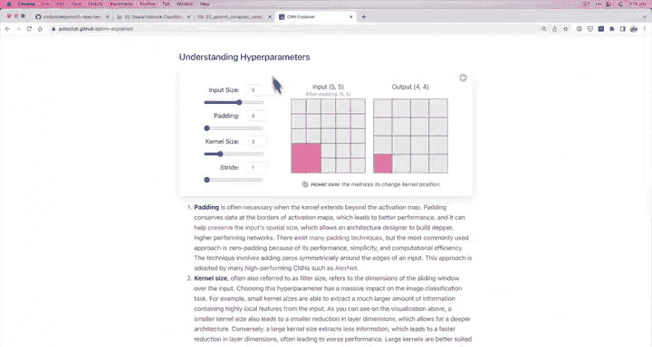

# mrdbourke《一天学会pytorch深度学习｜Learn PyTorch for deep learning in a day Literally》中英 - P71：113. Coding a CNN.zh_en - GPT中英字幕课程资源 - BV1kx4y1r79d

Welcome back。 In the last video， we went briefly through the CNN explainplainer website。

 which is my favorite resource for learning about convolution or neural networks。😊，And， of course。

 we could spend 20 minutes clicking through everything here to find out what's going on with a convolutional neural network。

 or we could start to code one up。 So how about we do that， hey。😊，If in doubt， code it out。

 So we're going to create a convolutional。Neural network。

 And what I'm going to do is I'm going to build this。

Or we're going to build this model together in this video。

 And then because it's going to use layers or pyto layers that we haven't looked at before。

 we're going to spend the next couple of videos stepping through those layers。

 So just bear with me as we code this entire model together。

 We'll go break it down in subsequent videos。 So let's build our first convolutional neural network。

 That's a mouthful， by the way， I'm just gonna probably stick to saying CNN。😊，Fashion amist。

We're up to model V2。 We're going to subclass N N dot module。

 as we always do when we're building a applied touch model。And in here， we're going to。

So model architecture。That replicates the tiny VGG。And you might be thinking。

 where did you get out from Daniel model from CNN Explainer website？

And so oftentimes when convolutional neural networks or new types of architecture come out。

 the authors of the research paper that present the model get to name the model。

 And so that way in the future， you can refer to different types of model architectures with just a simple name like tiny VGG and people kind of know what's going on So I believe somewhere on here it's called tiny VGG。

Tinny VgG。We have nothing。 Yeah， there we go in tiny VG G。 And do we have more than one tiny。Tiny。

 yeah， tiny Vggg。 And if we look up Vggg。Conve。VG G16 was one of the original ones。 VGG。

 very deep convolutional neural networks of VGG net。There's also。RsNe。

 which is another convolutional neural network。You can also， I don't want to give you my location。

 Google， you can go popular CNN architectures。AndThis will give you a fair few options。

Lette is one of the first Alexnett， Z Fnett， whole bunch of different resources。 And also。

 how could you find out more about a convolutional neural network。

 What is a convolutional neural network， You can go through that。 But let's stop that for a moment。

 Let's code this one up together。 So we're going to initialize our。Cls here。Deaf and it。

 we're going to pass it in an input shape， just like we often do。

 We're going to put in a number of hidden units。Which is an int。

And we're going to put in an output shape。Which is an int。Wonderful。

 so nothing too outlandish that we haven't seen before there。And we're going to go super。

net to initialize our initializer。Yeahm。😊，For lack of a better way of putting it。 Now。

 we're going to create our neural network in a couple of blocks this time。

 And you might often hear in。When you learn more about convolutional neural networks。

 or I'll just tell you that things are referred to are often referred to as convolutional blocks。

 So if we go back to our keynote， this here。This combination of layers might be referred to as a convolutional block。

 and a convolutional block， a deeper CNN might be comprised of multiple convolutional blocks。

So to add to the confusion， a block is comprised of multiple layers and then an overall architecture is comprised of multiple blocks。

😊，And so the deeper and deeper your models get， the more blocks it might be comprised of and the more layers those blocks may be comprised of within them。

So it's kind of like Lego， which is very fun。 So let's put together an N in sequential。😊，Now。

 the first few layers here that we're going to create incom block 1 N N dot com 2D。 Oh， look at that。

 us writing us our first CNN layer。 And we have to define something here， which is in channels。

So this channels refers to the number of channels in your visual data。

 and we're going to put in input shape。 So we're defining the input shape。

 This is going to be the first layer in our model。 The input shape is going to be what we define when we instantiate this class。

And then the out channels。 Oh， it's the out channels going to be。 Well。

 it's going to be hidden units。 just like we've done with our previous models。 Now。

 the difference here is that in N N co 2 D， we have a number of different hyperparameter that we can set。

 I'm going to set some pretty quickly here， but then we're going to step back through them。

 Not only in this video， but in subsequent videos。 We've got a fair bit going on here。

 We've got in channels， which is our input shape。 We've got out channels， which our hidden units。

 We've got a kernel size， which equals 3， or this could be a topple as well，3 by3。😊。

But I just like to keep it a three。 We've got a stride， and we've got padding。 Now。

 because these are values we can set ourselves， what are they referred to as。Let's write this down。

 valuesue we can set ourselves in our neural networks。In our NNs。

 neural networks are called hyperparameters。So these are the hyperparameter of Nn co 2D and you might be thinking what is 2D for Well because we're working with  two dimensional data our images have heightened width。

 there's also co 1D for one dimensional data 3D for 3 dimensional data。

 we're going to stick with 2D for now and so what do each of these hyperparameter do Well before we go through what each one of them do。

 we're going to do that when we step by step through this particular layer。What we've just done is。

 we've replicated。This particular layer。Of the CNN explainer website， we've still got the Reello。

 We've still got another con and Oello and a max pool and a con and Oello and a con and Oello and a max pool。

 But this is the block I was talking about。 This is one block here。Of this neural network。

 or at least that's how I've broken it down。 And this is another block。

You might notice that they're comprised of the same layers just stacked on top of each other。

 And then we're going to have an output layer。And if you want to learn about where the hyperpara came from。

 what we just coded， where could you learn about those。Well， one。

 you could go of course to the Pytage documentation， Pytorch N Ncom 2D。You can read about it there。

There's the mathematical operation that we talked about or briefly stepped on before or touched on。

 stepped on。 Sos that the right word， so。Create a comb layerer。It's there。But also。

 this is why I showed you this beautiful website so that you can read about these hyper parametersa down here。

 understandingstand hyperpara。 So your extra curriculum for this video is to go through。😊。

This little graphic here。 And see if you can find out what padding means。

 what the kernel size means and what the stride means。 I'm not going to read through this for you。

 You can have a look at this interactive plot。We're going to keep coding。

Cause that's what we're all about here。 If and now， code it out。

 So we're going to now add a re layer。And then after that， we're going to add another Com 2 D layer。

 and the in channels here is going to be the hidden units。

Because we're going to take the output size of this layer and use it as the input size to this layer。

 We're going to keep going here。 out channels equals hidden units again， in this case。

And then the kernel size is going to be three as well。 strideide will be one。Padding will be one。Now。

 of course， we can change all of these values later on。

 but just bear with me while we set them how they are。We'll have another relu layer。

 and then we're going to finish off with the N N max pool 2D layer。Again。

 the 2D comes from the same reason we use Com 2D。 We're working with 2D data here。

 and we're going to set the kernel size here to be equal to 2。And， of course。

 this can be a tuple as well。 So it can be2，2。 Now， where could you find out about N N Max pool 2D。

Well， we go NN Max pool 2D。What does this do。Applies a 2D max pooling over an input signal composed of several input planes。

 So it' taking the max of an input。And we've got some parameters here， kernel size。

 the size of the window to take the max over。 Now， where have we seen a window before？

 I'm just going to close these。We come back up。Where do we see a window？

 Let's dive into the max pool layer。See where my mouse is。 Do you see that two by2， Well。

 that's a window。 Now， look at the difference between the input and the output。 What's happening。

Well we have a tile that's 2 by 2， a window of4。 and the max。

 we're taking the max of that tile in this case at 0。 let's find an actual value。 There we go。

 So if you look at those four numbers in the middle inside the max brackets， we have 0。07。0。090。06，0。

05。 And the max of all those is 0。09。 And you'll notice that the input and the output shapes are different。

The output is half the size of the input。 So that's what max pooling does。

 is it tries to take the max value of whatever its input is and then outputs it on the right here。

 And so as our data， this is a trend in all of deep learning， actually。As our image moves through。

 this is what you'll notice， notice all the different shapes here。

Even if you don't completely understand what's going on here。

 you'll notice that the two values here on the left start to get smaller and smaller as they go through the model。

 and what our model is trying to do here is take the input and learn a compressed representation through each of these layers。

So it's going to smsh and smsh and smsh trying to find the most generalizable patterns。

To get to the ideal output。And that input is eventually going to be a feature vector to our final layer。

So a lot going on there， but let's keep coding What we've just completed is this first block。😡。

We've got a con layer， a relu layer， a con layer， a reo layer， and a max pool layer。Look at that。

 Com layer， Reou layer， Com layer， Reou layer， max pool。 Shouldll we move on to the next block。

 We can do this one a bit faster now because we've already coded the first one。

 So I'm going to do N N dot sequential as well。😊，And then we're going to go Nn。com 2D。

We're going to set the in channels。 What should the in channels be here？Well。

 we're going to set it to hidden units as well， because。

Our network is going to flow just straight through all of these layers。

And the output size of this is going to be hidden units。

 And so we want the in channels to match up with the previous layers out channels。

 So then we're going to go out channels， equals。Hidden units as well。

We're going to set the kernel size。Colonnal size equals 3， strideide equals 1。Patting equals 1。

 Then what comes next。Well， because the two blocks are identical， the con block1 and co 2。

 we can just go the exact same combination of layers。An enrlo。And N， co 2D。In channels， equals。

 hidden units。Out channels， equals， you might already know this hidden units。

Then we have kernel size。Eals 3。 Oh，32 don't want it that big。 strideide equals 1。Padding equals 1。

 What comes next。Well， we have another re layer。Reello， and then what comes after that。

 We have another max pool。And then max pool 2 D， kernel size equals 2。Beautiful， now。

 what have we coded up so far， We've got this block。 numberumb one。

 That's what this one on the inside here。 And then we have Com 2， Re 2， Com 2， Re 2， Maxpo 2。

 So we've built these two blocks。😊，Now， what do we need to do？While we need an output layer。

 And so what did we do before when we made Model 1。We flattened the inputs。Of the final layer。

 before we put them to the last linear layer。So， flatten。

So this is going to be the same kind of setup as our classifier layer。 Now， I say that on purpose。

 because that's what you'll generally hear the last output layer in a classification model called is a classifier layer。

 So we're going to have these two layers are going to be feature extractors。In other words。

 they're trying to learn the patterns that best represent our data。

 and this final layer is going to take those features and classify them into our target classes。

 whatever our model thinks， best suits those features。

 or whatever our model thinks those features that it learned represents in terms of our classes。😡。

So let's code it out。We go down here。Let's build our classifier layer。

Let's see our biggest neural network yet。You should be very proud。 We have N N dot sequential again。

😊，And we're going to pass in an end off flatten。Because the output。Of these two blocks。

Is going to be a multidimensal tensor， something similar to this size 131310。

 So we want to flatten the outputs into a single feature vector。

 and then we want to pass that feature vector to an N N dot linear layer。

 And we're going to go in features equals hidden units。Times， something， times， something。Now。

 the reason I do this is because we're going to find something out later on or time0。

Just so it doest error。But sometimes calculating what your' in features needs to be is quite tricky。

 and I'm going to show you a trick that I use later on to figure it out。

 and then we have out features relates to our output shape。

 which will be the length of how many classes we have right， one value for each class that we have。

And so with that being said， let's now that we've defined all of the components of our tiny VGG architecture。

There is a lot going on， but this is the same methodology we've been using the whole time。

 defining some components and then putting them together。To compute in some way， in a forward method。

So forward self X。How we going to do this， Are we going to set x is equal to self Com block 1 X。

 So x is going to go through Com block 1， It's going to go through the co 2D layer， Relu layer。

 Com 2D layer， Relu layer， max pool layer， which will be the equivalent of an image going through this layer。

 this layer， this layer， this layer， this layer， and then ending up here。So we'll set it to that。

 and then we can print out x dot shape to get its shape。 We'll check this later on。

Then we pass x through Com block 2。Which is just going to go through all of the layers in this block。

 which is equivalent to the output of this layer， going through all of these layers。

 And then because we've constructed a classifier layer， we're going to take the output of this block。

 which is going to be here。 and we're going to pass it through our output layer。

 or what we've termed it。 our classifier layer。 I'll just print out X dot shape here so we can track the shape as our model moves through the architecture。

 X ele self dot classifier X。 And then we're going to return X。 look at us go。😊。

We just built our first convolutional neural network。

By replicating what's on a CNN explainer website。 now。

 that is actually very common practice in machine learning is to find some sort of architecture that someone has found to work on some sort of problem。

And replicate it with code and see if it works on your own problem。You'll see this quite often。

 And so now let's instantiate a model。 go Torch dot manualual。 C。

 We're going to instantiate our first convolutional neural network。Model2 equals fashion Mnist。

We will go Model V2。And we are going to set the input shape。 Now， what will the input shape be。Well。

 a comp 2 D layer up here。The input shape is the number of channels in our images。

 So do we have an image。Readav to go， image， shape。This is the number of color channels in our image。

 We have one。 If we had color images， we would set the input shape to3。

 So the difference between our convolutional neural network。

 our CNN tiny VGG and the CNN explainer tiny VGG， is that they are using color images。

 So their input is three here。 So one for each color channel， red， green and blue。

 whereas we have black and white images。 So we have only one color channel。

 So we set the input shape to one。And then we're going to go hidden units。Equals 10。

 which is exactly the same as what tiny VG G has used，10，1，2，3，4，5，6，7，8，9，10。

 So that sets the hidden units value of each of our layers。

 That's the power of creating an initializer with hidden units。 And then finally。

 our output shape is going to be what we've seen this before。

 This is going to be the length of our class names。 One value for each class in our data set。 And。

 of course， we're going to send this model to the device。 We're going to hit shift and enter。😊，Oh。

 no。 What did we get wrong。Out channels。 Out shape。Where did I spell wrong， out channels。

 out channels， out channels。 I forgotten L。Of course， typo。Oh， kernelel size and other typo。

 Did you notice that。Coel's size， Colel size。 Colel size。 Colel size。Where did we spell this wrong。

 Oh， here。Colonel size， are there any other typos， probably。A beautiful。There we go。 Okay。

 what have we got initializing0 opt tenses is a non op all。

 So we've got an issue here an error here because I've got this。 But this is just to。

There's a trick to calculating this。We're going to cover this in another video。

 but pat yourself on the back。 We've written a fair bit of code here。

 This is a convolutional neural network that replicates the tiny VGG architecture on the CNN explainer website。

 Now， don't forget， your extra curriculum is to go through this website for at least 20 minutes。😊。

And read about what's happening in our models。 We're focused on code here。

 But this is particularly where you want to pay attention to。 If you read through this。

 understanding hyperparameter and play around with this。

 the next couple of videos will make a lot more sense。

 So read about padding read about kernel size and read about stride。I'll see you in the next video。

 We're going to go through our network step by step。

