# mrdbourke《一天学会pytorch深度学习｜Learn PyTorch for deep learning in a day Literally》中英 - P72：114. Breaking down nn.Conv2d-nn.MaxPool2d.zh_en - GPT中英字幕课程资源 - BV1kx4y1r79d

Welcome back。 Now I'm super stoked because in the last video。

 we coded together our first ever convolutional neural network in Pytorch。 So well done。

 we replicated the tiny VGG architecture from the CNN explainer website。

 my favorite place for learning about CNNs in the browser。😊。

So now we introduced two new layers that we haven't seen before， Com 2D and Max pool 2D。

But they all have the same sort of premise of what we've been doing so far is that they're trying to learn the best features to represent our data in some way。

 shape or form。 Now， in the case of Max pool 2D， It doesn't actually have any learnable parameters。

 It just takes the Mac。 but we're going to step through that later on。

 Let's use this video to step through N N Com 2D。 We're going to do that with code。

 So I'll make a new heading here。😊，7。1。Stepping through。N N co2D。Beautiful， now。

 where could we find out what's going on in N N Com 2 D， Well， of course， we have the documentation。

 N N Com 2 D。😊，We've got pi torch。 So if you want to learn the mathematical operation that's happening。

 we have this value here， this operation here， essentially。

 it's saying the output is equal to the bias term times something plus the sum of the weight times something times the input。

So do you see how just the weight matrix， the weight tensor and the bias value manipulating our input in some way equals the output？

Now， if we map this， we've got batchge size， channels in， height， width， channels out， out， out。

 etc cetera， etc cetera。 But we're not going to focus too much on this。

 If you'd like to read more into that， you can。 Let's try it with code and we're going to reproduce this particular layer here。

 the first layer of the CNN explainer website。 And we're going to do it with a dummy input。 In fact。

 that's one of my favorite ways to test things。 So I'm just going to link here the documentation。

See the documentation for。And then。Comale to thee。系呀。And if you'd like to read through more of this。

 of course， this is a beautiful place to learn about what's going on。 There's the shape。

 how to calculate the shape。😊，Hight out， without， etc cetera。

 That's very helpful if you need to calculate input and output shapes。

 but I'll show you my trick for doing so later on。We have here。 Let's create some dummy data。

 So I'm going to set torch manual seed。 We need it to be the same size as our。

Seeing an explainer data。 So 64，64，3， but we're going to do it pie torch style。

 This is color channels Last。 We're going to do color channels first。

 So how about we create a batch of images。We're going to be riding torch dot R n。

 and we're going to pass in size equals 32，3，64，64。

 And then we're going to create a singular image by taking the first of that。 So image 0。

 Now let's get the image batch shape。Because a lot of machine learning。

 as I've said before and deep learning is making sure your data has the right shape。

 So let's check images dot shape。And let's check。Single image shape。

We're going to go test image dot shape。 and finally。

We're going to print what does the test image look like？We'll get this on a new line。 Hey。

 new line test image。 This is， of course， not going to be an actual image。

 It's just going to be a collection of random numbers。And， of course。

 that is what our model is currently comprised of。 Model 2。

 if we have a look at what's on the inside。We are going to see a whole bunch of random numbers。

 Look at all this。 What do we have。We scroll up， is going to give us a name for something。

We have Comv blocklock 22。 We have a weight。 We have a bias。 Keep going up。

 If we go right to the top。 We have another weight。 keep going down。 We have a bias， a weight。

 et cetera， et cetera。 Now， our model is comprised of random numbers。

 and what we are trying to do is just like all of our other models is pass data in and adjust the random numbers within these layers to best represent our data So let's see what happens if we pass some random data through one of our co2D layers。

So let's go here。 We're going to create a single。Comm 2D layout。So con layer equals。What is it equal。

And then Com 2D， and we're going to set the in channels。Is equal to what。Oh。

 revealed the answer too quickly。3， why is it3？Well。

 it's because the in channels is the same number of color channels as our images。

So if we have a look at our test image shape。What do we have 3。

 It has three color channels that is the same as the value here， except the order is a reverse。

 This is color channelss last P toch defaults to color channels first。So， or for now。

 it does in the future， this may change。 So just keep that in mind。 So out channels equals 10。

 This is equivalent to the number of hidden units we have。1， oh， I don't want that one just yet。1，2。

3，4，5，6，7，8，9，10。 So we have that 10 there。 So we have 10 there。 and then we have kernel size。 Oh。

 what is the kernel。 Well， it's not KFC C。 I can tell you that。 And then we have strideide。

 And then we have padding。 We're going to step through these in a second。

But let's check out the kernel。 And this kernel can also be 3 by3。

 but it's a shortcut to just type in 3。 So that's what it actually means if you just type in a single number。

 it's equivalent to typing in a topple。 Now， of course。

 you could find that out by reading through the documentation here。 But where did I get that value。

 Well， let's dive into this beautiful website。 And let's see what happening。So we have a kernel here。

 which is also called a filter。 So the thing I'm talking about is this little square here。

 this kernel。 Oh， we can see the weights there up the top。Thiss how beautiful this website is。😊。

So if we go over there。This is what's going to happen。 This is a convolution。

 It starts with this little square， and it moves pixel by pixel across our image。

 And you'll notice that the output is creating some sort of number there。

 And you'll notice in the middle， we have a mathematical operation。 This operation here。

 is what's happening here。😊，I't wait times the input。That's what we've got there。 Now。

 the beauty of Pytor is it does all of this behind the scenes for us。 So again。

 if you'd like to dig more into the mathematical operation behind the scenes。

 you've got the resource here and you've also got plenty of other resources online。

 We're going to focus on code for now。😊，So if we keep doing this across our entire image。

 we get this output over here。 So that's the kernel。 And now where did I get3 by3 from， Well。

 look at this 1，2，3，1，2，3，1，2，3，3 by 3， we have 9 squares。 Now， if we scroll down。

 this was your extra curriculum for the last video， understandingstand hyperparameter。

 What happens if we change the kernel size to 3 by 3。 have a look at the red square on the left。 Now。

 if we change it to 2 by 2。😊，It changed again 3 by3。 This is our kernel， or also known as a filter。

 passing across our image， Per some sort of mathematical operation。

 And now the whole idea of a convolutional layer is to try and make sure that this kernel performs the right operation to get the right output over here。

Now， what do these kernels learn， Well， that is entirely up to the model。

 That's the beauty of deep learning is that it learns how to best represent our data hopefully。

 on its own， by looking at more data。😊，And then so if we jump back in here。

 So that's the equivalent of setting kernel size 3 by3。What if we set the stride equal to one。

 Have we got this in the right order， It doesn't really matter。 Let's go through stride next。

 if we go to。Here， what does strideide say？Striide of the convolution。Of the convolving kernel。

 the default is one wonderful。 Now， if we set the stride， or if we keep it at one， it's a default1。

 It's going to hop over。 Watch the red square on the left。

 It's going to hop over one pixel at a time。😊，So the convolution。

 the convolving happens one pixel at a time。 That's what the stride sets。 Now。

 watch what happens when I change the stride value to the output shape。Wow。

 do you notice that it went down。😮，So we have here the kernel size is still the same。

 but now we're jumping over two pixels at a time。Notice how on the left two pixels become available and then if I jump over again。

 two pixels。So the reason why the output compresses is because we're skipping some pixels as we go across the image。

And now， this pattern happens throughout the entire network。That's one of the reasons why， you see。

The size of our input or the size of each layer go down over time。

What our convolutional layer is doing， and in fact。

 a lot of deep learning neural networks do is they try to compress the input into some representation。

That best suits the data。Because it would be no point of just memorizing the exact patterns you want to compress it in some way。

 otherwise you just might as well move your input data around。

You want to learn generalizable patterns that you can move around。 And so we keep going。

 We've got padding equals 0。 Let's see what happens here。If we change the padding value。

 what happens up down， notice the size here。Oh， we've added two extra pixels around the edge。 Now。

 if we go down one extra pixel。Now， if we go 0， now， why might we do that。

If we add some padding on the end， well， that's so that our kernel can operate on what's going on here in the corner。

In case there's some information on the edges of our image。 Now， you might be thinking， Daniel。

 there's a whole bunch of values here。 How do we know what to set them？ Well。

 you notice that I've just copied exactly what is going on here。There's a three by three kernel。

 There's no padding on the image， and the stride is just going one by one。

And so that's often very common in machine learning。

 is that when you're just getting started and you're not sure what values to set these values to。

You just copy some existing values from somewhere and see if it works on your own problem。

And then if it doesn't， well， you can adjust them。 So let's see what happens when we do that。

 So pass the data。Through。The convolutional layer。So let's see what happens。

 Com output equals Com layer。 Let's pass it our test image。And we'll check the comm output。

 What happens。Oh， no， we get an error。 Of course we get a shape error。

 one of the most common issues of machine learning and deep learning。😊。

So this is saying that our input for the conlayer。Expects a four dimensional tensor。

 except it got a three dimensional input size of 364，64。

Now how do we add an extra dimension to our test image？Let's have a look。

How would we add a batch dimension over on the left here？We can go unsqueeze0。

So now we have a four dimensional tensor。 Now， just keep in mind that if you're running this layer and thencom 2 D on a piey to version that is。

 I believe they fixed this or they changed it in。Pietorrch。What am I on。

 I think this Google coab instance is on 1。10。 I think you might not get this error if you're running 1。

11。 So just keep that in mind。 like this should work if you're running 1。11。But if it doesn't。

 you can always unsqueeze here。And let's see what happens。Look at that。 We get another tensor output。

 Again， this is just all random numbers， though， because our test image is just random numbers and our con layerer is instantiated with random numbers。

😊，But we'll set the manual seed here。Now， if our numbers are different to what's。

 if your numbers are different to what's on my screen， don't worry too much。

 Why is that Because our coner is instantiated with。Random numbers。

 And our test image is just random numbers， as well。

What we're paying attention to is the input and output shapes。Do you see what just happened。

 We put our input image in there with three channels。 And now。

 because we've set out channels to be 10， we've got 10， and we've got 62，62。

 And this is just the batch size。 It just means one image。 So essentially， our random numbers。

 our test image have gone through the convolutional layer that we created。

Have gone through this mathematical operation with regards to all the values that we've set。

 We've put the weight tens out。 Well， actually， Pinetorch created that for us。

Pytorch has done this whole operation for us。 Thank you， Pytorch。

It's gone through all of these steps across， you could code this all by hand if you want。

 but it's a lot easier and simpler to use a pytage layer。And it's done this。

 And now it's created this output。Now， whatever this output is， I don't know。 It is random numbers。

 but this same process will happen if we use actual data as well。

 So let's see what happens if we change the values。 kernelnal size， we increase。

Notice how our output has gotten smaller because we're using a bigger kernel to convulve across the image。

 What if we put this to 3，3 back to what it was and stride of 2， What do you think will happen。

Well I'll output size basically hves because we're skipping two pixels at a time。

 We'll put that back to one。 What do you think will happen if we set padding to one。64，64。

 we get basically the same size because we've added an extra pixel around the edges。

 So you can play around with this。 And， in fact， I encourage you to do。 This is what we just did。

 padding  one。 We just added an extra dummy0 pixel around the edges。😊，So practice with this。

See what happens as you pass our test image， random numbers through a comm 2 D layer with different values here。

 What do you think will happen if you change this to 64。

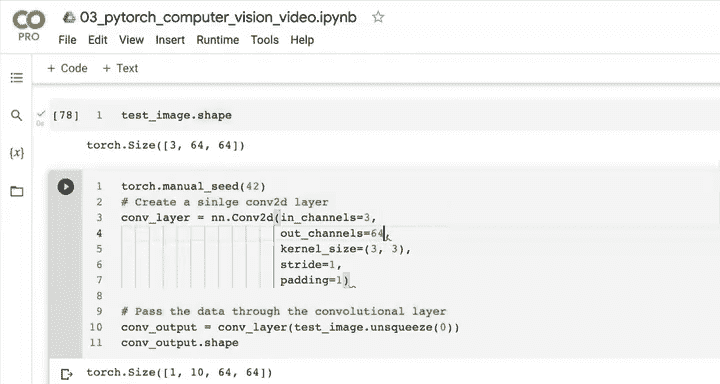

Give that a shot， and I'll see you in the next video。

Who's ready to step through the N N Max pool 2 D layer。 Put your hand up。 I've got my hand up。

 So let's do it together。 He， we've got 7。2。 Now， you might have already given this a shot yourself。

Stepping through。And then。Maxpo。2D。And this is， this is what I do for a lot of different concepts that I haven't gone through before。

 I I just write some test code and see what the inputs and outputs are。

 And so where could we find out about Max tool 2 D。 Well， of course， we've got the documentation。

I'm just going to link this in here。Maxpo 2D。In the simplest case。

 the output value of layer with input size and C H W output and C H out W out， by the way。

 this is number of batches， color channels， height width。

 and this is the output of that layer and kernel size， which is a parameter up here。K H。

 KW can be precisely described as out is going to be the max of some value。

 depending on the kernel size and the stride。 So let's have a look at that in practice。

 And of course， you can read further through the documentation here。 I'll describe the link for this。

 actually。So谁样。Wonderful， and let's now first try it with our test image that we created above。

 So just highlight what the test image is。😊，Bunch of random numbers in the same shape as what a single image would be if we were to replicate the image size of the CNN explainer。

By the way， we'll have a look at a visual in a second of Max pool here。

 but you can go through that on your own time。 let's if in doubt， code it out。

 So we're going to print out the original image shape。Without unscezed dimension。Ca recall that。

 we had to。Add an extra dimension to pass it through our co 2D layer Now if you're using a later version of Ptorrch。

 you might not get an error if you only use a three dimensional image tensor and pass it through a con layer。

So we're going pass it in。Test image。Original shape。Test image dot shape。

 So this is just going to tell us what the line of code in the cell bulb tells us， but that's fine。

I like to make pretty printouts， you know。Test image with unsquecezed dimension。

So this is just going to be our test image and we're going to see what happens when we unsqueeze a dimension。

Unsqueze on the zeroth dimension。 that is。I was about to say first， but it's a zero。

Now we're going to create a sample NN max pool。2 d layer。Because remember。

 even layers themselves in torch。nn are models。Of their own accord。 so we can just create a single。

 This is like creating a single layer model here。We'll set the kernel size equal to2。😡，And recall。

 if we go back to CNN explainer kernel size equal to 2 results in a2 by two square。

 a two by two kernel that's going to。Convolve over our image like so。 And this is an example。

 input and example output。 And you can see the operation that max pooling does here。

 So just keep that in mind as we pass some sample data through our max pool layer。

And now let's pass data through it。I actually， we'll pass it through just the conlayer first。

Through just the co layerer。Because that's sort of how you might stack things。

 you might put a convolutional layer and then a max pool layer on top of that convolutional layer。

So test image through Com。We'll create a variable here equals al com layer。

Is going to take as an input our test image dot unsqueze on the zero dimension again。Beautiful。

Now we're going to print out the shape here。This is just highlighting how I like to troubleshoot things is I do one step。

 print the shape， one step， print the shape， see what is happening as our data moves through various layers。

 So test image through Com dot shape will' see what our co layer does to the shape of our data。

And then we're going to pass。Data through。The max pool layer。

Which is the layer we created a couple of lines above this one here。So let's see what happens。

Test image through。Can't type at the moment through Com and Maxpo。So quite a long variable name here。

 but this is to help us avoid confusion of what's going on。 So we go test image through Com。

 So you notice how we're taking the output of our convolutional layer this year。

And we're passing it through our max pool layer， which has another typo。Wonderful， and finally。

 we'll print out the shape shape after going through con layer。😊，And Max Po。layer。What happens here？

So we want test image through Com and Max poolol。Let's see how our Max pool layout manipulates our test images shape。

 you ready？Three， two， one， let's go。What do we get， Okay， so we have the test image original shape。

 Re that our test image is just a collection of random numbers。And of course。

 our conlayer is going to be instantiated with random numbers。

 and Max pool actually has no parameters。 It just takes the maximum of a certain range of innertensor。

So， when we unsqueezze the。Test image as the input， we get an extra dimension here。

When we pass it through our con layer， oh， where did this 64 come from。1，64，64，64。

 Let's go back up to our co layer。Do you notice how that we get the 64 there because we change the out channels's value。

 if we change this back to 10， like what's in the CNN explainer model 1，2，3，4，5，6，7，8，9，10。

What do you think will happen there？Well， we get a little highlight here，10。Then we keep going。

 I'll just get rid of this extra cell。 We don't need to check the version any more。

 We'll check the test image shaped still 3，64，64。 But then as we pass it through the con layer here。

We get a different size now。So it originally had three channels as the input for color channels。

 but we've upscaled it to 10 so that we have 10 hidden units in our layer。And then we have 64， 64。

Now， again， these shapes will change if we change the values of what's going on here。

So we might put padding to zero。What happens there instead of 64，64， we get 62，62。

And then what happens after we pass it through the con layer and then through the max pool layer？

We've got1，10，64，64。 and now we have 1，10，32，32。 Now， why is that。Well。

 let's go back into the CNN explainer。 jump into this max pool layer here。 Maybe。

 maybe this one because has got a bit more going on。Do you notice on the left here is the input。

 and we've got a two by two kernel here？And so the max pooling layer。

 what it does is it takes the maximum of whatever the input is。😊，So， youll notice the。Import is 60。

60， in this case。Whereas the output over here is 3030。 Now， why is that？ Well。

 Because the max operation here is reducing it from section of four numbers。

So let's get one with a few different numbers。There we go。 that'll do。

So it's taking it from four numbers and finding the maximum value within those four numbers here。Now。

 why would it do that？So as we've discussed before。

 what deep learning neural network is trying to do， or in this case， a CNN is take some input data。

And figure out what features best represent whatever the input data is。

And compress them into a feature vector that is going to be our output。

Now the reason being for that is because you could consider it from a neural network's perspective is that intelligence is compression。

 so you're trying to compress the patterns that make up actual data into a smaller vector space。

 go from a higher dimensional space to a smaller vector space in terms of dimensionality of a tensor。

But still， this smaller dimensionality space represents the original data。

And can be used to predict on future data。So that's the idea behind Max's pool is， hey。

 if we've got these learned features from our convolutional layers。

Will the patterns will the most important patterns stay around if we just take the maximum of a certain section？

So do you notice how the input here， we still have。 You can still see the outline of the car here。

Albeit a little bit more pixelated。 But just by taking the marks of a certain region。

 we've got potentially the most important feature of that little section。And now， of course。

 you could customize this value here。 if when we create our max pool layer。

 you could increase the kernel size to 4 by 4。 What do you think will happen if we can increase it to 4。

So here we've got a two by two kernel。If we increase it to 4 by4， what happens？

Do you notice that we've gone from 62 to 15。 We've essentially divided our feature space by 4。

 We've compressed it even further。 Now， will that work。Well。

 I'm not sure that's part of the experimental nature of machine learning。

 but we're going to keep it at2 for now。And so this is with our tensor here，64，64。

 but now let's do the same as what we've done above。

 but we'll do it with a smaller tensor so that we can really visualize things。

And we're going to just replicate the same operation that's going on here。So let's go here。

 we'll create another random tensor。We'll set up the manual seed first。

And we're going to create a random tensor。With a similar number of dimensions。Now。

 record dimensions don't tell you。 So this is a dimension，1。3，64，64。 That is a dimension。

 that dimensions can have different values within themselves。

So we want to create a four dimensional tensor。To our images。 So what that means is。

 let me just show you。 it's way easy to explain things when we've got code。Is torch。Dot R end。

And we're going to set it up as size equals1，1，2，2。We can have a look at this random tensor。

 it's got four dimensions。1，2，3，4。So you could have a batch size， color channels and height width。

 a very small image。 But it's a random image here。 But this is quite similar to what we've got going on here。

 right。4our numbers。 Now， what do you think will happen if we create a max pool layer just like we've done above。

Create a max poll layout。So we' got max pull。Layah。

 just repeating the code that we have in the cell above， that's all right。 A little bit of practice。

Colonel size。Equals 2。And then we're going to pass the random tensor。Through the max pool layer。

So we' go Max pool。天测。Equals Max poll。Layer and we're going to pass it in the random tensor。

Wonderful， and then we can print out some shapes and print out some tensesors。😊。

As we always do to visualize， visualize， visualize， So we're going to write in here。

 Max pool tensor on a new line。We'll get in the max pool tensor。

We'll see what this looks like and we'll also print out Max pool tenser。Shape。

And we can probably print out random tensor itself as well as its shape as well。

We'll get the shape here， dot shape。And we'll do the same for the random tensile。So print。

You get a new line。Random tensa。New line。Random tensor， and then we'll get the shape。

Random tensor shape， randomandom tensor， Oh， a lot of coding here。 But that's。

 that's the fun part about machine learning， Right， You get to write lots of code， okay。😊。

So we're visualizing what's going on with our random tensor。

 This is what's happening within the max pool layer。 We've seen this from a few different angles now。

 So we have a random tensor of numbers。 and we've got a size here。But the max pool tensor。

 once we pass our random tensor through the max pool layer， what happens when we have 0。

3367128823452303。 Now， what's the max of all these。😊，Well it takes the max here is 3，3，6，7。Oh。

 and we've got the random tensor down there。 we don't want that。

And see how we've reduced the shape from two by two to one by one。Now， what's going on here。

 just for one last time to reiterate， the convolutional layer is trying to learn the most important features。

Within an image。So if we jump into here。Now， what are they。Well。

 we don't decide what a convolutional layer learns。 It learns these features on its own。

So the convolutional layer learns those features。We pass them through a Reello nonlinear activation in case our data requires nonlinear functions。

And then we pass those learned features through a max pool layer to compress them even further。

So the convolutional layer can compress the features into a smaller space。

 but the max pooling layer really compresses them。 So that's the entire idea。

 One more time we start with some input data。 We design a neural network in this case。

 a convolutional neural network to learn a compressed representation of what our input data is so that we can use this compressed representation to later on make predictions on images of our own。

 And in fact， you can try that out if you wanted to click here and add your own image so I'd give that a go。

 That's your extension for this video。 But now we've stepped through。

The max pole 2D layer and the conv 2D layer。I think it's time we started to try and use our tiny VGG network。

 This is your challenge， is to create a dummy tensor and pass it through this model。

Pass it through its forward layer and see what happens to the shape of your dummy tensor as it moves through Com block 1 and Com block 2。

And I'll show you my trick to calculating the in features here for this final layer。

 which is equivalent to this final layer here。

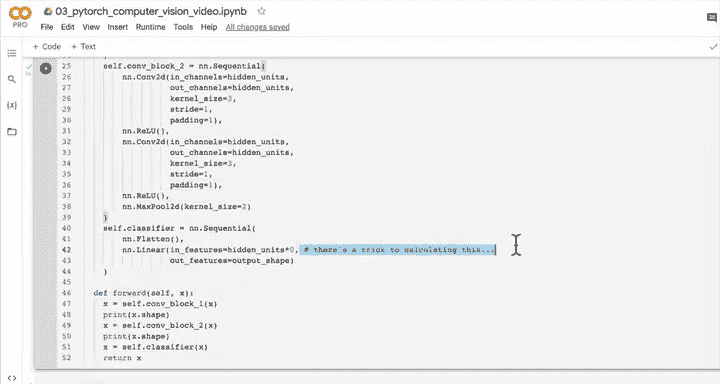

I'll see you in the next video。

Over the last few videos， we've been replicating the tiny VG G architecture from the CNN explainer website。

 And I hope you know that this is， is actually quite exciting because。😊，Years ago。

 this would have taken months of work。 and we've just covered。

 we've broken it down over the last few videos and rebuilt it ourselves with a few lines of Pytorch code。

So that just goes to show how powerful Pytorch is and how far the deep learning field has come。

 but we're not finished yet。

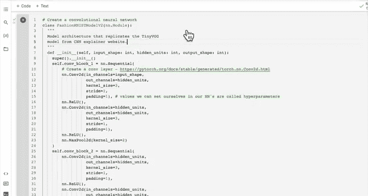

Let's just go over to our keynote。😊，This is what we've done。See an explainer model。

We have an input layer。 We've created that。😊，We have Com 2D layers， we've created those。

We have rail activation layers， we've created those。And finally， we have polling layers。

 and then we finish off with an output layer。 But now let's see what happens when we actually pass some data through this entire model。

 And as I've said before， this is actually quite a common practice is。😊。

You replicate a model that you found somewhere and then test it out with your own data。

 So we're going to start off by using some dummy data to make sure that our model works。

 and then we're going to pass through， oh， I've got another slide for this。By the way。

 here's a breakdown of torch and Ncom 2D。 if you'd like to see it in text form。

 nothing here that we really haven't discussed before。

 but this will be in the slides if you would like to see it。

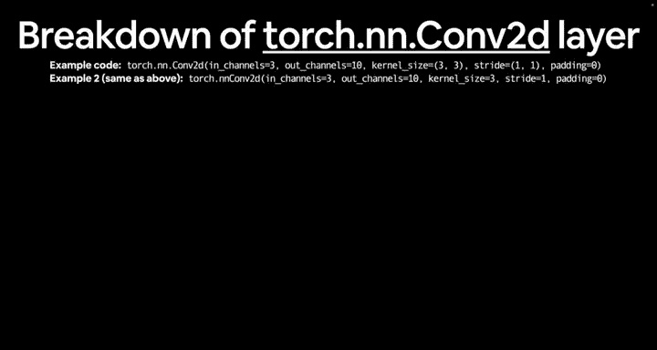

Then we have a video animation。 We've seen this before， though。 And plus。

 I'd rather you go through the CNN and explain a website on your own and explore these different values rather than me just keep talking about it。

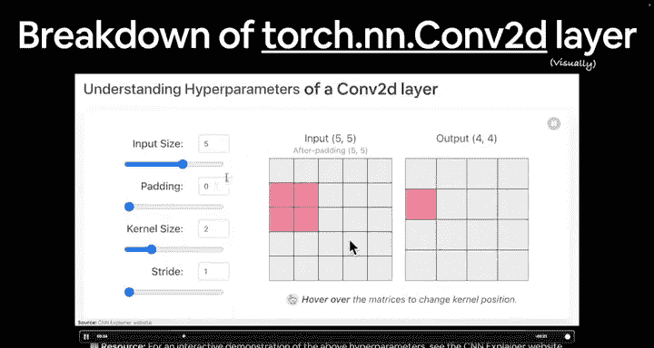

Here's what we're working towards doing。We have our fashion M S data set， and we have our inputs。

 We're going to numerically encode them。 We've done that already。

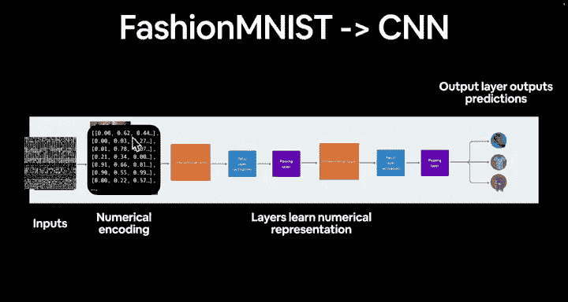

Then we have our convolutional neural network。

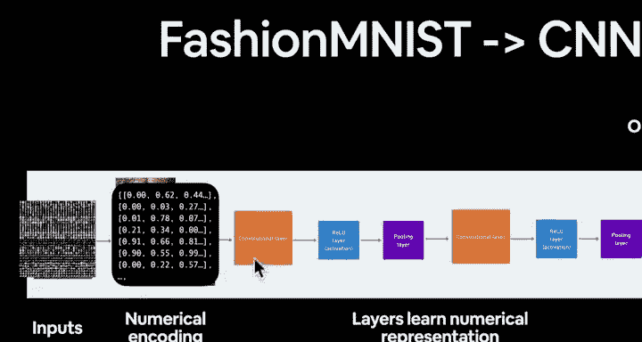

Which is a combination of convolutional layers， non linear activation layers， pooling layers。

 But again， these could be comprised in many different ways， shapes and forms。

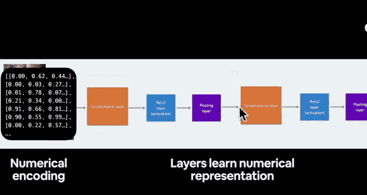

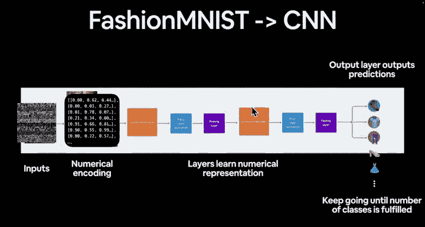

In our case， we've just replicated the tiny VDG architecture。And then finally。

 we want to have an output layer to predict what class of clothing are particular input images。😡。

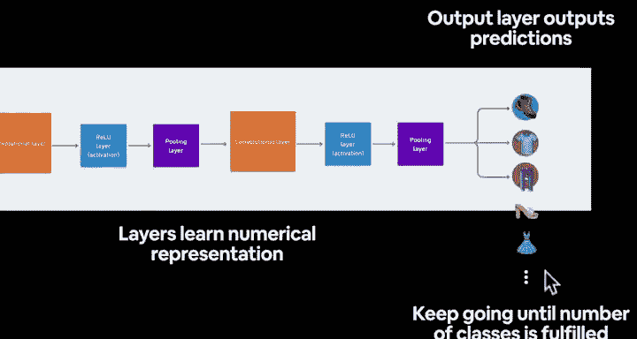

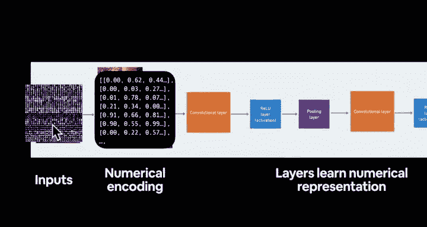

And so let's go back。We have our CNNN model here。And。We've got Model 2。

So let's just practice a dummy Ford pass here。 We're going to come back up a bit to where we were。

 We'll make sure we've got Model2。And we get an error。Here， because I've timesd this by 0。

 So I'm going to just remove that and keep it there。

Let's see what happens if we create a dummy tensor and pass it through here。 Now。

 if you recall what our image is， do we have image。This is a fashion mist image。

So I wonder if we can go。Ploot。 im show。Image and I'm going to squeeze that and I'm going to set this C map e to gray。

😊，So this is our current image。Wonderful。So there's our current image。So let's create a tensor。

Or maybe we just try and pass this through the model and see what happens。😊，How about we try that？

Model image。Right， we're going to try the first pass， Ford pass。So pass image through model。

 what's going to happen？While we get an error。Another shape mismatch。 we've seen this before。

 How do we deal with this， Because what is the shape of our current image。1，28，28。 Now。

 if you don't have this image instantiated， you might have to go back up a few cells。

Where did we create image？I'll just find this。 So just， we created this a fairly a long time ago。

 so I'm going to。Probably recreate it down the bottom。My goodness， we've written a lot of code。

Well done' to us， We could create a dummy tensor if we wanted to。😊。

How about we do that And then if you want to find oh right back up here， we have an image。😊。

How about we do that， we can just do it with a dummy tensor， that's fine。

We can create one of the same size， but if you have image instantiated， you can try that out。

 So there's an image。 Let's now create an image that is or a random tensor that is the same shape as our image。

So Rand。Image Tensa。Eagles， what？Torch。randn。And we're going to pass in size equals 1， 28， 28。

Then if we get RAd image tensor。We check it shape， what do we get？

So the same shape as our test image here， but it's just going to be random numbers， but that's okay。

 we just want to highlight a point here of input and output shapes。

 We want to make sure our model works。Can our random image tends to go all the way through our model。

 that's what we want to find out。😡，So we get an error here， we have four dimensions。

 but our image is three dimensions。 How do we add an extra dimension for batch size Now you might not get this error if you're running a later version of pytorch just keep that in mind。

So unsqueeze zero。Oh， expected all tensors to be on the same device。

 but found at least two devices again， we're going through all the three major issues in deep learning。

 shape mismatch， device mismatch， data type mismatch。

 So let's put this on the device to target devicecause we've set up device agnostic code。

Mat 1 and mat 2 shapes cannot be multiplied。 Oh， but we get an output here。That is very exciting。

 So what I might do is move this a couple of cells up so that we can tell what's going on。

 I'm going to delete this cell。😊，so。Where do these shapes come from？Well。

 we've printed out the shapes there。 And so this is what's happened when our。

I'll just create our random tensor。 I'll bring our random tensor up a bit too。 Let's bring this up。

There we go。So。We pass our random image tensor through our model。

 and we've made sure it's got four dimensions by unsqueed0。

 and we make sure it's on the same device as our model because our model has been sent to the GPU。

And this is what happens as we pass our random image tensor we've got 12828 instead of previously we've seen 64643。

 I going to clean this up a bit。😊，And we get different shapes here。

So you'll notice that as our input， if it was 64643， goes through these layers。

It gets shaped into different values。 Now， this is going to be universal across all of the different data sets you work on。

 You will be working with different shapes。 So it's important to and also quite fun to troubleshoot what shapes you need to use for your different layers。

 So this is where my trick comes in。😊，To find out the shapes for different layers。

 I often construct my models how we've done here as best I can with the information that I've got。

 such as replicating what's here。 But I don't really know what the output shape is going to be before it goes into this final layer。

And so I recreate the model as best I can。 And then I pass data through it in the form of a dummy tensor in the same shape as my actual data so we could customize this to be any shape that we wanted。

 And then I print the shapes of what's happening through each of the forward past steps。

 And so if we pass it through this random tensor through the first column block。😊。

It goes through these layers here， and then it outputs a tensor with this size。

So we've got 10 because that's how many output channels we've set。 and then 1414。

 because our 2828 tensor has gone through a max pool 2 D layer and gone through a convolutional layer。

 And then it goes through the next block， column block 2。

Which is because we've put it in the forward method here。 And then it outputs the shape。

 And if we go back down。We have now a shape of 1，10，7，7。 So our previous tensor。

 the output of Com block1。Has gone from 1414 to 7，7。 So it's been compressed。

 So let me just write this down here。 outputput shape of calm block 1。

 just so we get a little bit more。Information。And I'm just going to copy this。Pul in here。

That will become block 2。And then finally， I want to know if I get an output shape of。Classifier。

So if I rerun all of this。I don't get an output shape of classifier。

 so my model is running into trouble。Once it gets to， so I get the output of Com block 1。

 I don't get an output of classifier。 So this is telling me that I have an issue with my classifier layer。

Now， I know this because。Well， I've coded this model before and the in features here。

 we need a special calculation。 So what is going on with our shapes。

MaAT1 and mat2 shapes can be multiplied。So do you see here。

 What is the rule of matrix multiplication， The inner dimensions here I have to match。 We've got 4。

90。 Where could that number have come from。And we've got 10 times 10。Now， okay。

 I know I've set hidden units to 10。 so maybe that's where that 10 came from。

And what is the output layer of the output shape of Comv block 2。So if we look。

 we've got the output shape of Com block 2。Where does that go？😡，The output of Com block 2。

Goes into our classifier model， and then it gets flattened。 So that's telling us something there。

And then our NN linear layer is expecting the output of the flatten layer as its in features。😊。

So this is where my trick comes into play。I pass the output of Comv Vlock2 into the classifier layer。

It gets flattened。And then that's what my N N linear layer is expecting so。

What happens if we flatten this Shapeia？Do we get this value， Let's have a look。

 So if we go 10 times 7 times 7。490。😡，Now， where was this 10？Well， that's our hidden units。

And where were these sevens？Well。These sevens are the output of Comv block 2。So that's my trick。

 I print the shapes of previous layers and see whether or not they line up with subsequent layers。

So if we go time  seven， times7。We're going to have hidden units equals 10， times 7 times 7。

 Where do we get the two7s， Because that is the output shape of con block 2。

Do you see how this can be a little bit hard to calculate ahead of time。Now。

 you could calculate this by hand if you went into Mcom 2D。

 but I prefer to write code to calculate things for me。You can calculate that value by hand。

 if you go through。H out W out， you can。Add together all of their different parameters and multiply them and divide them and。

What not？ You can calculate the input and output shapes of your convolutional layers。

 You're more than welcome to try that out by hand。But I prefer to code it out。 if， in doubt。

 code it out。 Now， let's see what happens。If we。Run our random image tensor through our model。 Now。

 Do you think it will work。Well， let's find out。 All we've done is we've added this little line here。

 Time 7， times 7。And we've calculated that because we've gone， ha。

 what if we pass a tensor of this dimension through a flatten layer？

And what is our rule of matrix multiplication， The inner dimensions here must match。

 And why do we know that these are matrices。 Well， mat 1 and mat 2 shapes cannot be multiplied。

 and we know that inside a linear layer。Is a matrix multiplication。So let's now give this a go。

We'll see if it works。Oh， would you look at that。 That is so exciting。

 We have the output shape of the classifier is 1 and 10。 We have a look。 We have one number，1，2，3，4。

5，6，7，8，9，10，1 number for each class in our data set。😊，Wow， just like the CNN explainer website。

 we have 10 outputs here。 We just happen to have 10 classes as well。 Now， this number， again。

 could be whatever you want。 It could be 100 could be 30， could be 3。

 depending on how many classes you have， but we have just figured out the input and output shapes of each layer in our model。

So that's very exciting。 I think it's now time。😊，We've passed a random tensor through。

 how about we pass some actual data through our model？😊。

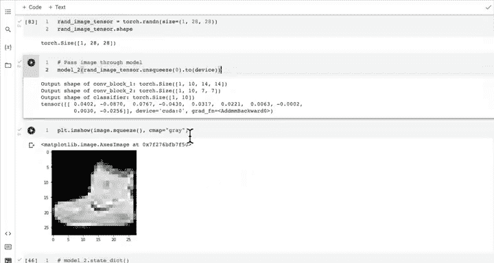

In the next video， let's use our train and test step functions to train our first convolutional neural network。

I'll see you there。

WellLet's get ready to train our first CNN。 So what do we need， Where are we up to in the workflow。

 Well， we've built a model and we've stepped through it。 We know what's going on。

 but let's really see what's going on by training。😊。

This CNNnN or see if it trains because we don't always know if it will on our own data set。

 which is of fashion Mist。 So we're going to set up a loss function and optr。😊，For Model two。

 just as we've done before， Model 2， turn that into markdown。

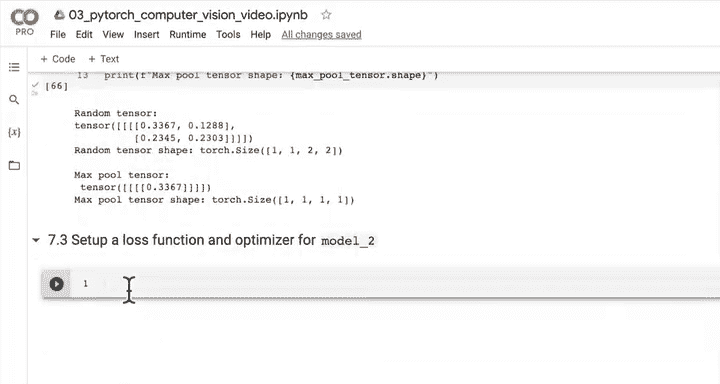

I'll just show you the workflow again。 So this is what we're doing。 we've got some inputs。

 we've got a numerical encoding。 we've built this architecture and hopefully it helps us learn or helps us make a predictive model that we can input images such as grayscale images of clothing and predict。

😊。

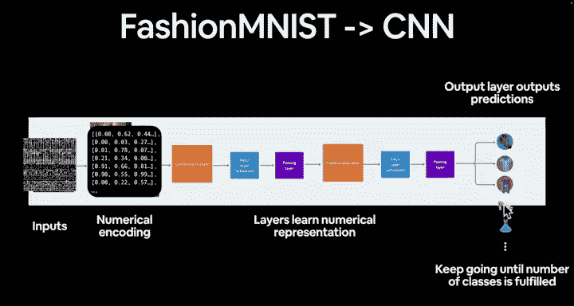

And if we look where we are at the。PyToage workflow， we've got our data ready。

We've built our next model。Now here's where we're up to。Picking a loss function。 and an optimizer。

So let's do that， hey？Loss function， or we can do evaluation metrics as well。

 So set up loss function， slash Aval metrics， slash optimizer， and we want from helper functions。

Import accuracy function， we don't need to reimporter but we're going to do it anyway for completeness Los function equals Nn。

 crossenttropy loss because we are working with a multiclass classification problem and the optimizer we're going to keep the same as what we've used before。

 Torch。 Opim SGD and we'll pass it in this time the parameters that we're trying to optimize are the parameters of Model 2。

Prameters and we'll use a learning rate of 0。1 run that and just to reiterate。

 here's what we're trying to optimize Model 2 state di。We have a lot of random weights in Model 2。

Have a look at all this。 There's the bias。 There's the weight。

 We're going to try and optimize these to help us predict on our fashion Mnes data set。

 So without any further ado， let's in the next video go to the workflow。😊。

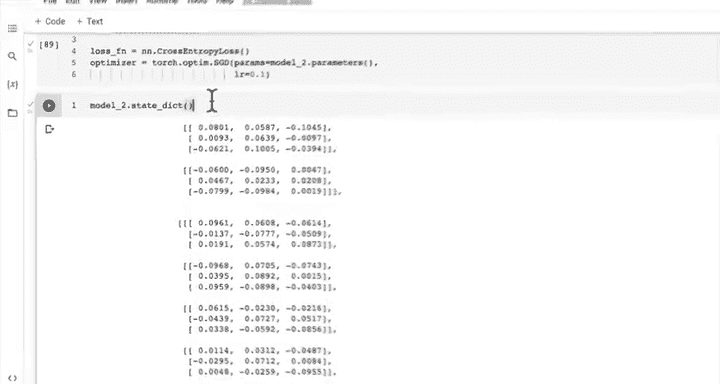

We're going to build our training loop， But thanks to us before we've now got functions to do this for us。

 So if you want to give this a go， use our train step and test step function to train Model 2。😊。

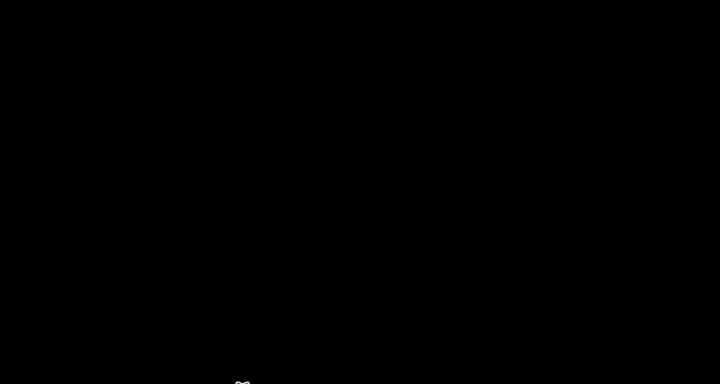

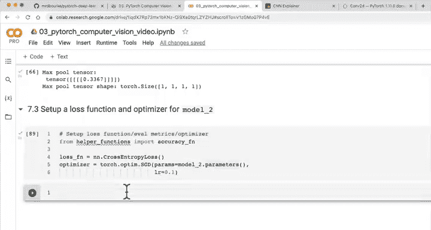

Try that out and we'll do it together in the next video。😊。

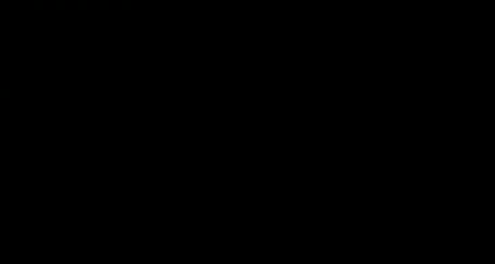