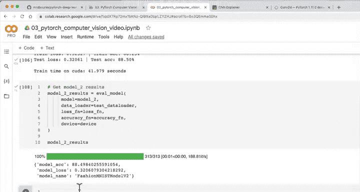
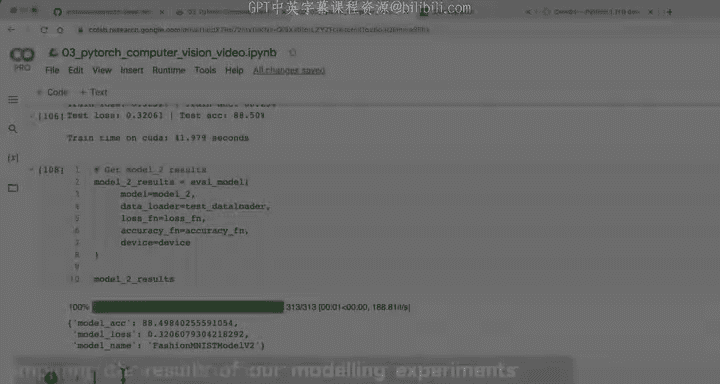
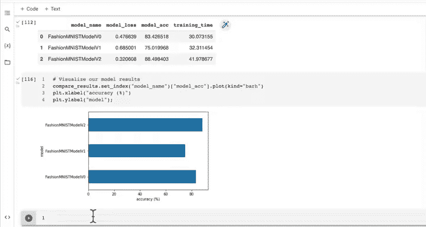

# mrdbourke《一天学会pytorch深度学习｜Learn PyTorch for deep learning in a day Literally》中英 - P73：118. Training our first CNN.zh_en - GPT中英字幕课程资源 - BV1kx4y1r79d

We're getting so close to training our model。 let's write some code to train our first CNN model。😊。

Training and testing， I'm just going to make another heading here， Model two。

 using our training and test functions。So we don't have to rewrite all of the steps in a training loop and a testing loop because we've already created that functionality before through our train step function。

😊，There we go， performs a training or this should be perform a training step with model trying to learn on data loader。

 So let's set this up。 I'm going to set up torch manual seed。

42 and we can set up a couda manual seed as well。Just to try and make our experiments as reproducible as possible because we're going to be using Kuda。

We're going to measure the time because we want to compare our models not only their performance in evaluation metrics。

 but how long they take to train。😊，From time it， because there's no point having a model that performs really。

 really well， but takes 10 times longer to train。Well maybe there is。

 depending on what you're working on， Model two equals timer。And we're going to train and test model。

 but that the time is just something to be aware of is that usually a better performing model will take longer to train。

 not always the case， but just something to keep in mind。

So for epoch in we're going to use TQDm to measure the progress。

 we're going to create a range of epochs。 we're just going to train for three epochs。

 keeping our experiments short for now just to see how they work。Apoch。

And we're going to print a new line here。So for an epoch in a range。

We're going to do the training step， which is our train step function。

The model is going to be equal to Model2， which is our convolutional neural network， our tiny VGG。

 the data loader is just going to be equal to the train data loader， the same one we've used before。

 the loss function is going to be equal to the loss function that we've set up above。Loss fn。

The optimizer as well， is going to be the optimizer in our case， storcastic gradient descent。

Optimizer equals Opr。Then we set up the accuracy function。

 which is going to be equal to our accuracy function。And the device is going to be the target device。

😊，How easy was that Now we do the same for the train or the testing step。 Sorry。

 the model is going to be equal to model 2。 And then the data loader is going to be the test data loader。

And then the loss function is going to be our same loss function。

 and then we have no optimizer for this。 we're just going to pass in the accuracy function here。

And then， of course， the device is going to be equal to the device。And then what do we do now？Well。

 we can measure。The end time。So that we know how long the code here took to run。

So let's go train time end for Model 2， this will be on the GPU， by the way。

 but this time it's using a convolutional neural network。And the total train time。

Total train time for Model 2 is going to be equal to print train time。

 our function that we created before as well to help us measure start and end time。

 so we're going to pass in train time start Model2 and then end is going to be train time end Model2。

And then we're going to print out the device that it's using as well。 So you're ready。

 Are you ready to train our first convolutional neural network？Hopefully this code works。

 We've created these functions before， so it should be all right。😊，But if in doubt， code it out。

 if in doubt， run the code。 Let's see what happens。Oh my goodness， Of course。

 we forgot to comment out the output shapes。😊，So we get a whole bunch of outputs for our model because what have we done back up here？

😊，We forgot to。 So this means every time our data goes through the forward pass。

 it's going to be printing out the output shapes。 So let's just comment out these。

And I think this cell is going to take quite a long time to run because。😊，It's got so many printouts。

 yeah， see， streaming output truncated to the last 5000 lines。😊，So we're going to try and stop that。

 Okay， there we go， beautiful。 That actually works。 Sometimes it doesn't stop so quickly。

So we're going to rerun our fashion MSV2 model cell so that we comment out these print lines and then we'll just rerun these cells down here。

Just go back through fingers crossed。 There's no errors and we'll train our model again。 beautifuli。

 not as many printouts this time。 So here we go。 Our first CNN is training。

 How do you think it'll go。😊，Well， that's all we have printouts， right， so we can see the progress。

 So you can see here all the functions that are been called behind the scenes from Pytorch。

 So thank you to Pytorch for that。 There's our， oh， our train step function was in there。😊。

Train step， wonderful。Beautiful， so there's epoch 0。 Oh， we get a pretty good test accuracy。

 How good is that Test accuracy is climbing as well。 Have we beaten our baseline。😊。

We're looking at about 14 seconds per epoch here。And then the final apoch。What do we finish at88。

5 Wow， in 41。97979 or 42 there're about seconds Again， your mileage may vary。

 Don't worry too much if these numbers aren't exactly the same on your screen and same with the training time because we might be using slightly different hardware。

 What GPU do I have today。I have a Tesla P100 GPU you might not have the same GPU so the training time if this training time is something like 10 times higher。

 you might want to look into what's going on and if these values are like 10% lower or 10% higher。

 you might want to see what's going on with your code as well。

But let's now calculate our Model 2 results。 I think it is the best performing model that we have so far。

 Let's get a results dictionary。 Model 2 results。 Is it so exciting when learning the power of convolutional neural networks。

 Model 2 results equals a vow model， And this is a function that we've created before。😊。

So return to dictionary containing the results of a model predicting on data loader。

 so now let's pass in the model， which will be our trained model2。

And then we'll pass in the data loader， which will be our test data loader。And then， oh， excuse me。

Typo， our loss function will be， of course， our loss function and the accuracy function will be。

Accuracy function and the device is already set， but we can reset anyway， device es device。

And we'll check out the Model2 results。Make some predictions。 Oh， look at that。Model accuracy88。

 does that beat our baseline Model zero results？😊，Or。

 we did beat our baseline with a convolutional neural network。All right。

 so I feel like that's that's quite exciting。 but now let's keep going on。

 and let's start to compare the results of all of our models。😊。

I'll see you in the next video。Welcome back。 Now， in the last video。

 we trained our first convolutional neural network and from the looks of things it's improved upon our baseline。

 but let's make sure by comparing this is another important part of machine learning experiments is comparing the results across your experiments So and training time Now we've done that in a way where we've got three dictionaries here of our Model 0 results。

 Model 1 results， Model 2 results。 So how about we create a data frame comparing them。

 So let's import pandas。😊，As PDd。And we're going to compare results equals PDd。 datata frame。

And because our model results dictionaries all have the same keys， let's pass them in as a list。

 so model zero results。😊，Model1 results。And Model two results to compare them。

Wonderful and what it looks like when we compare the results。Al righty。

 so recall our first model was our baseline v0 which just two linear layers。

 and so we have an accuracy of 83。4 and a loss of 0。47。😊。

The next model was we trained on the GPU and we introduced linearities so。

We actually found that that was worse off than our baseline。 But then we brought in the big guns。

 We brought in the tiny VG G architecture from the CNN explainer website and trained our first convolutional neural network。

 and we got the best results so far。 But there's a lot more experiments that we could do。

 We could go back through our tiny VGG， and we could increase the number of hidden units。😊。

Where do we create our model up here， We could increase this to say 30 and see what happens。

 That would be a good experiment to try。 And if we found that non linearities didn't help with our second model。

 we could comment out the Re layers。😊，We could， of course， change the kernel size。

 change the padding， change the max pool。 a whole bunch of different things that we could try here。

 We could train it for longer。 So maybe if we trained it for tanypos， it would perform better。

 But these are just things to keep in mind and try out。 I'd encourage you to give them a go yourself。

 But for now， we've kept all our experiments quite the same。😊。

How about we see the results we add in the training time。

 because that's another important thing that we've been tracking as well。 So we'll add。Training time。

Two results comparison。So the reason why we do this is because。😡。

If this model is performing quite well， even compared to our CNN。

 So a difference in about 5% accuracy， maybe that's tolerable in the the space that we're working。

 except that this model might actually train and perform inference 10 times faster than this model。

 So that's just something to be aware of。 It's called the performance speed trade off。

 So let's add another column here， compareare results and we're going to add in。 oh， excuse me。

Got a little error there。 That's all right。 Got Tri happy on the shift and enter Tra time equals。

 We're going to add in。We've got another list here is going to be total train time for Model zero。

And total train time for Model one and total train time for model。2。And then we have a look at our。

Compare results， dictionary or sorry， compareare results data frame。Wonderful。

So we see and now this is another thing I keep stressing this to keep in mind if your numbers aren exactly of what I've got here。

 don't worry too much， go back through the code and see if you've set up the random seeds correctly。

 you might need a coud or random seed， we may have missed one of those。😡。

If your numbers are outlandishly different to these numbers。

 then you should go back through your code and see if there's something wrong and again。

 the training time will be highly dependent on the compute environment you're using so if you're running this notebook locally you might get faster training times if you're running it on a different GPU to what I have Nvidia SMI you might get different training times so I'm using a Tesla P 100 which is quite a faster GPU but that's because I'm paying for coab Pro which generally gives you faster GPus and model 0 was trained on the CPU so depending on what compute resource Google allocates to you with Google Coab this number might vary here so just keep that in mind these values training time will be very dependent on the hardware you're using。

But if your numbers are dramatically different， well。

 then you might want to change something in your code and see what's going on。

And how about we finish this off with a graph？😊，Let's go visualize our model results and why are we're doing this。

 have a look at the data frame above。😊，Is the performance here 10 seconds longer training time worth that extra 5% of the results on the accuracy？

Now in our case， we're using a relatively toy problem。

 What I mean by toy problem is quite a simple data set to try and test this out。

 but in your practice that may be worth doing if your model takes longer to train but gets quite a bit better performance。

It really depends on the problem you're working with。

Compare results and we're going to set the index as the model name because I think that's what we want our graph to be。

 we want the model name and then we're going to plot， we want to compare the model accuracyacies。😊。

And we want to plot。The kind is going to be equal to bar H horizontal bar chart。

We'll go Px label we're going to get。Accuracy as a percentage。And then we're going to go P Y label。

 This is just something that you could share if someone was asking how did your modeling experiments go on fashion Mnest？

 Well， here's what I've got。 And then they ask you well。

 what's the fashion Mnes model V2 where you could say that's a convolutional neural network that trained that's replicates the CNN explainer website that trained on a GPU how long did that take to train Well then you've got the training time here。

 We could just do it as a vertical bar chart。I did it as horizontal so that this looks a bit funny to me。

So horizontal like that。So the model names are over here。Wonderful。

 so now I feel like we've got a trained model。 How about we make some visual predictions because we've just got numbers on a page here。

 but our model is trained on computer vision data and the whole point of making a machine learning model on computer vision data is to be able to visualize predictions。

😊，So let's give that a shot hey， in the next video， we're going to use our best performing model。

 fashionash Anes model V2 to make predictions on random samples from the test data set。

 You might want to give that a shot， make some predictions on random samples from the test dataset set and plot them out with their predictions as the title。

😊。

So try that out， otherwise we'll do it together in the next video。😊。

