# mrdbourke《一天学会pytorch深度学习｜Learn PyTorch for deep learning in a day Literally》中英 - P75：121. Plotting our best model predictions.zh_en - GPT中英字幕课程资源 - BV1kx4y1r79d

Let's now continue following the data Explorer's motto of visualize visualize visualize。

 We have some prediction classes。 We have some labels we'd like to compare them to。

 You can compare them visually。 It looks like our model is doing pretty good but lets since we're making predictions on images。

 let's plot those images along with the predictions。

 So I'm going to write some code here to plot the predictions。

 I'm going to create a matte plotlib figure。 I'm going to set the fig size to9 and 9 because we've got nine random samples。

 You could of course change this to however menu you want。

 I just found that a three by three plot works pretty good in practice。 and I'm going to set n rows。

😊。

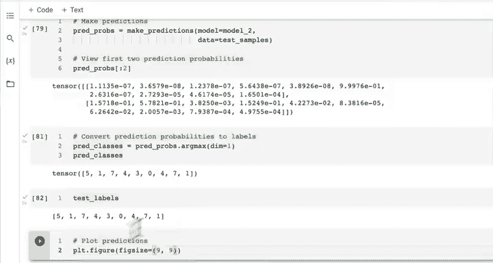

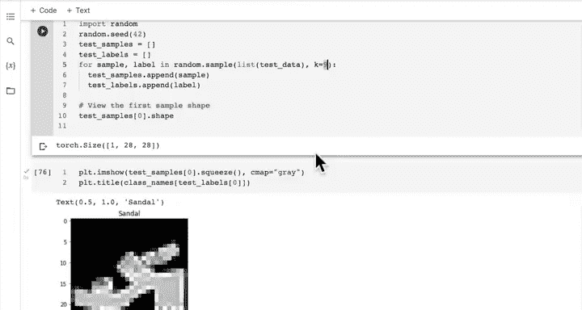

So for my mappl lib plot， I want three rows and I want three columns。

And so I'm going to enumerate through。The samples in test samples。

And then I'm going to create a subplot for each sample， so create a subplot。

Because this is going to create a subpllock because it's within the loop。

Each time it goes through a new sample， create a subplot of androws and coals and the index it's going to be on。

Is going to be I plus one， because it can't start at 0。 So we just put I plus one in there。

What's going on here？Enumerate， Oh， excuse me。In enumerate， wonderful。

 so now we're going to plot the target image。😊，We can go plot。mshow we're going to get sample。

 squeezequeeze。Because we need to remove the batch dimension。

And then we're going to set the C map is equal to gray。What's this telling me up here？Oh no。

 that's correct。Next we're going to find the prediction label in text form because we don't want it in a numeric form。

 we could do that， but we want to look at things visually with human readable language such as sandal for whatever class sandal is。

 whatever number class that is。So we're going to set the pre label equals class names。

 and we're going to index using the pre class's i value。So right now we're going to plot our sample。

 we're going to find its prediction。And now we're going to get the truth label。

So we also want this in text form。And what is the truth label going to be？Well。

 the truth label is we're going to have to index using in class names and index on that using test labelbels I。

 so we're just matching up our indexes here。Finally， we're going to create a title。😊。

Create a title for the plot and now here's what I like to do as well if we're getting visual well we might as well get really visual right。

 so I think we can change the color of the title text depending if the prediction is right or wrong。

😊，So I'm going to create a title using an F string。

 Pre is going to be a pre label and the truth label。

We could even plot the prediction probabilities here if we wanted to。

 that might be an extension that you might want to try。And so here we're going to check for equality。

Between pre and truth。And change color of title text。

So what I mean by this it's going to be a lot easier to explain if we just if in doubt， code it out。

 so if the pre label equals the truth label， so they're equal。

 I want the plot dot title to be the title text。But I want the font size。

 well the font size can be the same 10， I want the color to equal green。So， if there。So green text。

 if prediction。Same as truth。And else I'm going to set the plot title to have。Title text。

 font size equals 10， and the color is going to be red。

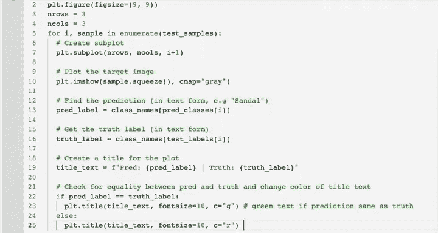

So does that make sense？

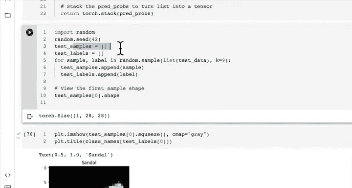

All we're doing is we're reumer through our test samples that we got up here。

 test samples that we found randomly from the test data set。

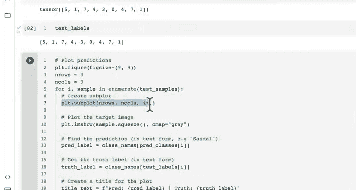

And then each time we're creating a subplot。 We're plotting our image。

 We're finding the prediction label by indexing on the class names with our preed classes value。

We're getting the truth label and we're creating a title for the plot that compares the pre label to the truth。

 and we're changing the color of the title text depending if the pre label is correct or not。😡。

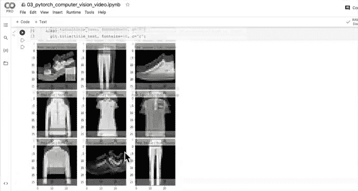

So let's see what happens， did we get it right？😊，Oh， yes， we did。 Oh， I'm gonna do one more thing。

 I want to turn off the aes。

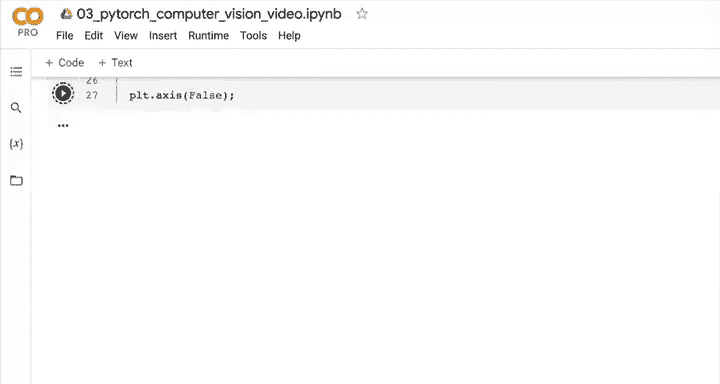

Just so we get more real estate。I love these kind of plots。😊。

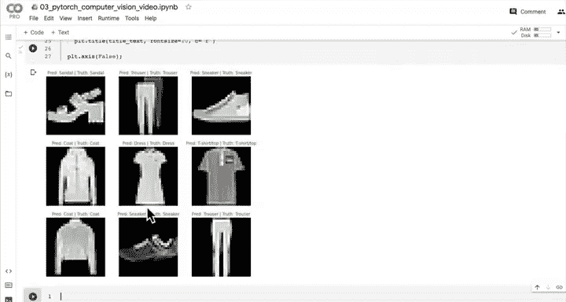

It helps that our model got all of these predictions right， so look at this。😊。

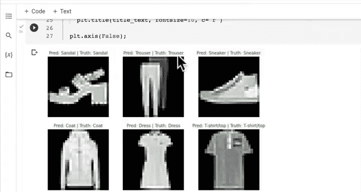

Pread sandal， Tru sandal。 Pre trouser。

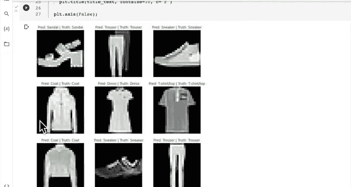

Truth trouser。 So that's pretty darn good， right。 See how for me， I much appreciate like。

 I much prefer visualizing things。 Numbers on a page look good， but there's something。

 there's nothing quite like visualizing your machine learning models predictions。

 especially when it gets it right。 So how about we select some different random samples up here。

 We could functionise this as well to do like all of this code in one hit。 But that's all right。

 We'll be a bit hacky for now。 So this is just going to randomly sample with no seed at all。

 So your samples might be different to mine。😊。

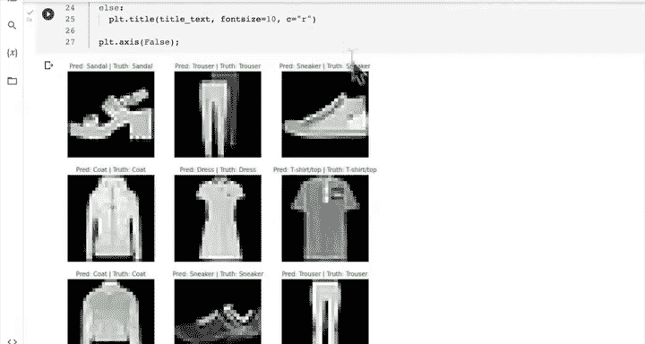

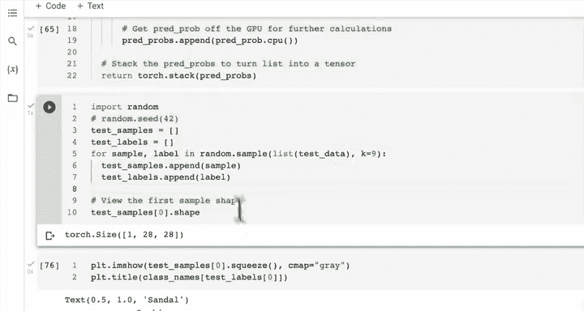

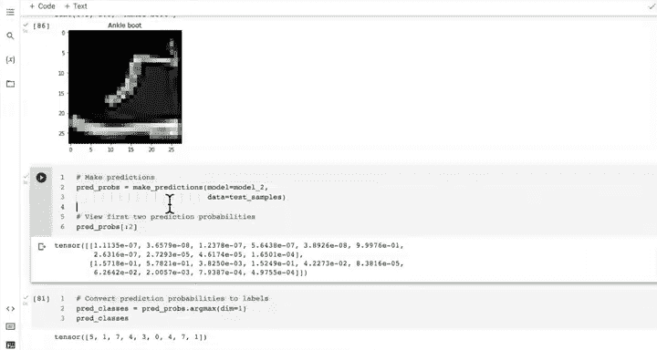

Nine different samples， so this time we have an ankle boot， we'll make some predictions。

 we'll just step through all of this code here。

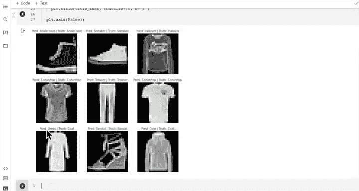

And oh， there we go。 It got one wrong。 So all of these are correct。

 But this is more interesting as well， is where does your model get things wrong。

 So it predicted a dress。 But this is a coat。😊。

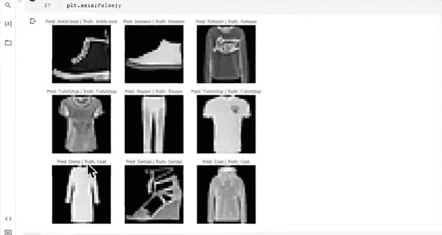

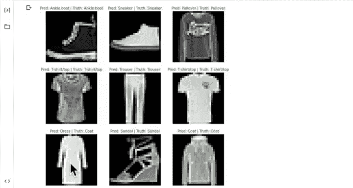

Now， do you think that this could be potentially addressed to me。

 I could see that as being addressed。 So I kind of understand where the model is coming from in there。

 Let's make some more random predictions。We might do two more of these before we move on to the next video。

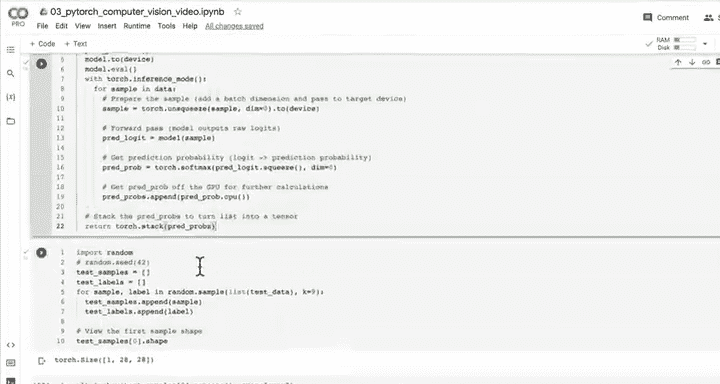

Oh， all correct。 We're interested in getting something wrong here。 So our model seems to be too good。

😊。

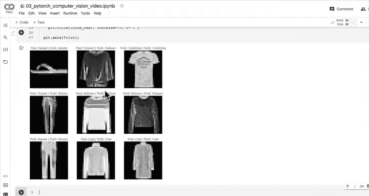

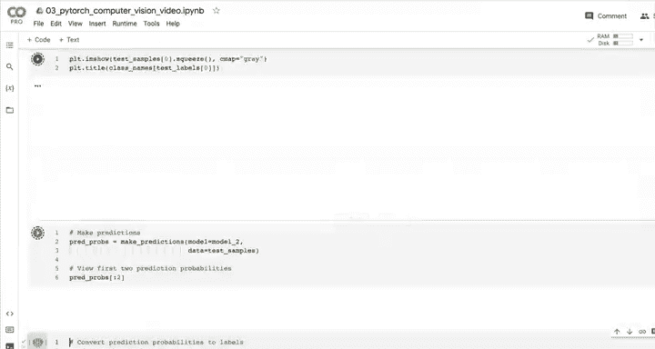

All correct again， okay， one more time if we don't get any wrong， we're going on to the next video。

But this is just。Really， oh， there we go。 too wrong。 Beai。 So predicted a dress。 and that's a shirt。

 Okay， I can kind of see where the model might have stuffed up there。

 So a little bit long for a shirt for me， but I can still understand that that would be a shirt。😊。

And this is a pullover， but the truth is a coat。 So maybe maybe there's some issues with the labels。

 And that's probably what you'll find in a lot of data sets， especially quite large ones。

 just for the sheer lo of large numbers then maybe some truth labels in your datasets that you work with that are wrong。

 And so that's why I like to see， compare the model's predictions versus the truth on a bunch of random samples to go you know what is our model's results better or worse than they actually are。

 and that's what visualizing helps you do。 It's figure out， you know what our model is actually。

 it says it's good on the accuracy。 But when we visualize the predictions it's not too good。

 and vice versa right， So you can keep playing around with this。

 try look at some more random samples by running this again， we'll do one more for good luck。

 and then we'll move on to the next video。 we're going to go on to another way。

 Oh see this is another example。 some labels here could be confusing。😊。

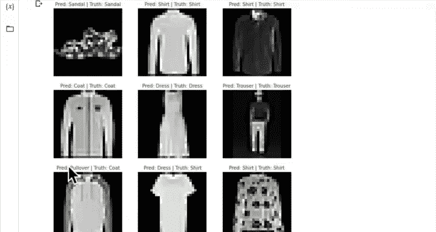

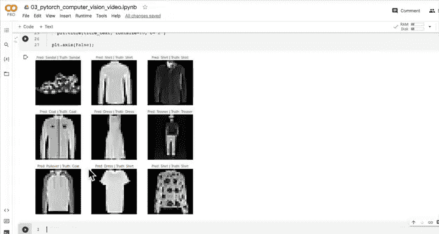

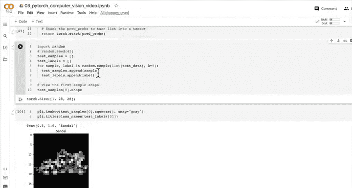

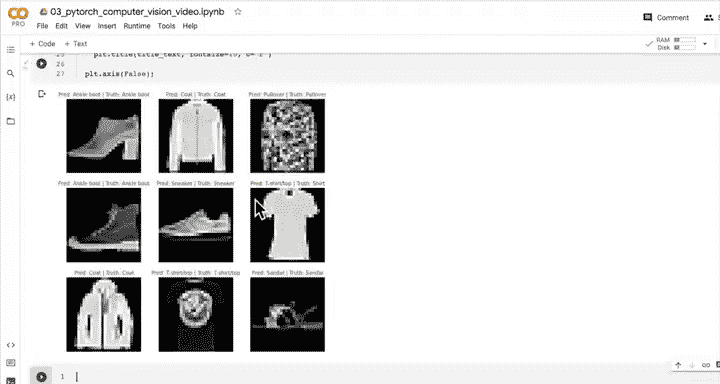

And speaking of confusing， well， that's going to be a spoiler for the next video。

But do you see how the prediction is a T shirt top， but the truth is a shirt。 to me。

 that label is kind of overlapping like， I don't know。

 what's the difference between a T shirt and a shirt。

So that's something that you'll find as you train models is maybe your model is going to tell you about your data as well。

😡。

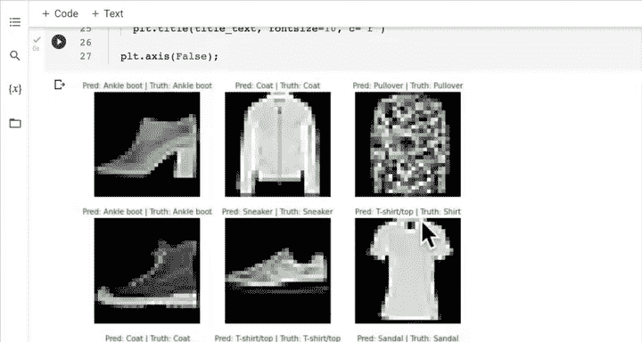

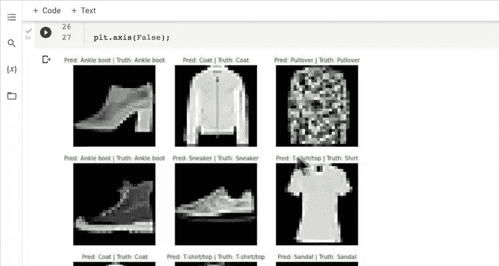

And so we hinted that this is going to be confused。 The model is confused between T shirt。

 top and shirt。

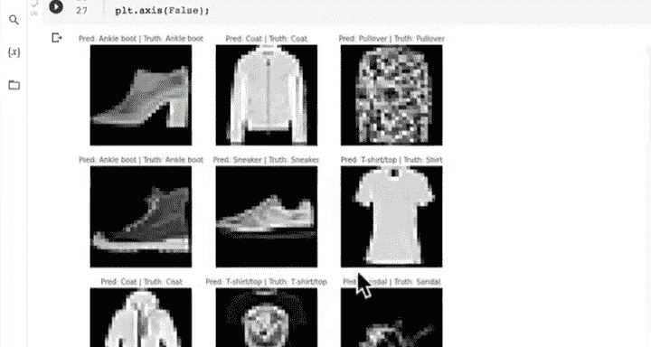

How about we plot a confusion matrix in the next video？I'll see you there。

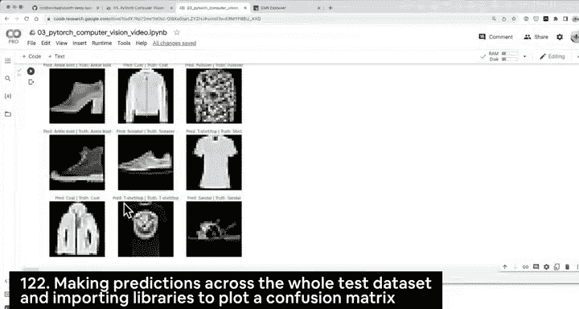

We're up to a very exciting point in evaluating our machine learning model and that is visualizing。

 visualizing， visualizing and we saw that in the previous video our model kind of gets a little bit confused and in fact I would personally get confused at the difference between Thirt slash top and a shirt。

😊。

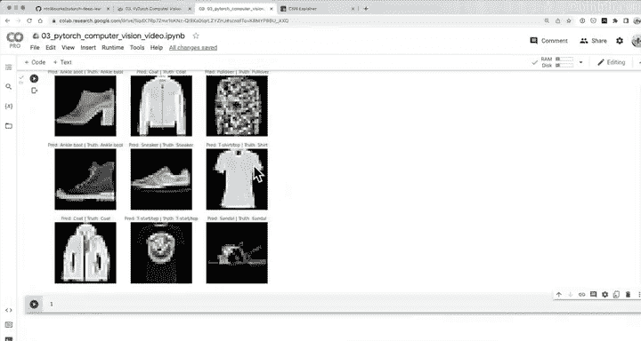

So these kind of insights into our model predictions can also give us insights into maybe some of our labels could be improved。

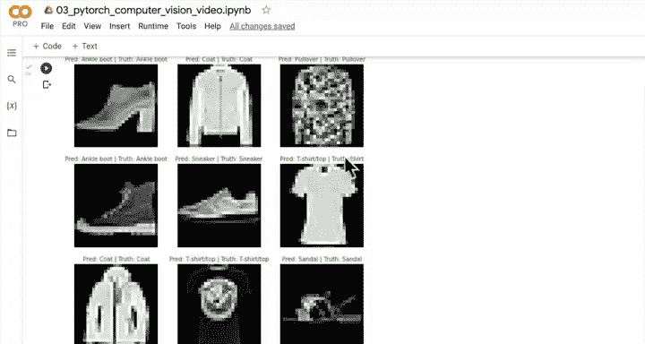

And another way to check that is to make a confusion matrix。 So let's do that。

 making a confusion matrix for further。

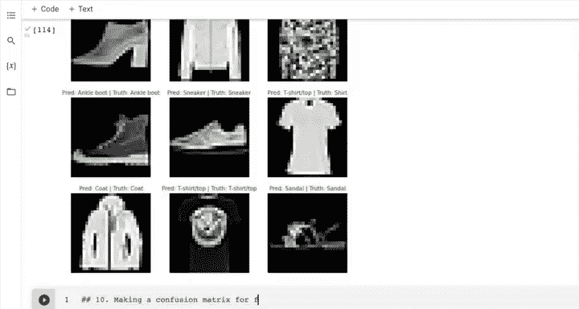

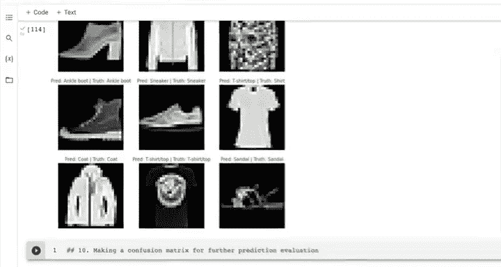

Prediction。Evaluation Now， a confusion matrix is another one of my favorite ways of evaluating a classification model。

 because that's what we're doing。 We're doing multiclass classification。 And if you recall。

 if we go back to section2 of the Learnptorch do book。😊。

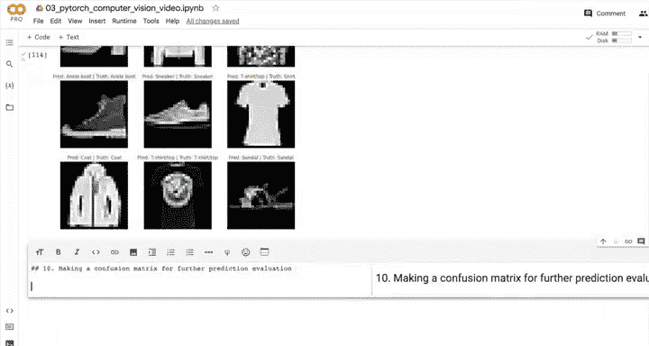

And then if we scroll down， we have a section here， more classification evaluation metrics。

 So accuracy is probably the gold standard of classification evaluation。 There's precision。

 there's recall， there's F1 score， and there's a confusion matrix here。

 So how about we try to build one of those。 I want to get this and copy this。😊。

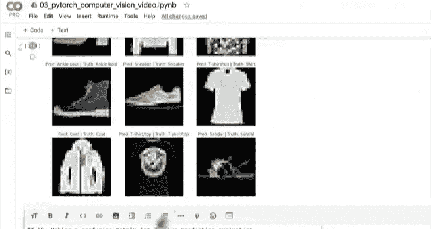

So and write down。A confusion matrix is a fantastic way of evaluating your classification models。

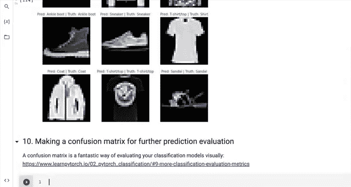

Visually。

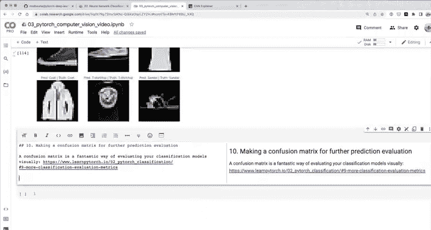

Beautiful。So we're going to break this down first of all， we need to to plot a confusion matrix。

 we need to make predictions with our trained model。😊，On the test data set。Number two。

 we're going to make a confusion matrix and to do so， we're going to leverage torch metrics。

 tricks have to figure out how to spell metrics and confusion matrix。

So recall that torch metrics we've touched on this before is a great package torch metrics for。😊。

A whole bunch of evaluation metrics of machine learning models。And pieyoid flavor。

So if we find we've got classification metrics， we've got audio image detection。 Lookout。

 this is beautiful。 a bunch of different evaluation metrics。 And if we go down over here。

 we've got confusion matrix。😊，So I only touched on five here。But or6。

 But if you look at torch metrics， they've got， how many is that about 25 different classification metrics。

 So if you want some extra curriculum， you can read through these。But let's go to Con matrixtri。

And if we look at some code here， we've got torch metrics， confusion matrix。

 we need a pass in number of classes， we can normalize if we want。

And do you notice how this is quite similar to the P torch documentation， Well。

 that's the beautiful thing about torch metrics is that it's created with pie torch in mind。😊。

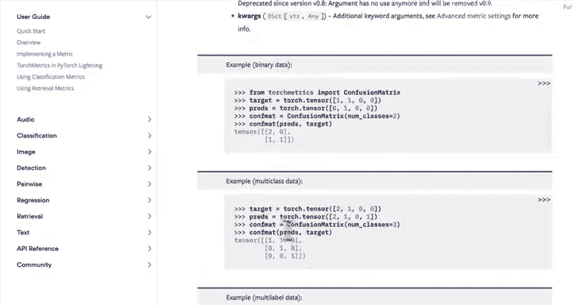

So let's try out if you wanted to try it out on some。Test a code， you could do it here。

 but since we've already got some of our own code， let's just bring in this。

And then number three is to plot it。😡，We've got another helper package here。

Ploot the confusion matrix。Using ML extendend so this is another one of my favorite helper libraries for machine learning things It's got a lot of functionality that you can code up yourself。

 but you often find yourself coding at a few too many times such as plotting a confusion matrix。

 So if we look up ML extend plot confusion matrix，😊。

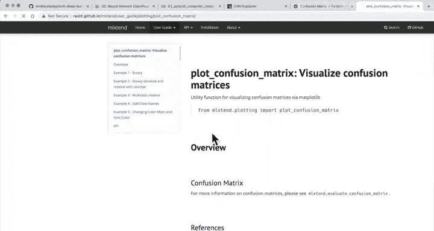

This is a wonderful library， I believe it was。

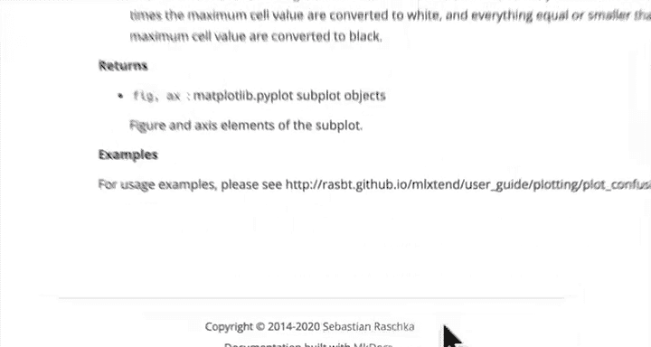

It was created by。Yeah， Sebastian Rushka， who's a machine learning researcher and also author of a great book。

 There he is。 Yeah， this is a side note， Mach learning with Piytorrch and Psyit loan。

 I just got this book。 It just got released in the start of 2022。 And it's a great book。

 So that's a little side note for learning more about machine learning with Piytorrch and Psy kit loan。

 So shout out to Sebastian Rushka。 Thank you for this package as well。

 This is going to just help us plot a confusion matrix like this。

 So we'll have our predicted labels on the bottom。 And our true labels on the side here。

 But we can just copy this code in here。😊。

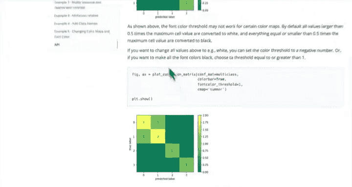

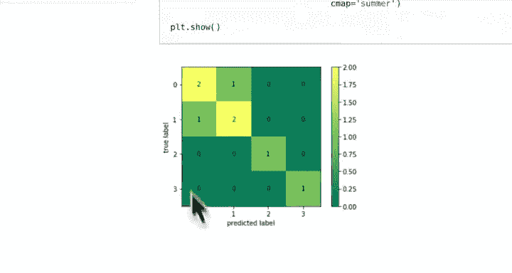

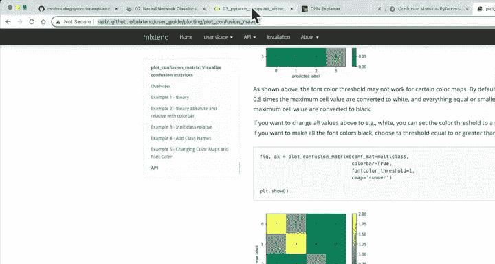

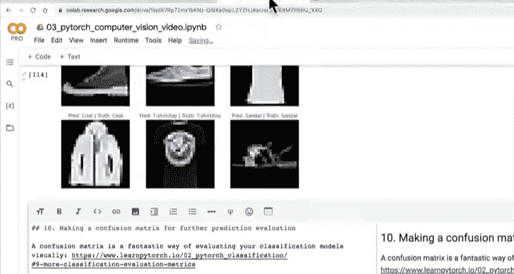

Link sorry， and then confusion matrix， we can copy that in here。

The thing is that torch metrics doesn't come with Google CoLab。 So if you're using Google Coab。

 I think ML extendend does， but we need a certain version of ML extendend that Google Coabb doesn't yet have Yeah。

 so we actually need version 0。19。0。

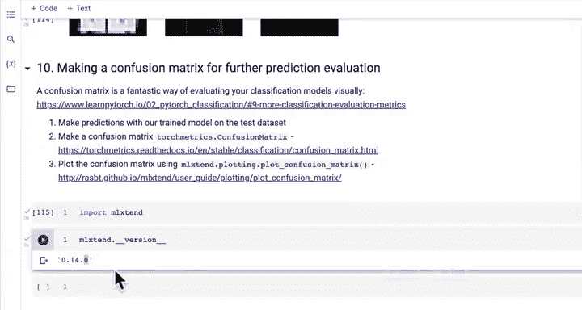

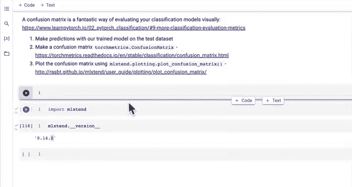

But we're going to import those in a second。 let's first make some predictions across our entire test data set。

So previously， we made some predictions only on nine random samples。So random sample， we selected 9。

 You could， of course， change this number to make it or more。 but this was only on 9 samples。

 Let's write some code to make predictions across our entire test data set。

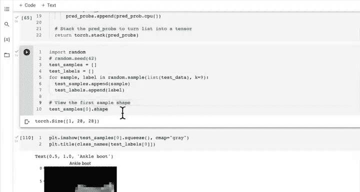

So import tqdm。ordo。For progress by tracking。CQDM auto， we don't need to re importport it。

 I believe we've already got it above， but I'm just going to do it anyway for completeness。

 And so we're going to make。

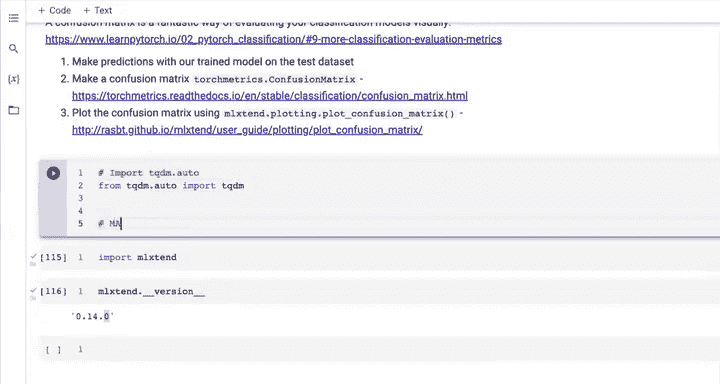

This is step one。Above。Make predictions。Make predictions with。Trained model。

 Our trained model is model 2。 So let's create an empty predictions list。

So we can add our predictions to that， we're going to set our model into evaluation mode。😊。

And we're going to set with torch inference mode as our context manager。 and then inside that。

 let's just build the same sort of code that we used for our testing loop。

Except this time we're going to a handle of our predictions to a list。

So we're going to iterate through the test data loader。And we can give our TQDM description。

We're going to say making predictions do dot， you'll see what that looks like in a minute。

And here we are going to send the data。And Ta to target device。So x， Y equals x。

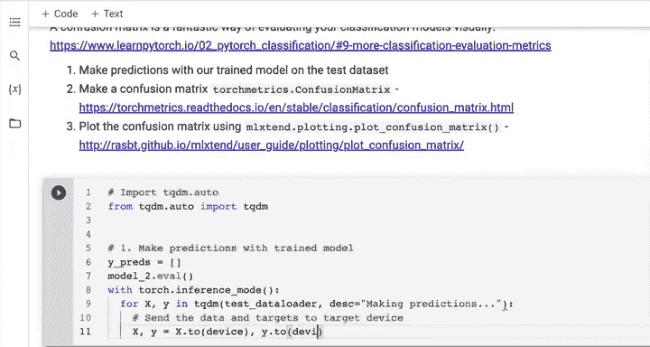

Two device。And why。Two device。Wonderful， and we're going to do the forwardd pass。

So we're going to create Y Loit。Remember， the raw outputs of a model with a linear layer at the end are referred to as logits。

And we don't need to calculate the loss， but we want to turn predictions。From logits to。

Prediction probabilities。To prediction。Lbels。So we'll set here y pre equals torch。

ofmax you could actually skip the torch softmax step if you wanted to and just take the argmax of the Loitts。

 but we will just go from prediction probabilities to pre labels for completeness。😊，So。

Squeeze and we're going to do it across the first dimension or the zeroth dimension。

 and then we'll take the arg max of that across the first dimension as well and little tidbit。

 if you take different dimensions here， you'll probably get different values。

 so just check the inputs and outputs of your code to make sure you're using the right dimension here。

And so let's go put predictions。On CPU for evaluation。Because if we're going to plot anything。

 that plot lid will want them on the CPU， so we're going to ourend our predictions to yPs， yPread。

cpu。Beautiful and because we're going to have a list of different predictions we can use concatenate。

😊，List of predictions。Into a tensor， so let's just print out Ypre and so I can show you what it looks like and then if we go why pre。

Tensor， this is going to turn our list of predictions into a single tensor。And then we'll go why pre。

Tensor and we'll view the first10。Let's see if this works。So making predictions， oh。

 would you look at that？Okay， so yeah， here's our list of predictions。😊，A big list of tensesors。

Right we don't really want it like that。 So if we get rid of that and there's our progress bar。

 it's going through each batch in the test data loader。 so there's 313 batches of 32。😊。

So if we comment out print wide pres。This line here torch dot cat Y Pres is going to turn this these tensors into a single tensor or this list of tensors into a single tensor concatenate。

Now if we have a look， there we go beautiful and if we have a look at the whole thing。

 we're making predictions every single time here， but that's all right， they are pretty quick。

 There we go， one big long tensor and then if we check length wide pre tensor。

 there should be one prediction per test sample。😊，10000 beautiful。 So now we're going to。

 we need to install torch metrics because torch metrics doesn't come with Google Colab at the time of recording。

 So let me just show you if we tried to import torch metrics。😊，It doesn't it might in the future。

 so just keep that in mind it might come with Google Coab because it's a pretty useful package。

 but let's now install， see if required packages are installed and if not。Install them。

So we'll just install torch metrics we'll finish up this video by。😊。

Trying to import we'll set up a try and accept loop。

 so Python is going to try import Torch metrics and ML extendend。

 I write it like this because you may already have Torch metrics and MLXend if you're running this code on a local machine but if you're running it in Google Coab which I'm sure many of you are we are going to try and import it anyway and if it doesn't work we're going to install it。

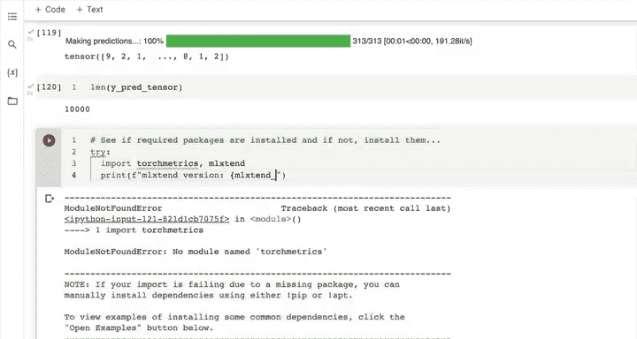

So ML I extend， I'm just going to check the version here because we need version for our plot confusion matrix function。

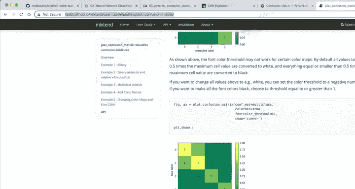

This one， we need version 0。19。0 or higher。So I'm just going to write a little statement here。Assert。

Int MLl extend dot version。So if these two， if this condition in the tri loop is or try block is accepted。

 it will skip the next step。Dot split。 And I'm just going to check the first index string equals。

Is greater than L equal to 19 otherwise I'm going to return an error saying ML extend version should be。

0。19。0 or higher。And so let me just show you what this looks like。If we run this here。String and int。

 Did I not turn it into a string。Oh， excuse me。There we go。And I don't need that bracket on the end。

There we go so that's what I'm saying so this is just saying， hey。

 the version of MLX that you have should be zero or should be 19 or higher。Because right now。

 Google Co La by default has 14。 This may change in the future。

 So let's finish off this accept block。If the above condition fails， which it should。

 we are going to。Pip install， so we're going to install this into Google Co Lab Torch metrics。

 we're going to do it quietly and we're also going to pass the U tag for updated MLL extend。So。

 import。Torch metrics， ML extend afterwards， after it's been installed and upgraded and print。

 we're going to go ML extend version。You're going to go ML， extend。Underscore version。

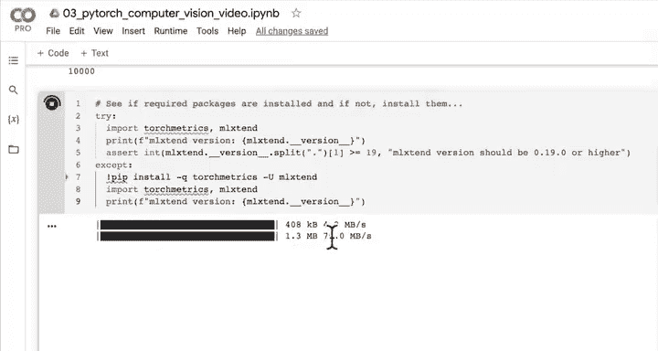

And let's see what happens if we run this。So we should see， yeah， some installation happening here。

This is going to install torch metrics。Oh， do we not have ML extend the upgraded version？

Let's have a look， we may need to restart our Google Coabab instance。Okay， let's take this off。😊。

Quiet。Is this going to tell us to restart Google Coabb？Well， let's restart our runtime。

After you've run this cell。If you're using Google Colla。

 you may have to restart your runtime to reflect the fact that we have the updated version of ML extendend。

 So I'm going to restart my runtime now。Otherwise， we won't be able to plot our confusion matrix。

 We need 0。19。0。And I'm going to run all of these cells。 I'm going to pause a video here。

 run all of the cells by clicking Run All note if you run into any errors。

 you will have to run those cells manually， and then I'm going to get back down to this cell and make sure that I have ML extendend version 0。

1。9。I'll see， in a few seconds。I'm back and just a little heads up。

 If you restart your run time and click Run all， your coab notebook will stop running cells if it runs into an error。

 So this is that error we found in a previous video where our data and model were on different devices。

 So to skip past that， we can just jump to the next cell。 and we can click run。After there we go。

 And it's going to run all of the cells after for us。 It's going to retrain our models。

Everything's going to get rerun。 and then we're going to come right back down to where we were before。

 trying to install the updated version of ML L Xend。

 I'm going to write some more code while our code is running。

Import ML extend and then I'm going to just make sure that we've got the right version here。

You may require a runtime restart， you may not so just try to see after you've run this install of torch metrics and upgrade of ML extendend。

 see if you can reimport ML extend and if you have the version 0。19。

0 or above we should be able to run the code Yeah there we go wonderful ML extend 0。19。0。

And we've got MLX version， As。Import。Beautiful， so I've got a lot of extra code here。

In the next video let's move forward with creating a confusion matrix。

 I just wanted to show you how to install and upgrade some packages in Google ColLabb if you don't have them。

 but now we've got predictions across our entire test data set and we're going to be moving towards using confusion matrix function here to compare our predictions versus the target data。

😊。

Of our test data set。So I'll see in the next video， let's plot a confusion matrix。

