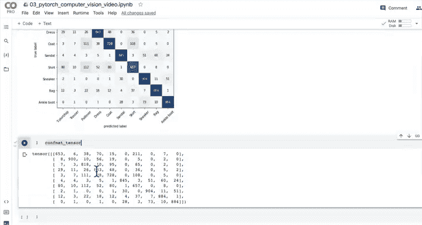
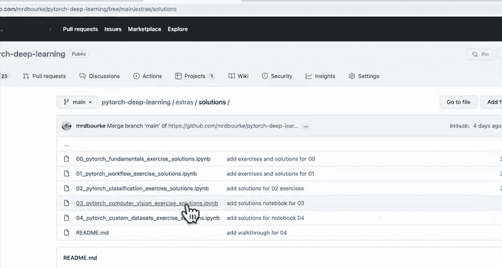

# mrdbourke《一天学会pytorch深度学习｜Learn PyTorch for deep learning in a day Literally》中英 - P76：123. Evaluating model predictions with a confusion matrix.zh_en - GPT中英字幕课程资源 - BV1kx4y1r79d

Welcome back In the last video， we wrote a bunch of code to import some extra libraries that we need for plotting a confusion matrix。

 and this is really helpful， by the way， Google Coab comes with a lot of prebuilt installed stuff。

 but definitely later on down the track you're going to need to have some experience installing stuff。

 and this is just one way that you can do it。😊，And we also made predictions across our entire test data set。

 so we've got 10，000 predictions in this tensor， and what we're going to do with the confusion matrix is confirm or compare these predictions to the target labels in our test data set。

So we've done step number one。And we've prepared ourselves for step2 and three by installing torch metrics and installing ML extend or the later version of ML extendend。

 So now let's go through step 2 making a confusion matrix and step 3 plotting that confusion matrix。

 This is going to look so good。 I love how good confusion matrixes look。

 So because we've got torch matrix now we're going to import the confusion matrix class and from MLl extend we're going to go into the plotting module and import plot confusion matrix。

😊，Recall that the documentation for both of these are。

Within torch metrics here and within ML I extend here。Let's see what they look like。

 so number two is set up confusion matrix instance and compare predictions to target。

That's what evaluating a model is right comparing our model's predictions to the target predictions。

 so I'm going to set up a confusion matrix under the variable confmat then I'm going to call the confusion matrix class from Torch Ma and to set up an instance of it I need to pass in the number of classes that we have。

So because we have 10 classes， they are all contained within class names。

Recall that class names is a list of all of the different classes that we're working with。

So I'm just going to pass in the number of classes as the length of our class names。

And then I can use that co mat instance， confusion matrix instance。

 to create a confusion matrix tensor。😊，By passing into Comfmat。

 which is what I've just created up here。Com from Matt， just like we do with our loss function。

 I'm going to pass in pres equals our Y pre tensor， which is。Just above。

 why pre tensor that we calculated all of the。Predictions on the test data set。There we go。

 that's our pres and our target is going to be equal to test data。 target。

And this is our test data data set that we've seen before， So if we go test data and press tabab。

 we've got a bunch of different attributes we can get the classes。😊，And of course。

 we can get the targets， which is the labels。Pytorch calls labelbels targets。

 I usually refer to them as labels， but the target is the test data target。

 so we want to compare our model's predictions on the test data set to our test data targets。

And so let's keep going forward。 We're up to step number3 now。

 So this is going to create our confusion matrix tensor。 Oh， let's see what that looks like。

 actually。Come from that Tensor。Oh， okay。So we've got a fair bit going on here。

 but let's turn this into a pretty version of this。

 So along the bottom is going to be our predicted labels and along the side here is going to be our true labels。

 But this is where the power of ML L X1 comes in。We're going to plot our confusion matrix。

So let's create a figure and an aes， I'm going to call the function plot confusion matrix。

That we've just imported above。And we're going to pass in our Com format。Equals our conf mat tensor。

 but because we're working with matpl Lib， it'll want it as nuy。So I'm just going to write here。

Mapplot Lib likes working with。Numpie。And we're going to pass in the class name so that we get labels for each of our rows and columns。

Class names， this is just a list of our text based class names。

 and then I'm going to set the fig size to my favorite hand and poker， which is 107。

Also happens to be a good dimension for Google Colab。 Look at that。

OhThat is something beautiful to see。 Now， a confusion matrix。

 the ideal confusion matrix will have all of the diagonal rows。😊。

Darkened with all of the values and no values here and no values here。

 because that means that the predicted label lines up with the true label。 So in our case。

 we have definitely a very dark diagonal here。 But let's dive into some of the highest numbers here。

 It looks like our model is predicting shirt。 When the true label is actually T shirt slash top。

 So that is reflective of what we saw before。 Do we still have that image there。Okay。

 we don't have an image there， but in a previous video， we saw that when we plotted our predictions。

The model predicted t-shirt slash top when it was actually a shirt。 And of course， vice versa。

 So what's another one here。 It looks like our model is predicting shirt， when it's actually a coat。

 Now this is something that you can used to visually inspect your data to see if the the errors that your model is making make sense from a visual perspective。

 So it's getting confused by predicting pullover when the actual label is coat predicting pullover when the actual label is shirt。

 So a lot of these things clothing wise and data wise may， in fact， look quite the same。

 Here's a relatively large one as well。 it's predicting sneaker when it should be an ankle boot。

 So it's confusing two different types of shoes there。😊。

So this is just a way to further evaluate your model and start to go， h。

 maybe our labels are a little bit confusing。 Could we expand them a little bit more？

 So keep that in mind。 a confusion matrix is one of the most powerful ways to visualize your classification model predictions。

And a really， really， really helpful way of creating one is to use torch matrix confusion matrix and to plot it。

😊，You can use plot Con Matri from MLXend， however， if you're using Google CoLB for these。

 you may need to import them or install them。So that's a confusion matrix if you would like more classification metrics。

 you've got them here and you've got of course more in torch metrics so give that a look。

 I think in the next video。😊，We've done a fair bit of evaluation。 Where are we up to in our workflow。

I believe it's time we saved and loaded our best trained model。 So let's give that a go。

 I'll see in the next video。😊。

In the last video， we created our beautiful confusion matrix with the power of torch matrix。😊。

And M L extend。But now it's time to save and load our best model because if we if we evaluated it。

 our convolutional neural network can go， you know what， this model is pretty good。

 Let's export it to a file so we can use it somewhere else。 Let's see how we do that。 And by the way。

 if we go into our keynote。😊，We've got evaluateval model。Torch metrics。

 We've been through this a fair few times now。 we've improved through experimentation。

 We haven't used Tensor board yet， but that'll be in a later video。

And save and reload your train model So here's where we're up to if we've gone through all these steps enough times and we're like you know what。

 let's save our model so we can use it elsewhere and we can reload it in to make sure that it's it's saved correctly。

😊，Let's go through this step。 We want number 11。We're going to go save and load best performing model you may have already done this before。

 so if you've been through the other parts of the course you definitely have。

 So if you want to give that a go pause the video now and try it out yourself。

 I believe we did it in notebook number one。We have。Here we go。 saving and loading a pi torch model。

 You can go through this section of section number one on your own and see if you can do it。

 Otherwise， let's code it out together。 So I'm going to start from with importing。

Partth from Path Libb because I like to create a model directory path。So create model directory path。

 So my model path is going to be set equal to path。 And I'm going to save it to models。

 This is where I want to。I want to create file over here called modelss。And save my models to there。

Modelpath dotmkD for make directory。Parents， yes， I want it to make the parent directories if they don't exist and exist okay。

 also equals true， so if we try to create it but it's already existing， we're not going to get error。

That's fine。 And next we are going to create a model save path。

Just going to add some code cells here so I have more space。Let's pass in here a model name。

I'Going to set this equal to since we're on section three， I'm going to call this03 pi torch。

Computer vision。Model 2 is our best model， and I'm going to save it to PTH。For Pi towach。

 you can also save it to dot PT。😡，I like to use PTH。And we're going to go model save path equal。

Model path slash model name。 So now if we have a look at this。

 we're going to have a path called model save path， but it's going to be a Posss path。

In models 03 Pytorch Comp Vision， Model 2。 pH。 and if we have a look over here， we should have， yeah。

 we have a models directory now。That's not going to have anything in it at the moment。

 We've got our data directory that we had before。 There's fashionash Mnes。

 This is a good way to start setting up your directories。 Bre them down data， models。

 helper function files， etc cetera。 But let's keep going。Let's save。Save the model state dict。

We're going to go print。Saving model two， she's going to give us some。

Information about what's happening。Model save path， and we can save a model by calling torch。

Dot save and we pass in the object that we want to save using the object parameter OBj。

And we get a dock string there。We're going to go model two， we want to save the state dict。

 recall that the state dict is going to be our model what？

Our models learned parameters on the data set。 So all the weights and biases and all that sort of jazz。

Beautiful， so when we first created Model 2， these were all random numbers。 They've been。

 or since we trained Model 2 on our training data， these have all been updated to represent the training images。

😊，And we can leverage these later on， as you've seen before， to make predictions。

 so I'm not going to go through all of those， but that's what we're saving。

And the file path is going to be our model save path。 So let's run this and see what happens。

Beautiful， we're saving our model to our model directory。And now let's have a look in here。

 Do we have a model。 Yes， we do。 beautiful。 So let's how quickly we can save a model。 Of course。

 you can customize what the name is， where you save it， etc cetera， etc cetera。 Now。

 let's see what happens when we load it in。😊，So create a new instance because we only save the state di of Model 2。

 we need to create a new instance of our Model 2 or how it was created which was with our class fashion AmNT V2。

😊，If we saved the whole model， we could just import it to a new variable。

 but I'll let you read back more on that on the different ways of saving a model in here。

 there's also a link to the Pytoch documentation would highly recommend that。

But let's see it in action， we need to create a new instance of our fashion Ms model V2。

Which is our convolutional neural network， so I'm going to set the manual seed。😊，That way。

 when we create a new instance， it's instantiated with the same random numbers。

So we're going to set up loaded Model two equals。Fashion M N， V2。

And it's important here that we set it up with the same parameters as our original saved model。

So fashion M Nist V2。 Oh， we've got a typo here。I fashion Emnest Model V2。Wonderful。

 so the input shape is going to be one because that is the number of color channels in our test in our images。

Test image dot shape。 Do we still have a test image。Should be well， we've created a different one。

 but our image size， our image shape is 1，28，28。Image shape。For color channels。Height width。

 then we create it with hidden units。 We use 10 for hidden units so we can just set that here。

This is important they just have to otherwise if the shapes aren't the same。

 what are we going to get， we're going to get a shape mismatch error and our output shape is what？😊。

Is also going to be 10 or length of class names。If you have the class names variable instantiated that is。

😊，So we're going to load in the saved state dick， the one that we just saved。

So we can go loaded Model2。Dot load stateduct。And we can pass in torch。

 load in here and the file that we want to load or the file path is model Sa path。Up here。

 this is why I like to just save my path variables to a variable so that I can just use them later on instead of retyping out this all the time。

 which is definitely prone to errors。So we're going to send the model to the target device。

Loaded Model2。Dot2 device。Beautiful， let's see what happens here。Wonderful。

So let's now evaluate the loaded model。So evaluate loaded model。

 the results should be very much the same as our Model 2 results。So Model  two results。

So this is what we're looking for。 We want to make sure that our saved model saved these results pretty closely Now I say pretty closely because you might find some discrepancies in this lower these lower decimals here just because of the way files get saved and something gets lost。

 etc cea， etc ce。 So that's just to do with precision and computing but as long as like the first few numbers are quite similar。

 well then we're all gravy。😡，So let's go torch。Manual seed。Remember。

 evaluating a model is almost as well， is just as important as training a model。

 So this is what we're doing。 or making sure our model save correctly before we deployed it。

 If it didn't， if we deployed it， it didn't save correctly。 Well， then we'd get our。

We would get less than ideal results wouldn't we so model equals loaded Model2。

 we're going to use our same ofval model function， by the way。And of course。

 we're going to evaluate it on the same test data set that we've been using， test data loader。

And we're going to create a loss function or just putting in our loss function that we've created before。

 and our accuracy function is the accuracy function we've been using throughout this notebook。😊。

So now let's check out loaded Model2 results， they should be quite similar to this one。

We're going to make some predictions， and then if we go down。Do we have the same numbers， Yes， we do。

 So we have 5，6，8，2，9，5，6，8，2，9。 wonderfulnder， and 3，1，3，5，8，3，1，3，5，8。 beautiful。

 It looks like our。😊，Loaded model gets the same results as our previously trained model before we even saved it。

 And if you wanted to check if they were close， you can also use。Torch dot is close。

 Check if model results。 if you wanted to check if they were close programmatically。

 that is because we just looked at these visually。Check if model results are close to each other。

Now we can go torch is close。We're going to pass in torch。tensor。

 we have to turn these values into a tensor。We're going to go model two results。

And we'll compare the。Model loss。 How about we do that。

 We want to make sure the loss values are the same。Or very close that is with Torchdot is close。

Toorch。 tensar。dOr we want this one to be loaded Model2 results。Model loss。

Another bracket on the end there and we'll see how close they are true， wonderful Now。

 if this doesn't return true， you can also adjust the tolerance levels in here。

So we go a toll equals this is going to be the absolute tolerance。 So if we do one to the negative8。

 it's saying like hey， we need to make sure our results are basically the same up to eight decimal points。

 that's probably quite low， I would say just make sure they're at least within two。

But if you're getting discrepancies here between your saved model and your loaded model or sorry。

 this model here， the original one and your loaded model， if they are quite large。

 so there are like more than a few decimal points off in this column or even here。

 I'd go back through your code and make sure that your model is saving correctly。

 make sure you've got random seeds set up， but if they're pretty close like in terms of within three or two decimal places of each other。

 well then I'd say that's close enough， but you can also adjust the tolerance level here to check if your model results are close enough programmatically。

Wellow， we have covered a fair bit here。 We've gone through this entire workflow for a computer vision problem。

Let's are in the next video， I think that's enough code for this section， section 3。

 Ptorrch Comp visions， I've got some exercises and some extracur lined up for you。

 so let's have a look at those in the next video。😊，I'll see you there。My goodness。

 look how much computer vision pieytorrch code we've written together。

 We started off right up the top。 We looked at the reference notebook and the online book。

 We checked out computer vision libraries in Pytorrch。 The main one being torch vision。😊。

Then weve got a data set， namely the fashionash MNIS data there are a bunch more datas that we could have looked at。

 and in fact I'd encourage you to try some out in the Torchvision。c datas。

 use all of the steps that we've done here to try it on another data。😊，We repaired our data loaders。

 so turned our data into batches。We built a baseline model which is an important step in machine learning because the baseline model is usually relatively simple and it's going to serve as a baseline that you're going to try and improve upon through。

 just go back to the keynote through various experiments。😊，We then made predictions with Model zero。

 we evaluated it。We timed our predictions to see if running our models on the GPU was faster and we learned that sometimes a GPU won't necessarily speed up code if it's a relatively small data set because of the overheads between copying data from CPU to GPU。

We tried a model with nonliarity， and we saw that it didn't really improve upon our baseline model。

 but then we brought in the big guns， a convolutional neural network replicating the CNN explainer website and by gosh。

 didn't we spend a lot of time here。 I'd encourage you as part of your extra curriculum to go through this again and again。

 I still even come back to refer to it to。 I referred to it a lot making the materials for this video section and this code section。

 So be sure to go back and check out the CNN explainer website for more of what's going on behind the scenes of your CNNs but we coded one using pure pie torch that is amazing。

 We compared our model results across different experiments。

 We found that our convolutional neural network。😊，Did the best。

 although it took a little bit longer to train， and we also learned that the training time values will definitely vary depending on the hardware you're using。

 so that's just something to keep in mind。We made an evaluated random predictions with our best model。

 which is an important step in visualizing visualizing visualizing your model's predictions。

 because you could get evaluation metrics， but until you start to actually visualize what's going on。

 Well， in my case， that's how I best understand what my model is thinking。

 we saw a confusion matrix using two different libraries torch metrics and M L extend a great way to evaluate your classification models。

 and we saw how to save and load the best performing model to file and made sure that the results of our save model weren't too different from the model that we trained within the notebook。

 So now it is time。😊，I'd love for you to practice what you've gone through。

 This is actually really exciting now， because you've gone through an end to end computer vision problem。

 I've got some exercises prepared。 If you go to the Learnpytorrch doo website in section 03。 Sc down。

 You can read through all of this。 This is all the materials that we've just covered in pure code。

 There's a lot of pictures in this notebook2 that are helpful to learn things what's going on。

 We have some exercises here。 So all of the exercises are focused on practicing the code and the sections above。

 we have two resources， we also have some extra curriculum that I've put together。

 If you want an in depth understanding of what's going on behind the scenes in the convolutional neural networks because we focused a lot on code。

 I highly recommend Mit's induction to deep computer vision lecture。😊。

You can spend 10 minutes clicking through the different options in the Py Torch Viion library。

 Torch Vi， look up most common convolutional neural networks in the Torch Viion model library。

And then for a larger number of pretrain pilottorrch computer vision models。

 and if you get deeper into computer vision， you're probably going to run into the Torch image models library。

 otherwise known as10， but I'm going to leave that as X curriculum I'm going to just link this exercises section here again it's at learnpytororch。

 in the exercises section and come down。😡，There we go。But there is also resource here。

 an exercise template notebook， so we've got one， one or three areas in industry where computer vision has been currently used。

Now this is in the Pytorch deep Learning repo extratras exercises number3。

 I've put out some template code here for you to fill in these different sections。

 so some of them are code related， some of them are just text based。

 but they should all be able to be completed by referencing what we've gone through in this notebook here。

And just as one more， if we go back to Pytor deep learning。

This will probably be updated by the time you get here。

 You can always find the exercise and extra curriculum by going computer vision。

 go to exercise an extra curriculum， or if we go into the extras file and then we go to solutions。

 I've now also started to add video walkthroughs of each of the solutions。

 So this is me going through。Each of the exercises myself and coding them。

 And so you'll get to see they're unedited videos。 So they're just one long live stream。

 And they've done some for 02，03 and 04。 And there will be more here by the time you watch this video。

 But if you'd like to see how I figure out the solutions to the exercises。

 you can watch those videos and go through them yourself。 But first and foremost。

 I would highly recommend trying out the exercises on your own first。 And then if you get stuck。

 refer to the notebook here， refer to the Pytorch documentation。 And finally。

 you can check out what I would have coded as a potential solution。

 So there's number3 computer vision exercise solutions。 So congratulations。

 I'm going through the Pytorch computer vision section。😊。

I'll see you in the next section， we're going to look at Plytorch custom datas。But no spoilers。

I'll see you soon。

好了。