# mrdbourke《一天学会pytorch深度学习｜Learn PyTorch for deep learning in a day Literally》中英 - P77：126. Introduction to custom datasets.zh_en - GPT中英字幕课程资源 - BV1kx4y1r79d

Oh hello， hello and welcome to Section number4 of the Learn Pytht for deep Learning course。

 We have custom data sets with。😊。

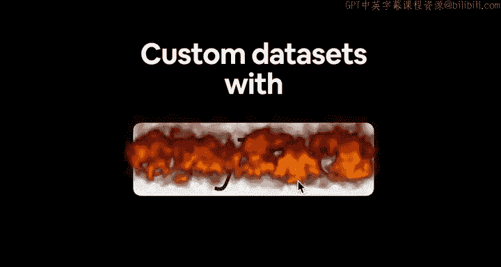

Hi torch now before we dive into what we're going to cover， let's answer the most important question。

 where can you get help Now we've been through this a few times now， but it's important to reiterate。

😡，Follow along with the code as best you can。 We're going to be writing a bunch of Pytorrch code。😡。

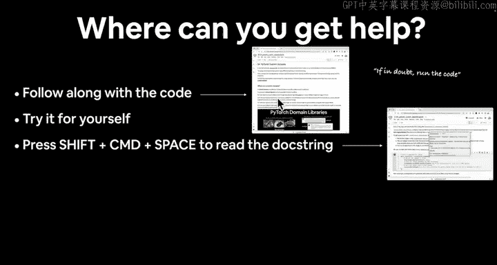

Remember the motto， if in doubt， run the code。 That's in line with try it for yourself。

 If you'd like to read or read the doc string， you can press shift command plus space in Google Co Laab。

Or if you're on Windows， command might be control。Then if you're still stuck， you can search for it。

 Two of the resources you will probably come across is stack overflow or the wonderful Pytorage documentation。

 which we've had a lot of experience with so far。 Then， of course， try again。

 go back through your code， if in doubt， code it out or if in doubt， run the code。 And then finally。

 if you're still stuck， ask a question on the Pytage deep learning Disc Github page。

 So if I click this link。 We come to Mr。 Deep Burke slash Pytorage deep learning， the URL is here。

 we've seen this before。 If you have a trouble or a problem with any of the course。

 you can start a discussion。😊。

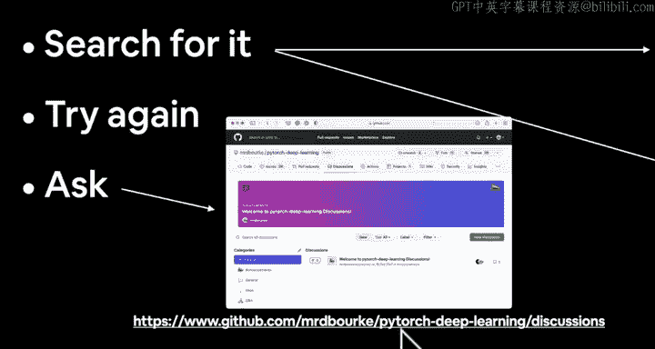

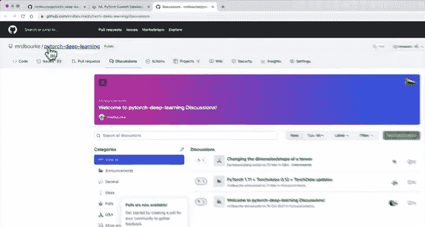

And you can select the category， general ideas， polls， Q& A， and then we can go here， video。

 put the video number in， So 99， for example。My code doesn't do what I'd like it to。

So say your problem。And then come in here， write some code here。😊，Code here and then my question is。

Something， something something click start discussion， and then we can help out。

 and then if we come back to discussions， of course you can search for what's going on。

 So if you have an error and you feel like someone else might have seen this error。

 you can of course search it and find out what's happening。

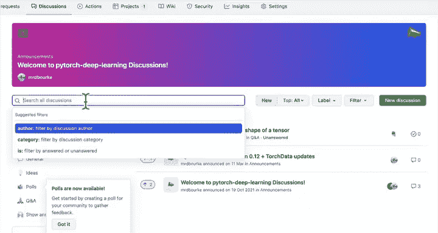

Now， I just want to highlight again， the resources for this course are at learnpytororch。o。

 We are up to section 4。 This is a beautiful online book version of all the materials we are going to cover in this section。

 So spoiler alert， you can use this as a reference and then of course。

 in the Github We have the same notebook here， Pytorch custom datas。

 This is the ground truth notebook。 So check that out if you get stuck。😊。

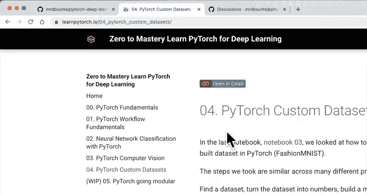

So I'm just going to exit out of this， we've got Pytoch custom data sets that learn Pytoch。

o and then of course the Disc tab for the Q&A。😊。

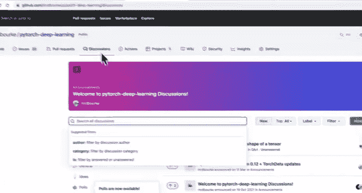

Now， if we jump back to the keynote， what do we have？We might be asking。

What is a custom data set Now， we've built a fair few Pytorrch deep learning neural networks so far on various data sets such as fashion Mns。

 But you might be wondering， hey， I've got my own data set， or I'm working on my own problem。

 Can I build a model with Pytorrch to predict on that data set。And the answer is yes， however。

 you do have to go through a few pre processingces steps to make that data set compatible with Pytorch。

 and that's what we're going to be covering in this section。

And so I'd like to highlight the Pytch domain libraries。

 Now we've had a little bit of experience before with torch vision。

 such as if we wanted to classify whether a photo was a pizza， steak or sushi。

 So a computer vision image classification problem Now there's also text such as if these reviews are positive or negative。

😊。

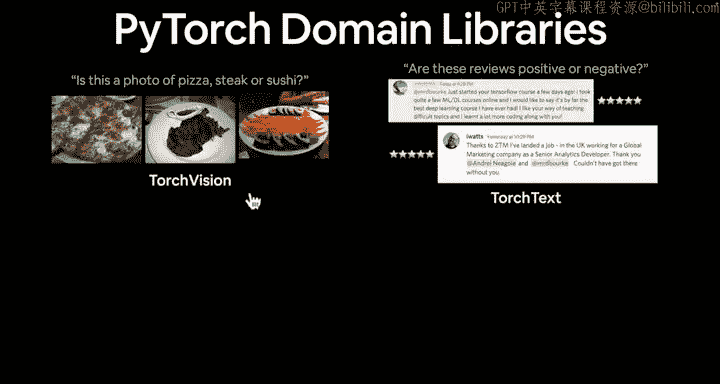

And then you can use torch text for that。 But again。

 these are only just one problem within the vision space， within the text space。

I want you to just understand that if you have any type of vision data。

 you probably want to look into torch vision。 and if you have any kind of text data。

 you probably want to look into torch text。 And then if you have audio such as if you wanted to classify what song was playing。

 this is what Chizam does。It uses the input sound of some sort of music and then runs a neural network over it to classify it to a certain song。

 You can look into torch audio for that。 And then if you'd like to recommend something such as you ever have an online store or if your Netflix or something like that。

 and you'd like to have a home page that updates for recommendations。

 you'd like to look into Torch Re， which stands for recommendation system。

 And so this is just something to keep in mind。

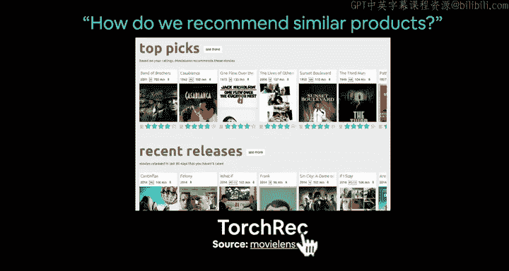

Because each of these domain libraries has a data sets module that helps you work with different data sets from different domains。

 and so different domain libraries contain data loading functions for different data sources。

 So Torch vision Let's just go into the next slide we have problem space vision。😡。

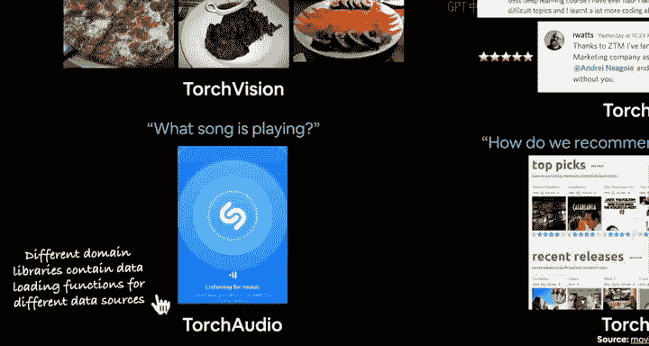

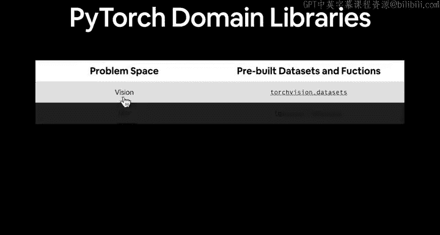

For prebuilt data sets or existing dataset sets like we've seen with fashion Ms。

 as well as functions to load your own vision data sets， you'll want to look into torchvision datas。

 So if we click on this， we have built in data sets。 This is the Ptorrch documentation。

 And if we go here， we have Torch audio， Torch text， Torch vision， Torch rack， Torch data。 Now。

 at the time of recording， which is April 2022， this is torch data is currently in beta。

 but it's going to be updated over time。 So just keep this in mind。

 updated over time to add even more ways to load different data resources。

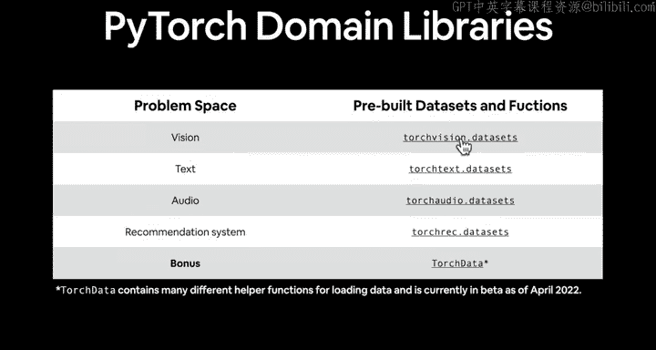

But for now， we're just going to get familiar with torch vision data sets。

 If we went into torch text， there's another torch text dot data sets。

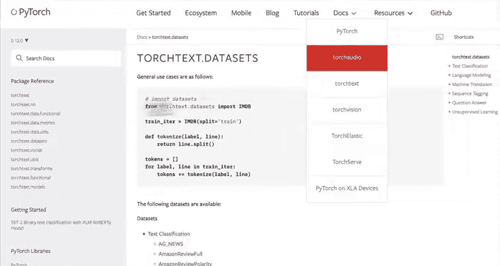

And then if we went into torch audio， we have torch audio data sets。

 And so you're noticing a trend here that depending on the domain you're working in。

 whether it be vision， text， audio or your data is recommendation data。

 you'll probably want to look into its custom library within Ptorrch。 and of course。

 the bonus is torch data， it contains many different helper functions for loading data and is currently in beta as of April 22。

 So 2022 so that by the time you watch this torch data may be out of be。

 and then that should be something that's extra curriculum on top of what we're going to cover in this section。

😊。

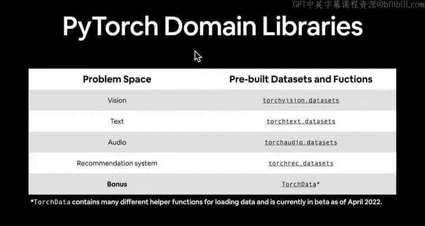

So let's keep going。So this is what we're going to work towards building。Food vision mini。

 So we're going to load some data， namely some images of pizza。

 sushi and steak from the Food 101 data set。 We're going to build an image classification model。

 such as the model that might power a food vision recognition app or a food image recognition app。

And then we're going to see if we can classify an image of pizza as pizza。

 an image of sushi as sushi and an image of steak as steak。

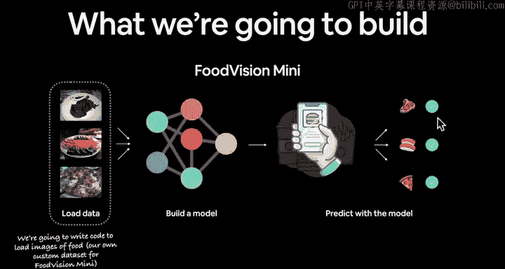

So this is what we're going to focus on。 We want to load。

 say we had images existing already of pizza， sushi and steak。

 We want to write some code to load these images of food。

 So our own custom data set for building this food visionion mini model。

 which is quite similar to if you go to， this is the project I'm working on personally nurified dot app。

😊。

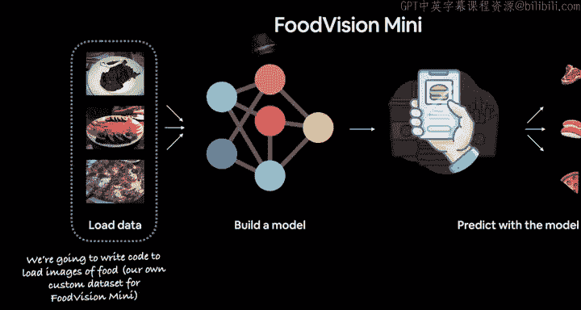

This is a food image recognition model。Here we go。 So it's still a work in progress as I'm going through it。

 but you can upload an image of food， and nurify will try to classify what type of food it is。

 So do we have steak There we go。 Let's upload that。 Beaiful St。

 So we're going to be building a similar model to what powers nurify。😊。

And then there's the macronutrients for the steak ya， if you'd like to find out how it works。

 I've got all the links here， but that's at nutrafin。 app。😊。

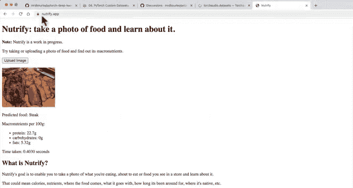

So let's keep pushing forward。 We'll go back to the keynote。This is what we're working towards。

 as I said we want to load these images into Pytorrch so that we can build a model。

 we've already built a computer vision model。😡。

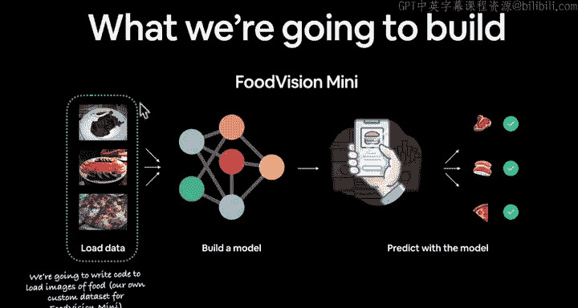

So we want to figure out how do we get our own data into that computer vision model？And so。

 of course， we'll be adhering to our Pytorch workflow。That we've used a few times now。

So we're going to learn how to load a data with our own custom data rather than an existing data set within Pytorch。

We'll see how we can build a model to fit our own custom data set。

 We'll go through all the steps that's involved in training a model such as picking a loss function and an optr。

 We'll build a training loop。Will evaluate our model。We'll improve through experimentation。

 and then we can see， save and reloading our model。

 but we're also going to practice predicting on our own custom data， which is a very。

 very important step whenever training your own models。 So what we're going to cover broadly。😊。

We're going to get a custom data set with Pytoch。 As we said。

 we're going to become one with the data。 In other words， preparing and visualizing it。

 We'll learn how to transform data for use with a model。 very important step。

 We'll see how we can load custom data with pre built functions and our own custom functions。

We'll build a computer vision model， AK Food Viion Mini to classify pizza， steak and sushi images。

 So a multi class classification model willll compare models with and without data augmentation。

 We haven't covered that yet， but we will later on。And finally， we'll see how we can， as I said。

 make predictions on custom data， so this means data that's not within our training or our test data set。

😊，And how are we going to do it？ Well， we could do it， cooks or chs。

But I like to treat machine learning as a little bit of an art。

 So we're going to be cooking up lots of code。That being said？I'll see you in Google Coab。

 Let's code。Welcome back to the Plytorch Cook show。

 Let's now learn how we can cook up some custom data sets。 I'm going to jump into Google Coab。

 So coab dot research dot Google dot com。😊。

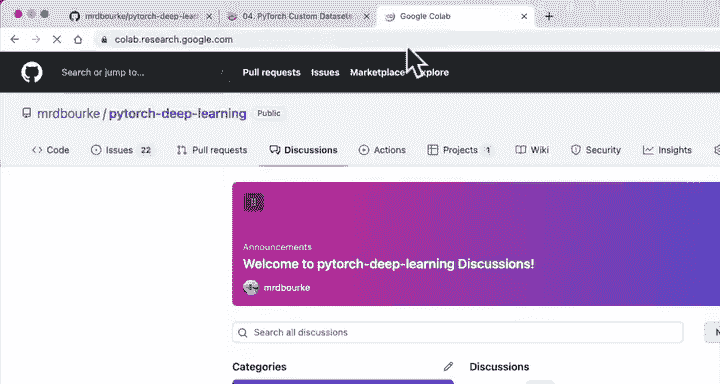

And I'm going to click new notebook。😡，Just're going to make sure this is zoomed in enough for the video。

Wonderful， so I'm going to rename this notebook。04 because we're up to section 04。😊。

And I'm going to call it Pytorch custom datas underscore video because this is going to be one of the video notebooks。

 which has all the code that I write during the videos。

 which is of course contained within the video notebooks folder on the Pytorch Deep Learn Repo。

So if you'd like the resource or the ground truth notebook for this。

 I'm going to just put a heading here。04。Pytorrch， custom data sets。Video notebook。Make that bigger。

And then。Well put resources。So。Book version。Of the course materials。For 04。

We'll go there and then we'll go ground truth version of notebook 04。

 which will be the reference notebook that we're going to use for this section。

Come into Pytorch custom datas。And then we can put that in there。Wonderful。

 so the whole synopsis of this custom data set section is。😊，We've used some data sets with Ptorrch。

Before。But how do you get your own data into Pytorrch？

Because that's what you want to start working on， right。

 You want to start working on problems of your own。

 You want to come into any sort of data that you've never worked with before。

 and you want to figure out how do you get that into Pytorch。 So one of the ways to do so。Is Valya。

Custom data sets。And then I want to put a note down here。

So we're going to go zero section zero is going to be importing pieytorrch and setting up device agnostic。

codeode。But I want to just stress here。That。Domain libraries。So。

Just to reiterate what we went through last video so depending on what。You're working on。

Whether it be vision。Text， audio， recommendation， something like that。

You'll want to look into each of the pie torch。Domain libraries。For existing。

Data loader or data loading functions and customizable。Data loading functions。

So just keep that in mind， we've seen some of them so if we go torch vision。

 which is what we're going to be looking at。Torch vision， we've got data sets。

 and we've got documentation。 We've got data sets for each of the other domain libraries here as well。

 So if you're working on a tax problem， it's going to be a similar set of steps to what we're going to do with our vision problem when we build food vision Min。

What we have is a data set that exists somewhere and what we want to do is bring that into Pytorrch so we can build a model with it。

So let's import the libraries that we need。 So we're going to import torch and。

We'll probably import Nn。So we'll import that from pi torch。

 and I'm just going to check the torch version here， So note。We need pie torch 1。10。0。

Plus is required for this course， so if you're using Google Coabab at a later date。

 you may have a later version of Pytorrch， I'm just going to show you what version I'm using。

I's going to let this load。We're going to get this ready。

 We're going to also set up device agnostic code right from the start this time。

 because this is best practice with Ptorrch。😊，So this way， if we have a couder device available。

 our model is going to use that couder device and our data is going to be on that couder device。

So there we go wonderful。 We've got Ptorch 1。10。0 plus Kuda111， maybe that's 11。1。

 So let's check if Kuda dot is available。 Now I'm using Google co Lab。 we haven't set up a GPU yet。

 so it probably won't be available yet。😊，Let's have a look。Wonderful。

 so because we've started a new coab instance， it's going to use the CPU by default。

 So how do we change that， We come up to run time， change runtime type。😊。

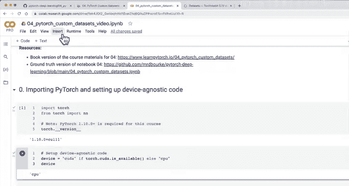

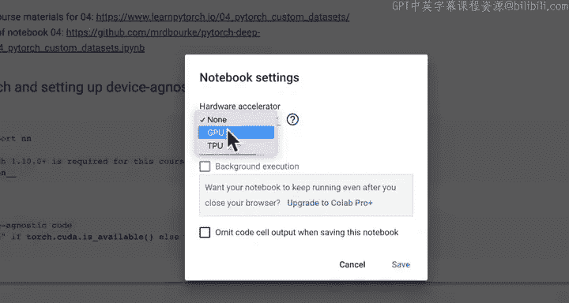

I'm going to go hard the accelerator GPU。 We've done this a few times now。

 I am paying for Google Coab Pro。 So one of the benefits of that is that it Google Coab reserves faster GPUus for you。

 You do not need Google Coab Pro， as I've said， to complete this course。

 You can use the free version。 But just recall Google Coabab Pro tends to give you a better GPU just because GPUs aren't free。

😊，Wonderful， so now we've got access to a GPU， Coa。 What GPU do I have。

Nvidia SMI we have I have a Tesla P100 with 16 gigabytes of memory。

 which will be more than enough for the problem that we're going to work on in this video。

So I believe that's enough to cover for the first coding video。 Let's in the next section。

 we are working with custom data sets。 after all。 Let's in the next video。 Let's get some data， hey。

😊。

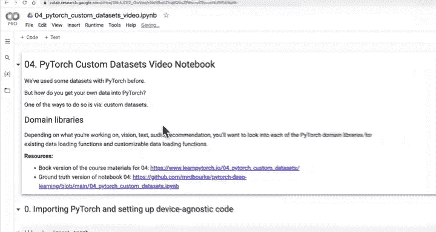