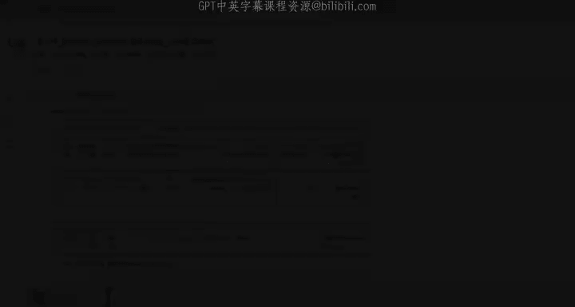
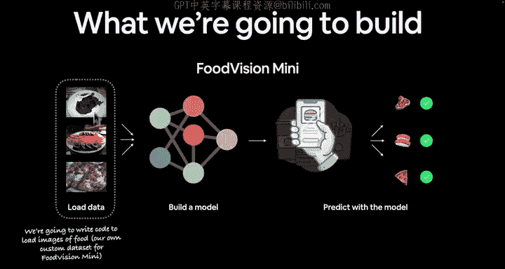
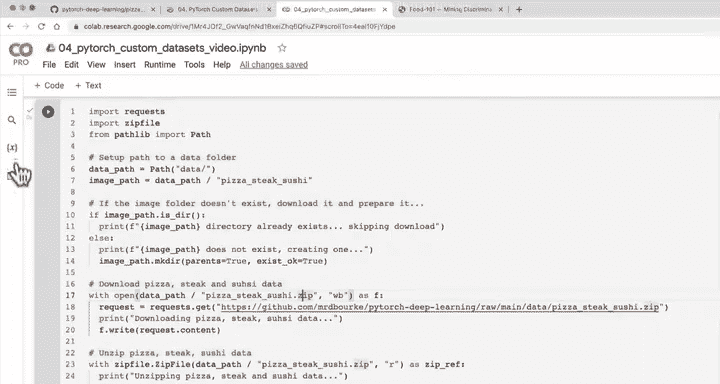

# mrdbourke《一天学会pytorch深度学习｜Learn PyTorch for deep learning in a day Literally》中英 - P78：128. Downloading a custom dataset of pizza, steak and sushi images.zh_en - GPT中英字幕课程资源 - BV1kx4y1r79d

Now， as I said in the last video， we can't cover custom data sets without some data。

 So let's get some data。 and just remind ourselves what we're going to build。

 And that is food visionion Min。 So we need a way of getting some food images。

 And if we go back to Google Chrome。

TorgeVision Datas has plenty of built in data sets， and one of them is the Food 101 data。Food 101。

So if we go in here。This is going to take us to the original food 1，01 website。 So food 1。

01 is a01 different classes of food。It has a challenging data set of 101 different food categories with 101。

000 images， so it's quite a BV data set。😊，And so for each class。

250 manually reviewed test images are provided， so we have per class，101 classes，250 testing images。

 and we have 750 training images。 Now， we could start working on this entire data set straight from the get go。

 But to practice， I've created a smaller subset of this data set。

 and I'd encourage you to do the same with your own problems。 Start small and upgrade when necessary。

So I've reduced the number of categories to three and the number of images to 10%。Now。

 you could reduce this to an arbitrary amount， but I just decided three is enough to begin with and 10% of the data。

 And then if it works， hey， you could upscale that on your own accord。

And so I just want to show you the notebook that I use to create this data and as extra curriculum。

 you could go through this notebook。 So if we go into extras。😊，0，4 custom data creation。

This is just how I created the subset of data。 So making a dataset to use with notebook number 4。

 I created it in custom image data set or image classification style。

 So we have a top level folder of pizza steakak and sushi。

 we have a training directory with pizza steakak and sushi images and we have a test directory with pizzaak and sushi images as well。

 So you can go through that to check it out how it was made， But now and also。

 if you go to the loanne Pytorch doo section 4， there's more information here about what food 101 is。

 So get data Here we go。 There's all the information about food 101， there's some resources。

 the original food 101 data Torch Viion data， Food 101。

 how I created the data and actually downloading the data But now we're going to write some code。

 because this data set， the smaller version that I've created is on the Pytorch deep learninging repo under data and then we have。

😊，This one is a little spoiler for one of the exercises for this section， but you'll see that later。

😊，So let's go in here。Let's now write some code to get this data set。From Github， Ptsushi。

zip and then we'll explore it will become one with the data。So I just want to write down here。

Our data is a subset of the Food 101 data。Food 1，01， starts with。101 different classes of food。

So we could definitely build computer vision models for 101 classes。

 but we're going to start smaller， our data set。😊，Starts with。3 classes of food。

And only 10% of the images。So it's right here。And a thousand images per class。Which is 750 training。

2，50 testing。And we have about 75 training images per class and about 25 testing images per class。

So why do this？When starting out， ML projects。It's important。

To try things on a small scale and then increase the scale when necessary。

The whole point is to speed up。😡，How fast you can experiment。

Because there's no point trying to experiment on things that if we try to train on 100000 images to begin with。

 our models might train， take half an hour to train at a time。 So at the beginning。

 we want to increase the rate that we experiment at。And so let's get some data。

 We're going to import requests so that we can request something from Github to download this URL here。

Then we're also going to import zip file from Python because our data is in the form of a zip file right now。

Then we're going to get partlib because I like to use paths whenever I'm dealing with final paths or directory partss。

So now let's set up a path to a data folder。And this of course， will depend on where your data lives。

 what you'd like to do， but I typically like to create a folder over here called data。

 and that's just going to store all of my data for whatever project I'm working on。

So data path equals PA data。And then we're going to go image path equals data path， slash pizza。

Stteak sushi。That's how we're going to have images from those three classes。

 pizza steak and sushi are three of the classes out of the 101 in Food 101。

So if the image folder doesn't exist， so if our data folder already exists。

 we don't want to redownload it， but if it doesn't exist， we want to download it and unzip it。

So if image path。Is there。So we want to print out。The image path， directory。Already exists。

Skipping download。And then if it doesn't exist， we want to print。Image path does not exist。

Creating one。Beautiful and so we're going to go imagepath do MkD to make a directory。

 we want to make its parents if we need to， so the parent directories and we want to pass exist okay equals true so we don't get any errors if it already exists。

And so then we can write some code。I just want to show you what this does if we run it。😊。

So our target directory data slash pizzate sushi does not exist， It's creating one。

So then we have now data and inside pizza steak sushi， wonderful。

 but we're going to fill this up with some images so that we have some data to work with and in the whole premise of this entire section we'll be loading this data of just images into Pytorrch so that we can build a computer vision model on it。

 But I just want to stress that this step will be very similar。

 no matter what data you're working with， you'll have some folder over here。

 or maybe it'll live on the cloud somewhere who knows wherever your data is。

 but you'll want to write code to load it from here into Ptorrch。😊，So let's download。Pizza， steak。

 and sushi data。So I'm going to use with。I'll just x over here so we have more screen space with open。

 I'm going to open the data path。Slash the file name that I'm trying to open。

 which will be pizzataksushi dot zip。 And I'm going to write binary as F。

 So this is essentially saying， I'm doing this in advance because I know I'm going to download this folder here。

 So I know the the file name of it。 Ptaksshi dot zip。 I'm going to download that into。Google Coab。

 and I want to open it up。So request。Egles request dot get。And so when I want to get。😡，This file。

 I can click here。And then if I click download， it's going to， what do you think it's going to do？

Well， let's see。If I wanted to download it locally， I could do that。And then I could come over here。

And then I could click upload if I wanted to， so upload the session storage。

 I could upload it from that， but I prefer to write code so that I could just run this cell over again and have the file instead of being download to my local computer。

 it just goes straight into Google coabb。 So to do that， we need the URL from here。

And I'm just going to put that in there， it needs to be as a string。Excuse me。

Of getting Tri happy on the shift and enter。Wonderful。

So now I've got a request to get the content that's in here and GiHub can't really show this because this is a zip file of images。

 spoiler alert。Now let's keep going。We're going to print out。That we're downloading pizza， steak。

 and sushi data。Dot dot dot， and then I'm going to write to file the request dot content。

So the content of the request that I just made to GitHub。

 so that's request is here using the Python requestquest library to get the information here from GiHub。

This URL could be wherever your file has been stored。

And then I'm going to write the content of that request to my target file， which is this。This here。

 so if I just copy this。I'm going to write the data to here， Data path， slash pizza steak sushi， zip。

And then because it's a zip file， I want to unzip it， so unzip pizza steak sushi data。😡。

Let's go with zip file， so we imported zip file up there， which is a Python library to help us。

Deal with zip files。I'm going to use zip file dot zip file，'m going to pass it in the data path。

 So just the path that we did below data path， slash pizza， steak， sushi。

t zip And this time instead of giving it right permissions， So that's what WB stands for。

 stands for right binary， I'm going to give it read permissions。

 so I want to read this target file instead of writing it。And I'm going to go as zipipf。

We could call this anything really， but Zipf is kind of， you'll see this a lot in。

Different path and examples。So we're going to print out again， so unzipping。Pizza。

 steak and sushi data。Then we're going to go zip underscore ref。Dot extract all。

And we're going to go image path。So what this means is it's taking the zip ref here。

And it's extracting all of the information that's within that zip ref， so within this zip file。😡，To。

 the image path， which is what we created up here。So if we have a look at image path。Let's see that。

Image P。Wonderful， so that's where all of the contents of that zip file are going to go into this file。

 So let's see it in action。 You ready。 Hopefully， it works。3，2，1， run。😊，File is not a zip file。 Oh。

 no， What did we get wrong， So did I type this wrong。Dot zip data path。Oh， we got the zip file here。

Pizza steak sushi dot zip， read。Data path。Okay， I found the error。

 So this is another thing that you'll have to keep in mind。 And I believe we've covered this before。

 but。I like to keep the errors in these videos so that you can see where I get things wrong because you never write code right the first time。

 So we have this link in Github。 We have to make sure that we have the raw link address。

 So I come down to here and copy the link address from the download button。😊。

You'll notice a slight difference if we come back into here， so I'm just going to copy that there。

So if we step through this GitHub， Mr。 De Burke Py deep learning， we have raw。Instead of blob。

 So that is why we've had an error I that our code is correct。 It's just downloading the wrong data。

 So let's change this to the raw。 So just keep that in mind。 You must have raw here。

And so let's see if this works。Do we have the correct data， Oh， we might have to delete this。 Oh。

 there we go。Test， beautiful train pizza stay sushi， wonderful。 So it looks like we've got some data。

 And if we open this up， what do we have， We have various Jpegs。 Okay， so this is our testing data。

 And if we click on there， we've got an image of pizza。😊，Beautiful。

 so we're going to explore this a little bit more in the next video。

 but that is some code that we've written to download data sets or download our own custom data set。

😊，Now， just recall that we are working specifically on a pizza steak and sushi problem for computer vision。

However， our whole premise is that we have some custom data and we want to convert these。

 how do we get these into tensors， That's what we want to do。

 And so the same process will be for your own problems。

 will be loading a target data set and then writing code to convert whatever the format the data set is in into tensors for Pythch。

So I'll see you in the next video， let's explore the data we've downloaded。

