# mrdbourke《一天学会pytorch深度学习｜Learn PyTorch for deep learning in a day Literally》中英 - P79：129. Becoming one with the data.zh_en - GPT中英字幕课程资源 - BV1kx4y1r79d

Welcome back in the last video we wrote some code to download a target data set。

 our own custom data set from the Py Toch deep learning data。😊，Directory。

And if you'd like to see how that data set was made， you can go to P To deep learning slash extras。

 and it's going to be in the custom data creation notebook here for04。

 So I've got all the code there。😊，All we've done is take data from the Food 101 data set。

 which you can download from this website here or from Torch Vision。So if we go to tour Division。

 food 101。We've got the data built into Pytorch there。

 so I've used that data set from Pytorch and broken it down from 101 classes to three classes so that we can start with a small experiment so there we go。

 get the training data， data sets food 101 and then I've customized it to be my own style。

 So if we go back to coabab， We've now got pizza St sushi。

 a test folder which will be our testing images and a train folder which will be our training images。

This data is in standard image classification format， but we'll cover that in a second。

All we're going to do in this video is kick off section number two， which is。😊。

Becoming one with the data。Which is。One of my favorite ways to refer to data preparation。

And data exploration。So becoming one with the data and I'd just like to show you one of my favorite quotes from Abraham Loss function。

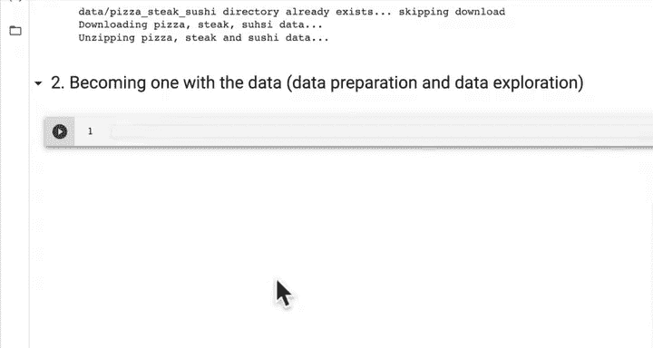

So if I had eight hours to build a machine learning model。

 I'd spend the first six hours preparing my data set。And that's what we're going to do。

 Abraham Los function sounds like he knows what is going on。

 But since we've just downloaded some data， let's explore it。 Hey， and we'll write some code now to。

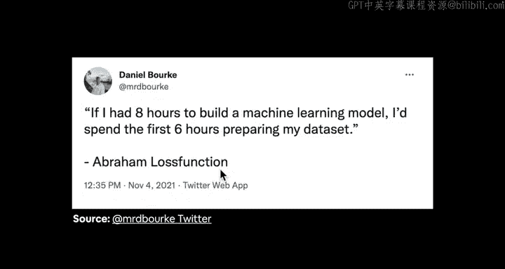

Walk through each of the directories。 How you explore your data will depend on。What data you've got。

 So we've got a fair few different directories here with a fair few different folders within them。

 So how about we walk through each of these directories and see what's going on。

If you have visual data， you'll probably want to visualize an image。

 so we're going to do that in a second two， write a little doc string for this helper function。😊。

So walk through door path。Returning its contents。Now。

 just in case you didn't know Abraham loss function does not exist as far as I know。

 but I did make up that quote。 So we're going to use the。OS。walk function。

 and we're going to pass it in a door path and what does walk do？We can get the dock string here。

Diirectctory tree generator for each directory in the directory tree， rooted at the top。

 including top itself， but excluding dot and dot dot yields a three tuple de path。

D names and file names。 you can step through this in the Python documentation if you'd like。

 but essentially it's just going to go through our target directory。

 which in this case will be this one here and walk through each of these directories。

 printing out some information about each one。 So let's see that in action。

 This is one of my favorite things to do if we're working with standard image classification format data。

So there are length domain namess， directories。And let's go Lng。Len file names。

Let me say at length like I've got the G on the end， but it's just L images in。😊，Let's put in here。

Dur path。So。Little bit confusing if you've never used Walk before。

 but it's so exciting to see all of the information in all of your directories。😡。

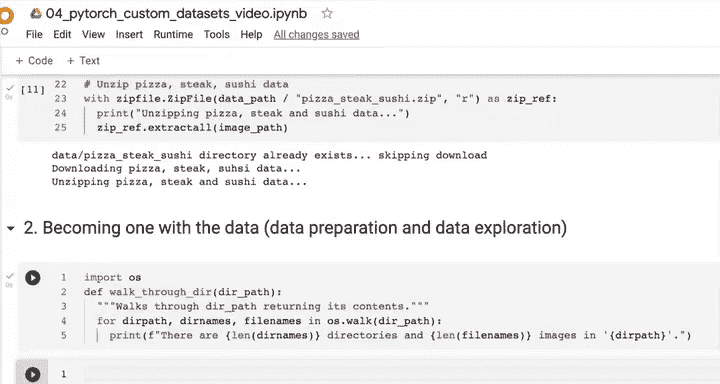

Oh， we didn't we didn't run it， let's check our function now。

 walk through D and we're going to pass it in the image path， which is what？😊，Well。

 it's going to show us。Are beautiful， so let's compare what we've got in our print out here。😊。

There are two directories and zero images in data， pizza St sushi， so this one here。

There's zero images， but there's two directories。Test and train。 wonderful。

 And there are three directories in data pizza steak sushi test。Yes， that looks correct。

 three directories pizza steak sushi。And then we have zero directories and 19 images in our pizza steakak sushi slash test that stake if we have a look at this。

 so that means there's 19 testing images for steak， let's have a look at one of them。😊，There we go。

 Now， again， these are from the Food 101 data set， the original food 101 data。

 which is just a whole bunch of images of food，100000 of them。 There's some steak there。 Wo。

 And we're trying to build a food vision model to recognize what is in each image。😊。

Then if we jump down to here， we have three directories in the training directory。

So we have pizza steak sushi， and then we have 75 steak images，72 sushi images and 78 pizza。

 so slightly different， but very much the same numbers， they're not too far off each other。

 So we've got about 75 or so training images and we've got about 25 or so testing images per class Now these were just randomly selected from the food 101 data set。

 10% of three different classes。So let's keep pushing forward and we're going to set up our training and test path。

Parts so I just want to show you， we'll just set up this and then I'll just show you the the standard image classification setup image path。

 train。And we're going to go tester so if you're working on an image classification problem。

We want to set this up as test。And then if we print out the trainer and the tester。

This is what we're going to be trying to do。 We're going to write some code to go， hey。

 look at this path。For our training images。 And look at this path for our testing images。

And so this is the standard image classification data format is that you have your overall data folder and then you have a training folder dedicated to all of the training images that you might have and then you have a testing folder dedicated to all of the testing images that you might have and you could have a validation data set here as well if you wanted to。

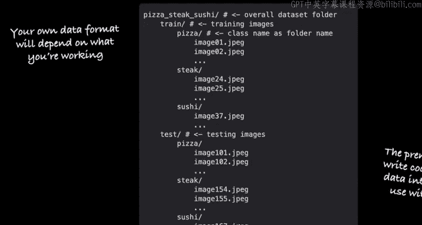

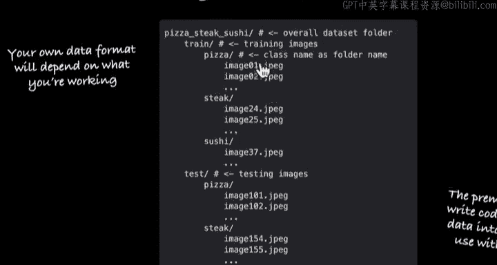

But to label each one of these images。The class name is the folder name。

 So all of the pizza images live in the pizza directory， the same for steak and the same for sushi。

So depending on your problem， your own data format will depend on whatever you're working on。

 you might have folders of different text files or folders of different audio files。

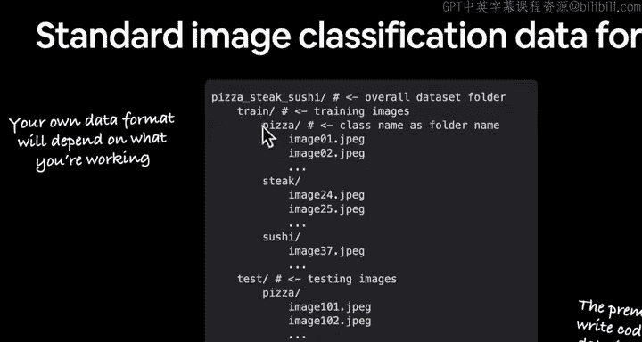

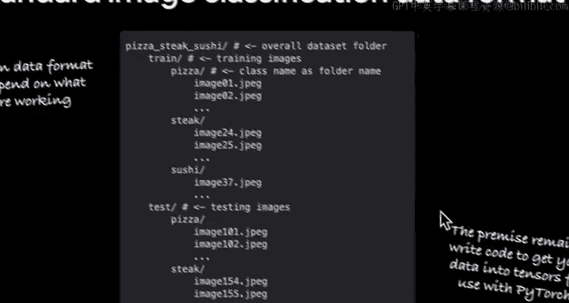

But the premise remains we're going to be writing code to get our data here into tensesors for use with pytorch。

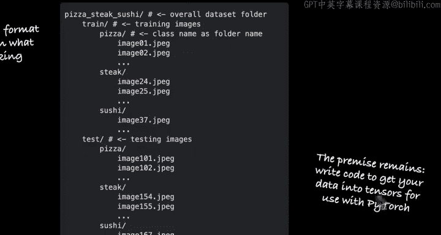

And so where does this come from， this image data classification format， well。

 if we go to the Torch Viion datas documentation。😊。

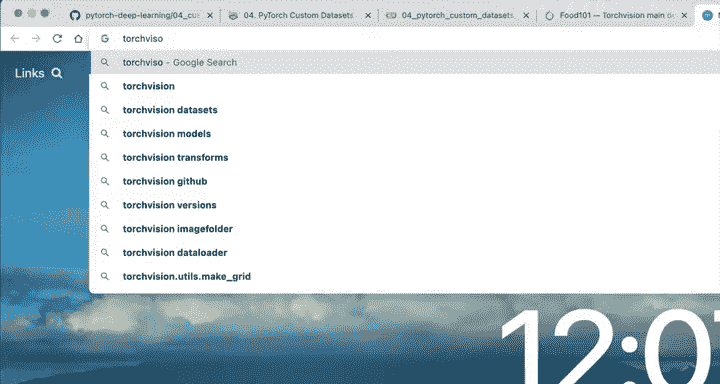

As you start to work with more data sets， you'll start to realize that there are standardized ways of storing specific types of data。

So if we come down to here， base classes for custom data sets will be working towards using this image folder data set。

But this is a generic data loader where the images are arranged in this way by default。

 So I've specifically formatted our data to mimic the style that this pre-built data loading function is4 So we've got a root directory here in case of we were classifying dog and cat images we have root then we have a dog folder then we have various images and the same thing for cat this would be dog versus cat but the only difference for us is that we have food images and we have pizza steak sushi if we wanted to use the entire food 101 data set。

 we would have 101 different folders of images here。Which is totally possible。

 but to begin with we're keeping things small。So let's keep pushing forward， as I said。

 we are dealing with a computer vision problem， so what's another way to explore our data other than just walking through the directories themselves？

😊，Let's visualize an image， hey， but we've done that before with just clicking on the file。

 how about we write some code to do so？We'll replicate this， but with code。

I'll see you in the next video。Welcome back。In the last video。

 we started to become one with the data and we learned that we have about 75 images per training class and about 25 images per testing class。

 and we also learned that the standard image classification data structure is to have the stake images within the stake folder of the training data set and the same for test and the pizza images within the pizza folder and so on for each different image classification class that we might have So if you wanted to create your own data set you might format it in such a way that your training images are living in a directory with their classification name So if you wanted to classify photos of dogs and cats you might create a training folder of train slash dog Tra s cat put images of dogs in the dog folder。

 images of cats in the cat folder and then the same for the testing data set。😊。

But the premise remains。 I'm going to sound like a broken record here。

 We want to get our data from these files， whatever files they may be in。

 whatever data structure they might be in into tensess。 But before we do that。

 let's keep becoming one with the data， and we're going to visualize an image。

So visualizing an image and you know how much I love randomness so let's select a random image from all of the files that we have in here and let's plot it hey because we could just click through them and visualize them but I like to do things with code so specifically let's let's plan this out let's write some code。

😊，Two number one is get all of the image pubs。We'll see how we can do that with the Path Lib library。

 we then want to pick a random image path using we can use Python's random for that。

Python's random dot choice will pick a single image。Random dot choice。

Then we want to get the image class name。And this is where Part Lib comes in handy class name recall that whichever target image we pick。

 the class name will be whichever directory that it's in。

 so in the case of if we picked a random image from this directory，😊，The class name would be pizza。

 So we can do that using， I think it's going to be pathlib dot path。

 And then we'll get the parent folder wherever that image lives。 So the parent image， parent folder。

 that parent directory of our target random image。 And we're going to get the stem of that。

 So we have stem， the stem is the last little bit here。Number four， what should we do Well。

 we want to open the image。 So since we。Working with images， let's open the image。With Python's Pi。

 which is Python imagem library， which will actually be pillow So if we go Python Pi。

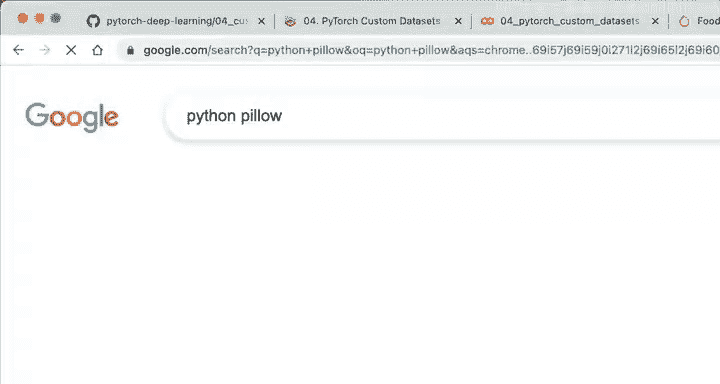

A little bit confusing when I started to learn about Python image manipulation。

 so pillow is a friendly pill fork。

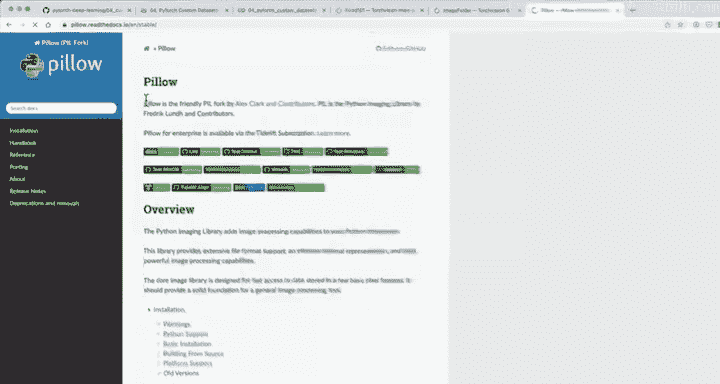

But it's still called pill。

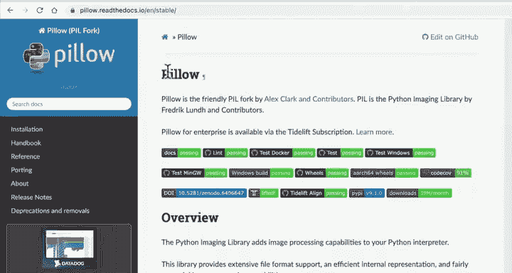

So just think of Pi as a way to process images with Python。

 So Pi is the Python imagingaging Library by Frederick Lund。

And so Alex Clark and contributors have created pillow。 So thank you， everyone。

And let's go to number five。What do we want to do as well， We want to， yeah。

 let's get some metadata about the image well then show the image。😊，And print metadata。Wonderful。

 so let's import random because machine learning is all about harnessing the power of randomness。

 and I like to use randomness to explore data， as well as model it。😊，So let's set the seed。

So we get the same image on both of our ends， so random dot seed。I'm going to use 42。

 you can use whatever you'd like， but if you'd like to get the same image as me。

 I'd suggest using 42 as well。Now， let's get all the image path。

We can do this because our image path。List， we want to get our image path。So recall our image path。

Is this。 So this folder here。 I'm just going to close all this。 So this is our image path。

 this folder here。 you can also go copy path if you wanted to。

 We're just going to get something very similar there。That's going to error out。

 so I'll just comment that。So it does't error。That's our path。

 but we're going to keep it in the Po path format。And we can go list。

 let's create a list of imagepath dot Gloob， which stands for grab。

 I don't actually know what Gloob stands for， but to me it's like Glob together all of the images that or all of the files that suit a certain pattern so Glob together for me means stick them all。

😊，And you might be able to correct me if I've got the wrong meaning there。 I'd appreciate that。

And so we're going to pass in a certain combination， so we want star。Slash star。

 And then we want star dot JPG。 Now， why are we doing this or because we want every image path。

 So star is going to be this first。Diirectctory here。 So any combination， it can be trained or test。

 And then this star means anything for what's inside tests。

 And let's say this first star is equal to test。 This second star is equal to anything here。

 so it could be any of pizza steak or sushi。 And then then finally， this star。

 Let's say it was test pizza。 This star is anything in here that is before dot JPG。

 So it could be any one of these files here。Now this will make more sense once we print it out。

 so image path list， let's have a look。There we go。

 So now we've got a list of every single image that's within pizza steakak sushi。

And this is just another way that I like to visualize data is to just get all of the paths and then randomly visualize it whether it be an image or text or audio you might want to randomly listen to it。

 recall that each each of the domain libraries have different input and output methods for different data sets。

 so if we come to torch vision we have UTs， so we have different ways to draw on images。😊。

Reading and writing images and videos。 so we could load an image。V read image， we could decode it。

 We could do a whole bunch of things。 I'll let you explore that as extra curriculum。

 But now let's select a random image from here and plot it。So we'll go number two。

Which was I'll step up here， pick a random image。So pick a random。Image path。

Let's get rid of this and so we can go random image path。Equals random， do choice。

 harnessness the power of randomness to explore our data。

 Let's get a random image from image part list， and then we'll print out random image path。

 Which one was our lucky image that we selected。Beautiful。

 so we have a test pizza image is our lucky。Random image。And。Because we've got a random seed。

 it's going to be the same one each time， yes it is。And if we comment out the random seed。

 we'll get a different one each time we've got a stake image， we've got another stake image。

Another steak image， all three in a row， four in a row。😊，Pizza， okay。

 let's keep going so we'll get the image class。From the path name。

 so the image class is the name of the directory because our image data is in standard image classification format where the image is stored。

So let's do that image class。Equals random image。Plf dot parent， dot stem。

 And then we're going to print image class。 What do we get， So we've got pizza。 wonderful。

 So the parent is this folder here。And then the stem is the end of that folder， which is pizza。

Beautiful， what are we up to now？We're working with images。

 Let's open up the image so we can open up the image using pill。

 We could also open up the image with Pytorch here， so with Re image。

 but we're going to use pill to keep things a little bit generic for now。So open image。

Image equals image so from pill import image and the image class has an open function and we're just going to pass it in here。

 the random image path， note if this is corrupt if your image is corrupt。😊，This may error。

 so then you could potentially use this to clean up your data set。I've。

ItImported a lot of images with image。 open of our target data set here。

 I don't believe any of them are corrupt， but if they are。

 please let me know and we'll find out later on when our model tries to train on it。

So let's print some metadata， so when we open our image， we get some information from it。

So let's go our random image path is what？Random image path。We're already printing this out。

 but we'll do it again anyway。And then we're going to go the image class。Is equal to what。

Will be the image class。Wonderful and then we can print out we can get some metadata about our images so the image height is going to be img。

 height， we get that metadata from using the pill library and then we're going to print out image width and we'll get IMG dot width and then we'll print the image itself。

Wonderful， and we can get rid of this， and we can get rid of this。

 Let's now have a look at some random images from our data set。😊，Lovely。

 we've got an image of pizza there。 Now， I will warn you that one of the downsides of working with food data is it does make you a little bit hungry。

 So there we've got some sushi。😊，And then we've got some more sushi。Some steak。And we have a steak。

 We'll go one more for good luck。😊。

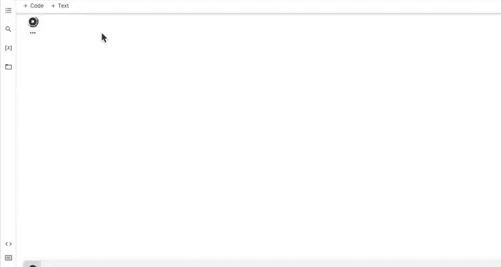

And we finish off with some sushi。 Oh， that could be a little bit confusing to me。

 I thought that might be stake to begin with。 And this is， do you see now。

 we'll do one more why it's important to sort of visualize your images randomly。

 because you never know what you're gonna to come across。 And this way。

 once we visualize enough images， you could do this 100 more times。 you could do this 20 more times。

 until you feel comfortable to go， hey， I feel like I know enough about the data now。

 let's see how well our model goes on this sort of data。 So finish off on this steak image。

 And now I'll set you a little challenge before the next video is to。😊。

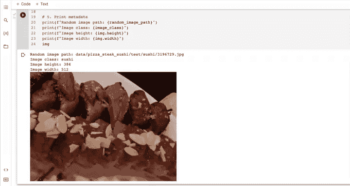

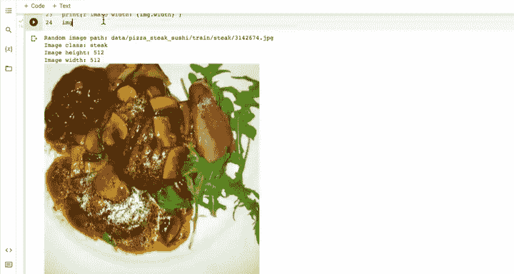

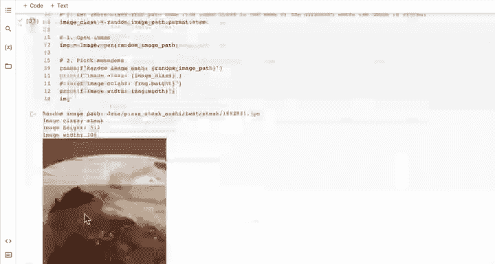

Visualize an image like we've done here， but this time do it with Maplot Lib。

 so try to visualize an image with Maplot Lib。

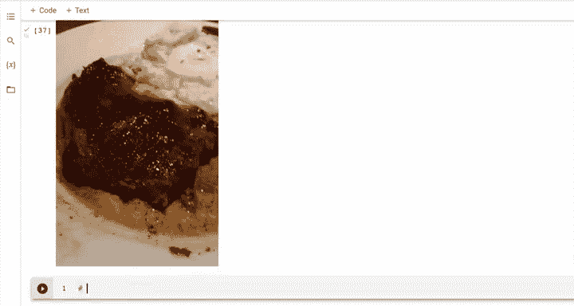

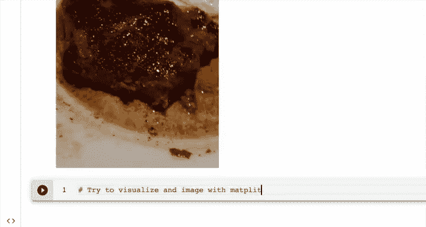

That's your little challenge before the next video so give that a go。

 we want to do a random image as well， so quite a similar setup to this。

 but instead of printing out things like this， we want to visualize it using mappllib so try that out and we'll do it together in the next video。

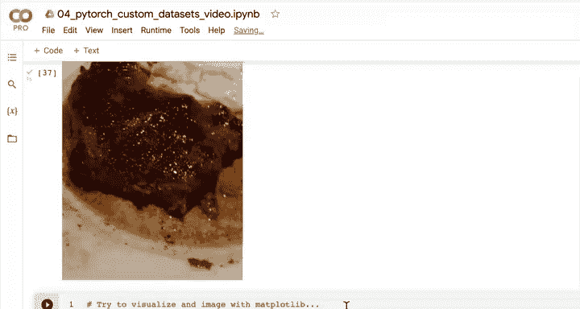

Ho we are well on the way to creating our own pi toch custom data set。

 and we've started to become one with the detail。 But now let's continue to visualize another image。

 I set you the challenge in the last video to try and replicate what we've done here with the pill library with Matpllib。

 So now let's give it a go，y， and why use mapplotlib。 Well。

 because mappllib and I'm going to import nu pie as well。

 because we're going to have to convert this image into an array。

 That was a little little trick that I didn't quite elaborate on。

 But I hope you tried to code it out and figure it out from the errors you received。😊。

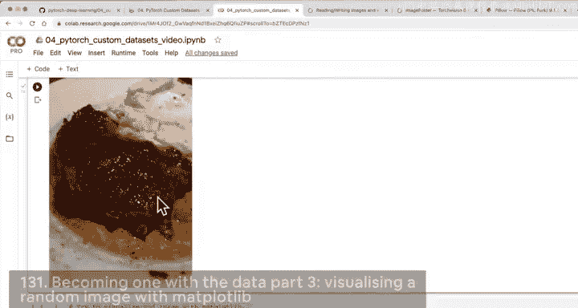

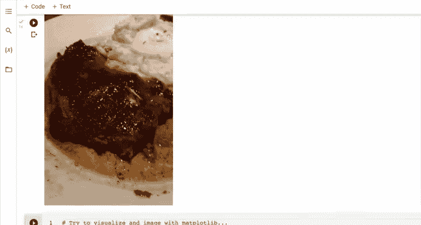

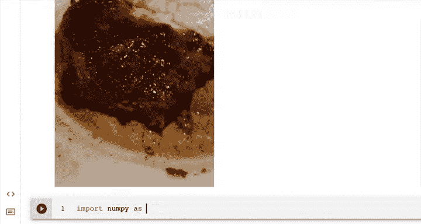

But MapllootLib is one of their most fundamental data science libraries。

 so you're going to see it everywhere so it's just important to be aware of how to plot images and data with MaplotLib。

So turn the image。Into an array。So we can go image as。

Aray and I'm going to use the nuy method NP as array。We're going to pass it in the image。

 recall that the image is the same image that we've just set up here。

 and we've already opened it with pill。And then I'm going to plot the image。Ploot the image with。

Mat plot lib。PLT。figu。And then we can go fig size。Equs 10。seven。And then we're going to go plt。imhow。

😡，Image as。Aray， pass it in the array of numbers， I'm going to set the title here as an F string。

And then I'm going to pass in image class。E goes image class and I'm going to pass in image shape so we can get the shape here now this is another important thing to be aware of of your different data sets when you're exploring them is what is the shape of your data because what's one of the main errors in machine learning and deep learning？

😊，It's shape mismatch issues， so if we know the shape of our data where we can start to go okay。

 I kind of understand what shape I need my model layers to be in。

 what what shape I need my other data to be in and I'm going to turn the aes off here。😊，Beautiful。

 so look at what we've got。😡，Now I've just thrown this in here without really explaining it。

 but we've seen this before in the computer vision section as our image shape is 5123063。

 Now the dimensions here are height is 512 pixels。 The width is 306 pixels。

 and it has three color channels。 So what format is this。 This is color channels last。😊。

Which is the default for the pill library， and there's also the default for Mapllib。

 but Pytorage recall is default if we put the color channels at the start color channels first。Now。

 there is a lot of debate， as I've said over which is the best order。

 It looks like it's leading towards going towards this。 but for now。

 Pytorage defaults to color channels first， but that's okay because we can manipulate these dimensions to what we need for whatever code that we're writing。

 and the three color channels is what red， green and blue。 So if you combine red。

 green and blue in some way， shape or form， you get the different colorss here that represent our image。

And so if we have a look at our image as a。😊，Our image is in numerical format， wonderful。😊，So， okay。

 we've got one way to do this for。One image。I think we start moving towards scaling this up to do it for every image in our data folder。

 So let's just finish off this video by visualizing one more image。 What do we get。Sme premise。

 The images is now。As an array， different numerical values。

 you've got a delicious looking pizza here of Sha 512，512 with color channels last。

 and we've got the same thing up here。😊，So that is one way to become one with the data。

 is to visualize different images， especially random images。 you could do the same thing。

 visualizing different text samples that you're working with or listening to different audio samples。

 It depends what domain you're working in。 So now in the next video。

 let's start working towards turning all of the images in here。

 now that we've visualized some of them and become one with the data。

 we've seen that the shapes are varying in terms of height and width。

 but they all look like they have three color channels because we have color images。

But now we want to write code to turn all of these images into Ptorrch tensesors。

So let's start moving towards that， I'll see you in the next video。😊。

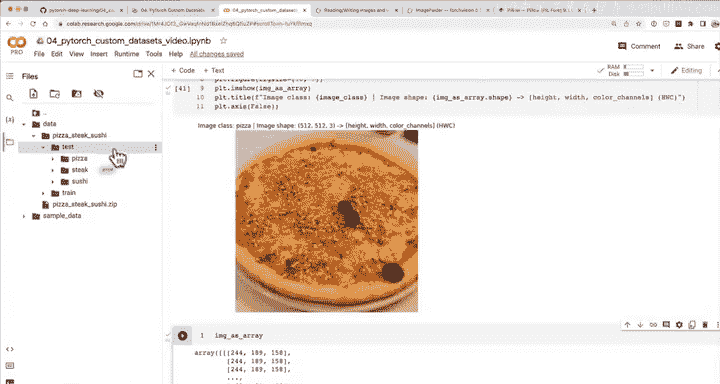