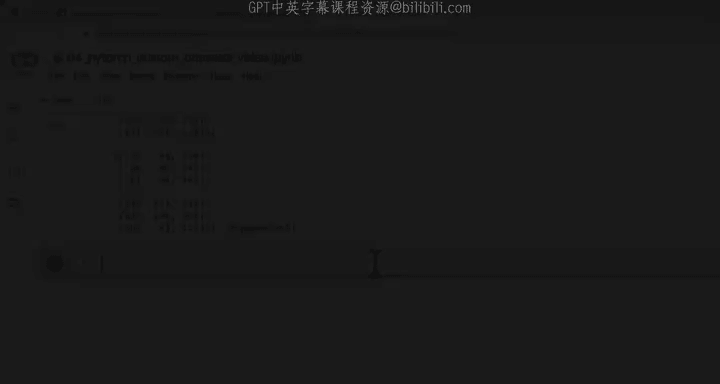
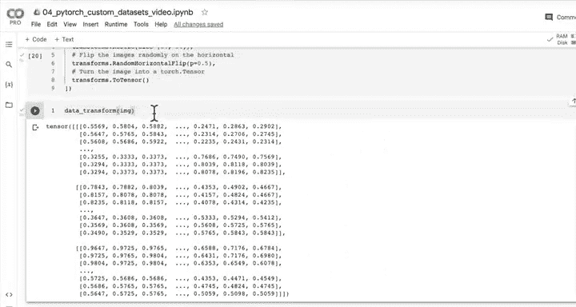
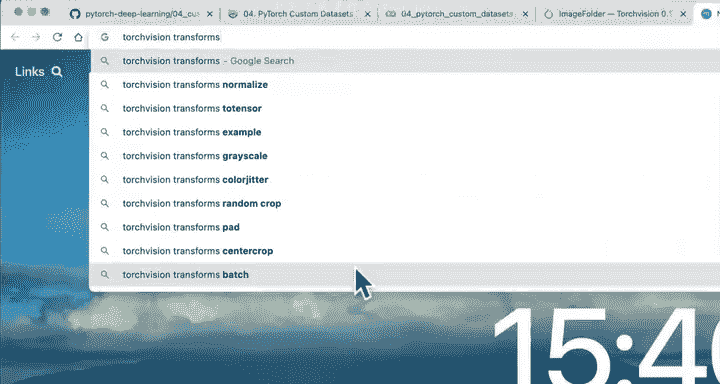
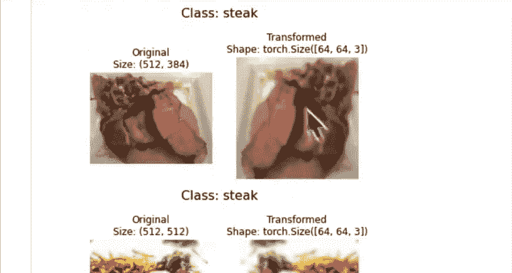
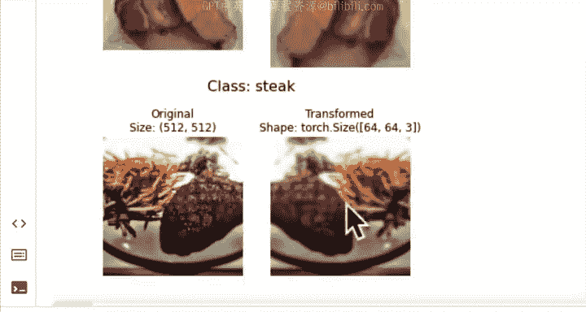
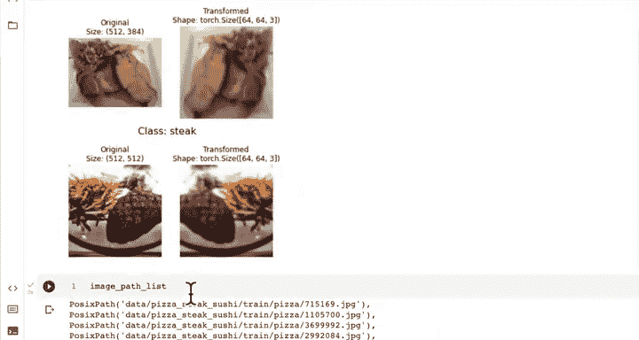
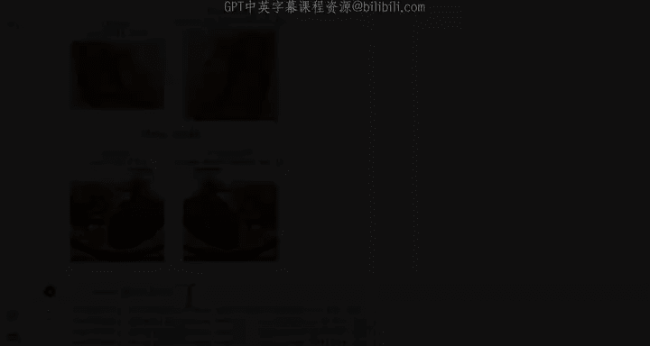
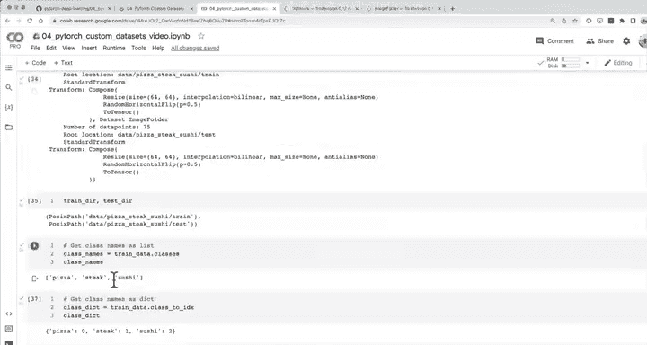
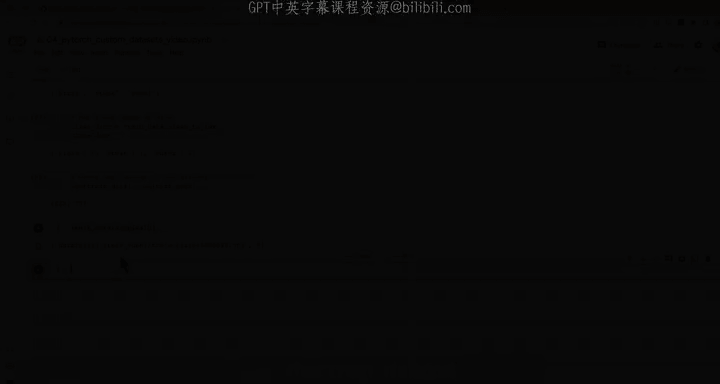
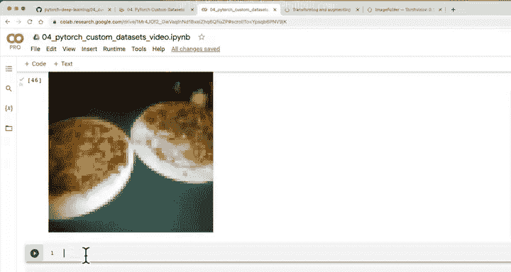

# mrdbourke《一天学会pytorch深度学习｜Learn PyTorch for deep learning in a day Literally》中英 - P80：132. Turning images into tensors.zh_en - GPT中英字幕课程资源 - BV1kx4y1r79d

Hello and welcome back。 In the last video， we converted an image to a nuy array。

 and we saw how an image can be represented as an array。

 But what if we'd like to get this image from our custom data set over here。😊。

Pizza steak sushi into pie tarch。 Well， let's cover that in this video。

 So I'm going to create a new heading here。 and it's going to be。Transforming data。

 And so what we'd like to do here is I've been hinting at it the fact the whole time is we want to get our data into tensor format because that is the data type that Pytorch accepts。

 So let's write down here before we can use our image data with Pytorch。 Now this goes for images。

 other vision data， it goes for text， it goes to audio。

 basically whatever kind of data set you're working with， you need some way to turn it into tensors。

 So thats step number one turn your target。Data into tenses in our case。

It's going to be a numerical representation of our images。😊，And number two is turn it into a torch。

utils。data。data set。😡，So recall from a previous。Video that we've used the data set to house all of our data in Tensor format。

And then subsequently， we've turned our data sets， our Ptorch data sets into torch。utils。data。

data loader。😡，And a data loader creates an iterable or a batched version of our data set。

 So for short， we're going to call these。Data set and data loader。😡，Now， as I discussed previously。

 if we go to the Pytorrch documentation， Torch Vi。For Torch vision。

And this is going to be quite similar for torch audio， torch text， torch rack。

 torch data eventually when it comes out of beta。😡。

There are different ways to create such data sets so we can go into the data sets。

Module and then we can find built in data sets and then also base classes for custom data sets。But。

If we go into here。Image folder。 There's another parameter I'd like to show you。

 and this is going to be universal across many of your different data types。

 is the transform parameter。Now， the transform parameter is。

A parameter we can use to pass in some transforms on our data so when we load our data sets from an image folder。

It performs a transform on those data samples that we've sent in here as the target data folder。 Now。

 this is a lot more easier to understand through illustration rather than just talking about it。

 So let's create a transform。And the main transform we're going to be doing is transforming our data and we're turning it into tensor so let's see what that looks like so we're going to just going to reimport all of the main libraries that we're going to use So from Torchuttils。

 data let's import data loader。And we're going to import from Torch Vi。

I'm going to import data sets and I'm also going to import transforms。Beautiful。

 and I'm going to create another little heading here。 This is going to be 3。

1 transforming data with torch visionion dot transform。

 So the main transform we're looking to here is turning out images。From JPEGs。😡。

If we go into train and then we go into any folder， we've got JPEG images。

And we want to turn these into tenser representation， so there's some pizza there。Forget out of this。

 Let's see what we can do。How about we create a transform here？Write a transform for image。And。

Let's start off by calling it data transform and I'm going to show you how we can combine a few transforms together。

 If you want to combine transforms together， you can use transforms。

 composeose you can also use anN dot sequential。To combine transforms。

 or we're going to stick with transformforms。com for now。And it takes a list。

 and so let's just run out three transforms to begin with and then we can talk about them after we do so so we want to resize our images。

To 64 64。 Now， why might we do this， Well， do you recall in the last section computer vision。

 we use the tiny VGG architecture。And what size were the images that the tiny VGG architecture took？

Well we replicated the CNN website version or the CNN explainer website version and they took images of size 6464。

 so perhaps we want to leverage that computer vision model later on。

 so we're going to resize our images to 6464。And then we're going to create another transform。

And so this is I just want to highlight how transforms can help you manipulate your data in a certain way。

 So if we wanted to flip the images， which is a form of data augmentation。

 in other words artificially increasing the diversity of our data set。😊。

We can flip the images randomly on the horizontal。So transforms dot random。Horizontal。Flip。

 and I'm going to put a probability in here of P equals 0。5。

 So that means 50% of the time if an image goes through this transform pipeline。

It will get flipped on the horizontal axis， as I said。

 this makes a lot more sense when we visualize it。 So we're going to do that very shortly。

 and finally， we're going to turn the image into a torch tensor。

So we can do this with transform do to Tensor。And now。Where might you find such transforms？

So this transform here says to tensor。 If we have a look at the dock string。

 weve got convert a pill image， which is what we're working with right now or a nuy array to a tensor。

This transform does not support Torch script if you'd like to find out what that is。

 I'd like to read the documentation for that it's essentially turning your Pythtorrch code into a Python script。

It converts a pill image or a nuy array from height width colour channels in the range 0 to 2，5，5。

 which is what our。Values are up here， they're from 0 to 255， red， green and blue。

To a torch float tensor of shape， colour channels height width in the range 0 to one。😡。

So it will take our tensor values here or our nuier array values from 0 to 2，5。

5 and convert them into a torch tensor in the range 0 to 1。

 We're going to see this later on in action。 But this is our first transform。

So we can pass data data through that。 In fact， I'd encourage you to try that out。

See what happens when you pass in data transform。What happens when you pass it in our image as a？

Image as a right， let's see what happenshu？Oh， image should be pill image， Go class nuie， All。

 what if we just pass in our straight up image？So this is a pill image。There we go， beautiful。

 So if we look at the shape of this， what do we get？😊，3，64，64， there's 64。

 And if what if we wanted to change this to 2，2，4， which is another common value for。

Computer vision models，2，2，4， to 2，4。 You see how powerful this is。 This little transforms module。

 the Torch vision library will' change that back to 64，64。

And then if we have a look at what D type of our transform tensor is。We get torch floatat 32。

Beautiful， so now we've got a way to transform our images into tensesors。And so。

 but we're still only doing this with one image。😊，How about we progress towards doing it for every image in our data folder here？

😡，But before we do that， I'd like to visualize what this looks like。 So in the next video。

 let's write some code to visualize what it looks like to transform multiple images at a time。

And I think it'd be a good idea to compare the transform that we're doing to the original image。😊。

So I'll see you in the next video， let's write some visualization code。😊。

Let's now follow our data Explorer's motto of visualizing our transformedform images。

 so we saw what it looks like to pass one image through a data transform。😊。

And if we wanted to find more documentation on。😊，Torch visionion transforms， where could we go？

There is a lot of these， so transforming and augmenting images。

 this is actually going to be your extra curriculum for this video。😊。

So transforms are common image transformations available in the transforms module。

 They can be chained together using compose， which is what we've already done beautiful。

 And so if you'd like to go through all of these， there's a whole bunch of different transforms that you can do。

 including some data augmentation transforms。 And then if you'd like to see them visually。

 I'd encourage you to check out illustration of transforms。

 but let's write some code to explore our own transform visually first。 So I'll leave this as a link。

😊，So。And go up here。Right here transforms。Help you get your images ready to be used with a model。

Slash， perform。Data augmentation。Wonderful， so we've got a way to turn images into tensesors。

 That's what we want for our model。 We want our images as pietorrch tensesors。

 The same goes for any other data type that you're working with。😊。

But now I'd just like to visualize what it looks like if we plot a number of transformed images。

 so we're going to make a function here that takes in some image paths。

 a transform a number of images to transform at a time and a random seed here because we're going to harness the power of randomness and sometimes we want to set the seed sometimes we don't。

😊，So。We have an image path list that we've created before。

 which is just all of the image paths that we have of our data set。😊，So data。Pizza steak sushi。Now。

 how about we select some random image paths and then take the image from that path。

 run it through our data transform， and then compare the original image of what it looks like and the transformed image and what that looks like？

Let's give it a try。 Hey， So I'm going to write a doctoring of what this does。And then select。

Random images from a path of images and loads slash transforms them。

Then plots the original verse the transformed。Version。That's quite a long dock string。

 but that'll be enough we can put in some stuff for the image path， transforms and seed。

 we'll just code this out。Let's go randomand seed we' create the seed。Or maybe we do it if seed。

 random seed， let's put that and we'll set seed to equal none by default。That way we can are。

 we'll see if this works， he？If in doubt， code it out random image paths。

 and then we're going to go random sample from the image paths and the number of sample that we're going to do。

 so random sample is going to this will be a list。I'll just pass in here that this is a list。

So we're going to randomly sample。K， which is going to be n。

 so three images from our image path list。And then we're going to go four image path。

 We're going to loop through the randomly sampled image parts。

 You know how much I love harnessing the power of randomness for visualization。

 So for image path in random image paths， let's open up that image using pill。😊，Image。

t open image path as F。And then we're going to create a figure and an axes。

 and we're going to create a subplot with Matplot lib。 So subplots。 and we want it to create。😊。

One row。So it goes N rows N Cos。One row。And N cos equals two。

And then on the first or the zeroth axie， we're going to plot the original image。 so I show。

We're just going to pass it straight in F。And then if we want to go x0， we're going to set the title。

 so set title。We're going to set it to be the original， so we'll create this as an F string。

 original， and then new line will create a size variable， and this is going to be F dot size。

 so we're just getting the size attribute from our file。

So we'll keep going and we'll turn off the axes here。So axis and we're going to set that to false。

Now let's transform on the first aes plot。We're going to transform and plot target image。

 This is so that our images are going to be side by side， the original and the transformed version。

So there's one thing that we're going to have to do。

 I'll just I'll code it out in the wrong way first。

 I think that'll be a good way to illustrate what's going on。F， so I'm just going to put a note here。

Note， we will need to change shape for mappl Lib because we're going to come back here。

Because what does this do？What have we noticed that our transform does？If we check the shape here。Oh。

 excuse me， it converts our image。Two color channels first。Whereas Matplotlibb prefers。

Colorour channels last。 So just keep that in mind when we're going forward。 this code。

 I'm writing it。 It will error on purpose。So transformed image。

And then we're going to go Acts1 as well， we're going to set the title。

 which is going to be transformed。And then we'll create a new line and we'll say size is going to be。

Transformed。Image dot shape。Oh， probably a bit of， yeah， we could probably go shape here。😊。

And then finally we're going to go as1， we're going to turn the axis。

 we're going to set that to false， You can also set it to off so you could write false or you could write off。

 you might see that different versions of that somewhere and I'm going to write a super title。Here。

Which you'll see what this looks like class is going to be image path。

So we're getting the target image path and we're just going to get the attribute or the parent attribute and then the ST attribute from that just like we did before to get the class name。

 and then I'm going to set this to a larger font size so that we make some nice looking plots right if we're going to visualize our data we might as well make our plots visually appealing so let's plot some transformed data or transformed images。

😊，So image partss， we're going to set this to image part list。

 which is just the variable we have down below， which is a part list to a list containing all of our image parts。

 our transform， we're going to set our transform to be equal to our data transform。

 so this just means that if we pass the transform in our image is going to go through that transform and then go through all of these is's going to be resized。

 It's going to be randomly horizontally flipped and it's going to be converted to a tensor。😊。

And then so we're going to set that data transfer there or data transform， sorry。

And is going to be three， so we plot three images and we'll set the seed to 42 to begin with。

Let's see if this works。哦。What did we get wrong， We have invalid shape。 As I said。

 I love seeing this error， because we have seen this error many times。

 and we know what to do with it。 We know that we have to rearrange the shapes of our data in some way。

 shape or form。 Well， I said shape a lot there。 That's all right。 Let's go here， permute。

 This is what we have to do。 We have to permute。 We have to swap the order of the axises。

 So right now our color channels is first。 So we have to bring this color channel axis or dimension to the end。

 So we need to shuffle these across。 So 64 into here，64 into here and 3 on the end。 We need to。

 in other words， turn it from color channels first to color channels last。

 So we can do that by permuting it to have the first axie come now in the0 dimension spot。

 And then number  two is going to be in the first dimension spot。

 and then number 0 is going to be at the back end。 So this is essentially going from C。😊，Hj。W。

 and we're just changing the order to be H。WC， so the exact same data is going to be within that tensor。

 we're just changing the order of the dimensions。 Let's see if this works。Ho， look at that。Oh。

 I love seeing some manipulated data。 We have a class of pizza and the original images there。

 and it's 512 by 5，12。 But then we've resized it using our transform。

 Notice that it's a lot more pixelated now。 But that makes sense because it's only 64，64 pixels。 Now。

 why might we do such a thing。😊，Well， one， if is this image still look like that， Well， to me。

 it still does， but the most important thing will be， does it look like that to our model。

 Does it still look like the original to our model。Now， 64 by 64。

 there is less information encoded in this image， so our model will be able to compute faster on images of this size。

 However， we may lose some performance because not as much information is encoded as the original image。

😡，Again， the size of an image is something that you can control。

 you can set it to be a hyperparameter， you can tune the size to see if it improves your model。

But I've just decided to go 664， 643 in line with the CNN Exer website。

So a little hint we're going to be rerelicating this model that we've done before。 Now。

 you notice that our images are now the same size 64，64，3 as what the CNN explainer model uses。

 So that's where I've got that from。 But again， you could change this to size to whatever you want。

 And we see， oh， we've got a stake image here。 And you notice that our image has been flipped on the horizontal。

So the horizontal axis， our image has just been flipped same with this one here。

So this is the power of torch transforms。😡，Now there are a lot more transforms， as I said。

You can go through them here to have a look at what's going on。

 Illrations of Transs is a great place。So there's resize， there's scent a crop。

 you can crop your images， you can crop five different locations， you can do gray scale。

 you can change the color， a whole bunch of different things。I'd encourage you to check this out。

 that's your extra curriculum for this video。😊，But now that we've visualized the transform。

This is what I hinted out before that we're going to use this transform for when we load all of our images in。

 using into a torch data set。So I just wanted to make sure that they had been visualized first。

 We're going to use our data transform in the next video when we load all of our data using a torchvision do data sets helper function。

So let's give that a go， I'll see you in the next video。

Have a look at that beautiful plot。 You've got some original images and some transformed images。

 and the beautiful thing about our transformed images is that they're in tensor format。

 which is what we need for our model。 That's what we've been slowly working towards。

 We've got a data set。 And now we've got a way to turn it into tensesors ready for a model。

 So let's just visualize what another。 I'll turn the seed off here so we can look at some more random images。

😊，There we go Okay， so we've got steak pixelated because were downsizing 64 64，3。

 same thing for this one and it's been flipped on the horizontal and then same thing for this pizza image and we'll do one more to finish off。

😊，Wonderful， so that is the premise of transforms， turning our images into tenses and also manipulating those images if we want to。

😊，So let's get rid of this， I'm going to make another heading， we're up to section or part4 now。

 and this is going to be option one。So loading image data using。Image folder。And now。

I'm going to turn that into Markdown。And so let's go torch vision。Data sets。

So recall how each one of the Torch Viion domainin libraries has its own datas module that has built in functions for helping you load data。

In this case， we have an image folder and there's a few others here if you'd like to look into those。

But an image folder， this class is going to help us load in data that is in this format。

 the generic image classification format。 So this is a prebuilt data sets function。

 just like there's pre-built data sets。 We can use prebuilt data set functions。 Now。

 option 2 later on， This is a spoiler。 is we're going to create our own custom version of a data loader。

 but we'll see that in a later video。 So let's see how we can use image folder to load all of our custom data。

 our custom images into tensesors。😊，So this is where the transform is going to come in helpful。

So let's right here， we can。Load image classification data using。Let's write this。

 let's write the full path name， Torch vision datas。😊，Dot image folder。😡，P that in there。Beautiful。

 and so let's just start it out， use image folder。To create data sets and now in a previous video I hinted at the fact that we can pass a transform to our image folder class。

That's going to be。Right here。So let's see what that looks like in practice。 So from taunch vision。

I'm going to import data sets because that's where the image folder module lives。

 and then we can go train data equals datas。image folder。And we're going to pass in the route。

 which is our trainer。Because we're going to do it for the training directory first。

 and then we're going to pass in a transform， which is going to be equal to our data transform。

And then we're going to pass in a target transform， but we're going to leave this as none。

 which is the default， I believe。If we go up to him。Yeah， target transform is optional。

 So what this means is this is going to be a transform for the data。

And this is going to be a transform。For the labelel。/lash target Pytorch likes to use target。

 I like to use label， but that's okay。So this means that we don't need a target transform because our labels are going to be inferred by the target directory where the images live。

 So our pizza images are in this directory and they're going to have pizza as the label because our data set is in standard image classification format。

 Now if your data wasn't in a standard image classification format。

 you might use a different data loader here， a lot of them will have a transform for the data。

 So this transform is going to run our images， whatever images are loaded from these folders through this transform that we've created here。

 it's going to resize them randomly flip them on the horizontal and then turn them into tensors。

 which is exactly how we want them for our Pytorage models。

And if we wanted to transform the labels in some way， shape or form。

 we could pass in a target transform here， but in our case we don't need to transform the labels。

So let's now do the same thing for the test data。And so that's why I wanted to visualize our transforms in the previous videos。

 because otherwise we're just passing them in as。A transform。

 So really what's going to happen behind the scenes is all of our images are going to go through these steps。

 and so that's what they're going to look like when we turn them into a data set。😊。

So let's create the tester here or the test data set。

 the transform we're going to transform the test data set in the same way we've transformed our training data set and we're you going to leave that like that。

So let's now print out。What our data sets look like， train data and test data。Beautiful。

 so we have a data set， a torch data set which is an image folder and we have a number of data points this is going to be for the training data set。

 we have 225， so that means about 75 images per class and we have the root location which is the folder we've loaded them in from。

 which is our training directory we've set these two up before Traer and tester。😊。

And then we have a transform here， which is a standard transform。

 a resize followed by a random horizontal flip， followed by two tensor。

 then we've got basically the same output here for our test directory。

 except we have less samples there。So let's get a few little attributes from the image folder。

 This is one of the benefits of using a pytorage prebuilt data loader， I that or data set loader。

 is that it comes with a fair few attributes so we could go to the documentation。

 find this out from in here， inherits from data folder， keep digging into there。

 or we could just come straight into Google Coabab。 Let's go get class names as a list。

Can we go train data dot and then press tabab？Beautiful。

 so we've got a fair few things here that are attributes。 Let's have a look at classes。

This is going to give us a list of the class names。Class names。This is very helpful later on。

 So we've got pizza steak sushi。 We're trying to。Do everything with code here。

 So if we have this attribute of train data dot classes。

 we can use this list later on for when we plot images straight from our data set or make predictions on them。

 and we want to label them。 You can also get class names as a dictionary mapped to their integer。

Index， that is， so we can go train data。Dot press tab， We've got class to IDX。

 Let's see what this looks like。Clas di。Wonderful， so then we've got our。

String class names mapped to their integer。 So we've got pizza is 0。 Steak is one。 Sushi is 2。 Now。

 this is where the target transform would come into play。If you wanted to transform those。

These labels here in some way， shape or form， you could pass a transform into here。

And then if we keep going， let's check the lengths of what's going on。

 check the lengths of our data set。So we've seen this before。

 but this is going to just give us how many samples that we have length。Train data length test data。

 beautiful。 And then， of course， if you'd like to explore more attributes。

 you can go train data dot and then we've got a few other things， functions， images， loader samples。

 targets。 if you wanted to just see the images， you can go dot samples。

 if you wanted to see just the labels， you can go dot targets。This is going to be all of our labels。

 look at that。😊，And I believe there're going to be an audit。 So we're going to have 0，0，0，1，1，1。222。

 and then if we wanted to have a look， let's say we have a look at the first sample， hey。

We have data， pizza， steak， sushi， train， pizza。There's the image path， and it's a label 0 for pizza。

 Woful。 So now we've done that。 How about we， we've been visualizing this whole time。

 So let's keep up that trend。 and let's visualize a sample and a label from the train data data set。

😊，So in this video， we've used image folder to load our images into tensesors。

 and because our data is already in standard image classification format。

 we can use one of Torchvision。 datas's prebuilt functions。

So let's do some more visualization in the next video。

哦一点。

Welcome back in the last video we used datas。im folder to turn all of our image data into tensors and we did that with the help of our data transform which is a little pipeline up here to take in some data or specifically an image。

 resize it to a value that we've set in our K6464 randomly flip it along the horizontal。

 we don't necessarily need this， but I've just put that in there to indicate what happens when you pass an image through a transforms pipeline and then most importantly we've turned our images into a torch tensor so that means that our data。

 our custom data set this is so exciting is now compatible to be used with a Pytorrch model so let's keep pushing forward we're not finished yet。

 we're going to visualize some samples from the train data data。😊，So let's， how can we do this。

 let's get， we can index on the train data data set。😊，To get a single image and a label。So if we go。

Can we do train data zero， what does that give us？Okay， so this is going to give us an image tensor。

😊，And it's associated label， in this case， it's an image of pizza because why its associated label is pizza。

So let's take the zeroth0， so this is going to be our image and the label is going to be train data0 and we're just going to get the first index item there。

 which is going to be one。 And then if we have a look at them separately。Image and label。Beautiful。

 so now one of our target images is in Tensor format exactly how we want it and its label is in numeric format as well。

 which is also exactly how we want it。😊，And then if we wanted to convert this back to a non label。

 we can go class names。And index on that。And we see pizza。 and， I mean， non label is in nonnumeric。

 We can get it back to string format， which is human understandable。

 We can just index on class names。 So let's print out some information about what's going on here。

 Pri F。 we're going to go image tensor。I love F strings if you haven't noticed yet。

Image tensor and we're going to set in new line， we're going to pass it in our image。

 which is just the image that we've got here。Then we'll print in some more information about that this is still all becoming one with the data right where we're slowly finding out information about our data set so that if errors arise later on we can goHm our image or we're getting a shape error and I know our images are of this shape or we're getting a data type error which is why I've got the dot D type here and that might be why we're getting a data type issue。

😊，So let's do one more with the image label。Label， oh well actually we'll do one more。

 we'll do print， we'll get the label data type as well。😊，Label。

 this will be important to take note of later on。Type。As I said， three big issues shape mismatch。

 device mismatch and data type mismatch。Can we get the type of our label？Beautiful。

 so we've got our image tensor。And we've got its shape it's of torch size 36464。

 that's exactly how we want it。 The data type is torch float 32。

 which is the default data type in Pitorrch， our image label is0 and the label data type is of integer。

😊，So let's try and plot this and see what it looks like， hey。😊，Using that plot lib。 So first of all。

 what do we have to do while we have to rearrange the order of dimensions。In other words。

 mapplloot Lib likes color channels last， so let's see what this looks like。 we'll go image permute。

 we've done this before， image dot permute 1，20 means we're reordering the dimensions。

 zero would usually be here except that we've taken the zeroth dimension the color channels and put it on the end and shuffled the other two forward。

So let's now print out。Different shapes。I love printing out the change in shapes。

 helps me really understand what's going on because sometimes I look at a line like this。

 and it doesn't really help me。 But if I print out something of what the shapes were originally and what they changed to。

 well， hey， that's a big help。 That's what Jupiter notebooks are all about， right。😊。

So this is going to be colour channels first， height， width。And depending on what data you're using。

 if you're not using images， if you're using text， still knowing the shape of your data is a very good thing。

 We're going to go imagepermute dot shape and this should be everything going right is height width color channels on the end here。

And we're just going to plot the image。Can never get enough plotting practice。Pt the image。

 I'm going to go Plt。fi or pass in fig size。Equals 10，7。And then we're going to go Plt。mshow。

We'll pass in the commuted image。Image underscore puutees and then we'll turn off the axes。

And we will set the title to be class names and we're going to index on the label just as we did before。

 and we're going to set the font size equal to 14 so it's nice and big here we go。Beautiful。

 there is our image of pizza。 It is very pixelated because we're going from about 5。

12 as the original size 5，12 by 5，12 to 64，64。 I would encourage you to try this out。

 potentially you could use a different image here。 So we've indexed on sample 0。

 maybe you want to change this to just be a random image and go through these steps here。

 And then if you'd like to see different transforms， I'd also encourage you to try changing this out。

 our transform pipeline here， maybe increase the size and see what it looks like。

 And if you're feeling really adventurous， you can go into torch vision。

 and look at the transforms library here and then try one of these and see what it does to our images。

 But we're going to keep pushing forward， we are going to look at another way。😊，Or actually。

 I think for completeness， let's now turn， we've got a data set。😊，We want to。

 we wrote up here before that we wanted to turn our images into a data set and then subsequently a torch U's data data loader。

 So we've done this before。By batching our images or batching our data that we've been working with。

So I'd encourage you to give this a shot yourself， try to go through the next video and create a train data loader using our train data。

 wherever that is， train data， and a test data loader using our test data。

So give that a shot and we'll do it together in the next video。

 we'll turn our data sets into data loaders。

